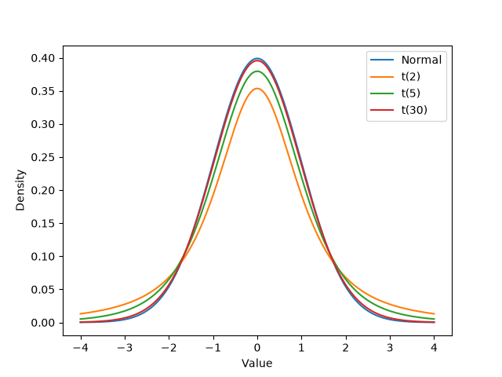

# 第 1 章: 統計学の復習

## 1.1 この章の地図

計量経済学は、データ（標本）から、母集団の性質を推し量る学問です。そのために、標本の特徴を数値にまとめる道具（平均・分散・共分散・相関）と、推し量りの確かさを測る道具（標準誤差と確率分布）を使います。この章で、その道具を、関数とテストで用意します。次の章以降の、回帰分析の土台です。



| 項目 | 内容 |
| :--- | :--- |
| 計量経済学の題材 | 標本の特徴を表す数値、標本平均の標準誤差、正規分布・t 分布・χ² 分布・F 分布 |
| 使う Python の機能 | 関数、NumPy の配列計算、`scipy.stats`（確率分布）、テスト（`pytest`）、乱数の生成器 |
| 新しく導入するライブラリ | SciPy（確率分布の臨界値を求める） |
| 完成形 | `sample_variance`、`sample_covariance`、`sample_correlation`、`standardize`、`standard_error_of_mean`、`normal_cdf`、`critical_value`、`sampling_distribution_of_mean` |
| ファイル | 実装: `lib/chapter01/statistics.py`、`lib/chapter01/plot.py`（分布の図）／テスト: `test/chapter01/test_statistics.py`、`test/chapter01/test_plot.py`（自分で書くときは、`practice/chapter01/` に、同じ名前で作ります） |
| データ | なし（手で書ける小さな数列と、乱数） |

### 統計学の式とコードの対応

| 統計学 | 式 | コード |
| :--- | :--- | :--- |
| 不偏分散 | s² = Σ(xᵢ − x̄)² ÷ (n − 1) | `sample_variance(x)` |
| 標本共分散 | s_xy = Σ(xᵢ − x̄)(yᵢ − ȳ) ÷ (n − 1) | `sample_covariance(x, y)` |
| 標本相関係数 | r = s_xy ÷ √(s_x² · s_y²) | `sample_correlation(x, y)` |
| 標準化 | zᵢ = (xᵢ − x̄) ÷ s | `standardize(x)` |
| 標本平均の標準誤差 | SE = √(s² ÷ n) | `standard_error_of_mean(x)` |
| 標準正規分布の分布関数 | Φ(z) | `normal_cdf(z)` |
| 臨界値 | P(X ≤ c) = p となる c | `critical_value(name, p, *df)` |

> **記号について**: n は観測値の数、x̄ は標本平均です。一覧は、[記号について](how-to-read.md#symbols) を参照してください。

### 前提とする第 1 シリーズの章

この記事は、Python の基礎を繰り返しません。次ができれば、読み進められます。

| できること | 第 1 シリーズの章 |
| :--- | :--- |
| 関数と pytest のテストを書く（Red → Green → Refactor） | 第 1〜6 章 |
| Matplotlib で図を描く | 第 7 章 |
| 乱数の生成器を引数にして、種を固定する | 第 8 章 |
| NumPy の配列計算 | 第 9 章 |

## 1.2 準備

サンプルコードは、リポジトリの `apps/econometrics-programming/python/` にあります。uv のインストールは、[第 1 シリーズの第 1 章](../economics-programming/01-preparation-and-first-test.md) の 1.2 節にあります。インストール済みなら、次の 3 行で、準備ができます。

```bash
cd apps/econometrics-programming/python
uv sync
uv run pytest test/chapter01
```

```text
32 passed
```

自分でコードを書くときは、`practice/chapter01/` を作って、完成形と同じ名前（`statistics.py`・`test_statistics.py`）のファイルに書きます。テストは、`uv run pytest practice/chapter01` で実行します。完成形（`lib/` と `test/`）は、**答え合わせ用**です。先に、自分で書いてから、見比べてください。

## 1.3 予想する

コードを見る前に、紙に書いて、予想してください。

1. データ 1、2、3、4、5 の不偏分散（n − 1 で割る）は、いくつですか。n で割ると、いくつですか
2. x = 1、2、3、4 と y = 2、4、5、9 の、相関係数は、1 に近いですか、0 に近いですか
3. 標準正規分布から 25 個を取り出して、平均を求める作業を、2000 回繰り返します。2000 個の標本平均の標準偏差は、いくつに近いでしょうか。25 個ではなく、100 個にすると、どうなりますか
4. 95% の信頼区間を作るときの臨界値は、標準正規分布では約 1.96 です。自由度 2 の t 分布では、1.96 より大きいですか、小さいですか

## 1.4 標本の特徴を表す数値

### 母集団と標本

調べたい全体を**母集団**、そこから取り出した一部を**標本**といいます。計量経済学では、標本の数値から、母集団の性質（例: 教育が賃金に与える効果）を推し量ります。標本は、取り出すたびに変わるので、標本から計算した数値（**統計量**）も、取り出すたびに変わります。この変わり方を知ることが、推し量りの確かさを測ることです。

### 分散と、n − 1 で割る理由

分散は、平均からのずれの 2 乗の平均です。ただし、標本から母集団の分散を推し量るときは、n ではなく **n − 1** で割ります（**不偏分散**）。標本平均は、標本のデータに合わせて計算するので、ずれが、母集団の平均からのずれより、小さくなります。n で割ると、母集団の分散を、平均すると、少し小さく見積もります。n − 1 で割ると、平均して、ちょうどになります。この「平均して、ちょうど」という性質を、**不偏性**といいます。次の章から、何度も出てきます。

### 共分散と相関

共分散は、2 つの変数が、平均からいっしょに動く程度です。x が平均より大きいとき、y も大きければ、正になります。ただし、単位（円か千円か）で大きさが変わります。共分散を、2 つの標準偏差の積で割ると、単位に左右されない、−1 から 1 の値（**相関係数**）になります。

### 標準誤差

標本平均は、標本によって変わります。標本平均の標準偏差を、**標準誤差**といいます。母集団の標準偏差が σ なら、標本平均の標準誤差は σ ÷ √n です。n が 4 倍になると、標準誤差は、半分になります。σ は未知なので、実際には、標本の不偏分散で置き換えます。

### 確率分布と臨界値

回帰分析の検定では、4 つの分布を使います。

| 分布 | 何に使うか | 次の章 |
| :--- | :--- | :--- |
| 標準正規分布 | 標本が大きいときの、推定量の分布 | 第 6 章 |
| t 分布（自由度 df） | 誤差が正規分布のときの、回帰係数の検定・信頼区間 | 第 5 章 |
| χ² 分布（自由度 df） | 分散の検定、尤度比検定 | 第 8・14 章 |
| F 分布（自由度 df₁、df₂） | 複数の係数についての検定 | 第 5 章 |

**臨界値**は、「下側確率が p になる点」です。95% 信頼区間の臨界値は、p = 0.975 の点です（両側に 2.5% ずつ残すため）。この章では、SciPy の `scipy.stats` を使います。この関数が内部で何をしているかは、この記事では、分布の名前と自由度を渡すと、臨界値が返る道具として使います。

## 1.5 プログラミング

### Red: 分散のテスト

最初のテストです。1、2、3、4、5 の不偏分散は、平均が 3 なので、ずれの 2 乗が 4、1、0、1、4 で、合計 10 を n − 1 = 4 で割った 2.5 です。n で割ると、2 になります。

```python
import pytest

from lib.chapter01.statistics import sample_variance

X = [1, 2, 3, 4, 5]
```

```python
def test_不偏分散は分母がn引く1() -> None:
    assert sample_variance(X) == pytest.approx(2.5)


def test_分母をnにすると標本分散() -> None:
    assert sample_variance(X, ddof=0) == pytest.approx(2.0)
```

実行すると、`ModuleNotFoundError`（まだ、`sample_variance` がないので）で、失敗します。これが **Red** です。

### Green: sample_variance を実装する

```python
def sample_variance(x: Array, ddof: int = 1) -> float:
    """分散。分母は n - ddof（既定は不偏分散の n - 1）。"""
    values = np.asarray(x, dtype=float)
    if values.size <= ddof:
        raise ValueError("観測値の数が足りない（分母が 0 以下になる）")
    return float(np.sum((values - values.mean()) ** 2) / (values.size - ddof))
```

テストが通ります（**Green**）。観測値が 1 個だと、分母が 0 になるので、エラーにします。これも、先にテストを書きます。

```python
def test_観測値が足りないと分散は計算できない() -> None:
    with pytest.raises(ValueError, match="観測値の数"):
        sample_variance([1])
    with pytest.raises(ValueError, match="観測値の数"):
        sample_variance([1, 2], ddof=2)
```

### 共分散と相関

共分散は、x = [1, 2, 3]、y = [2, 4, 5] で、手計算できます。平均は 2 と 11/3、ずれの積の合計は (−1)(−5/3) + 0 + (1)(4/3) = 3 なので、n − 1 = 2 で割って、1.5 です。

```python
def test_共分散() -> None:
    assert sample_covariance([1, 2, 3], [2, 4, 5]) == pytest.approx(1.5)


def test_自分自身との共分散は分散() -> None:
    assert sample_covariance(X, X) == pytest.approx(sample_variance(X))


def test_長さが違うと共分散は計算できない() -> None:
    with pytest.raises(ValueError, match="長さ"):
        sample_covariance([1, 2, 3], [1, 2])
    with pytest.raises(ValueError, match="長さ"):
        sample_covariance([1, 2], [1, 2, 3])


def test_観測値が1個だと共分散は計算できない() -> None:
    with pytest.raises(ValueError, match="観測値の数"):
        sample_covariance([1], [2])
```

```python
def sample_covariance(x: Array, y: Array) -> float:
    """標本共分散（分母は n - 1）。"""
    a = np.asarray(x, dtype=float)
    b = np.asarray(y, dtype=float)
    if a.size != b.size:
        raise ValueError("x と y の長さが違う")
    if a.size < 2:
        raise ValueError("観測値の数が足りない（2 個以上必要）")
    return float(np.sum((a - a.mean()) * (b - b.mean())) / (a.size - 1))
```

相関係数は、直線上のデータなら、傾きが正で 1、負で −1 になります。単位を変えても、変わりません。

```python
def test_直線上のデータの相関は1と負の1() -> None:
    assert sample_correlation(X, [2 * v + 1 for v in X]) == pytest.approx(1)
    assert sample_correlation(X, [-3 * v for v in X]) == pytest.approx(-1)


def test_相関は単位を変えても変わらない() -> None:
    x, y = [1, 2, 3, 4], [2, 4, 5, 9]
    scaled = [100 * v for v in x]
    assert sample_correlation(scaled, y) == pytest.approx(sample_correlation(x, y))


def test_ばらつきのない変数の相関は計算できない() -> None:
    with pytest.raises(ValueError, match="分散が 0"):
        sample_correlation([1, 1, 1], [1, 2, 3])
```

```python
def sample_correlation(x: Array, y: Array) -> float:
    """標本相関係数。どちらかの分散が 0 なら、計算できない。"""
    var_x = sample_variance(x)
    var_y = sample_variance(y)
    if var_x == 0 or var_y == 0:
        raise ValueError("分散が 0 の変数の相関は計算できない")
    return sample_covariance(x, y) / math.sqrt(var_x * var_y)
```

予想した x = [1, 2, 3, 4]、y = [2, 4, 5, 9] で、実際に計算します。

```python
from lib.chapter01.statistics import sample_correlation, sample_covariance

x = [1, 2, 3, 4]
y = [2, 4, 5, 9]
print(sample_covariance(x, y))
print(sample_correlation(x, y))
```

```text
3.6666666666666665
0.9647638212377321
```

共分散は 11/3、相関係数は約 0.965 で、1 に近い値です。NumPy の `np.corrcoef` と一致することも、テストで確かめています（`test_共分散の例の相関はNumPyと一致する`）。

### 標準化と標準誤差

標準化は、平均を引いて標準偏差で割ります。結果は、平均が 0、分散が 1 になります。標本平均の標準誤差は、√(不偏分散 ÷ n) です。1、2、3、4、5 では、√(2.5 ÷ 5) ≈ 0.7071 です。

```python
def test_標準化すると平均0分散1() -> None:
    z = standardize([1, 2, 3, 4, 10])
    assert np.mean(z) == pytest.approx(0, abs=1e-12)
    assert sample_variance(z) == pytest.approx(1)


def test_標本平均の標準誤差() -> None:
    assert standard_error_of_mean(X) == pytest.approx((2.5 / 5) ** 0.5)
```

```python
def standardize(x: Array) -> NDArray[np.float64]:
    """平均を引いて、標準偏差で割る（平均 0、分散 1 にする）。"""
    values = np.asarray(x, dtype=float)
    return (values - values.mean()) / math.sqrt(sample_variance(values))


def standard_error_of_mean(x: Array) -> float:
    """標本平均の標準誤差 = √(不偏分散 ÷ n)。"""
    return math.sqrt(sample_variance(x) / len(x))
```

### 確率分布

標準正規分布の分布関数 Φ(z) は、誤差関数 `math.erf` で書けます。Φ(0) = 0.5（左右対称なので）と、Φ(1.96) ≈ 0.975 が、目印です。SciPy の結果と一致することも、テストにします。

```python
def test_標準正規の分布関数() -> None:
    assert normal_cdf(0) == pytest.approx(0.5)
    assert normal_cdf(1.96) == pytest.approx(0.9750021, abs=1e-6)
    assert normal_cdf(-1.96) == pytest.approx(1 - normal_cdf(1.96))


def test_標準正規の分布関数はSciPyと一致する() -> None:
    for z in (-3.0, -0.5, 0.3, 2.2):
        assert normal_cdf(z) == pytest.approx(stats.norm.cdf(z))
```

```python
def normal_cdf(z: float) -> float:
    """標準正規分布の累積分布関数 Φ(z)。誤差関数 erf で書く。"""
    return 0.5 * (1 + math.erf(z / math.sqrt(2)))
```

臨界値は、`scipy.stats` の分布の `ppf`（下側確率から点を返す関数）を使います。分布の名前を、辞書で引きます。

```python
def critical_value(name: str, probability: float, *df: float) -> float:
    """分布の下側確率が probability になる点（臨界値）。df は自由度。"""
    if name not in _DISTRIBUTIONS:
        raise ValueError(f"知らない分布: {name}（normal・t・chi2・f のどれか）")
    if not 0 < probability < 1:
        raise ValueError("確率は 0 と 1 の間（0 と 1 は含まない）")
    return float(_DISTRIBUTIONS[name].ppf(probability, *df))
```

臨界値のテストは、分布の間の関係で書きます。**t の 2 乗は、F（第 1 の自由度が 1）に等しく、標準正規の 2 乗は、χ²（自由度 1）に等しい**、という関係です。回帰分析で、t 検定と F 検定が、同じ結論になる理由の、土台になります。

```python
def test_正規分布の臨界値() -> None:
    assert critical_value("normal", 0.975) == pytest.approx(1.959964, abs=1e-6)


def test_t分布の臨界値は正規分布より大きい() -> None:
    assert critical_value("t", 0.975, 2) == pytest.approx(4.302653, abs=1e-6)
    assert critical_value("t", 0.975, 30) > critical_value("normal", 0.975)


def test_自由度が大きいとt分布は正規分布に近づく() -> None:
    assert critical_value("t", 0.975, 100000) == pytest.approx(
        critical_value("normal", 0.975), abs=1e-4
    )


def test_tの2乗はFの1つめの自由度が1の場合に等しい() -> None:
    t = critical_value("t", 0.975, 2)
    assert t**2 == pytest.approx(critical_value("f", 0.95, 1, 2))
    assert critical_value("f", 0.95, 1, 2) == pytest.approx(18.5128, abs=1e-4)


def test_標準正規の2乗はカイ2乗の自由度1に等しい() -> None:
    z = critical_value("normal", 0.975)
    assert z**2 == pytest.approx(critical_value("chi2", 0.95, 1))


def test_知らない分布は受け付けない() -> None:
    with pytest.raises(ValueError, match="分布"):
        critical_value("gamma", 0.95)


def test_確率は0と1の間でなければならない() -> None:
    for p in (0, 1, -0.1, 1.5):
        with pytest.raises(ValueError, match="確率"):
            critical_value("normal", p)
```

予想した臨界値を、実際に求めます。

```python
from lib.chapter01.statistics import critical_value

print(critical_value("normal", 0.975))
for df in (2, 5, 30, 1000):
    print(df, round(critical_value("t", 0.975, df), 4))
print(round(critical_value("chi2", 0.95, 1), 4))
print(round(critical_value("f", 0.95, 1, 2), 4))
```

```text
1.959963984540054
2 4.3027
5 2.5706
30 2.0423
1000 1.9623
3.8415
18.5128
```

自由度が小さいほど、t 分布の臨界値は大きく（裾が厚く）、自由度が大きくなると、1.96 に近づきます。自由度 2 では 4.30 で、正規分布の 2 倍以上です。サンプルが小さいときに、信頼区間が広くなるのは、このためです。4.3027 の 2 乗は 18.5128 で、F の臨界値と一致します。

### 標本平均の標準誤差を、シミュレーションで見る

標準誤差は、「標本平均が、標本ごとに、どれだけ変わるか」でした。実際に、標本を取り直して、確かめます。乱数の生成器を引数にして、種を固定すると、テストが毎回同じ結果になります（[第 1 シリーズの第 8 章](../economics-programming/08-random-numbers-and-simulation.md)）。

```python
def sampling_distribution_of_mean(
    n: int, repetitions: int, rng: np.random.Generator
) -> NDArray[np.float64]:
    """標準正規分布から n 個を取り出して平均を求める作業を、繰り返す。"""
    draws = rng.standard_normal((repetitions, n))
    result: NDArray[np.float64] = draws.mean(axis=1)
    return result
```

標準正規分布（σ = 1）から 25 個を取り出すので、標準誤差の理論値は 1 ÷ √25 = 0.2 です。テストは、2000 回の標本平均の標準偏差が、0.2 の 10% 以内にあることを確かめます。許容誤差は、標準偏差の推定値のばらつき（約 0.2 ÷ √4000 ≈ 0.003、つまり 1.6%）より、十分に大きく取っています。

```python
def test_標本平均の標準偏差は1をnの平方根で割った値に近づく() -> None:
    means = sampling_distribution_of_mean(
        n=25, repetitions=2000, rng=np.random.default_rng(0)
    )
    assert means.shape == (2000,)
    assert np.mean(means) == pytest.approx(0, abs=4 * 0.2 / 2000**0.5)
    assert np.std(means, ddof=1) == pytest.approx(0.2, rel=0.1)


def test_同じ種なら同じ標本平均になる() -> None:
    a = sampling_distribution_of_mean(5, 10, np.random.default_rng(1))
    b = sampling_distribution_of_mean(5, 10, np.random.default_rng(1))
    assert np.array_equal(a, b)
```

```python
import numpy as np

from lib.chapter01.statistics import sampling_distribution_of_mean

for n in (25, 100):
    means = sampling_distribution_of_mean(n, 2000, np.random.default_rng(0))
    print(n, round(float(np.std(means, ddof=1)), 4), round(1 / n**0.5, 4))
```

```text
25 0.2033 0.2
100 0.1022 0.1
```

標本の大きさを 4 倍にすると、標準誤差は、約半分になります。「データを増やすと、推定が確かになる」ことを、数値で見ました。次の章から、同じ形のシミュレーションで、回帰の推定量の性質を確かめます。

### 図: 正規分布と t 分布

冒頭の図は、`plot_densities` で描きます。テストは、図に描いた線の名前、中心の高さ（標準正規の φ(0) ≈ 0.3989、t(2) の中心 ≈ 0.3536）、裾の厚さの順序を確かめます。

```python
def test_中心の高さは理論値と一致する() -> None:
    ax = plot_densities().axes[0]
    middle = len(xs(ax.lines[0])) // 2
    assert xs(ax.lines[0])[middle] == pytest.approx(0)
    assert ys(ax.lines[0])[middle] == pytest.approx(0.398942, abs=1e-6)
    assert ys(ax.lines[1])[middle] == pytest.approx(0.353553, abs=1e-6)


def test_自由度が小さいほど裾が厚い() -> None:
    ax = plot_densities().axes[0]
    tail = [ys(line)[-1] for line in ax.lines]
    assert tail[1] > tail[2] > tail[3] > tail[0]
```

```python
def plot_densities(degrees_of_freedom: Sequence[int] = (2, 5, 30)) -> Figure:
    """標準正規分布と、自由度ごとの t 分布の密度関数を重ねて描く。"""
    grid = np.linspace(-4, 4, 201)
    fig, ax = plt.subplots()
    ax.plot(grid, stats.norm.pdf(grid), label="Normal")
    for df in degrees_of_freedom:
        ax.plot(grid, stats.t.pdf(grid, df), label=f"t({df})")
    ax.set_xlabel("Value")
    ax.set_ylabel("Density")
    ax.legend()
    plt.close(fig)
    return fig
```

### 実行結果

```bash
uv run pytest test/chapter01
```

```text
32 passed
```

## 1.6 規則で言うと

1. **標本から母集団を推し量るときは、n − 1 で割る。** 標本平均を、データから計算するぶん、ずれが小さく見えるので、補正する（不偏分散）
2. **推定値は、標本ごとに変わる。変わり方が、標準誤差。** 標準誤差は、標準偏差 ÷ √n。標本の大きさを 4 倍にすると、半分になる
3. **分布の間には、関係がある。** t² = F（第 1 の自由度が 1）、z² = χ²（自由度 1）。後の章の検定は、この関係でつながっている

混同しやすい点を、表にまとめます。

| 混同しやすい点 | 違い |
| :--- | :--- |
| 標準偏差 と 標準誤差 | 標準偏差は、データ自体のばらつき。標準誤差は、標本平均（など推定値）の、標本ごとのばらつき。n が大きくなると、標準誤差は小さくなるが、標準偏差は変わらない |
| 標本分散（n で割る）と 不偏分散（n − 1 で割る） | 母集団の分散を推し量るには、不偏分散。`numpy.var` の既定は n で割る（`ddof=0`）ので、注意 |
| 共分散 と 相関 | 共分散は単位で大きさが変わる。相関は、−1 から 1 に、そろえたもの |
| t 分布 と 正規分布 | 自由度が小さいと、t 分布は裾が厚い。自由度が大きいと、ほぼ同じ |

### この道具が成り立たない場面

- **相関は、直線の関係しか測りません。** x = −2、−1、0、1、2、y = x² は、y が x で完全に決まりますが、相関係数は 0 です。相関が 0 でも、関係がないとは限りません（次の `0.0` を確かめてください）
- **標準誤差の式は、標本が、独立に取り出されたことを、前提にしています。** 同じ人を何度も調べたデータ（パネル・データ）では、独立ではないので、標準誤差が、小さく出すぎます（第 10 章）
- **t 分布は、誤差が正規分布のときに、正確に成り立ちます。** 標本が大きければ、正規分布でなくても、近似として使えます（第 6 章）

```python
from lib.chapter01.statistics import sample_correlation

x = [-2, -1, 0, 1, 2]
y = [v**2 for v in x]
print(sample_correlation(x, y))
```

```text
0.0
```

## 1.7 練習問題

| 種類 | 問題 |
| :--- | :--- |
| 想起 | 本文を閉じて、`sample_variance` の最初のテスト（1〜5 の不偏分散が 2.5）を書いてください |
| 生成 | 解説を見る前に、歪度（わいど）= 3 次の中心モーメント ÷ （2 次の中心モーメント）^(3/2) を返す `sample_skewness(x)` を、テストから書いてください。中心モーメントは、ずれの k 乗の平均（n で割る）です。左右対称なデータの歪度は、いくつですか。第 6 章の Jarque-Bera 検定で使います |
| 多様 | 標本の大きさ n を 25 から 100 に変えると、標本平均の標準偏差は、どう変わりますか。先に予想してから、`sampling_distribution_of_mean` で確かめてください |
| 交互 | 乱数の種を変えても（[第 1 シリーズの第 8 章](../economics-programming/08-random-numbers-and-simulation.md)）、標本平均の標準偏差が、理論値 0.2 に近いことを、種 1 と種 2 で確かめてください |

??? note "解答（先に自分で取り組んでから、開いてください）"

    **想起**:

    ```python
    def test_1から5の不偏分散は2点5() -> None:
        assert sample_variance([1, 2, 3, 4, 5]) == pytest.approx(2.5)
    ```

    **生成**: 左右対称なデータは、3 次のモーメントが 0 になるので、歪度は 0 です。[0, 0, 0, 4] は、平均 1、ずれが −1、−1、−1、3 なので、3 次のモーメントは (−1 − 1 − 1 + 27) ÷ 4 = 6、2 次のモーメントは (1 + 1 + 1 + 9) ÷ 4 = 3 で、歪度は 6 ÷ 3^(3/2) = 2 ÷ √3 ≈ 1.1547 です。

    ```python
    def sample_skewness(x):
        values = np.asarray(x, dtype=float)
        deviations = values - values.mean()
        return float(np.mean(deviations**3) / np.mean(deviations**2) ** 1.5)
    ```

    ```python
    def test_左右対称なデータの歪度は0() -> None:
        assert sample_skewness([1, 2, 3, 4, 5]) == pytest.approx(0)


    def test_右に裾が長いデータの歪度は正() -> None:
        assert sample_skewness([0, 0, 0, 4]) == pytest.approx(2 / 3**0.5)
        assert sample_skewness([4, 0, 0, 0]) == pytest.approx(2 / 3**0.5)
        assert sample_skewness([0, 0, 0, -4]) == pytest.approx(-2 / 3**0.5)
    ```

    **多様**: 標準誤差は 1 ÷ √n なので、n を 4 倍にすると、半分になります。理論値は 0.2 から 0.1 です。

    ```python
    def test_nを4倍にすると標準誤差は半分() -> None:
        small = sampling_distribution_of_mean(25, 2000, np.random.default_rng(0))
        large = sampling_distribution_of_mean(100, 2000, np.random.default_rng(0))
        assert np.std(large, ddof=1) == pytest.approx(0.1, rel=0.1)
        assert np.std(large, ddof=1) / np.std(small, ddof=1) == pytest.approx(
            0.5, rel=0.1
        )
    ```

    **交互**: 種が違っても、標準偏差は、0.2 の 10% 以内（観測値は、種 1 で約 0.196、種 2 で約 0.199）です。

    ```python
    def test_種を変えても標準誤差は理論値に近い() -> None:
        for seed in (1, 2):
            means = sampling_distribution_of_mean(
                25, 2000, np.random.default_rng(seed)
            )
            assert np.std(means, ddof=1) == pytest.approx(0.2, rel=0.1)
    ```

## 1.8 振り返り

- 予想した 4 つの値は、当たりましたか。外れたなら、どこを勘違いしていましたか
- 「n − 1 で割る」理由を、自分の言葉で説明できますか
- 標準偏差と標準誤差の違いを、説明できますか

## 1.9 まとめ

- 不偏分散・共分散・相関係数・標準化・標準誤差を、手計算できる小さな例を、テストにして書いた
- t 分布は、自由度が小さいほど、臨界値が大きい（自由度 2 で 4.30）。t² = F、z² = χ² の関係を、テストで確かめた
- 標本の大きさを 4 倍にすると、標本平均の標準誤差が半分になることを、種を固定したシミュレーションで確かめた
- 次の章では、この道具を使って、1 つの説明変数による回帰分析（単回帰）の、傾きと標準誤差を、式から書きます
