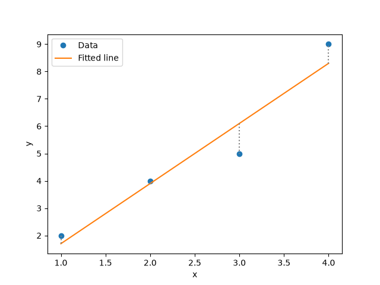
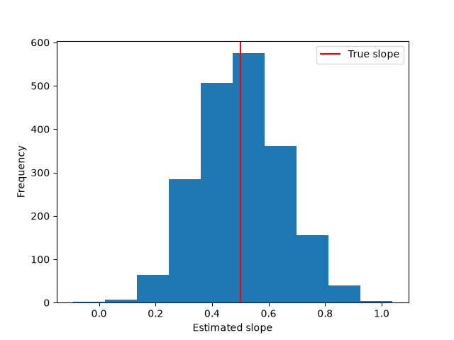

# 第 2 章: 単回帰分析

## 2.1 この章の地図

1 つの説明変数 x で、被説明変数 y を説明する回帰分析（単回帰）を、式から書きます。「傾き = 共分散 ÷ 分散」という式を、そのまま関数にして、手計算の値とテストで一致させます。さらに、標本を取り直すと、推定値がどう変わるか（**標本分布**）を、真の値を知っている乱数のデータで確かめます。



| 項目 | 内容 |
| :--- | :--- |
| 計量経済学の題材 | 単回帰、最小二乗法（OLS）、残差、決定係数、傾きの標準誤差、OLS 推定量の標本分布 |
| 使う Python の機能 | データクラス（`dataclass`）、NumPy の配列計算、乱数の生成器、`statsmodels`（照合） |
| 新しく導入するライブラリ | statsmodels（自分の関数の結果が合っているかを、照合する） |
| 完成形 | `SimpleFit`、`fit_simple`、`fitted_values`、`residuals`、`r_squared`、`slope_standard_error`、`draw_sample`、`sampling_distribution` |
| ファイル | 実装: `lib/chapter02/simple.py`、`lib/chapter02/plot.py`（図）／テスト: `test/chapter02/test_simple.py`、`test/chapter02/test_plot.py`（自分で書くときは、`practice/chapter02/` に、同じ名前で作ります） |
| データ | 4 つの観測値（手計算用）と、母集団の式から作った乱数 |

### 計量経済学の式とコードの対応

| 計量経済学 | 式 | コード |
| :--- | :--- | :--- |
| 母集団回帰式 | y = α + β·x + u | `draw_sample(n, intercept, slope, sigma, rng)` |
| OLS の傾き | β̂ = s_xy ÷ s_x² | `fit_simple(x, y).slope` |
| OLS の切片 | α̂ = ȳ − β̂·x̄ | `fit_simple(x, y).intercept` |
| 当てはめ値・残差 | ŷ = α̂ + β̂·x、e = y − ŷ | `fitted_values`、`residuals` |
| 決定係数 | R² = 1 − Σe² ÷ Σ(y − ȳ)² | `r_squared(fit, x, y)` |
| 傾きの標準誤差 | SE(β̂) = √(σ̂² ÷ Σ(x − x̄)²)、σ̂² = Σe² ÷ (n − 2) | `slope_standard_error(fit, x, y)` |

> **記号について**: α は回帰の切片、β は傾き、u は母集団の誤差項、e は残差です。この記事の α は、マクロの記事の資本分配率とは別の意味です。一覧は、[記号について](how-to-read.md#symbols) を参照してください。

### 前提とする章

| できること | 章 |
| :--- | :--- |
| 不偏分散・共分散・標準誤差の意味 | [第 1 章](01-statistics-review.md) |
| 乱数の生成器を引数にして、種を固定する | [第 1 シリーズの第 8 章](../economics-programming/08-random-numbers-and-simulation.md) |

## 2.2 準備

```bash
cd apps/econometrics-programming/python
uv sync
uv run pytest test/chapter02
```

```text
21 passed
```

自分でコードを書くときは、`practice/chapter02/` に、完成形と同じ名前（`simple.py`・`test_simple.py`）のファイルを作ります。

## 2.3 予想する

x = 1、2、3、4 のとき、y = 2、4、5、9 でした（観測値が 4 つ）。紙に書いて、予想してください。

1. 最小二乗法の直線 y = α̂ + β̂·x の、傾きと切片は、いくつですか（第 1 章の共分散と分散を使えます）
2. 4 つの残差（y − ŷ）の和は、いくつになりますか。残差と x の積の和は
3. 真の傾きが 0.5 の母集団から、n = 50 の標本を何度も取って、傾きを推定します。推定値の平均は、0.5 より大きいですか、小さいですか、ほぼ同じですか

## 2.4 回帰分析の考え方

### 母集団と標本の回帰

母集団では、y が、x と誤差項 u で決まるとします。

> y = α + β·x + u

α と β は、**未知の真の値**です。データ（標本）から、α と β を推し量ります。推し量った値が、α̂ と β̂（**推定値**）です。

### 最小二乗法

データを通る直線は、無数に引けます。**最小二乗法（OLS）**は、残差（データと直線の縦のずれ）の 2 乗の合計を、最小にする直線を選びます。式で解くと、次のようになります。

> β̂ = s_xy ÷ s_x²（共分散 ÷ 分散）、α̂ = ȳ − β̂·x̄

直線は、必ず、標本平均の点 (x̄, ȳ) を通ります。

### 残差と決定係数

残差 e = y − ŷ には、最小二乗法の性質で、次が成り立ちます。

- 残差の和は 0
- 残差と x の積の和も 0（残差は、x と直交する）

**決定係数** R² は、y のばらつき（全平方和）のうち、直線で説明できた割合です。残差平方和が 0 なら、R² = 1 です。

### 標準誤差

β̂ は、標本によって変わります。変わり方の大きさ（標準偏差）を、データから推し量った値が、**標準誤差**です。誤差項の標準偏差 σ は未知なので、残差から、σ̂² = Σe² ÷ (n − 2) と推し量ります（n − 2 は、α̂ と β̂ の 2 つを推定したぶんを引いた**自由度**）。

> SE(β̂) = √(σ̂² ÷ Σ(x − x̄)²)

x のばらつきが大きいほど、誤差が小さいほど、傾きは正確に推定できます。

## 2.5 プログラミング

### Red: 傾きと切片のテスト

```python
import pytest

from lib.chapter02.simple import fit_simple

X = [1, 2, 3, 4]
Y = [2, 4, 5, 9]
```

予想した、手計算の値を、テストにします。x̄ = 2.5、ȳ = 5、Σ(x − x̄)(y − ȳ) = 11、Σ(x − x̄)² = 5 なので、傾きは 11 ÷ 5 = 2.2、切片は 5 − 2.2 × 2.5 = −0.5 です。

```python
def test_手計算の例の傾きと切片() -> None:
    fit = fit_simple(X, Y)
    assert fit.slope == pytest.approx(2.2)
    assert fit.intercept == pytest.approx(-0.5)
```

### Green: fit_simple を実装する

第 1 章の `sample_covariance` と `sample_variance` を使います。

```python
@dataclass(frozen=True)
class SimpleFit:
    """単回帰 y = intercept + slope · x の推定結果。"""

    intercept: float
    slope: float


def fit_simple(x: Array, y: Array) -> SimpleFit:
    """最小二乗法。傾き = Cov(x, y) ÷ Var(x)、切片 = ȳ − 傾き · x̄。"""
    var_x = sample_variance(x)
    if var_x == 0:
        raise ValueError("説明変数の分散が 0 なので、傾きを推定できない")
    slope = sample_covariance(x, y) / var_x
    intercept = float(np.mean(y)) - slope * float(np.mean(x))
    return SimpleFit(intercept=intercept, slope=slope)
```

説明変数にばらつきがない（すべて同じ値）と、傾きは決まらないので、エラーにします。

```python
def test_説明変数にばらつきがないと推定できない() -> None:
    with pytest.raises(ValueError, match="分散が 0"):
        fit_simple([2, 2, 2], [1, 2, 3])


def test_直線上のデータは傾きと切片を復元する() -> None:
    x = [0, 1, 2, 5]
    fit = fit_simple(x, [3 + 2 * v for v in x])
    assert isinstance(fit, SimpleFit)
    assert fit.intercept == pytest.approx(3)
    assert fit.slope == pytest.approx(2)
```

### 当てはめ値・残差・決定係数

残差は、手計算で 0.3、0.1、−1.1、0.7 です。残差平方和は 1.8、全平方和は 26 なので、決定係数は 1 − 1.8 ÷ 26 ≈ 0.9308 です。テストでは、手計算の値に加えて、**ちょうど成り立つ関係**（恒等式）も確かめます。残差の和が 0、残差と x が直交、全平方和 = 説明される平方和 + 残差平方和、です。

```python
def test_当てはめ値と残差() -> None:
    fit = fit_simple(X, Y)
    assert fitted_values(fit, X) == pytest.approx([1.7, 3.9, 6.1, 8.3])
    assert residuals(fit, X, Y) == pytest.approx([0.3, 0.1, -1.1, 0.7])


def test_残差の和は0で説明変数と直交する() -> None:
    fit = fit_simple(X, Y)
    e = residuals(fit, X, Y)
    assert np.sum(e) == pytest.approx(0, abs=1e-12)
    assert np.sum(np.asarray(X) * e) == pytest.approx(0, abs=1e-12)


def test_残差平方和と決定係数() -> None:
    fit = fit_simple(X, Y)
    e = residuals(fit, X, Y)
    assert np.sum(e**2) == pytest.approx(1.8)
    assert r_squared(fit, X, Y) == pytest.approx(1 - 1.8 / 26)


def test_全平方和は説明される部分と残差平方和の和() -> None:
    fit = fit_simple(X, Y)
    y = np.asarray(Y, dtype=float)
    total = np.sum((y - y.mean()) ** 2)
    explained = np.sum((fitted_values(fit, X) - y.mean()) ** 2)
    unexplained = np.sum(residuals(fit, X, Y) ** 2)
    assert total == pytest.approx(explained + unexplained)


def test_直線上のデータの決定係数は1() -> None:
    fit = fit_simple(X, [1 + 3 * v for v in X])
    assert r_squared(fit, X, [1 + 3 * v for v in X]) == pytest.approx(1)
```

```python
def fitted_values(fit: SimpleFit, x: Array) -> NDArray[np.float64]:
    """当てはめ値 ŷ = 切片 + 傾き · x。"""
    return fit.intercept + fit.slope * np.asarray(x, dtype=float)


def residuals(fit: SimpleFit, x: Array, y: Array) -> NDArray[np.float64]:
    """残差 e = y − ŷ。"""
    return np.asarray(y, dtype=float) - fitted_values(fit, x)


def r_squared(fit: SimpleFit, x: Array, y: Array) -> float:
    """決定係数 R² = 1 − 残差平方和 ÷ 全平方和。"""
    rss = float(np.sum(residuals(fit, x, y) ** 2))
    tss = float(np.sum((np.asarray(y, dtype=float) - np.mean(y)) ** 2))
    return 1 - rss / tss
```

### 標準誤差

σ̂² = 1.8 ÷ 2 = 0.9、Σ(x − x̄)² = 5 なので、傾きの標準誤差は √(0.9 ÷ 5) = √0.18 ≈ 0.4243 です。観測値が 2 個だと、自由度が 0 になり、標準誤差は計算できません。

```python
def test_傾きの標準誤差() -> None:
    fit = fit_simple(X, Y)
    assert slope_standard_error(fit, X, Y) == pytest.approx((0.9 / 5) ** 0.5)


def test_観測値が2個では標準誤差は計算できない() -> None:
    fit = fit_simple([1, 2], [1, 3])
    with pytest.raises(ValueError, match="自由度"):
        slope_standard_error(fit, [1, 2], [1, 3])
```

```python
def slope_standard_error(fit: SimpleFit, x: Array, y: Array) -> float:
    """傾きの標準誤差 = √(σ̂² ÷ Σ(x − x̄)²)。σ̂² = 残差平方和 ÷ (n − 2)。"""
    n = len(x)
    if n <= 2:
        raise ValueError("自由度（n − 2）が 0 以下なので、標準誤差を計算できない")
    sigma2 = float(np.sum(residuals(fit, x, y) ** 2)) / (n - 2)
    sxx = sample_variance(x) * (n - 1)
    return math.sqrt(sigma2 / sxx)
```

```python
from lib.chapter02.simple import (
    fit_simple,
    fitted_values,
    r_squared,
    residuals,
    slope_standard_error,
)

x = [1, 2, 3, 4]
y = [2, 4, 5, 9]
fit = fit_simple(x, y)
print(fit)
print(fitted_values(fit, x), residuals(fit, x, y))
print(r_squared(fit, x, y), slope_standard_error(fit, x, y))
```

```text
SimpleFit(intercept=-0.4999999999999991, slope=2.1999999999999997)
[1.7 3.9 6.1 8.3] [ 0.3  0.1 -1.1  0.7]
0.9307692307692308 0.4242640687119285
```

予想した 2.2、−0.5 に（浮動小数点の誤差を除いて）一致します。残差の和は 0 です（0.3 + 0.1 − 1.1 + 0.7）。

### statsmodels と照合する

自分で書いた関数が、定評のあるライブラリと同じ答えを返すかを確かめます。乱数で作った標本（真の切片 1、真の傾き 0.5、誤差の標準偏差 1、n = 30）で、`statsmodels` の `OLS` と比べます。

```python
def draw_sample(
    n: int, intercept: float, slope: float, sigma: float, rng: np.random.Generator
) -> tuple[NDArray[np.float64], NDArray[np.float64]]:
    """母集団の式 y = 切片 + 傾き · x + u から、n 個の標本を作る。

    x は標準正規分布、誤差項 u は平均 0・標準偏差 sigma の正規分布。
    """
    x = rng.standard_normal(n)
    u = sigma * rng.standard_normal(n)
    return x, intercept + slope * x + u
```

```python
def test_statsmodelsと一致する() -> None:
    x, y = draw_sample(30, 1.0, 0.5, 1.0, np.random.default_rng(0))
    fit = fit_simple(x, y)
    reference = sm.OLS(y, sm.add_constant(x)).fit()
    assert [fit.intercept, fit.slope] == pytest.approx(reference.params)
    assert slope_standard_error(fit, x, y) == pytest.approx(reference.bse[1])
    assert r_squared(fit, x, y) == pytest.approx(reference.rsquared)


def test_標本は長さnで同じ種なら同じ() -> None:
    x1, y1 = draw_sample(10, 1.0, 2.0, 1.0, np.random.default_rng(3))
    x2, y2 = draw_sample(10, 1.0, 2.0, 1.0, np.random.default_rng(3))
    assert x1.shape == y1.shape == (10,)
    assert np.array_equal(x1, x2)
    assert np.array_equal(y1, y2)


def test_誤差が0なら母集団の式の上に乗る() -> None:
    x, y = draw_sample(10, 1.0, 2.0, 0.0, np.random.default_rng(0))
    assert y == pytest.approx(1.0 + 2.0 * x)
```

```python
import numpy as np
import statsmodels.api as sm

from lib.chapter02.simple import draw_sample, fit_simple

x, y = draw_sample(30, 1.0, 0.5, 1.0, np.random.default_rng(0))
print(fit_simple(x, y))
result = sm.OLS(y, sm.add_constant(x)).fit()
print(result.params, result.bse[1], result.rsquared)
```

```text
SimpleFit(intercept=1.2293834080948305, slope=0.11563757995920465)
[1.22938341 0.11563758] 0.2063038918600538 0.01109632343246425
```

自分の関数と `statsmodels` が、一致しました。注目してほしいのは、**真の傾きは 0.5 なのに、この標本の推定値は 0.116 だった**ことです。標準誤差が 0.206 なので、真の値から、約 1.9 標準誤差ずれています。1 つの標本の推定値は、真の値からずれます。そのずれ方を調べるのが、次の節です。

### 推定値の標本分布

標本を取り直して推定する作業を、2000 回繰り返します。真の値を知っているので、推定値の平均が、真の値に近いか（**不偏性**）、ばらつきが、標準誤差と合うか、を確かめられます。

```python
def sampling_distribution(
    n: int,
    repetitions: int,
    intercept: float,
    slope: float,
    sigma: float,
    rng: np.random.Generator,
) -> pd.DataFrame:
    """標本を取り直して推定する作業を繰り返し、切片・傾き・標準誤差の表を返す。"""
    rows = []
    for _ in range(repetitions):
        x, y = draw_sample(n, intercept, slope, sigma, rng)
        fit = fit_simple(x, y)
        rows.append((fit.intercept, fit.slope, slope_standard_error(fit, x, y)))
    return pd.DataFrame(rows, columns=["intercept", "slope", "se"])
```

x を標準正規分布から取ると、傾きの標準偏差の理論値は、σ ÷ √(n − 3) になります（x のばらつきの逆数の期待値が、1 ÷ (n − 3) であることによります）。n = 50、σ = 1 なら、1 ÷ √47 ≈ 0.1459 です。

```python
def test_標本分布の表の形() -> None:
    table = sampling_distribution(
        n=20,
        repetitions=50,
        intercept=1,
        slope=0.5,
        sigma=1,
        rng=np.random.default_rng(0),
    )
    assert list(table.columns) == ["intercept", "slope", "se"]
    assert len(table) == 50


def test_傾きの推定値は不偏() -> None:
    table = sampling_distribution(
        n=50,
        repetitions=2000,
        intercept=1,
        slope=0.5,
        sigma=1,
        rng=np.random.default_rng(0),
    )
    spread = 1 / (50 - 3) ** 0.5
    assert table["slope"].mean() == pytest.approx(0.5, abs=4 * spread / 2000**0.5)
    assert table["intercept"].mean() == pytest.approx(1.0, abs=0.02)


def test_傾きのばらつきは理論値に近く標準誤差の平均と一致する() -> None:
    table = sampling_distribution(
        n=50,
        repetitions=2000,
        intercept=1,
        slope=0.5,
        sigma=1,
        rng=np.random.default_rng(0),
    )
    assert table["slope"].std() == pytest.approx(1 / 47**0.5, rel=0.1)
    assert table["se"].mean() == pytest.approx(table["slope"].std(), rel=0.1)


def test_誤差が大きいほど傾きはばらつく() -> None:
    small = sampling_distribution(30, 500, 1, 0.5, 1, np.random.default_rng(1))
    large = sampling_distribution(30, 500, 1, 0.5, 3, np.random.default_rng(1))
    assert large["slope"].std() == pytest.approx(3 * small["slope"].std(), rel=1e-9)
```

```python
import numpy as np

from lib.chapter02.simple import sampling_distribution

table = sampling_distribution(50, 2000, 1, 0.5, 1, np.random.default_rng(0))
print(table.mean().round(4).to_dict())
print(round(table["slope"].std(), 4), round(1 / 47**0.5, 4))
```

```text
{'intercept': 0.9985, 'slope': 0.5014, 'se': 0.145}
0.1499 0.1459
```

傾きの推定値の平均は 0.5014 で、真の値 0.5 にほぼ一致します（不偏）。ばらつきは 0.1499 で、理論値 0.1459 に近く、標準誤差の平均（0.145）とも近い値です。**標準誤差は、「標本ごとの推定値のばらつき」を、1 つの標本から推し量った値**です。



### 図

2 つの図は、`plot_regression_line`（データ・直線・残差）と、`plot_slope_distribution`（傾きのヒストグラムと真の値の線）で描きます。テストは、線と点の座標、残差の線が当てはめ値とデータを結ぶこと、棒の度数の合計が観測数に等しいこと、を確かめます。

```python
def test_回帰直線の図はデータと直線と残差を描く() -> None:
    ax = plot_regression_line(X, Y, fit_simple(X, Y)).axes[0]
    labels = [line.get_label() for line in ax.lines]
    assert labels[:2] == ["Data", "Fitted line"]
    assert labels[2:] == ["_residual"] * 4
    assert xs(ax.lines[0]) == X
    assert ys(ax.lines[0]) == Y


def test_傾きの分布の図は棒と真の値の線() -> None:
    slopes = [0.4, 0.5, 0.5, 0.6, 0.5, 0.45]
    ax = plot_slope_distribution(slopes, 0.5).axes[0]
    assert len(ax.patches) == 10
    assert [line.get_label() for line in ax.lines] == ["True slope"]
    assert xs(ax.lines[0]) == [0.5, 0.5]
    assert ax.get_xlabel() == "Estimated slope"
    assert ax.get_ylabel() == "Frequency"
    bars: list[Any] = list(ax.patches)
    assert sum(p.get_height() for p in bars) == len(slopes)
```

```python
def plot_regression_line(x: Array, y: Array, fit: SimpleFit) -> Figure:
    """データ・回帰直線・残差（データと直線を結ぶ縦線）を描く。"""
    fig, ax = plt.subplots()
    ax.plot(x, y, "o", label="Data")
    ends = [float(np.min(x)), float(np.max(x))]
    ax.plot(ends, fitted_values(fit, ends), label="Fitted line")
    for xi, yi, fi in zip(x, y, fitted_values(fit, x), strict=True):
        ax.plot([xi, xi], [fi, yi], color="gray", linestyle=":", label="_residual")
    ax.set_xlabel("x")
    ax.set_ylabel("y")
    ax.legend()
    plt.close(fig)
    return fig


def plot_slope_distribution(slopes: Sequence[float], true_slope: float) -> Figure:
    """傾きの推定値のヒストグラムと、真の傾きの線を描く。"""
    fig, ax = plt.subplots()
    ax.hist(slopes, bins=10)
    ax.axvline(true_slope, color="red", label="True slope")
    ax.set_xlabel("Estimated slope")
    ax.set_ylabel("Frequency")
    ax.legend()
    plt.close(fig)
    return fig
```

### 実行結果

```bash
uv run pytest test/chapter02
```

```text
21 passed
```

## 2.6 規則で言うと

1. **傾きは、共分散 ÷ 分散。** x と y がいっしょに動く程度を、x 自身のばらつきで割った値
2. **推定値は、標本ごとに変わる。** 真の値を中心に、標準誤差の大きさで、ばらつく。1 つの標本の推定値は、真の値からずれて当然
3. **残差は、x と直交する。** 最小二乗法は、残差の中に、x で説明できる部分が残らないように、直線を選ぶ

混同しやすい点を、表にまとめます。

| 混同しやすい点 | 違い |
| :--- | :--- |
| 誤差項 u と 残差 e | u は母集団の誤差で、観測できない。e は、推定した直線からのずれで、データから計算できる |
| 傾きの標準誤差 と 傾きの標準偏差（シミュレーション） | 標準偏差（シミュレーション）は、標本を何度も取り直してわかる値。標準誤差は、1 つの標本から推し量った値。平均すると、ほぼ一致する |
| 決定係数が高い と 傾きが正確 | R² は、y のばらつきのうち、直線で説明できた割合。傾きの正確さ（標準誤差）は、別。n が小さいと、R² が高くても、傾きは不正確なことがある |

### この推定が成り立たない場面

- **不偏性は、誤差項が x と無関係なときに成り立ちます。** 欠落した変数が x と関係していると、平均しても、真の値に近づきません（第 11 章）
- **標準誤差の式は、誤差のばらつきが、x によらず一定であることを前提にします。** ばらつきが x で変わると、この標準誤差は、不正確になります（第 8 章）
- **決定係数は、因果の強さを示しません。** 逆向きの関係や、共通の原因でも、R² は高くなります

## 2.7 練習問題

| 種類 | 問題 |
| :--- | :--- |
| 想起 | 本文を閉じて、`fit_simple` の最初のテスト（手計算の例で、傾き 2.2、切片 −0.5）を書いてください |
| 生成 | 解説を見る前に、誤差項の標準偏差の推定値 σ̂ = √(残差平方和 ÷ (n − 2)) を返す `residual_standard_deviation(fit, x, y)` を、テストから書いてください。手計算の例では、いくつですか |
| 多様 | 真の傾きを 0.5 から 1.0 に変えて、同じ乱数で（`sampling_distribution(50, 2000, 1, 1.0, 1, np.random.default_rng(0))`）傾きの推定値の標準偏差は、どう変わりますか。先に予想してから確かめてください |
| 交互 | [第 1 章](01-statistics-review.md)の `sample_correlation` と `sample_variance` を使って、傾きが「相関係数 × y の標準偏差 ÷ x の標準偏差」に等しいことを、手計算の例で確かめてください |

??? note "解答（先に自分で取り組んでから、開いてください）"

    **想起**:

    ```python
    def test_傾きと切片の手計算() -> None:
        fit = fit_simple([1, 2, 3, 4], [2, 4, 5, 9])
        assert fit.slope == pytest.approx(2.2)
        assert fit.intercept == pytest.approx(-0.5)
    ```

    **生成**: 手計算の例では、残差平方和が 1.8、自由度が 2 なので、σ̂ = √0.9 ≈ 0.9487 です。傾きの標準誤差は、σ̂ ÷ √Σ(x − x̄)² = 0.9487 ÷ √5 でも求まります。

    ```python
    def residual_standard_deviation(fit, x, y):
        e = residuals(fit, x, y)
        return math.sqrt(np.sum(e**2) / (len(x) - 2))
    ```

    ```python
    def test_誤差の標準偏差の推定値() -> None:
        x, y = [1, 2, 3, 4], [2, 4, 5, 9]
        fit = fit_simple(x, y)
        sigma = residual_standard_deviation(fit, x, y)
        assert sigma == pytest.approx(0.9**0.5)
        assert sigma / 5**0.5 == pytest.approx(slope_standard_error(fit, x, y))
    ```

    **多様**: 傾きの標準偏差は、誤差の標準偏差と、x のばらつきで決まり、**真の傾きには依存しません**。同じ乱数なら、y = α + β·x + u の β を 0.5 増やすと、すべての推定値が、ちょうど 0.5 増えるので、ばらつき（標準偏差）は同じです。

    ```python
    def test_真の傾きを変えても推定値のばらつきは変わらない() -> None:
        base = sampling_distribution(50, 500, 1, 0.5, 1, np.random.default_rng(0))
        shifted = sampling_distribution(50, 500, 1, 1.0, 1, np.random.default_rng(0))
        assert shifted["slope"].std() == pytest.approx(base["slope"].std())
        assert shifted["slope"].mean() == pytest.approx(base["slope"].mean() + 0.5)
    ```

    **交互**: 傾き = 共分散 ÷ 分散 = 相関 × √分散(y) ÷ √分散(x) です。手計算の例では、0.9648 × 2.9439 ÷ 1.2910 ≈ 2.2 です。

    ```python
    def test_傾きは相関に標準偏差の比を掛けたもの() -> None:
        x, y = [1, 2, 3, 4], [2, 4, 5, 9]
        ratio = (sample_variance(y) / sample_variance(x)) ** 0.5
        assert fit_simple(x, y).slope == pytest.approx(
            sample_correlation(x, y) * ratio
        )
    ```

## 2.8 振り返り

- 予想した傾きと切片は、当たりましたか。残差の和が 0 になる理由を、説明できますか
- 1 つの標本の推定値が、真の値からずれる理由と、「不偏」の意味を、説明できますか
- 標準誤差と、推定値の標準偏差（シミュレーション）の関係を、説明できますか

## 2.9 まとめ

- 傾き = 共分散 ÷ 分散、切片 = ȳ − 傾き × x̄ の式から、単回帰の関数を、テストから書いた。手計算の値と、`statsmodels` の結果の、両方に一致した
- 残差の和が 0、残差と x が直交、全平方和 = 説明される部分 + 残差、の恒等式を、テストで確かめた
- 標本を取り直すシミュレーションで、傾きの推定値の平均は真の値（不偏）で、ばらつきは理論値 1 ÷ √(n − 3) と標準誤差に近いことを確かめた
- 次の章では、説明変数を複数にして、行列で最小二乗法を書きます（重回帰）
