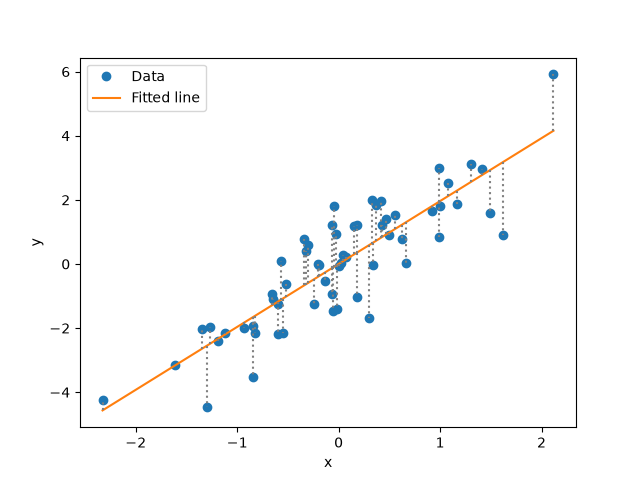
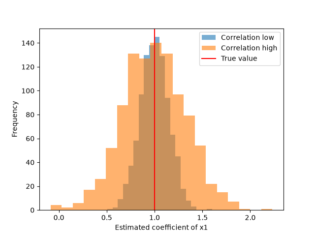

# 第 3 章: 重回帰分析

## 3.1 この章の地図

説明変数が複数の回帰（重回帰）を、行列で書きます。第 2 章の「共分散 ÷ 分散」は、説明変数が 1 つのときの特別な場合でした。一般には、**正規方程式** (X′X)b = X′y を解きます。この章の後半では、「他の変数の影響を除く」という重回帰の意味（FWL）と、説明変数どうしの相関が強いときに起きる問題（**多重共線性**）を、確かめます。



| 項目 | 内容 |
| :--- | :--- |
| 計量経済学の題材 | 重回帰、正規方程式、てこ比、FWL、分散拡大係数（VIF）、多重共線性、対数の被説明変数の係数の解釈 |
| 使う Python の機能 | NumPy の行列計算（`@`・`linalg.solve`）、pandas の `Series`・`DataFrame`、データクラス |
| 新しく導入するライブラリ | なし |
| 完成形 | `OlsResult`、`fit_ols`、`leverage`、`partial_out`、`fwl_coefficient`、`variance_inflation_factor`、`percent_effect`、`multicollinearity_experiment` |
| ファイル | 実装: `lib/chapter03/multiple.py`、`lib/chapter03/plot.py`（図）／テスト: `test/chapter03/test_multiple.py`、`test/chapter03/test_plot.py`（自分で書くときは、`practice/chapter03/` に、同じ名前で作ります） |
| データ | 手計算用の数列と、母集団の式から作った乱数 |

### 計量経済学の式とコードの対応

| 計量経済学 | 式 | コード |
| :--- | :--- | :--- |
| 母集団回帰式 | y = X·β + u（X の 1 列目は、すべて 1） | （第 2 章の `draw_sample` の一般化） |
| 正規方程式 | (X′X)·b = X′y | `fit_ols(y, x)`（`np.linalg.solve`） |
| 係数の分散 | Var(b) = σ̂²·(X′X)⁻¹、σ̂² = Σe² ÷ (n − k) | `result.standard_errors` |
| てこ比 | H = X(X′X)⁻¹X′ の対角成分 | `leverage(x)` |
| FWL | b₁ = 他の変数を除いた x₁ と y の単回帰の傾き | `fwl_coefficient(y, x, others)` |
| 分散拡大係数 | VIF = 1 ÷ (1 − R²_j) | `variance_inflation_factor(x, column)` |
| 対数の係数の解釈 | 変化率 = (exp(β·Δx) − 1) × 100% | `percent_effect(coefficient, change)` |

> **記号について**: k は、定数項を含む係数の数です。第 1・2 シリーズやマクロの記事の k（資本）とは別の意味です。一覧は、[記号について](how-to-read.md#symbols) を参照してください。

### 前提とする章

| できること | 章 |
| :--- | :--- |
| 単回帰の傾き・残差・標準誤差 | [第 2 章](02-simple-regression.md) |
| NumPy の行列計算 | [第 1 シリーズの第 9 章](../economics-programming/09-numpy-arrays.md) |

## 3.2 準備

```bash
cd apps/econometrics-programming/python
uv sync
uv run pytest test/chapter03
```

```text
24 passed
```

自分でコードを書くときは、`practice/chapter03/` に、完成形と同じ名前（`multiple.py`・`test_multiple.py`）のファイルを作ります。

## 3.3 予想する

x1 = 1、2、3、4、5、x2 = 2、1、4、3、6 で、y = 1 + 2·x1 + 3·x2（ちょうど成り立つ関係、誤差なし）とします。

1. y を、定数項・x1・x2 で回帰すると、係数はいくつになりますか。標準誤差と決定係数は
2. y = 1 + 2·x1 − x2 + u（誤差あり）から作ったデータで、**x2 を入れずに**、x1 だけで回帰します。x1 と x2 が、正の相関を持つとき、x1 の係数は、真の値 2 より大きくなりますか、小さくなりますか
3. 2 つの説明変数の相関が 0.9 のとき、相関が 0 のときに比べて、係数の推定値のばらつき（標準偏差）は、およそ何倍になりますか

## 3.4 重回帰の考え方

### 行列で書く

n 個の観測値、k 個の係数（定数項を含む）のとき、説明変数を n × k の行列 X、被説明変数を n 個のベクトル y にまとめます。残差平方和を最小にする係数 b は、次の**正規方程式**の解です。

> (X′X)·b = X′y

X′X が逆行列を持てば、b = (X′X)⁻¹X′y と書けます。実装では、逆行列を求めずに、連立方程式として `np.linalg.solve` で解きます（逆行列より、安定していて速い）。係数の標準誤差は、σ̂²·(X′X)⁻¹ の対角成分の平方根です。ここで、σ̂² = 残差平方和 ÷ (n − k) です。

### 「他の変数を一定にする」の意味: FWL

重回帰の x1 の係数は、「x2 を一定にしたときの、x1 の効果」と読みます。この意味を、式で確かめられます（**フリッシュ・ウォー・ロヴェルの定理、FWL**）。

1. x1 を、x2（と定数項）で回帰して、残差を取る（x2 の影響を除いた x1）
2. y を、x2（と定数項）で回帰して、残差を取る（x2 の影響を除いた y）
3. 2 つの残差の単回帰の傾きが、重回帰の x1 の係数に、**ちょうど等しい**

### 多重共線性

説明変数の間に、完全な線形関係（同じ列、定数倍の列など）があると、X′X に逆行列がなく、係数が 1 つに決まりません。完全でなくても、相関が強いと、係数の標準誤差が大きくなります。2 変数の場合、他の変数の影響を除いたあとの x1 のばらつきが小さくなるためです。この拡大を測るのが、**分散拡大係数（VIF）**です（√VIF が、標準誤差の拡大の倍率）。

### 対数の被説明変数

賃金の対数 ln(wage) を被説明変数にすると、説明変数が 1 単位増えたときの変化は、**割合**で読めます。係数が 0.1 なら、「約 10%」ですが、正確には exp(0.1) − 1 ≈ 10.5% です。係数が大きいほど、近似の誤差が大きくなります。

## 3.5 Red → Green → Refactor

### Red: ちょうどの関係から係数を復元する

予想 1 のテストです。誤差のないデータなので、係数は、1、2、3 に一致し、標準誤差は 0、決定係数は 1 になります。

```python
import numpy as np
import pandas as pd
import pytest

from lib.chapter03.multiple import fit_ols

X1 = [1, 2, 3, 4, 5]
X2 = [2, 1, 4, 3, 6]
```

def test_ちょうどの関係から係数を復元する() -> None:
    x = pd.DataFrame({"x1": X1, "x2": X2})
    y = [1 + 2 * a + 3 * b for a, b in zip(X1, X2, strict=True)]
    result = fit_ols(y, x)
    assert result.coefficients.tolist() == pytest.approx([1, 2, 3])
    assert result.standard_errors.tolist() == pytest.approx([0, 0, 0], abs=1e-9)
    assert result.r_squared == pytest.approx(1)

### Green: fit_ols を実装する

@dataclass(frozen=True)
class OlsResult:
    """最小二乗法の推定結果。"""

    coefficients: pd.Series
    standard_errors: pd.Series
    residuals: NDArray[np.float64]
    r_squared: float
    n_obs: int
    df_resid: int


def _names(x: ArrayLike, width: int) -> list[str]:
    if isinstance(x, pd.DataFrame):
        return [str(c) for c in x.columns]
    if isinstance(x, pd.Series):
        return [str(x.name)]
    return [f"x{i + 1}" for i in range(width)]


def _matrix(x: ArrayLike, constant: bool) -> tuple[NDArray[np.float64], list[str]]:
    values = np.asarray(x, dtype=float)
    if values.ndim == 1:
        values = values.reshape(-1, 1)
    names = _names(x, values.shape[1])
    if constant:
        values = np.column_stack([np.ones(len(values)), values])
        names = ["const", *names]
    return values, names


def fit_ols(y: ArrayLike, x: ArrayLike, constant: bool = True) -> OlsResult:
    """正規方程式 (X'X) b = X'y を解いて、係数・標準誤差・決定係数を求める。"""
    design, names = _matrix(x, constant)
    target = np.asarray(y, dtype=float)
    n, k = design.shape
    if n <= k:
        raise ValueError("観測値の数が係数の数以下なので、推定できない")
    gram = design.T @ design
    if np.linalg.matrix_rank(gram) < k:
        raise ValueError("多重共線性（説明変数の間に、完全な線形関係がある）")
    coefficients = np.linalg.solve(gram, design.T @ target)
    residuals: NDArray[np.float64] = target - design @ coefficients
    rss = float(residuals @ residuals)
    sigma2 = rss / (n - k)
    errors = np.sqrt(sigma2 * np.diag(np.linalg.inv(gram)))
    tss = float(np.sum((target - target.mean()) ** 2))
    return OlsResult(
        coefficients=pd.Series(coefficients, index=names),
        standard_errors=pd.Series(errors, index=names),
        residuals=residuals,
        r_squared=1 - rss / tss,
        n_obs=n,
        df_resid=n - k,
    )

係数の名前は、列の名前（配列なら `x1`、`x2`…）に、`const`（定数項）を足したものです。説明変数が 1 次元の配列や、名前のある 1 つの列でも使えるようにします。定数項なし（`constant=False`）も選べます（第 10 章で使います）。

def test_係数の名前は列の名前と定数項() -> None:
    df = random_data()
    result = fit_ols(df["y"], df[["x1", "x2"]])
    assert list(result.coefficients.index) == ["const", "x1", "x2"]
    assert list(result.standard_errors.index) == ["const", "x1", "x2"]


def test_配列を渡すと名前はx1から始まる() -> None:
    df = random_data()
    result = fit_ols(df["y"].to_numpy(), df[["x1", "x2"]].to_numpy())
    assert list(result.coefficients.index) == ["const", "x1", "x2"]


def test_列の名前がある1次元のデータは名前を引き継ぐ() -> None:
    df = random_data()
    result = fit_ols(df["y"], df["x2"])
    assert list(result.coefficients.index) == ["const", "x2"]


def test_1次元の配列も説明変数にできる() -> None:
    df = random_data()
    result = fit_ols(df["y"], df["x1"].to_numpy())
    assert list(result.coefficients.index) == ["const", "x1"]


def test_定数項なしにできる() -> None:
    df = random_data()
    result = fit_ols(df["y"], df[["x1", "x2"]], constant=False)
    assert list(result.coefficients.index) == ["x1", "x2"]

### 照合・恒等式・エラー

乱数で作ったデータ（`random_data`）で、`statsmodels` の `OLS` と、係数・標準誤差・決定係数・自由度が一致することを確かめます。残差の和は 0、各説明変数と直交します。完全な線形関係と、観測値の不足は、エラーにします。

def random_data(n: int = 40, seed: int = 0) -> pd.DataFrame:
    rng = np.random.default_rng(seed)
    x1 = rng.standard_normal(n)
    x2 = 0.5 * x1 + rng.standard_normal(n)
    y = 1 + 2 * x1 - x2 + rng.standard_normal(n)
    return pd.DataFrame({"y": y, "x1": x1, "x2": x2})


def test_statsmodelsと一致する() -> None:
    df = random_data()
    result = fit_ols(df["y"], df[["x1", "x2"]])
    reference = sm.OLS(df["y"], sm.add_constant(df[["x1", "x2"]])).fit()
    assert result.coefficients.to_numpy() == pytest.approx(reference.params.to_numpy())
    assert result.standard_errors.to_numpy() == pytest.approx(reference.bse.to_numpy())
    assert result.r_squared == pytest.approx(reference.rsquared)
    assert result.n_obs == reference.nobs
    assert result.df_resid == reference.df_resid


def test_残差の和は0で説明変数と直交する() -> None:
    df = random_data()
    result = fit_ols(df["y"], df[["x1", "x2"]])
    assert np.sum(result.residuals) == pytest.approx(0, abs=1e-10)
    for name in ("x1", "x2"):
        assert np.dot(df[name], result.residuals) == pytest.approx(0, abs=1e-10)


def test_同じ列を2つ入れると推定できない() -> None:
    df = random_data()
    x = pd.DataFrame({"a": df["x1"], "b": df["x1"]})
    with pytest.raises(ValueError, match="多重共線性"):
        fit_ols(df["y"], x)


def test_定数倍の列を入れても推定できない() -> None:
    df = random_data()
    x = pd.DataFrame({"a": df["x1"], "b": 2 * df["x1"]})
    with pytest.raises(ValueError, match="多重共線性"):
        fit_ols(df["y"], x)


def test_観測値が係数の数以下だと推定できない() -> None:
    x = pd.DataFrame({"x1": [1, 2, 4], "x2": [2, 1, 5]})
    with pytest.raises(ValueError, match="観測値の数"):
        fit_ols([1, 2, 3], x)

```python
import numpy as np
import pandas as pd

from lib.chapter03.multiple import fit_ols

rng = np.random.default_rng(0)
x1 = rng.standard_normal(40)
x2 = 0.5 * x1 + rng.standard_normal(40)
y = 1 + 2 * x1 - x2 + rng.standard_normal(40)
df = pd.DataFrame({"y": y, "x1": x1, "x2": x2})
result = fit_ols(df["y"], df[["x1", "x2"]])
print(result.coefficients.round(4).to_dict())
print(result.standard_errors.round(4).to_dict())
print(round(result.r_squared, 4), result.n_obs, result.df_resid)
```

```text
{'const': 0.9982, 'x1': 2.1476, 'x2': -0.9494}
{'const': 0.1575, 'x1': 0.2011, 'x2': 0.1401}
0.7767 40 37
```

真の値（1、2、−1）に近い値で、`statsmodels` の結果と一致します（テストで確認）。

### てこ比

てこ比は、各観測値が、自分自身の当てはめ値に与える影響の大きさです。ハット行列 H = X(X′X)⁻¹X′ の対角成分で、**合計が、係数の数 k に等しく**、各値は 1/n 以上 1 以下です。第 4 章の診断で使います。

def test_てこ比の和は係数の数でありstatsmodelsと一致する() -> None:
    df = random_data()
    h = leverage(df[["x1", "x2"]])
    assert h.sum() == pytest.approx(3)
    assert h.min() >= 1 / len(df) - 1e-12
    assert h.max() <= 1
    reference = OLSInfluence(
        sm.OLS(df["y"], sm.add_constant(df[["x1", "x2"]])).fit()
    ).hat_matrix_diag
    assert h == pytest.approx(reference)

def leverage(x: ArrayLike, constant: bool = True) -> NDArray[np.float64]:
    """てこ比（ハット行列 H = X (X'X)⁻¹ X' の対角成分）。"""
    design, _ = _matrix(x, constant)
    hat = design @ np.linalg.solve(design.T @ design, design.T)
    result: NDArray[np.float64] = np.diag(hat)
    return result

### FWL: 他の変数の影響を除く

def partial_out(v: ArrayLike, others: ArrayLike) -> NDArray[np.float64]:
    """v を、定数項と others で回帰した残差（others の影響を除いた v）。"""
    return fit_ols(v, others).residuals


def fwl_coefficient(y: ArrayLike, x: ArrayLike, others: ArrayLike) -> float:
    """FWL: y と x から others の影響を除き、残差どうしの単回帰の傾きを求める。"""
    y_tilde = partial_out(y, others)
    x_tilde = partial_out(x, others)
    return float(x_tilde @ y_tilde / (x_tilde @ x_tilde))

def test_偏りを除いた回帰の傾きは重回帰の係数と一致する() -> None:
    df = random_data()
    full = fit_ols(df["y"], df[["x1", "x2"]])
    assert fwl_coefficient(df["y"], df["x1"], df[["x2"]]) == pytest.approx(
        full.coefficients["x1"]
    )
    assert fwl_coefficient(df["y"], df["x2"], df[["x1"]]) == pytest.approx(
        full.coefficients["x2"]
    )


def test_偏りを除いた変数は他の変数と直交する() -> None:
    df = random_data()
    z = partial_out(df["x1"], df[["x2"]])
    assert np.sum(z) == pytest.approx(0, abs=1e-10)
    assert np.dot(z, df["x2"]) == pytest.approx(0, abs=1e-10)

```python
from lib.chapter03.multiple import fit_ols, fwl_coefficient

print(round(fwl_coefficient(df["y"], df["x1"], df[["x2"]]), 4))
print(round(fit_ols(df["y"], df[["x1"]]).coefficients["x1"], 4))
```

```text
2.1476
1.7508
```

FWL の傾き 2.1476 は、重回帰の x1 の係数に、一致します。一方、**x2 を入れずに x1 だけで回帰すると、係数は 1.7508** で、真の値 2 より小さくなります（予想 2）。x1 と x2 は正の相関を持ち、x2 の真の係数は負（−1）なので、x2 の効果の一部を、x1 が拾ってしまうためです。これが**欠落変数バイアス**で、第 11 章で、式とシミュレーションで調べます。



### 分散拡大係数

x1 を x2 で回帰したときの決定係数が R² なら、VIF = 1 ÷ (1 − R²) です。2 変数の場合、R² は相関係数の 2 乗に等しいので、VIF = 1 ÷ (1 − r²) です。

def variance_inflation_factor(x: pd.DataFrame, column: str) -> float:
    """分散拡大係数 VIF = 1 ÷ (1 − R²)。R² は、column を他の列で回帰したもの。"""
    result = fit_ols(x[column], x.drop(columns=column))
    return 1 / (1 - result.r_squared)

def test_分散拡大係数は相関から決まる() -> None:
    df = random_data()
    r = np.corrcoef(df["x1"], df["x2"])[0, 1]
    vif = variance_inflation_factor(df[["x1", "x2"]], "x1")
    assert vif == pytest.approx(1 / (1 - r**2))
    assert vif == pytest.approx(variance_inflation_factor(df[["x1", "x2"]], "x2"))


def test_分散拡大係数はstatsmodelsと一致する() -> None:
    df = random_data()
    exog = sm.add_constant(df[["x1", "x2"]]).to_numpy()
    assert variance_inflation_factor(df[["x1", "x2"]], "x1") == pytest.approx(
        reference_vif(exog, 1)
    )


def test_相関のない変数の分散拡大係数は1に近い() -> None:
    x = pd.DataFrame({"a": [1, 2, 3, 4], "b": [1, -1, -1, 1]})
    assert variance_inflation_factor(x, "a") == pytest.approx(1)

### 多重共線性の影響を、シミュレーションで見る

y = 1 + x1 + x2 + u の係数を、x1 と x2 の相関を指定して、繰り返し推定します。

def multicollinearity_experiment(
    correlation: float, n: int, repetitions: int, rng: np.random.Generator
) -> pd.DataFrame:
    """y = 1 + x1 + x2 + u の係数を、x1 と x2 の相関を指定して、繰り返し推定する。"""
    rows = []
    for _ in range(repetitions):
        z1, z2, u = rng.standard_normal((3, n))
        x1 = z1
        x2 = correlation * z1 + math.sqrt(1 - correlation**2) * z2
        y = 1 + x1 + x2 + u
        result = fit_ols(y, np.column_stack([x1, x2]))
        rows.append((result.coefficients["x1"], result.coefficients["x2"]))
    return pd.DataFrame(rows, columns=["x1", "x2"])

def test_相関が強くても推定値は不偏() -> None:
    table = multicollinearity_experiment(0.9, 50, 1000, np.random.default_rng(0))
    assert list(table.columns) == ["x1", "x2"]
    assert table.mean().to_numpy() == pytest.approx([1, 1], abs=0.05)


def test_相関が強いほど係数はばらつく() -> None:
    low = multicollinearity_experiment(0.0, 50, 1000, np.random.default_rng(0))
    high = multicollinearity_experiment(0.9, 50, 1000, np.random.default_rng(0))
    ratio = high["x1"].std() / low["x1"].std()
    assert ratio == pytest.approx((1 / (1 - 0.9**2)) ** 0.5, rel=0.15)

```python
import numpy as np

from lib.chapter03.multiple import multicollinearity_experiment

for rho in (0.0, 0.9):
    table = multicollinearity_experiment(rho, 50, 1000, np.random.default_rng(0))
    print(rho, table.mean().round(4).to_dict(), table.std().round(4).to_dict())
```

```text
0.0 {'x1': 0.9997, 'x2': 1.0012} {'x1': 0.1482, 'x2': 0.1415}
0.9 {'x1': 0.9972, 'x2': 1.0028} {'x1': 0.3267, 'x2': 0.3247}
```

相関が 0.9 でも、平均は真の値 1 に近く、**偏りはありません**。ただし、標準偏差は 0.148 から 0.327 へ、約 2.2 倍になりました。理論値の √VIF = √(1 ÷ (1 − 0.81)) ≈ 2.29 に近い値です（予想 3）。多重共線性は、偏りではなく、**推定の不正確さ**の問題です。

### 対数の係数の解釈

def percent_effect(coefficient: float, change: float = 1) -> float:
    """対数の被説明変数の係数から、説明変数が change 増えたときの変化率（%）。"""
    return (math.exp(coefficient * change) - 1) * 100

def test_対数の係数の割合への換算() -> None:
    assert percent_effect(0.1) == pytest.approx(10.5171, abs=1e-4)
    assert percent_effect(0) == 0
    assert percent_effect(-0.1) == pytest.approx(-9.5163, abs=1e-4)
    assert percent_effect(0.1, change=2) == pytest.approx(22.1403, abs=1e-4)

係数 0.1 は 10.5171%、−0.1 は −9.5163% です。符号によって、近似の誤差の向きが違います。

### 図

`plot_collinearity_distributions` は、2 つの分布のヒストグラムと真の値の線を描きます。

def test_2つの分布のヒストグラムと真の値の線() -> None:
    low = [0.9, 1.0, 1.1, 1.0]
    high = [0.2, 1.0, 1.8, 1.0]
    ax = plot_collinearity_distributions(low, high).axes[0]
    assert len(ax.patches) == 2 * 20
    assert [line.get_label() for line in ax.lines] == ["True value"]
    legend = ax.get_legend()
    assert legend is not None
    assert [t.get_text() for t in legend.get_texts()] == [
        "Correlation low",
        "Correlation high",
        "True value",
    ]


def test_ヒストグラムの度数の合計は観測数() -> None:
    low = [0.9, 1.0, 1.1, 1.0]
    high = [0.2, 1.0, 1.8]
    ax = plot_collinearity_distributions(low, high).axes[0]
    bars: list[Any] = list(ax.patches)
    heights = [p.get_height() for p in bars]
    assert sum(heights[:20]) == len(low)
    assert sum(heights[20:]) == len(high)


def test_真の値の線は既定で1の位置() -> None:
    ax = plot_collinearity_distributions([1.0, 1.1], [0.5, 1.5]).axes[0]
    assert [float(v) for v in ax.lines[0].get_xdata()] == [1.0, 1.0]
    ax = plot_collinearity_distributions([1.0, 1.1], [0.5, 1.5], 2.0).axes[0]
    assert [float(v) for v in ax.lines[0].get_xdata()] == [2.0, 2.0]

def plot_collinearity_distributions(
    low: Sequence[float], high: Sequence[float], true_value: float = 1.0
) -> Figure:
    """相関が弱い場合と強い場合の、係数の推定値の分布を重ねて描く。"""
    fig, ax = plt.subplots()
    ax.hist(low, bins=20, alpha=0.6, label="Correlation low")
    ax.hist(high, bins=20, alpha=0.6, label="Correlation high")
    ax.axvline(true_value, color="red", label="True value")
    ax.set_xlabel("Estimated coefficient of x1")
    ax.set_ylabel("Frequency")
    ax.legend()
    plt.close(fig)
    return fig

### 実行結果

```bash
uv run pytest test/chapter03
```

```text
24 passed
```

## 3.6 規則で言うと

1. **重回帰の係数は、他の変数の影響を除いた関係。** FWL: 他の変数で回帰した残差どうしの単回帰の傾きに、ちょうど等しい
2. **説明変数を落とすと、係数が変わる。** 落とした変数が、残った変数と関係していると、残った係数は偏る（欠落変数バイアス）
3. **多重共線性は、偏りではなく、不正確さ。** 相関が強いほど、標準誤差が √VIF 倍に広がる。完全な線形関係なら、推定できない

混同しやすい点を、表にまとめます。

| 混同しやすい点 | 違い |
| :--- | :--- |
| 多重共線性 と 欠落変数 | 多重共線性は、入れた変数の間の相関で、標準誤差が大きくなる（偏らない）。欠落変数は、入れなかった変数のせいで、係数が偏る |
| 決定係数が上がる と モデルが良い | 説明変数を足すと、決定係数は、必ず上がる（下がらない）。係数の数 k を考慮した自由度修正済み決定係数や、理論での判断が必要 |
| てこ比が大きい と 外れ値 | てこ比は、説明変数の値が、平均から遠い程度（x の外れ）。外れ値は、y の外れ。両方が大きいと、推定値への影響が大きい（第 4 章） |

### この推定が成り立たない場面

- **X′X が逆行列を持つことが必要です。** 完全な線形関係があるとき（ダミー変数の罠など）は、推定できません（第 7 章）
- **標準誤差の式は、誤差のばらつきが一定であることを前提にしています。** 一定でないときは、頑健な標準誤差を使います（第 8 章）
- **「他の変数を一定にする」は、データの中で、その変数が実際に動いていることが前提です。** 相関が強すぎると、一定にしたときの x1 の動きが、ほとんど残りません

## 3.7 練習問題

| 種類 | 問題 |
| :--- | :--- |
| 想起 | 本文を閉じて、完全な線形関係（同じ列を 2 つ入れる）のとき、`fit_ols` がエラーになるテストを書いてください |
| 生成 | 解説を見る前に、自由度修正済み決定係数 1 − (1 − R²)·(n − 1) ÷ (n − k) を返す `adjusted_r_squared(result)` を、テストから書いてください（k は、定数項を含む係数の数。`result.df_resid` を使います）。`statsmodels` の `rsquared_adj` と一致しますか |
| 多様 | 説明変数の相関を 0.9 から 0.99 に変えると、係数のばらつきは、何倍になりますか。√VIF の理論値を、先に計算してから確かめてください |
| 交互 | [第 2 章](02-simple-regression.md)の `fit_simple` と、この章の `fit_ols` が、説明変数が 1 つのとき、同じ傾きと切片を返すことを確かめてください |

??? note "解答（先に自分で取り組んでから、開いてください）"

    **想起**:

    ```python
    def test_同じ列は推定できない() -> None:
        x = pd.DataFrame({"a": [1.0, 2.0, 3.0, 4.0], "b": [1.0, 2.0, 3.0, 4.0]})
        with pytest.raises(ValueError, match="多重共線性"):
            fit_ols([1.0, 3.0, 2.0, 5.0], x)
    ```

    **生成**: n − k は、`df_resid` です。

    ```python
    def adjusted_r_squared(result):
        return 1 - (1 - result.r_squared) * (result.n_obs - 1) / result.df_resid
    ```

    ```python
    def test_自由度修正済み決定係数はstatsmodelsと一致する() -> None:
        import statsmodels.api as sm

        rng = np.random.default_rng(0)
        x = pd.DataFrame({"a": rng.standard_normal(30), "b": rng.standard_normal(30)})
        y = 1 + x["a"] + rng.standard_normal(30)
        result = fit_ols(y, x)
        reference = sm.OLS(y, sm.add_constant(x)).fit()
        assert adjusted_r_squared(result) == pytest.approx(reference.rsquared_adj)
        assert adjusted_r_squared(result) < result.r_squared
    ```

    **多様**: √(1 ÷ (1 − 0.99²)) ≈ 7.09 です。相関 0.9 の 2.29 倍から、約 3 倍に拡大します。

    ```python
    def test_相関が0点99だとばらつきは約7倍() -> None:
        low = multicollinearity_experiment(0.0, 50, 1000, np.random.default_rng(0))
        high = multicollinearity_experiment(0.99, 50, 1000, np.random.default_rng(0))
        ratio = high["x1"].std() / low["x1"].std()
        assert ratio == pytest.approx((1 / (1 - 0.99**2)) ** 0.5, rel=0.2)
    ```

    **交互**:

    ```python
    def test_単回帰と重回帰は説明変数が1つなら同じ() -> None:
        x, y = [1, 2, 3, 4], [2, 4, 5, 9]
        simple = fit_simple(x, y)
        multiple = fit_ols(y, x)
        assert multiple.coefficients["const"] == pytest.approx(simple.intercept)
        assert multiple.coefficients["x1"] == pytest.approx(simple.slope)
        assert multiple.standard_errors["x1"] == pytest.approx(
            slope_standard_error(simple, x, y)
        )
    ```

## 3.8 振り返り

- 予想した 3 つの値は、当たりましたか。外れたなら、どこを勘違いしていましたか
- 重回帰の係数の意味を、FWL を使って、説明できますか
- 「多重共線性は、偏りではなく不正確さ」の意味を、説明できますか

## 3.9 まとめ

- 正規方程式 (X′X)b = X′y を `np.linalg.solve` で解く `fit_ols` を、テストから書いた。手計算の関係と、`statsmodels` の結果の、両方に一致した
- てこ比（合計 = k）、FWL（重回帰の係数 = 他の変数を除いた単回帰の傾き）を、恒等式のテストで確かめた
- 説明変数を落とすと、係数が偏る（x1 だけの回帰で 1.7508、真の値は 2）ことを見た。多重共線性は、偏りではなく、標準偏差が √VIF 倍に広がる問題であることを、シミュレーションで確かめた（相関 0.9 で約 2.2 倍）
- 次の章では、残差を調べて、回帰の仮定が成り立っているかを、図と数値で診断します
