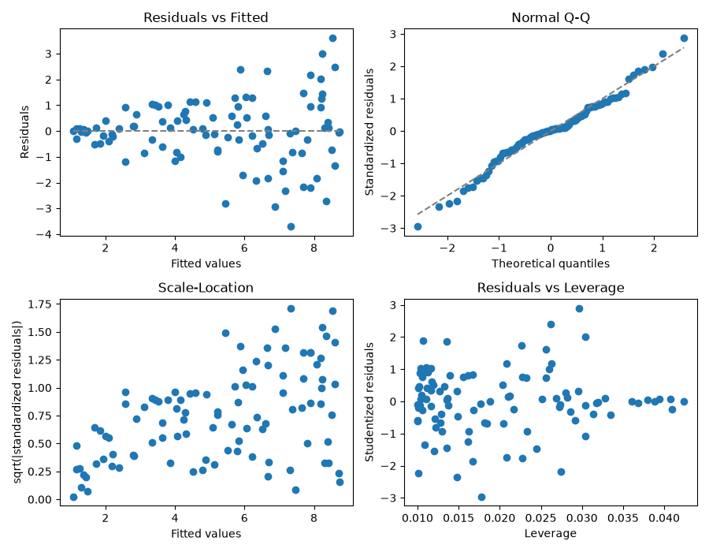
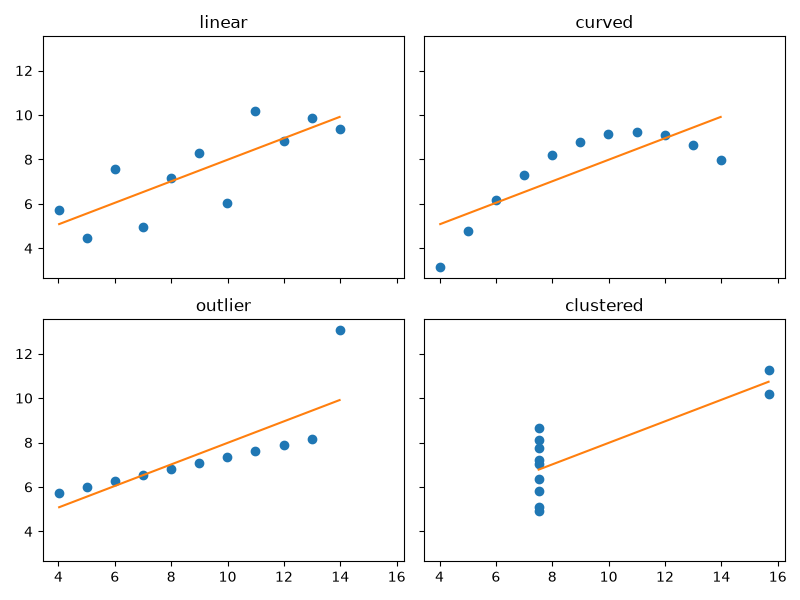

# 第 4 章: 残差診断

## 4.1 この章の地図

回帰分析の結果（係数・標準誤差・決定係数）は、モデルの仮定が成り立っているときに、意味を持ちます。仮定が成り立っているかを、残差を調べて確かめるのが、**残差診断**です。この章では、診断に使う量（標準化残差、てこ比、クックの距離、Q-Q プロットの点）を、自分で書きます。



| 項目 | 内容 |
| :--- | :--- |
| 計量経済学の題材 | 標準化・スチューデント化残差、てこ比、クックの距離、Q-Q プロット、要約統計量が同じで形が違うデータ |
| 使う Python の機能 | NumPy の配列計算、`scipy.stats.norm`、Matplotlib の複数の枠（`subplots`） |
| 新しく導入するライブラリ | なし |
| 完成形 | `standardized_residuals`、`studentized_residuals`、`cooks_distance`、`qq_points`、`match_moments`、`same_summary_datasets` |
| ファイル | 実装: `lib/chapter04/diagnostics.py`、`lib/chapter04/plot.py`（診断図）／テスト: `test/chapter04/test_diagnostics.py`、`test/chapter04/test_plot.py`（自分で書くときは、`practice/chapter04/` に、同じ名前で作ります） |
| データ | 手計算の例と、乱数で作ったデータ、要約統計量をそろえて作った 4 組のデータ |

### 計量経済学の式とコードの対応

| 計量経済学 | 式 | コード |
| :--- | :--- | :--- |
| 標準化残差 | e ÷ σ̂ | `standardized_residuals(result)` |
| スチューデント化残差 | e ÷ (σ̂·√(1 − h)) | `studentized_residuals(result, leverage)` |
| クックの距離 | D = r² ÷ k · h ÷ (1 − h)（r はスチューデント化残差、h はてこ比） | `cooks_distance(result, leverage)` |
| Q-Q プロット | 標準正規分布の分位点と、標準化した残差を小さい順に並べた値 | `qq_points(values)` |

> **記号について**: e は残差、h はてこ比、σ̂ は誤差項の標準偏差の推定値です。一覧は、[記号について](how-to-read.md#symbols) を参照してください。

### 前提とする章

| できること | 章 |
| :--- | :--- |
| 回帰の残差・てこ比 | [第 3 章](03-multiple-regression.md) |
| 標準化・標準正規分布 | [第 1 章](01-statistics-review.md) |

## 4.2 準備

```bash
cd apps/econometrics-programming/python
uv sync
uv run pytest test/chapter04
```

```text
17 passed
```

自分でコードを書くときは、`practice/chapter04/` に、完成形と同じ名前（`diagnostics.py`・`test_diagnostics.py`）のファイルを作ります。

## 4.3 予想する

第 2 章の 4 つの観測値（x = 1、2、3、4、y = 2、4、5、9）の回帰で、残差は 0.3、0.1、−1.1、0.7 でした。

1. 4 つの観測値のうち、「この 1 つを除くと、直線が最も大きく動く」のは、どれですか（見当を付けてください）
2. 平均・標準偏差・相関・回帰直線がすべて同じ 4 組のデータは、散布図を描くと、どれも同じ形になりますか
3. 標準正規分布から取った 500 個の値と、指数分布から取った 500 個の値で、Q-Q プロットの点は、どちらが直線に近いですか

## 4.4 残差診断の考え方

### 回帰の仮定と、残差

回帰分析の標準的な仮定は、次のとおりです。

| 仮定 | 診断の方法 |
| :--- | :--- |
| 関係が線形（y の期待値が、x の線形式） | 残差と当てはめ値の図に、曲がりが残っていないか |
| 誤差のばらつきが一定（均一分散） | 残差の広がりが、当てはめ値によって変わらないか（扇形でないか） |
| 誤差が正規分布 | Q-Q プロットが直線に乗るか |
| 特定の観測値が、結果を支配していない | てこ比・クックの距離 |

### 標準化とスチューデント化

残差そのものは、単位に依存します。誤差の標準偏差の推定値 σ̂ で割ったものが、**標準化残差**です。ただし、てこ比 h が大きい観測値は、直線を自分に引き寄せるので、残差の分散が (1 − h)·σ² に小さくなります。これを補正した e ÷ (σ̂·√(1 − h)) が、**スチューデント化残差**（内的）です。

### てこ比とクックの距離

**てこ比**は、説明変数の値が平均から遠い観測値ほど大きくなります。**クックの距離**は、その観測値を除くと、推定値が全体としてどれだけ動くかを表します。てこ比が大きくて、残差も大きい観測値で、大きくなります。目安として、1 を超えると、注意します。

### Q-Q プロット

残差が正規分布に従うなら、標準化した残差を小さい順に並べた値は、標準正規分布の分位点と、1 本の直線（傾き 1）に並びます。裾が厚い・歪んでいると、両端が直線から離れます。

## 4.5 プログラミング

### Red: 手計算の例のてこ比と標準化残差

第 3 章の `leverage` を使います。x = 1、2、3、4 のてこ比は、1/4 + (x − 2.5)² ÷ 5 なので、0.7、0.3、0.3、0.7 です。合計は 2（= 係数の数）です。σ̂² = 1.8 ÷ 2 = 0.9 なので、標準化残差は、残差を √0.9 で割った値です。

```python
import numpy as np
import pandas as pd
import pytest

from lib.chapter03.multiple import fit_ols, leverage
from lib.chapter04.diagnostics import (
    cooks_distance,
    standardized_residuals,
    studentized_residuals,
)

X = [1, 2, 3, 4]
Y = [2, 4, 5, 9]
```

```python
def test_標準化残差は残差を誤差の標準偏差の推定値で割る() -> None:
    result = fit_ols(Y, X)
    z = standardized_residuals(result)
    assert z == pytest.approx(np.array([0.3, 0.1, -1.1, 0.7]) / 0.9**0.5)


def test_手計算の例のてこ比() -> None:
    assert leverage(X) == pytest.approx([0.7, 0.3, 0.3, 0.7])


def test_手計算の例のスチューデント化残差とクックの距離() -> None:
    result = fit_ols(Y, X)
    h = leverage(X)
    r = studentized_residuals(result, h)
    assert r[0] == pytest.approx(0.3 / (0.9**0.5 * 0.3**0.5))
    assert cooks_distance(result, h)[0] == pytest.approx(r[0] ** 2 / 2 * 0.7 / 0.3)
```

### Green: 標準化残差・スチューデント化残差・クックの距離

```python
def _sigma_hat(result: OlsResult) -> float:
    """誤差項の標準偏差の推定値 σ̂ = √(残差平方和 ÷ (n − k))。"""
    return math.sqrt(float(result.residuals @ result.residuals) / result.df_resid)


def standardized_residuals(result: OlsResult) -> NDArray[np.float64]:
    """標準化残差 e ÷ σ̂。"""
    return result.residuals / _sigma_hat(result)


def studentized_residuals(
    result: OlsResult, leverage: NDArray[np.float64]
) -> NDArray[np.float64]:
    """スチューデント化残差 e ÷ (σ̂ · √(1 − てこ比))。"""
    if np.any(leverage >= 1):
        raise ValueError("てこ比が 1 の観測値があり、その観測値の残差は計算できない")
    return result.residuals / (_sigma_hat(result) * np.sqrt(1 - leverage))


def cooks_distance(
    result: OlsResult, leverage: NDArray[np.float64]
) -> NDArray[np.float64]:
    """クックの距離 = r² ÷ k · h ÷ (1 − h)。観測値を除くと、推定値がどれだけ動くか。"""
    k = len(result.coefficients)
    r = studentized_residuals(result, leverage)
    distance: NDArray[np.float64] = r**2 / k * leverage / (1 - leverage)
    return distance
```

`statsmodels` の `OLSInfluence` と、一致することも確かめます。

```python
def random_data(n: int = 40, seed: int = 0) -> pd.DataFrame:
    rng = np.random.default_rng(seed)
    x1 = rng.standard_normal(n)
    x2 = 0.5 * x1 + rng.standard_normal(n)
    y = 1 + 2 * x1 - x2 + rng.standard_normal(n)
    return pd.DataFrame({"y": y, "x1": x1, "x2": x2})


def test_スチューデント化残差とクックの距離はstatsmodelsと一致する() -> None:
    df = random_data()
    x = df[["x1", "x2"]]
    result = fit_ols(df["y"], x)
    h = leverage(x)
    influence = OLSInfluence(sm.OLS(df["y"], sm.add_constant(x)).fit())
    assert studentized_residuals(result, h) == pytest.approx(
        influence.resid_studentized_internal
    )
    assert cooks_distance(result, h) == pytest.approx(influence.cooks_distance[0])
```

```python
import numpy as np

from lib.chapter03.multiple import fit_ols, leverage
from lib.chapter04.diagnostics import (
    cooks_distance,
    standardized_residuals,
    studentized_residuals,
)

x = [1, 2, 3, 4]
y = [2, 4, 5, 9]
result = fit_ols(y, x)
h = leverage(x)
print(standardized_residuals(result).round(4))
print(h.round(4))
print(studentized_residuals(result, h).round(4))
print(cooks_distance(result, h).round(4))
```

```text
[ 0.3162  0.1054 -1.1595  0.7379]
[0.7 0.3 0.3 0.7]
[ 0.5774  0.126  -1.3859  1.3472]
[0.3889 0.0034 0.4116 2.1173]
```

**4 番目の観測値（x = 4、y = 9）の、クックの距離が 2.1173** で、突出しています。てこ比が 0.7 と大きく（x が端にある）、残差も 0.7 と大きいためです（予想 1）。この 1 点を除くと、直線が大きく動きます（練習問題で確かめます）。

### Q-Q プロットの点

標準化して小さい順に並べた値と、標準正規分布の分位点 Φ⁻¹((i − 0.5) ÷ n) を、組にします。

```python
def qq_points(values: ArrayLike) -> tuple[NDArray[np.float64], NDArray[np.float64]]:
    """Q-Q プロットの点: 標準正規分布の分位点と、標準化して小さい順に並べた値。"""
    ordered = np.sort(standardize(np.asarray(values, dtype=float)))
    n = len(ordered)
    probabilities = (np.arange(1, n + 1) - 0.5) / n
    return stats.norm.ppf(probabilities), ordered
```

```python
def test_Q_Qの点は小さい順で理論分位点と対応する() -> None:
    values = [3.0, -1.0, 0.5, 2.0]
    theoretical, ordered = qq_points(values)
    assert ordered.tolist() == sorted(
        (np.asarray(values) - np.mean(values)) / np.std(values, ddof=1)
    )
    assert theoretical == pytest.approx(stats.norm.ppf([0.125, 0.375, 0.625, 0.875]))


def test_正規乱数のQ_Q点はほぼ1本の直線上にある() -> None:
    values = np.random.default_rng(0).standard_normal(500)
    theoretical, ordered = qq_points(values)
    assert sample_correlation(theoretical, ordered) > 0.99
    assert fit_simple(theoretical, ordered).slope == pytest.approx(1, abs=0.05)
```

標準正規分布から取った 500 個の値と、指数分布（右に裾が長い）から取った 500 個の値で、Q-Q の点の相関を比べると、前者は 0.9965、後者は 0.8909 でした（予想 3）。直線に乗るほど、1 に近づきます。

### 要約統計量が同じで形が違う 4 組のデータ

平均・標準偏差・相関・回帰直線が、すべて同じでも、散布図の形は、まったく違うことがあります。この 4 組は、形の違う数列を、**平均・標準偏差・相関が指定どおりになるように直して**作ります。x の形を標準化し、y の形から x と直交する部分を取り出して、相関に応じて混ぜます。

```python
def match_moments(
    x_shape: ArrayLike,
    y_shape: ArrayLike,
    means: tuple[float, float],
    sds: tuple[float, float],
    correlation: float,
) -> tuple[NDArray[np.float64], NDArray[np.float64]]:
    """形の違う 2 つの数列を、平均・標準偏差・相関が指定どおりになるように直す。"""
    zx = standardize(np.asarray(x_shape, dtype=float))
    zy = standardize(np.asarray(y_shape, dtype=float))
    n = len(zx)
    perpendicular = zy - (zy @ zx / (n - 1)) * zx
    sd = math.sqrt(perpendicular @ perpendicular / (n - 1))
    if sd < 1e-12:
        raise ValueError("y の形が x に比例しているので、相関を指定できない")
    y = correlation * zx + math.sqrt(1 - correlation**2) * perpendicular / sd
    return means[0] + sds[0] * zx, means[1] + sds[1] * y


def same_summary_datasets() -> dict[
    str, tuple[NDArray[np.float64], NDArray[np.float64]]
]:
    """平均・標準偏差・相関・回帰直線が同じで、形が違う 4 組のデータ（11 個ずつ）。"""
    x = np.arange(11.0)
    shapes: dict[str, tuple[ArrayLike, ArrayLike]] = {
        "linear": (x, [1.2, -0.8, 2.0, -1.5, 0.3, 0.9, -2.2, 1.7, -0.4, 0.1, -1.1]),
        "curved": (x, -((x - 5) ** 2)),
        "outlier": (x, [0.0] * 10 + [10.0]),
        "clustered": (
            [0.0] * 9 + [1.0] * 2,
            [0.3, -1.0, 1.1, 0.2, -0.5, 0.8, -0.2, 0.6, -0.9, 2.5, 1.9],
        ),
    }
    return {
        name: match_moments(xs, ys, (9, 7.5), (3.3, 2.0), 0.8)
        for name, (xs, ys) in shapes.items()
    }
```

```python
def test_モーメントをそろえると平均と標準偏差と相関が指定どおり() -> None:
    x, y = match_moments(
        np.arange(6.0), [1.0, 3.0, 2.0, 5.0, 4.0, 4.5], (9, 7.5), (3.3, 2.0), 0.8
    )
    assert np.mean(x) == pytest.approx(9)
    assert np.mean(y) == pytest.approx(7.5)
    assert sample_variance(x) ** 0.5 == pytest.approx(3.3)
    assert sample_variance(y) ** 0.5 == pytest.approx(2.0)
    assert sample_correlation(x, y) == pytest.approx(0.8)


def test_形が説明変数と完全に比例していると相関を指定できない() -> None:
    with pytest.raises(ValueError, match="比例"):
        match_moments([1.0, 2.0, 3.0], [2.0, 4.0, 6.0], (0, 0), (1, 1), 0.5)


def test_4組のデータは要約統計量がすべて同じ() -> None:
    datasets = same_summary_datasets()
    assert list(datasets) == ["linear", "curved", "outlier", "clustered"]
    for x, y in datasets.values():
        assert len(x) == len(y) == 11
        assert np.mean(x) == pytest.approx(9)
        assert np.mean(y) == pytest.approx(7.5)
        assert sample_variance(x) ** 0.5 == pytest.approx(3.3)
        assert sample_variance(y) ** 0.5 == pytest.approx(2.0)
        assert sample_correlation(x, y) == pytest.approx(0.8)
        fit = fit_simple(x, y)
        assert fit.slope == pytest.approx(0.8 * 2.0 / 3.3)
        assert fit.intercept == pytest.approx(7.5 - 0.8 * 2.0 / 3.3 * 9)


def test_4組のデータは要約統計量が同じでもクックの距離が違う() -> None:
    maxima = {}
    for name, (x, y) in same_summary_datasets().items():
        result = fit_ols(y, x)
        maxima[name] = cooks_distance(result, leverage(x)).max()
    assert maxima["outlier"] > 5 * maxima["linear"]
    assert maxima["outlier"] > 1


def test_てこ比が1の観測値があればスチューデント化残差は計算できない() -> None:
    result = fit_ols([1.0, 2.0, 3.0, 5.0], [1.0, 2.0, 3.0, 4.0])
    with pytest.raises(ValueError, match="てこ比"):
        studentized_residuals(result, np.array([0.2, 0.3, 0.2, 1.0]))
```



```python
import numpy as np

from lib.chapter01.statistics import sample_correlation, sample_variance
from lib.chapter02.simple import fit_simple
from lib.chapter03.multiple import fit_ols, leverage
from lib.chapter04.diagnostics import cooks_distance, same_summary_datasets

for name, (x, y) in same_summary_datasets().items():
    fit = fit_simple(x, y)
    h = leverage(x)
    cook = cooks_distance(fit_ols(y, x), h).max()
    print(
        name,
        round(float(np.mean(y)), 4),
        round(sample_variance(y) ** 0.5, 4),
        round(sample_correlation(x, y), 4),
        round(fit.slope, 4),
        round(float(cook), 3),
    )
```

```text
linear 7.5 2.0 0.8 0.4848 0.186
curved 7.5 2.0 0.8 0.4848 0.808
outlier 7.5 2.0 0.8 0.4848 2.1
clustered 7.5 2.0 0.8 0.4848 0.176
```

y の平均 7.5、標準偏差 2.0、相関 0.8、傾き 0.4848 は、4 組で同じです（予想 2）。しかし、図では、直線が合っている組（linear）、曲線（curved）、1 点の外れ値（outlier）、2 つの塊（clustered）で、まるで違います。クックの距離の最大値も、outlier が 2.1 で、linear の 0.186 の 10 倍以上です。**要約統計量だけでは、データの問題を見つけられません。図と診断量を見る必要があります。**

### 診断図

`plot_diagnostics` は、4 つの図（残差と当てはめ値、Q-Q、スケール、てこ比）を、自分で書いた量から描きます。テストは、各枠に描かれた点の座標が、`fit_ols` の残差・`qq_points`・`leverage` と一致することを確かめます。冒頭の図は、x が大きいほど誤差が大きいデータで、残差が右に行くほど広がっています（**不均一分散**）。次の章以降で、この問題への対処を学びます（第 8 章）。

```python
def data() -> tuple[np.ndarray, np.ndarray]:
    rng = np.random.default_rng(0)
    x = rng.standard_normal(30)
    return x, 1 + 2 * x + rng.standard_normal(30)


def test_診断図は4つの枠を持つ() -> None:
    x, y = data()
    fig = plot_diagnostics(y, x)
    assert len(fig.axes) == 4
    assert [ax.get_title() for ax in fig.axes] == [
        "Residuals vs Fitted",
        "Normal Q-Q",
        "Scale-Location",
        "Residuals vs Leverage",
    ]


def test_残差と当てはめ値の図は残差を描き0の線を引く() -> None:
    x, y = data()
    ax = plot_diagnostics(y, x).axes[0]
    result = fit_ols(y, x)
    assert ys(ax.lines[0]) == pytest.approx(result.residuals)
    assert xs(ax.lines[0]) == pytest.approx(y - result.residuals)
    assert ys(ax.lines[1]) == [0, 0]


def test_Q_Qの図は点と基準線() -> None:
    x, y = data()
    ax = plot_diagnostics(y, x).axes[1]
    theoretical, ordered = qq_points(fit_ols(y, x).residuals)
    assert xs(ax.lines[0]) == pytest.approx(theoretical)
    assert ys(ax.lines[0]) == pytest.approx(ordered)
    assert xs(ax.lines[1]) == ys(ax.lines[1])


def test_スケールの図は標準化残差の絶対値の平方根() -> None:
    x, y = data()
    ax = plot_diagnostics(y, x).axes[2]
    z = standardized_residuals(fit_ols(y, x))
    assert ys(ax.lines[0]) == pytest.approx(np.sqrt(np.abs(z)))


def test_てこ比の図はてこ比を横軸にする() -> None:
    x, y = data()
    ax = plot_diagnostics(y, x).axes[3]
    assert xs(ax.lines[0]) == pytest.approx(leverage(x))
    assert ax.get_xlabel() == "Leverage"
```

```python
def plot_diagnostics(y: ArrayLike, x: ArrayLike) -> Figure:
    """回帰の診断図 4 点（残差と当てはめ値、Q-Q、スケール、てこ比）を描く。"""
    target = np.asarray(y, dtype=float)
    result = fit_ols(target, x)
    h = leverage(x)
    fitted = target - result.residuals
    fig, axes = plt.subplots(2, 2, figsize=(9, 7))
    ax = axes[0, 0]
    ax.plot(fitted, result.residuals, "o")
    ax.plot([fitted.min(), fitted.max()], [0, 0], "--", color="gray")
    ax.set_title("Residuals vs Fitted")
    ax.set_xlabel("Fitted values")
    ax.set_ylabel("Residuals")
    theoretical, ordered = qq_points(result.residuals)
    ax = axes[0, 1]
    ax.plot(theoretical, ordered, "o")
    ends = [float(theoretical.min()), float(theoretical.max())]
    ax.plot(ends, ends, "--", color="gray")
    ax.set_title("Normal Q-Q")
    ax.set_xlabel("Theoretical quantiles")
    ax.set_ylabel("Standardized residuals")
    ax = axes[1, 0]
    ax.plot(fitted, np.sqrt(np.abs(standardized_residuals(result))), "o")
    ax.set_title("Scale-Location")
    ax.set_xlabel("Fitted values")
    ax.set_ylabel("sqrt(|standardized residuals|)")
    ax = axes[1, 1]
    ax.plot(h, studentized_residuals(result, h), "o")
    ax.set_title("Residuals vs Leverage")
    ax.set_xlabel("Leverage")
    ax.set_ylabel("Studentized residuals")
    fig.tight_layout()
    plt.close(fig)
    return fig


def plot_same_summary(
    datasets: Mapping[str, tuple[NDArray[np.float64], NDArray[np.float64]]],
) -> Figure:
    """要約統計量が同じで形が違う 4 組のデータと、共通の回帰直線を描く。"""
    fig, axes = plt.subplots(2, 2, figsize=(8, 6), sharex=True, sharey=True)
    for ax, (name, (x, y)) in zip(axes.flat, datasets.items(), strict=True):
        ax.plot(x, y, "o", label="Data")
        ends = [float(x.min()), float(x.max())]
        ax.plot(ends, fitted_values(fit_simple(x, y), ends), label="Fitted line")
        ax.set_title(name)
    fig.tight_layout()
    plt.close(fig)
    return fig
```

### ノートブックで試す

数字を書き換えて、結果と図が変わるのを、手軽に確かめられます。`apps/econometrics-programming/python/notebooks/ch04_residual_diagnostics.ipynb` を開き、「Parameters」のセルの数字（標本の大きさ・誤差が不均一か・乱数の種）を書き換えて、上から順に実行します。起動は、アプリのディレクトリで `uv run --with jupyterlab jupyter lab notebooks/` です。

### 実行結果

```bash
uv run pytest test/chapter04
```

```text
17 passed
```

## 4.6 規則で言うと

1. **要約統計量だけで、安心しない。** 平均・相関・傾きが同じでも、形は違う。必ず、図を描く
2. **外れ値は、てこ比と残差の両方で見る。** てこ比が大きくて残差も大きい観測値が、推定値を動かす（クックの距離）
3. **残差は、仮定の通知表。** 当てはめ値との図で線形性と均一分散を、Q-Q で正規性を確かめる

混同しやすい点を、表にまとめます。

| 混同しやすい点 | 違い |
| :--- | :--- |
| 標準化残差 と スチューデント化残差 | 標準化は σ̂ で割るだけ。スチューデント化は、てこ比の影響（√(1 − h)）も補正する |
| てこ比が大きい と 悪いデータ | てこ比は、x の位置だけで決まる。y が直線に乗っていれば、影響は小さい（クックの距離で見る） |
| 残差が正規分布でない と 推定が間違い | 標本が大きければ、正規でなくても、t 検定は近似として使える（第 6 章）。小標本では、検定が不正確になる |

### この診断が成り立たない場面

- **目で見る診断は、主観が入ります。** 図の読み方に慣れが必要で、数値の検定（第 6・8 章）と組み合わせます
- **観測値が少ないと、図から何も読めません。** 4 つの観測値では、Q-Q プロットは、意味を持ちません
- **外れ値を、見つけたからといって、削除してはいけません。** 入力ミスなのか、重要な観測なのかを、経済学の知識と、データの出所で判断します

## 4.7 練習問題

| 種類 | 問題 |
| :--- | :--- |
| 想起 | 本文を閉じて、手計算の例のてこ比が [0.7, 0.3, 0.3, 0.7] になるテストを書いてください |
| 生成 | 解説を見る前に、スチューデント化残差の絶対値が、しきい値を超える観測値の位置（0 から数える）を返す `outliers(result, leverage, threshold)` を、テストから書いてください。手計算の例（スチューデント化残差は 0.5774、0.126、−1.3859、1.3472）で、しきい値 1.3 のとき、どれが返りますか |
| 多様 | `match_moments` の相関を 0.8 から 0.5 に変えると、回帰直線の傾きは、いくつになりますか。4 組で、傾きは同じままですか。先に予想してから確かめてください |
| 交互 | [第 2 章](02-simple-regression.md)の `fit_simple` で、クックの距離が最大の観測値を除いたときの、傾きを求めてください。除く前の傾き（2.2）と比べて、どれだけ動きますか |

??? note "解答（先に自分で取り組んでから、開いてください）"

    **想起**:

    ```python
    def test_てこ比の手計算() -> None:
        assert leverage([1, 2, 3, 4]) == pytest.approx([0.7, 0.3, 0.3, 0.7])
    ```

    **生成**: しきい値 1.3 を超えるのは、−1.3859（位置 2）と 1.3472（位置 3）です。

    ```python
    def outliers(result, leverage, threshold):
        r = studentized_residuals(result, leverage)
        return [int(i) for i in np.flatnonzero(np.abs(r) > threshold)]
    ```

    ```python
    def test_しきい値を超える観測値の位置() -> None:
        x, y = [1, 2, 3, 4], [2, 4, 5, 9]
        result = fit_ols(y, x)
        assert outliers(result, leverage(x), 1.3) == [2, 3]
        assert outliers(result, leverage(x), 1.4) == []
    ```

    **多様**: 傾きは、相関 × 標準偏差の比 = 0.5 × 2.0 ÷ 3.3 ≈ 0.303 です。4 組とも、同じ傾きになります（同じ標準偏差・相関・平均だから）。

    ```python
    def test_相関を変えても4組の傾きは同じ() -> None:
        slopes = []
        for x_shape, y_shape in [
            (np.arange(11.0), np.sin(np.arange(11.0))),
            (np.arange(11.0), np.arange(11.0) ** 2),
        ]:
            x, y = match_moments(x_shape, y_shape, (9, 7.5), (3.3, 2.0), 0.5)
            slopes.append(fit_simple(x, y).slope)
        assert slopes == pytest.approx([0.5 * 2.0 / 3.3] * 2)
    ```

    **交互**: クックの距離が最大なのは、4 番目（x = 4、y = 9）です。これを除くと、x = 1、2、3、y = 2、4、5 になり、傾きは 1.5、切片は 2/3 です。傾きは、2.2 から 1.5 へ、約 3 割下がります。1 つの観測値で、結果がこれだけ動くのは、観測値が 4 つしかないためでもあります。

    ```python
    def test_クックの距離が最大の観測値を除くと傾きが下がる() -> None:
        x, y = [1, 2, 3, 4], [2, 4, 5, 9]
        worst = int(np.argmax(cooks_distance(fit_ols(y, x), leverage(x))))
        assert worst == 3
        kept = [i for i in range(4) if i != worst]
        fit = fit_simple([x[i] for i in kept], [y[i] for i in kept])
        assert fit.slope == pytest.approx(1.5)
        assert fit.intercept == pytest.approx(2 / 3)
    ```

## 4.8 振り返り

- 予想した 3 つは、当たりましたか。4 組のデータが同じ要約統計量だと知って、どう感じましたか
- てこ比・残差・クックの距離の関係を、説明できますか
- 自分の分析で、まず見るべき図は、何ですか

## 4.9 まとめ

- 標準化残差・スチューデント化残差・てこ比・クックの距離・Q-Q の点を、手計算の例と、`statsmodels` の結果に一致するように書いた
- 手計算の例では、4 番目の観測値のクックの距離が 2.1173 で、突出していた。除くと、傾きは 2.2 から 1.5 へ動く
- 平均・標準偏差・相関・回帰直線が同じで、形が違う 4 組のデータを作り、図と診断量でしか見つからない問題があることを確かめた
- 次の章では、推定値の確かさを、仮説検定と信頼区間で表します
