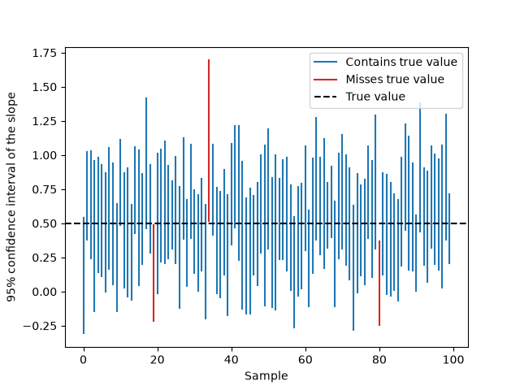

# 第 5 章: 推論（検定と信頼区間）

## 5.1 この章の地図

回帰分析の結果には、必ず、不確かさがあります。推定値が、真の値からどれだけ離れていそうかを、**標準誤差**で表しました。この章では、それを、仮説検定（t 検定・F 検定）と信頼区間にして、「係数は 0 ではないと言えるか」「真の値は、どの範囲にありそうか」に答えます。「95% 信頼区間」が、実際に、95% の割合で真の値を含むのか、検定の誤りの確率は、有意水準どおりか、を、シミュレーションで確かめます。



| 項目 | 内容 |
| :--- | :--- |
| 計量経済学の題材 | t 検定、p 値（両側・片側）、信頼区間、F 検定、検定の大きさ（有意水準）と検出力 |
| 使う Python の機能 | データクラス、`scipy.stats`（t 分布・F 分布）、pandas の表、乱数の生成器 |
| 新しく導入するライブラリ | なし |
| 完成形 | `TestResult`、`t_statistics`、`p_value`、`confidence_interval`、`f_test`、`slope_intervals`、`coverage_rate`、`rejection_rate` |
| ファイル | 実装: `lib/chapter05/inference.py`、`lib/chapter05/plot.py`（図）／テスト: `test/chapter05/test_inference.py`、`test/chapter05/test_plot.py`（自分で書くときは、`practice/chapter05/` に、同じ名前で作ります） |
| データ | 手計算の例と、母集団の式から作った乱数 |

### 計量経済学の式とコードの対応

| 計量経済学 | 式 | コード |
| :--- | :--- | :--- |
| t 値 | t = (β̂ − β₀) ÷ SE(β̂) | `t_statistics(result, null)` |
| p 値（両側） | P(\|T\| ≥ \|t\|)。T は自由度 n − k の t 分布 | `p_value(t, df)` |
| 信頼区間 | β̂ ± t(1 − α/2, n − k) × SE(β̂) | `confidence_interval(result, level)` |
| F 統計量 | F = ((RSS_r − RSS_u) ÷ q) ÷ (RSS_u ÷ (n − k)) | `f_test(y, x, zero)` |
| 被覆率 | 信頼区間が、真の値を含む割合 | `coverage_rate(n, repetitions, level, rng)` |
| 棄却率 | 検定が、帰無仮説を棄却する割合 | `rejection_rate(...)` |

> **記号について**: β₀ は帰無仮説の値、RSS_r・RSS_u は、制約付き・制約なしの回帰の残差平方和、q は制約の数です。一覧は、[記号について](how-to-read.md#symbols) を参照してください。

### 前提とする章

| できること | 章 |
| :--- | :--- |
| t 分布・F 分布の臨界値、t² = F | [第 1 章](01-statistics-review.md) |
| 重回帰の係数・標準誤差・自由度 | [第 3 章](03-multiple-regression.md) |

## 5.2 準備

```bash
cd apps/econometrics-programming/python
uv sync
uv run pytest test/chapter05
```

```text
23 passed
```

自分でコードを書くときは、`practice/chapter05/` に、完成形と同じ名前（`inference.py`・`test_inference.py`）のファイルを作ります。

## 5.3 予想する

第 2 章の例（x = 1、2、3、4、y = 2、4、5、9）で、傾きの推定値は 2.2、標準誤差は 0.4243、自由度は 2 でした。

1. 「傾きは 0」という仮説の t 値は、いくつですか。この値は、有意水準 5% で、棄却できますか（自由度 2 の t 分布の 97.5% 点は 4.30 でした）
2. 傾きの 95% 信頼区間は、どのくらいの幅ですか。0 を含みますか
3. 「傾きは 0」の t 検定で、棄却されなかった場合、「傾きは 0 である」と結論してよいですか
4. 「95% 信頼区間」を、標本を取り直して 2000 回作ると、そのうち、真の値を含むのは、何回くらいですか

## 5.4 推論の考え方

### 仮説検定

**帰無仮説**（例: 傾き = 0）が正しいとして、データが得られる確からしさを調べます。

1. 検定統計量 t = (β̂ − β₀) ÷ SE(β̂) を計算する。誤差が正規分布なら、t は、帰無仮説の下で、自由度 n − k の t 分布に従う
2. **p 値**は、帰無仮説の下で、今の t 値以上に極端な値が出る確率。小さいほど、帰無仮説と合わない
3. p 値が**有意水準**（例: 5%）より小さければ、帰無仮説を棄却する

対立仮説が「傾き ≠ 0」なら両側検定、「傾き > 0」なら片側検定です。

### 信頼区間

95% 信頼区間は、β̂ ± (t の臨界値) × SE(β̂) です。「標本を取り直して、同じ方法で区間を作ると、95% の区間が、真の値を含む」という意味です。**1 つの区間が、95% の確率で真の値を含む、ではありません**（真の値は固定、区間のほうが標本ごとに変わります）。

### F 検定

複数の係数が、同時に 0 という仮説（**制約**）は、F 検定で調べます。制約を課した回帰の残差平方和（RSS_r）と、課さない回帰（RSS_u）を比べます。制約が正しければ、RSS_r と RSS_u は、ほぼ同じになります。制約が 1 つなら、**F = t²** で、p 値も一致します（第 1 章の t² = F の関係）。

### 検定の誤り

帰無仮説が正しいのに棄却する誤りの確率が、**有意水準**です。帰無仮説が誤っているときに、正しく棄却する確率が、**検出力**です。標本が大きいほど、帰無仮説が真の値から遠いほど、検出力は高くなります。

## 5.5 Red → Green → Refactor

### Red: t 値と p 値のテスト

手計算で、傾きの t 値は 2.2 ÷ √0.18 ≈ 5.1854 です。切片の標準誤差は √(0.9 × (1/4 + 2.5²/5)) = √1.35 なので、切片の t 値は −0.5 ÷ √1.35 ≈ −0.4303 です。

```python
import numpy as np
import pandas as pd
import pytest
import statsmodels.api as sm
from scipy import stats

from lib.chapter03.multiple import fit_ols
from lib.chapter05.inference import t_statistics

X = [1, 2, 3, 4]
Y = [2, 4, 5, 9]
```

```python
def test_手計算の例のt値() -> None:
    t = t_statistics(fit_ols(Y, X))
    assert t["x1"] == pytest.approx(2.2 / 0.18**0.5)
    assert t["const"] == pytest.approx(-0.5 / 1.35**0.5)


def test_帰無仮説の値を変えるとt値が変わる() -> None:
    result = fit_ols(Y, X)
    t = t_statistics(result, null=2.0)
    assert t["x1"] == pytest.approx(0.2 / 0.18**0.5)
```

### Green: t 値・p 値を実装する

```python
@dataclass(frozen=True)
class TestResult:
    """検定の結果（検定統計量と p 値）。"""

    __test__ = False  # pytest が、テストのクラスと間違えないようにする

    statistic: float
    p_value: float


def t_statistics(result: OlsResult, null: float = 0.0) -> pd.Series:
    """t 値 = (係数 − 帰無仮説の値) ÷ 標準誤差。"""
    return (result.coefficients - null) / result.standard_errors


def p_value(t: float, df: float, alternative: str = "two-sided") -> float:
    """t 値の p 値。対立仮説は two-sided（両側）・greater・less。"""
    if alternative == "two-sided":
        return float(2 * stats.t.sf(abs(t), df))
    if alternative == "greater":
        return float(stats.t.sf(t, df))
    if alternative == "less":
        return float(stats.t.cdf(t, df))
    raise ValueError(f"知らない対立仮説: {alternative}")
```

p 値は、両側が 2 × P(T > |t|)、片側が P(T > t) または P(T < t) です。両側と片側の関係と、t = 0 のときの値をテストにします。

```python
def test_p値は両側と片側で関係する() -> None:
    two = p_value(5.185, 2)
    assert two == pytest.approx(2 * stats.t.sf(5.185, 2))
    assert p_value(5.185, 2, "greater") == pytest.approx(two / 2)
    assert p_value(-5.185, 2, "less") == pytest.approx(two / 2)
    assert p_value(5.185, 2, "less") == pytest.approx(1 - two / 2)


def test_t値が0ならp値は1と半分() -> None:
    assert p_value(0, 10) == pytest.approx(1)
    assert p_value(0, 10, "greater") == pytest.approx(0.5)


def test_知らない対立仮説は受け付けない() -> None:
    with pytest.raises(ValueError, match="対立仮説"):
        p_value(1, 10, "bigger")
```

### 信頼区間

```python
def confidence_interval(result: OlsResult, level: float = 0.95) -> pd.DataFrame:
    """係数の信頼区間 = 係数 ± t の臨界値 × 標準誤差。"""
    critical = float(stats.t.ppf(1 - (1 - level) / 2, result.df_resid))
    half = critical * result.standard_errors
    return pd.DataFrame(
        {"lower": result.coefficients - half, "upper": result.coefficients + half}
    )
```

```python
def test_手計算の例の信頼区間() -> None:
    interval = confidence_interval(fit_ols(Y, X))
    half = 4.302653 * 0.18**0.5
    assert interval.loc["x1", "lower"] == pytest.approx(2.2 - half, abs=1e-5)
    assert interval.loc["x1", "upper"] == pytest.approx(2.2 + half, abs=1e-5)


def test_信頼区間はstatsmodelsと一致する() -> None:
    df = random_data()
    x = df[["x1", "x2"]]
    interval = confidence_interval(fit_ols(df["y"], x), level=0.9)
    reference = sm.OLS(df["y"], sm.add_constant(x)).fit().conf_int(alpha=0.1)
    assert interval.to_numpy() == pytest.approx(reference.to_numpy())


def test_水準が高いほど区間は広い() -> None:
    result = fit_ols(Y, X)
    narrow = confidence_interval(result, 0.9).loc["x1"]
    wide = confidence_interval(result, 0.99).loc["x1"]
    assert wide["upper"] - wide["lower"] > narrow["upper"] - narrow["lower"]
```

```python
import pandas as pd

from lib.chapter03.multiple import fit_ols
from lib.chapter05.inference import confidence_interval, f_test, p_value, t_statistics

x = [1, 2, 3, 4]
y = [2, 4, 5, 9]
result = fit_ols(y, x)
t = t_statistics(result)
print(t.round(4).to_dict(), result.df_resid)
print({k: round(p_value(v, 2), 4) for k, v in t.items()})
print(confidence_interval(result).round(4))
print(confidence_interval(result, 0.99).round(4).loc["x1"].to_dict())
```

```text
{'const': -0.4303, 'x1': 5.1854} 2
{'const': 0.7089, 'x1': 0.0352}
        lower   upper
const -5.4992  4.4992
x1     0.3745  4.0255
{'lower': -2.0108, 'upper': 6.4108}
```

傾きの t 値は 5.1854、p 値は 0.0352 で、5% では棄却されます（予想 1）。95% 信頼区間は 0.3745 から 4.0255 で、0 を含みません（予想 2）。ただし、**幅は約 3.65 と、とても広い**です。観測値が 4 つ（自由度 2）しかないので、t の臨界値が 4.30 と大きいためです。99% 水準では、区間は −2.01 から 6.41 に広がり、0 を含みます。**有意かどうかは、水準で変わります。**

### F 検定

```python
def _rss(y: ArrayLike, x: pd.DataFrame) -> tuple[float, int]:
    """残差平方和と、残差の自由度。説明変数がなければ、定数項だけの回帰。"""
    if x.shape[1] == 0:
        values = np.asarray(y, dtype=float)
        return float(np.sum((values - values.mean()) ** 2)), len(values) - 1
    result = fit_ols(y, x)
    return float(result.residuals @ result.residuals), result.df_resid


def f_test(y: ArrayLike, x: pd.DataFrame, zero: list[str]) -> TestResult:
    """列 zero の係数が、すべて 0 という仮説の F 検定（制約付き回帰との比較）。"""
    rss_full, df_full = _rss(y, x)
    rss_restricted, df_restricted = _rss(y, x.drop(columns=zero))
    q = df_restricted - df_full
    if q == 0:
        raise ValueError("検定する列がない（zero が空）")
    statistic = ((rss_restricted - rss_full) / q) / (rss_full / df_full)
    return TestResult(float(statistic), float(stats.f.sf(statistic, q, df_full)))
```

```python
def test_制約が1つならFはtの2乗でp値も一致する() -> None:
    result = fit_ols(Y, X)
    test = f_test(Y, pd.DataFrame({"x": X}), ["x"])
    t = t_statistics(result)["x1"]
    assert test.statistic == pytest.approx(t**2)
    assert test.statistic == pytest.approx(24.2 / 0.9)
    assert test.p_value == pytest.approx(p_value(t, 2))


def test_複数の制約のF検定はstatsmodelsと一致する() -> None:
    df = random_data()
    test = f_test(df["y"], df[["x1", "x2"]], ["x1", "x2"])
    full = sm.OLS(df["y"], sm.add_constant(df[["x1", "x2"]])).fit()
    assert test.statistic == pytest.approx(full.fvalue)
    assert test.p_value == pytest.approx(full.f_pvalue)


def test_一部の制約のF検定はstatsmodelsと一致する() -> None:
    df = random_data()
    test = f_test(df["y"], df[["x1", "x2"]], ["x2"])
    full = sm.OLS(df["y"], sm.add_constant(df[["x1", "x2"]])).fit()
    restricted = sm.OLS(df["y"], sm.add_constant(df[["x1"]])).fit()
    statistic, p, _ = full.compare_f_test(restricted)
    assert isinstance(test, TestResult)
    assert test.statistic == pytest.approx(statistic)
    assert test.p_value == pytest.approx(p)
```

```python
x = [1, 2, 3, 4]
y = [2, 4, 5, 9]
test = f_test(y, pd.DataFrame({"x": x}), ["x"])
print(round(test.statistic, 4), round(test.p_value, 4), round(t["x1"] ** 2, 4))
```

```text
26.8889 0.0352 26.8889
```

F 統計量は 26.8889 で、t 値の 2 乗（5.1854²）に等しく、p 値も 0.0352 で一致します。複数の制約のときの F 検定も、`statsmodels` の結果と一致することを、テストで確かめました。

### 信頼区間の被覆率

「95% 信頼区間」は、本当に 95% の割合で、真の値を含むでしょうか。真の傾き 0.5 の母集団から、n = 30 の標本を 2000 回取って、区間を作り、真の値を含む割合を数えます。

```python
def slope_intervals(
    n: int, repetitions: int, level: float, rng: np.random.Generator
) -> pd.DataFrame:
    """標本を取り直して、傾きの信頼区間を繰り返し作る（真の傾きは 0.5）。"""
    rows = []
    for _ in range(repetitions):
        x, y = draw_sample(n, 1.0, 0.5, 1.0, rng)
        interval = confidence_interval(fit_ols(y, x), level).loc["x1"]
        rows.append((interval["lower"], interval["upper"]))
    return pd.DataFrame(rows, columns=["lower", "upper"])


def coverage_rate(
    n: int, repetitions: int, level: float, rng: np.random.Generator
) -> float:
    """信頼区間が真の傾き（0.5）を含む割合（被覆率）。水準に近いはず。"""
    table = slope_intervals(n, repetitions, level, rng)
    return float(((table["lower"] <= 0.5) & (0.5 <= table["upper"])).mean())
```

許容誤差は、割合の標準誤差 √(p(1 − p) ÷ 2000) の 4 倍です。

```python
def test_傾きの信頼区間を繰り返し作る() -> None:
    table = slope_intervals(30, 20, 0.95, np.random.default_rng(0))
    assert list(table.columns) == ["lower", "upper"]
    assert len(table) == 20
    assert (table["lower"] < table["upper"]).all()


def test_信頼区間の被覆率は区間の表から数えた割合と一致する() -> None:
    table = slope_intervals(30, 200, 0.95, np.random.default_rng(5))
    expected = ((table["lower"] <= 0.5) & (0.5 <= table["upper"])).mean()
    assert coverage_rate(30, 200, 0.95, np.random.default_rng(5)) == expected


def test_信頼区間の被覆率は水準に近い() -> None:
    rate = coverage_rate(30, 2000, 0.95, np.random.default_rng(0))
    assert rate == pytest.approx(0.95, abs=4 * (0.95 * 0.05 / 2000) ** 0.5)


def test_水準を下げると被覆率も下がる() -> None:
    rate = coverage_rate(30, 2000, 0.8, np.random.default_rng(0))
    assert rate == pytest.approx(0.8, abs=4 * (0.8 * 0.2 / 2000) ** 0.5)
```

```python
import numpy as np

from lib.chapter05.inference import coverage_rate

for level in (0.8, 0.95):
    print(level, coverage_rate(30, 2000, level, np.random.default_rng(0)))
```

```text
0.8 0.8125
0.95 0.953
```

被覆率は、80% 水準で 0.8125、95% 水準で 0.953 でした（予想 4: 2000 回のうち、約 1900 回）。冒頭の図は、100 回のうち、真の値を含まなかったのが、赤の 3 本です（5 本程度が期待されます）。

### 検定の大きさと検出力

帰無仮説が正しいとき（傾き = 0.5 という仮説）の棄却率が、有意水準 5% に近いか、帰無仮説が誤っているとき（傾き = 0.3、傾き = 0）の棄却率（検出力）が、どう変わるかを、見ます。

```python
def rejection_rate(
    n: int,
    repetitions: int,
    true_slope: float,
    null_slope: float,
    significance: float,
    rng: np.random.Generator,
) -> float:
    """傾きが null_slope という仮説を、両側 t 検定で棄却する割合。"""
    rejected = 0
    for _ in range(repetitions):
        x, y = draw_sample(n, 1.0, true_slope, 1.0, rng)
        result = fit_ols(y, x)
        t = t_statistics(result, null_slope)["x1"]
        rejected += p_value(t, result.df_resid) < significance
    return rejected / repetitions
```

```python
def test_帰無仮説が正しいときの棄却率は有意水準に近い() -> None:
    rate = rejection_rate(30, 2000, 0.5, 0.5, 0.05, np.random.default_rng(0))
    assert rate == pytest.approx(0.05, abs=4 * (0.05 * 0.95 / 2000) ** 0.5)


def test_帰無仮説が誤っているほど棄却率は高い() -> None:
    near = rejection_rate(30, 1000, 0.5, 0.3, 0.05, np.random.default_rng(0))
    far = rejection_rate(30, 1000, 0.5, 0.0, 0.05, np.random.default_rng(0))
    assert far > near > 0.05
    assert far > 0.5


def test_検定する列がなければF検定はできない() -> None:
    x = pd.DataFrame({"a": [1.0, 2.0, 3.0, 4.0, 6.0, 7.0]})
    with pytest.raises(ValueError, match="検定する列"):
        f_test([1.0, 3.0, 2.0, 5.0, 4.0, 7.0], x, [])
```

```python
from lib.chapter05.inference import rejection_rate

print(rejection_rate(30, 2000, 0.5, 0.5, 0.05, np.random.default_rng(0)))
for null in (0.3, 0.0):
    print(null, rejection_rate(30, 1000, 0.5, null, 0.05, np.random.default_rng(0)))
```

```text
0.047
0.3 0.19
0.0 0.703
```

正しい仮説を棄却する割合は 0.047 で、有意水準 5% に近い値です。誤った仮説の棄却率は、真の値（0.5）から近い 0.3 で 0.19、遠い 0 で 0.703 です。**真の値に近い仮説は、n = 30 では、ほとんど棄却できません**。棄却されなかったことは、帰無仮説が正しい証拠ではありません（予想 3）。

### 図

`plot_confidence_intervals` は、区間を縦線で描き、真の値を含まないものを赤にします。

```python
def test_区間ごとに縦線を描き最後に真の値の線を引く() -> None:
    ax = plot_confidence_intervals(TABLE, 0.5).axes[0]
    assert len(ax.lines) == 5
    assert [xs(line) for line in ax.lines[:4]] == [[0, 0], [1, 1], [2, 2], [3, 3]]
    assert ys(ax.lines[0]) == pytest.approx([0.3, 0.7])
    assert ys(ax.lines[4]) == [0.5, 0.5]


def test_含む区間と含まない区間で凡例の名前が違う() -> None:
    ax = plot_confidence_intervals(TABLE, 0.5).axes[0]
    labels = [line.get_label() for line in ax.lines]
    assert labels == [
        "Contains true value",
        "Misses true value",
        "_interval",
        "_interval",
        "True value",
    ]


def test_含む区間と含まない区間で色が違う() -> None:
    ax = plot_confidence_intervals(TABLE, 0.5).axes[0]
    colors = [line.get_color() for line in ax.lines[:4]]
    assert colors[0] == colors[3]
    assert colors[1] == colors[2]
    assert colors[0] != colors[1]


def test_真の値を含む区間は青で含まない区間は赤() -> None:
    ax = plot_confidence_intervals(TABLE, 0.5).axes[0]
    assert ax.lines[0].get_color() == "tab:blue"
    assert ax.lines[1].get_color() == "tab:red"
```

```python
def plot_confidence_intervals(intervals: pd.DataFrame, true_value: float) -> Figure:
    """標本ごとの信頼区間を縦線で描く。真の値を含む区間と、含まない区間で色を変える。"""
    fig, ax = plt.subplots()
    seen: set[bool] = set()
    names = {True: "Contains true value", False: "Misses true value"}
    colors = {True: "tab:blue", False: "tab:red"}
    for i, (lower, upper) in enumerate(
        zip(intervals["lower"], intervals["upper"], strict=True)
    ):
        contains = bool(lower <= true_value <= upper)
        label = "_interval" if contains in seen else names[contains]
        seen.add(contains)
        ax.plot([i, i], [lower, upper], color=colors[contains], label=label)
    ax.axhline(true_value, color="black", linestyle="--", label="True value")
    ax.set_xlabel("Sample")
    ax.set_ylabel("95% confidence interval of the slope")
    ax.legend()
    plt.close(fig)
    return fig
```

### 実行結果

```bash
uv run pytest test/chapter05
```

```text
23 passed
```

## 5.6 規則で言うと

1. **有意かどうかは、帰無仮説と水準で決まる。** 同じデータでも、95% では 0 を含まず、99% では含む、ということが起きる
2. **信頼区間は、標本ごとに変わる。** 「この区間が真の値を含む確率が 95%」ではなく、「この方法で作った区間の 95% が、真の値を含む」
3. **棄却されない、は、正しいではない。** 検出力が低いと、誤った帰無仮説も、棄却できない。標本が小さいときは、特に

混同しやすい点を、表にまとめます。

| 混同しやすい点 | 違い |
| :--- | :--- |
| p 値 と 帰無仮説が正しい確率 | p 値は、帰無仮説が正しいとして、今のデータ以上に極端な値が出る確率。帰無仮説が正しい確率ではない |
| 統計的に有意 と 経済的に意味がある | 標本が大きいと、小さな係数も有意になる。係数の大きさ（賃金が何%上がるか）を、必ず読む |
| t 検定 と F 検定 | 1 つの係数なら F = t²。複数の係数を同時に検定するときは、F 検定（t 検定を個別に繰り返すと、誤りの確率が膨らむ） |

### この推論が成り立たない場面

- **t 分布は、誤差が正規分布のときに、正確に成り立ちます。** 標本が大きければ、近似として使えます（第 6 章）
- **標準誤差が不正確だと、すべてが崩れます。** 誤差の分散が一定でないとき（第 8 章）、同じ個人を何度も調べたとき（第 10 章）は、標準誤差を直す必要があります
- **何度も検定を繰り返すと、偶然の有意が混ざります。** 5% の検定を 20 回繰り返すと、すべて帰無仮説が正しくても、約 1 回は棄却されます

## 5.7 練習問題

| 種類 | 問題 |
| :--- | :--- |
| 想起 | 本文を閉じて、「t 値が 0 なら、両側の p 値は 1、片側の p 値は 0.5」のテストを書いてください |
| 生成 | 解説を見る前に、係数 name が、帰無仮説の値 null と等しいという仮説を、有意水準 level の両側 t 検定で棄却するかを返す `reject(result, name, null, level)` を、テストから書いてください。手計算の例で、傾きの null = 0（level = 0.05）は棄却、null = 2.0 は棄却しない、level = 0.01 で null = 0 も棄却しない、ことを確かめてください |
| 多様 | 信頼水準を 0.95 から 0.9 に変えると、被覆率は、いくつに近づきますか。先に予想してから、`coverage_rate` で確かめてください |
| 交互 | [第 1 章](01-statistics-review.md)の `critical_value` と、[第 2 章](02-simple-regression.md)の `slope_standard_error` で、傾きの 95% 信頼区間を、手で組み立ててください。`confidence_interval` の結果と一致しますか |

??? note "解答（先に自分で取り組んでから、開いてください）"

    **想起**:

    ```python
    def test_t値が0のときのp値() -> None:
        assert p_value(0, 5) == pytest.approx(1)
        assert p_value(0, 5, "greater") == pytest.approx(0.5)
    ```

    **生成**: p 値が、有意水準より小さければ、棄却します。手計算の例の p 値は、null = 0 で 0.0352、null = 2.0 で 0.68 です。

    ```python
    def reject(result, name, null, level):
        t = t_statistics(result, null)[name]
        return p_value(t, result.df_resid) < level
    ```

    ```python
    def test_棄却するかどうか() -> None:
        result = fit_ols([2, 4, 5, 9], [1, 2, 3, 4])
        assert reject(result, "x1", 0.0, 0.05)
        assert not reject(result, "x1", 2.0, 0.05)
        assert not reject(result, "x1", 0.0, 0.01)
    ```

    **多様**: 被覆率は、水準と同じ 0.9 に近づきます。水準を下げると、区間は狭くなり、外れる割合が増えます。

    ```python
    def test_90パーセント区間の被覆率は0点9に近い() -> None:
        rate = coverage_rate(30, 2000, 0.9, np.random.default_rng(0))
        assert rate == pytest.approx(0.9, abs=4 * (0.9 * 0.1 / 2000) ** 0.5)
    ```

    **交互**:

    ```python
    def test_信頼区間を手で組み立てる() -> None:
        x, y = [1, 2, 3, 4], [2, 4, 5, 9]
        fit = fit_simple(x, y)
        half = critical_value("t", 0.975, 2) * slope_standard_error(fit, x, y)
        interval = confidence_interval(fit_ols(y, x)).loc["x1"]
        assert interval["lower"] == pytest.approx(fit.slope - half)
        assert interval["upper"] == pytest.approx(fit.slope + half)
    ```

## 5.8 振り返り

- 予想した 4 つは、当たりましたか。「棄却できなかったから、効果がない」と考えてしまいそうな場面を、思い出せますか
- 信頼区間の正しい読み方を、自分の言葉で説明できますか
- 標本が小さいときの、推論の限界を、説明できますか

## 5.9 まとめ

- t 値・p 値（両側・片側）・信頼区間・F 検定を、手計算の値と、`statsmodels` の結果に一致するように書いた。制約が 1 つなら、F = t² で、p 値も一致した
- 手計算の例（n = 4）では、傾きの 95% 信頼区間は 0.3745 から 4.0255（幅 3.65）、99% では 0 を含む。標本が小さいと、結論が水準に左右される
- 信頼区間の被覆率が水準（80%・95%）に近く（0.8125・0.953）、帰無仮説が正しいときの棄却率が 5% に近い（0.047）ことを、シミュレーションで確かめた。誤った仮説の棄却率（検出力）は、真の値から遠いほど高い（0.19 と 0.703）
- 次の章では、標本が大きくなると、推定量がどう振る舞うか（大標本特性）と、誤差が正規分布でないときの検定を調べます
