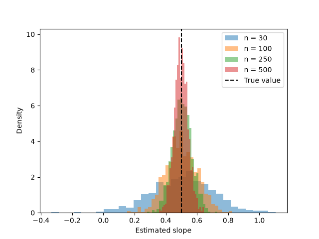

# 第 6 章: 大標本特性

## 6.1 この章の地図

第 5 章の t 検定と信頼区間は、誤差項が正規分布であることを前提にしていました。現実のデータでは、誤差が正規分布とは限りません。それでも、標本が大きければ、t 検定は、ほぼ正しく働きます。これが**大標本特性**（漸近的な性質）です。この章では、標本の大きさを 30 から 500 まで増やして推定値の分布が真の値に集まること（**一致性**）、誤差が歪んでいても、n が大きければ t 値の分布が標準正規分布に近づくこと、を確かめます。正規性を調べる Jarque-Bera 検定と、LM 検定も書きます。最後に、**実際のデータ**（賃金）で、第 1〜6 章の関数を使い、第 1 部の到達チェックを行います。



| 項目 | 内容 |
| :--- | :--- |
| 計量経済学の題材 | 一致性、小標本特性と大標本特性、歪んだ誤差項の下での t 値、歪度・尖度、Jarque-Bera 検定、LM 検定 |
| 使う Python の機能 | NumPy の乱数（指数分布）、pandas の `concat`、乱数の生成器 |
| 新しく導入するライブラリ | wooldridge（実際のデータの節だけ。任意の依存グループ `realdata`） |
| 完成形 | `skewness`、`kurtosis`、`jarque_bera`、`lm_test`、`draw_skewed_sample`、`consistency_experiment`、`t_value_distribution`、`jarque_bera_rejection_rate`、`bootstrap_standard_error` |
| ファイル | 実装: `lib/chapter06/asymptotics.py`、`lib/chapter06/plot.py`（図）／テスト: `test/chapter06/test_asymptotics.py`、`test/chapter06/test_plot.py`（自分で書くときは、`practice/chapter06/` に、同じ名前で作ります） |
| データ | 母集団の式から作った乱数。6.6 節だけ、実際のデータ（`wooldridge` の賃金データ） |

### 計量経済学の式とコードの対応

| 計量経済学 | 式 | コード |
| :--- | :--- | :--- |
| 歪度 | S = m₃ ÷ m₂^(3/2)（m_k は k 次の中心モーメント） | `skewness(x)` |
| 尖度 | K = m₄ ÷ m₂²（正規分布は 3） | `kurtosis(x)` |
| Jarque-Bera 検定 | JB = n ÷ 6 · (S² + (K − 3)² ÷ 4) ~ χ²(2) | `jarque_bera(x)` |
| LM 検定 | LM = n · R²（補助回帰）~ χ²(q) | `lm_test(y, restricted, extra)` |
| 歪んだ誤差 | u = σ · (指数分布 − 1)（平均 0、歪度 2） | `draw_skewed_sample(...)` |

> **記号について**: S は歪度、K は尖度、q は制約の数です。一覧は、[記号について](how-to-read.md#symbols) を参照してください。

### 前提とする章

| できること | 章 |
| :--- | :--- |
| OLS の推定値・標準誤差、標本分布のシミュレーション | [第 2 章](02-simple-regression.md)、[第 3 章](03-multiple-regression.md) |
| t 値・p 値・信頼区間 | [第 5 章](05-inference.md) |

## 6.2 準備

```bash
cd apps/econometrics-programming/python
uv sync
uv run pytest test/chapter06
```

```text
23 passed
```

自分でコードを書くときは、`practice/chapter06/` に、完成形と同じ名前（`asymptotics.py`・`test_asymptotics.py`）のファイルを作ります。

## 6.3 予想する

真の傾きが 0.5 の母集団（誤差の標準偏差 1）から、標本を何度も取って、傾きを推定します。

1. 標本の大きさ n を 30、100、250、500 と増やすと、傾きの推定値の標準偏差は、それぞれ、およそいくつになりますか（第 2 章の理論値 1 ÷ √(n − 3) を使えます）
2. 誤差項が、**正規分布ではなく、右に裾が長い分布**（歪度 2）のとき、n = 10 の t 検定（有意水準 5%）は、帰無仮説が正しいのに、5% より多く棄却しますか。臨界値を 1.96 にした場合と、t 分布の臨界値にした場合で、どうですか。n = 500 なら、どうですか
3. 誤差が歪んでいるとき、Jarque-Bera 検定は、n = 100 で、どのくらいの割合で、正規性を棄却しますか。誤差が正規分布のときは

## 6.4 大標本特性の考え方

### 一致性

標本が大きくなるにつれて、推定量が真の値に確率的に近づくことを、**一致性**といいます。OLS 推定量は、誤差項が説明変数と無関係なら一致性を持ちます。シミュレーションでは、n が増えるほど、推定値の分布が、真の値のまわりに集まります。

### 小標本特性と大標本特性

| 特性 | 必要な前提 | 内容 |
| :--- | :--- | :--- |
| 小標本（有限標本）特性 | 誤差項が正規分布 | n が小さくても、t 値が正確に t 分布に従う |
| 大標本（漸近的な）特性 | 誤差項の分布は、不問（分散が有限なら） | n が大きいと、t 値が標準正規分布に近づく（中心極限定理） |

誤差が正規分布でない場合、小さな標本では、t 検定の有意水準が、名目（5%）からずれます。標本が大きければ、ずれは小さくなります。

### 正規性の検定

正規分布は、歪度が 0、尖度が 3 です。**Jarque-Bera 検定**は、標本の歪度・尖度が、この値から離れている程度を、JB = n ÷ 6 · (S² + (K − 3)² ÷ 4) にまとめます。帰無仮説（正規分布）の下で、JB は、大標本で、自由度 2 のχ² 分布に従います。

### LM 検定

説明変数 x₂ を落とした回帰で、x₂ が必要かを調べる検定の 1 つです。制約付き回帰の残差を、**すべての説明変数で回帰**し、決定係数 R² を求めます。LM = n · R² は、帰無仮説（x₂ の係数が 0）の下で、大標本で、χ²(q) に従います。q は、制約の数です。F 検定と違い、**制約付きの回帰だけを推定して**、補助回帰を 1 つ行えば、検定できます。

## 6.5 Red → Green → Refactor

### Red: 歪度・尖度・Jarque-Bera のテスト

[0, 0, 0, 4] は、平均 1、ずれが −1、−1、−1、3 で、2 次のモーメント 3、3 次のモーメント 6、4 次のモーメント 21 です。歪度は 6 ÷ 3^1.5 = 2 ÷ √3、尖度は 21 ÷ 9 です。n = 4 なので、JB = 4 ÷ 6 · (4/3 + (21/9 − 3)² ÷ 4) = 4 ÷ 6 · (4/3 + 1/9) ≈ 0.9630 です。自由度 2 の χ² 分布の上側確率は exp(−x ÷ 2) なので、p 値は exp(−0.4815) ≈ 0.6179 です。

```python
import math

import numpy as np
import pandas as pd
import pytest
from scipy import stats

from lib.chapter06.asymptotics import jarque_bera, kurtosis, skewness

SKEWED = [0, 0, 0, 4]
```

```python
def test_歪度は左右対称なら0で裾が長い側が正() -> None:
    assert skewness([1, 2, 3, 4, 5]) == pytest.approx(0)
    assert skewness(SKEWED) == pytest.approx(2 / 3**0.5)
    assert skewness([4, 4, 4, 0]) == pytest.approx(-2 / 3**0.5)


def test_尖度() -> None:
    assert kurtosis([-1, 1]) == pytest.approx(1)
    assert kurtosis(SKEWED) == pytest.approx(21 / 9)


def test_正規乱数の歪度は0で尖度は3に近い() -> None:
    x = np.random.default_rng(3).standard_normal(100000)
    assert skewness(x) == pytest.approx(0, abs=0.03)
    assert kurtosis(x) == pytest.approx(3, abs=0.1)


def test_手計算の例のJB統計量とp値() -> None:
    test = jarque_bera(SKEWED)
    assert test.statistic == pytest.approx(4 / 6 * (4 / 3 + 1 / 9))
    assert test.p_value == pytest.approx(math.exp(-test.statistic / 2))


def test_JB検定はstatsmodelsと一致する() -> None:
    x = np.random.default_rng(0).exponential(1.0, 50)
    test = jarque_bera(x)
    statistic, p, _, _ = reference_jarque_bera(x)
    assert isinstance(test, TestResult)
    assert test.statistic == pytest.approx(statistic)
    assert test.p_value == pytest.approx(p)
```

### Green: 歪度・尖度・Jarque-Bera を実装する

```python
def skewness(x: ArrayLike) -> float:
    """歪度 = 3 次の中心モーメント ÷ （2 次の中心モーメント）^(3/2)。"""
    values = np.asarray(x, dtype=float)
    d = values - values.mean()
    if np.mean(d**2) == 0:
        raise ValueError("ばらつきがないので、歪度は計算できない")
    return float(np.mean(d**3) / np.mean(d**2) ** 1.5)


def kurtosis(x: ArrayLike) -> float:
    """尖度 = 4 次の中心モーメント ÷ （2 次の中心モーメント）²。正規分布は 3。"""
    values = np.asarray(x, dtype=float)
    d = values - values.mean()
    if np.mean(d**2) == 0:
        raise ValueError("ばらつきがないので、尖度は計算できない")
    return float(np.mean(d**4) / np.mean(d**2) ** 2)


def jarque_bera(x: ArrayLike) -> TestResult:
    """Jarque-Bera 検定。JB = n ÷ 6 · (歪度² + (尖度 − 3)² ÷ 4) は、χ²(2) に従う。"""
    n = len(np.asarray(x))
    statistic = n / 6 * (skewness(x) ** 2 + (kurtosis(x) - 3) ** 2 / 4)
    return TestResult(float(statistic), float(stats.chi2.sf(statistic, 2)))
```

```python
from lib.chapter06.asymptotics import jarque_bera

print(jarque_bera([0, 0, 0, 4]))
```

```text
TestResult(statistic=0.9629629629629629, p_value=0.6178673543839128)
```

手計算の 0.9630 と 0.6179 に一致します。`statsmodels` の `jarque_bera` と一致することも、テストで確認しています。

### LM 検定

LM 統計量は、n · R²（補助回帰）でした。補助回帰の被説明変数は、制約付き回帰の残差で、その全平方和は、制約付き回帰の残差平方和（RSS_r）に等しく、補助回帰の残差平方和は、制約なしの回帰の残差平方和（RSS_u）に等しくなります。したがって、**LM = n · (1 − RSS_u ÷ RSS_r)** が、ちょうど成り立ちます。この恒等式を、テストにします。

```python
def lm_test(y: ArrayLike, restricted: pd.DataFrame, extra: pd.DataFrame) -> TestResult:
    """LM 検定: extra の係数が 0 という仮説。LM = n · R²（補助回帰）は、χ²(q) に従う。

    補助回帰は、制約付き回帰の残差を、すべての説明変数で回帰したもの。
    """
    residuals = fit_ols(y, restricted).residuals
    full = pd.concat([restricted, extra], axis=1)
    auxiliary = fit_ols(residuals, full)
    statistic = len(residuals) * auxiliary.r_squared
    q = extra.shape[1]
    return TestResult(float(statistic), float(stats.chi2.sf(statistic, q)))
```

```python
def random_data(n: int = 60, seed: int = 0) -> pd.DataFrame:
    rng = np.random.default_rng(seed)
    x1 = rng.standard_normal(n)
    x2 = rng.standard_normal(n)
    y = 1 + 2 * x1 + 0.3 * x2 + rng.standard_normal(n)
    return pd.DataFrame({"y": y, "x1": x1, "x2": x2})


def test_LM統計量は残差平方和の比から決まる() -> None:
    df = random_data()
    test = lm_test(df["y"], df[["x1"]], df[["x2"]])
    rss_restricted = float(np.sum(fit_ols(df["y"], df[["x1"]]).residuals ** 2))
    rss_full = float(np.sum(fit_ols(df["y"], df[["x1", "x2"]]).residuals ** 2))
    assert test.statistic == pytest.approx(60 * (1 - rss_full / rss_restricted))
    assert test.p_value == pytest.approx(stats.chi2.sf(test.statistic, 1))


def test_LM検定は関係のある変数を棄却し関係のない変数を棄却しない() -> None:
    df = random_data(200)
    noise = pd.DataFrame({"noise": np.random.default_rng(9).standard_normal(200)})
    relevant = lm_test(df["y"], df[["x2"]], df[["x1"]])
    irrelevant = lm_test(df["y"], df[["x1"]], noise)
    assert relevant.p_value < 0.001
    # 種を固定した 1 標本の例示。帰無仮説が正しくても、種を変えれば、約 5% で p < 0.05 になる
    assert irrelevant.p_value > 0.05


def test_LM検定は複数の変数を同時に検定できる() -> None:
    df = random_data()
    test = lm_test(df["y"], df[["x1"]], df[["x2"]].assign(x3=df["x2"] ** 2))
    assert test.p_value == pytest.approx(stats.chi2.sf(test.statistic, 2))
```

```python
import numpy as np
import pandas as pd

from lib.chapter06.asymptotics import lm_test

rng = np.random.default_rng(1)
df = pd.DataFrame({"x1": rng.standard_normal(100), "x2": rng.standard_normal(100)})
y = 1 + df["x1"] + rng.standard_normal(100)
print(lm_test(y, df[["x1"]], df[["x2"]]))
y2 = 1 + df["x1"] + 0.5 * df["x2"] + rng.standard_normal(100)
print(lm_test(y2, df[["x1"]], df[["x2"]]))
```

```text
TestResult(statistic=0.023631055605644047, p_value=0.8778273926837962)
TestResult(statistic=31.113580285047014, p_value=2.433627997839447e-08)
```

x₂ が y に無関係なとき（1 つ目）は、p 値 0.88 で、棄却されません。x₂ が関係するとき（2 つ目、真の係数 0.5）は、p 値が 2.4 × 10⁻⁸ で、強く棄却されます。

### 一致性のシミュレーション

標本の大きさごとに、傾きの推定値を、1000 回求めます（真の傾きは 0.5）。

```python
def _draw(
    n: int, skewed: bool, rng: np.random.Generator
) -> tuple[NDArray[np.float64], NDArray[np.float64]]:
    draw = draw_skewed_sample if skewed else draw_sample
    return draw(n, 1.0, 0.5, 1.0, rng)


def consistency_experiment(
    sample_sizes: list[int], repetitions: int, rng: np.random.Generator
) -> dict[int, NDArray[np.float64]]:
    """標本の大きさごとに、傾きの推定値を繰り返し求める（真の傾きは 0.5）。"""
    estimates = {}
    for n in sample_sizes:
        slopes = []
        for _ in range(repetitions):
            x, y = _draw(n, False, rng)
            slopes.append(fit_ols(y, x).coefficients["x1"])
        estimates[n] = np.array(slopes)
    return estimates
```

```python
def test_標本が大きいほど傾きの推定値は真の値に集まる() -> None:
    estimates = consistency_experiment(
        [30, 100, 250, 500], 1000, np.random.default_rng(0)
    )
    assert list(estimates) == [30, 100, 250, 500]
    sds = []
    for n, slopes in estimates.items():
        assert len(slopes) == 1000
        assert slopes.mean() == pytest.approx(0.5, abs=4 * slopes.std() / 1000**0.5)
        assert slopes.std(ddof=1) == pytest.approx(1 / (n - 3) ** 0.5, rel=0.1)
        sds.append(slopes.std(ddof=1))
    assert sds == sorted(sds, reverse=True)
```

```python
import numpy as np

from lib.chapter06.asymptotics import consistency_experiment

estimates = consistency_experiment([30, 100, 250, 500], 1000, np.random.default_rng(0))
for n, slopes in estimates.items():
    print(n, round(float(slopes.mean()), 4), round(float(slopes.std(ddof=1)), 4), round(1 / (n - 3) ** 0.5, 4))
```

```text
30 0.5037 0.1971 0.1925
100 0.5001 0.1011 0.1015
250 0.5043 0.0622 0.0636
500 0.4986 0.0447 0.0449
```

列は、n、推定値の平均、標準偏差、理論値 1 ÷ √(n − 3) です。平均はどの n でも 0.5 に近く、標準偏差は、理論値どおりに小さくなります（予想 1）。n が 5 倍（100 → 500）になると、標準偏差は約 0.44 倍（0.1011 → 0.0447）で、理論値 1 ÷ √5 ≈ 0.447 のとおりです。

### 誤差が正規分布でないとき

誤差を、平均 0 に直した指数分布（右に裾が長い、歪度 2）にします。

```python
def draw_skewed_sample(
    n: int, intercept: float, slope: float, sigma: float, rng: np.random.Generator
) -> tuple[NDArray[np.float64], NDArray[np.float64]]:
    """誤差項が正規分布でない（平均 0 に直した指数分布。歪度 2）標本を作る。"""
    x = rng.standard_normal(n)
    u = sigma * (rng.exponential(1.0, n) - 1.0)
    return x, intercept + slope * x + u


def t_value_distribution(
    n: int, repetitions: int, skewed: bool, rng: np.random.Generator
) -> NDArray[np.float64]:
    """真の傾きを帰無仮説にした t 値 (傾き − 0.5) ÷ 標準誤差を、繰り返し求める。"""
    values = []
    for _ in range(repetitions):
        x, y = _draw(n, skewed, rng)
        result = fit_ols(y, x)
        values.append((result.coefficients["x1"] - 0.5) / result.standard_errors["x1"])
    return np.array(values)
```

```python
def test_歪んだ誤差は平均0で歪度が2に近い() -> None:
    x, y = draw_skewed_sample(100000, 1.0, 0.5, 1.0, np.random.default_rng(0))
    u = y - 1.0 - 0.5 * x
    assert np.mean(u) == pytest.approx(0, abs=0.02)
    assert skewness(u) == pytest.approx(2, abs=0.15)
    assert np.std(u) == pytest.approx(1, abs=0.02)


def test_誤差の大きさで歪んだ誤差も比例する() -> None:
    _, y1 = draw_skewed_sample(1000, 0.0, 0.0, 1.0, np.random.default_rng(1))
    _, y3 = draw_skewed_sample(1000, 0.0, 0.0, 3.0, np.random.default_rng(1))
    assert y3 == pytest.approx(3 * y1)


def test_誤差が正規分布ならt値の標準偏差はt分布の理論値に近い() -> None:
    t = t_value_distribution(30, 2000, False, np.random.default_rng(1))
    assert t.mean() == pytest.approx(0, abs=0.1)
    assert t.std() == pytest.approx((28 / 26) ** 0.5, rel=0.05)


def test_標本が大きければ誤差が歪んでいてもt値は標準正規に近い() -> None:
    t = t_value_distribution(500, 2000, True, np.random.default_rng(1))
    assert t.std() == pytest.approx(1, abs=0.05)
    assert np.mean(np.abs(t) > 1.96) == pytest.approx(
        0.05, abs=4 * (0.05 * 0.95 / 2000) ** 0.5
    )


def test_小標本で臨界値1_96を使うと棄却率が超えるがt分布の臨界値なら5パーセントに近い() -> (
    None
):
    critical = stats.t.ppf(0.975, 8)
    for skewed in (False, True):
        t = t_value_distribution(10, 2000, skewed, np.random.default_rng(1))
        assert np.mean(np.abs(t) > 1.96) > 0.07
        assert np.mean(np.abs(t) > critical) == pytest.approx(
            0.05, abs=4 * (0.05 * 0.95 / 2000) ** 0.5
        )
```

真の傾きを帰無仮説にした t 値 (β̂ − 0.5) ÷ SE を、2000 回求め、平均・標準偏差と、棄却される割合を、見ます。割合は、臨界値を正規分布の 1.96 にした場合と、自由度 n − 2 の t 分布の臨界値にした場合の 2 つです。

```python
from scipy import stats

for n, skewed in [(10, False), (10, True), (30, True), (500, True)]:
    t = t_value_distribution(n, 2000, skewed, np.random.default_rng(1))
    critical = stats.t.ppf(0.975, n - 2)
    print(n, skewed, round(float(t.mean()), 3), round(float(t.std()), 3), float(np.mean(np.abs(t) > 1.96)), float(np.mean(np.abs(t) > critical)))
```

```text
10 False 0.009 1.118 0.0815 0.0445
10 True 0.051 1.138 0.0775 0.048
30 True -0.014 1.058 0.061 0.049
500 True 0.006 0.995 0.0505 0.0495
```

列は、n、誤差が歪んでいるか、t 値の平均、標準偏差、|t| > 1.96 の割合、|t| > t 分布の臨界値の割合です。

- **臨界値を 1.96 にすると、n = 10 では、誤差が正規分布でも 0.0815 と、5% を超えます。** 原因は、誤差の歪みではなく、**自由度 8 の t 分布の裾が、正規分布より厚いこと**です（誤差が正規なら、理論値は 0.0857）。歪んだ誤差の 0.0775 も、同じ理由です
- **t 分布の臨界値（n = 10 で 2.306）を使うと、歪んだ誤差でも、0.048 と、ほぼ 5% です。** この歪み（歪度 2）では、n = 10 でも、t 検定の有意水準は、ほとんどずれません
- n = 500 では、どちらの臨界値でも、0.05 に近く（0.0505、0.0495）、標準偏差も 1 に近い（0.995）です（予想 2）。n が大きければ、1.96 でも t 分布の臨界値でも、ほぼ同じです

**誤差が正規分布でなくても、この歪みなら、t 検定は、ほぼ正しい**ことが、確かめられました（歪みがもっと強い場合は、ずれが大きくなります）。

### 正規性の検定の、棄却率

```python
def jarque_bera_rejection_rate(
    n: int, repetitions: int, skewed: bool, rng: np.random.Generator
) -> float:
    """残差の Jarque-Bera 検定を、有意水準 5% で棄却する割合。"""
    rejected = 0
    for _ in range(repetitions):
        x, y = _draw(n, skewed, rng)
        rejected += jarque_bera(fit_ols(y, x).residuals).p_value < 0.05
    return rejected / repetitions
```

```python
def test_JB検定は歪んだ誤差を棄却し正規の誤差をほとんど棄却しない() -> None:
    skewed = jarque_bera_rejection_rate(100, 500, True, np.random.default_rng(2))
    normal = jarque_bera_rejection_rate(100, 500, False, np.random.default_rng(2))
    assert skewed > 0.95
    assert normal < 0.08


def test_ばらつきのない列では歪度も尖度も計算できない() -> None:
    for function in (skewness, kurtosis):
        with pytest.raises(ValueError, match="ばらつき"):
            function([3.0, 3.0, 3.0])
```

```python
from lib.chapter06.asymptotics import jarque_bera_rejection_rate

for skewed in (False, True):
    print(skewed, jarque_bera_rejection_rate(100, 1000, skewed, np.random.default_rng(2)))
```

```text
False 0.038
True 1.0
```

誤差が正規分布のとき、棄却率は 0.038（有意水準 5% より少し小さい）で、歪んだ誤差のときは、n = 100 で、すべての標本で棄却されました（予想 3）。

### ブートストラップ標準誤差

標準誤差の公式がない統計量（中央値など）や、公式が複雑な統計量（第 16 章のヘックマンの 2 段階推定）では、**標本から復元抽出を繰り返して、統計量のばらつきを、計算で求める**方法があります。これが**ブートストラップ**です。

1. 手元の標本（n 個）から、n 個を、**同じ値を何度選んでもよい**（復元抽出）として、選び直す
2. 選び直した標本で、統計量（平均・中央値など）を求める
3. 1〜2 を、何百回も繰り返し、統計量の**標準偏差**を求める。これがブートストラップ標準誤差

```python
def test_ブートストラップ標準誤差は復元抽出を繰り返した統計量の標準偏差() -> None:
    values = np.array([1.0, 2.0, 4.0, 8.0, 16.0])
    rng = np.random.default_rng(3)
    expected_rng = np.random.default_rng(3)
    draws = [
        values[expected_rng.integers(0, len(values), len(values))].mean()
        for _ in range(5)
    ]
    assert bootstrap_standard_error(values, np.mean, 5, rng) == pytest.approx(
        np.std(draws, ddof=1)
    )


def test_標本平均のブートストラップ標準誤差は公式の標準誤差に近い() -> None:
    values = np.random.default_rng(0).standard_normal(200)
    formula = values.std(ddof=1) / np.sqrt(len(values))
    boot = bootstrap_standard_error(values, np.mean, 2000, np.random.default_rng(1))
    # 許容誤差: ブートストラップ回数 2000 での標準偏差の推定誤差（約 1.6%）の 4 倍
    assert boot == pytest.approx(formula, rel=0.07)


def test_中央値のように公式のない統計量にも使える() -> None:
    values = np.random.default_rng(0).standard_normal(200)
    boot = bootstrap_standard_error(values, np.median, 500, np.random.default_rng(1))
    mean_boot = bootstrap_standard_error(values, np.mean, 500, np.random.default_rng(1))
    assert boot > mean_boot  # 正規分布の標本では、中央値のほうがばらつく（約 1.25 倍）


def test_ブートストラップの回数が2未満なら標準偏差を求められない() -> None:
    with pytest.raises(ValueError, match="2 回以上"):
        bootstrap_standard_error([1.0, 2.0], np.mean, 1, np.random.default_rng(0))
```

```python
def bootstrap_standard_error(
    values: ArrayLike,
    statistic: Callable[[NDArray[np.float64]], float],
    repetitions: int,
    rng: np.random.Generator,
) -> float:
    """ブートストラップ標準誤差。標本から復元抽出を繰り返し、統計量の標準偏差を求める。

    公式のない統計量（中央値など）や、公式が複雑な統計量の標準誤差を、計算だけで求められる。
    """
    if repetitions < 2:
        raise ValueError("ブートストラップは 2 回以上、繰り返す必要がある")
    data = np.asarray(values, dtype=float)
    draws = [
        statistic(data[rng.integers(0, len(data), len(data))])
        for _ in range(repetitions)
    ]
    return float(np.std(draws, ddof=1))
```

標本平均では、公式の標準誤差 s ÷ √n と、比べられます。

```python
from lib.chapter06.asymptotics import bootstrap_standard_error

values = np.random.default_rng(0).standard_normal(200)
formula = values.std(ddof=1) / np.sqrt(len(values))
boot_mean = bootstrap_standard_error(values, np.mean, 2000, np.random.default_rng(1))
boot_median = bootstrap_standard_error(values, np.median, 2000, np.random.default_rng(1))
print(round(float(formula), 4), round(boot_mean, 4), round(boot_median, 4))
```

```text
0.0681 0.0676 0.0968
```

標本平均では、公式の 0.0681 と、ブートストラップの 0.0676 が、ほぼ一致します。**ブートストラップは、公式がある場合に、公式と同じ値を返す**ので、信頼できます。中央値には、簡単な公式がありませんが、ブートストラップで 0.0968 と求められます（平均より大きく、中央値のほうが、ばらつきます）。第 16 章では、ヘックマンの 2 段階推定の標準誤差を、この方法で求めます。

### 図

`plot_estimate_distributions` は、標本の大きさごとのヒストグラム（密度）と、真の値の線を描きます。テストは、密度のヒストグラムの面積が 1 になることを確かめます。

```python
def test_標本の大きさごとにヒストグラムを描き真の値の線を引く() -> None:
    ax = plot_estimate_distributions(ESTIMATES, 0.5).axes[0]
    assert len(ax.patches) == 2 * 30
    legend = ax.get_legend()
    assert legend is not None
    assert [t.get_text() for t in legend.get_texts()] == [
        "n = 30",
        "n = 500",
        "True value",
    ]
    assert [line.get_label() for line in ax.lines] == ["True value"]


def test_ヒストグラムは密度で描き面積は1() -> None:
    ax = plot_estimate_distributions(ESTIMATES, 0.5).axes[0]
    bars: list[Any] = list(ax.patches)
    for patches in (bars[:30], bars[30:]):
        area = sum(p.get_height() * p.get_width() for p in patches)
        assert area == pytest.approx(1)
```

```python
def plot_estimate_distributions(
    estimates: Mapping[int, NDArray[np.float64]], true_value: float
) -> Figure:
    """標本の大きさごとの推定値のヒストグラム（密度）と、真の値の線を描く。"""
    fig, ax = plt.subplots()
    for n, values in estimates.items():
        ax.hist(values, bins=30, density=True, alpha=0.5, label=f"n = {n}")
    ax.axvline(true_value, color="black", linestyle="--", label="True value")
    ax.set_xlabel("Estimated slope")
    ax.set_ylabel("Density")
    ax.legend()
    plt.close(fig)
    return fig
```

### 実行結果

```bash
uv run pytest test/chapter06
```

```text
23 passed
```

## 6.6 実際のデータで試す（賃金）

ここまでは、真の値を知っている乱数のデータで試しました。最後に、**実際のデータ**で、第 1〜6 章の関数を、そのまま使います。

### データを取得する

教科書 Wooldridge, *Introductory Econometrics: A Modern Approach*（Cengage）のデータが、`wooldridge` パッケージ（MIT ライセンス、バージョン 0.5.0）で配布されています。この記事では、賃金のデータ `wage1` を使います。パッケージの説明によると、1976 年の米国の Current Population Survey（現在人口調査）のデータで、Henry Farber 氏が収集したものです。

| 項目 | 内容 |
| :--- | :--- |
| 入手先 | `wooldridge` パッケージ（`pip` で取得する。リポジトリには、データを入れません） |
| 導入 | `uv run --group realdata ...`（任意の依存グループ。テストと CI には、不要です） |
| データの利用条件 | **確認していません**。データそのものは、教科書のものです。各自で確認し、使うときは、教科書を出典に明記してください |
| 引用 | Wooldridge, J. M., *Introductory Econometrics: A Modern Approach*, Cengage Learning |

### ファイルの形（実物で確かめたこと）

`wooldridge.data("wage1")` は、`DataFrame` を返します。**526 行、24 列**です。この節で使う列は、`wage`（平均の時間当たり賃金。パッケージの説明に、通貨の単位は書かれていません）、`educ`（教育年数）、`exper`（潜在的な経験年数。パッケージの説明の語は "years potential experience"）です。`wage` の平均は 5.896、最小は 0.53、最大は 24.98、`educ` の平均は 12.563、`exper` の平均は 17.017 でした。

### 自分の関数を、実際のデータに使う

次のスクリプトを、`practice/chapter06/wage1.py` として保存し、アプリの根（`apps/econometrics-programming/python/`）で、`uv run --group realdata python -m practice.chapter06.wage1` で実行します。

このスクリプトは、完成形（`lib/`）の関数を使います。自分で書いた関数で試すときは、`from lib.chapterNN.` を `from practice.chapterNN.` に書き換えます（ファイル名と関数名を、完成形と同じにしてあれば、そのまま動きます）。書き換えた結果が、完成形と同じ出力になれば、自作の関数が、実際のデータでも動いたことになります。

```python
import numpy as np
import wooldridge

from lib.chapter03.multiple import fit_ols, percent_effect
from lib.chapter05.inference import confidence_interval, f_test, t_statistics
from lib.chapter06.asymptotics import jarque_bera, skewness

df = wooldridge.data("wage1")
print(df.shape)
x = df[["educ", "exper"]]
for name, y in [("wage", df["wage"]), ("log(wage)", np.log(df["wage"]))]:
    result = fit_ols(y, x)
    test = jarque_bera(result.residuals)
    print(name, result.coefficients.round(4).to_dict(), round(result.r_squared, 4))
    print("  skewness", round(skewness(result.residuals), 3), "JB", round(test.statistic, 2))

result = fit_ols(np.log(df["wage"]), x)
print(result.standard_errors.round(4).to_dict())
print(t_statistics(result).round(3).to_dict())
print(confidence_interval(result).round(4).loc["educ"].to_dict())
print(round(percent_effect(result.coefficients["educ"]), 2))
test = f_test(np.log(df["wage"]), x, ["educ", "exper"])
print(round(test.statistic, 2), test.p_value)
```

```text
(526, 24)
wage {'const': -3.3905, 'educ': 0.6443, 'exper': 0.0701} 0.2252
  skewness 1.715 JB 727.16
log(wage) {'const': 0.2169, 'educ': 0.0979, 'exper': 0.0103} 0.2493
  skewness 0.165 JB 9.49
{'const': 0.1086, 'educ': 0.0076, 'exper': 0.0016}
{'const': 1.997, 'educ': 12.848, 'exper': 6.653}
{'lower': 0.083, 'upper': 0.1129}
10.29
86.86 2.678596029954473e-33
```

読み方です。

- **賃金の水準**を被説明変数にすると、残差の歪度は 1.715 と大きく右に歪み、JB は 727 で、正規性は強く棄却されます。**対数**にすると、歪度は 0.165、JB は 9.49 に下がります（まだ 5% で棄却されますが、n = 526 と大きいので、t 検定は、大標本特性により、ほぼ正しく働きます）
- 対数賃金の回帰で、教育年数の係数は 0.0979 です。**教育が 1 年増えると、賃金が約 10.3% 高い**関係です（`percent_effect` で 10.29%）。標準誤差は 0.0076、95% 信頼区間は 0.083 から 0.1129 で、およそ 8%〜11% の幅です
- 潜在的な経験年数の係数は 0.0103（1 年で約 1%）、t 値は 6.653 です
- 2 つの係数が同時に 0 という F 検定は、F = 86.86 で、p 値は 10⁻³³ です。決定係数は 0.2493 で、賃金の変動の約 4 分の 1 を、この 2 変数で説明しています

> **ここで言えること、言えないこと。** この回帰は、「教育年数が長い人は、賃金が高い」という**相関**を示します。「教育が賃金を上げる」という**因果**を、これだけで言うことはできません。能力など、教育年数と賃金の両方に影響する要因が、回帰に入っていないためです（欠落変数バイアス。第 11 章）。

## 6.7 規則で言うと

1. **標本が大きいと、推定量は真の値に集まる。** 標準偏差は 1 ÷ √n の速さで小さくなる（一致性）
2. **誤差が正規でなくても、n が大きければ、t 検定は、ほぼ正しい。** 小さな標本では、正規分布の臨界値（1.96）を使うと、棄却しすぎる（t 分布の臨界値を使う）。歪みが強いと、さらにずれる
3. **仮定は、診断してから使う。** 残差の歪度・尖度（JB 検定）と図で、正規性を調べる。賃金のように歪む変数は、対数をとる

混同しやすい点を、表にまとめます。

| 混同しやすい点 | 違い |
| :--- | :--- |
| 不偏性 と 一致性 | 不偏性は、どの n でも、平均して真の値に等しい（小標本特性）。一致性は、n を大きくすると、真の値に近づく（大標本特性） |
| F 検定 と LM 検定 | どちらも、制約の検定。F 検定は、制約なしの回帰も推定する。LM 検定は、制約付きの回帰と、補助回帰で足りる。大標本では、同じ結論になる |
| 検定で正規性を棄却 と t 検定が使えない | n が大きければ、正規性が棄却されても、t 検定は、近似として使える。n が小さいときに、問題になる |

### この結果が成り立たない場面

- **一致性は、誤差項が説明変数と無関係なことが必要です。** 無関係でない（内生性）と、n を増やしても、真の値に近づきません（第 11 章）
- **大標本特性は、「大きい」の基準がありません。** 歪みが強い、外れ値がある、と、必要な n は、大きくなります。n = 10 で歪んだ誤差だと、棄却率が 7.75% でした
- **標準誤差が不正確なら、大標本でも解決しません。** 誤差のばらつきが一定でない、同じ個人を繰り返し調べた、というときは、標準誤差の計算を直す必要があります（第 8・10 章）

## 6.8 第 1 部の到達チェック

第 1 部（第 1〜6 章）の終わりです。何も見ずに、できるかどうかを、自分で確かめます。

### できること

| できること | 検証の方法 | 戻る章 |
| :--- | :--- | :--- |
| 不偏分散・共分散・相関・標準誤差を求める | [1, 2, 3, 4, 5] の不偏分散 2.5。x = [1, 2, 3]、y = [2, 4, 5] の共分散 1.5 | 第 1 章 |
| 単回帰の傾き・切片・残差・決定係数・標準誤差を求める | x = [1, 2, 3, 4]、y = [2, 4, 5, 9] で、傾き 2.2、切片 −0.5、R² ≈ 0.9308、傾きの標準誤差 ≈ 0.4243。statsmodels と一致する | 第 2 章 |
| 行列で重回帰を解き、FWL と VIF を確かめる | ちょうどの関係から係数を復元する。重回帰の係数 = FWL の傾き。VIF = 1 ÷ (1 − r²) | 第 3 章 |
| 残差を診断する | てこ比の合計 = k。手計算の例で、4 番目の観測値のクックの距離が突出する | 第 4 章 |
| t 検定・信頼区間・F 検定を行う | 傾きの t 値 ≈ 5.185、95% 信頼区間 (0.374, 4.026)。制約が 1 つなら F = t² | 第 5 章 |
| シミュレーションで、推定量の性質を確かめる | 傾きの平均が真の値に一致する。被覆率 ≈ 0.95。n を 4 倍にすると標準偏差が半分 | 第 2・5・6 章 |
| 実際のデータを、先に形を確かめてから分析する | 行数・列・単位を確認してから、関数を使う。水準と対数で、残差の歪みを比べる | 第 6 章（6.6 節） |

### 時間を決めて書く課題

何も見ずに、時間を計って、関数とテストを書きます。

| 課題 | 目安の時間 |
| :--- | :--- |
| 単回帰の傾き・切片・残差・決定係数・傾きの標準誤差の関数と、手計算の例でのテスト | 20 分 |
| t 値・両側の p 値・95% 信頼区間の関数と、F = t² のテスト | 20 分 |
| 標本を取り直して、信頼区間の被覆率を求める関数と、種を固定したテスト | 25 分 |

### 誤りの原因の分類

できなかったときは、原因を分類して、戻る章に戻ります。

| 原因 | 例（第 1 部） | 対策 |
| :--- | :--- | :--- |
| 知らない | 不偏分散の分母 n − 1。残差の自由度 n − k。FWL | 第 1〜3 章に戻る |
| 見抜けない | 棄却できないことは、帰無仮説が正しい証拠ではないこと。要約統計量が同じでも形が違うこと | 第 4・5 章の「成り立たない場面」を読む |
| 混同した | 標準偏差と標準誤差。誤差項と残差。多重共線性（不正確さ）と欠落変数（偏り）。不偏性と一致性 | 各章の「混同しやすい点」の表を読む |
| 手順の誤り | 自由度を n − 1 にしてしまう。残差の和でなく、2 乗の和を使い忘れる。種を固定せず、テストが不安定になる | テストを先に書き、手計算の値と比べる |

## 6.9 練習問題

| 種類 | 問題 |
| :--- | :--- |
| 想起 | 本文を閉じて、歪度の最初のテスト（[1, 2, 3, 4, 5] の歪度が 0、[0, 0, 0, 4] の歪度が 2 ÷ √3）を書いてください |
| 生成 | 解説を見る前に、値の配列のうち、絶対値が critical を超える割合を返す `share_beyond(values, critical)` を、テストから書いてください。[−3, −1, 0.5, 2.5] で、critical = 1.96 のとき、いくつですか |
| 多様 | 誤差が歪んでいるとき、n = 10 と n = 500 で、|t| > 1.96 の割合は、どちらが 5% に近いですか。また、n = 10 で、臨界値を t 分布（自由度 8）にすると、どうなりますか。先に予想してから、`t_value_distribution` で確かめてください |
| 交互 | [第 2 章](02-simple-regression.md)の `sampling_distribution` で求めた傾きの推定値（n = 50、2000 回）の歪度と尖度は、どのくらいですか。誤差が正規分布なら、推定値の分布も、正規分布に近いはずです |

??? note "解答（先に自分で取り組んでから、開いてください）"

    **想起**:

    ```python
    def test_歪度の手計算() -> None:
        assert skewness([1, 2, 3, 4, 5]) == pytest.approx(0)
        assert skewness([0, 0, 0, 4]) == pytest.approx(2 / 3**0.5)
    ```

    **生成**: 絶対値が 1.96 を超えるのは、−3 と 2.5 の 2 つです。4 つのうち 2 つなので、0.5 です。

    ```python
    def share_beyond(values, critical):
        return float(np.mean(np.abs(np.asarray(values)) > critical))
    ```

    ```python
    def test_絶対値が臨界値を超える割合() -> None:
        assert share_beyond([-3, -1, 0.5, 2.5], 1.96) == pytest.approx(0.5)
        assert share_beyond([0, 0], 1.96) == 0
    ```

    **多様**: n = 500 のほうが、5% に近いと予想できます。標本が大きいと、t 分布が標準正規に近づくためです。n = 10 の 0.0775 は、歪みのせいだけではなく、自由度 8 の t 分布の裾が厚いために生じます。臨界値を t 分布の 2.306 にすると、0.048 と、5% に近づきます。

    ```python
    def test_標本が大きいほど棄却率は5パーセントに近い() -> None:
        small = t_value_distribution(10, 2000, True, np.random.default_rng(1))
        large = t_value_distribution(500, 2000, True, np.random.default_rng(1))
        assert abs(share_beyond(large, 1.96) - 0.05) < abs(share_beyond(small, 1.96) - 0.05)
        assert share_beyond(small, 1.96) == pytest.approx(0.0775)
        assert share_beyond(small, 2.306) == pytest.approx(0.048, abs=0.002)
    ```

    **交互**: 誤差が正規分布なら、傾きの推定値の分布は、ほぼ左右対称（歪度 0）で、尖度は 3 に近くなります。観測値は、歪度 0.086、尖度 3.057 です。

    ```python
    def test_傾きの推定値の分布は正規分布に近い() -> None:
        table = sampling_distribution(50, 2000, 1, 0.5, 1, np.random.default_rng(0))
        assert skewness(table["slope"]) == pytest.approx(0, abs=0.2)
        assert kurtosis(table["slope"]) == pytest.approx(3, abs=0.3)
    ```

## 6.10 振り返り

- 予想した 3 つは、当たりましたか。n = 10 と n = 500 の違いは、予想どおりでしたか
- 「不偏性」と「一致性」の違いを、説明できますか
- 実際のデータの分析で、「相関」と「因果」を区別して、書けますか

## 6.11 まとめ

- 標本が大きいほど、傾きの推定値が真の値に集まり、標準偏差が 1 ÷ √(n − 3) の理論値に従って小さくなる（一致性）ことを、シミュレーションで確かめた
- 誤差が右に歪んでいても、n = 500 では、t 値が標準正規分布に近く（棄却率 0.0505）、n = 10 でも、t 分布の臨界値を使えば、5% に近い（0.048）。臨界値を 1.96 にすると、小標本では、誤差の歪みとは別に、棄却しすぎる（0.0775）。歪度・尖度・Jarque-Bera 検定と、LM 検定（LM = n · (1 − RSS_u ÷ RSS_r) の恒等式）を、手計算に一致するように書いた
- 実際の賃金データ（526 人）で、第 1〜6 章の関数を使った。対数賃金の回帰で、教育 1 年あたりの賃金は約 10.3% 高い関係（係数 0.0979、95% 信頼区間 0.083〜0.1129）。この回帰は相関で、因果を示すものではない
- 第 1 部の到達チェックを行った。次の第 2 部では、質的変数（ダミー変数）、不均一分散、パネル・データへ、回帰分析を広げます
