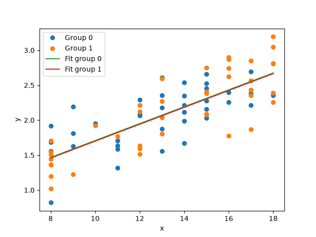
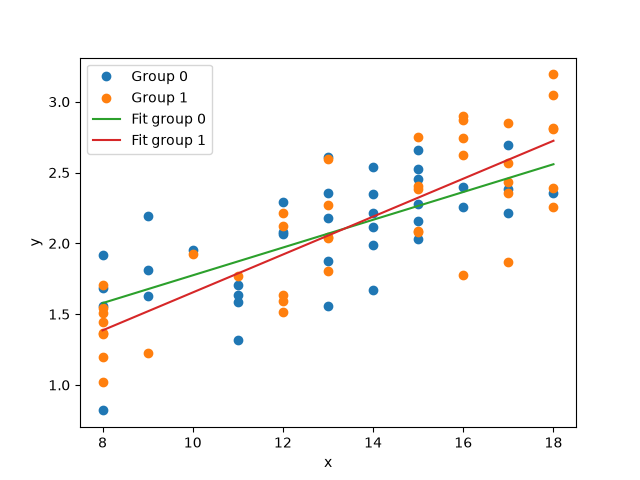

# 第 7 章: ダミー変数とカテゴリー変数

## 7.1 この章の地図

第 2 部は、回帰分析を、現実のデータに近づけます。最初の道具は、**ダミー変数**です。性別・地域・処置の有無のような、数ではない（質的な）変数を、0 と 1 で表して、回帰に入れます。この章では、ダミー変数の係数が、**群の平均の差に、ちょうど等しい**ことを確かめ、傾きも群ごとに変える**交差項**と、カテゴリーが 3 つ以上のときの作り方、そして、すべてのダミー変数を入れると推定できなくなる**ダミー変数の罠**を、関数とテストで確かめます。



| 項目 | 内容 |
| :--- | :--- |
| 計量経済学の題材 | ダミー変数、基準のカテゴリー、交差項、カテゴリー変数、ダミー変数の罠 |
| 使う Python の機能 | pandas の `groupby`・列の計算、`dict` と内包表記、乱数の生成器 |
| 新しく導入するライブラリ | なし |
| 完成形 | `group_means`、`make_dummies`、`has_dummy_trap`、`with_interaction`、`draw_wage_sample` |
| ファイル | 実装: `lib/chapter07/dummies.py`、`lib/chapter07/plot.py`（図）／テスト: `test/chapter07/test_dummies.py`、`test/chapter07/test_plot.py`（自分で書くときは、`practice/chapter07/` に、同じ名前で作ります） |
| データ | 手計算用の 5 つの値と、母集団の式から作った乱数（対数賃金・教育年数・女性ダミー・地域） |

### 計量経済学の式とコードの対応

| 計量経済学 | 式 | コード |
| :--- | :--- | :--- |
| ダミー変数 | d = 1（その群）、0（それ以外） | `make_dummies(values, base)` |
| 切片が違う回帰 | y = α + δ·d + β·x + u | `fit_ols(y, x に d を含める)` |
| 交差項 | y = α + δ·d + β·x + γ·(x·d) + u | `with_interaction(x, d)` |
| 群の平均 | ȳ_g | `group_means(y, groups)` |
| ダミー変数の罠 | 全カテゴリーのダミー変数の和 = 定数項 | `has_dummy_trap(x, constant)` |

> **記号について**: δ はダミー変数の係数、γ は交差項の係数です。一覧は、[記号について](how-to-read.md#symbols) を参照してください。

### 前提とする章

| できること | 章 |
| :--- | :--- |
| 重回帰 `fit_ols`、係数の名前、多重共線性のエラー | [第 3 章](03-multiple-regression.md) |
| F 検定 | [第 5 章](05-inference.md) |

## 7.2 準備

```bash
cd apps/econometrics-programming/python
uv sync
uv run pytest test/chapter07
```

```text
22 passed
```

自分でコードを書くときは、`practice/chapter07/` に、完成形と同じ名前（`dummies.py`・`test_dummies.py`）のファイルを作ります。

## 7.3 予想する

5 人の賃金を、グループ a（3 人）と b（2 人）で比べます。a は 10、12、14、b は 20、22 です。

1. 定数項だけの回帰（y = α + u）の、α の推定値は、いくつですか
2. b なら 1 になるダミー変数を入れた回帰（y = α + δ·d + u）の、α と δ の推定値は、いくつですか
3. 基準を a から b に変えると、α と δ は、どうなりますか。当てはめ値は、変わりますか
4. a と b のダミー変数を**両方**、定数項といっしょに入れると、どうなりますか

## 7.4 ダミー変数の考え方

### 定数項だけの回帰と、ダミー変数

定数項だけの回帰は、y の標本平均を推定します（最小二乗法で、残差の 2 乗の和を最小にする定数は、平均）。ダミー変数 d を足すと、d = 0 の群の平均が α、d = 1 の群の平均が α + δ になります。したがって、**δ は、2 つの群の平均の差**です。

### 基準のカテゴリー

カテゴリーが k 個あるとき、ダミー変数は、**k − 1 個**を作り、1 つを**基準**にします。基準を入れ替えても、係数の見え方（基準との差）が変わるだけで、当てはめ値は変わりません。

### 交差項

切片だけが違う（平行な）直線では、教育の効果（傾き）は、男女で同じです。傾きも変えるには、x とダミー変数の積（**交差項**）を足します。交差項の係数 γ は、傾きの群の間の差です。交差項つきの回帰は、**群ごとに別々に回帰したもの**と、同じ結果になります。

### ダミー変数の罠

カテゴリーのダミー変数を、**すべて**入れると、その和が、どの行でも 1 になり、定数項（すべて 1 の列）と同じになります。完全な線形関係なので、推定できません（第 3 章の多重共線性）。対処は、(1) 基準のダミー変数を 1 つ除く、(2) 定数項を外す、のどちらかです。

## 7.5 プログラミング

### Red: 群の平均とダミー変数

予想 1・2 の手計算です。a の平均は 12、b の平均は 21 です。定数項だけの回帰の係数は、全体の平均 78 ÷ 5 = 15.6 です。ダミー変数を入れると、α = 12、δ = 21 − 12 = 9 です。

```python
import numpy as np
import pandas as pd
import pytest

from lib.chapter03.multiple import fit_ols
from lib.chapter07.dummies import group_means, make_dummies

Y = pd.Series([10.0, 12.0, 14.0, 20.0, 22.0], name="y")
GROUP = pd.Series(["a", "a", "a", "b", "b"], name="group")
```

```python
def test_グループごとの平均() -> None:
    means = group_means(Y, GROUP)
    assert means["a"] == pytest.approx(12)
    assert means["b"] == pytest.approx(21)


def test_ダミー変数は基準のカテゴリーを除いて作る() -> None:
    d = make_dummies(GROUP)
    assert list(d.columns) == ["group_b"]
    assert d["group_b"].tolist() == [0, 0, 0, 1, 1]


def test_基準のカテゴリーを指定できる() -> None:
    d = make_dummies(GROUP, base="b")
    assert list(d.columns) == ["group_a"]
    assert d["group_a"].tolist() == [1, 1, 1, 0, 0]


def test_カテゴリーが3つならダミー変数は2つ() -> None:
    region = pd.Series(["north", "south", "west", "south"], name="region")
    d = make_dummies(region)
    assert list(d.columns) == ["region_south", "region_west"]
    assert d.sum(axis=1).tolist() == [0, 1, 1, 1]


def test_存在しない基準のカテゴリーは受け付けない() -> None:
    with pytest.raises(ValueError, match="基準"):
        make_dummies(GROUP, base="c")


def test_名前のないデータにも名前が付く() -> None:
    d = make_dummies(pd.Series(["x", "y", "x"]))
    assert list(d.columns) == ["d_y"]
```

### Green: group_means と make_dummies を実装する

```python
def group_means(y: pd.Series, groups: pd.Series) -> pd.Series:
    """グループごとの平均。"""
    return y.groupby(groups).mean()


def make_dummies(values: pd.Series, base: str | None = None) -> pd.DataFrame:
    """カテゴリー変数から、ダミー変数（0 と 1）を作る。基準のカテゴリーは除く。

    基準を指定しなければ、小さい順で最初のカテゴリーを基準にする。
    """
    levels = sorted(values.unique())
    reference = levels[0] if base is None else base
    if reference not in levels:
        raise ValueError(f"基準のカテゴリー {reference!r} が、データにない")
    prefix = "d" if values.name is None else str(values.name)
    return pd.DataFrame(
        {
            f"{prefix}_{level}": (values == level).astype(float)
            for level in levels
            if level != reference
        },
        index=values.index,
    )
```

### 係数は、群の平均の差

```python
def test_定数項だけの回帰の係数は標本平均() -> None:
    result = fit_ols(Y, np.empty((5, 0)))
    assert result.coefficients["const"] == pytest.approx(Y.mean())


def test_ダミー変数の係数は2つの群の平均の差() -> None:
    result = fit_ols(Y, make_dummies(GROUP))
    assert result.coefficients["const"] == pytest.approx(12)
    assert result.coefficients["group_b"] == pytest.approx(21 - 12)


def test_基準を入れ替えると符号が変わるが当てはめ値は同じ() -> None:
    a = fit_ols(Y, make_dummies(GROUP, base="a"))
    b = fit_ols(Y, make_dummies(GROUP, base="b"))
    assert b.coefficients["const"] == pytest.approx(21)
    assert b.coefficients["group_a"] == pytest.approx(-9)
    assert a.residuals == pytest.approx(b.residuals)


def test_カテゴリーのダミー変数の係数は基準との平均の差() -> None:
    y = pd.Series([1.0, 3.0, 5.0, 6.0, 10.0, 12.0])
    g = pd.Series(["p", "p", "q", "q", "r", "r"], name="g")
    result = fit_ols(y, make_dummies(g))
    assert result.coefficients["const"] == pytest.approx(2)
    assert result.coefficients["g_q"] == pytest.approx(5.5 - 2)
    assert result.coefficients["g_r"] == pytest.approx(11 - 2)
```

```python
import numpy as np
import pandas as pd

from lib.chapter03.multiple import fit_ols
from lib.chapter07.dummies import group_means, make_dummies

y = pd.Series([10.0, 12.0, 14.0, 20.0, 22.0], name="y")
group = pd.Series(["a", "a", "a", "b", "b"], name="group")
print(group_means(y, group).to_dict())
print(fit_ols(y, np.empty((5, 0))).coefficients.to_dict())
print(fit_ols(y, make_dummies(group)).coefficients.to_dict())
print(fit_ols(y, make_dummies(group, base="b")).coefficients.to_dict())
```

```text
{'a': 12.0, 'b': 21.0}
{'const': 15.6}
{'const': 12.0, 'group_b': 9.0}
{'const': 21.000000000000007, 'group_a': -9.000000000000009}
```

予想どおり、定数項だけの回帰は 15.6、ダミー変数ありは α = 12、δ = 9 です。基準を b に変えると、α = 21、δ = −9 です（浮動小数点の誤差を除いて）。**当てはめ値は、変わりません**（テストで確認）。

### ダミー変数の罠

```python
def has_dummy_trap(x: pd.DataFrame, constant: bool = True) -> bool:
    """ダミー変数の罠: 定数項があり、ダミー変数が全カテゴリー分そろっているか。

    すべてのダミー変数の和が、どの行でも 1（定数項と同じ）になると、推定できない。
    """
    return constant and bool((x.sum(axis=1) == 1).all())
```

```python
def test_ダミー変数の罠() -> None:
    assert has_dummy_trap(FULL)
    assert not has_dummy_trap(make_dummies(GROUP))
    assert not has_dummy_trap(FULL, constant=False)
    with pytest.raises(ValueError, match="多重共線性"):
        fit_ols(Y, FULL)


def test_定数項を外すと全カテゴリーの係数が群の平均になる() -> None:
    result = fit_ols(Y, FULL, constant=False)
    assert result.coefficients["a"] == pytest.approx(12)
    assert result.coefficients["b"] == pytest.approx(21)
```

```python
full = pd.DataFrame({"a": (group == "a") * 1.0, "b": (group == "b") * 1.0})
try:
    fit_ols(y, full)
except ValueError as error:
    print(error)
print(fit_ols(y, full, constant=False).coefficients.to_dict())
```

```text
多重共線性（説明変数の間に、完全な線形関係がある）
{'a': 12.0, 'b': 21.0}
```

全カテゴリーのダミー変数と定数項を入れると、推定できません（予想 4）。定数項を外すと、各ダミー変数の係数が、**そのまま群の平均**になります。どちらも同じモデルですが、係数の意味が違います。

### 交差項

```python
def with_interaction(x: pd.Series, d: pd.Series) -> pd.Series:
    """交差項（2 つの変数の積）。"""
    product = x * d
    product.name = f"{x.name}:{d.name}"
    return product
```

```python
def test_交差項は2つの変数の積() -> None:
    x = pd.Series([1.0, 2.0, 3.0, 4.0], name="x")
    d = pd.Series([0.0, 1.0, 0.0, 1.0], name="d")
    z = with_interaction(x, d)
    assert z.name == "x:d"
    assert z.tolist() == [0, 2, 0, 4]
```

### 乱数の賃金データ

母集団の式は、次のとおりです（真の値を、自分で決めます）。

> lwage = 1 + 0.08·educ − 0.25·female + 0.02·educ·female + 地域の効果 + 0.3·u

地域の効果は、north が 0（基準）、south が −0.1、west が 0.15 です。教育 1 年あたりの賃金は、男性で 8%、女性で 10%（0.08 + 0.02）です。

```python
def draw_wage_sample(n: int, rng: np.random.Generator) -> pd.DataFrame:
    """対数賃金・教育年数・女性ダミー・地域の標本を、母集団の式から作る。

    lwage = 1 + 0.08·educ − 0.25·female + 0.02·educ·female + 地域の効果 + 0.3·u
    """
    educ = rng.integers(8, 19, n)
    female = rng.integers(0, 2, n)
    region = rng.choice(list(REGION_EFFECTS), n)
    effect = np.array([REGION_EFFECTS[r] for r in region])
    u = rng.standard_normal(n)
    lwage = 1 + 0.08 * educ - 0.25 * female + 0.02 * educ * female + effect + 0.3 * u
    return pd.DataFrame(
        {"lwage": lwage, "educ": educ, "female": female, "region": region}
    )
```

```python
def wage_sample(n: int = 20000) -> pd.DataFrame:
    return draw_wage_sample(n, np.random.default_rng(0))


def test_標本の列とカテゴリー() -> None:
    df = wage_sample(300)
    assert list(df.columns) == ["lwage", "educ", "female", "region"]
    assert set(df["region"]) == {"north", "south", "west"}
    assert set(df["female"]) == {0, 1}
    assert df["educ"].min() == 8
    assert df["educ"].max() == 18


def test_同じ種なら同じ標本() -> None:
    a = draw_wage_sample(50, np.random.default_rng(2))
    b = draw_wage_sample(50, np.random.default_rng(2))
    pd.testing.assert_frame_equal(a, b)
```

交差項つきの回帰が、**男女別の回帰と、ちょうど一致する**ことを、テストにします。

```python
def test_交差項つきの回帰は群ごとの回帰と一致する() -> None:
    df = wage_sample(400)
    x = pd.DataFrame(
        {
            "educ": df["educ"],
            "female": df["female"],
            "educ:female": with_interaction(df["educ"], df["female"]),
        }
    )
    pooled = fit_ols(df["lwage"], x).coefficients
    male = df[df["female"] == 0]
    female = df[df["female"] == 1]
    m = fit_ols(male["lwage"], male[["educ"]]).coefficients
    f = fit_ols(female["lwage"], female[["educ"]]).coefficients
    assert pooled["const"] == pytest.approx(m["const"])
    assert pooled["educ"] == pytest.approx(m["educ"])
    assert pooled["const"] + pooled["female"] == pytest.approx(f["const"])
    assert pooled["educ"] + pooled["educ:female"] == pytest.approx(f["educ"])
```

```python
from lib.chapter07.dummies import draw_wage_sample, with_interaction

small = draw_wage_sample(400, np.random.default_rng(0))
xs = pd.DataFrame(
    {
        "educ": small["educ"],
        "female": small["female"],
        "educ:female": with_interaction(small["educ"], small["female"]),
    }
)
joint = fit_ols(small["lwage"], xs).coefficients
male = small[small["female"] == 0]
female = small[small["female"] == 1]
m = fit_ols(male["lwage"], male[["educ"]]).coefficients
f = fit_ols(female["lwage"], female[["educ"]]).coefficients
print(round(joint["const"], 4), round(m["const"], 4))
print(round(joint["const"] + joint["female"], 4), round(f["const"], 4))
print(round(joint["educ"], 4), round(m["educ"], 4))
print(round(joint["educ"] + joint["educ:female"], 4), round(f["educ"], 4))
```

```text
1.0165 1.0165
0.6685 0.6685
0.0774 0.0774
0.1043 0.1043
```

4 行とも、左（交差項つきの回帰から作った値）と、右（群ごとの回帰）が一致します。男性の傾き 0.0774（真の値 0.08）、女性の傾き 0.1043（真の値 0.10）です。

### 真の値の復元

n = 20000 の標本で、地域ダミー変数も入れて推定し、真の値と比べます。許容誤差は、標準誤差の 4 倍です。

```python
def test_真の係数は標準誤差の4倍以内で復元される() -> None:
    df = wage_sample()
    result = fit_ols(df["lwage"], full_design(df))
    truth = {
        "const": 1.0,
        "educ": 0.08,
        "female": -0.25,
        "educ:female": 0.02,
        "region_south": -0.1,
        "region_west": 0.15,
    }
    for name, value in truth.items():
        assert abs(result.coefficients[name] - value) < 4 * result.standard_errors[name]
```

```python
from lib.chapter07.dummies import draw_wage_sample, make_dummies, with_interaction

df = draw_wage_sample(20000, np.random.default_rng(0))
x = pd.DataFrame(
    {
        "educ": df["educ"],
        "female": df["female"],
        "educ:female": with_interaction(df["educ"], df["female"]),
    }
).join(make_dummies(df["region"]))
result = fit_ols(df["lwage"], x)
print(pd.DataFrame({"est": result.coefficients, "se": result.standard_errors}).round(4))
```

```text
                 est      se
const         0.9824  0.0130
educ          0.0808  0.0009
female       -0.2439  0.0180
educ:female   0.0193  0.0013
region_south -0.0913  0.0052
region_west   0.1594  0.0052
```

推定値は、真の値（1、0.08、−0.25、0.02、−0.1、0.15）に近く、標準誤差の 4 倍以内です。

### 図

`plot_group_lines` は、2 群のデータと回帰直線を描きます。切片だけが違う場合は、平行な直線（冒頭の図）、交差項がある場合は、傾きも違う直線です。



```python
def test_群ごとにデータと直線を描く() -> None:
    ax = plot_group_lines(X, Y, D, interaction=False).axes[0]
    assert [line.get_label() for line in ax.lines] == [
        "Group 0",
        "Group 1",
        "Fit group 0",
        "Fit group 1",
    ]
    assert ys(ax.lines[0]) == [1, 2, 3]
    assert ys(ax.lines[1]) == [3, 4, 5]


def test_切片だけ違う直線は平行() -> None:
    ax = plot_group_lines(X, Y, D, interaction=False).axes[0]
    assert ys(ax.lines[2]) == pytest.approx([1, 3])
    assert ys(ax.lines[3]) == pytest.approx([3, 5])


def test_交差項があると傾きも変わる() -> None:
    y = Y.copy()
    y[3:] = [3.0, 5.0, 7.0]
    ax = plot_group_lines(X, y, D, interaction=True).axes[0]
    assert ys(ax.lines[2]) == pytest.approx([1, 3])
    assert ys(ax.lines[3]) == pytest.approx([3, 7])
```

```python
def plot_group_lines(
    x: NDArray[np.float64],
    y: NDArray[np.float64],
    d: NDArray[np.float64],
    interaction: bool,
) -> Figure:
    """ダミー変数 d で分けた 2 群のデータと、回帰直線を描く。

    interaction が偽なら、切片だけが違う（平行な）直線。真なら、傾きも違う直線。
    """
    columns: dict[str, ArrayLike] = {"x": x, "d": d}
    if interaction:
        columns["x:d"] = with_interaction(
            pd.Series(x, name="x"), pd.Series(d, name="d")
        )
    coefficients = fit_ols(y, pd.DataFrame(columns)).coefficients
    fig, ax = plt.subplots()
    ends = [float(np.min(x)), float(np.max(x))]
    for group in (0, 1):
        mask = d == group
        ax.plot(x[mask], y[mask], "o", label=f"Group {group}")
    for group in (0, 1):
        intercept = coefficients["const"] + coefficients["d"] * group
        slope = coefficients["x"] + (coefficients["x:d"] * group if interaction else 0)
        ax.plot(ends, [intercept + slope * v for v in ends], label=f"Fit group {group}")
    ax.set_xlabel("x")
    ax.set_ylabel("y")
    ax.legend()
    plt.close(fig)
    return fig
```

### 実行結果

```bash
uv run pytest test/chapter07
```

```text
22 passed
```

## 7.6 規則で言うと

1. **ダミー変数の係数は、基準との平均の差。** 他の変数を入れなければ、ちょうど等しい。他の変数を入れると、「他を一定にした」差になる
2. **カテゴリーが k 個なら、ダミー変数は k − 1 個。** 基準の選び方は、係数の見え方を変えるだけで、モデルは変わらない
3. **交差項は、群ごとの回帰。** 交差項つきの回帰は、群を分けて別々に回帰したものと、同じ結果になる

混同しやすい点を、表にまとめます。

| 混同しやすい点 | 違い |
| :--- | :--- |
| ダミー変数の係数 と 群の平均 | 定数項ありなら、基準との差。定数項なしで全カテゴリーを入れると、群の平均そのもの |
| 交差項の係数 と ダミー変数の係数 | ダミー変数の係数は、x = 0 での群の差（切片の差）。交差項の係数は、傾きの差 |
| 交差項で傾きが違う と 差が有意 | 傾きの差が 0 かは、交差項の係数の t 検定（または、ダミー変数と交差項の F 検定）で調べる |

### この方法が成り立たない場面

- **x = 0 が、データにないとき、ダミー変数の係数は、読みにくくなります。** 教育年数が 8〜18 年のデータで、「教育 0 年での男女差」は、データの外です。x から平均を引くと、「平均的な教育年数での差」に読み替えられます
- **ダミー変数は、群の違いを表すだけで、理由を教えません。** 女性ダミーが負でも、差別・職種・労働時間のどれによるものかは、わかりません
- **観測値が少ない群の係数は、不正確です。** 群の観測値が、数個しかないと、標準誤差が大きくなります

## 7.7 練習問題

| 種類 | 問題 |
| :--- | :--- |
| 想起 | 本文を閉じて、「ダミー変数の係数が、2 群の平均の差に等しい」テスト（a が 10、12、14、b が 20、22 で、差 9）を書いてください |
| 生成 | 解説を見る前に、ダミー変数 d（0 か 1）の値で分けた、y の平均を、(d = 0 の平均, d = 1 の平均) の順で返す `average_by_dummy(y, d)` を、テストから書いてください。[10, 12, 14, 20, 22] と [0, 0, 0, 1, 1] で、いくつですか |
| 多様 | 地域の基準を north から west に変えると、south と north の係数は、どうなりますか。真の値（north 0、south −0.1、west 0.15）から、先に予想してから確かめてください |
| 交互 | [第 5 章](05-inference.md)の `f_test` で、「女性ダミーと交差項の係数が、両方 0（男女で賃金の決まり方が同じ）」を検定してください。結論は、どうなりますか |

??? note "解答（先に自分で取り組んでから、開いてください）"

    **想起**:

    ```python
    def test_ダミー変数の係数は群の平均の差() -> None:
        y = pd.Series([10.0, 12.0, 14.0, 20.0, 22.0], name="y")
        g = pd.Series(["a", "a", "a", "b", "b"], name="g")
        coefficients = fit_ols(y, make_dummies(g)).coefficients
        assert coefficients["g_b"] == pytest.approx(21 - 12)
    ```

    **生成**:

    ```python
    def average_by_dummy(y, d):
        values = np.asarray(y, dtype=float)
        flags = np.asarray(d)
        return float(values[flags == 0].mean()), float(values[flags == 1].mean())
    ```

    ```python
    def test_ダミー変数で分けた平均() -> None:
        assert average_by_dummy([10, 12, 14, 20, 22], [0, 0, 0, 1, 1]) == (12, 21)
    ```

    **多様**: west を基準にすると、south は −0.1 − 0.15 = −0.25、north は 0 − 0.15 = −0.15 です。基準が違うだけで、当てはめ値は、変わりません。

    ```python
    def test_基準を西に変えると地域の係数は基準との差になる() -> None:
        df = draw_wage_sample(20000, np.random.default_rng(0))
        base = pd.DataFrame({"educ": df["educ"], "female": df["female"]})
        north = fit_ols(df["lwage"], base.join(make_dummies(df["region"])))
        west = fit_ols(df["lwage"], base.join(make_dummies(df["region"], base="west")))
        assert west.coefficients["region_south"] == pytest.approx(-0.25, abs=0.02)
        assert west.coefficients["region_north"] == pytest.approx(-0.15, abs=0.02)
        assert west.residuals == pytest.approx(north.residuals)
    ```

    **交互**: 男女で賃金の決まり方が同じなら、女性ダミーと交差項の係数は、両方 0 です。n = 20000 では、p 値が、ほぼ 0 で、棄却されます（真の値は、−0.25 と 0.02）。

    ```python
    def test_男女で賃金の決まり方が同じという仮説は棄却される() -> None:
        df = draw_wage_sample(20000, np.random.default_rng(0))
        x = pd.DataFrame(
            {
                "educ": df["educ"],
                "female": df["female"],
                "educ:female": with_interaction(df["educ"], df["female"]),
            }
        )
        assert f_test(df["lwage"], x, ["female", "educ:female"]).p_value < 1e-10
    ```

## 7.8 振り返り

- 予想した 4 つは、当たりましたか。基準を入れ替えても当てはめ値が変わらない理由を、説明できますか
- 交差項つきの回帰が、群ごとの回帰と一致する理由を、説明できますか
- ダミー変数の罠を、自分の分析で、どう避けますか

## 7.9 まとめ

- ダミー変数の係数が、2 群の平均の差にちょうど等しいこと（15.6 → α = 12、δ = 9）、基準を替えても当てはめ値が変わらないことを、テストで確かめた
- 全カテゴリーのダミー変数と定数項を入れると、推定できない（ダミー変数の罠）。定数項を外すと、係数は群の平均になる
- 交差項つきの回帰は、群ごとの回帰と、ちょうど一致する。乱数の賃金データで、真の係数が標準誤差の 4 倍以内で復元された
- 次の章では、誤差のばらつきが一定でないとき（不均一分散）の、標準誤差と検定を調べます
