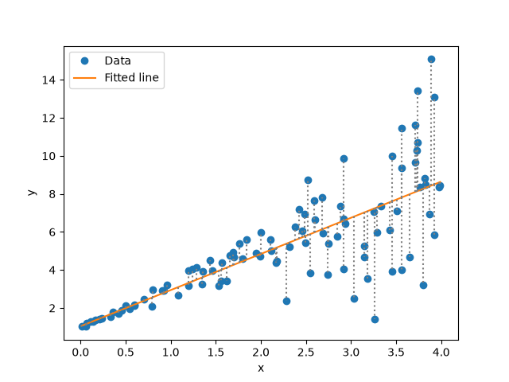
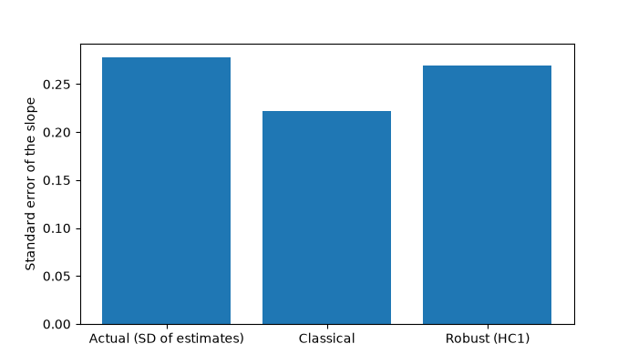

# 第 8 章: 不均一分散

## 8.1 この章の地図

第 2 章の標準誤差の式は、誤差項のばらつき（分散）が、すべての観測値で**同じ**であることを前提にしていました（**均一分散**）。現実のデータでは、所得が高い人ほど、消費のばらつきが大きいなど、ばらつきが説明変数とともに変わることが、よくあります（**不均一分散**）。このとき、係数の推定値は、偏りませんが、**通常の標準誤差は、不正確**になり、t 検定や信頼区間が、信用できなくなります。この章では、その問題を、シミュレーションで見て、直し方（**頑健な標準誤差**）と、見つけ方（**Breusch-Pagan 検定・White 検定**）、線形性の検定（**RESET**）を、式から書きます。



| 項目 | 内容 |
| :--- | :--- |
| 計量経済学の題材 | 不均一分散、頑健な標準誤差（サンドイッチ推定量、HC0〜HC3）、Breusch-Pagan 検定、White 検定、RESET |
| 使う Python の機能 | NumPy の行列計算、`itertools.combinations`、辞書による分岐、pandas の表 |
| 新しく導入するライブラリ | なし |
| 完成形 | `robust_standard_errors`、`breusch_pagan`、`white_test`、`reset_test`、`draw_fan_sample`、`standard_error_comparison` |
| ファイル | 実装: `lib/chapter08/hetero.py`、`lib/chapter08/plot.py`（図）／テスト: `test/chapter08/test_hetero.py`、`test/chapter08/test_plot.py`（自分で書くときは、`practice/chapter08/` に、同じ名前で作ります） |
| データ | 手計算用の 4 つの観測値と、母集団の式から作った乱数 |

### 計量経済学の式とコードの対応

| 計量経済学 | 式 | コード |
| :--- | :--- | :--- |
| 頑健な分散（サンドイッチ） | (X′X)⁻¹ · X′ diag(w·e²) X · (X′X)⁻¹ | `robust_standard_errors(y, x, kind)` |
| 重み w | HC0: 1、HC1: n ÷ (n − k)、HC2: 1 ÷ (1 − h)、HC3: 1 ÷ (1 − h)² | `kind="HC0"`〜`"HC3"` |
| Breusch-Pagan 検定 | e² を x で回帰、LM = n·R² ~ χ²(説明変数の数) | `breusch_pagan(y, x)` |
| White 検定 | e² を x・x²・交差項で回帰、LM = n·R² | `white_test(y, x)` |
| RESET | ŷ²・ŷ³ を足して F 検定 | `reset_test(y, x)` |

> **記号について**: e は残差、h はてこ比、w は重みです。一覧は、[記号について](how-to-read.md#symbols) を参照してください。

### 前提とする章

| できること | 章 |
| :--- | :--- |
| 重回帰 `fit_ols`、てこ比 `leverage` | [第 3 章](03-multiple-regression.md) |
| F 検定 `f_test` と `TestResult` | [第 5 章](05-inference.md) |
| LM = n·R² の検定の考え方 | [第 6 章](06-asymptotics.md) |

## 8.2 準備

```bash
cd apps/econometrics-programming/python
uv sync
uv run pytest test/chapter08
```

```text
25 passed
```

自分でコードを書くときは、`practice/chapter08/` に、完成形と同じ名前（`hetero.py`・`test_hetero.py`）のファイルを作ります。

## 8.3 予想する

x = 1、2、3、4、y = 2、4、5、9 の回帰（傾き 2.2、残差 0.3、0.1、−1.1、0.7）で、頑健な標準誤差を考えます。

1. HC0 の、傾きの標準誤差を、手計算してください（ヒント: 分子は Σ(x − x̄)²·e²、分母は (Σ(x − x̄)²)² = 25 です）。HC1 は、HC0 の何倍ですか（n = 4、k = 2）
2. x が大きいほど誤差のばらつきが大きいデータで、通常の標準誤差は、傾きの実際のばらつきより、大きいですか、小さいですか
3. 均一分散のデータに、Breusch-Pagan 検定を使うと、何％の割合で、均一分散を棄却しますか

## 8.4 不均一分散の考え方

### 何が起きるか

誤差項の分散が、観測値ごとに違っても、OLS の係数は、偏りません（一致性も保たれます）。しかし、第 2 章の標準誤差の式（σ̂²·(X′X)⁻¹）は、分散が一定という前提で導いたので、**係数の本当のばらつきを、正しく表さなくなります**。標準誤差が小さすぎれば、t 値が大きく出て、実際には関係のないものを、有意と判断しやすくなります。

### 頑健な標準誤差

分散が観測値ごとに違ってもよい、標準誤差の式が、**サンドイッチ推定量**です。

> Var(b) = (X′X)⁻¹ · (X′ diag(w·e²) X) · (X′X)⁻¹

真ん中の項（**ミート**）は、残差の 2 乗 e² で、各観測値の分散を代用します。重み w の違いで、HC0〜HC3 があります。HC0 は w = 1 で、標本が小さいと、過小になりやすいので、自由度を補正した HC1（w = n ÷ (n − k)）が、広く使われます。HC2・HC3 は、てこ比の大きい観測値の残差が小さく出る影響を、補正します。

### 不均一分散の検定

**Breusch-Pagan 検定**は、残差の 2 乗 e² を、説明変数で回帰します。説明変数で e² が説明できる（R² が大きい）なら、ばらつきが x とともに変わっています。LM = n·R² を、自由度が説明変数の数の χ² と比べます（第 6 章の LM 検定と同じ形）。**White 検定**は、説明変数の 2 乗と交差項も加えて、より一般的な形のばらつきの変化を、調べます。

### RESET

関数形が線形でないのに、線形で回帰すると、残差に、当てはめ値の 2 乗・3 乗で説明できる部分が残ります。**RESET** は、当てはめ値の 2 乗・3 乗を説明変数に足して、その係数が 0 かを、F 検定します。

## 8.5 Red → Green → Refactor

### Red: 手計算の例の頑健な標準誤差

予想 1 の手計算です。x̃ = x − x̄ = −1.5、−0.5、0.5、1.5、e = 0.3、0.1、−1.1、0.7 なので、Σx̃²e² = 0.2025 + 0.0025 + 0.3025 + 1.1025 = 1.61 です。HC0 の分散は 1.61 ÷ 25 = 0.0644、標準誤差は √0.0644 ≈ 0.2538 です。HC1 は、n ÷ (n − k) = 4 ÷ 2 = 2 倍の分散、標準誤差は √0.1288 ≈ 0.3589 です。

```python
import numpy as np
import pandas as pd
import pytest
import statsmodels.api as sm

from lib.chapter08.hetero import robust_standard_errors

X = [1, 2, 3, 4]
Y = [2, 4, 5, 9]
```

```python
def test_手計算の例のHC0とHC1() -> None:
    hc0 = robust_standard_errors(Y, X, "HC0")
    hc1 = robust_standard_errors(Y, X, "HC1")
    assert hc0["x1"] == pytest.approx((1.61 / 25) ** 0.5)
    assert hc1["x1"] == pytest.approx((2 * 1.61 / 25) ** 0.5)
    assert hc0["x1"] == pytest.approx(0.2538, abs=1e-4)
    assert hc1["x1"] == pytest.approx(0.3589, abs=1e-4)


def test_既定はHC1() -> None:
    assert (
        robust_standard_errors(Y, X).tolist()
        == robust_standard_errors(Y, X, "HC1").tolist()
    )


def test_知らない種類は受け付けない() -> None:
    with pytest.raises(ValueError, match="種類"):
        robust_standard_errors(Y, X, "HC9")
```

### Green: robust_standard_errors を実装する

```python
def _frame(x: ArrayLike) -> pd.DataFrame:
    """説明変数を、列の名前のある表にそろえる。"""
    if isinstance(x, pd.DataFrame):
        return x
    values = np.asarray(x, dtype=float)
    if values.ndim == 1:
        values = values.reshape(-1, 1)
    return pd.DataFrame(values, columns=[f"x{i + 1}" for i in range(values.shape[1])])


def robust_standard_errors(y: ArrayLike, x: ArrayLike, kind: str = "HC1") -> pd.Series:
    """不均一分散に頑健な標準誤差（サンドイッチ推定量）。

    Var(b) = (X'X)⁻¹ · X' diag(w·e²) X · (X'X)⁻¹。重み w は HC0: 1、
    HC1: n ÷ (n − k)、HC2: 1 ÷ (1 − h)、HC3: 1 ÷ (1 − h)²（h はてこ比）。
    """
    if kind not in KINDS:
        raise ValueError(f"知らない種類: {kind}（HC0〜HC3 のどれか）")
    frame = _frame(x)
    result = fit_ols(y, frame)
    design = np.column_stack([np.ones(len(frame)), frame.to_numpy(dtype=float)])
    n, k = design.shape
    h = leverage(frame)
    weights = {
        "HC0": np.ones(n),
        "HC1": np.full(n, n / (n - k)),
        "HC2": 1 / (1 - h),
        "HC3": 1 / (1 - h) ** 2,
    }[kind]
    bread = np.linalg.inv(design.T @ design)
    meat = design.T @ (design * (weights * result.residuals**2)[:, None])
    variance = bread @ meat @ bread
    return pd.Series(np.sqrt(np.diag(variance)), index=result.coefficients.index)
```

`statsmodels` の `cov_type="HC0"`〜`"HC3"` と一致することを、4 つの種類で確かめます。

```python
def two_variable_data(n: int = 80, seed: int = 0) -> tuple[pd.Series, pd.DataFrame]:
    rng = np.random.default_rng(seed)
    x = pd.DataFrame({"x1": rng.standard_normal(n), "x2": rng.standard_normal(n)})
    y = 1 + x["x1"] + 0.5 * x["x2"] + (0.5 + np.abs(x["x1"])) * rng.standard_normal(n)
    return y, x


@pytest.mark.parametrize("kind", ["HC0", "HC1", "HC2", "HC3"])
def test_頑健な標準誤差はstatsmodelsと一致する(kind: str) -> None:
    y, x = two_variable_data()
    reference = sm.OLS(y, sm.add_constant(x)).fit(cov_type=kind).bse
    assert robust_standard_errors(y, x, kind).to_numpy() == pytest.approx(
        reference.to_numpy()
    )


def test_HC3はHC2より大きくHC2はHC0より大きい() -> None:
    se = {k: robust_standard_errors(Y, X, k)["x1"] for k in ("HC0", "HC2", "HC3")}
    assert se["HC0"] < se["HC2"] < se["HC3"]


def test_配列でも使える() -> None:
    assert list(robust_standard_errors(Y, np.array(X, dtype=float)).index) == [
        "const",
        "x1",
    ]


def test_頑健な標準誤差の係数は通常の最小二乗法と同じ() -> None:
    y, x = two_variable_data()
    assert list(robust_standard_errors(y, x).index) == list(
        fit_ols(y, x).coefficients.index
    )
```

```python
from lib.chapter08.hetero import robust_standard_errors

x = [1, 2, 3, 4]
y = [2, 4, 5, 9]
for kind in ("HC0", "HC1", "HC2", "HC3"):
    print(kind, robust_standard_errors(y, x, kind).round(4).to_dict())
```

```text
HC0 {'const': 0.4637, 'x1': 0.2538}
HC1 {'const': 0.6557, 'x1': 0.3589}
HC2 {'const': 0.8437, 'x1': 0.4375}
HC3 {'const': 1.5383, 'x1': 0.7778}
```

HC0 は 0.2538、HC1 は 0.3589（予想 1）。HC0 < HC1 < HC2 < HC3 の順に大きく、観測値が 4 つと少ないので、種類による差が大きく出ます（通常の標準誤差は 0.4243）。

### 検定を実装する

```python
def _squared_residual_test(
    y: ArrayLike, x: ArrayLike, auxiliary: pd.DataFrame
) -> TestResult:
    """残差の 2 乗を auxiliary で回帰し、LM = n · R² を、χ² 検定する。"""
    residuals = fit_ols(y, _frame(x)).residuals
    fit = fit_ols(residuals**2, auxiliary)
    statistic = len(residuals) * fit.r_squared
    return TestResult(
        float(statistic), float(stats.chi2.sf(statistic, auxiliary.shape[1]))
    )


def breusch_pagan(y: ArrayLike, x: ArrayLike) -> TestResult:
    """Breusch-Pagan 検定: 残差の 2 乗が、説明変数で決まるか（帰無仮説: 均一分散）。"""
    frame = _frame(x)
    return _squared_residual_test(y, frame, frame)


def white_test(y: ArrayLike, x: ArrayLike) -> TestResult:
    """White 検定: 説明変数・その 2 乗・交差項で、残差の 2 乗を説明する。

    ダミー変数は d² = d になるので、同じ値の列は 1 本にまとめる。
    自由度は、まとめたあとの列数。
    """
    frame = _frame(x)
    columns = {name: frame[name] for name in frame.columns}
    for name in frame.columns:
        columns[f"{name}^2"] = frame[name] ** 2
    for a, b in combinations(frame.columns, 2):
        columns[f"{a}*{b}"] = frame[a] * frame[b]
    auxiliary = pd.DataFrame(columns)
    auxiliary = auxiliary.loc[:, ~auxiliary.T.duplicated()]
    return _squared_residual_test(y, frame, auxiliary)


def reset_test(y: ArrayLike, x: ArrayLike) -> TestResult:
    """RESET: 当てはめ値の 2 乗・3 乗を足し、係数が 0 か F 検定する（線形性の検定）。"""
    frame = _frame(x)
    result = fit_ols(y, frame)
    fitted = np.asarray(y, dtype=float) - result.residuals
    augmented = frame.assign(fitted2=fitted**2, fitted3=fitted**3)
    return f_test(y, augmented, ["fitted2", "fitted3"])
```

`statsmodels` の `het_breuschpagan`・`het_white`・`linear_reset` と、統計量・p 値が一致することを、テストにします。

```python
def test_Breusch_Paganはstatsmodelsと一致する() -> None:
    y, x = two_variable_data()
    fit = sm.OLS(y, sm.add_constant(x)).fit()
    lm, p, _, _ = het_breuschpagan(fit.resid, fit.model.exog)
    test = breusch_pagan(y, x)
    assert test.statistic == pytest.approx(lm)
    assert test.p_value == pytest.approx(p)


def test_Whiteはstatsmodelsと一致する() -> None:
    y, x = two_variable_data()
    fit = sm.OLS(y, sm.add_constant(x)).fit()
    lm, p, _, _ = het_white(fit.resid, fit.model.exog)
    test = white_test(y, x)
    assert test.statistic == pytest.approx(lm)
    assert test.p_value == pytest.approx(p)


@pytest.mark.filterwarnings(
    "ignore::statsmodels.tools.sm_exceptions.SingularMatrixWarning"
)
def test_ダミー変数を含んでもWhite検定は_statsmodels_と一致する() -> None:
    rng = np.random.default_rng(3)
    n = 400
    d = (rng.random(n) < 0.4).astype(float)
    x = rng.standard_normal(n)
    y = 1 + 2 * x + d + (0.5 + d) * rng.standard_normal(n)
    frame = pd.DataFrame({"x": x, "d": d})
    result = white_test(y, frame)
    fit = sm.OLS(y, sm.add_constant(frame)).fit()
    lm, p, _, _ = het_white(fit.resid, fit.model.exog)
    assert result.statistic == pytest.approx(lm)
    assert result.p_value == pytest.approx(p)


def test_RESETはstatsmodelsと一致する() -> None:
    y, x = two_variable_data()
    fit = sm.OLS(y, sm.add_constant(x)).fit()
    reference = linear_reset(fit, power=3, test_type="fitted", use_f=True)
    test = reset_test(y, x)
    assert test.statistic == pytest.approx(float(reference.fvalue))
    assert test.p_value == pytest.approx(float(reference.pvalue))
```

### 不均一分散の標本を作る

x を 0〜4 の一様乱数、誤差の標準偏差を 0.05 + 0.25x²（x が大きいほど大きい）にします。比較のため、標準偏差が 1 で一定の標本も作れます。

```python
def draw_fan_sample(
    n: int, rng: np.random.Generator, heteroskedastic: bool
) -> tuple[NDArray[np.float64], NDArray[np.float64]]:
    """y = 1 + 2x + u。x は 0〜4 の一様乱数。

    不均一分散なら、u の標準偏差は 0.05 + 0.25x²（x が大きいほど大きい）。
    均一分散なら、1。
    """
    x = rng.uniform(0, 4, n)
    sd = 0.05 + 0.25 * x**2 if heteroskedastic else 1.0
    return x, 1 + 2 * x + sd * rng.standard_normal(n)
```

```python
def test_標本の形() -> None:
    x, y = draw_fan_sample(30, np.random.default_rng(0), True)
    assert x.shape == y.shape == (30,)
    assert x.min() >= 0
    assert x.max() <= 4


def test_誤差の大きさは不均一分散なら_x_が大きいほど大きい() -> None:
    x, y = draw_fan_sample(20000, np.random.default_rng(0), True)
    e = y - 1 - 2 * x
    assert np.std(e[x > 3]) > 5 * np.std(e[x < 1])
    x, y = draw_fan_sample(20000, np.random.default_rng(0), False)
    e = y - 1 - 2 * x
    assert np.std(e[x > 3]) == pytest.approx(np.std(e[x < 1]), rel=0.1)
```

### 検定が、不均一分散を見つけるか

```python
import numpy as np

from lib.chapter08.hetero import breusch_pagan, draw_fan_sample, white_test

for heteroskedastic in (True, False):
    xs, ys = draw_fan_sample(200, np.random.default_rng(1), heteroskedastic)
    bp, white = breusch_pagan(ys, xs), white_test(ys, xs)
    print(heteroskedastic, round(bp.p_value, 8), round(white.p_value, 8))
```

```text
True 2.3e-06 7.1e-07
False 0.29946135 0.20126174
```

不均一分散のデータ（True）では、p 値が 10⁻⁶ 台で、均一分散の帰無仮説を強く棄却します。均一分散のデータ（False）では、0.30 と 0.20 で、棄却しません。

```python
def test_不均一分散のデータでは均一分散の帰無仮説を棄却する() -> None:
    x, y = draw_fan_sample(200, np.random.default_rng(1), True)
    assert breusch_pagan(y, x).p_value < 0.001
    assert white_test(y, x).p_value < 0.001


def test_均一分散のデータでは棄却しない() -> None:
    x, y = draw_fan_sample(200, np.random.default_rng(1), False)
    assert breusch_pagan(y, x).p_value > 0.05
    assert white_test(y, x).p_value > 0.05
```

### RESET

```python
from lib.chapter08.hetero import reset_test

rng = np.random.default_rng(3)
x = rng.uniform(0, 3, 200)
y = 1 + x + 0.8 * x**2 + 0.3 * rng.standard_normal(200)
print(reset_test(y, x))
linear = 1 + x + 0.3 * rng.standard_normal(200)
print(reset_test(linear, x))
```

```text
TestResult(statistic=301.4063902340213, p_value=1.5903200518057808e-60)
TestResult(statistic=3.5482989645080742, p_value=0.03063623768277364)
```

x² を含む真の関係を、線形で回帰すると、p 値は 10⁻⁶⁰ で、強く棄却されます。線形の関係（2 つ目）でも、p 値は 0.031 で、**5% の水準では棄却されました**。これは、バグではなく、**正しいモデルでも、5% の確率で棄却する**という、検定の性質です（有意水準 5% の意味）。テストでは、しきい値を 1% にしてあります。

```python
def test_RESETは2乗の項が欠落したモデルを棄却する() -> None:
    rng = np.random.default_rng(3)
    x = rng.uniform(0, 3, 200)
    y = 1 + x + 0.8 * x**2 + 0.3 * rng.standard_normal(200)
    assert reset_test(y, x).p_value < 0.001
    linear = 1 + x + 0.3 * rng.standard_normal(200)
    assert reset_test(linear, x).p_value > 0.01
```

### 標準誤差は、どれだけ違うか

標本を 2000 回作り直して、傾きの推定値の標準偏差（実際のばらつき）と、通常の標準誤差・HC1 の標準誤差の平均を、比べます。

```python
def standard_error_comparison(
    n: int, repetitions: int, heteroskedastic: bool, rng: np.random.Generator
) -> dict[str, float]:
    """傾きの推定値の標準偏差（実際のばらつき）と、通常・頑健（HC1）な標準誤差の平均。"""
    slopes, classical, robust = [], [], []
    for _ in range(repetitions):
        x, y = draw_fan_sample(n, rng, heteroskedastic)
        result = fit_ols(y, x)
        slopes.append(result.coefficients["x1"])
        classical.append(result.standard_errors["x1"])
        robust.append(robust_standard_errors(y, x)["x1"])
    return {
        "sd": float(np.std(slopes, ddof=1)),
        "classical": float(np.mean(classical)),
        "hc1": float(np.mean(robust)),
    }
```

```python
def test_均一分散なら通常の標準誤差も頑健な標準誤差も実際のばらつきに近い() -> None:
    r = standard_error_comparison(50, 2000, False, np.random.default_rng(0))
    # 許容誤差: sd の推定誤差（約 1.6%）の 4 倍。HC1 は n = 50 で 5% ほど過小なので、その分を足す
    assert r["classical"] == pytest.approx(r["sd"], rel=0.07)
    assert r["hc1"] == pytest.approx(r["sd"], rel=0.12)


def test_不均一分散なら通常の標準誤差は過小で頑健な標準誤差は近い() -> None:
    r = standard_error_comparison(50, 2000, True, np.random.default_rng(0))
    assert r["classical"] < 0.85 * r["sd"]
    assert r["hc1"] == pytest.approx(r["sd"], rel=0.12)
```

```python
from lib.chapter08.hetero import standard_error_comparison

for heteroskedastic in (False, True):
    result = standard_error_comparison(50, 2000, heteroskedastic, np.random.default_rng(0))
    print(heteroskedastic, {k: round(v, 4) for k, v in result.items()})
```

```text
False {'sd': 0.1252, 'classical': 0.1245, 'hc1': 0.1229}
True {'sd': 0.2783, 'classical': 0.222, 'hc1': 0.2694}
```

均一分散（False）では、3 つとも 0.12 台で、ほぼ同じです。**不均一分散（True）では、実際のばらつきが 0.2783 なのに、通常の標準誤差は 0.222 で、約 2 割小さい**（予想 2）。HC1 は 0.2694 で、実際のばらつきに近い値です。通常の標準誤差で t 検定をすると、有意になりやすすぎます。



### 図

`plot_standard_errors` は、3 つの値の棒グラフです。

```python
def test_3本の棒を描く() -> None:
    ax = plot_standard_errors(VALUES).axes[0]
    bars: list[Any] = list(ax.patches)
    assert [p.get_height() for p in bars] == pytest.approx([0.28, 0.22, 0.27])
    assert [t.get_text() for t in ax.get_xticklabels()] == list(VALUES)


def test_軸の名前() -> None:
    ax = plot_standard_errors(VALUES).axes[0]
    assert ax.get_ylabel() == "Standard error of the slope"
```

```python
def plot_standard_errors(values: Mapping[str, float]) -> Figure:
    """実際のばらつきと、通常・頑健な標準誤差を、棒グラフで比べる。"""
    fig, ax = plt.subplots(figsize=(7, 4))
    ax.bar(list(values), list(values.values()))
    ax.set_ylabel("Standard error of the slope")
    plt.close(fig)
    return fig
```

### 実行結果

```bash
uv run pytest test/chapter08
```

```text
25 passed
```

## 8.6 規則で言うと

1. **不均一分散は、係数を偏らせず、標準誤差を狂わせる。** 通常の標準誤差が過小だと、有意になりやすすぎる
2. **迷ったら、頑健な標準誤差。** 均一分散でも、ほぼ同じ値になる（0.1245 と 0.1229）ので、使って損が小さい。標本が小さいときは、HC1 以上
3. **検定は、見つける道具。** 棄却されたら、頑健な標準誤差か、モデルの見直しを考える。棄却されなくても、小標本では、検出力が低い

混同しやすい点を、表にまとめます。

| 混同しやすい点 | 違い |
| :--- | :--- |
| 不均一分散 と 内生性 | 不均一分散は、標準誤差の問題（係数は偏らない）。内生性（第 11 章）は、係数そのものが偏る問題。頑健な標準誤差では、内生性は直らない |
| Breusch-Pagan と White | BP は、残差の 2 乗が x の線形関数かを調べる。White は、2 乗項・交差項も入れるので、より一般的だが、自由度が増え、検出力が下がる |
| HC0 と HC1 | HC1 は、自由度の補正で、小標本では HC0 より大きい。標本が大きいと、ほぼ同じ |

### この方法が成り立たない場面

- **頑健な標準誤差は、大標本の近似です。** 観測値が少ないと（この章の例の 4 つなど）、種類によって、値が大きく違い、信頼できません
- **誤差が、観測値の間で相関している（同じ個人を何度も観測）ときは、別の対処が必要です。** 頑健な標準誤差は、観測値の間の独立を前提にします（第 10 章のクラスター標準誤差）
- **検定は、モデルの誤りと、不均一分散を、区別できません。** RESET が棄却されたら、関数形（2 乗項など）を、先に見直します。関数形の誤りは、不均一分散のように見えることがあります

## 8.7 練習問題

| 種類 | 問題 |
| :--- | :--- |
| 想起 | 本文を閉じて、手計算の例の HC0 の傾きの標準誤差（≈ 0.2538）のテストを書いてください |
| 生成 | 解説を見る前に、HC1 の標準誤差を、通常の標準誤差で割った比を返す `ratio_to_classical(y, x, name)` を、テストから書いてください。手計算の例の傾きでは、いくつですか（HC1 ≈ 0.3589、通常 ≈ 0.4243） |
| 多様 | 標本の大きさを 50 から 200 に増やすと、不均一分散のデータでの、通常の標準誤差の過小評価は、なくなりますか。先に予想してから、`standard_error_comparison` で確かめてください |
| 交互 | [第 5 章](05-inference.md)の t 値 `t_statistics` は、通常の標準誤差を使います。手計算の例で、傾きの t 値を、HC1 の標準誤差で計算し直してください。通常の t 値（5.185）より、大きいですか |

??? note "解答（先に自分で取り組んでから、開いてください）"

    **想起**:

    ```python
    def test_HC0の標準誤差の手計算() -> None:
        se = robust_standard_errors([2, 4, 5, 9], [1, 2, 3, 4], "HC0")
        assert se["x1"] == pytest.approx((1.61 / 25) ** 0.5)
    ```

    **生成**: 0.3589 ÷ 0.4243 ≈ 0.846 です。

    ```python
    def ratio_to_classical(y, x, name):
        return robust_standard_errors(y, x, "HC1")[name] / fit_ols(y, x).standard_errors[name]
    ```

    ```python
    def test_頑健な標準誤差と通常の標準誤差の比() -> None:
        ratio = ratio_to_classical([2, 4, 5, 9], [1, 2, 3, 4], "x1")
        assert ratio == pytest.approx(0.3589 / 0.4243, abs=1e-3)
    ```

    **多様**: n を増やしても、通常の標準誤差の過小評価は、**なくなりません**。n が大きくなるほど、標準誤差も、実際のばらつきも、小さくなりますが、比（通常 ÷ 実際）は、n = 50 で 0.78、n = 200 で 0.74（500 回の繰り返し）と、むしろ少し悪化します。不均一分散は、標本を増やしても、直りません。

    ```python
    def test_標本を増やしても通常の標準誤差は過小のまま() -> None:
        r = standard_error_comparison(200, 500, True, np.random.default_rng(0))
        assert r["classical"] < 0.9 * r["sd"]
        assert r["hc1"] == pytest.approx(r["sd"], rel=0.1)
    ```

    **交互**: HC1 の標準誤差で割ると、2.2 ÷ 0.3589 ≈ 6.13 で、通常の t 値 5.185 より大きくなります。この例では、頑健な標準誤差のほうが、通常のものより小さい（0.3589 < 0.4243）からです。不均一分散で、通常の標準誤差が過小になる場合とは、逆の向きもあります。

    ```python
    def test_頑健な標準誤差で計算したt値() -> None:
        x, y = [1, 2, 3, 4], [2, 4, 5, 9]
        slope = fit_ols(y, x).coefficients["x1"]
        t_robust = slope / robust_standard_errors(y, x)["x1"]
        assert t_robust == pytest.approx(6.13, abs=0.01)
        assert t_robust > t_statistics(fit_ols(y, x))["x1"]
    ```

## 8.8 振り返り

- 予想した 3 つは、当たりましたか。通常の標準誤差が過小になる理由を、説明できますか
- 頑健な標準誤差を使うと、何が直り、何が直らないかを、説明できますか
- 自分の分析で、まず、何を調べますか（図、検定、頑健な標準誤差）

## 8.9 まとめ

- サンドイッチ推定量（HC0〜HC3）を、手計算の値（HC0 0.2538、HC1 0.3589）と、`statsmodels` の結果に一致するように書いた。Breusch-Pagan 検定・White 検定・RESET も、`statsmodels` と一致した
- 不均一分散のデータでは、通常の標準誤差（0.222）が、実際のばらつき（0.2783）より約 2 割小さく、HC1（0.2694）は近い。均一分散では、3 つともほぼ同じ
- 検定は、不均一分散を見つける（p ≈ 10⁻⁶）一方、均一分散では棄却しない（p ≈ 0.2〜0.3）。RESET は、2 乗項の欠落を強く棄却する。正しいモデルでも、5% の確率で棄却する
- 次の章では、観測値が、2 つの時点にわたるデータ（プーリング・データ）と、差分の差分（DiD）を調べます
