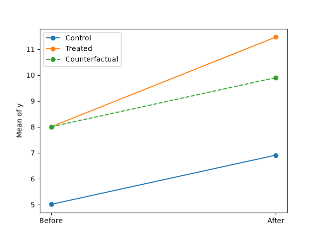

# 第 9 章: プーリング・データと差分の差分

## 9.1 この章の地図

政策や出来事の効果を測りたいとき、「処置の前後」だけを比べても、時間とともに起きる共通の変化（景気など）が混ざります。「処置を受けた群と受けなかった群」を比べても、もともとの群の差が混ざります。**差分の差分（DiD）**は、2 つを組み合わせて、両方を除きます。この章では、DiD が、第 7 章の**交差項の回帰**と、ちょうど一致することを確かめます。後半では、同じ個人を何期も追うデータ（**パネル・データ**）を扱い、個人ごとの観測されない違い（個人効果）が x と相関すると、プーリング OLS が偏ること、**1 階差分推定**が、個人効果を消して直すことを、シミュレーションで見ます。



| 項目 | 内容 |
| :--- | :--- |
| 計量経済学の題材 | 独立なプーリング・データ、差分の差分（DiD）、平行トレンドの仮定、パネル・データ、個人効果、1 階差分推定 |
| 使う Python の機能 | pandas の `groupby`・`unstack`・`diff`、`numpy` の `repeat`・`tile`、データフレームの結合 |
| 新しく導入するライブラリ | なし |
| 完成形 | `group_period_means`、`did_estimate`、`did_regression`、`draw_did_sample`、`draw_panel`、`first_difference`、`first_difference_estimate`、`pooled_estimate`、`panel_estimators` |
| ファイル | 実装: `lib/chapter09/did.py`、`lib/chapter09/plot.py`（図）／テスト: `test/chapter09/test_did.py`、`test/chapter09/test_plot.py`（自分で書くときは、`practice/chapter09/` に、同じ名前で作ります） |
| データ | 手計算用の 8 個・6 個の観測値と、母集団の式から作った乱数 |

### 計量経済学の式とコードの対応

| 計量経済学 | 式 | コード |
| :--- | :--- | :--- |
| DiD | (ȳ_処置,後 − ȳ_処置,前) − (ȳ_対照,後 − ȳ_対照,前) | `did_estimate(df)` |
| DiD の回帰 | y = α + β₁·treated + β₂·post + δ·(treated·post) + u | `did_regression(df)` |
| パネルの母集団の式 | y_it = α + β·x_it + a_i + u_it | `draw_panel(entities, periods, correlation, rng)` |
| 1 階差分 | Δy_it = β·Δx_it + Δu_it（a_i が消える） | `first_difference_estimate(panel)` |
| プーリング OLS | y を x で回帰（個人を区別しない） | `pooled_estimate(panel)` |

> **記号について**: δ は処置の効果（DiD）、a_i は個人 i ごとの観測されない効果（個人効果）、i は個人、t は期です。一覧は、[記号について](how-to-read.md#symbols) を参照してください。

### 前提とする章

| できること | 章 |
| :--- | :--- |
| 交差項 `with_interaction`、ダミー変数の係数 | [第 7 章](07-dummy-variables.md) |
| 重回帰 `fit_ols`、欠落変数による偏り | [第 3 章](03-multiple-regression.md) |

## 9.2 準備

```bash
cd apps/econometrics-programming/python
uv sync
uv run pytest test/chapter09
```

```text
20 passed
```

自分でコードを書くときは、`practice/chapter09/` に、完成形と同じ名前（`did.py`・`test_did.py`）のファイルを作ります。

## 9.3 予想する

ある政策を、処置群にだけ実施しました。y の平均は、処置群が 10（前）→ 15（後）、対照群が 8（前）→ 10（後）です。

1. 処置群の「前後の差」は 5 です。政策の効果は、5 ですか。DiD は、いくつですか
2. 対照群の前後の差（2）は、何を表していると考えますか
3. 個人ごとの効果 a_i が、説明変数 x と正の相関を持つパネルで、y を x で回帰（プーリング OLS）すると、傾きは、真の値より大きくなりますか、小さくなりますか
4. 個人ごとに 1 期前との差を取ってから回帰すると、a_i は、どうなりますか

## 9.4 差分の差分とパネルの考え方

### 差分の差分（DiD）

2 つの群（処置群・対照群）と 2 つの時点（前・後）の、4 つの平均を使います。

| | 前 | 後 | 変化 |
| :--- | ---: | ---: | ---: |
| 対照群 | 8 | 10 | +2 |
| 処置群 | 10 | 15 | +5 |

処置群の変化（+5）には、処置の効果と、共通の時間変化が含まれます。対照群の変化（+2）は、共通の時間変化だけです。**差を取ると、効果が残ります**: DiD = 5 − 2 = 3。

この結論には、**平行トレンドの仮定**が必要です。「処置がなければ、処置群も、対照群と同じだけ（+2）変化したはずだ」という仮定です。図の点線は、この反事実です。

### 回帰で書く

y = α + β₁·treated + β₂·post + δ·(treated·post) + u を推定すると、**交差項の係数 δ が、DiD に、ちょうど等しく**なります。α は対照群の処置前の平均、β₁ は処置前の群の差、β₂ は対照群の時間変化です。回帰で書くと、標準誤差・検定・説明変数の追加が、できます。

### パネル・データと個人効果

同じ個人を、何期も追うデータが、**パネル・データ**です。y_it = α + β·x_it + a_i + u_it の a_i（個人効果）は、能力・体質のような、観測されない、個人に固有の要因です。a_i が x_it と相関すると、a_i を誤差項に入れた回帰（プーリング OLS）は、**偏ります**（欠落変数バイアス。第 3 章・第 11 章）。

### 1 階差分

各個人で、1 期前との差を取ります: Δy_it = β·Δx_it + Δu_it。個人効果 a_i は、期をまたいで同じなので、**差で消えます**。消えたものは、x と相関していても、問題になりません。

## 9.5 Red → Green → Refactor

### Red: 差分の差分の手計算

予想 1 の手計算です。各セルに 2 個ずつの観測値を置きます（平均が 8、10、10、15 になるように）。

```python
import numpy as np
import pandas as pd
import pytest

from lib.chapter09.did import did_estimate, did_regression, group_period_means

CELLS = pd.DataFrame(
    {
        "y": [7, 9, 9, 11, 9, 11, 14, 16],
        "treated": [0, 0, 0, 0, 1, 1, 1, 1],
        "post": [0, 0, 1, 1, 0, 0, 1, 1],
    },
    dtype=float,
)
```

```python
def test_2_x_2の平均() -> None:
    means = group_period_means(CELLS)
    assert means.to_numpy().tolist() == [[8, 10], [10, 15]]
    assert list(means.index) == ["control", "treated"]
    assert list(means.columns) == ["before", "after"]


def test_差分の差分の手計算() -> None:
    assert did_estimate(CELLS) == pytest.approx((15 - 10) - (10 - 8))


def test_回帰の交差項の係数はDiDにちょうど等しい() -> None:
    coefficients = did_regression(CELLS).coefficients
    assert coefficients["treated:post"] == pytest.approx(3)
    assert coefficients["const"] == pytest.approx(8)
    assert coefficients["treated"] == pytest.approx(10 - 8)
    assert coefficients["post"] == pytest.approx(10 - 8)
```

### Green: DiD を実装する

```python
def group_period_means(df: pd.DataFrame) -> pd.DataFrame:
    """処置群・対照群の、処置の前後の、y の平均（2 × 2 の表）。"""
    table = df.groupby(["treated", "post"])["y"].mean().unstack()
    table.index = ["control", "treated"]
    table.columns = ["before", "after"]
    return table


def did_estimate(df: pd.DataFrame) -> float:
    """差分の差分 = (処置群の変化) − (対照群の変化)。"""
    means = group_period_means(df)
    change = means["after"] - means["before"]
    return float(change["treated"] - change["control"])


def did_regression(df: pd.DataFrame) -> OlsResult:
    """y を、処置群ダミー・処置後ダミー・その交差項で回帰する。交差項の係数が DiD。"""
    x = pd.DataFrame(
        {
            "treated": df["treated"],
            "post": df["post"],
            "treated:post": with_interaction(df["treated"], df["post"]),
        }
    )
    return fit_ols(df["y"], x)
```

```python
from lib.chapter09.did import did_estimate, did_regression, group_period_means

print(group_period_means(CELLS))
print(did_estimate(CELLS))
print(did_regression(CELLS).coefficients.to_dict())
```

```text
         before  after
control     8.0   10.0
treated    10.0   15.0
3.0
{'const': 8.0, 'treated': 2.0, 'post': 2.0, 'treated:post': 3.0}
```

DiD は 3 で、効果は、前後の差の 5 ではありません（予想 1）。回帰の係数も、`treated:post` が 3、`const` が対照群の処置前の平均 8、`treated` が処置前の群の差 2、`post` が対照群の時間変化 2 で、すべて、4 つの平均から作った値と一致します（予想 2）。

### 乱数の標本で、効果を復元する

各セルに n 個の標本を作ります。母集団の式は、y = 5 + 3·treated + 2·post + 効果·treated·post + u です。群の差 3 と、時間変化 2 は、DiD で除かれます。

```python
def draw_did_sample(n: int, effect: float, rng: np.random.Generator) -> pd.DataFrame:
    """2 × 2（処置群・対照群 × 処置の前後）に、n 個ずつの標本を作る。

    y = 5 + 3·treated + 2·post + effect·treated·post + u（u は標準正規）。
    群の差 3 と、共通の時間変化 2 は、DiD で除かれる。
    """
    treated = np.repeat([0.0, 0.0, 1.0, 1.0], n)
    post = np.repeat([0.0, 1.0, 0.0, 1.0], n)
    y = 5 + 3 * treated + 2 * post + effect * treated * post
    return pd.DataFrame(
        {"y": y + rng.standard_normal(4 * n), "treated": treated, "post": post}
    )
```

```python
def test_乱数の標本でも回帰の交差項はDiDに等しい() -> None:
    sample = draw_did_sample(100, 1.5, np.random.default_rng(1))
    assert did_regression(sample).coefficients["treated:post"] == pytest.approx(
        did_estimate(sample)
    )


def test_標本の形() -> None:
    sample = draw_did_sample(10, 1.5, np.random.default_rng(0))
    assert len(sample) == 40
    assert sample.groupby(["treated", "post"]).size().tolist() == [10, 10, 10, 10]


def test_処置の効果は標準誤差の4倍以内で復元される() -> None:
    sample = draw_did_sample(500, 1.5, np.random.default_rng(0))
    result = did_regression(sample)
    assert (
        abs(result.coefficients["treated:post"] - 1.5)
        < 4 * (result.standard_errors["treated:post"])
    )
    assert (
        abs(result.coefficients["treated"] - 3) < 4 * result.standard_errors["treated"]
    )
    assert abs(result.coefficients["post"] - 2) < 4 * result.standard_errors["post"]


def test_効果が0なら差分の差分は0に近い() -> None:
    sample = draw_did_sample(2000, 0.0, np.random.default_rng(0))
    assert did_estimate(sample) == pytest.approx(0, abs=0.1)


def test_群の差と共通の時間変化だけでは差分の差分は0() -> None:
    df = CELLS.copy()
    df["y"] = 5 + 3 * df["treated"] + 2 * df["post"]
    assert did_estimate(df) == pytest.approx(0)
```

```python
from lib.chapter09.did import draw_did_sample

sample = draw_did_sample(500, 1.5, np.random.default_rng(0))
result = did_regression(sample)
print(round(did_estimate(sample), 4))
print(result.coefficients.round(4).to_dict())
print(result.standard_errors.round(4).to_dict())
```

```text
1.4249
{'const': 4.9731, 'treated': 3.0775, 'post': 1.9577, 'treated:post': 1.4249}
{'const': 0.0447, 'treated': 0.0632, 'post': 0.0632, 'treated:post': 0.0894}
```

DiD は 1.4249 で、真の効果 1.5 から、標準誤差 0.0894 の、1 つ分弱だけずれています。群の差（3.0775、真の値 3）と時間変化（1.9577、真の値 2）も、近い値です。

### 図

```python
def ys(line: Any) -> list[float]:
    values: Any = line.get_ydata()
    return [float(v) for v in values]


def test_処置群と対照群と反事実を描く() -> None:
    ax = plot_did(group_period_means(CELLS)).axes[0]
    assert [line.get_label() for line in ax.lines] == [
        "Control",
        "Treated",
        "Counterfactual",
    ]
    assert ys(ax.lines[0]) == [8, 10]
    assert ys(ax.lines[1]) == [10, 15]


def test_反事実は処置群の処置前から対照群と同じだけ動く() -> None:
    ax = plot_did(group_period_means(CELLS)).axes[0]
    assert ys(ax.lines[2]) == pytest.approx([10, 12])
    assert ax.lines[2].get_linestyle() == "--"
```

```python
def plot_did(means: pd.DataFrame) -> Figure:
    """処置群・対照群の平均と、反事実（処置がなかったときの処置群）を描く。

    反事実は、処置群の処置前の平均から、対照群と同じだけ動く（平行トレンド）。
    """
    values = means.to_numpy(dtype=float)  # 1 行目が対照群、2 行目が処置群
    control, treated = values[0], values[1]
    fig, ax = plt.subplots()
    ax.plot([0, 1], control, marker="o", label="Control")
    ax.plot([0, 1], treated, marker="o", label="Treated")
    ax.plot(
        [0, 1],
        [treated[0], treated[0] + control[1] - control[0]],
        "--",
        marker="o",
        label="Counterfactual",
    )
    ax.set_xticks([0, 1], ["Before", "After"])
    ax.set_ylabel("Mean of y")
    ax.legend()
    plt.close(fig)
    return fig
```

### パネルの 1 階差分

3 人の、2 期のパネルで、手計算します。y = a_i + 2·x（真の傾き 2）で、a は 1、6、−1（個人効果）です。

```python
PANEL = pd.DataFrame(
    {
        "entity": [0, 0, 1, 1, 2, 2],
        "time": [0, 1] * 3,
        "x": [1, 2, 2, 4, 0, 3],
        "y": [3, 5, 10, 14, -1, 5],
    },
    dtype=float,
)
```

```python
def first_difference(panel: pd.DataFrame) -> pd.DataFrame:
    """個人ごとに、1 期前との差（Δy・Δx）を取る。最初の期は、差が取れないので除く。"""
    ordered = panel.sort_values(["entity", "time"])
    differences = ordered.groupby("entity")[["x", "y"]].diff().dropna()
    return differences.rename(columns={"x": "dx", "y": "dy"})


def first_difference_estimate(panel: pd.DataFrame) -> float:
    """1 階差分推定: Δy を Δx で回帰した傾き。個人ごとの効果 a が差で消える。"""
    d = first_difference(panel)
    return float(fit_ols(d["dy"], d[["dx"]]).coefficients["dx"])


def pooled_estimate(panel: pd.DataFrame) -> float:
    """プーリング OLS: 個人を区別せず、y を x で回帰した傾き。"""
    return float(fit_ols(panel["y"], panel[["x"]]).coefficients["x"])
```

```python
def test_1階差分は個人ごとの前期との差() -> None:
    d = first_difference(PANEL.sample(frac=1, random_state=0))
    assert d["dx"].tolist() == [1, 2, 3]
    assert d["dy"].tolist() == [2, 4, 6]
    assert list(d.columns) == ["dx", "dy"]


def test_1階差分推定は個人の効果を除いて真の傾きを復元する() -> None:
    assert first_difference_estimate(PANEL) == pytest.approx(2)


def test_プーリングOLSは個人の効果のため偏る() -> None:
    assert pooled_estimate(PANEL) == pytest.approx(3.2)
```

```python
from lib.chapter09.did import first_difference, first_difference_estimate, pooled_estimate

print(first_difference(PANEL))
print(first_difference_estimate(PANEL), pooled_estimate(PANEL))
```

```text
    dx   dy
1  1.0  2.0
3  2.0  4.0
5  3.0  6.0
2.0 3.2
```

差を取ると、Δy = 2·Δx（ちょうど）で、傾きは 2.0 です。個人効果 a は、差で消えました。**プーリング OLS は 3.2** で、真の値 2 より大きく偏ります（予想 3）。x が大きい個人は、a も大きいためです（a = 1、6、−1 に対し、x の平均は 1.5、3、1.5）。

### 乱数のパネルで、偏りを確かめる

```python
def draw_panel(
    entities: int, periods: int, correlation: float, rng: np.random.Generator
) -> pd.DataFrame:
    """個人ごとの効果 a が x と相関するパネル・データ。真の傾きは 1。

    x = correlation·a + v、y = 1 + x + a + 0.5·u。
    """
    a = np.repeat(rng.standard_normal(entities), periods)
    x = correlation * a + rng.standard_normal(entities * periods)
    y = 1 + x + a + 0.5 * rng.standard_normal(entities * periods)
    return pd.DataFrame(
        {
            "entity": np.repeat(np.arange(entities), periods),
            "time": np.tile(np.arange(periods), entities),
            "x": x,
            "y": y,
        }
    )


def panel_estimators(
    entities: int,
    periods: int,
    correlation: float,
    repetitions: int,
    rng: np.random.Generator,
) -> pd.DataFrame:
    """パネルを作り直して、プーリング OLS と 1 階差分推定を繰り返す（真の傾きは 1）。"""
    rows = []
    for _ in range(repetitions):
        panel = draw_panel(entities, periods, correlation, rng)
        rows.append((pooled_estimate(panel), first_difference_estimate(panel)))
    return pd.DataFrame(rows, columns=["pooled", "first_difference"])
```

x = 相関 × a + v、y = 1 + x + a + 0.5·u（真の傾きは 1）。個人 200 人、2 期、相関 0 と 1 で、500 回繰り返します。理論上、プーリング OLS の傾きは、1 + 相関 ÷ (相関² + 1) に近づきます（相関 1 で 1.5）。

```python
def test_パネルの形() -> None:
    panel = draw_panel(10, 4, 0.5, np.random.default_rng(0))
    assert len(panel) == 40
    assert list(panel.columns) == ["entity", "time", "x", "y"]
    assert panel["entity"].nunique() == 10
    assert panel.groupby("entity")["time"].apply(list).iloc[0] == [0, 1, 2, 3]


def test_個人の効果は期をまたいで同じ() -> None:
    a = draw_panel(5, 3, 1.0, np.random.default_rng(0))
    b = draw_panel(5, 3, 1.0, np.random.default_rng(0))
    pd.testing.assert_frame_equal(a, b)


def test_相関があるとプーリングは偏り差分は偏らない() -> None:
    table = panel_estimators(200, 2, 1.0, 500, np.random.default_rng(0))
    se = table.std() / 500**0.5
    assert abs(table["pooled"].mean() - 1.5) < 4 * se["pooled"]
    assert abs(table["first_difference"].mean() - 1.0) < 4 * se["first_difference"]


def test_相関がなければプーリングも偏らない() -> None:
    table = panel_estimators(200, 2, 0.0, 500, np.random.default_rng(0))
    se = table.std() / 500**0.5
    assert abs(table["pooled"].mean() - 1.0) < 4 * se["pooled"]
    assert abs(table["first_difference"].mean() - 1.0) < 4 * se["first_difference"]


def test_期が多くても1階差分は偏らない() -> None:
    table = panel_estimators(100, 5, 1.0, 200, np.random.default_rng(0))
    se = table.std() / 200**0.5
    assert abs(table["first_difference"].mean() - 1.0) < 4 * se["first_difference"]
```

```python
from lib.chapter09.did import panel_estimators

for correlation in (0.0, 1.0):
    table = panel_estimators(200, 2, correlation, 500, np.random.default_rng(0))
    print(correlation, table.mean().round(4).to_dict(), table.std().round(4).to_dict())
```

```text
0.0 {'pooled': 0.9992, 'first_difference': 0.9998} {'pooled': 0.053, 'first_difference': 0.0346}
1.0 {'pooled': 1.4974, 'first_difference': 0.9998} {'pooled': 0.0328, 'first_difference': 0.0346}
```

列は、推定値の平均と標準偏差です。相関 0 では、どちらも偏らず（0.9992 と 0.9998）、1 階差分のほうが、ばらつきが小さい（0.0346 < 0.053。個人効果が差で消えるぶん）。**相関 1 では、プーリング OLS は 1.4974 と、理論値 1.5 のとおりに偏り、1 階差分は 0.9998 で、偏りません**（予想 3・4）。

### 実行結果

```bash
uv run pytest test/chapter09
```

```text
20 passed
```

## 9.6 規則で言うと

1. **DiD は、2 つの差の差。** 群の違いと、共通の時間変化を、同時に除く。回帰では、交差項の係数が、DiD に、ちょうど等しい
2. **DiD の根拠は、平行トレンドの仮定。** 処置がなければ、処置群も、対照群と同じだけ動いたはず、という仮定は、データでは確かめられない（処置前の複数時点で、傾向を比べる）
3. **個人効果が x と相関すると、プーリング OLS は偏る。** 個人内の変化（差分）だけを使うと、個人効果が消える

混同しやすい点を、表にまとめます。

| 混同しやすい点 | 違い |
| :--- | :--- |
| 前後の差 と 効果 | 前後の差は、効果と共通の時間変化の和。対照群の変化を引いて、効果が残る |
| プーリング・データ と パネル・データ | プーリング・データは、時点ごとに、別の個人の標本。パネル・データは、同じ個人を追う。個人効果の問題は、パネルで生じ、差分・固定効果で直せる |
| 1 階差分 と 固定効果 | 2 期間なら、定数項なしの 1 階差分が、固定効果と、ちょうど一致する（第 10 章）。3 期間以上では、結果が違う |

### この方法が成り立たない場面

- **平行トレンドが成り立たないと、DiD は偏ります。** 処置群が、もともと成長が速い（政策が、成長しそうな地域に導入された）場合、効果を、過大に見積もります
- **1 階差分は、時間とともに変わらない変数の効果を、推定できません。** 性別・生まれた地域のような変数は、差で消えます
- **誤差が、時間を通じて相関していると、標準誤差が狂います。** 同じ個人を繰り返し観測したデータでは、クラスター標準誤差が必要です（第 10 章）

## 9.7 練習問題

| 種類 | 問題 |
| :--- | :--- |
| 想起 | 本文を閉じて、「処置群 10 → 15、対照群 8 → 10 のとき、DiD が 3」になるテストを書いてください |
| 生成 | 解説を見る前に、反事実（処置がなければ、処置後に、処置群の平均がいくつだったか）を返す `counterfactual_after(df)` を、テストから書いてください。反事実は、処置群の処置前の平均に、対照群の変化を足した値です。手計算の例では、いくつですか。実際の処置後の平均との差は、DiD と一致しますか |
| 多様 | 共通の時間変化（処置後に、全員に足される値）を 2 から 5 に変えると、DiD は変わりますか。先に予想してから、確かめてください |
| 交互 | [第 8 章](08-heteroskedasticity.md)の `robust_standard_errors` で、DiD の回帰の、交差項の標準誤差（HC1）を求めてください。通常の標準誤差と比べて、どうですか |

??? note "解答（先に自分で取り組んでから、開いてください）"

    **想起**:

    ```python
    def test_差分の差分の手計算() -> None:
        df = pd.DataFrame(
            {
                "y": [7, 9, 9, 11, 9, 11, 14, 16],
                "treated": [0, 0, 0, 0, 1, 1, 1, 1],
                "post": [0, 0, 1, 1, 0, 0, 1, 1],
            },
            dtype=float,
        )
        assert did_estimate(df) == pytest.approx(3)
    ```

    **生成**: 反事実は 10 + (10 − 8) = 12 です。実際の処置後の平均 15 との差は 3 で、DiD と一致します。

    ```python
    def counterfactual_after(df):
        means = group_period_means(df)
        control_change = means.loc["control", "after"] - means.loc["control", "before"]
        return float(means.loc["treated", "before"] + control_change)
    ```

    ```python
    def test_反事実と実際の処置後の平均の差はDiD() -> None:
        df = pd.DataFrame(
            {
                "y": [7, 9, 9, 11, 9, 11, 14, 16],
                "treated": [0, 0, 0, 0, 1, 1, 1, 1],
                "post": [0, 0, 1, 1, 0, 0, 1, 1],
            },
            dtype=float,
        )
        assert counterfactual_after(df) == pytest.approx(12)
        actual = group_period_means(df).loc["treated", "after"]
        assert actual - counterfactual_after(df) == pytest.approx(did_estimate(df))
    ```

    **多様**: DiD は、変わりません。共通の時間変化は、処置群と対照群の、両方の変化に同じだけ足されるので、差で消えます。

    ```python
    def test_共通の時間変化を変えてもDiDは変わらない() -> None:
        sample = draw_did_sample(100, 1.5, np.random.default_rng(0))
        shifted = sample.assign(y=sample["y"] + 3 * sample["post"])
        assert did_estimate(shifted) == pytest.approx(did_estimate(sample))
    ```

    **交互**: 均一分散のデータなので、頑健な標準誤差は、通常のものに近い値です。

    ```python
    def test_DiDの交差項の頑健な標準誤差は通常の標準誤差に近い() -> None:
        sample = draw_did_sample(500, 1.5, np.random.default_rng(0))
        x = pd.DataFrame(
            {
                "treated": sample["treated"],
                "post": sample["post"],
                "treated:post": with_interaction(sample["treated"], sample["post"]),
            }
        )
        robust = robust_standard_errors(sample["y"], x)["treated:post"]
        classical = fit_ols(sample["y"], x).standard_errors["treated:post"]
        assert robust == pytest.approx(classical, rel=0.1)
    ```

## 9.8 振り返り

- 予想した 4 つは、当たりましたか。前後の差を効果と考えてしまう間違いを、説明できますか
- 平行トレンドの仮定が崩れる例を、思いつけますか
- プーリング OLS が偏る理由を、個人効果で、説明できますか

## 9.9 まとめ

- DiD を、4 つの平均から求め（手計算 3）、回帰の交差項の係数が、ちょうど一致することを確かめた。乱数の標本で、真の効果 1.5 を、1.4249（標準誤差 0.0894）と復元した
- 個人効果が x と相関するパネルでは、プーリング OLS が偏り（手計算の例で 3.2、真の値 2。シミュレーションで 1.4974、理論値 1.5）、1 階差分は偏らない（2.0、0.9998）
- 次の章では、個人効果を除く、もう 1 つの方法（固定効果）と、除かずに扱う方法（ランダム効果）を比べ、実際のデータで試します
