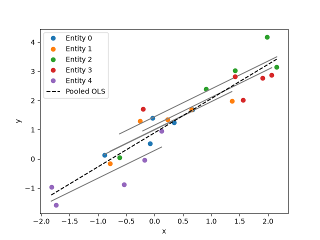
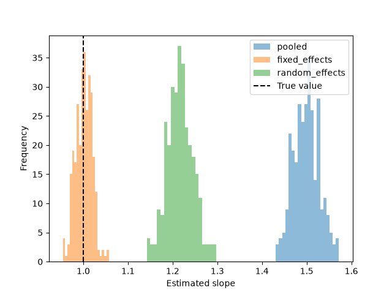

# 第 10 章: パネル・データ分析

## 10.1 この章の地図

第 9 章では、個人効果 a_i が x と相関するとき、プーリング OLS が偏り、1 階差分が、それを直すことを見ました。この章では、個人効果を扱う標準的な方法を、3 つ書きます。

| 方法 | 考え方 | 個人効果と x が相関するとき |
| :--- | :--- | :--- |
| 固定効果（FE） | 個人ごとの平均を引いて（ウィズイン変換）、個人効果を消す | 偏らない |
| ランダム効果（RE） | 個人効果を、誤差の一部として扱い、系列相関を考慮して推定する（準差分） | 偏る |
| 相関ランダム効果（CRE） | x の個人平均を、説明変数に足す（Mundlak） | 係数は、FE と同じ |

どれを使うかを、**Hausman 検定**で判断します。さらに、同じ個人の誤差が相関しているときの標準誤差（**クラスター標準誤差**）も書きます。最後に、実際のパネル・データ（賃金）で試し、**第 2 部の到達チェック**を行います。



| 項目 | 内容 |
| :--- | :--- |
| 計量経済学の題材 | 固定効果、ウィズイン変換、ダミー変数による固定効果、ランダム効果、θ（準差分の係数）、相関ランダム効果、Hausman 検定、クラスター標準誤差 |
| 使う Python の機能 | pandas の `groupby().transform`、データクラス、行列計算（`np.linalg.inv`） |
| 新しく導入するライブラリ | linearmodels（`PanelOLS`・`RandomEffects`。**照合専用**。推定は、先に自分の式で書く） |
| 完成形 | `PanelFit`、`within_transform`、`fixed_effects`、`least_squares_dummy_variables`、`random_effects_theta`、`random_effects`、`correlated_random_effects`、`hausman_test`、`cluster_standard_errors`、`estimator_comparison`、`hausman_rejection_rate`、`pooled_standard_errors` |
| ファイル | 実装: `lib/chapter10/panel.py`、`lib/chapter10/plot.py`（図）／テスト: `test/chapter10/test_panel.py`、`test/chapter10/test_plot.py`（自分で書くときは、`practice/chapter10/` に、同じ名前で作ります） |
| データ | 手計算用の 6 個の観測値、乱数のパネル、10.6 節だけ、実際のデータ（`wooldridge` の `wagepan`） |

### 計量経済学の式とコードの対応

| 計量経済学 | 式 | コード |
| :--- | :--- | :--- |
| ウィズイン変換 | ỹ_it = y_it − ȳ_i、x̃_it = x_it − x̄_i | `within_transform(panel, columns)` |
| 固定効果 | ỹ を x̃ で回帰（定数項なし）。自由度は n − N − k | `fixed_effects(panel, y, xs)` |
| ダミー変数 | y を x と個人ダミーで回帰 | `least_squares_dummy_variables(...)` |
| θ | θ = 1 − √(σ_u² ÷ (σ_u² + T·σ_a²)) | `random_effects_theta(...)` |
| ランダム効果 | y − θȳ_i を、x − θx̄_i（と、定数項 1 − θ）で回帰 | `random_effects(...)` |
| 相関ランダム効果 | y を x と x̄_i で回帰 | `correlated_random_effects(...)` |
| Hausman 検定 | H = (b_FE − b_RE)′ (V_FE − V_RE)⁻¹ (b_FE − b_RE) ~ χ²(k) | `hausman_test(fixed, random, names)` |
| クラスター標準誤差 | (X′X)⁻¹ (Σ_g X_g′e_g e_g′X_g) (X′X)⁻¹ × 補正 | `cluster_standard_errors(y, x, groups)` |

> **記号について**: N は個人の数、T は期数、k は x の係数の数、σ_u² は idiosyncratic な誤差の分散、σ_a² は個人効果の分散です。一覧は、[記号について](how-to-read.md#symbols) を参照してください。

### 前提とする章

| できること | 章 |
| :--- | :--- |
| ダミー変数 `make_dummies` | [第 7 章](07-dummy-variables.md) |
| 個人効果、プーリング OLS、1 階差分 | [第 9 章](09-pooling-and-did.md) |
| 頑健な標準誤差 | [第 8 章](08-heteroskedasticity.md) |

## 10.2 準備

```bash
cd apps/econometrics-programming/python
uv sync
uv run pytest test/chapter10
```

```text
28 passed
```

自分でコードを書くときは、`practice/chapter10/` に、完成形と同じ名前（`panel.py`・`test_panel.py`）のファイルを作ります。

## 10.3 予想する

3 人、2 期のパネルで、y = a_i + 2·x です。a は 1、6、−1（個人効果）、x は個人 0 が 1、2、個人 1 が 2、4、個人 2 が 0、3 です。

1. 個人ごとの平均を引くと、x と y は、どうなりますか。引いたあとの y を x で回帰すると、傾きは、いくつですか
2. 個人ごとのダミー変数を入れた回帰の、x の係数は、固定効果と、同じですか
3. 個人効果が x と相関するとき、固定効果・ランダム効果・プーリング OLS のうち、偏らないのはどれですか
4. 2 期間のパネルで、固定効果と 1 階差分は、同じですか

## 10.4 パネル・データ分析の考え方

### 固定効果（ウィズイン変換）

y_it = α + β·x_it + a_i + u_it の両辺から、個人ごとの平均（ȳ_i = α + β·x̄_i + a_i + ū_i）を引くと、a_i（と α）が消えます。

> ỹ_it = β·x̃_it + ũ_it

ỹ を x̃ で回帰（定数項なし）したものが、**固定効果推定量**です。個人の中の変化だけを使うので、個人効果が x と相関していても、偏りません。標準誤差を計算するときは、自由度に注意します。個人の平均を N 個推定しているので、自由度は n − k ではなく、**n − N − k**です。

### ダミー変数による固定効果

個人ごとのダミー変数を、説明変数に足して回帰（LSDV）しても、x の係数は、**ウィズイン変換と、ちょうど一致**します（FWL。第 3 章）。標準誤差も、一致します。ただし、N が大きいと、ダミー変数の数が増えて、計算が重くなります。

### ランダム効果

個人効果 a_i が、x と**相関しない**と仮定すると、a_i を誤差項に入れたまま、効率的に推定できます。同じ個人の誤差は、a_i を共有するので、相関します。この相関を考慮して、各変数から、個人平均の θ 倍を引いた（**準差分**）変数で回帰します。θ = 0 ならプーリング OLS、θ = 1 なら固定効果です。θ は、個人効果の分散 σ_a² が大きいほど、期数 T が大きいほど、1 に近づきます。

### 相関ランダム効果

x の個人平均 x̄_i を、説明変数に足して、プーリング OLS で回帰します（Mundlak）。x の係数は、**固定効果と、ちょうど一致**します。x̄_i の係数が 0 でなければ、個人効果と x が、相関しているとわかります。

### Hausman 検定

固定効果は、個人効果が x と相関しても偏りませんが、ランダム効果は、相関しないと偏ります。相関しないなら、両者は近く、ランダム効果のほうが効率的です。**Hausman 検定**は、2 つの係数の差が、ゼロとみなせるかを調べます。棄却されたら、固定効果を使います。

### クラスター標準誤差

同じ個人の誤差が相関しているとき、通常の標準誤差は、小さすぎます。個人（**クラスター**）ごとに、スコア X_g′e_g を足してから、2 乗するサンドイッチ推定量が、**クラスター標準誤差**です。

## 10.5 Red → Green → Refactor

### Red: ウィズイン変換と固定効果の手計算

予想 1 の手計算です。個人 0 の x の平均は 1.5、y の平均は 4 なので、引いた値は x が −0.5、0.5、y が −1、1。個人 1 は x が −1、1、y が −2、2。個人 2 は x が −1.5、1.5、y が −3、3 です。ỹ = 2·x̃ がちょうど成り立つので、傾きは 2、残差は 0、自由度は n − N − k = 6 − 3 − 1 = 2 です。

```python
import numpy as np
import pandas as pd
import pytest

from lib.chapter10.panel import fixed_effects, within_transform

PANEL = pd.DataFrame(
    {
        "entity": [0, 0, 1, 1, 2, 2],
        "time": [0, 1] * 3,
        "x": [1, 2, 2, 4, 0, 3],
        "y": [3, 5, 10, 14, -1, 5],
    },
    dtype=float,
)
```

def test_ウィズイン変換は個人ごとの平均を引く() -> None:
    tilde = within_transform(PANEL, ["x", "y"])
    assert tilde["x"].tolist() == [-0.5, 0.5, -1, 1, -1.5, 1.5]
    assert tilde["y"].tolist() == [-1, 1, -2, 2, -3, 3]


def test_ウィズイン変換すると個人ごとの平均は0() -> None:
    panel = sample()
    tilde = within_transform(panel, ["x", "y"])
    means = tilde.groupby(panel["entity"]).mean()
    assert means.to_numpy() == pytest.approx(0, abs=1e-12)


def test_固定効果は個人の効果を除いて真の傾きを復元する() -> None:
    fit = fixed_effects(PANEL, "y", ["x"])
    assert fit.coefficients["x"] == pytest.approx(2)
    assert fit.standard_errors["x"] == pytest.approx(0, abs=1e-9)
    assert fit.df_resid == 6 - 3 - 1
    assert fit.n_obs == 6

### Green: ウィズイン変換と固定効果を実装する

@dataclass(frozen=True)
class PanelFit:
    """パネル・データの推定結果（係数・標準誤差・共分散行列・誤差の分散の推定値）。"""

    coefficients: pd.Series
    standard_errors: pd.Series
    covariance: pd.DataFrame
    sigma2: float
    r_squared: float
    n_obs: int
    df_resid: int


def within_transform(
    panel: pd.DataFrame, columns: list[str], entity: str = "entity"
) -> pd.DataFrame:
    """ウィズイン変換: 各列から、個人ごとの平均を引く。"""
    means = panel.groupby(entity)[columns].transform("mean")
    return panel[columns] - means


def _fit_without_constant(y: pd.Series, x: pd.DataFrame, df_resid: int) -> PanelFit:
    """定数項なしの回帰。誤差の分散は、指定した自由度 df_resid で割って推定する。"""
    result = fit_ols(y, x, constant=False)
    design = x.to_numpy(dtype=float)
    sigma2 = float(result.residuals @ result.residuals) / df_resid
    covariance = sigma2 * np.linalg.inv(design.T @ design)
    names = list(x.columns)
    return PanelFit(
        coefficients=result.coefficients,
        standard_errors=pd.Series(np.sqrt(np.diag(covariance)), index=names),
        covariance=pd.DataFrame(covariance, index=names, columns=names),
        sigma2=sigma2,
        r_squared=result.r_squared,
        n_obs=len(y),
        df_resid=df_resid,
    )


def fixed_effects(
    panel: pd.DataFrame, y: str, xs: list[str], entity: str = "entity"
) -> PanelFit:
    """固定効果推定: ウィズイン変換した y を、x で回帰する（定数項なし）。

    個人の数 N を引いた、自由度 n − N − k で、標準誤差を計算する。
    """
    tilde = within_transform(panel, [y, *xs], entity)
    df_resid = len(panel) - panel[entity].nunique() - len(xs)
    return _fit_without_constant(tilde[y], tilde[xs], df_resid)

```python
from lib.chapter10.panel import fixed_effects, within_transform

print(within_transform(PANEL, ["x", "y"]))
fit = fixed_effects(PANEL, "y", ["x"])
print(fit.coefficients.to_dict(), round(float(fit.standard_errors["x"]), 10), fit.df_resid)
```

```text
     x    y
0 -0.5 -1.0
1  0.5  1.0
2 -1.0 -2.0
3  1.0  2.0
4 -1.5 -3.0
5  1.5  3.0
{'x': 2.0} 0.0 2
```

手計算と一致します（予想 1）。第 9 章では、プーリング OLS が 3.2 に偏った同じデータで、固定効果は、真の値 2 を、ちょうど復元します。

### 乱数のパネルで、3 つの方法を比べる

第 9 章の `draw_panel` で、個人 100 人、5 期、x と個人効果の相関 0.7 のパネルを作ります（真の傾きは 1）。

```python
import numpy as np

from lib.chapter03.multiple import fit_ols
from lib.chapter09.did import draw_panel
from lib.chapter10.panel import (
    correlated_random_effects,
    fixed_effects,
    least_squares_dummy_variables,
    random_effects,
    random_effects_theta,
)

panel = draw_panel(100, 5, 0.7, np.random.default_rng(0))
fe = fixed_effects(panel, "y", ["x"])
print("fe", fe.coefficients.round(4).to_dict(), fe.standard_errors.round(4).to_dict(), fe.df_resid)
print("lsdv", least_squares_dummy_variables(panel, "y", ["x"]).round(4).to_dict())
print("cre", correlated_random_effects(panel, "y", ["x"]).round(4).to_dict())
pooled = fit_ols(panel["y"], panel[["x"]])
print("pooled", pooled.coefficients.round(4).to_dict(), pooled.standard_errors.round(4).to_dict())
```

```text
fe {'x': 0.9887} {'x': 0.0235} 399
lsdv {'coefficient': {'x': 0.9887}, 'standard_error': {'x': 0.0235}}
cre {'coefficient': {'x': 0.9887}, 'standard_error': {'x': 0.0351}}
pooled {'const': 1.0417, 'x': 1.4342} {'const': 0.0424, 'x': 0.0355}
```

固定効果の傾きは 0.9887 で、真の値 1 に近く、自由度は 399（500 − 100 − 1）です。**ダミー変数推定（LSDV）の係数と標準誤差は、固定効果と、同じ値**です（予想 2）。相関ランダム効果の係数も、0.9887 と同じです（標準誤差は、別の計算なので、0.0351 と違います）。プーリング OLS は、1.4342 と偏ります。

def least_squares_dummy_variables(
    panel: pd.DataFrame, y: str, xs: list[str], entity: str = "entity"
) -> pd.DataFrame:
    """ダミー変数による固定効果推定: 個人ごとのダミー変数を、説明変数に足して回帰する。

    x の係数と標準誤差の表（列は coefficient・standard_error）を返す。
    """
    result = fit_ols(panel[y], panel[xs].join(make_dummies(panel[entity])))
    return pd.DataFrame(
        {
            "coefficient": result.coefficients[xs],
            "standard_error": result.standard_errors[xs],
        }
    )


def correlated_random_effects(
    panel: pd.DataFrame, y: str, xs: list[str], entity: str = "entity"
) -> pd.DataFrame:
    """相関ランダム効果（Mundlak）: x の個人平均を足して、プーリング OLS で回帰する。

    x の係数は、固定効果推定と、ちょうど一致する。
    """
    means = panel.groupby(entity)[xs].transform("mean").add_suffix("_mean")
    result = fit_ols(panel[y], panel[xs].join(means))
    return pd.DataFrame(
        {
            "coefficient": result.coefficients[xs],
            "standard_error": result.standard_errors[xs],
        }
    )

def sample(
    entities: int = 50, periods: int = 4, correlation: float = 0.7
) -> pd.DataFrame:
    return draw_panel(entities, periods, correlation, np.random.default_rng(0))


def test_固定効果とダミー変数推定は係数も標準誤差もちょうど一致する() -> None:
    panel = sample()
    fit = fixed_effects(panel, "y", ["x"])
    dummy = least_squares_dummy_variables(panel, "y", ["x"])
    assert dummy.loc["x", "coefficient"] == pytest.approx(
        fit.coefficients["x"], abs=1e-10
    )
    assert dummy.loc["x", "standard_error"] == pytest.approx(
        fit.standard_errors["x"], abs=1e-10
    )


def test_固定効果はlinearmodelsと一致する() -> None:
    panel = sample()
    fit = fixed_effects(panel, "y", ["x"])
    reference = PanelOLS.from_formula(
        "y ~ x + EntityEffects", panel.set_index(["entity", "time"])
    ).fit()
    assert fit.coefficients["x"] == pytest.approx(reference.params["x"])
    assert fit.standard_errors["x"] == pytest.approx(reference.std_errors["x"])


def test_相関ランダム効果の係数は固定効果とちょうど一致する() -> None:
    panel = sample()
    cre = correlated_random_effects(panel, "y", ["x"])
    assert cre.loc["x", "coefficient"] == pytest.approx(
        fixed_effects(panel, "y", ["x"]).coefficients["x"], abs=1e-10
    )

`linearmodels` の `PanelOLS` と、係数・標準誤差が一致することも、テストで確かめています。

### ランダム効果

ランダム効果の θ は、2 つの分散から求めます（**Swamy-Arora**）。σ_u² は固定効果の誤差の分散、σ_b² は、個人平均の回帰の誤差の分散で、σ_a² = σ_b² − σ_u² ÷ T です（負なら 0）。θ = 1 − √(σ_u² ÷ (σ_u² + T·σ_a²)) です。

def _balanced_periods(panel: pd.DataFrame, entity: str) -> int:
    counts = panel.groupby(entity).size()
    if counts.nunique() != 1:
        raise ValueError("バランスしたパネル（どの個人も同じ期数）だけを扱う")
    return int(counts.iloc[0])


def random_effects_theta(
    panel: pd.DataFrame, y: str, xs: list[str], entity: str = "entity"
) -> float:
    """ランダム効果の θ（Swamy-Arora の分散成分から求める）。

    σ_u² は固定効果の誤差の分散、σ_b² = σ_a² + σ_u² ÷ T は個人平均の回帰の
    誤差の分散。θ = 1 − √(σ_u² ÷ (σ_u² + T·σ_a²))。
    """
    periods = _balanced_periods(panel, entity)
    sigma_u2 = fixed_effects(panel, y, xs, entity).sigma2
    means = panel.groupby(entity)[[y, *xs]].mean()
    between = fit_ols(means[y], means[xs])
    sigma_b2 = float(between.residuals @ between.residuals) / between.df_resid
    sigma_a2 = max(sigma_b2 - sigma_u2 / periods, 0.0)
    return 1 - math.sqrt(sigma_u2 / (sigma_u2 + periods * sigma_a2))


def random_effects(
    panel: pd.DataFrame, y: str, xs: list[str], entity: str = "entity"
) -> PanelFit:
    """ランダム効果推定: 個人平均の θ 倍を引いた（準差分の）変数で、回帰する。"""
    theta = random_effects_theta(panel, y, xs, entity)
    columns = [y, *xs]
    means = panel.groupby(entity)[columns].transform("mean")
    quasi = panel[columns] - theta * means
    x = quasi[xs].assign(const=1 - theta)[["const", *xs]]
    return _fit_without_constant(quasi[y], x, len(panel) - len(xs) - 1)

def test_ランダム効果はlinearmodelsと一致する() -> None:
    panel = sample()
    fit = random_effects(panel, "y", ["x"])
    reference = RandomEffects.from_formula(
        "y ~ 1 + x", panel.set_index(["entity", "time"])
    ).fit()
    assert fit.coefficients["x"] == pytest.approx(reference.params["x"])
    assert fit.coefficients["const"] == pytest.approx(reference.params["Intercept"])
    assert fit.standard_errors["x"] == pytest.approx(reference.std_errors["x"])
    assert random_effects_theta(panel, "y", ["x"]) == pytest.approx(
        float(np.asarray(reference.theta)[0, 0])
    )


def test_θは0から1の間() -> None:
    assert 0 < random_effects_theta(sample(), "y", ["x"]) < 1


def test_個人の効果がなければθは0でランダム効果はプーリングに一致する() -> None:
    rng = np.random.default_rng(4)
    panel = pd.DataFrame(
        {
            "entity": np.repeat(range(4), 6),
            "time": np.tile(range(6), 4),
            "x": rng.standard_normal(24),
        }
    )
    panel["y"] = 1 + panel["x"] + rng.standard_normal(24)
    assert random_effects_theta(panel, "y", ["x"]) == 0
    pooled = fit_ols(panel["y"], panel[["x"]])
    fit = random_effects(panel, "y", ["x"])
    assert fit.coefficients["x"] == pytest.approx(pooled.coefficients["x"])
    assert fit.coefficients["const"] == pytest.approx(pooled.coefficients["const"])


def test_期数がそろっていないパネルは扱わない() -> None:
    with pytest.raises(ValueError, match="バランス"):
        random_effects_theta(sample().iloc[:-1], "y", ["x"])

```python
from lib.chapter10.panel import hausman_test

re = random_effects(panel, "y", ["x"])
print("re", re.coefficients.round(4).to_dict(), re.standard_errors.round(4).to_dict())
print("theta", round(random_effects_theta(panel, "y", ["x"]), 4))
test = hausman_test(fe, re, ["x"])
print("hausman", round(test.statistic, 2), test.p_value)
```

```text
re {'const': 1.0463, 'x': 1.0847} {'const': 0.0673, 'x': 0.0262}
theta 0.6297
hausman 184.07 6.258411565090162e-42
```

θ は 0.6297 で、0 と 1 の間です。ランダム効果の傾きは 1.0847 で、固定効果（0.9887）と、プーリング OLS（1.4342）の**中間**です。`linearmodels` の `RandomEffects` と、係数・標準誤差・θ が一致します。Hausman 検定は、統計量 184.07、p 値 6 × 10⁻⁴² で、「固定効果とランダム効果の係数は同じ」を、強く棄却します。この標本では、固定効果を使うべきです（予想 3）。

### Hausman 検定を実装する

def hausman_test(fixed: PanelFit, random: PanelFit, names: list[str]) -> TestResult:
    """Hausman 検定: 固定効果とランダム効果の係数が、同じか（帰無仮説: 同じ）。

    H = (b_fe − b_re)′ (V_fe − V_re)⁻¹ (b_fe − b_re) は、χ²(k) に従う。
    2 つの推定で誤差の分散の推定値が違うと、H が負になることがある。
    そこで、ランダム効果の共分散行列を、固定効果の σ² に、そろえて使う。
    """
    diff = (fixed.coefficients[names] - random.coefficients[names]).to_numpy()
    scale = fixed.sigma2 / random.sigma2
    variance = (
        fixed.covariance.loc[names, names] - scale * random.covariance.loc[names, names]
    ).to_numpy()
    statistic = float(diff @ np.linalg.inv(variance) @ diff)
    return TestResult(statistic, float(stats.chi2.sf(statistic, len(names))))

> **実装の注意**: 固定効果とランダム効果は、それぞれ、誤差の分散 σ² を推定します。個人効果と x が相関していると、ランダム効果の σ² が、大きく出て、分散の差 V_FE − V_RE が**負**になり、統計量が負になることがあります（この標本では、−68.7 でした）。そこで、ランダム効果の共分散行列を、固定効果の σ² に、そろえて使います。

def known_fit(coefficient: float, variance: float, sigma2: float) -> PanelFit:
    return PanelFit(
        pd.Series({"x": coefficient}),
        pd.Series({"x": variance**0.5}),
        pd.DataFrame({"x": [variance]}, index=["x"]),
        sigma2,
        0.5,
        10,
        8,
    )


def test_Hausman統計量の手計算() -> None:
    test = hausman_test(known_fit(1.0, 0.04, 1.0), known_fit(0.7, 0.01, 1.0), ["x"])
    assert test.statistic == pytest.approx(0.3**2 / (0.04 - 0.01))
    assert test.p_value == pytest.approx(stats.chi2.sf(3.0, 1))


def test_Hausman検定はランダム効果の分散を固定効果のσ2にそろえる() -> None:
    test = hausman_test(known_fit(1.0, 0.04, 1.0), known_fit(0.7, 0.01, 2.0), ["x"])
    assert test.statistic == pytest.approx(0.09 / 0.035)

### 2 期間の固定効果と、1 階差分

```python
from lib.chapter09.did import first_difference, first_difference_estimate

two = draw_panel(60, 2, 0.8, np.random.default_rng(1))
d = first_difference(two)
print(round(float(fixed_effects(two, "y", ["x"]).coefficients["x"]), 4))
print(round(float(fit_ols(d["dy"], d[["dx"]], constant=False).coefficients["dx"]), 4))
print(round(first_difference_estimate(two), 4))
```

```text
1.1161
1.1161
1.1104
```

**2 期間では、固定効果と、定数項なしの 1 階差分が、ちょうど一致します**（1.1161、予想 4）。第 9 章の `first_difference_estimate` は、定数項を含むので、1.1104 と、少し違います（定数項が、平均的な変化を吸収するため）。

def test_2期間の固定効果は定数項なしの1階差分とちょうど一致する() -> None:
    panel = draw_panel(60, 2, 0.8, np.random.default_rng(1))
    d = first_difference(panel)
    no_constant = fit_ols(d["dy"], d[["dx"]], constant=False).coefficients["dx"]
    assert fixed_effects(panel, "y", ["x"]).coefficients["x"] == pytest.approx(
        no_constant
    )


def test_定数項ありの1階差分は固定効果と少しだけ違う() -> None:
    panel = draw_panel(60, 2, 0.8, np.random.default_rng(1))
    with_constant = first_difference_estimate(panel)
    fixed = fixed_effects(panel, "y", ["x"]).coefficients["x"]
    assert with_constant != pytest.approx(fixed, abs=1e-6)
    assert with_constant == pytest.approx(fixed, abs=0.05)

### 推定量の性質を、シミュレーションで

個人 200 人、5 期で、相関 0 と 1 を、300 回繰り返します（真の傾きは 1）。

def estimator_comparison(
    entities: int,
    periods: int,
    correlation: float,
    repetitions: int,
    rng: np.random.Generator,
) -> pd.DataFrame:
    """パネルを作り直し、3 つの推定量（真の傾きは 1）を繰り返す。"""
    rows = []
    for _ in range(repetitions):
        panel = draw_panel(entities, periods, correlation, rng)
        rows.append(
            (
                pooled_estimate(panel),
                fixed_effects(panel, "y", ["x"]).coefficients["x"],
                random_effects(panel, "y", ["x"]).coefficients["x"],
            )
        )
    return pd.DataFrame(rows, columns=["pooled", "fixed_effects", "random_effects"])


def hausman_rejection_rate(
    entities: int,
    periods: int,
    correlation: float,
    repetitions: int,
    significance: float,
    rng: np.random.Generator,
) -> float:
    """Hausman 検定が、同じという帰無仮説を、棄却する割合。"""
    rejected = 0
    for _ in range(repetitions):
        panel = draw_panel(entities, periods, correlation, rng)
        test = hausman_test(
            fixed_effects(panel, "y", ["x"]), random_effects(panel, "y", ["x"]), ["x"]
        )
        rejected += test.p_value < significance
    return rejected / repetitions

def test_相関があるとプーリングは偏りランダム効果は中間で固定効果は偏らない() -> None:
    table = estimator_comparison(200, 5, 1.0, 300, np.random.default_rng(0))
    means = table.mean()
    se = table.std() / 300**0.5
    assert abs(means["fixed_effects"] - 1.0) < 4 * se["fixed_effects"]
    assert abs(means["pooled"] - 1.5) < 4 * se["pooled"]
    assert means["fixed_effects"] < means["random_effects"] < means["pooled"]


def test_相関がなければ3つの推定量はどれも偏らない() -> None:
    table = estimator_comparison(200, 5, 0.0, 300, np.random.default_rng(0))
    se = table.std() / 300**0.5
    for name in table.columns:
        assert abs(table[name].mean() - 1.0) < 4 * se[name]
    assert table["pooled"].std() > table["fixed_effects"].std()


def test_個人の効果が説明変数と相関するとHausman検定は棄却する() -> None:
    rate = hausman_rejection_rate(100, 5, 1.0, 100, 0.05, np.random.default_rng(0))
    assert rate > 0.95


def test_相関がなければHausman検定の棄却率は有意水準に近い() -> None:
    rate = hausman_rejection_rate(200, 5, 0.0, 300, 0.05, np.random.default_rng(0))
    assert rate == pytest.approx(0.05, abs=4 * (0.05 * 0.95 / 300) ** 0.5)

```python
from lib.chapter10.panel import estimator_comparison, hausman_rejection_rate

for correlation in (0.0, 1.0):
    table = estimator_comparison(200, 5, correlation, 300, np.random.default_rng(0))
    rate = hausman_rejection_rate(200, 5, correlation, 300, 0.05, np.random.default_rng(0))
    print(correlation, table.mean().round(4).to_dict(), table.std().round(4).to_dict(), rate)
```

```text
0.0 {'pooled': 1.001, 'fixed_effects': 1.0013, 'random_effects': 1.0013} {'pooled': 0.036, 'fixed_effects': 0.0181, 'random_effects': 0.018} 0.05
1.0 {'pooled': 1.4993, 'fixed_effects': 1.0013, 'random_effects': 1.2165} {'pooled': 0.0288, 'fixed_effects': 0.0181, 'random_effects': 0.0288} 1.0
```

列は、各推定量の平均と標準偏差、Hausman 検定の棄却率です。

- **相関 0**: 3 つとも偏らず（約 1.00）、ランダム効果（0.018）が、固定効果（0.0181）と同じ程度に効率的で、プーリング OLS（0.036）は、約 2 倍ばらつきます。Hausman 検定の棄却率は 0.05 で、有意水準どおりです
- **相関 1**: 固定効果は偏らず（1.0013）、プーリング OLS は 1.4993（理論値 1.5）、ランダム効果は 1.2165 と中間です。Hausman 検定は、すべての標本で棄却します（1.0）



### クラスター標準誤差

def cluster_standard_errors(
    y: pd.Series, x: pd.DataFrame, groups: pd.Series
) -> pd.Series:
    """個人（クラスター）ごとの相関に頑健な標準誤差。同じ個人の誤差は、相関してよい。

    Var(b) = (X′X)⁻¹ · Σ_g X_g′ e_g e_g′ X_g · (X′X)⁻¹ に、
    G ÷ (G − 1) · (n − 1) ÷ (n − k) を掛ける。
    """
    result = fit_ols(y, x)
    design = np.column_stack([np.ones(len(x)), x.to_numpy(dtype=float)])
    n, k = design.shape
    scores = (
        pd.DataFrame(design * result.residuals[:, None])
        .groupby(groups.to_numpy())
        .sum()
    )
    meat = scores.to_numpy().T @ scores.to_numpy()
    g = len(scores)
    bread = np.linalg.inv(design.T @ design)
    variance = g / (g - 1) * (n - 1) / (n - k) * bread @ meat @ bread
    return pd.Series(np.sqrt(np.diag(variance)), index=result.coefficients.index)


def pooled_standard_errors(
    entities: int, periods: int, repetitions: int, rng: np.random.Generator
) -> dict[str, float]:
    """プーリング OLS の傾きのばらつきと、通常・クラスター標準誤差の平均。

    x = m + v（m は個人ごとの成分）、y = 1 + x + a + 0.5·u（a は個人ごとの効果）。
    a と m は無関係なので、推定値は偏らないが、同じ個人の誤差と x が、相関する。
    """
    slopes, classical, clustered = [], [], []
    for _ in range(repetitions):
        entity = np.repeat(np.arange(entities), periods)
        n = entities * periods
        m = np.repeat(rng.standard_normal(entities), periods)
        a = np.repeat(rng.standard_normal(entities), periods)
        x = pd.DataFrame({"x": m + rng.standard_normal(n)})
        y = pd.Series(1 + x["x"] + a + 0.5 * rng.standard_normal(n))
        result = fit_ols(y, x)
        slopes.append(result.coefficients["x"])
        classical.append(result.standard_errors["x"])
        clustered.append(cluster_standard_errors(y, x, pd.Series(entity))["x"])
    return {
        "sd": float(np.std(slopes, ddof=1)),
        "classical": float(np.mean(classical)),
        "clustered": float(np.mean(clustered)),
    }

def test_クラスター標準誤差はstatsmodelsと一致する() -> None:
    panel = sample()
    robust = cluster_standard_errors(panel["y"], panel[["x"]], panel["entity"])
    reference = sm.OLS(panel["y"], sm.add_constant(panel[["x"]])).fit(
        cov_type="cluster", cov_kwds={"groups": panel["entity"]}
    )
    assert robust.to_numpy() == pytest.approx(reference.bse.to_numpy())
    assert list(robust.index) == ["const", "x"]


def test_個人内で相関があると通常の標準誤差は過小でクラスターは近い() -> None:
    r = pooled_standard_errors(100, 5, 500, np.random.default_rng(0))
    assert r["classical"] < 0.75 * r["sd"]
    assert r["clustered"] == pytest.approx(r["sd"], rel=0.1)

```python
from lib.chapter10.panel import cluster_standard_errors, pooled_standard_errors

print(cluster_standard_errors(panel["y"], panel[["x"]], panel["entity"]).round(4).to_dict())
print({k: round(v, 4) for k, v in pooled_standard_errors(100, 5, 1000, np.random.default_rng(0)).items()})
```

```text
{'const': 0.0746, 'x': 0.0467}
{'sd': 0.057, 'classical': 0.0354, 'clustered': 0.056}
```

上の標本で、プーリング OLS の x の標準誤差は、通常 0.0355、クラスター 0.0467 です。クラスター標準誤差は、`statsmodels` の `cov_type="cluster"` と一致します。2 行目は、x にも個人ごとの成分があり、個人効果と無関係な設計で、1000 回繰り返した結果です。**実際のばらつき 0.057 に対し、通常の標準誤差は 0.0354 と、約 4 割小さく、クラスターは 0.056 で近い**値です。同じ個人の誤差が相関しているのに、通常の標準誤差を使うと、有意になりすぎます。

### 図

`plot_entity_lines` は、個人ごとのデータと、固定効果の傾きの直線、プーリング OLS の直線を描きます。`plot_estimate_comparison` は、推定量ごとの推定値のヒストグラムです。

def test_個人ごとのデータと直線とプーリングの直線() -> None:
    panel = draw_panel(8, 5, 1.0, np.random.default_rng(0))
    ax = plot_entity_lines(panel, entities=3).axes[0]
    labels = [line.get_label() for line in ax.lines]
    assert labels == [
        "Entity 0",
        "_fit",
        "Entity 1",
        "_fit",
        "Entity 2",
        "_fit",
        "Pooled OLS",
    ]


def test_個人ごとの直線の傾きは固定効果の傾き() -> None:
    panel = draw_panel(8, 5, 1.0, np.random.default_rng(0))
    beta = fixed_effects(panel, "y", ["x"]).coefficients["x"]
    ax = plot_entity_lines(panel, entities=2).axes[0]
    for line in (ax.lines[1], ax.lines[3]):
        x, y = xs(line), ys(line)
        assert (y[1] - y[0]) / (x[1] - x[0]) == pytest.approx(beta)


def test_プーリングの直線の傾きはプーリングの推定値() -> None:
    panel = draw_panel(8, 5, 1.0, np.random.default_rng(0))
    ax = plot_entity_lines(panel, entities=3).axes[0]
    x, y = xs(ax.lines[-1]), ys(ax.lines[-1])
    shown = panel[panel["entity"] < 3]
    expected = np.polyfit(shown["x"], shown["y"], 1)[0]
    assert (y[1] - y[0]) / (x[1] - x[0]) == pytest.approx(expected)
    assert ax.lines[-1].get_linestyle() == "--"


def test_推定値の比較の図は3つのヒストグラムと真の値の線() -> None:
    table = estimator_comparison(50, 3, 1.0, 30, np.random.default_rng(0))
    ax = plot_estimate_comparison(table, 1.0).axes[0]
    assert len(ax.patches) == 3 * 20
    assert [line.get_label() for line in ax.lines] == ["True value"]
    legend = ax.get_legend()
    assert legend is not None
    assert [t.get_text() for t in legend.get_texts()] == [
        "pooled",
        "fixed_effects",
        "random_effects",
        "True value",
    ]

def plot_entity_lines(panel: pd.DataFrame, entities: int = 5) -> Figure:
    """最初の数人のデータと、固定効果の傾きの直線（個人ごと）、プーリング OLS の直線。

    個人ごとの直線は平行（同じ傾き）で、プーリング OLS の直線は、傾きが違う。
    """
    beta = fixed_effects(panel, "y", ["x"]).coefficients["x"]
    fig, ax = plt.subplots()
    for entity in range(entities):
        data = panel[panel["entity"] == entity]
        ax.plot(data["x"], data["y"], "o", label=f"Entity {entity}")
        ends = np.array([data["x"].min(), data["x"].max()])
        center = data["y"].mean() + beta * (ends - data["x"].mean())
        ax.plot(ends, center, color="gray", label="_fit")
    shown = panel[panel["entity"] < entities]
    ends = np.array([shown["x"].min(), shown["x"].max()])
    pooled = pooled_estimate(shown)
    line = shown["y"].mean() + pooled * (ends - shown["x"].mean())
    ax.plot(ends, line, "--", color="black", label="Pooled OLS")
    ax.set_xlabel("x")
    ax.set_ylabel("y")
    ax.legend()
    plt.close(fig)
    return fig


def plot_estimate_comparison(estimates: pd.DataFrame, true_value: float) -> Figure:
    """推定量ごとの、傾きの推定値のヒストグラムと、真の値の線を重ねて描く。"""
    fig, ax = plt.subplots()
    for name in estimates.columns:
        ax.hist(estimates[name], bins=20, alpha=0.5, label=name)
    ax.axvline(true_value, color="black", linestyle="--", label="True value")
    ax.set_xlabel("Estimated slope")
    ax.set_ylabel("Frequency")
    ax.legend()
    plt.close(fig)
    return fig

### 実行結果

```bash
uv run pytest test/chapter10
```

```text
28 passed
```

## 10.6 実際のデータで試す（賃金のパネル）

ここまでは、乱数のパネルで試しました。最後に、**実際のパネル・データ**で、自分の関数を、そのまま使います。

### データを取得する

第 6 章と同じ、`wooldridge` パッケージ（MIT ライセンス）の、`wagepan` を使います。パッケージの説明によると、出典は、F. Vella and M. Verbeek (1998), "Whose Wages Do Unions Raise? A Dynamic Model of Unionism and Wage Rate Determination for Young Men," Journal of Applied Econometrics 13, 163-183 です。**データの利用条件は、確認していません**。各自で確認し、使うときは、出典を明記してください（導入は、第 6 章 6.6 節と同じ、`uv run --group realdata ...`）。

### ファイルの形（実物で確かめたこと）

`wooldridge.data("wagepan")` は、**4360 行、44 列**です。個人の識別子 `nr` が 545 人、`year` が 1980 年から 1987 年の 8 期で、545 × 8 = 4360 のバランスしたパネルです。この節で使う列は、`lwage`（賃金の対数）、`married`（既婚なら 1）、`union`（組合員なら 1）です。

### 自分の関数を、実際のデータに使う

次のスクリプトを `practice/chapter10/wagepan.py` として保存し、アプリの根で、`uv run --group realdata python -m practice.chapter10.wagepan` で実行します。

```python
import wooldridge

from lib.chapter03.multiple import fit_ols
from lib.chapter10.panel import (
    cluster_standard_errors,
    correlated_random_effects,
    fixed_effects,
    hausman_test,
    random_effects,
)

df = wooldridge.data("wagepan")
print(df.shape, df["nr"].nunique(), df["year"].min(), df["year"].max())
panel = df.rename(columns={"nr": "entity", "year": "time", "lwage": "y"})
xs = ["married", "union"]
pooled = fit_ols(panel["y"], panel[xs])
fe = fixed_effects(panel, "y", xs)
re = random_effects(panel, "y", xs)
print("pooled", pooled.coefficients.round(4).to_dict())
print("fe", fe.coefficients.round(4).to_dict(), fe.standard_errors.round(4).to_dict())
print("re", re.coefficients.round(4).to_dict(), re.standard_errors.round(4).to_dict())
cluster = cluster_standard_errors(panel["y"], panel[xs], panel["entity"])
print("pooled se", pooled.standard_errors.round(4).to_dict())
print("cluster se", cluster.round(4).to_dict())
print(correlated_random_effects(panel, "y", xs).round(4).to_dict())
test = hausman_test(fe, re, xs)
print(round(test.statistic, 2), round(test.p_value, 4))
```

```text
(4360, 44) 545 1980 1987
pooled {'const': 1.5139, 'married': 0.2142, 'union': 0.1689}
fe {'married': 0.2417, 'union': 0.07} {'married': 0.0177, 'union': 0.0207}
re {'const': 1.5226, 'married': 0.2351, 'union': 0.0955} {'const': 0.0182, 'married': 0.0164, 'union': 0.0191}
pooled se {'const': 0.0112, 'married': 0.0158, 'union': 0.0182}
cluster se {'const': 0.0222, 'married': 0.0261, 'union': 0.0297}
{'coefficient': {'married': 0.2417, 'union': 0.07}, 'standard_error': {'married': 0.0241, 'union': 0.0283}}
11.01 0.0041
```

自分で書いた関数の結果は、`linearmodels` の `PanelOLS`・`RandomEffects`・`PooledOLS` で得た値（固定効果 0.2417・0.0700、ランダム効果 0.2351・0.0955、プーリング 0.2142・0.1689）と、一致しました。読み方です。

- **組合員の係数**は、プーリング OLS の 0.1689（賃金が約 17% 高い）から、固定効果の 0.07（約 7%）に、大きく下がります。個人ごとの、観測されない要因（能力ややる気）が、組合に入ることと、賃金の両方に関係していた可能性を、示します。ランダム効果（0.0955）は、中間です
- **既婚の係数**は、プーリング 0.2142、固定効果 0.2417、ランダム効果 0.2351 で、あまり変わりません
- **相関ランダム効果**の係数は、固定効果と、ちょうど一致します（0.2417、0.07）
- **Hausman 検定**は、統計量 11.01、p 値 0.0041 で、5% で、「固定効果とランダム効果は同じ」を棄却します。固定効果を使います
- **クラスター標準誤差**は、プーリング OLS の通常の標準誤差の、約 1.6 倍です（既婚 0.0158 → 0.0261、組合 0.0182 → 0.0297）。同じ個人の、8 年分の観測値は、独立ではないためです

> **ここで言えること、言えないこと。** 固定効果は、**時間を通じて変わらない**個人の要因を除きます。時間とともに変わる、観測されない要因（たとえば、昇進と結婚が、同時に起きる）は、除けません。また、固定効果では、`educ` のような、個人ごとに変わらない変数の係数を、推定できません。ウィズイン変換で消えるためです（`linearmodels` で、固定効果に `educ` を入れると、`AbsorbingEffectError` になります）。

## 10.7 規則で言うと

1. **個人効果と x が相関するなら、固定効果。** 個人内の変化だけを使い、相関する個人効果を、消す
2. **固定効果 = ダミー変数 = ウィズイン変換。** x の係数は、ちょうど一致する。自由度は n − N − k
3. **Hausman 検定で、固定効果とランダム効果を選ぶ。** 棄却されたら、固定効果。同じ個人の誤差は相関するので、標準誤差は、クラスターにする

混同しやすい点を、表にまとめます。

| 混同しやすい点 | 違い |
| :--- | :--- |
| 固定効果 と ランダム効果 | 固定効果は、個人効果と x の相関を許す（偏らない）。ランダム効果は、相関しないという仮定が必要だが、効率的で、時間で変わらない変数も推定できる |
| 固定効果 と 1 階差分 | 2 期間なら、定数項なしの 1 階差分は、固定効果と同じ。3 期間以上では、異なる（誤差の仮定によって、どちらが効率的かが変わる） |
| 頑健な標準誤差 と クラスター標準誤差 | 頑健（第 8 章）は、観測値の間の独立を仮定する。クラスターは、同じ個人の中での相関を許す |

### この方法が成り立たない場面

- **時間とともに変わる、観測されない要因は、固定効果でも除けません。** 個人内の変化と相関する、欠落した変数があれば、偏ります（第 11 章）
- **個人ごとに変わらない変数の効果は、推定できません。** 性別・教育年数など。ランダム効果か、相関ランダム効果を使います
- **個人の数が少ないと、クラスター標準誤差は、不正確です。** 目安は、クラスターの数が 30〜50 以上です

## 10.8 第 2 部の到達チェック

第 2 部（第 7〜10 章）の終わりです。何も見ずに、できるかどうかを、自分で確かめます。

### できること

| できること | 検証の方法 | 戻る章 |
| :--- | :--- | :--- |
| ダミー変数を作り、係数を群の平均の差として読む | a が 10、12、14、b が 20、22 で、定数項 12、ダミー変数 9。基準を替えても当てはめ値は同じ。全カテゴリーを入れると、推定できない | 第 7 章 |
| 交差項で、傾きを群ごとに変える | 交差項つきの回帰が、群ごとの回帰と一致する | 第 7 章 |
| 頑健な標準誤差を書き、不均一分散を検定する | x = 1、2、3、4、y = 2、4、5、9 で、HC0 ≈ 0.2538、HC1 ≈ 0.3589。`statsmodels` と一致する | 第 8 章 |
| DiD を、平均と回帰で求める | 処置群 10 → 15、対照群 8 → 10 で 3。交差項の係数と一致する | 第 9 章 |
| 固定効果・ランダム効果・Hausman 検定を行う | 手計算の例で、固定効果の傾き 2（プーリングは 3.2）。固定効果 = ダミー変数推定。`linearmodels` と一致する | 第 10 章 |
| 実際のパネルを、先に形を確かめてから分析する | 行数・個人数・期数（4360、545、8）を確認してから、関数を使う | 第 10 章（10.6 節） |

### 時間を決めて書く課題

何も見ずに、時間を計って、関数とテストを書きます。

| 課題 | 目安の時間 |
| :--- | :--- |
| カテゴリー変数から、ダミー変数を作る関数と、「係数は群の平均の差」のテスト | 15 分 |
| HC1 の頑健な標準誤差の関数と、手計算の例（0.3589）でのテスト | 20 分 |
| ウィズイン変換と固定効果の関数と、手計算の例（傾き 2）および、ダミー変数推定と一致するテスト | 25 分 |

### 誤りの原因の分類

できなかったときは、原因を分類して、戻る章に戻ります。

| 原因 | 例（第 2 部） | 対策 |
| :--- | :--- | :--- |
| 知らない | ダミー変数の罠。サンドイッチ推定量の形。固定効果の自由度 n − N − k | 第 7・8・10 章に戻る |
| 見抜けない | 前後の差が効果ではないこと。不均一分散が、係数ではなく標準誤差を狂わせること | 第 8・9 章の「成り立たない場面」を読む |
| 混同した | 固定効果とランダム効果。頑健な標準誤差とクラスター標準誤差。DiD の回帰の各係数 | 各章の「混同しやすい点」の表を読む |
| 手順の誤り | 全カテゴリーのダミー変数と定数項を、同時に入れる。固定効果に、個人ごとに変わらない変数を入れる | テストを先に書き、手計算の値と比べる |

## 10.9 練習問題

| 種類 | 問題 |
| :--- | :--- |
| 想起 | 本文を閉じて、手計算の例の固定効果（傾き 2）のテストを書いてください |
| 生成 | 解説を見る前に、個人ごとの平均だけを使った回帰（**ビトウィーン推定量**）の傾きを返す `between_estimate(panel, y, xs)` を、テストから書いてください。手計算の例（個人平均 x が 1.5、3、1.5、y が 4、12、2）では、いくつですか。固定効果の 2 と比べてください |
| 多様 | 期数 T を 5 から 10 に増やすと、ランダム効果の θ は、どうなりますか（個人 100 人、相関 0.7）。先に予想してから、確かめてください |
| 交互 | [第 8 章](08-heteroskedasticity.md)の頑健な標準誤差（HC1）と、この章のクラスター標準誤差を、同じパネルで、プーリング OLS の x について比べてください。どちらが大きいですか |

??? note "解答（先に自分で取り組んでから、開いてください）"

    **想起**:

    ```python
    def test_手計算の例の固定効果() -> None:
        panel = pd.DataFrame(
            {
                "entity": [0, 0, 1, 1, 2, 2],
                "time": [0, 1] * 3,
                "x": [1, 2, 2, 4, 0, 3],
                "y": [3, 5, 10, 14, -1, 5],
            },
            dtype=float,
        )
        assert fixed_effects(panel, "y", ["x"]).coefficients["x"] == pytest.approx(2)
    ```

    **生成**: 個人平均の回帰は、(x̄ − 2)(ȳ − 6) の和 = 9、(x̄ − 2)² の和 = 1.5 なので、傾きは 6 です。個人効果が、そのまま、平均に残るので、固定効果の 2 から、大きくずれます。

    ```python
    def between_estimate(panel, y, xs):
        means = panel.groupby("entity")[[y, *xs]].mean()
        return float(fit_ols(means[y], means[xs]).coefficients[xs[0]])
    ```

    ```python
    def test_ビトウィーン推定量の手計算() -> None:
        panel = pd.DataFrame(
            {
                "entity": [0, 0, 1, 1, 2, 2],
                "time": [0, 1] * 3,
                "x": [1, 2, 2, 4, 0, 3],
                "y": [3, 5, 10, 14, -1, 5],
            },
            dtype=float,
        )
        assert between_estimate(panel, "y", ["x"]) == pytest.approx(6)
    ```

    **多様**: T が増えると、個人効果の分散に比べて、期ごとの誤差の平均が小さくなるので、θ は 1 に近づきます（固定効果に近づく）。

    ```python
    def test_期数が増えるとシータは1に近づく() -> None:
        theta5 = random_effects_theta(
            draw_panel(100, 5, 0.7, np.random.default_rng(0)), "y", ["x"]
        )
        theta10 = random_effects_theta(
            draw_panel(100, 10, 0.7, np.random.default_rng(0)), "y", ["x"]
        )
        assert theta5 < theta10 < 1
    ```

    **交互**: 個人効果を共有する同じ個人の誤差が相関するので、クラスター標準誤差のほうが、頑健な（HC1）標準誤差より、大きくなります。

    ```python
    def test_クラスター標準誤差は頑健な標準誤差より大きい() -> None:
        panel = draw_panel(100, 5, 0.7, np.random.default_rng(0))
        hc1 = robust_standard_errors(panel["y"], panel[["x"]])["x"]
        cluster = cluster_standard_errors(panel["y"], panel[["x"]], panel["entity"])["x"]
        assert cluster > 1.2 * hc1
    ```

## 10.10 振り返り

- 予想した 4 つは、当たりましたか。固定効果が、個人効果と x の相関を許す理由を、説明できますか
- Hausman 検定の結果から、どの推定を使うか、決められますか
- 実際の賃金データで、組合員の係数が、プーリングから固定効果で、大きく下がった理由を、説明できますか

## 10.11 まとめ

- ウィズイン変換と固定効果を、手計算の例（傾き 2、プーリングは 3.2）に一致するように書いた。固定効果は、ダミー変数推定とちょうど一致し、`linearmodels` とも一致する。相関ランダム効果の係数は、固定効果と同じ
- ランダム効果の θ（0.6297）と、Hausman 検定（共通の σ² で、負にならない形）を書いた。個人効果と x が相関すると、固定効果は偏らず（1.0013）、ランダム効果は偏り（1.2165）、プーリング OLS は、さらに偏る（1.4993）。Hausman 検定は、棄却率 1.0（相関 0 では 0.05）
- クラスター標準誤差を書き、`statsmodels` と一致させた。同じ個人の誤差が相関すると、通常の標準誤差は、実際のばらつきより約 4 割小さい
- 実際の賃金のパネル（545 人 × 8 年）で、組合員の係数が、プーリング 0.1689 から、固定効果 0.07 に下がること、Hausman 検定が固定効果を選ぶこと（p = 0.0041）を確かめた。第 2 部の到達チェックを行った
- 次の第 3 部では、固定効果でも除けない、「説明変数と誤差項の相関（内生性）」の問題を、扱います
