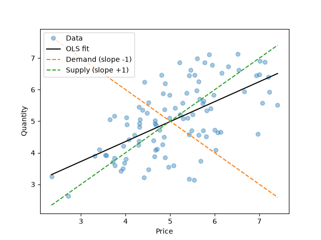
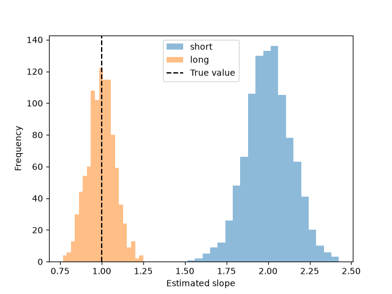
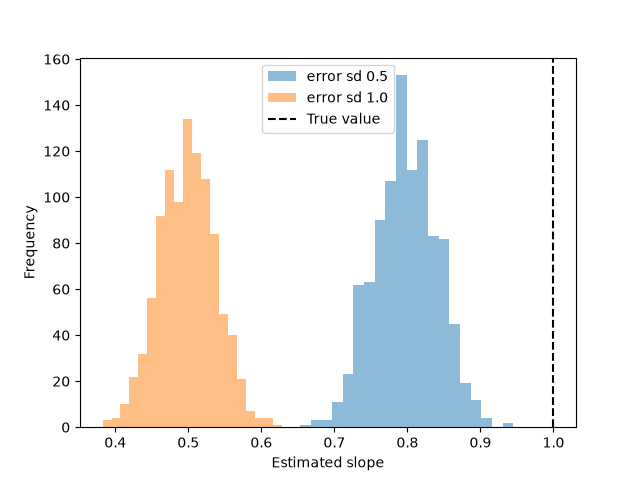
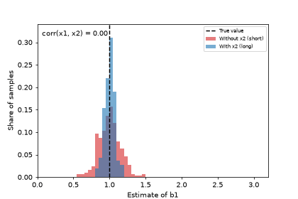

# 第 11 章: 外生性が満たされない場合

## 11.1 この章の地図

第 6 章で、OLS 推定量は、誤差項が説明変数と無関係（**外生**）なら、標本が大きいほど真の値に近づく（一致性）ことを見ました。この前提が崩れて、説明変数と誤差項が相関する（**内生性**）と、標本をいくら増やしても、OLS は真の値に近づきません。第 3 部は、この問題と、その解決（**操作変数法**）を扱います。この章では、内生性が生じる 3 つの典型的な原因を、真の値を知っている乱数のデータで再現します。

| 原因 | 何が起きるか | バイアスの大きさ |
| :--- | :--- | :--- |
| 欠落変数 | y に影響し、x と相関する変数を、回帰に入れ忘れる | 欠落した変数の係数 × 補助回帰の傾き |
| 測定誤差 | x を、誤差つきで測る | 傾きが 0 の方向に縮む（減衰）。係数 × 減衰係数 |
| 同時方程式（同時性） | x と y が、互いに影響し合う（需要と供給など） | OLS が、どちらの式の傾きにも、近づかない |



| 項目 | 内容 |
| :--- | :--- |
| 計量経済学の題材 | 内生性、欠落変数バイアス、測定誤差による減衰バイアス、同時性バイアス |
| 使う Python の機能 | データクラス、NumPy の乱数（多次元）、pandas の表、乱数の生成器 |
| 新しく導入するライブラリ | なし |
| 完成形 | `OvbDecomposition`、`ovb_decomposition`、`draw_omitted`、`simulate_omitted`、`attenuation_factor`、`draw_measurement_error`、`simulate_measurement_error`、`draw_market`、`simultaneity_slope`、`simulate_simultaneity` |
| ファイル | 実装: `lib/chapter11/endogeneity.py`、`lib/chapter11/plot.py`（市場の図）／テスト: `test/chapter11/test_endogeneity.py`、`test/chapter11/test_plot.py`（自分で書くときは、`practice/chapter11/` に、同じ名前で作ります） |
| データ | 手計算用の数列と、母集団の式から作った乱数 |

### 計量経済学の式とコードの対応

| 計量経済学 | 式 | コード |
| :--- | :--- | :--- |
| 欠落変数バイアス | b_短い = b_長い + β̂₂ · δ̃（標本の恒等式） | `ovb_decomposition(y, x1, x2)` |
| 測定誤差の減衰 | plim b = β · Var(x*) ÷ (Var(x*) + Var(e)) | `attenuation_factor(var_true, var_error)` |
| 需要・供給 | 需要 q = 10 − p + u_d、供給 q = p + u_s | `draw_market(n, sd_demand, sd_supply, rng)` |
| 同時性バイアス | plim b = (σ_d² − σ_s²) ÷ (σ_d² + σ_s²) | `simultaneity_slope(sd_demand, sd_supply)` |

> **記号について**: x* は真の（観測できない）変数、e は測定誤差、δ̃ は欠落変数 x₂ を x₁ で回帰したときの傾き（補助回帰）、plim は、標本が大きくなったときの極限です。一覧は、[記号について](how-to-read.md#symbols) を参照してください。

### 前提とする章

| できること | 章 |
| :--- | :--- |
| 重回帰、FWL | [第 3 章](03-multiple-regression.md) |
| 一致性、標本の大きさと標本分布 | [第 6 章](06-asymptotics.md) |

## 11.2 準備

```bash
cd apps/econometrics-programming/python
uv sync
uv run pytest test/chapter11
```

```text
24 passed
```

自分でコードを書くときは、`practice/chapter11/` に、完成形と同じ名前（`endogeneity.py`・`test_endogeneity.py`）のファイルを作ります。

## 11.3 予想する

1. y = 1 + x₁ + 2·x₂ + u の母集団で、x₁ と x₂ の相関が 0.5（どちらも分散 1）です。**x₂ を回帰に入れず**、y を x₁ だけで回帰すると、x₁ の係数は、平均して、いくつに近づきますか（真の値は 1）。標本を 50 から 2000 に増やすと、どうなりますか
2. 真の x* の分散が 1、測定誤差の分散が 1 のとき、誤差のある x で回帰した傾きは、真の値 1 の、何倍に近づきますか
3. 需要曲線 q = 10 − p + u_d と、供給曲線 q = p + u_s から、均衡の (p, q) を多数集めて、q を p で回帰します。需要の変動 u_d と、供給の変動 u_s の大きさが同じ（標準偏差 1）なら、傾きは、いくつに近づきますか（需要の傾き −1 と、供給の傾き +1 の、どちらにも近づかないかもしれません）

## 11.4 内生性の考え方

### 一致性と外生性

y = α + β·x + u の OLS の傾きは、b = β + Cov(x, u) ÷ Var(x)（標本では、Σ(x − x̄)u ÷ Σ(x − x̄)²）と書けます。**Cov(x, u) = 0**（外生）なら、標本が大きいと、b は β に近づきます。Cov(x, u) ≠ 0（内生）だと、b は、β から、Cov(x, u) ÷ Var(x) だけずれた値に近づきます。標本を増やしても、ずれは消えません。

### 欠落変数

真の式が y = β₁·x₁ + β₂·x₂ + u なのに、x₂ を入れずに、y を x₁ だけで回帰します。x₂ が誤差項に入り、x₁ と相関していれば、x₁ の係数が偏ります。標本の中で、次の**恒等式**が、ちょうど成り立ちます。

> b_短い = b_長い + b₂ · δ̃

b_短い は x₂ を落とした回帰の x₁ の傾き、b_長い・b₂ は x₂ を入れた回帰の x₁・x₂ の係数、δ̃ は x₂ を x₁ で回帰した傾き（補助回帰）です。バイアスの方向は、**b₂ の符号 × x₁ と x₂ の相関の符号**です。

### 測定誤差

真の x*（分散 σ*²）を、誤差 e（分散 σ_e²）つきで x = x* + e と測ると、e が誤差項に入り、x と相関します。OLS の傾きは、**0 の方向に縮み**（減衰）、σ*² ÷ (σ*² + σ_e²) 倍の値に近づきます。測定誤差が大きいほど、縮みが大きくなります。

### 同時方程式

需要 q = a − b·p + u_d と、供給 q = c + d·p + u_s で、価格 p と数量 q は、同時に決まります。均衡の p は、u_d と u_s の両方に影響されるので、どちらの式でも、p は、誤差項と相関します。q を p で回帰した傾きは、需要の傾きと供給の傾きの、**混ざった値**になります。需要の変動が大きいと供給の傾き（需要曲線が動いて、供給曲線をなぞる）、供給の変動が大きいと需要の傾きに近づきます。

## 11.5 プログラミング

### Red: 欠落変数バイアスの恒等式

手計算の例です。x₁ = 1、2、3、4、5、x₂ = 2、1、4、3、6 で、y = 1 + 2·x₁ + 3·x₂（誤差なし）。x₂ を x₁ で回帰した傾きは Σ(x₁ − 3)(x₂ − 3.2) ÷ Σ(x₁ − 3)² = 10 ÷ 10 = 1.0 なので、x₂ を落とすと、x₁ の傾きは 2 + 3 × 1.0 = **5** になります。

```python
import numpy as np
import pytest

from lib.chapter02.simple import fit_simple
from lib.chapter11.endogeneity import ovb_decomposition

X1 = [1.0, 2.0, 3.0, 4.0, 5.0]
X2 = [2.0, 1.0, 4.0, 3.0, 6.0]
Y = [1 + 2 * a + 3 * b for a, b in zip(X1, X2, strict=True)]
```

```python
def test_ちょうどの関係では長い回帰が真の係数を復元する() -> None:
    d = ovb_decomposition(Y, X1, X2)
    assert d.long == pytest.approx(2)
    assert d.beta2 == pytest.approx(3)


def test_手計算の補助回帰の傾き() -> None:
    d = ovb_decomposition(Y, X1, X2)
    assert d.delta == pytest.approx(fit_simple(X1, X2).slope)
    assert d.delta == pytest.approx(1.0)


def test_短い回帰の傾きは長い回帰の傾きにバイアスを足したものにちょうど等しい() -> None:
    d = ovb_decomposition(Y, X1, X2)
    assert d.short == pytest.approx(d.long + d.beta2 * d.delta)
    assert d.short == pytest.approx(2 + 3 * 1.0)
```

### Green: ovb_decomposition を実装する

```python
@dataclass(frozen=True)
class OvbDecomposition:
    """欠落変数バイアスの分解: 短い回帰の傾き = 長い回帰の傾き + β₂ · δ。"""

    short: float
    long: float
    beta2: float
    delta: float


def ovb_decomposition(y: Array, x1: Array, x2: Array) -> OvbDecomposition:
    """x2 を落とした回帰（短い）と、入れた回帰（長い）、補助回帰（x2 を x1 で回帰）。

    標本の中で、短い回帰の傾き = 長い回帰の x1 の係数 + x2 の係数 × 補助回帰の傾き
    が、ちょうど成り立つ。
    """
    long = fit_ols(y, np.column_stack([x1, x2])).coefficients
    return OvbDecomposition(
        short=fit_simple(x1, y).slope,
        long=float(long["x1"]),
        beta2=float(long["x2"]),
        delta=fit_simple(x1, x2).slope,
    )
```

```python
from lib.chapter11.endogeneity import ovb_decomposition

x1 = [1.0, 2.0, 3.0, 4.0, 5.0]
x2 = [2.0, 1.0, 4.0, 3.0, 6.0]
y = [1 + 2 * a + 3 * b for a, b in zip(x1, x2)]
d = ovb_decomposition(y, x1, x2)
print(d)
print(d.long + d.beta2 * d.delta, d.short)
```

```text
OvbDecomposition(short=5.0, long=1.9999999999999973, beta2=3.0000000000000018, delta=1.0)
4.999999999999999 5.0
```

手計算の 5 と一致します。恒等式（長い回帰の傾き + b₂ × δ̃ = 短い回帰の傾き）も、浮動小数点の誤差を除いて、ちょうど成り立ちます。

### 乱数の標本

y = 1 + x₁ + 2·x₂ + u（真の傾きは x₁ が 1、x₂ が 2）。x₁ と x₂ は、どちらも分散 1 で、相関が 0.5 です。x₂ を落とすと、バイアスは 2 × 0.5 = 1 で、x₁ の傾きは 2 に近づくはずです（予想 1）。

```python
def draw_omitted(
    n: int, correlation: float, rng: np.random.Generator
) -> tuple[NDArray[np.float64], NDArray[np.float64], NDArray[np.float64]]:
    """y = 1 + x1 + 2·x2 + u（x1 と x2 の相関は correlation、どちらも分散 1）。

    x2 を落とすと、x1 の係数は、1 + 2·correlation に近づく（バイアスは 2·correlation）。
    """
    x1 = rng.standard_normal(n)
    x2 = correlation * x1 + math.sqrt(1 - correlation**2) * rng.standard_normal(n)
    y = 1 + x1 + 2 * x2 + rng.standard_normal(n)
    return y, x1, x2


def simulate_omitted(
    n: int, correlation: float, repetitions: int, rng: np.random.Generator
) -> pd.DataFrame:
    """x2 を落とした回帰（short）と入れた回帰（long）の x1 の係数を繰り返す。"""
    rows = []
    for _ in range(repetitions):
        y, x1, x2 = draw_omitted(n, correlation, rng)
        d = ovb_decomposition(y, x1, x2)
        rows.append((d.short, d.long))
    return pd.DataFrame(rows, columns=["short", "long"])
```

```python
def test_恒等式は乱数の標本でも成り立つ() -> None:
    y, x1, x2 = draw_omitted(50, 0.5, np.random.default_rng(0))
    d = ovb_decomposition(y, x1, x2)
    assert d.short == pytest.approx(d.long + d.beta2 * d.delta, abs=1e-10)


def test_バイアスの符号は欠落変数の係数と相関の符号の積() -> None:
    for correlation in (0.6, -0.6):
        y, x1, x2 = draw_omitted(5000, correlation, np.random.default_rng(1))
        d = ovb_decomposition(y, x1, x2)
        assert np.sign(d.short - d.long) == np.sign(d.beta2 * correlation)


def test_標本の形と相関() -> None:
    y, x1, x2 = draw_omitted(20000, 0.5, np.random.default_rng(0))
    assert y.shape == x1.shape == x2.shape == (20000,)
    assert np.corrcoef(x1, x2)[0, 1] == pytest.approx(0.5, abs=0.02)
    assert np.var(x2) == pytest.approx(1, rel=0.05)
```

```python
import numpy as np

from lib.chapter11.endogeneity import draw_omitted, simulate_omitted

y, x1, x2 = draw_omitted(200, 0.5, np.random.default_rng(0))
d = ovb_decomposition(y, x1, x2)
print(round(d.short, 4), round(d.long, 4), round(d.beta2, 4), round(d.delta, 4))
print(round(d.long + d.beta2 * d.delta, 4))
for n in (50, 2000):
    table = simulate_omitted(n, 0.5, 500, np.random.default_rng(0))
    print(n, table.mean().round(4).to_dict(), table.std().round(4).to_dict())
```

```text
1.9431 1.0327 2.0687 0.44
1.9431
50 {'short': 1.9949, 'long': 0.9941} {'short': 0.288, 'long': 0.1682}
2000 {'short': 2.0009, 'long': 1.0014} {'short': 0.0442, 'long': 0.0262}
```

1 つの標本（n = 200）では、x₂ を入れた回帰の x₁ の係数は 1.0327（真の値 1 に近い）、落とした回帰は 1.9431（2 に近い）です。500 回繰り返すと、**落とした回帰の平均は、n = 50 で 1.9949、n = 2000 で 2.0009**。標本を増やしても、ばらつき（0.288 → 0.0442）が小さくなるだけで、**偏りは消えません**。入れた回帰は、平均が真の値 1 に近いままです。

```python
def test_x2を落とした回帰は平均して1プラス2ρに近く入れた回帰は真の値() -> None:
    table = simulate_omitted(200, 0.5, 1000, np.random.default_rng(0))
    se = table.std() / 1000**0.5
    assert list(table.columns) == ["short", "long"]
    assert abs(table["short"].mean() - 2.0) < 4 * se["short"]
    assert abs(table["long"].mean() - 1.0) < 4 * se["long"]


def test_相関がなければ欠落変数バイアスはない() -> None:
    table = simulate_omitted(200, 0.0, 1000, np.random.default_rng(0))
    se = table.std() / 1000**0.5
    assert abs(table["short"].mean() - 1.0) < 4 * se["short"]


def test_標本を増やしても短い回帰のバイアスは消えない() -> None:
    small = simulate_omitted(50, 0.5, 500, np.random.default_rng(0))["short"]
    large = simulate_omitted(2000, 0.5, 500, np.random.default_rng(0))["short"]
    assert large.mean() == pytest.approx(2.0, abs=0.02)
    assert large.std() < small.std() / 3
    assert abs(large.mean() - 1.0) > 0.9
```



### 測定誤差

```python
def attenuation_factor(var_true: float, var_error: float) -> float:
    """測定誤差による減衰係数 = Var(真の x) ÷ (Var(真の x) + Var(誤差))。"""
    return var_true / (var_true + var_error)


def draw_measurement_error(
    n: int, error_sd: float, rng: np.random.Generator
) -> tuple[NDArray[np.float64], NDArray[np.float64]]:
    """y = 1 + x* + u。観測できるのは、誤差のある x = x* + e だけ（x* は分散 1）。"""
    x_true = rng.standard_normal(n)
    y = 1 + x_true + rng.standard_normal(n)
    return y, x_true + error_sd * rng.standard_normal(n)


def simulate_measurement_error(
    n: int, error_sd: float, repetitions: int, rng: np.random.Generator
) -> NDArray[np.float64]:
    """誤差のある x で回帰した傾きを、繰り返し推定する（真の傾きは 1）。"""
    slopes = []
    for _ in range(repetitions):
        y, x = draw_measurement_error(n, error_sd, rng)
        slopes.append(fit_simple(x, y).slope)
    return np.array(slopes)
```

```python
def test_減衰係数() -> None:
    assert attenuation_factor(1, 1) == pytest.approx(0.5)
    assert attenuation_factor(1, 0.25) == pytest.approx(0.8)
    assert attenuation_factor(1, 0) == 1


def test_測定誤差のある標本の形() -> None:
    y, x = draw_measurement_error(20000, 1.0, np.random.default_rng(0))
    assert np.var(x) == pytest.approx(2, rel=0.05)
    assert np.var(y) == pytest.approx(2, rel=0.05)


def test_測定誤差があると傾きは0の方向に減衰する() -> None:
    for error_sd in (0.5, 1.0):
        slopes = simulate_measurement_error(
            500, error_sd, 1000, np.random.default_rng(0)
        )
        expected = attenuation_factor(1, error_sd**2)
        assert slopes.mean() == pytest.approx(
            expected, abs=4 * slopes.std() / 1000**0.5
        )


def test_誤差がなければ減衰しない() -> None:
    slopes = simulate_measurement_error(500, 0.0, 500, np.random.default_rng(0))
    assert slopes.mean() == pytest.approx(1, abs=4 * slopes.std() / 500**0.5)


def test_標本を増やしても減衰は消えない() -> None:
    slopes = simulate_measurement_error(5000, 1.0, 300, np.random.default_rng(0))
    assert slopes.mean() == pytest.approx(0.5, abs=0.02)
```

```python
from lib.chapter11.endogeneity import simulate_measurement_error

for error_sd in (0.5, 1.0):
    slopes = simulate_measurement_error(500, error_sd, 1000, np.random.default_rng(0))
    print(error_sd, round(float(slopes.mean()), 4), round(float(slopes.std()), 4), round(1 / (1 + error_sd**2), 4))
```

```text
0.5 0.7984 0.0429 0.8
1.0 0.4991 0.038 0.5
```

列は、誤差の標準偏差、傾きの平均、標準偏差、減衰係数の理論値です。誤差の分散が 0.25 のとき、傾きの平均は 0.7984（理論値 0.8）、誤差の分散が 1 のとき 0.4991（理論値 0.5）です（予想 2）。**真の傾きは 1 なのに、測定誤差があると、半分以下に縮みます**。



### 同時方程式

```python
def draw_market(
    n: int, sd_demand: float, sd_supply: float, rng: np.random.Generator
) -> pd.DataFrame:
    """需要・供給の均衡で決まる、価格 p と数量 q の標本。

    需要: q = 10 − p + u_d、供給: q = p + u_s（需要の傾き −1、供給の傾き +1）。
    均衡で、p = (10 + u_d − u_s) ÷ 2、q = (10 + u_d + u_s) ÷ 2。
    """
    u_d = sd_demand * rng.standard_normal(n)
    u_s = sd_supply * rng.standard_normal(n)
    return pd.DataFrame({"p": (10 + u_d - u_s) / 2, "q": (10 + u_d + u_s) / 2})


def simultaneity_slope(sd_demand: float, sd_supply: float) -> float:
    """q を p で回帰した傾きの、大標本での値 = (σ_d² − σ_s²) ÷ (σ_d² + σ_s²)。"""
    return (sd_demand**2 - sd_supply**2) / (sd_demand**2 + sd_supply**2)


def simulate_simultaneity(
    n: int,
    sd_demand: float,
    sd_supply: float,
    repetitions: int,
    rng: np.random.Generator,
) -> NDArray[np.float64]:
    """q を p で回帰した傾きを、繰り返し推定する。"""
    slopes = []
    for _ in range(repetitions):
        market = draw_market(n, sd_demand, sd_supply, rng)
        slopes.append(fit_simple(market["p"], market["q"]).slope)
    return np.array(slopes)
```

```python
def test_市場の標本の式() -> None:
    market = draw_market(10, 0.0, 0.0, np.random.default_rng(0))
    assert market["p"].tolist() == [5] * 10
    assert market["q"].tolist() == [5] * 10


def test_均衡の価格と数量は需要と供給の両方の式を満たす() -> None:
    market = draw_market(100, 1.0, 1.0, np.random.default_rng(0))
    demand_shock = market["q"] - (10 - market["p"])
    supply_shock = market["q"] - market["p"]
    assert demand_shock.std() == pytest.approx(1, rel=0.3)
    assert supply_shock.std() == pytest.approx(1, rel=0.3)


def test_大標本での傾き() -> None:
    assert simultaneity_slope(1, 1) == 0
    assert simultaneity_slope(2, 1) == pytest.approx(0.6)
    assert simultaneity_slope(1, 2) == pytest.approx(-0.6)


def test_同時性があるとOLSの傾きは需要の傾きにも供給の傾きにも近づかない() -> None:
    for sd_demand, sd_supply in ((1, 1), (2, 1), (1, 2)):
        slopes = simulate_simultaneity(
            500, sd_demand, sd_supply, 1000, np.random.default_rng(0)
        )
        expected = simultaneity_slope(sd_demand, sd_supply)
        assert slopes.mean() == pytest.approx(
            expected, abs=4 * slopes.std() / 1000**0.5
        )
        assert abs(slopes.mean() - 1) > 0.3
        assert abs(slopes.mean() + 1) > 0.3


def test_需要の変動が小さいと傾きは需要の傾きに近づく() -> None:
    slopes = simulate_simultaneity(500, 0.05, 1.0, 300, np.random.default_rng(0))
    assert slopes.mean() == pytest.approx(-1, abs=0.02)
```

```python
from lib.chapter11.endogeneity import simulate_simultaneity, simultaneity_slope

for sd_demand, sd_supply in ((1, 1), (2, 1), (1, 2), (0.05, 1)):
    slopes = simulate_simultaneity(500, sd_demand, sd_supply, 1000, np.random.default_rng(0))
    print(sd_demand, sd_supply, round(float(slopes.mean()), 4), round(simultaneity_slope(sd_demand, sd_supply), 4))
```

```text
1 1 -0.0015 0.0
2 1 0.5982 0.6
1 2 -0.6001 -0.6
0.05 1 -0.9949 -0.995
```

列は、需要の変動の標準偏差、供給の変動の標準偏差、傾きの平均、理論値です。需要と供給の変動が同じ大きさ（1、1）だと、傾きは**ほぼ 0**（予想 3）。需要の変動が大きい（2、1）と、供給の傾き +1 に向かって 0.6、供給の変動が大きい（1、2）と、需要の傾き −1 に向かって −0.6 です。需要の変動が、ほとんどない（0.05、1）ときだけ、需要の傾き −1 に近い（−0.995）値になります。**同じ市場でも、どちらの変動が大きいかで、結果が変わります。**

### 図

`plot_market` は、均衡の点と、OLS の直線、真の需要・供給の直線を描きます。冒頭の図（需要の変動 2、供給の変動 1）で、OLS の直線は、需要と供給の、間を通ります。

```python
def test_データと3本の直線() -> None:
    market = draw_market(50, 1.0, 1.0, np.random.default_rng(0))
    ax = plot_market(market).axes[0]
    assert [line.get_label() for line in ax.lines] == [
        "Data",
        "OLS fit",
        "Demand (slope -1)",
        "Supply (slope +1)",
    ]
    assert ys(ax.lines[0]) == pytest.approx(market["q"].tolist())


def test_OLSの直線の傾きはOLSの推定値() -> None:
    market = draw_market(50, 2.0, 1.0, np.random.default_rng(0))
    ax = plot_market(market).axes[0]
    x, y = xs(ax.lines[1]), ys(ax.lines[1])
    assert (y[1] - y[0]) / (x[1] - x[0]) == pytest.approx(
        fit_simple(market["p"], market["q"]).slope
    )


def test_需要の直線と供給の直線は真の式() -> None:
    market = draw_market(50, 1.0, 1.0, np.random.default_rng(0))
    ax = plot_market(market).axes[0]
    demand_x, demand_y = xs(ax.lines[2]), ys(ax.lines[2])
    supply_x, supply_y = xs(ax.lines[3]), ys(ax.lines[3])
    assert demand_y == pytest.approx([10 - p for p in demand_x])
    assert supply_y == pytest.approx(supply_x)
```

```python
def plot_market(market: pd.DataFrame) -> Figure:
    """均衡の点と、OLS の直線、真の需要曲線（q = 10 − p）、供給曲線（q = p）。"""
    fig, ax = plt.subplots()
    ax.plot(market["p"], market["q"], "o", alpha=0.4, label="Data")
    ends = np.array([market["p"].min(), market["p"].max()])
    ax.plot(
        ends,
        fitted_values(fit_simple(market["p"], market["q"]), ends),
        color="black",
        label="OLS fit",
    )
    ax.plot(ends, 10 - ends, "--", label="Demand (slope -1)")
    ax.plot(ends, ends, "--", label="Supply (slope +1)")
    ax.set_xlabel("Price")
    ax.set_ylabel("Quantity")
    ax.legend()
    plt.close(fig)
    return fig
```

### 動かして見る

x1 と x2 の相関を、0 から 0.9 へ上げます。x2 を入れた回帰（青）は、真の値のまま動きません。x2 を落とした回帰（赤）は、相関に比例して、真の値から離れます。標本を増やしても、この偏りは、消えません。



このアニメーションは、`lib/animations/` の関数で作っています（`uv run python -m tools.render_animations` で、GIF を書き出します）。**写経は、不要**です。動きを見て、式と図の対応を、確かめてください。

### 実行結果

```bash
uv run pytest test/chapter11
```

```text
24 passed
```

## 11.6 規則で言うと

1. **内生性は、標本を増やしても直らない。** バイアスは、Cov(x, u) ÷ Var(x) に収束する。標準誤差だけが小さくなり、間違った値に、自信を持つことになる
2. **バイアスの方向と大きさは、式で予想できる。** 欠落変数: b₂ × δ̃。測定誤差: 減衰係数。同時性: 分散の比
3. **回帰の外から、情報が要る。** 内生性を、回帰の中だけで直すことは、できない。次の章の、操作変数のような、外生的な変動が必要

混同しやすい点を、表にまとめます。

| 混同しやすい点 | 違い |
| :--- | :--- |
| 内生性 と 多重共線性 | 多重共線性は、説明変数どうしの相関で、標準誤差が大きくなる（偏らない）。内生性は、説明変数と誤差項の相関で、係数が偏る |
| 欠落変数バイアス と 説明変数を足すこと | x₂ を足すと直るのは、x₂ が、誤差項に入っていたからだけ。何でも足せばよいのではない |
| 測定誤差（説明変数）と 測定誤差（被説明変数） | 説明変数の誤差は、減衰バイアス。被説明変数の測定誤差は、誤差項に入るだけで、x と相関しなければ、偏らず、標準誤差が大きくなる |

### この分析が成り立たない場面

- **バイアスの式は、欠落した変数が 1 つで、関係が線形のときの話です。** 欠落した変数が多いと、方向を、符号だけでは決められません
- **「観測されない変数」は、その名のとおり、データから、相関を確かめられません。** 相関の符号と大きさは、経済学の理論や、他の研究で判断します
- **減衰バイアスの式は、古典的な測定誤差（誤差が、真の値と無関係）のときです。** 回答者が、高い値を低く答えるような、系統的な誤差では、式が変わります

## 11.7 練習問題

| 種類 | 問題 |
| :--- | :--- |
| 想起 | 本文を閉じて、「x₂ を落とした回帰の傾き = 長い回帰の傾き + b₂ × 補助回帰の傾き」が、手計算の例で成り立つテストを書いてください |
| 生成 | 解説を見る前に、測定誤差のある回帰の、傾きの極限（真の傾き × 減衰係数）を返す `expected_slope_with_error(beta, var_true, var_error)` を、テストから書いてください。真の傾き 2、var_true = 1、var_error = 1 では、いくつですか |
| 多様 | x₁ と x₂ の相関を 0.5 から −0.5 に変えると、x₂ を落とした回帰の x₁ の傾きは、平均していくつに近づきますか（真の値 1、x₂ の係数 2）。先に予想してから、`simulate_omitted` で確かめてください |
| 交互 | [第 3 章](03-multiple-regression.md)の `fwl_coefficient` で、x₂ の影響を除いた x₁ と y の傾きが、長い回帰の x₁ の係数と、一致することを確かめてください |

??? note "解答（先に自分で取り組んでから、開いてください）"

    **想起**:

    ```python
    def test_欠落変数バイアスの恒等式() -> None:
        x1 = [1.0, 2.0, 3.0, 4.0, 5.0]
        x2 = [2.0, 1.0, 4.0, 3.0, 6.0]
        y = [1 + 2 * a + 3 * b for a, b in zip(x1, x2, strict=True)]
        d = ovb_decomposition(y, x1, x2)
        assert d.short == pytest.approx(d.long + d.beta2 * d.delta)
        assert d.short == pytest.approx(5)
    ```

    **生成**: 2 × 1 ÷ (1 + 1) = 1 です。

    ```python
    def expected_slope_with_error(beta, var_true, var_error):
        return beta * attenuation_factor(var_true, var_error)
    ```

    ```python
    def test_測定誤差のある傾きの極限() -> None:
        assert expected_slope_with_error(2, 1, 1) == pytest.approx(1)
    ```

    **多様**: バイアス = b₂ × 相関 = 2 × (−0.5) = −1 なので、傾きは 1 + (−1) = 0 に近づきます。x₂ を落とすと、x₁ は、まったく効果がないように見えます。

    ```python
    def test_相関が負なら欠落変数バイアスも負() -> None:
        table = simulate_omitted(200, -0.5, 500, np.random.default_rng(0))
        se = table["short"].std() / 500**0.5
        assert abs(table["short"].mean() - 0.0) < 4 * se
    ```

    **交互**: FWL は、他の変数の影響を除いたあとの単回帰の傾きが、重回帰の係数に、ちょうど等しい、というものでした。

    ```python
    def test_FWLの傾きは長い回帰の係数() -> None:
        y, x1, x2 = draw_omitted(100, 0.5, np.random.default_rng(0))
        d = ovb_decomposition(y, x1, x2)
        slope = fwl_coefficient(y, x1, x2.reshape(-1, 1))
        assert slope == pytest.approx(d.long)
    ```

## 11.8 振り返り

- 予想した 3 つは、当たりましたか。標本を増やすと、バイアスがどうなるかを、説明できますか
- 自分の分析で、どの変数の欠落が心配ですか。バイアスの方向を、式で予想できますか
- 測定誤差と同時性が、それぞれ、どんな場面で起きるか、例を挙げられますか

## 11.9 まとめ

- 欠落変数バイアスの恒等式（短い回帰の傾き = 長い回帰の傾き + b₂·δ̃）を、手計算（5 = 2 + 3 × 1）と乱数の標本で、ちょうど一致させた。x₂ を落とすと、標本を増やしても、傾きは 1 でなく 2 に近づく（n = 2000 で平均 2.0009）
- 測定誤差があると、傾きは、減衰係数（0.8、0.5）の倍率で縮む（0.7984、0.4991）。標本を増やしても、消えない
- 需要と供給が同時に決まると、OLS の傾きは、需要の傾き −1 にも供給の傾き +1 にも近づかず、変動の大きさの比で決まる（(1、1) で −0.0015、(2、1) で 0.5982）
- 次の章では、内生性を直す方法、**操作変数法**（2SLS）を書きます
