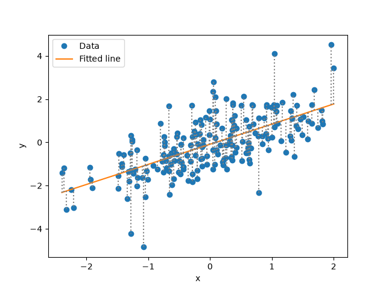
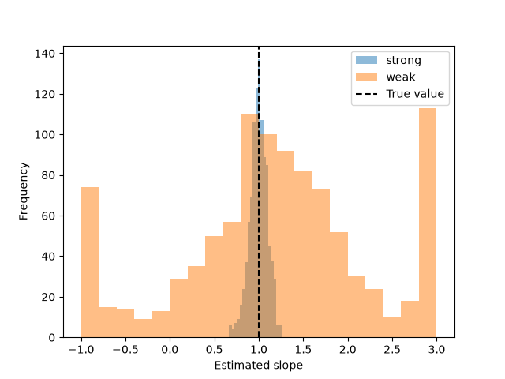

# 第 12 章: 操作変数法と 2 段階最小二乗法

## 12.1 この章の地図

第 11 章で、説明変数 x が誤差項 u と相関する（内生）と、OLS は偏ることを見ました。この章では、それを直す**操作変数法（IV）**を書きます。操作変数 z は、次の 2 つの条件を満たす変数です。

| 条件 | 内容 | 確かめられるか |
| :--- | :--- | :--- |
| 関連性 | z は、x と相関する | データで、確かめられる（第 1 段階の F 検定） |
| 外生性 | z は、誤差項 u と相関しない（z は、y に、x を通してしか影響しない） | データでは、確かめにくい（第 13 章の Sargan 検定は、一部だけ） |

z が x を動かす部分だけを使って、x が y に与える効果を、推定します。内生的な部分（u と相関する部分）は、使いません。操作変数が複数あるときの一般形が、**2 段階最小二乗法（2SLS）**です。この章の後半では、操作変数が**弱い**（x との相関が小さい）と、推定値が、大きくばらつき、OLS の方向に偏ることを見ます。



| 項目 | 内容 |
| :--- | :--- |
| 計量経済学の題材 | 操作変数、関連性と外生性、単純な IV 推定、2SLS、第 1 段階の F 値、弱操作変数 |
| 使う Python の機能 | データクラス、NumPy の最小二乗（`np.linalg.lstsq`）、行列計算、`linearmodels`（照合） |
| 新しく導入するライブラリ | なし（`linearmodels` は、第 10 章から、照合専用で使っています） |
| 完成形 | `IvResult`、`iv_estimate`、`iv_slope_standard_error`、`two_stage_least_squares`、`manual_second_stage`、`first_stage_f`、`draw_iv_sample`、`weak_instrument_experiment` |
| ファイル | 実装: `lib/chapter12/iv.py`／テスト: `test/chapter12/test_iv.py`（自分で書くときは、`practice/chapter12/` に、同じ名前で作ります）。図は、第 2 章・第 10 章の描画関数を使います |
| データ | 手計算用の 4 つの観測値と、母集団の式から作った乱数 |

### 計量経済学の式とコードの対応

| 計量経済学 | 式 | コード |
| :--- | :--- | :--- |
| 単純な IV 推定 | b_IV = Cov(z, y) ÷ Cov(z, x) | `iv_estimate(y, x, z)` |
| 2SLS | b = (R̂′R)⁻¹ R̂′y。R は説明変数（定数項・外生・内生）、R̂ は、R を操作変数と外生の変数で回帰した当てはめ値 | `two_stage_least_squares(y, endogenous, instruments, exogenous)` |
| 2SLS の分散 | Var(b) = σ̂² · (R̂′R̂)⁻¹、σ̂² = Σ(y − R·b)² ÷ (n − k)（残差は元の R で計算） | `result.standard_errors` |
| 第 1 段階の F 値 | 操作変数の係数がすべて 0 の F 検定 | `first_stage_f(x, instruments, exogenous)` |

> **記号について**: z は操作変数、x は内生変数、R は定数項・外生の説明変数・内生変数を並べた行列、R̂ はその当てはめ値です。一覧は、[記号について](how-to-read.md#symbols) を参照してください。

### 前提とする章

| できること | 章 |
| :--- | :--- |
| 内生性とバイアス | [第 11 章](11-endogeneity.md) |
| 重回帰、F 検定 | [第 3 章](03-multiple-regression.md)、[第 5 章](05-inference.md) |

## 12.2 準備

```bash
cd apps/econometrics-programming/python
uv sync
uv run pytest test/chapter12
```

```text
18 passed
```

自分でコードを書くときは、`practice/chapter12/` に、完成形と同じ名前（`iv.py`・`test_iv.py`）のファイルを作ります。

## 12.3 予想する

x = 1、3、2、5、y = 2、5、3、7、操作変数 z = 1、2、3、4 の 4 つの観測値です。

1. 単純な IV 推定の傾きは、Cov(z, y) ÷ Cov(z, x) です。いくつですか（ヒント: Σ(z − z̄)(y − ȳ) = 6.5、Σ(z − z̄)(x − x̄) = 5.5）。同じデータの OLS の傾き（Σ(x − x̄)(y − ȳ) ÷ Σ(x − x̄)² = 11.25 ÷ 8.75）と、どちらが大きいですか
2. 2SLS を「第 1 段階で x を z に回帰して x̂ を作り、第 2 段階で y を x̂ に回帰する」と、**手作業**で行います。係数は、IV と同じですか。標準誤差は、どうでしょう
3. 内生性があるとき、OLS の傾きは、操作変数が強くても弱くても、同じだけ偏ります。IV の推定値のばらつきは、操作変数が弱いと、どうなりますか

## 12.4 操作変数法の考え方

### 単純な IV 推定

y = α + β·x + u で、x が内生のとき、z（x と相関し、u と無関係）の共分散を取ります。

> Cov(z, y) = β·Cov(z, x) + Cov(z, u) = β·Cov(z, x)（Cov(z, u) = 0 より）

したがって、β = Cov(z, y) ÷ Cov(z, x) です。分子は、z の動きが y に与える影響（**誘導形**）、分母は、z の動きが x に与える影響（**第 1 段階**）で、IV は、その比です。

### 2 段階最小二乗法

1. **第 1 段階**: 説明変数（内生変数と外生変数）を、操作変数と外生変数で回帰して、当てはめ値を求める
2. **第 2 段階**: y を、当てはめ値で回帰する

内生変数の当てはめ値は、操作変数で説明できる部分だけなので、誤差項と相関しません。

### 標準誤差の落とし穴

第 2 段階の回帰の標準誤差を、そのまま使うと、**間違えます**。第 2 段階の残差は、当てはめ値 x̂ を使った残差（y − b·x̂）で、元の残差（y − b·x）と違います。正しい標準誤差は、**元の説明変数**で残差を計算して、σ̂² を求めます。手作業の 2 段階は、係数は正しいのに、標準誤差が正しくありません。

### 弱操作変数

z と x の相関が小さい（第 1 段階の F 値が小さい）と、IV の分母 Cov(z, x) が 0 に近づき、推定値が、大きくばらつきます。また、標本が有限だと、OLS の方向に偏ります。目安として、第 1 段階の F 値が **10 未満**だと、弱いと考えます。

## 12.5 Red → Green → Refactor

### Red: 単純な IV 推定の手計算

予想 1 の手計算です。z̄ = 2.5、x̄ = 2.75、ȳ = 4.25。Σ(z − z̄)(y − ȳ) = 6.5、Σ(z − z̄)(x − x̄) = 5.5 なので、傾きは 6.5 ÷ 5.5 = 13/11 ≈ 1.1818、切片は ȳ − 傾き × x̄ = 4.25 − 3.25 = 1.0 です。OLS の傾き（11.25 ÷ 8.75 = 9/7 ≈ 1.2857）より小さい値です。

```python
import numpy as np
import pandas as pd
import pytest

from lib.chapter12.iv import iv_estimate

X = [1, 3, 2, 5]
Y = [2, 5, 3, 7]
Z = [1, 2, 3, 4]
```

def test_手計算の単純なIV推定() -> None:
    fit = iv_estimate(Y, X, Z)
    assert fit.slope == pytest.approx(6.5 / 5.5)
    assert fit.intercept == pytest.approx(1.0)


def test_同じデータのOLSとは傾きが違う() -> None:
    assert fit_simple(X, Y).slope == pytest.approx(9 / 7)
    assert iv_estimate(Y, X, Z).slope != pytest.approx(9 / 7)


def test_操作変数が説明変数そのものならOLSと一致する() -> None:
    fit = iv_estimate(Y, X, X)
    assert fit.slope == pytest.approx(fit_simple(X, Y).slope)

### Green: iv_estimate を実装する

def iv_estimate(y: Array, x: Array, z: Array) -> SimpleFit:
    """単純な IV 推定（内生変数 x が 1 つ、操作変数 z が 1 つ）。

    傾き = Cov(z, y) ÷ Cov(z, x)、切片 = ȳ − 傾き · x̄。
    """
    slope = sample_covariance(z, y) / sample_covariance(z, x)
    mean_y = float(np.mean(np.asarray(y, dtype=float)))
    mean_x = float(np.mean(np.asarray(x, dtype=float)))
    return SimpleFit(intercept=mean_y - slope * mean_x, slope=slope)


def iv_slope_standard_error(y: Array, x: Array, z: Array, fit: SimpleFit) -> float:
    """単純な IV 推定の、傾きの標準誤差。

    残差は、元の x で計算する: u = y − 切片 − 傾き · x。
    Var = σ̂² · Σ(z − z̄)² ÷ (Σ(z − z̄)(x − x̄))²、σ̂² = Σu² ÷ (n − 2)。
    """
    values_z = np.asarray(z, dtype=float)
    centered_z = values_z - values_z.mean()
    values_x = np.asarray(x, dtype=float)
    centered_x = values_x - values_x.mean()
    u = np.asarray(y, dtype=float) - fit.intercept - fit.slope * values_x
    sigma2 = float(u @ u) / (len(u) - 2)
    return math.sqrt(
        sigma2 * float(centered_z @ centered_z) / float(centered_z @ centered_x) ** 2
    )

```python
from lib.chapter02.simple import fit_simple
from lib.chapter12.iv import iv_estimate, iv_slope_standard_error

x = [1, 3, 2, 5]
y = [2, 5, 3, 7]
z = [1, 2, 3, 4]
fit = iv_estimate(y, x, z)
print(fit)
print(fit_simple(x, y))
print(round(iv_slope_standard_error(y, x, z, fit), 5))
```

```text
SimpleFit(intercept=1.0, slope=1.1818181818181819)
SimpleFit(intercept=0.714285714285714, slope=1.2857142857142858)
0.17725
```

IV の傾きは 1.1818、OLS は 1.2857 です（予想 1）。IV の標準誤差は 0.17725 です。残差は、元の x で計算します（u = y − 1.0 − 1.1818·x）。

def test_手計算の例の傾きの標準誤差() -> None:
    fit = iv_estimate(Y, X, Z)
    assert iv_slope_standard_error(Y, X, Z, fit) == pytest.approx(0.17725, abs=1e-5)

### 2SLS を実装する

操作変数の数が、内生変数の数より少ないと、識別されません（式の数が足りない）。

@dataclass(frozen=True)
class IvResult:
    """2SLS の推定結果。"""

    coefficients: pd.Series
    standard_errors: pd.Series
    residuals: NDArray[np.float64]
    n_obs: int
    df_resid: int


def _design(
    columns: pd.DataFrame, exogenous: pd.DataFrame | None
) -> tuple[NDArray[np.float64], list[str]]:
    """定数項・外生の説明変数・columns の順に並べた行列と、名前。"""
    parts = [np.ones((len(columns), 1))]
    names = ["const"]
    if exogenous is not None:
        parts.append(exogenous.to_numpy(dtype=float))
        names += list(exogenous.columns)
    parts.append(columns.to_numpy(dtype=float))
    names += list(columns.columns)
    return np.column_stack(parts), names


def _fitted_regressors(
    endogenous: pd.DataFrame,
    instruments: pd.DataFrame,
    exogenous: pd.DataFrame | None,
) -> tuple[NDArray[np.float64], NDArray[np.float64], list[str]]:
    """第 1 段階: 説明変数 R を、操作変数と外生の説明変数 Q で回帰した当てはめ値 R̂。"""
    if instruments.shape[1] < endogenous.shape[1]:
        raise ValueError("操作変数の数が、内生変数の数より少ないので、識別されない")
    regressors, names = _design(endogenous, exogenous)
    exogenous_part, _ = _design(instruments, exogenous)
    projection, *_ = np.linalg.lstsq(exogenous_part, regressors, rcond=None)
    return regressors, exogenous_part @ projection, names


def two_stage_least_squares(
    y: ArrayLike,
    endogenous: pd.DataFrame,
    instruments: pd.DataFrame,
    exogenous: pd.DataFrame | None = None,
) -> IvResult:
    """2SLS: β = (R̂′R)⁻¹ R̂′y。標準誤差の残差は、R̂ でなく、元の R で計算する。

    Var(β) = σ̂² · (R̂′R̂)⁻¹、σ̂² = Σ(y − Rβ)² ÷ (n − k)。
    """
    target = np.asarray(y, dtype=float)
    regressors, fitted, names = _fitted_regressors(endogenous, instruments, exogenous)
    coefficients = np.linalg.solve(fitted.T @ regressors, fitted.T @ target)
    residuals: NDArray[np.float64] = target - regressors @ coefficients
    n, k = regressors.shape
    sigma2 = float(residuals @ residuals) / (n - k)
    errors = np.sqrt(sigma2 * np.diag(np.linalg.inv(fitted.T @ fitted)))
    return IvResult(
        coefficients=pd.Series(coefficients, index=names),
        standard_errors=pd.Series(errors, index=names),
        residuals=residuals,
        n_obs=n,
        df_resid=n - k,
    )

def test_識別のちょうどの場合2SLSは単純なIV推定と係数も標準誤差も一致する() -> None:
    result = two_stage_least_squares(Y, pd.DataFrame({"x": X}), pd.DataFrame({"z": Z}))
    fit = iv_estimate(Y, X, Z)
    assert result.coefficients["x"] == pytest.approx(fit.slope)
    assert result.coefficients["const"] == pytest.approx(fit.intercept)
    assert result.standard_errors["x"] == pytest.approx(
        iv_slope_standard_error(Y, X, Z, fit)
    )
    assert result.df_resid == 2
    assert result.n_obs == 4


def sample_with_control(n: int = 300) -> pd.DataFrame:
    rng = np.random.default_rng(0)
    base = draw_iv_sample(n, 1.0, 0.5, rng)
    base["z2"] = 0.5 * base["z"] + rng.standard_normal(n)
    base["w"] = rng.standard_normal(n)
    return base.assign(y=base["y"] + 0.5 * base["w"])


def test_操作変数が内生変数より少ないと識別されない() -> None:
    s = sample_with_control()
    endogenous = s[["x", "z2"]]
    with pytest.raises(ValueError, match="識別"):
        two_stage_least_squares(s["y"], endogenous, s[["z"]])

`linearmodels` の `IV2SLS` と、係数・標準誤差が一致することを、確かめます。外生の説明変数と、複数の操作変数がある場合も、一致します。

def test_2SLSはlinearmodelsと一致する() -> None:
    s = draw_iv_sample(500, 1.0, 0.5, np.random.default_rng(0))
    result = two_stage_least_squares(s["y"], s[["x"]], s[["z"]])
    reference = IV2SLS(
        s["y"], pd.DataFrame({"const": np.ones(500)}), s[["x"]], s[["z"]]
    ).fit(cov_type="unadjusted", debiased=True)
    assert result.coefficients["x"] == pytest.approx(reference.params["x"])
    assert result.coefficients["const"] == pytest.approx(reference.params["const"])
    assert result.standard_errors["x"] == pytest.approx(reference.std_errors["x"])


def test_外生の説明変数と複数の操作変数でもlinearmodelsと一致する() -> None:
    s = sample_with_control()
    result = two_stage_least_squares(s["y"], s[["x"]], s[["z", "z2"]], s[["w"]])
    reference = IV2SLS(
        s["y"],
        pd.DataFrame({"const": np.ones(len(s)), "w": s["w"]}),
        s[["x"]],
        s[["z", "z2"]],
    ).fit(cov_type="unadjusted", debiased=True)
    assert list(result.coefficients.index) == ["const", "w", "x"]
    for name in ("const", "w", "x"):
        assert result.coefficients[name] == pytest.approx(reference.params[name])
        assert result.standard_errors[name] == pytest.approx(reference.std_errors[name])

### 手作業の 2 段階の、標準誤差

def manual_second_stage(
    y: ArrayLike,
    endogenous: pd.DataFrame,
    instruments: pd.DataFrame,
    exogenous: pd.DataFrame | None = None,
) -> tuple[pd.Series, pd.Series]:
    """手作業の 2 段階: 第 2 段階の OLS の、係数と標準誤差。

    係数は 2SLS と同じだが、標準誤差は、当てはめ値 x̂ の残差で計算するので、正しくない。
    """
    _, fitted, names = _fitted_regressors(endogenous, instruments, exogenous)
    second = fit_ols(y, pd.DataFrame(fitted[:, 1:], columns=names[1:]))
    return second.coefficients, second.standard_errors

def test_手作業の2段階は係数は同じだが標準誤差が合わない() -> None:
    endogenous, instruments = pd.DataFrame({"x": X}), pd.DataFrame({"z": Z})
    result = two_stage_least_squares(Y, endogenous, instruments)
    coefficients, errors = manual_second_stage(Y, endogenous, instruments)
    assert coefficients["x"] == pytest.approx(result.coefficients["x"])
    assert errors["x"] > 3 * result.standard_errors["x"]


def test_手作業の2段階の標準誤差は乱数の標本でも過大() -> None:
    s = draw_iv_sample(500, 1.0, 0.5, np.random.default_rng(0))
    result = two_stage_least_squares(s["y"], s[["x"]], s[["z"]])
    _, errors = manual_second_stage(s["y"], s[["x"]], s[["z"]])
    assert errors["x"] != pytest.approx(result.standard_errors["x"], rel=0.05)

```python
import pandas as pd

from lib.chapter12.iv import manual_second_stage, two_stage_least_squares

result = two_stage_least_squares(y, pd.DataFrame({"x": x}), pd.DataFrame({"z": z}))
print(result.coefficients.round(4).to_dict(), result.standard_errors.round(4).to_dict(), result.df_resid)
coefficients, errors = manual_second_stage(y, pd.DataFrame({"x": x}), pd.DataFrame({"z": z}))
print(coefficients.round(4).to_dict(), errors.round(4).to_dict())
```

```text
{'const': 1.0, 'x': 1.1818} {'const': 0.534, 'x': 0.1773} 2
{'const': 1.0, 'x': 1.1818} {'const': 2.1737, 'x': 0.7216}
```

1 行目が 2SLS の係数・標準誤差・自由度、2 行目が手作業の 2 段階の係数・標準誤差です。**係数は、2SLS と同じ（1.1818）**ですが、手作業の標準誤差は **0.7216** で、正しい値 0.1773 の、約 4 倍です（予想 2）。

### 乱数の標本で、OLS と IV を比べる

x = strength·z + v、y = 1 + x + u、u と v の相関 = endogeneity（真の傾き 1）。OLS の傾きは、1 + endogeneity ÷ (1 + strength²) に近づきます（strength = 1、endogeneity = 0.5 で 1.25）。

def draw_iv_sample(
    n: int, strength: float, endogeneity: float, rng: np.random.Generator
) -> pd.DataFrame:
    """y = 1 + x + u、x = strength·z + v。u と v の相関は endogeneity（分散は 1）。

    z は操作変数（x と相関し、u と無関係）。
    OLS の傾きは、1 + endogeneity ÷ (1 + strength²) に近づく。
    """
    z = rng.standard_normal(n)
    v = rng.standard_normal(n)
    u = endogeneity * v + math.sqrt(1 - endogeneity**2) * rng.standard_normal(n)
    x = strength * z + v
    return pd.DataFrame({"y": 1 + x + u, "x": x, "z": z})

def test_標本の列と分散と相関() -> None:
    s = draw_iv_sample(50000, 1.0, 0.5, np.random.default_rng(0))
    assert list(s.columns) == ["y", "x", "z"]
    u = s["y"] - 1 - s["x"]
    assert np.cov(s["x"], u)[0, 1] == pytest.approx(0.5, abs=0.03)
    assert np.cov(s["z"], u)[0, 1] == pytest.approx(0, abs=0.03)
    assert np.cov(s["z"], s["x"])[0, 1] == pytest.approx(1.0, abs=0.03)
    assert np.var(u) == pytest.approx(1, rel=0.05)


def test_OLSは内生性で偏りIVは偏らない() -> None:
    s = draw_iv_sample(100000, 1.0, 0.5, np.random.default_rng(0))
    assert fit_simple(s["x"], s["y"]).slope == pytest.approx(1.25, abs=0.01)
    assert iv_estimate(s["y"], s["x"], s["z"]).slope == pytest.approx(1.0, abs=0.01)


def test_内生性がなければOLSも偏らない() -> None:
    s = draw_iv_sample(100000, 1.0, 0.0, np.random.default_rng(0))
    assert fit_simple(s["x"], s["y"]).slope == pytest.approx(1.0, abs=0.01)

```python
import numpy as np

from lib.chapter12.iv import draw_iv_sample, first_stage_f

s = draw_iv_sample(500, 1.0, 0.5, np.random.default_rng(0))
result = two_stage_least_squares(s["y"], s[["x"]], s[["z"]])
print(result.coefficients.round(4).to_dict(), result.standard_errors.round(4).to_dict())
print(round(fit_simple(s["x"], s["y"]).slope, 4))
_, errors = manual_second_stage(s["y"], s[["x"]], s[["z"]])
print(errors.round(4).to_dict())
big = draw_iv_sample(100000, 1.0, 0.5, np.random.default_rng(0))
print(round(fit_simple(big["x"], big["y"]).slope, 4), round(iv_estimate(big["y"], big["x"], big["z"]).slope, 4))
```

```text
{'const': 1.0116, 'x': 1.0242} {'const': 0.0437, 'x': 0.0428}
1.2319
{'const': 0.0737, 'x': 0.0721}
1.2502 0.9997
```

4 行は、順に、2SLS の係数・標準誤差、OLS の傾き、手作業の 2 段階の標準誤差、n = 100000 での OLS と IV の傾きです。

n = 500 の標本で、2SLS の傾きは 1.0242（標準誤差 0.0428）で、真の値 1 に近く、**OLS は 1.2319 と、1.25 の方向に偏っています**。手作業の標準誤差は 0.0721 で、正しい値（0.0428）の約 1.7 倍です。n = 100000 では、OLS は 1.2502（理論値 1.25）、IV は 0.9997 です（4 行目）。**標本を増やしても、OLS の偏りは消えず、IV は真の値に収束します。**

### 弱操作変数

def first_stage_f(
    endogenous: pd.Series,
    instruments: pd.DataFrame,
    exogenous: pd.DataFrame | None = None,
) -> TestResult:
    """第 1 段階の F 検定: 操作変数の係数がすべて 0 という仮説（弱操作変数の目安）。"""
    columns = instruments if exogenous is None else exogenous.join(instruments)
    return f_test(endogenous, columns, list(instruments.columns))


def weak_instrument_experiment(
    n: int, strength: float, repetitions: int, rng: np.random.Generator
) -> pd.DataFrame:
    """OLS と IV の傾きと第 1 段階の F 値を繰り返す（真の傾き 1、内生性 0.5）。"""
    rows = []
    for _ in range(repetitions):
        sample = draw_iv_sample(n, strength, 0.5, rng)
        stage = first_stage_f(sample["x"], sample[["z"]])
        rows.append(
            (
                fit_simple(sample["x"], sample["y"]).slope,
                iv_estimate(sample["y"], sample["x"], sample["z"]).slope,
                stage.statistic,
            )
        )
    return pd.DataFrame(rows, columns=["ols", "iv", "f"])

def test_第1段階のF値は操作変数のt値の2乗() -> None:
    s = draw_iv_sample(200, 0.5, 0.5, np.random.default_rng(1))
    first = fit_ols(s["x"], s[["z"]])
    assert first_stage_f(s["x"], s[["z"]]).statistic == pytest.approx(
        t_statistics(first)["z"] ** 2
    )


def test_外生の説明変数があっても第1段階のF値を求められる() -> None:
    s = sample_with_control()
    test = first_stage_f(s["x"], s[["z", "z2"]], s[["w"]])
    assert test.statistic > 10
    assert test.p_value < 0.001


def spread(values: pd.Series) -> float:
    return float(values.quantile(0.95) - values.quantile(0.05))


def test_強い操作変数ではF値が大きくIVは真の値に集まる() -> None:
    t = weak_instrument_experiment(100, 1.0, 1000, np.random.default_rng(0))
    assert list(t.columns) == ["ols", "iv", "f"]
    assert t["f"].mean() > 50
    assert t["iv"].median() == pytest.approx(1.0, abs=0.02)
    assert t["ols"].median() == pytest.approx(1.25, abs=0.03)


def test_弱い操作変数ではF値が小さくIVは広くばらつきOLSの方向に偏る() -> None:
    strong = weak_instrument_experiment(100, 1.0, 1000, np.random.default_rng(0))
    weak = weak_instrument_experiment(100, 0.1, 1000, np.random.default_rng(0))
    assert weak["f"].mean() < 5
    assert spread(weak["iv"]) > 5 * spread(strong["iv"])
    assert abs(weak["iv"].median() - 1) > abs(strong["iv"].median() - 1)
    assert weak["iv"].median() > 1.1

n = 100、操作変数の強さ（strength）を 1、0.3、0.1 と変えて、1000 回繰り返します。

```python
from lib.chapter12.iv import weak_instrument_experiment

for strength in (1.0, 0.3, 0.1):
    t = weak_instrument_experiment(100, strength, 1000, np.random.default_rng(0))
    q = t["iv"].quantile([0.05, 0.95]).round(3).tolist()
    print(strength, round(float(t["f"].mean()), 2), round(float(t["ols"].median()), 4), round(float(t["iv"].median()), 4), q)
print(first_stage_f(s["x"], s[["z"]]))
```

```text
1.0 103.31 1.248 0.9991 [0.825, 1.157]
0.3 10.37 1.456 0.9969 [0.18, 1.459]
0.1 2.1 1.4885 1.1951 [-1.759, 5.603]
TestResult(statistic=587.2525578899554, p_value=2.8096968237923527e-86)
```

列は、強さ、第 1 段階の F 値の平均、OLS の傾きの中央値、IV の傾きの中央値、IV の 5% 点と 95% 点です。

- **強い（F ≈ 103）**: IV の中央値は 0.9991（真の値 1）、90% が 0.825〜1.157 に入ります。OLS は 1.248
- **やや弱い（F ≈ 10）**: IV の中央値は 0.9969 で、偏りは小さいが、90% の範囲が 0.18〜1.459 と、広がります
- **とても弱い（F ≈ 2）**: IV の中央値は **1.1951** と、OLS（1.4885）の方向に偏り、90% の範囲は、**−1.759〜5.603** と、桁違いに広がります（予想 3）



### 実行結果

```bash
uv run pytest test/chapter12
```

```text
18 passed
```

## 12.6 規則で言うと

1. **IV は、内生変数のうち、操作変数で説明できる部分だけを使う。** 誘導形の傾き ÷ 第 1 段階の傾き。標本が大きければ、真の値に収束する
2. **標準誤差は、元の説明変数で計算する。** 手作業の 2 段階の標準誤差は、間違い。2SLS の関数（または `linearmodels`）を使う
3. **弱い操作変数は、使わない。** 第 1 段階の F 値が 10 未満なら、推定値は、大きくばらつき、OLS の方向に偏る。F 値は、必ず報告する

混同しやすい点を、表にまとめます。

| 混同しやすい点 | 違い |
| :--- | :--- |
| 関連性 と 外生性 | 関連性（z と x の相関）は、データで確かめられる。外生性（z と u が無相関）は、確かめにくい。理論と制度の知識で、正当化する |
| IV と OLS | IV は、一致性があるが、OLS より標準誤差が大きい（効率が悪い）。内生性がなければ、OLS のほうがよい |
| 2SLS の第 2 段階の標準誤差 と 正しい標準誤差 | 第 2 段階の残差は、x̂ で計算されるので、別物。2SLS の関数を使う |

### この方法が成り立たない場面

- **外生性は、検定できません。** 操作変数が、y に、x 以外の経路で影響する（除外制約が成り立たない）と、IV は偏ります。どんなに強い操作変数でも、外生性が成り立たなければ、無意味です
- **IV は、「操作変数で動いた人たち」の効果です。** 全員の平均的な効果とは、限りません（局所平均処置効果）
- **操作変数が弱いと、標準誤差・信頼区間も、不正確になります。** F 値が 10 を超えても、安心できない場合があります

## 12.7 練習問題

| 種類 | 問題 |
| :--- | :--- |
| 想起 | 本文を閉じて、手計算の単純な IV 推定（傾き 13/11、切片 1.0）のテストを書いてください |
| 生成 | 解説を見る前に、「IV の傾き = 誘導形の傾き（y を z で回帰）÷ 第 1 段階の傾き（x を z で回帰）」を計算する `indirect_least_squares(y, x, z)` を、テストから書いてください。手計算の例で、`iv_estimate` の傾きと、一致しますか |
| 多様 | 内生性を 0.5 から 0.8 に変えると、OLS の傾きは、平均していくつに近づきますか（strength = 1、真の値 1）。先に予想してから、`draw_iv_sample` で確かめてください。IV は、変わりますか |
| 交互 | [第 2 章](02-simple-regression.md)の考え方で、IV の傾きの標準誤差が、実際のばらつき（標本を取り直したときの標準偏差）と、一致するかを確かめてください（n = 200、強さ 1、300 回） |

??? note "解答（先に自分で取り組んでから、開いてください）"

    **想起**:

    ```python
    def test_手計算のIV推定() -> None:
        fit = iv_estimate([2, 5, 3, 7], [1, 3, 2, 5], [1, 2, 3, 4])
        assert fit.slope == pytest.approx(13 / 11)
        assert fit.intercept == pytest.approx(1.0)
    ```

    **生成**: 誘導形の傾きは 6.5 ÷ 5 = 1.3、第 1 段階の傾きは 5.5 ÷ 5 = 1.1 で、比は 1.3 ÷ 1.1 = 13/11 です。

    ```python
    def indirect_least_squares(y, x, z):
        return fit_simple(z, y).slope / fit_simple(z, x).slope
    ```

    ```python
    def test_間接最小二乗法はIVと一致する() -> None:
        y, x, z = [2, 5, 3, 7], [1, 3, 2, 5], [1, 2, 3, 4]
        assert indirect_least_squares(y, x, z) == pytest.approx(iv_estimate(y, x, z).slope)
    ```

    **多様**: OLS の傾きは、1 + 0.8 ÷ (1 + 1) = 1.4 に近づきます。IV は、内生性の大きさによらず、真の値 1 に近づきます。

    ```python
    def test_内生性が大きいほどOLSの偏りは大きいがIVは偏らない() -> None:
        s = draw_iv_sample(100000, 1.0, 0.8, np.random.default_rng(0))
        assert fit_simple(s["x"], s["y"]).slope == pytest.approx(1.4, abs=0.01)
        assert iv_estimate(s["y"], s["x"], s["z"]).slope == pytest.approx(1.0, abs=0.01)
    ```

    **交互**:

    ```python
    def test_IVの標準誤差は実際のばらつきに近い() -> None:
        rng = np.random.default_rng(0)
        slopes, errors = [], []
        for _ in range(300):
            s = draw_iv_sample(200, 1.0, 0.5, rng)
            fit = iv_estimate(s["y"], s["x"], s["z"])
            slopes.append(fit.slope)
            errors.append(iv_slope_standard_error(s["y"], s["x"], s["z"], fit))
        assert np.mean(errors) == pytest.approx(np.std(slopes, ddof=1), rel=0.15)
    ```

## 12.8 振り返り

- 予想した 3 つは、当たりましたか。手作業の 2 段階の標準誤差が、なぜ間違うのかを、説明できますか
- 操作変数の 2 つの条件のうち、どちらを、データで確かめられますか
- 自分の分析で、操作変数の候補は、ありますか。その外生性を、どう正当化しますか

## 12.9 まとめ

- 単純な IV 推定（誘導形の傾き ÷ 第 1 段階の傾き）を、手計算の値（13/11、標準誤差 0.17725）に一致するように書き、一般形の 2SLS を、`linearmodels` と、係数・標準誤差が一致するように書いた
- 手作業の 2 段階は、係数は同じだが、標準誤差が、正しい値の約 4 倍（手計算の例）、約 1.7 倍（乱数の標本）になる。標準誤差は、元の説明変数で計算する
- n = 100000 で、OLS は 1.2502 に偏ったまま、IV は 0.9997 に収束する。操作変数が弱い（F ≈ 2）と、IV の推定値は、90% の範囲が −1.759〜5.603 と広がり、OLS の方向に偏る
- 次の章では、操作変数の妥当性と、説明変数の外生性を、検定で調べ、同時方程式と測定誤差に、操作変数法を適用します
