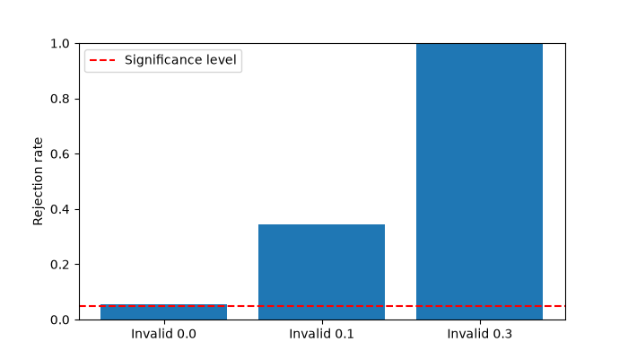

# 第 13 章: 操作変数法の検定と応用

## 13.1 この章の地図

第 12 章の操作変数法には、2 つの疑問が残ります。

1. **そもそも、IV が必要か**: 説明変数は、本当に内生か（外生なら、OLS のほうが効率的）
2. **操作変数は、妥当か**: 操作変数は、本当に外生か（外生でなければ、IV は偏る）

前者は **Wu-Hausman 検定**、後者は、操作変数が内生変数より多いときの **Sargan 検定**（過剰識別制約の検定）で、調べます。この章では、2 つの検定を式から書き、`linearmodels` と照合し、棄却率を、シミュレーションで確かめます。さらに、第 11 章の同時方程式と測定誤差に、IV を適用し、最後に、**実際のデータ**（女性の賃金と教育）で試して、**第 3 部の到達チェック**を行います。



| 項目 | 内容 |
| :--- | :--- |
| 計量経済学の題材 | Wu-Hausman 検定、Sargan 検定（過剰識別制約）、同時方程式への IV、測定誤差への IV、検定の大きさと検出力 |
| 使う Python の機能 | pandas の表の結合・`assign`、NumPy の乱数（多次元）、`scipy.stats` |
| 新しく導入するライブラリ | wooldridge（実際のデータの節だけ。任意の依存グループ `realdata`） |
| 完成形 | `wu_hausman`、`sargan_test`、`draw_overid_sample`、`wu_hausman_rejection_rate`、`sargan_rejection_rate`、`draw_market_with_shifter`、`draw_two_measurements` |
| ファイル | 実装: `lib/chapter13/iv_tests.py`、`lib/chapter13/plot.py`（図）／テスト: `test/chapter13/test_iv_tests.py`、`test/chapter13/test_plot.py`（自分で書くときは、`practice/chapter13/` に、同じ名前で作ります） |
| データ | 母集団の式から作った乱数。13.6 節だけ、実際のデータ（`wooldridge` の `mroz`） |

### 計量経済学の式とコードの対応

| 計量経済学 | 式 | コード |
| :--- | :--- | :--- |
| Wu-Hausman 検定 | x を操作変数で回帰した残差 v̂ を、y の回帰に足して、v̂ の係数が 0 かを F 検定 | `wu_hausman(y, x, instruments, exogenous)` |
| Sargan 検定 | 2SLS の残差 û を、外生の変数・操作変数で回帰。LM = n·R² ~ χ²(L − K) | `sargan_test(y, endogenous, instruments, exogenous)` |
| 需要の識別 | 供給の変動要因 w を、需要の式に入らない操作変数にする | `draw_market_with_shifter(n, rng)` |
| 測定誤差への IV | 同じ変数の、もう 1 回の独立な測定を、操作変数にする | `draw_two_measurements(n, error_sd, rng)` |

> **記号について**: L は操作変数の数、K は内生変数の数です（L − K が、過剰に識別されている数）。v̂ は第 1 段階の残差です。一覧は、[記号について](how-to-read.md#symbols) を参照してください。

### 前提とする章

| できること | 章 |
| :--- | :--- |
| 2SLS、第 1 段階の F 値 | [第 12 章](12-instrumental-variables.md) |
| 同時方程式・測定誤差の問題 | [第 11 章](11-endogeneity.md) |
| LM = n·R² の検定 | [第 6 章](06-asymptotics.md) |

## 13.2 準備

```bash
cd apps/econometrics-programming/python
uv sync
uv run pytest test/chapter13
```

```text
18 passed
```

自分でコードを書くときは、`practice/chapter13/` に、完成形と同じ名前（`iv_tests.py`・`test_iv_tests.py`）のファイルを作ります。

## 13.3 予想する

1. 説明変数が**外生**のとき（内生性 0）、Wu-Hausman 検定（有意水準 5%）は、何％の割合で、外生という仮説を棄却しますか。内生性が 0.3 あると、どうですか
2. 操作変数が 2 つ（z1・z2）で、**両方とも有効**なとき、Sargan 検定は、何％の割合で棄却しますか。z2 が、誤差項と相関して（相関 0.1、0.3）無効なら、どうなりますか
3. 供給の変動要因 w（天候など）を、操作変数にすると、需要の傾き −1 を推定できますか。OLS は、どうでしょう

## 13.4 操作変数法の検定の考え方

### Wu-Hausman 検定（外生性の検定）

x が外生なら、OLS も IV も一致するので、2 つの推定値は近いはずです。回帰を使った形では、第 1 段階（x を、操作変数と外生の説明変数で回帰）の**残差 v̂** を、元の回帰に足します。

> y = α + β·x + γ·v̂ + 誤差

v̂ は、x のうち、操作変数で説明できない部分（内生的な部分を含む）です。x が外生なら、v̂ は y と関係せず、**γ = 0** です。γ が 0 かを、F 検定（制約が 1 つなので、t 検定の 2 乗）します。棄却されたら、x は内生で、IV を使います。

### Sargan 検定（過剰識別制約の検定）

操作変数が、内生変数より**多い**（L > K）と、「操作変数が、すべて外生」という仮説を、検定できます。2SLS の残差 û を、外生の変数と、すべての操作変数で回帰し、LM = n·R² を、自由度 L − K の χ² 分布と比べます。操作変数が有効なら、û は、操作変数と無関係で、R² は 0 に近くなります。棄却されたら、操作変数の**少なくとも 1 つ**が、無効です。どれが無効かは、わかりません。

### 同時方程式への IV

第 11 章の、需要と供給の問題で、需要曲線の傾きを推定します。供給の変動要因 w（天候など）で、供給曲線が動き、需要曲線は動かないとします。w は、価格に影響する（関連性）が、需要の誤差とは、無関係（外生性）です。w を操作変数にすると、**供給曲線が動いて、需要曲線をなぞる**ので、需要の傾きが識別できます。

### 測定誤差への IV

説明変数が、誤差つきで測られているとき、**同じ変数の、もう 1 回の独立な測定**が、操作変数になります。2 つの測定は、真の値で相関し（関連性）、誤差は独立なので、互いの誤差と無関係（外生性）です。

## 13.5 Red → Green → Refactor

### Red: Wu-Hausman 検定

第 12 章の標本（n = 500、強さ 1、内生性 0.5）で、`linearmodels` の `wu_hausman()` の結果と、統計量・p 値が一致することを、テストにします。また、統計量が、**第 1 段階の残差のt値の 2 乗**に等しいことも、確かめます。

```python
import numpy as np
import pandas as pd
import pytest
from linearmodels.iv import IV2SLS

from lib.chapter12.iv import draw_iv_sample
from lib.chapter13.iv_tests import wu_hausman
```

```python
def with_control(n: int = 400) -> pd.DataFrame:
    rng = np.random.default_rng(2)
    s = draw_iv_sample(n, 1.0, 0.5, rng)
    s["w"] = rng.standard_normal(n)
    return s.assign(y=s["y"] + 0.5 * s["w"])


def reference_fit(df: pd.DataFrame, endog: list[str], instruments: list[str]) -> Any:
    exog = pd.DataFrame({"const": np.ones(len(df))})
    if "w" in df:
        exog["w"] = df["w"]
    return IV2SLS(df["y"], exog, df[endog], df[instruments]).fit(
        cov_type="unadjusted", debiased=True
    )


def test_Wu_Hausmanはlinearmodelsと一致する() -> None:
    s = draw_iv_sample(500, 1.0, 0.5, np.random.default_rng(0))
    test = wu_hausman(s["y"], s["x"], s[["z"]])
    reference = reference_fit(s, ["x"], ["z"]).wu_hausman()
    assert test.statistic == pytest.approx(reference.stat)
    assert test.p_value == pytest.approx(reference.pval)


def test_外生の説明変数があってもWu_Hausmanはlinearmodelsと一致する() -> None:
    s = with_control()
    test = wu_hausman(s["y"], s["x"], s[["z"]], s[["w"]])
    reference = reference_fit(s, ["x"], ["z"]).wu_hausman()
    assert test.statistic == pytest.approx(reference.stat)
    assert test.p_value == pytest.approx(reference.pval)


def test_Wu_Hausmanの統計量は第1段階の残差のt値の2乗() -> None:
    s = draw_iv_sample(300, 1.0, 0.5, np.random.default_rng(0))
    v_hat = fit_ols(s["x"], s[["z"]]).residuals
    augmented = fit_ols(s["y"], pd.DataFrame({"x": s["x"], "v_hat": v_hat}))
    test = wu_hausman(s["y"], s["x"], s[["z"]])
    assert test.statistic == pytest.approx(t_statistics(augmented)["v_hat"] ** 2)


def test_説明変数が内生なら外生という仮説を棄却する() -> None:
    s = draw_iv_sample(500, 1.0, 0.5, np.random.default_rng(0))
    assert wu_hausman(s["y"], s["x"], s[["z"]]).p_value < 1e-10
```

### Green: wu_hausman を実装する

```python
def wu_hausman(
    y: pd.Series,
    endogenous: pd.Series,
    instruments: pd.DataFrame,
    exogenous: pd.DataFrame | None = None,
) -> TestResult:
    """Wu-Hausman 検定: 説明変数 x が外生か（帰無仮説: 外生）。

    第 1 段階の残差 v̂ を、元の回帰に足し、v̂ の係数が 0 かを F 検定する。
    x が外生なら、v̂（x の内生的な部分）は、y と関係しない。
    """
    columns = instruments if exogenous is None else exogenous.join(instruments)
    residual = fit_ols(endogenous, columns).residuals
    base = pd.DataFrame({endogenous.name: endogenous})
    if exogenous is not None:
        base = exogenous.join(base)
    return f_test(y, base.assign(v_hat=residual), ["v_hat"])
```

```python
from lib.chapter13.iv_tests import wu_hausman

s = draw_iv_sample(500, 1.0, 0.5, np.random.default_rng(0))
test = wu_hausman(s["y"], s["x"], s[["z"]])
print(round(test.statistic, 4), test.p_value)
```

```text
63.3748 1.169171881900736e-14
```

統計量は 63.3748、p 値は 10⁻¹⁴ で、`linearmodels` と一致します。この標本は、内生性 0.5 で作ったので、外生という仮説を、強く棄却します。

### 棄却率（大きさと検出力）

```python
def wu_hausman_rejection_rate(
    n: int,
    endogeneity: float,
    repetitions: int,
    significance: float,
    rng: np.random.Generator,
) -> float:
    """Wu-Hausman 検定が、外生という帰無仮説を棄却する割合。"""
    rejected = 0
    for _ in range(repetitions):
        s = draw_iv_sample(n, 1.0, endogeneity, rng)
        rejected += wu_hausman(s["y"], s["x"], s[["z"]]).p_value < significance
    return rejected / repetitions
```

```python
def test_外生なら棄却率は有意水準に近く内生なら高い() -> None:
    size = wu_hausman_rejection_rate(500, 0.0, 500, 0.05, np.random.default_rng(0))
    power = wu_hausman_rejection_rate(500, 0.3, 500, 0.05, np.random.default_rng(0))
    assert size == pytest.approx(0.05, abs=4 * (0.05 * 0.95 / 500) ** 0.5)
    assert power > 0.95
```

```python
from lib.chapter13.iv_tests import wu_hausman_rejection_rate

for endogeneity in (0.0, 0.3, 0.5):
    rate = wu_hausman_rejection_rate(500, endogeneity, 500, 0.05, np.random.default_rng(0))
    print(endogeneity, rate)
```

```text
0.0 0.042
0.3 0.998
0.5 1.0
```

外生（内生性 0）のとき、棄却率は 0.042 で、有意水準 5% に近い値です（予想 1）。内生性 0.3 では、0.998 と、ほとんどの標本で、内生を見つけます。

### Sargan 検定

```python
def sargan_test(
    y: pd.Series,
    endogenous: pd.DataFrame,
    instruments: pd.DataFrame,
    exogenous: pd.DataFrame | None = None,
) -> TestResult:
    """Sargan 検定（過剰識別制約の検定）: 操作変数が、すべて外生か（帰無仮説: 外生）。

    2SLS の残差 û を、外生の変数と、すべての操作変数で回帰する。
    LM = n · R² は、χ²(操作変数の数 − 内生変数の数) に従う。
    """
    degrees = instruments.shape[1] - endogenous.shape[1]
    if degrees <= 0:
        raise ValueError("操作変数が内生変数より多くないと、過剰識別の検定はできない")
    result = two_stage_least_squares(y, endogenous, instruments, exogenous)
    columns = instruments if exogenous is None else exogenous.join(instruments)
    statistic = result.n_obs * fit_ols(result.residuals, columns).r_squared
    return TestResult(float(statistic), float(stats.chi2.sf(statistic, degrees)))


def draw_overid_sample(
    n: int, invalid: float, rng: np.random.Generator
) -> pd.DataFrame:
    """操作変数が 2 つ（過剰識別）の標本。z2 が、誤差項 u と相関する度合いが invalid。

    y = 1 + x + u、x = z1 + z2 + v、u = 0.5·v + √0.75·w + invalid·z2。
    invalid = 0 なら、z1 も z2 も有効。invalid > 0 なら、z2 は無効（外生でない）。
    """
    z1, z2, v, w = rng.standard_normal((4, n))
    u = 0.5 * v + math.sqrt(0.75) * w + invalid * z2
    x = z1 + z2 + v
    return pd.DataFrame({"y": 1 + x + u, "x": x, "z1": z1, "z2": z2})
```

```python
def test_Sarganはlinearmodelsと一致する() -> None:
    for invalid, seed in ((0.0, 1), (0.5, 1)):
        o = draw_overid_sample(500, invalid, np.random.default_rng(seed))
        test = sargan_test(o["y"], o[["x"]], o[["z1", "z2"]])
        reference: Any = IV2SLS(
            o["y"], pd.DataFrame({"const": np.ones(500)}), o[["x"]], o[["z1", "z2"]]
        ).fit(cov_type="unadjusted")
        assert test.statistic == pytest.approx(reference.sargan.stat)
        assert test.p_value == pytest.approx(reference.sargan.pval)


def test_外生の説明変数があってもSarganはlinearmodelsと一致する() -> None:
    s = with_control()
    s["z2"] = 0.5 * s["z"] + np.random.default_rng(3).standard_normal(len(s))
    test = sargan_test(s["y"], s[["x"]], s[["z", "z2"]], s[["w"]])
    reference = reference_fit(s, ["x"], ["z", "z2"])
    assert test.statistic == pytest.approx(reference.sargan.stat)


def test_識別のちょうどの場合Sargan検定はできない() -> None:
    s = draw_iv_sample(100, 1.0, 0.5, np.random.default_rng(0))
    with pytest.raises(ValueError, match="過剰識別"):
        sargan_test(s["y"], s[["x"]], s[["z"]])


def test_有効な操作変数ではSarganは棄却せず無効な操作変数では棄却する() -> None:
    valid = draw_overid_sample(500, 0.0, np.random.default_rng(1))
    invalid = draw_overid_sample(500, 0.5, np.random.default_rng(1))
    assert sargan_test(valid["y"], valid[["x"]], valid[["z1", "z2"]]).p_value > 0.05
    assert (
        sargan_test(invalid["y"], invalid[["x"]], invalid[["z1", "z2"]]).p_value < 1e-6
    )


def test_過剰識別の標本の相関() -> None:
    o = draw_overid_sample(50000, 0.5, np.random.default_rng(0))
    u = o["y"] - 1 - o["x"]
    assert list(o.columns) == ["y", "x", "z1", "z2"]
    assert np.cov(o["z2"], u)[0, 1] == pytest.approx(0.5, abs=0.03)
    assert np.cov(o["z1"], u)[0, 1] == pytest.approx(0, abs=0.03)
    assert np.cov(o["z1"], o["x"])[0, 1] == pytest.approx(1, abs=0.03)
    assert np.cov(o["z2"], o["x"])[0, 1] == pytest.approx(1, abs=0.03)
```

操作変数が 1 つ（識別がちょうど）だと、Sargan 検定の自由度が 0 で、検定できません。エラーにします。

```python
from lib.chapter13.iv_tests import draw_overid_sample, sargan_rejection_rate, sargan_test

for invalid in (0.0, 0.5):
    o = draw_overid_sample(500, invalid, np.random.default_rng(1))
    test = sargan_test(o["y"], o[["x"]], o[["z1", "z2"]])
    print(invalid, round(test.statistic, 4), test.p_value)
for invalid in (0.0, 0.1, 0.3, 0.5):
    print(invalid, sargan_rejection_rate(500, invalid, 500, 0.05, np.random.default_rng(0)))
```

```text
0.0 0.0234 0.8784837298132436
0.5 66.8484 2.932108926336047e-16
0.0 0.054
0.1 0.344
0.3 0.998
0.5 1.0
```

前半の 2 行は、1 つの標本の結果です。操作変数が有効（0.0）なら、統計量は 0.0234、p 値は 0.878 で、棄却されません。z2 が無効（0.5）なら、統計量は 66.8484、p 値は 3 × 10⁻¹⁶ で、強く棄却されます。`linearmodels` の `sargan` と、統計量・p 値が一致します。

後半の 4 行は、棄却率です。有効なら **0.054**（有意水準 5% に近い）、無効の度合いが 0.1 で 0.344、0.3 で 0.998 と、無効なほど高くなります（予想 2）。**0.1 程度の相関は、n = 500 では、3 分の 2 の標本で、見逃されます**。

```python
def sargan_rejection_rate(
    n: int,
    invalid: float,
    repetitions: int,
    significance: float,
    rng: np.random.Generator,
) -> float:
    """Sargan 検定が、操作変数は外生という帰無仮説を棄却する割合。"""
    rejected = 0
    for _ in range(repetitions):
        s = draw_overid_sample(n, invalid, rng)
        test = sargan_test(s["y"], s[["x"]], s[["z1", "z2"]])
        rejected += test.p_value < significance
    return rejected / repetitions
```

```python
def test_操作変数が有効なら棄却率は有意水準に近く無効なほど高い() -> None:
    size = sargan_rejection_rate(500, 0.0, 500, 0.05, np.random.default_rng(0))
    weak = sargan_rejection_rate(500, 0.1, 500, 0.05, np.random.default_rng(0))
    strong = sargan_rejection_rate(500, 0.3, 500, 0.05, np.random.default_rng(0))
    assert size == pytest.approx(0.05, abs=4 * (0.05 * 0.95 / 500) ** 0.5)
    assert 0.2 < weak < strong
    assert strong > 0.95
```

### 図

```python
RATES = {"Valid (0)": 0.054, "Invalid (0.1)": 0.344, "Invalid (0.3)": 0.998}


def test_棄却率の棒と有意水準の線() -> None:
    ax = plot_rejection_rates(RATES, 0.05).axes[0]
    bars: list[Any] = list(ax.patches)
    assert [p.get_height() for p in bars] == pytest.approx([0.054, 0.344, 0.998])
    assert [t.get_text() for t in ax.get_xticklabels()] == list(RATES)
    assert [line.get_label() for line in ax.lines] == ["Significance level"]
    line_y: Any = ax.lines[0].get_ydata()
    assert [float(v) for v in line_y] == [0.05, 0.05]


def test_軸の名前と範囲() -> None:
    ax = plot_rejection_rates(RATES, 0.05).axes[0]
    assert ax.get_ylabel() == "Rejection rate"
    assert ax.get_ylim() == (0, 1)
```

```python
def plot_rejection_rates(rates: Mapping[str, float], level: float) -> Figure:
    """検定の棄却率の棒グラフと、有意水準の線。"""
    fig, ax = plt.subplots(figsize=(7, 4))
    ax.bar(list(rates), list(rates.values()))
    ax.axhline(level, color="red", linestyle="--", label="Significance level")
    ax.set_ylim(0, 1)
    ax.set_ylabel("Rejection rate")
    ax.legend()
    plt.close(fig)
    return fig
```

### 同時方程式に IV を使う

需要: q = 10 − p + u_d、供給: q = p + 2·w + u_s（w は需要に入らない供給の変動要因）。

```python
def draw_market_with_shifter(n: int, rng: np.random.Generator) -> pd.DataFrame:
    """需要曲線を識別できる、供給の変動要因 w（たとえば天候）つきの市場の標本。

    需要: q = 10 − p + u_d、供給: q = p + 2·w + u_s（w は需要に入らない）。
    均衡で、p = (10 + u_d − u_s − 2w) ÷ 2、q = (10 + u_d + u_s + 2w) ÷ 2。
    """
    u_d, u_s, w = rng.standard_normal((3, n))
    return pd.DataFrame(
        {
            "p": (10 + u_d - u_s - 2 * w) / 2,
            "q": (10 + u_d + u_s + 2 * w) / 2,
            "w": w,
        }
    )
```

```python
def test_供給の変動要因を操作変数にすると需要の傾きを識別できる() -> None:
    m = draw_market_with_shifter(5000, np.random.default_rng(0))
    ols = fit_simple(m["p"], m["q"]).slope
    result = two_stage_least_squares(m["q"], m[["p"]], m[["w"]])
    assert abs(ols + 1) > 0.2
    assert abs(result.coefficients["p"] + 1) < 4 * result.standard_errors["p"]


def test_供給の変動要因は価格を下げ需要の誤差とは無関係() -> None:
    m = draw_market_with_shifter(50000, np.random.default_rng(0))
    assert list(m.columns) == ["p", "q", "w"]
    assert np.cov(m["w"], m["p"])[0, 1] == pytest.approx(-1.0, abs=0.03)
    demand_shock = m["q"] - (10 - m["p"])
    assert np.cov(m["w"], demand_shock)[0, 1] == pytest.approx(0, abs=0.03)
```

```python
from lib.chapter02.simple import fit_simple
from lib.chapter12.iv import two_stage_least_squares
from lib.chapter13.iv_tests import draw_market_with_shifter

m = draw_market_with_shifter(5000, np.random.default_rng(0))
ols = fit_simple(m["p"], m["q"]).slope
result = two_stage_least_squares(m["q"], m[["p"]], m[["w"]])
print(round(ols, 4), result.coefficients.round(4).to_dict(), result.standard_errors.round(4).to_dict())
```

```text
-0.6652 {'const': 9.8776, 'p': -0.9763} {'const': 0.0693, 'p': 0.0136}
```

**OLS は −0.6652 で、需要の傾き −1 から、大きく外れます**（需要と供給が混ざる）。w を操作変数にした IV は、**−0.9763（標準誤差 0.0136）で、真の値 −1 の近くです**（予想 3）。切片は 9.8776（真の値 10）です。

### 測定誤差に IV を使う

```python
def draw_two_measurements(
    n: int, error_sd: float, rng: np.random.Generator
) -> pd.DataFrame:
    """y = 1 + x* + u。x* を、独立な誤差で 2 回測った x1・x2（x* は分散 1）。"""
    x_true = rng.standard_normal(n)
    y = 1 + x_true + rng.standard_normal(n)
    return pd.DataFrame(
        {
            "y": y,
            "x1": x_true + error_sd * rng.standard_normal(n),
            "x2": x_true + error_sd * rng.standard_normal(n),
        }
    )
```

```python
def test_2回目の測定を操作変数にすると測定誤差のバイアスが消える() -> None:
    d = draw_two_measurements(5000, 1.0, np.random.default_rng(0))
    ols = fit_simple(d["x1"], d["y"]).slope
    result = two_stage_least_squares(d["y"], d[["x1"]], d[["x2"]])
    assert ols == pytest.approx(0.5, abs=0.05)
    assert abs(result.coefficients["x1"] - 1) < 4 * result.standard_errors["x1"]


def test_2回の測定の標本の形() -> None:
    d = draw_two_measurements(20000, 1.0, np.random.default_rng(0))
    assert list(d.columns) == ["y", "x1", "x2"]
    assert np.var(d["x1"]) == pytest.approx(2, rel=0.05)
    assert np.var(d["x2"]) == pytest.approx(2, rel=0.05)
    assert np.cov(d["x1"], d["x2"])[0, 1] == pytest.approx(1, abs=0.05)
```

```python
from lib.chapter13.iv_tests import draw_two_measurements

d = draw_two_measurements(5000, 1.0, np.random.default_rng(0))
result = two_stage_least_squares(d["y"], d[["x1"]], d[["x2"]])
print(round(fit_simple(d["x1"], d["y"]).slope, 4), result.coefficients.round(4).to_dict(), result.standard_errors.round(4).to_dict())
```

```text
0.5102 {'const': 1.0071, 'x1': 1.0481} {'const': 0.0204, 'x1': 0.0303}
```

誤差のある x1 での OLS は 0.5102 と、減衰係数 0.5 のとおり、半分に縮みます（第 11 章）。もう 1 回の測定 x2 を操作変数にすると、**1.0481（標準誤差 0.0303）**で、真の値 1 に近づきます。

### 実行結果

```bash
uv run pytest test/chapter13
```

```text
18 passed
```

## 13.6 実際のデータで試す（女性の賃金と教育）

最後に、**実際のデータ**で、第 11〜13 章の関数を使います。問いは、「教育は、賃金を、どれだけ上げるか」です。OLS には、能力が、教育年数と賃金の両方に影響する、という欠落変数の問題があります。親の教育年数を、操作変数にします。

### データを取得する

第 6・10 章と同じ、`wooldridge` パッケージ（MIT ライセンス）の、`mroz` を使います。パッケージの説明によると、出典は、T.A. Mroz (1987), "The Sensitivity of an Empirical Model of Married Women's Hours of Work to Economic and Statistical Assumptions," Econometrica 55, 765-799 です。**データの利用条件は、確認していません**。各自で確認し、使うときは、出典を明記してください（導入は、第 6 章 6.6 節と同じ）。

### ファイルの形（実物で確かめたこと）

`wooldridge.data("mroz")` は、**753 行、22 列**です。1975 年の既婚女性のデータで、`wage` は、働いている 428 人だけが、観測されています（残りの **325 行は欠損**）。`inlf` は、労働力に入っているなら 1（合計 428）です。この節で使う列は、`wage`（推定の賃金）、`educ`（教育年数）、`exper`・`expersq`（就業経験と、その 2 乗）、`fatheduc`・`motheduc`（父・母の教育年数）です。

### 自分の関数を、実際のデータに使う

次のスクリプトを `practice/chapter13/mroz.py` として保存し、アプリの根で、`uv run --group realdata python -m practice.chapter13.mroz` で実行します。

このスクリプトは、完成形（`lib/`）の関数を使います。自分で書いた関数で試すときは、`from lib.chapterNN.` を `from practice.chapterNN.` に書き換えます（ファイル名と関数名を、完成形と同じにしてあれば、そのまま動きます）。書き換えた結果が、完成形と同じ出力になれば、自作の関数が、実際のデータでも動いたことになります。

```python
import numpy as np
import wooldridge

from lib.chapter03.multiple import fit_ols
from lib.chapter12.iv import first_stage_f, two_stage_least_squares
from lib.chapter13.iv_tests import sargan_test, wu_hausman

df = wooldridge.data("mroz")
print(df.shape, int(df["wage"].isna().sum()), int(df["inlf"].sum()))
working = df.dropna(subset=["wage"])
y = np.log(working["wage"])
exog = working[["exper", "expersq"]]
ols = fit_ols(y, working[["educ", "exper", "expersq"]])
print("ols", ols.coefficients.round(4).to_dict(), round(float(ols.standard_errors["educ"]), 4))
both = working[["fatheduc", "motheduc"]]
result = two_stage_least_squares(y, working[["educ"]], both, exog)
print("2sls", result.coefficients.round(4).to_dict(), result.standard_errors.round(4).to_dict())
father = two_stage_least_squares(y, working[["educ"]], working[["fatheduc"]], exog)
print("father only", round(float(father.coefficients["educ"]), 4), round(float(father.standard_errors["educ"]), 4))
stage = first_stage_f(working["educ"], both, exog)
print("first stage F", round(stage.statistic, 2), stage.p_value)
wu = wu_hausman(y, working["educ"], both, exog)
print("wu-hausman", round(wu.statistic, 3), round(wu.p_value, 4))
sargan = sargan_test(y, working[["educ"]], both, exog)
print("sargan", round(sargan.statistic, 3), round(sargan.p_value, 4))
```

```text
(753, 22) 325 428
ols {'const': -0.522, 'educ': 0.1075, 'exper': 0.0416, 'expersq': -0.0008} 0.0141
2sls {'const': 0.0481, 'exper': 0.0442, 'expersq': -0.0009, 'educ': 0.0614} {'const': 0.4003, 'exper': 0.0134, 'expersq': 0.0004, 'educ': 0.0314}
father only 0.0702 0.0344
first stage F 55.4 4.26890872463217e-22
wu-hausman 2.793 0.0954
sargan 0.378 0.5386
```

読み方です。

- **OLS の教育の係数は 0.1075**（教育 1 年で、賃金が約 11% 高い）。**2SLS（父・母の教育年数を操作変数）は 0.0614**（約 6%）で、**OLS より、かなり小さい**。能力の高い人が、教育も長い、という欠落変数バイアス（プラス）と、整合します
- ただし、2SLS の標準誤差は **0.0314** と、OLS（0.0141）の 2 倍以上で、95% 信頼区間は、およそ 0 から 0.123 と、広い。OLS の 0.1075 も、この区間に入っています。**IV は、一致性と引き換えに、精度を失います**
- 父の教育年数だけを操作変数にすると、0.0702（標準誤差 0.0344）で、大きくは変わりません
- **第 1 段階の F 値は 55.4**（p 値 4 × 10⁻²²）で、10 を大きく超え、**弱操作変数ではありません**
- **Wu-Hausman 検定は、統計量 2.793、p 値 0.0954** で、5% の水準では、外生という仮説を**棄却できません**（10% では棄却）。OLS と IV の差が、偶然のばらつきの範囲に入る程度、とも読めます。この標本だけでは、「教育は内生」と、断定できません
- **Sargan 検定は、統計量 0.378、p 値 0.5386** で、棄却されません。2 つの操作変数が、同じ方向の結果を与えている、ということです（どちらかが無効という証拠はない）

> **ここで言えること、言えないこと。** 親の教育年数が、本当に外生かは、検定できません。親の教育は、子の能力（遺伝や、家庭環境）と相関するかもしれません。その場合、IV も偏ります。Sargan 検定は、「2 つの操作変数が、同じ程度に偏っている」場合は、見逃します。また、この賃金は、**働いている女性だけ**で観測されています。働くかどうかの選択が、賃金と関係していると、標本選択のバイアスが、別に生じます（第 16 章）。

## 13.7 規則で言うと

1. **IV を使う前に、内生かを検定する。** 外生なら、OLS のほうが効率的。Wu-Hausman 検定が棄却されなければ、OLS と IV の差は、偶然の範囲
2. **操作変数が多いときは、過剰識別を検定する。** Sargan 検定が棄却されたら、操作変数の少なくとも 1 つが無効。棄却されなくても、安心できない
3. **同時方程式は、他の式に入らない変動要因で、識別する。** 測定誤差は、独立な、もう 1 つの測定で、識別する

混同しやすい点を、表にまとめます。

| 混同しやすい点 | 違い |
| :--- | :--- |
| Wu-Hausman 検定 と Sargan 検定 | Wu-Hausman は、説明変数が内生かを調べる（OLS と IV が、同じか）。Sargan は、操作変数が外生かを調べる（過剰識別のときだけ） |
| 検定が棄却されない と 操作変数が有効 | Sargan 検定が棄却されなくても、すべての操作変数が、同じ向きに偏っていれば、見逃す。n が小さいと、検出力が低い（相関 0.1 で、約 3 分の 1 しか棄却されない） |
| 識別のちょうど と 過剰識別 | 操作変数が内生変数と同数なら、識別のちょうど。外生性の検定はできない。多ければ、過剰識別で、Sargan 検定ができる |

### この検定が成り立たない場面

- **Sargan 検定は、操作変数のうち、少なくとも 1 つが有効であることを、前提にします。** すべてが無効なら、検出できません
- **Wu-Hausman 検定は、操作変数が有効であることを、前提にします。** 操作変数が無効だと、検定の結論も、信用できません
- **弱い操作変数の下では、検定の大きさ（有意水準）が、名目から、ずれます。** 第 1 段階の F 値が小さいときは、検定の結論も、慎重に読みます

## 13.8 第 3 部の到達チェック

第 3 部（第 11〜13 章）の終わりです。何も見ずに、できるかどうかを、自分で確かめます。

### できること

| できること | 検証の方法 | 戻る章 |
| :--- | :--- | :--- |
| 欠落変数バイアスを、式で予想し、再現する | x₁ = 1〜5、x₂ = 2、1、4、3、6、y = 1 + 2x₁ + 3x₂ で、x₂ を落とすと傾き 5（= 2 + 3 × 1）。標本を増やしても消えない | 第 11 章 |
| 測定誤差の減衰と、同時性バイアスを再現する | 誤差の分散 1 で、傾きが 0.5 倍。需要・供給の変動が同じなら、傾き ≈ 0 | 第 11 章 |
| 単純な IV 推定と、2SLS を書く | x = 1、3、2、5、y = 2、5、3、7、z = 1、2、3、4 で、傾き 13/11、標準誤差 ≈ 0.1773。`linearmodels` と一致する | 第 12 章 |
| 手作業の 2 段階の標準誤差が、合わない理由を説明する | 係数は同じで、標準誤差が、約 4 倍になる | 第 12 章 |
| 弱操作変数を、第 1 段階の F 値で見分ける | F ≈ 2 で、IV の推定値が、広く散らばる | 第 12 章 |
| 外生性と過剰識別を検定する | Wu-Hausman・Sargan が `linearmodels` と一致する。有効な操作変数での棄却率 ≈ 5% | 第 13 章 |
| 実際のデータを、先に形を確かめてから分析する | 行数・欠損（753 行、`wage` の欠損 325）を確認してから、OLS と IV を比べる | 第 13 章（13.6 節） |

### 時間を決めて書く課題

何も見ずに、時間を計って、関数とテストを書きます。

| 課題 | 目安の時間 |
| :--- | :--- |
| 単純な IV 推定の傾きと標準誤差の関数と、手計算の例（13/11、0.1773）でのテスト | 20 分 |
| 2SLS の関数と、単純な IV 推定と一致するテスト（識別のちょうどの場合） | 25 分 |
| Sargan 検定の関数と、有効・無効な操作変数での棄却を確かめるテスト | 25 分 |

### 誤りの原因の分類

できなかったときは、原因を分類して、戻る章に戻ります。

| 原因 | 例（第 3 部） | 対策 |
| :--- | :--- | :--- |
| 知らない | 操作変数の 2 つの条件。Sargan 検定の自由度 L − K。減衰係数の式 | 第 11〜13 章に戻る |
| 見抜けない | 操作変数が弱い（F 値が小さい）こと。親の教育が外生とは限らないこと | 第 12・13 章の「成り立たない場面」を読む |
| 混同した | Wu-Hausman と Sargan。関連性と外生性。標準誤差の残差を、x̂ で計算するか、x で計算するか | 各章の「混同しやすい点」の表を読む |
| 手順の誤り | 手作業の 2 段階の標準誤差を、そのまま使う。識別のちょうどの場合に、Sargan 検定をしようとする | テストを先に書き、手計算の値と比べる |

## 13.9 練習問題

| 種類 | 問題 |
| :--- | :--- |
| 想起 | 本文を閉じて、「操作変数が 1 つ（識別のちょうど）の場合、Sargan 検定はエラーになる」テストを書いてください |
| 生成 | 解説を見る前に、2SLS の残差 û と、操作変数の行列 Z（定数項を含む）から、Sargan 統計量 n·R²（û を Z で回帰した決定係数）を返す `sargan_by_hand(residuals, instruments)` を、テストから書いてください。`sargan_test` の結果と、一致しますか |
| 多様 | z2 が無効な度合いを 0.1 から 0.2 に変えると、Sargan 検定の棄却率は、0.344 と 0.998 のあいだの、どこにありますか。先に予想してから、確かめてください |
| 交互 | [第 11 章](11-endogeneity.md)・この章の市場の標本（供給の変動要因 w あり）で、価格 p が外生かを、Wu-Hausman 検定してください。OLS と IV の差が大きいので、棄却されますか |

??? note "解答（先に自分で取り組んでから、開いてください）"

    **想起**:

    ```python
    def test_識別のちょうどではSargan検定はできない() -> None:
        s = draw_iv_sample(100, 1.0, 0.5, np.random.default_rng(0))
        with pytest.raises(ValueError, match="過剰識別"):
            sargan_test(s["y"], s[["x"]], s[["z"]])
    ```

    **生成**: û を、Z で回帰した決定係数に、n を掛けます。

    ```python
    def sargan_by_hand(residuals, instruments):
        return len(residuals) * fit_ols(residuals, instruments).r_squared
    ```

    ```python
    def test_Sarganの手計算はsargan_testと一致する() -> None:
        o = draw_overid_sample(500, 0.3, np.random.default_rng(1))
        endogenous, instruments = o[["x"]], o[["z1", "z2"]]
        result = two_stage_least_squares(o["y"], endogenous, instruments)
        expected = sargan_test(o["y"], endogenous, instruments).statistic
        assert sargan_by_hand(result.residuals, instruments) == pytest.approx(expected)
    ```

    **多様**: 0.1 と 0.3 のあいだなので、0.344 と 0.998 のあいだにあるはずです。観測値は **0.92**（300 回の繰り返し）で、無効の度合いに対して、棄却率は急に上がります。

    ```python
    def test_無効の度合い0点2での棄却率() -> None:
        rate = sargan_rejection_rate(500, 0.2, 300, 0.05, np.random.default_rng(0))
        assert 0.344 < rate < 0.998
    ```

    **交互**: OLS（−0.6652）と IV（−0.9763）の差が大きく、n = 5000 なので、強く棄却されます。

    ```python
    def test_市場の価格は外生でないと判定される() -> None:
        m = draw_market_with_shifter(5000, np.random.default_rng(0))
        assert wu_hausman(m["q"], m["p"], m[["w"]]).p_value < 0.001
    ```

## 13.10 振り返り

- 予想した 3 つは、当たりましたか。Sargan 検定が、小さな無効さを見逃すことを、どう受け止めますか
- 実際のデータで、OLS と IV の差と、標準誤差の違いから、何が言えて、何が言えませんか
- 自分の分析の操作変数について、外生性を、どう正当化しますか

## 13.11 まとめ

- Wu-Hausman 検定（第 1 段階の残差を足して F 検定）と、Sargan 検定（2SLS の残差の n·R²）を書き、`linearmodels` と、統計量・p 値を一致させた。外生のとき、Wu-Hausman の棄却率は 0.042、Sargan（有効）は 0.054 で、有意水準に近い
- 同時方程式で、供給の変動要因を操作変数にすると、需要の傾きが識別できる（OLS −0.6652、IV −0.9763）。測定誤差では、2 回目の測定を操作変数にすると、減衰が消える（OLS 0.5102、IV 1.0481）
- 実際の女性の賃金データ（428 人）で、教育の係数は、OLS 0.1075、2SLS 0.0614（標準誤差 0.0314）。第 1 段階の F 値 55.4、Wu-Hausman p = 0.0954、Sargan p = 0.5386。第 3 部の到達チェックを行った
- 次の第 4 部では、被説明変数が、0 か 1 や、切断・打ち切りを受けるモデル（ロジット・プロビット・トービット・ヘックマン）を、最尤法で書きます
