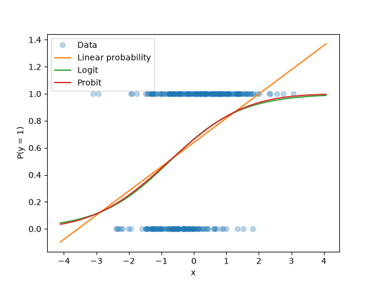

# 第 14 章: ロジットとプロビット

## 14.1 この章の地図

第 4 部は、被説明変数の**取りうる値に制限がある**モデルを扱います。この章は、被説明変数が **0 か 1**（働く・働かない、買う・買わない）の場合です。OLS で回帰する**線形確率モデル**は、予測値が 0〜1 の外に出ます。そこで、確率を、0〜1 に収まる分布関数 F で表します。

> P(y = 1 | x) = F(x′β)

F が標準ロジスティック分布なら**ロジット**、標準正規分布なら**プロビット**です。係数は、**最尤法**で推定します。この章では、最尤法を、ニュートン法で自分で書き、`statsmodels` と照合します。



| 項目 | 内容 |
| :--- | :--- |
| 計量経済学の題材 | 離散選択モデル、ロジット、プロビット、最尤法、限界効果、尤度比検定、線形確率モデル |
| 使う Python の機能 | `scipy.stats`（`logistic`・`norm` の `cdf`・`pdf`・`logcdf`・`logsf`）、NumPy の行列計算、データクラス |
| 新しく導入するライブラリ | なし |
| 完成形 | `BinaryFit`、`fit_binary`、`log_likelihood`、`predicted_probabilities`、`average_marginal_effects`、`likelihood_ratio_test`、`linear_probability`、`draw_binary_sample` |
| ファイル | 実装: `lib/chapter14/discrete.py`、`lib/chapter14/plot.py`（曲線の図）／テスト: `test/chapter14/test_discrete.py`、`test/chapter14/test_plot.py`（自分で書くときは、`practice/chapter14/` に、同じ名前で作ります） |
| データ | 手計算用の 2 × 2 の表と、乱数。実際のデータは、第 16 章（16.6 節）で使います |

### 計量経済学の式とコードの対応

| 計量経済学 | 式 | コード |
| :--- | :--- | :--- |
| 確率 | P(y = 1 \| x) = F(x′β) | `predicted_probabilities(fit, x)` |
| 対数尤度 | ln L = Σ [y·ln F(x′β) + (1 − y)·ln(1 − F(x′β))] | `log_likelihood(link, y, design, beta)` |
| ニュートン法 | β ← β + (X′WX)⁻¹ X′s（s はスコア、W は 2 階微分の符号を変えたもの） | `fit_binary(y, x, link)` |
| 平均限界効果 | ∂P/∂xⱼ の平均 = f(x′β) の平均 × βⱼ | `average_marginal_effects(fit, x)` |
| 尤度比検定 | LR = 2(ln L_制約なし − ln L_制約あり) ~ χ²(制約の数) | `likelihood_ratio_test(...)` |

> **記号について**: F は分布関数、f はその密度関数です。ロジットの F は標準ロジスティック分布、プロビットの F は標準正規分布（第 1 章の Φ）です。一覧は、[記号について](how-to-read.md#symbols) を参照してください。

### 前提とする章

| できること | 章 |
| :--- | :--- |
| 標準正規分布の分位点、χ² 分布 | [第 1 章](01-statistics-review.md) |
| LM 検定、検定の考え方 | [第 5 章](05-inference.md)、[第 6 章](06-asymptotics.md) |
| 重回帰（線形確率モデルで使う） | [第 3 章](03-multiple-regression.md) |

## 14.2 準備

```bash
cd apps/econometrics-programming/python
uv sync
uv run pytest test/chapter14
```

```text
32 passed
```

自分でコードを書くときは、`practice/chapter14/` に、完成形と同じ名前（`discrete.py`・`test_discrete.py`）のファイルを作ります。

## 14.3 予想する

1. 40 人のうち、30 人が y = 1 です。説明変数は定数項だけで、ロジットを推定すると、定数項は、いくつですか（ヒント: 対数オッズ ln(p ÷ (1 − p))）。プロビットは（ヒント: 標準正規分布の分位点）
2. ダミー変数 x があり、x = 0 の 40 人のうち y = 1 が 10 人（25%）、x = 1 の 40 人のうち 30 人（75%）です。ロジットの傾きは、いくつですか（ヒント: 対数オッズ比）
3. 同じデータで、ロジットとプロビットの**係数**は、同じ値になりますか。**平均限界効果**は
4. 線形確率モデルの予測値は、0 と 1 の間に収まりますか

## 14.4 離散選択モデルの考え方

### 線形確率モデルの問題

y が 0 か 1 のとき、y を x で OLS 回帰した値は、「y = 1 になる確率」の推定とみなせます（**線形確率モデル**）。計算が簡単で、係数は、確率の変化として読めます。しかし、予測値が 0〜1 の外に出ることがあり、誤差の分散が x によって変わります（不均一分散。第 8 章）。

### ロジットとプロビット

確率を、分布関数 F（0 から 1 に単調に増える S 字）で表します。背景には、観測できない**潜在変数** y* = x′β + ε があり、y* > 0 なら y = 1、とします。ε の分布が、ロジスティック分布ならロジット、正規分布ならプロビットです。分布の幅が違うので、**係数の大きさは違います**（ロジスティック分布の標準偏差は約 1.81 なので、ロジットの係数は、プロビットの約 1.6〜1.8 倍）。

### 最尤法

観測された y の並びが得られる確率（**尤度**）を、最大にする β を、推定値にします。対数をとった**対数尤度**

> ln L(β) = Σ [yᵢ·ln F(xᵢ′β) + (1 − yᵢ)·ln(1 − F(xᵢ′β))]

を最大にします。解の式はないので、**ニュートン法**で、繰り返し解きます。ロジット・プロビットの対数尤度は、β について凹なので、ニュートン法は、安定して解に収束します。標準誤差は、最大点での、2 階微分の符号を変えた行列（**情報行列**）の逆行列から求めます。

### 係数の解釈: 限界効果

ロジット・プロビットの係数は、y* への効果で、**確率への効果ではありません**。x の 1 単位の変化が、確率を、どれだけ変えるか（**限界効果**）は、∂P/∂x = f(x′β)·β で、**x の値によって変わります**。そこで、各観測値の f(x′β) を平均した、**平均限界効果**を使います。

### 尤度比検定

制約（いくつかの係数が 0）を課した推定と、課さない推定の、対数尤度の差で検定します。LR = 2(ln L_制約なし − ln L_制約あり) は、帰無仮説の下で、大標本で、χ²(制約の数) に従います。

### 完全分離

説明変数で、y = 0 と y = 1 が、完全に分けられると、尤度は、係数を無限に大きくするほど増えます。最大値がなく、ニュートン法は収束しません。

## 14.5 Red → Green → Refactor

### Red: 定数項だけのモデル

予想 1 の手計算です。定数項だけなら、最尤推定量は、**標本の割合** p̂ = 30/40 = 0.75 を再現します。ロジットの定数項 α は、F(α) = 0.75、つまり α = ln(0.75 ÷ 0.25) = ln 3 ≈ 1.0986。プロビットは、Φ(α) = 0.75 なので、α = Φ⁻¹(0.75) ≈ 0.6745 です。

```python
import numpy as np
import pandas as pd
import pytest
import statsmodels.api as sm
from scipy import stats

from lib.chapter14.discrete import fit_binary

Y = np.r_[np.zeros(30), np.ones(10), np.zeros(10), np.ones(30)]
X = np.r_[np.zeros(40), np.ones(40)]
```

```python
def test_定数項だけのロジットは対数オッズ() -> None:
    y = np.r_[np.ones(30), np.zeros(10)]
    fit = fit_binary(y, np.empty((40, 0)), "logit")
    assert fit.coefficients["const"] == pytest.approx(np.log(3))
    assert fit.coefficients["const"] == pytest.approx(1.0986, abs=1e-4)


def test_定数項だけのプロビットは標準正規分布の分位点() -> None:
    y = np.r_[np.ones(30), np.zeros(10)]
    fit = fit_binary(y, np.empty((40, 0)), "probit")
    assert fit.coefficients["const"] == pytest.approx(stats.norm.ppf(0.75))
    assert fit.coefficients["const"] == pytest.approx(0.6745, abs=1e-4)
```

### Green: fit_binary を実装する

対数尤度のスコア（x′β についての 1 階微分）と、2 階微分の符号を変えたものを、リンク関数ごとに求め、ニュートン法を回します。

```python
LINKS = {"logit": stats.logistic, "probit": stats.norm}


@dataclass(frozen=True)
class BinaryFit:
    """ロジット・プロビットの推定結果。"""

    coefficients: pd.Series
    standard_errors: pd.Series
    log_likelihood: float
    n_obs: int
    iterations: int
    link: str


def _design(x: ArrayLike) -> tuple[NDArray[np.float64], list[str]]:
    """定数項を先頭に足した説明変数の行列と、係数の名前。"""
    if isinstance(x, pd.DataFrame):
        names = [str(c) for c in x.columns]
    elif isinstance(x, pd.Series):
        names = [str(x.name)]
    else:
        names = []
    values = np.asarray(x, dtype=float)
    if values.ndim == 1:
        values = values.reshape(-1, 1)
    if not names:
        names = [f"x{i + 1}" for i in range(values.shape[1])]
    return np.column_stack([np.ones(len(values)), values]), ["const", *names]


def log_likelihood(
    link: str, y: ArrayLike, design: NDArray[np.float64], beta: NDArray[np.float64]
) -> float:
    """対数尤度 Σ [y·ln F(x′β) + (1 − y)·ln(1 − F(x′β))]。"""
    dist = LINKS[link]
    xb = design @ beta
    values = np.asarray(y, dtype=float)
    return float(np.sum(values * dist.logcdf(xb) + (1 - values) * dist.logsf(xb)))


def _score_and_weights(
    link: str, y: NDArray[np.float64], xb: NDArray[np.float64]
) -> tuple[NDArray[np.float64], NDArray[np.float64]]:
    """x′β についての、対数尤度の 1 階微分（スコア）と、2 階微分の符号を変えたもの。"""
    dist = LINKS[link]
    q = 2 * y - 1
    # 比を、対数の差から作る（極端な x′β でも、0 ÷ 0 や 0 での除算にならない）
    lam = q * np.exp(dist.logpdf(xb) - dist.logcdf(q * xb))
    if link == "logit":
        p = dist.cdf(xb)
        return lam, p * (1 - p)
    return lam, lam * (lam + xb)


def fit_binary(
    y: ArrayLike, x: ArrayLike, link: str = "logit", max_iterations: int = 100
) -> BinaryFit:
    """最尤法（ニュートン法）でロジット・プロビットを推定する。

    β ← β + (X′WX)⁻¹ X′s。s は x′β についてのスコア、W は 2 階微分の符号を変えたもの。
    収束しないとき（完全分離など）は、エラーにする。
    """
    if link not in LINKS:
        raise ValueError(f"知らないリンク関数: {link}（logit か probit）")
    design, names = _design(x)
    target = np.asarray(y, dtype=float)
    beta = np.zeros(design.shape[1])
    for iteration in range(1, max_iterations + 1):
        score, weights = _score_and_weights(link, target, design @ beta)
        information = design.T @ (design * weights[:, None])
        try:
            step = np.linalg.solve(information, design.T @ score)
        except np.linalg.LinAlgError:
            raise ValueError("収束しない（完全分離の可能性がある）") from None
        beta = beta + step
        if np.max(np.abs(step)) < 1e-10:
            _, weights = _score_and_weights(link, target, design @ beta)
            covariance = np.linalg.inv(design.T @ (design * weights[:, None]))
            return BinaryFit(
                coefficients=pd.Series(beta, index=names),
                standard_errors=pd.Series(np.sqrt(np.diag(covariance)), index=names),
                log_likelihood=log_likelihood(link, target, design, beta),
                n_obs=len(target),
                iterations=iteration,
                link=link,
            )
    raise ValueError("収束しない（完全分離の可能性がある）")
```

```python
import numpy as np

from lib.chapter14.discrete import fit_binary

y = np.r_[np.ones(30), np.zeros(10)]
for link in ("logit", "probit"):
    fit = fit_binary(y, np.empty((40, 0)), link)
    print(link, round(float(fit.coefficients["const"]), 4))
```

```text
logit 1.0986
probit 0.6745
```

手計算の 1.0986 と 0.6745 に一致します（予想 1）。

### 2 × 2 の表: 傾きは、対数オッズ比

予想 2 の手計算です。x = 0 の群は、確率 0.25（オッズ 1/3）、x = 1 の群は、0.75（オッズ 3）。ロジットでは、定数項は ln(1/3) = −1.0986、傾きは、**対数オッズ比** ln(3 ÷ (1/3)) = ln 9 ≈ 2.1972 です。プロビットは、定数項が Φ⁻¹(0.25) = −0.6745、傾きが Φ⁻¹(0.75) − Φ⁻¹(0.25) = 1.3490 です。

```python
def test_ダミー変数1つのロジットの傾きは対数オッズ比() -> None:
    fit = fit_binary(Y, X, "logit")
    assert fit.coefficients["const"] == pytest.approx(np.log(1 / 3))
    assert fit.coefficients["x1"] == pytest.approx(np.log(9))


def test_ダミー変数1つのプロビットの係数は分位点の差() -> None:
    fit = fit_binary(Y, X, "probit")
    assert fit.coefficients["const"] == pytest.approx(stats.norm.ppf(0.25))
    assert fit.coefficients["x1"] == pytest.approx(
        stats.norm.ppf(0.75) - stats.norm.ppf(0.25)
    )


def test_予測確率は表の割合に一致する() -> None:
    fit = fit_binary(Y, X, "logit")
    p = predicted_probabilities(fit, X)
    assert p[0] == pytest.approx(0.25)
    assert p[-1] == pytest.approx(0.75)
```

```python
from lib.chapter14.discrete import predicted_probabilities

y = np.r_[np.zeros(30), np.ones(10), np.zeros(10), np.ones(30)]
x = np.r_[np.zeros(40), np.ones(40)]
for link in ("logit", "probit"):
    fit = fit_binary(y, x, link)
    print(link, fit.coefficients.round(5).to_dict(), round(fit.log_likelihood, 4), fit.iterations)
print(np.log(9), predicted_probabilities(fit_binary(y, x), x)[[0, -1]].round(4))
```

```text
logit {'const': -1.09861, 'x1': 2.19722} -44.9868 5
probit {'const': -0.67449, 'x1': 1.34898} -44.9868 5
2.1972245773362196 [0.25 0.75]
```

ロジットの傾き 2.19722 は ln 9 に、プロビットの傾き 1.34898 は分位点の差に、一致します（予想 2）。どちらも、5 回の反復で収束し、**対数尤度は同じ −44.9868** です（この表では、どちらのモデルも、2 つの確率を、ちょうど再現できるため）。予測確率は、表の割合 0.25 と 0.75 です。

### statsmodels と照合する

乱数の標本（ロジットの母集団、n = 500）で、係数・標準誤差・対数尤度・平均限界効果を、`statsmodels` の `Logit`・`Probit` と、照合します。

```python
def predicted_probabilities(fit: BinaryFit, x: ArrayLike) -> NDArray[np.float64]:
    """P(y = 1 | x) = F(x′β)。"""
    design, _ = _design(x)
    result: NDArray[np.float64] = LINKS[fit.link].cdf(
        design @ fit.coefficients.to_numpy()
    )
    return result


def average_marginal_effects(fit: BinaryFit, x: ArrayLike) -> pd.Series:
    """平均限界効果 = 密度 f(x′β) の平均 × 係数（連続変数）。定数項は含めない。"""
    design, _ = _design(x)
    density = LINKS[fit.link].pdf(design @ fit.coefficients.to_numpy())
    return float(np.mean(density)) * fit.coefficients.drop("const")


def draw_binary_sample(n: int, link: str, rng: np.random.Generator) -> pd.DataFrame:
    """潜在変数 y* = 0.5 + x1 − 0.8·x2 + ε から、y = 1（y* > 0）の標本を作る。

    ε は、link が logit なら標準ロジスティック分布、probit なら標準正規分布。
    """
    x1, x2 = rng.standard_normal((2, n))
    error = rng.logistic(size=n) if link == "logit" else rng.standard_normal(n)
    latent = 0.5 + x1 - 0.8 * x2 + error
    return pd.DataFrame({"y": (latent > 0).astype(float), "x1": x1, "x2": x2})
```

```python
def sample(link: str = "logit", n: int = 500) -> pd.DataFrame:
    return draw_binary_sample(n, link, np.random.default_rng(0))


@pytest.mark.parametrize(
    ("link", "model"), [("logit", sm.Logit), ("probit", sm.Probit)]
)
def test_statsmodelsと係数も標準誤差も対数尤度も一致する(
    link: str, model: type
) -> None:
    s = sample(link)
    x = s[["x1", "x2"]]
    fit = fit_binary(s["y"], x, link)
    reference = model(s["y"], sm.add_constant(x)).fit(disp=0)
    assert fit.coefficients.to_numpy() == pytest.approx(reference.params.to_numpy())
    assert fit.standard_errors.to_numpy() == pytest.approx(reference.bse.to_numpy())
    assert fit.log_likelihood == pytest.approx(reference.llf)
    assert fit.n_obs == 500


@pytest.mark.parametrize(
    ("link", "model"), [("logit", sm.Logit), ("probit", sm.Probit)]
)
def test_平均限界効果はstatsmodelsと一致する(link: str, model: type) -> None:
    s = sample(link)
    x = s[["x1", "x2"]]
    fit = fit_binary(s["y"], x, link)
    reference = model(s["y"], sm.add_constant(x)).fit(disp=0).get_margeff().margeff
    assert average_marginal_effects(fit, x).to_numpy() == pytest.approx(reference)
    assert list(average_marginal_effects(fit, x).index) == ["x1", "x2"]


def test_対数尤度は最大値でスコアが0() -> None:
    s = sample()
    x = s[["x1", "x2"]]
    fit = fit_binary(s["y"], x, "logit")
    design = np.column_stack([np.ones(500), x.to_numpy()])
    beta = fit.coefficients.to_numpy()
    best = log_likelihood("logit", s["y"], design, beta)
    for direction in np.eye(3):
        for delta in (0.05, -0.05):
            assert (
                log_likelihood("logit", s["y"], design, beta + delta * direction) < best
            )
    residual = s["y"].to_numpy() - predicted_probabilities(fit, x)
    assert design.T @ residual == pytest.approx(0, abs=1e-7)


def test_標本の形と割合() -> None:
    s = draw_binary_sample(50000, "probit", np.random.default_rng(0))
    assert list(s.columns) == ["y", "x1", "x2"]
    assert set(s["y"]) == {0.0, 1.0}
    expected = stats.norm.cdf(0.5 / (1 + 1 + 0.64) ** 0.5)
    assert s["y"].mean() == pytest.approx(expected, abs=0.01)
```

```python
from lib.chapter03.multiple import fit_ols
from lib.chapter14.discrete import (
    average_marginal_effects,
    draw_binary_sample,
    likelihood_ratio_test,
    linear_probability,
)

s = draw_binary_sample(500, "logit", np.random.default_rng(0))
cols = s[["x1", "x2"]]
for link in ("logit", "probit"):
    fit = fit_binary(s["y"], cols, link)
    print(link, fit.coefficients.round(4).to_dict(), fit.standard_errors.round(4).to_dict(), round(fit.log_likelihood, 2))
    print("  AME", average_marginal_effects(fit, cols).round(4).to_dict())
print("LPM", linear_probability(s["y"], cols).round(4).to_dict())
```

```text
logit {'const': 0.4161, 'x1': 0.9386, 'x2': -0.502} {'const': 0.1016, 'x1': 0.1188, 'x2': 0.1121} -290.5
  AME {'x1': 0.1868, 'x2': -0.0999}
probit {'const': 0.2474, 'x1': 0.5543, 'x2': -0.2963} {'const': 0.0607, 'x1': 0.0666, 'x2': 0.0667} -290.95
  AME {'x1': 0.1839, 'x2': -0.0983}
LPM {'const': 0.5841, 'x1': 0.1824, 'x2': -0.0977}
```

母集団の真の値は、ロジットの式で、定数項 0.5、x1 の係数 1、x2 の係数 −0.8 です。ロジットの推定値（0.4161、0.9386、−0.502）は、定数項と x1 では、真の値から標準誤差（0.10〜0.12）の 1 つ分以内ですが、x2 は、真の値 −0.8 から、約 2.7 標準誤差ずれています。1 つの標本では、このようなずれも起こります（n = 100000 では、真の値に近づきます）。**係数の大きさは、ロジットとプロビットで違いますが**（0.9386 と 0.5543）、**平均限界効果は、ほぼ同じ**です（0.1868 と 0.1839、−0.0999 と −0.0983）。線形確率モデルの係数（0.1824、−0.0977）も、平均限界効果に近い値です（予想 3）。`statsmodels` との一致は、テストで確認しています。

### 反復と収束

```python
def test_完全に分離できるデータは収束しない() -> None:
    with pytest.raises(ValueError, match="完全分離"):
        fit_binary([0, 0, 0, 1, 1, 1], [1, 2, 3, 4, 5, 6])


def test_ニュートン法は2_x_2の表で5回で収束する() -> None:
    assert fit_binary(Y, X, "logit").iterations == 5
    assert fit_binary(Y, X, "probit").iterations == 5


def test_極端な線形予測値でもスコアは有限() -> None:
    y = np.array([1.0, 0.0, 1.0])
    xb = np.array([-40.0, 40.0, -800.0])
    for link in ("logit", "probit"):
        score, weights = _score_and_weights(link, y, xb)
        assert np.all(np.isfinite(score))
        assert np.all(np.isfinite(weights))
    # 外れた観測値のスコアは、ほぼ |x′β|（誤って予測した側）になる
    probit_score, _ = _score_and_weights("probit", y, xb)
    assert probit_score == pytest.approx([40.0, -40.0, 800.0], rel=0.01)


def test_まれな外れ値があっても完全分離と誤報しない() -> None:
    rng = np.random.default_rng(0)
    x = rng.standard_normal(20000)
    y = (4 * x + rng.standard_normal(20000) > 0).astype(float)
    x = np.append(x, -6.0)
    y = np.append(y, 1.0)
    fit = fit_binary(y, x, "probit")
    # 最大値では、スコアの合計が 0（statsmodels は確率を 2.2e-16 で切り詰めるので、照合に使わない）
    design = sm.add_constant(x)
    score, _ = _score_and_weights("probit", y, design @ fit.coefficients.to_numpy())
    assert design.T @ score == pytest.approx([0.0, 0.0], abs=1e-6)
    assert fit.coefficients["x1"] == pytest.approx(3.4944, abs=1e-3)


def test_知らないリンク関数は受け付けない() -> None:
    with pytest.raises(ValueError, match="リンク"):
        fit_binary(Y, X, "cauchy")


def test_反復の回数が少ないと収束しない() -> None:
    s = sample()
    with pytest.raises(ValueError, match="収束"):
        fit_binary(s["y"], s[["x1", "x2"]], "logit", max_iterations=2)


def test_配列と列の名前() -> None:
    s = sample()
    named = fit_binary(s["y"], s[["x1", "x2"]])
    plain = fit_binary(s["y"], s[["x1", "x2"]].to_numpy())
    single = fit_binary(s["y"], s["x1"])
    assert list(named.coefficients.index) == ["const", "x1", "x2"]
    assert list(plain.coefficients.index) == ["const", "x1", "x2"]
    assert list(single.coefficients.index) == ["const", "x1"]
    assert named.coefficients.to_numpy() == pytest.approx(plain.coefficients.to_numpy())
```

```python
try:
    fit_binary([0, 0, 0, 1, 1, 1], [1, 2, 3, 4, 5, 6])
except ValueError as error:
    print(error)
```

```text
収束しない（完全分離の可能性がある）
```

x = 1、2、3 で y = 0、x = 4、5、6 で y = 1 は、完全に分離できます。尤度は、係数を大きくするほど増え続けるので、収束せず、エラーにします（情報行列が、特異になる）。

### 尤度比検定

```python
def likelihood_ratio_test(
    log_likelihood_full: float, log_likelihood_restricted: float, restrictions: int
) -> TestResult:
    """尤度比検定: LR = 2 · (ln L_制約なし − ln L_制約あり) ~ χ²(制約の数)。"""
    statistic = 2 * (log_likelihood_full - log_likelihood_restricted)
    return TestResult(float(statistic), float(stats.chi2.sf(statistic, restrictions)))


def linear_probability(y: ArrayLike, x: ArrayLike) -> pd.Series:
    """線形確率モデル: y（0 か 1）を、OLS で x に回帰した係数。"""
    return fit_ols(y, x).coefficients
```

```python
def test_尤度比検定の手計算() -> None:
    test = likelihood_ratio_test(-40.0, -45.0, 2)
    assert test.statistic == pytest.approx(10)
    assert test.p_value == pytest.approx(stats.chi2.sf(10, 2))


def test_関係のある変数を除くと尤度比検定は棄却する() -> None:
    s = sample(n=1000)
    full = fit_binary(s["y"], s[["x1", "x2"]])
    restricted = fit_binary(s["y"], np.empty((1000, 0)))
    test = likelihood_ratio_test(full.log_likelihood, restricted.log_likelihood, 2)
    assert test.p_value < 1e-10


def test_関係のない変数を足しても尤度比検定は棄却しない() -> None:
    s = sample(n=1000)
    noise = np.random.default_rng(9).standard_normal(1000)
    full = fit_binary(s["y"], np.column_stack([s["x1"], s["x2"], noise]))
    restricted = fit_binary(s["y"], s[["x1", "x2"]])
    test = likelihood_ratio_test(full.log_likelihood, restricted.log_likelihood, 1)
    assert test.p_value > 0.05


def test_線形確率モデルはOLSの係数() -> None:
    s = sample()
    x = s[["x1", "x2"]]
    assert linear_probability(s["y"], x).to_numpy() == pytest.approx(
        fit_ols(s["y"], x).coefficients.to_numpy()
    )
```

```python
full = fit_binary(s["y"], cols)
null = fit_binary(s["y"], np.empty((500, 0)))
lr = likelihood_ratio_test(full.log_likelihood, null.log_likelihood, 2)
print(round(null.log_likelihood, 2), round(lr.statistic, 2), lr.p_value)
```

```text
-339.14 97.27 7.536831779785743e-22
```

定数項だけのモデルの対数尤度は −339.14、説明変数 2 つを入れたモデルは −290.5 です。LR 統計量は 97.27、p 値は 10⁻²¹ で、「2 つの係数が両方 0」を、強く棄却します。

### 標本が大きいと: ロジットとプロビットの違い

n = 100000 の標本を、ロジットの母集団と、プロビットの母集団の、両方から作って、ロジットとプロビットで、推定します。

```python
def test_ロジットの標本は標準ロジスティック分布の誤差() -> None:
    s = draw_binary_sample(100000, "logit", np.random.default_rng(1))
    fit = fit_binary(s["y"], s[["x1", "x2"]], "logit")
    assert fit.coefficients.to_numpy() == pytest.approx([0.5, 1.0, -0.8], abs=0.04)


def test_プロビットの標本ではプロビットの係数が真の値でロジットは約1点7倍() -> None:
    s = draw_binary_sample(100000, "probit", np.random.default_rng(1))
    probit = fit_binary(s["y"], s[["x1", "x2"]], "probit")
    logit = fit_binary(s["y"], s[["x1", "x2"]], "logit")
    assert probit.coefficients.to_numpy() == pytest.approx([0.5, 1.0, -0.8], abs=0.04)
    ratio = logit.coefficients["x1"] / probit.coefficients["x1"]
    assert ratio == pytest.approx(1.7, abs=0.1)


def test_平均限界効果はロジット_プロビット_線形確率モデルでほぼ同じ() -> None:
    s = draw_binary_sample(100000, "probit", np.random.default_rng(1))
    x = s[["x1", "x2"]]
    logit = average_marginal_effects(fit_binary(s["y"], x, "logit"), x)
    probit = average_marginal_effects(fit_binary(s["y"], x, "probit"), x)
    lpm = linear_probability(s["y"], x).drop("const")
    assert logit.to_numpy() == pytest.approx(probit.to_numpy(), abs=0.005)
    assert lpm.to_numpy() == pytest.approx(probit.to_numpy(), abs=0.01)
```

```python
for generator in ("logit", "probit"):
    big = draw_binary_sample(100000, generator, np.random.default_rng(1))
    cols = big[["x1", "x2"]]
    logit, probit = fit_binary(big["y"], cols, "logit"), fit_binary(big["y"], cols, "probit")
    print(generator, logit.coefficients.round(3).to_dict(), probit.coefficients.round(3).to_dict(), round(float(logit.coefficients["x1"] / probit.coefficients["x1"]), 3))
    print("  AME", average_marginal_effects(logit, cols).round(4).to_dict(), average_marginal_effects(probit, cols).round(4).to_dict(), linear_probability(big["y"], cols).drop("const").round(4).to_dict())
```

```text
logit {'const': 0.482, 'x1': 0.993, 'x2': -0.79} {'const': 0.287, 'x1': 0.589, 'x2': -0.469} 1.686
  AME {'x1': 0.1839, 'x2': -0.1463} {'x1': 0.1833, 'x2': -0.1458} {'x1': 0.1834, 'x2': -0.1458}
probit {'const': 0.846, 'x1': 1.717, 'x2': -1.372} {'const': 0.49, 'x1': 0.993, 'x2': -0.793} 1.729
  AME {'x1': 0.235, 'x2': -0.1878} {'x1': 0.2351, 'x2': -0.1877} {'x1': 0.2339, 'x2': -0.1869}
```

各ブロックは、順に、ロジットの係数、プロビットの係数、x1 の係数の比（ロジット ÷ プロビット）、そして、平均限界効果（ロジット・プロビット）と、線形確率モデルの係数です。

- **ロジットの母集団**（1 ブロック目）: ロジットの推定値は、真の値（0.5、1、−0.8）に近い（0.482、0.993、−0.79）。プロビットは、約 0.6 倍（比 1.686）
- **プロビットの母集団**（2 ブロック目）: プロビットの推定値が、真の値に近い（0.49、0.993、−0.793）。ロジットは、約 1.7 倍（比 1.729）
- **どちらの母集団でも、平均限界効果は、ロジット・プロビット・線形確率モデルで、ほぼ同じ**（x1 で 0.1834〜0.1839、および 0.2339〜0.2351）。**モデルの選択は、係数の大きさを変えますが、確率への効果は、ほとんど変えません。**

### 線形確率モデルは、範囲の外に出る

```python
def test_線形確率モデルは確率の範囲の外に出ることがある() -> None:
    s = sample(n=2000)
    x = s[["x1", "x2"]]
    fitted = fit_ols(s["y"], x).coefficients
    values = fitted["const"] + x @ fitted[["x1", "x2"]]
    assert (values > 1).any() or (values < 0).any()
    probabilities = predicted_probabilities(fit_binary(s["y"], x), x)
    assert ((probabilities > 0) & (probabilities < 1)).all()
```

```python
from lib.chapter03.multiple import fit_ols

s2 = draw_binary_sample(2000, "logit", np.random.default_rng(0))
cols = s2[["x1", "x2"]]
ols = fit_ols(s2["y"], cols).coefficients
fitted = ols["const"] + cols @ ols[["x1", "x2"]]
print(round(float((fitted > 1).mean()), 4), round(float((fitted < 0).mean()), 4), round(float(fitted.min()), 3), round(float(fitted.max()), 3))
```

```text
0.034 0.0065 -0.194 1.444
```

線形確率モデルの予測値は、3.4% の観測値で 1 を超え、0.65% で 0 を下回りました。最小は −0.194、最大は 1.444 で、確率として意味を持ちません（予想 4）。ロジット・プロビットの予測確率は、必ず 0 と 1 の間にあります（テストで確認）。

### 図

`plot_probability_curves` は、データ・線形確率モデルの直線・ロジット・プロビットの曲線を描きます。

```python
def xs(line: Any) -> list[float]:
    values: Any = line.get_xdata()
    return [float(v) for v in values]


def ys(line: Any) -> list[float]:
    values: Any = line.get_ydata()
    return [float(v) for v in values]


def test_データと3つの曲線() -> None:
    s = draw_binary_sample(300, "logit", np.random.default_rng(0))
    ax = plot_probability_curves(s["x1"].to_numpy(), s["y"].to_numpy()).axes[0]
    assert [line.get_label() for line in ax.lines] == [
        "Data",
        "Linear probability",
        "Logit",
        "Probit",
    ]
    assert ys(ax.lines[0]) == s["y"].tolist()


def test_ロジットとプロビットの曲線は0と1の間で単調に増える() -> None:
    s = draw_binary_sample(300, "logit", np.random.default_rng(0))
    ax = plot_probability_curves(s["x1"].to_numpy(), s["y"].to_numpy()).axes[0]
    for line in (ax.lines[2], ax.lines[3]):
        values = ys(line)
        assert min(values) > 0
        assert max(values) < 1
        assert values == sorted(values)


def test_ロジットの曲線は最尤推定の確率() -> None:
    s = draw_binary_sample(300, "logit", np.random.default_rng(0))
    x, y = s["x1"].to_numpy(), s["y"].to_numpy()
    ax = plot_probability_curves(x, y).axes[0]
    fit = fit_binary(y, x, "logit")
    grid = xs(ax.lines[2])
    expected = 1 / (
        1
        + np.exp(-(fit.coefficients["const"] + fit.coefficients["x1"] * np.array(grid)))
    )
    assert ys(ax.lines[2]) == pytest.approx(expected)


def test_線形確率モデルの直線は範囲の外に出る() -> None:
    s = draw_binary_sample(300, "logit", np.random.default_rng(0))
    ax = plot_probability_curves(s["x1"].to_numpy(), s["y"].to_numpy()).axes[0]
    values = ys(ax.lines[1])
    assert max(values) > 1 or min(values) < 0


def test_曲線の範囲はデータの範囲の両側に1ずつ広げる() -> None:
    s = draw_binary_sample(300, "logit", np.random.default_rng(0))
    x = s["x1"].to_numpy()
    ax = plot_probability_curves(x, s["y"].to_numpy()).axes[0]
    grid = xs(ax.lines[2])
    assert grid[0] == pytest.approx(x.min() - 1)
    assert grid[-1] == pytest.approx(x.max() + 1)
    assert len(grid) == 100
```

```python
def plot_probability_curves(x: NDArray[np.float64], y: NDArray[np.float64]) -> Figure:
    """0 か 1 のデータと、線形確率モデルの直線、ロジット・プロビットの曲線を描く。"""
    grid = np.linspace(float(x.min()) - 1, float(x.max()) + 1, 100)
    ols = fit_ols(y, x).coefficients
    fig, ax = plt.subplots()
    ax.plot(x, y, "o", alpha=0.3, label="Data")
    ax.plot(grid, ols["const"] + ols["x1"] * grid, label="Linear probability")
    for link, name in (("logit", "Logit"), ("probit", "Probit")):
        fit = fit_binary(y, x, link)
        ax.plot(grid, predicted_probabilities(fit, grid), label=name)
    ax.set_xlabel("x")
    ax.set_ylabel("P(y = 1)")
    ax.legend()
    plt.close(fig)
    return fig
```

### 実行結果

```bash
uv run pytest test/chapter14
```

```text
32 passed
```

## 14.6 規則で言うと

1. **確率は、0〜1 に収まる分布関数で表す。** ロジット・プロビットは、最尤法で推定する。係数の大きさは、モデルによって違う
2. **係数は、確率への効果ではない。** 確率への効果は、限界効果 f(x′β)·β で、x の値によって変わる。報告は、平均限界効果で
3. **ロジットとプロビットは、限界効果では、ほとんど同じ。** 迷ったら、解釈しやすい（オッズ比が使える）ロジットでよい。線形確率モデルも、平均的な効果の目安になる

混同しやすい点を、表にまとめます。

| 混同しやすい点 | 違い |
| :--- | :--- |
| ロジットの係数 と 限界効果 | 係数は、対数オッズへの効果。限界効果は、確率への効果（f(x′β) を掛ける）。係数 0.94 は、「確率が 94% 上がる」ではない |
| ロジットの係数 と プロビットの係数 | 同じデータでも、約 1.6〜1.8 倍違う（誤差分布の幅の違い）。係数を、モデルをまたいで比べない |
| オッズ と 確率 | オッズ = p ÷ (1 − p)。ロジットの係数は、x が 1 増えたときの、対数オッズの変化 |

### この方法が成り立たない場面

- **ロジット・プロビットは、誤差項の分布の仮定に依存します。** 誤差項の分散が、x で変わる（不均一分散）と、最尤推定量は、一致性を失います。線形確率モデルは、この点では頑健です
- **内生性は、直りません。** 説明変数が内生なら、ロジットでも偏ります（第 11 章）。操作変数法は、離散選択モデルでは、別の方法（制御関数法など）が必要です
- **まれな事象（y = 1 が、ごくわずか）では、最尤推定量が不安定です。** 完全分離に近づくと、係数が大きく、標準誤差も大きくなります

## 14.7 練習問題

| 種類 | 問題 |
| :--- | :--- |
| 想起 | 本文を閉じて、定数項だけのロジットが、割合 0.75 のとき ln 3 になるテストを書いてください |
| 生成 | 解説を見る前に、ロジットの係数から**オッズ比** exp(係数) を返す `odds_ratio(fit, name)` を、テストから書いてください。2 × 2 の表のロジットで、x のオッズ比は、いくつですか（ヒント: 3 ÷ (1/3)） |
| 多様 | 説明変数 x1 の単位を、2 倍にする（x1 × 2）と、ロジットの x1 の係数は、どうなりますか。予測確率は、変わりますか。先に予想してから、確かめてください |
| 交互 | [第 5 章](05-inference.md)の考え方で、x2 の係数が 0 という仮説を、(a) 尤度比検定と、(b) 係数 ÷ 標準誤差の 2 乗（Wald 検定）で、検定してください。統計量は、近い値になりますか（n = 500 の標本） |

??? note "解答（先に自分で取り組んでから、開いてください）"

    **想起**:

    ```python
    def test_定数項だけのロジット() -> None:
        y = np.r_[np.ones(30), np.zeros(10)]
        fit = fit_binary(y, np.empty((40, 0)), "logit")
        assert fit.coefficients["const"] == pytest.approx(np.log(3))
    ```

    **生成**: オッズ比 = 3 ÷ (1/3) = 9 です（ln 9 = 2.1972 の指数）。

    ```python
    def odds_ratio(fit, name):
        return float(np.exp(fit.coefficients[name]))
    ```

    ```python
    def test_オッズ比() -> None:
        y = np.r_[np.zeros(30), np.ones(10), np.zeros(10), np.ones(30)]
        x = np.r_[np.zeros(40), np.ones(40)]
        assert odds_ratio(fit_binary(y, x), "x1") == pytest.approx(9)
    ```

    **多様**: x1 を 2 倍にすると、係数は**半分**になります（x1 × 係数が変わらないため）。予測確率は、変わりません。単位の変更で、確率が変わらない、という当然の性質です。

    ```python
    def test_説明変数を2倍にすると係数は半分で予測確率は同じ() -> None:
        s = draw_binary_sample(500, "logit", np.random.default_rng(0))
        a = s[["x1", "x2"]]
        b = a.assign(x1=2 * a["x1"])
        fit_a, fit_b = fit_binary(s["y"], a), fit_binary(s["y"], b)
        assert fit_b.coefficients["x1"] == pytest.approx(fit_a.coefficients["x1"] / 2)
        assert predicted_probabilities(fit_b, b) == pytest.approx(
            predicted_probabilities(fit_a, a)
        )
    ```

    **交互**: LR 統計量と Wald 統計量（z²）は、大標本で、同じ分布に従うので、近い値になります。この標本では、どちらも約 20 です。

    ```python
    def test_尤度比検定とWald検定は近い値() -> None:
        s = draw_binary_sample(500, "logit", np.random.default_rng(0))
        full = fit_binary(s["y"], s[["x1", "x2"]])
        restricted = fit_binary(s["y"], s[["x1"]])
        lr = likelihood_ratio_test(full.log_likelihood, restricted.log_likelihood, 1)
        wald = (full.coefficients["x2"] / full.standard_errors["x2"]) ** 2
        assert lr.statistic == pytest.approx(wald, rel=0.2)
    ```

## 14.8 振り返り

- 予想した 4 つは、当たりましたか。係数と限界効果の違いを、説明できますか
- ロジットとプロビットの違いは、どこに現れ、どこに現れませんか
- 自分の分析で、被説明変数が 0 か 1 のものは、何ですか。線形確率モデルとロジットの、どちらを使いますか

## 14.9 まとめ

- ロジット・プロビットの最尤推定を、ニュートン法で書いた。定数項だけのモデルと、2 × 2 の表で、手計算（ln 3、ln 9、Φ⁻¹）に一致し、`statsmodels` と、係数・標準誤差・対数尤度・平均限界効果が一致した
- ロジットとプロビットは、係数の大きさが約 1.7 倍違うが、平均限界効果は、ほぼ同じ（0.1839 と 0.1833）。線形確率モデルの係数も近いが、予測値は 0〜1 の外に出る（3.4% が 1 超）
- 完全に分離できるデータは収束しない。尤度比検定（LR = 97.27）で、係数が 0 という仮説を検定できる
- 次の章では、被説明変数が、ある値で**打ち切られる**・**切断される**場合（トービットと切断回帰）を、最尤法で書きます
