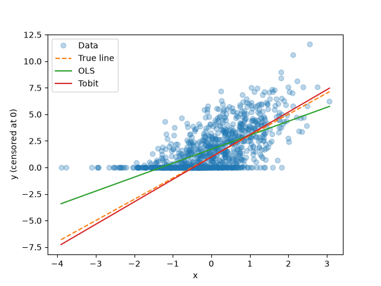
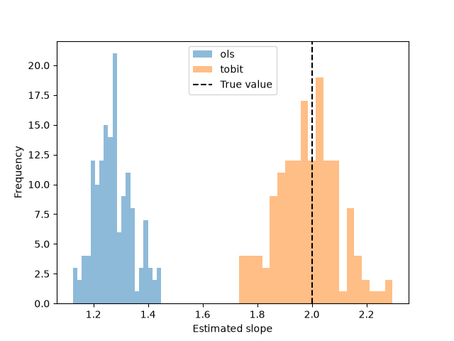

# 第 15 章: 切断回帰とトービット

## 15.1 この章の地図

被説明変数が、ある値以下を観測できない場合があります。たとえば、働いていない人の労働時間は 0 です。この章では、2 つの場合を区別します。

| 場合 | 何が起きるか | 例 |
| :--- | :--- | :--- |
| **打ち切り**（censoring） | 下限を下回る人も、標本にいる。ただし、y は下限として観測される | 働いていない人の労働時間 0（x は観測できる） |
| **切断**（truncation） | 下限を下回る人は、標本に、そもそもいない | 一定の所得以上の人だけを調べた調査 |

どちらも、そのまま OLS で回帰すると、傾きが **0 の方向に偏ります**。打ち切りには**トービット**、切断には**切断回帰**を、最尤法で推定します。この章では、2 つの対数尤度を書き、最適化の細部（**解析的な勾配**と、標準誤差の精度）も扱います。



| 項目 | 内容 |
| :--- | :--- |
| 計量経済学の題材 | 打ち切りと切断、トービット、切断回帰、最尤法、解析的な勾配、期待値と限界効果 |
| 使う Python の機能 | `scipy.optimize.minimize`（BFGS）、`scipy.stats.norm`（`logpdf`・`logcdf`・`logsf`）、関数を引数に渡す（`Callable`） |
| 新しく導入するライブラリ | なし |
| 完成形 | `LimitedFit`、`tobit_log_likelihood`、`truncreg_log_likelihood`、`tobit_gradient`、`truncreg_gradient`、`hessian_from_gradient`、`fit_tobit`、`fit_truncreg`、`tobit_expected_value`、`tobit_marginal_effects`、`draw_latent_sample`、`censor`、`truncate` |
| ファイル | 実装: `lib/chapter15/limited.py`、`lib/chapter15/plot.py`（図）／テスト: `test/chapter15/test_limited.py`、`test/chapter15/test_plot.py`（自分で書くときは、`practice/chapter15/` に、同じ名前で作ります） |
| データ | 手計算用の 2 つの観測値と、乱数。実際のデータは、第 16 章（16.6 節）で使います |

### 計量経済学の式とコードの対応

| 計量経済学 | 式 | コード |
| :--- | :--- | :--- |
| 潜在変数 | y* = x′β + u、u ~ N(0, σ²)。観測値は y = max(y*, left)（打ち切り） | `censor(y_latent, left)` |
| トービットの対数尤度 | 打ち切り: ln Φ((left − x′β) ÷ σ)。それ以外: ln φ((y − x′β) ÷ σ) − ln σ | `tobit_log_likelihood(params, y, design, left)` |
| 切断回帰の対数尤度 | ln φ((y − x′β) ÷ σ) − ln σ − ln(1 − Φ((left − x′β) ÷ σ)) | `truncreg_log_likelihood(...)` |
| 期待値 | E[y \| x] = left + (x′β − left)·Φ(z) + σ·φ(z)、z = (x′β − left) ÷ σ | `tobit_expected_value(fit, x)` |
| 限界効果 | ∂E[y \| x] ÷ ∂x = Φ(z)·β | `tobit_marginal_effects(fit, x)` |

> **記号について**: y* は潜在変数（打ち切られる前の、本来の値）、σ は誤差項の標準偏差、φ・Φ は標準正規分布の密度・分布関数です。最適化では、σ ではなく ln σ を動かします（σ > 0 を保つため）。一覧は、[記号について](how-to-read.md#symbols) を参照してください。

### 前提とする章

| できること | 章 |
| :--- | :--- |
| 最尤法、対数尤度、尤度比 | [第 14 章](14-logit-probit.md) |
| OLS、偏りのシミュレーション | [第 2 章](02-simple-regression.md)、[第 3 章](03-multiple-regression.md) |
| 標準正規分布 | [第 1 章](01-statistics-review.md) |

## 15.2 準備

```bash
cd apps/econometrics-programming/python
uv sync
uv run pytest test/chapter15
```

```text
26 passed
```

自分でコードを書くときは、`practice/chapter15/` に、完成形と同じ名前（`limited.py`・`test_limited.py`）のファイルを作ります。

## 15.3 予想する

潜在変数 y* = 1 + 2x + u（u の標準偏差は 2）から、標本を取ります。

1. y* が 0 を下回ったら、0 として観測します（**打ち切り**）。観測値 y（0 を含む）を、x で OLS 回帰すると、傾きは、真の値 2 より大きいですか、小さいですか。y > 0 の人だけで OLS 回帰したら
2. y* が 0 以下の人は、標本から消えます（**切断**）。残った人だけで、OLS 回帰すると、傾きはどうなりますか
3. トービットと切断回帰は、真の値 2 を、復元できますか
4. 打ち切りが、まったくない場合、トービットは、OLS と、同じ結果になりますか

## 15.4 打ち切りと切断の考え方

### OLS が偏る理由

y > 0 の人だけを見ると、x が小さい（y* の平均が低い）人は、u が大きかった人だけが残ります。x が小さいほど、残った人の u の平均が高くなるので、x と u が負に相関し、傾きが**小さく**出ます。y = 0 を含めても（打ち切り）、0 を、本来の負の値より高い値として扱うので、傾きは小さくなります。

### トービット

y* = x′β + u（u ~ N(0, σ²)）で、y* ≤ left なら、y = left と観測するモデルです。尤度は、2 種類の観測値の確率を掛けます。

- **打ち切られた観測値**（y = left）: y* ≤ left の確率 Φ((left − x′β) ÷ σ)
- **それ以外**: 正規分布の密度 (1 ÷ σ)·φ((y − x′β) ÷ σ)

### 切断回帰

y > left の人だけが標本にあります。密度を、「y > left という条件の下での」密度に直します。条件の確率で割る（対数では引く）ので、ln φ(…) − ln σ − ln(1 − Φ((left − x′β) ÷ σ)) です。

### 打ち切られた y の期待値

y = max(y*, left) の期待値は、E[y | x] = left + (x′β − left)·Φ(z) + σ·φ(z)（z = (x′β − left) ÷ σ）です。x の 1 単位の変化が、**打ち切りを含む y の期待値**を、どれだけ変えるかは、Φ(z)·β です。潜在変数への効果 β より小さく、x の値で変わります。

### 最適化の細部

対数尤度を、BFGS 法で最大にします。このとき、2 つの細部が、結果を大きく左右します。

1. **勾配は、解析的に与える。** 数値微分に任せると、値のスケールが大きいデータ（労働時間は 0〜5000 時間）で、**収束しないうちに、止まってしまう**ことがあります（労働時間のように、値の大きい実際のデータで起こりやすい）
2. **標準誤差は、ヘッセ行列（対数尤度の 2 階微分）の逆行列から求める。** 2 階微分は、対数尤度を 2 回差分するのではなく、**解析的な勾配を、1 回差分して**求めます（対数尤度の 2 階差分は、値が大きいと、桁落ちで不正確になります）

## 15.5 Red → Green → Refactor

### Red: 対数尤度の手計算

x = 0、1 の 2 人、β = (0.5, 1)、σ = 1（ln σ = 0）、下限 0 とします。1 人目が y = 0（打ち切り）、2 人目が y = 2 のとき、トービットの対数尤度は、ln Φ((0 − 0.5) ÷ 1) + ln φ((2 − 1.5) ÷ 1) = ln Φ(−0.5) − 0.5·ln(2π) − 0.125 ≈ −1.1759 − 1.0439 = **−2.2199** です。切断回帰（y = 1 と 2 が観測）は、**−1.6498** です（各観測値で、ln φ − ln(1 − Φ(−0.5 または −1.5)) を足します）。

```python
import math

import numpy as np
import pytest

from lib.chapter15.limited import tobit_log_likelihood, truncreg_log_likelihood

PARAMS = np.array([0.5, 1.0, 0.0])
DESIGN = np.column_stack([np.ones(2), [0.0, 1.0]])
```

```python
def test_トービットの対数尤度の手計算() -> None:
    # y = 0（打ち切り）: ln Φ(−0.5)、y = 2: ln φ(2 − 1.5)
    expected = (
        math.log(0.5 * math.erfc(0.5 / math.sqrt(2)))
        - 0.5 * math.log(2 * math.pi)
        - 0.125
    )
    value = tobit_log_likelihood(PARAMS, np.array([0.0, 2.0]), DESIGN, 0.0)
    assert value == pytest.approx(expected)
    assert value == pytest.approx(-2.2199, abs=1e-4)


def test_切断回帰の対数尤度の手計算() -> None:
    value = truncreg_log_likelihood(PARAMS, np.array([1.0, 2.0]), DESIGN, 0.0)
    assert value == pytest.approx(-1.6498, abs=1e-4)
```

### Green: 対数尤度を実装する

```python
@dataclass(frozen=True)
class LimitedFit:
    """トービット・切断回帰の推定結果。係数の最後の `sigma` は、誤差の標準偏差。"""

    coefficients: pd.Series
    standard_errors: pd.Series
    log_likelihood: float
    n_obs: int


def tobit_log_likelihood(
    params: NDArray[np.float64],
    y: NDArray[np.float64],
    design: NDArray[np.float64],
    left: float,
) -> float:
    """トービット（下限 left で打ち切り）の対数尤度。params = (β, ln σ)。

    打ち切られた観測値（y = left）: ln Φ((left − x′β) ÷ σ)
    それ以外: ln φ((y − x′β) ÷ σ) − ln σ
    """
    beta, sigma = params[:-1], np.exp(params[-1])
    xb = design @ beta
    censored = y <= left
    uncensored = ~censored
    return float(
        np.sum(stats.norm.logcdf((left - xb[censored]) / sigma))
        + np.sum(stats.norm.logpdf((y[uncensored] - xb[uncensored]) / sigma))
        - uncensored.sum() * params[-1]
    )


def truncreg_log_likelihood(
    params: NDArray[np.float64],
    y: NDArray[np.float64],
    design: NDArray[np.float64],
    left: float,
) -> float:
    """切断回帰（y > left の観測値だけが標本にある）の対数尤度。params = (β, ln σ)。

    ln φ((y − x′β) ÷ σ) − ln σ − ln (1 − Φ((left − x′β) ÷ σ))
    """
    beta, sigma = params[:-1], np.exp(params[-1])
    xb = design @ beta
    return float(
        np.sum(stats.norm.logpdf((y - xb) / sigma))
        - len(y) * params[-1]
        - np.sum(stats.norm.logsf((left - xb) / sigma))
    )
```

```python
from lib.chapter15.limited import tobit_log_likelihood, truncreg_log_likelihood

params = np.array([0.5, 1.0, 0.0])
design = np.column_stack([np.ones(2), [0.0, 1.0]])
print(round(tobit_log_likelihood(params, np.array([0.0, 2.0]), design, 0.0), 4))
print(round(truncreg_log_likelihood(params, np.array([1.0, 2.0]), design, 0.0), 4))
```

```text
-2.2199
-1.6498
```

手計算の値と一致します。`erfc` で書いた、独立な計算とも、一致することを、テストで確認しています。

### 解析的な勾配

トービットの勾配は、打ち切られた観測値で**逆ミルズ比** λ = φ(c) ÷ Φ(c)（c = (left − x′β) ÷ σ）を使い、それ以外では標準化残差 z = (y − x′β) ÷ σ を使います。ln σ についての微分は、前者が −λ·c、後者が z² − 1 です。

```python
def tobit_gradient(
    params: NDArray[np.float64],
    y: NDArray[np.float64],
    design: NDArray[np.float64],
    left: float,
) -> NDArray[np.float64]:
    """トービットの対数尤度の勾配（β と ln σ についての、1 階微分）。

    打ち切られた観測値は、逆ミルズ比 λ = φ(c) ÷ Φ(c)（c = (left − x′β) ÷ σ）を使う。
    """
    beta, sigma = params[:-1], np.exp(params[-1])
    xb = design @ beta
    censored = y <= left
    z = (y - xb) / sigma
    c = (left - xb) / sigma
    mills = np.exp(stats.norm.logpdf(c) - stats.norm.logcdf(c))
    weight = np.where(censored, -mills / sigma, z / sigma)
    d_log_sigma = np.where(censored, -mills * c, z**2 - 1)
    return np.append(design.T @ weight, d_log_sigma.sum())


def truncreg_gradient(
    params: NDArray[np.float64],
    y: NDArray[np.float64],
    design: NDArray[np.float64],
    left: float,
) -> NDArray[np.float64]:
    """切断回帰の対数尤度の勾配。m = φ(a) ÷ (1 − Φ(a))、a = (left − x′β) ÷ σ。"""
    beta, sigma = params[:-1], np.exp(params[-1])
    xb = design @ beta
    z = (y - xb) / sigma
    a = (left - xb) / sigma
    hazard = np.exp(stats.norm.logpdf(a) - stats.norm.logsf(a))
    weight = (z - hazard) / sigma
    d_log_sigma = z**2 - 1 - hazard * a
    return np.append(design.T @ weight, d_log_sigma.sum())


def hessian_from_gradient(
    gradient: Callable[[NDArray[np.float64]], NDArray[np.float64]],
    point: NDArray[np.float64],
) -> NDArray[np.float64]:
    """勾配の関数を、中心差分で微分して、2 階微分の行列（ヘッセ行列）を求める。

    刻み幅は、各パラメータの大きさに比例させる。結果は、対称な行列にそろえる。
    """
    n = len(point)
    hessian = np.zeros((n, n))
    for j in range(n):
        step = 1e-5 * max(1.0, abs(float(point[j])))
        e = np.eye(n)[j] * step
        hessian[:, j] = (gradient(point + e) - gradient(point - e)) / (2 * step)
    return (hessian + hessian.T) / 2
```

解析的な勾配を、**数値微分と比べる**テストを書きます（式の書き間違いを、見つけられます）。

```python
def latent_data(n: int = 20000, seed: int = 0) -> tuple[np.ndarray, np.ndarray]:
    return draw_latent_sample(n, np.random.default_rng(seed))


def numerical_gradient(
    f: Callable[[np.ndarray], float], point: np.ndarray
) -> np.ndarray:
    step = 1e-6
    result = np.zeros(len(point))
    for i in range(len(point)):
        e = np.eye(len(point))[i] * step
        result[i] = (f(point + e) - f(point - e)) / (2 * step)
    return result


def test_トービットの解析的な勾配は数値微分に一致する() -> None:
    x, y = latent_data(400)
    observed = censor(y)
    design = np.column_stack([np.ones(400), x])
    for params in (np.array([0.5, 1.5, 0.3]), np.array([-1.0, 3.0, 1.0])):
        numeric = numerical_gradient(
            lambda p: tobit_log_likelihood(p, observed, design, 0.0), params
        )
        assert tobit_gradient(params, observed, design, 0.0) == pytest.approx(
            numeric, rel=1e-5, abs=1e-5
        )


def test_切断回帰の解析的な勾配は数値微分に一致する() -> None:
    x, y = latent_data(400)
    kept_x, kept_y = truncate(x, y)
    design = np.column_stack([np.ones(len(kept_x)), kept_x])
    for params in (np.array([0.5, 1.5, 0.3]), np.array([1.0, 2.0, 0.7])):
        numeric = numerical_gradient(
            lambda p: truncreg_log_likelihood(p, kept_y, design, 0.0), params
        )
        assert truncreg_gradient(params, kept_y, design, 0.0) == pytest.approx(
            numeric, rel=1e-5, abs=1e-5
        )


def test_ヘッセ行列は既知の2次式の勾配の差分に一致する() -> None:
    def gradient(v: np.ndarray) -> np.ndarray:
        # f = 3a² + ab + 2b² の勾配
        return np.array([6 * v[0] + v[1], v[0] + 4 * v[1]])

    hessian = hessian_from_gradient(gradient, np.array([1.0, 2.0]))
    assert hessian == pytest.approx(np.array([[6.0, 1.0], [1.0, 4.0]]), abs=1e-6)


def test_ヘッセ行列は対称にそろえる() -> None:
    # 勾配 (b, 0) の微分は [[0, 1], [0, 0]]。対称にそろえると [[0, 0.5], [0.5, 0]]
    def gradient(v: np.ndarray) -> np.ndarray:
        return np.array([v[1], 0.0])

    hessian = hessian_from_gradient(gradient, np.array([1.0, 2.0]))
    assert hessian == pytest.approx(np.array([[0.0, 0.5], [0.5, 0.0]]), abs=1e-6)
    assert hessian == pytest.approx(hessian.T)


def test_大きな値のパラメータでもヘッセ行列を求められる() -> None:
    def gradient(v: np.ndarray) -> np.ndarray:
        return np.array([2 * v[0], 6 * v[1]])

    hessian = hessian_from_gradient(gradient, np.array([1000.0, 5.0]))
    assert hessian == pytest.approx(np.array([[2.0, 0.0], [0.0, 6.0]]), abs=1e-4)
```

### fit_tobit と fit_truncreg を実装する

```python
def _fit(
    log_likelihood: Callable[
        [NDArray[np.float64], NDArray[np.float64], NDArray[np.float64], float], float
    ],
    gradient: Callable[
        [NDArray[np.float64], NDArray[np.float64], NDArray[np.float64], float],
        NDArray[np.float64],
    ],
    y: ArrayLike,
    x: ArrayLike,
    left: float,
) -> LimitedFit:
    """対数尤度を最大化する（初期値は OLS）。標準誤差は、ヘッセ行列から求める。"""
    target = np.asarray(y, dtype=float)
    ols = fit_ols(target, x)
    columns = np.asarray(x, dtype=float)
    design = np.column_stack([np.ones(len(target)), columns.reshape(len(target), -1)])
    names = [*ols.coefficients.index, "sigma"]
    sigma0 = np.sqrt(ols.residuals @ ols.residuals / len(target))
    start = np.append(ols.coefficients.to_numpy(), np.log(sigma0))

    n = len(target)

    def negative(params: NDArray[np.float64]) -> float:
        return -log_likelihood(params, target, design, left)

    # 1 観測値あたりの対数尤度を最大化する（勾配の尺度を、nによらず、そろえる）
    result = optimize.minimize(
        lambda params: negative(params) / n,
        start,
        jac=lambda params: -gradient(params, target, design, left) / n,
        method="BFGS",
        options={"gtol": 1e-9},
    )
    if not result.success and np.max(np.abs(result.jac)) > 1e-6:
        raise ValueError("最尤法が収束しない")
    hessian = hessian_from_gradient(
        lambda params: gradient(params, target, design, left), result.x
    )
    covariance = np.linalg.inv(-hessian)
    errors = np.sqrt(np.diag(covariance))
    sigma = float(np.exp(result.x[-1]))
    values = np.append(result.x[:-1], sigma)
    errors = np.append(errors[:-1], sigma * errors[-1])  # デルタ法: σ = exp(ln σ)
    return LimitedFit(
        coefficients=pd.Series(values, index=names),
        standard_errors=pd.Series(errors, index=names),
        log_likelihood=float(-result.fun * n),
        n_obs=len(target),
    )


def fit_tobit(y: ArrayLike, x: ArrayLike, left: float = 0.0) -> LimitedFit:
    """トービットの最尤推定（下限 left で打ち切られた y）。"""
    return _fit(tobit_log_likelihood, tobit_gradient, y, x, left)


def fit_truncreg(y: ArrayLike, x: ArrayLike, left: float = 0.0) -> LimitedFit:
    """切断回帰の最尤推定（y > left の観測値だけが標本にある）。"""
    return _fit(truncreg_log_likelihood, truncreg_gradient, y, x, left)
```

初期値は、OLS の係数と、残差の標準偏差の対数です。最適化に失敗したら、エラーにします。

```python
def test_係数の名前と標本の大きさ() -> None:
    x, y = latent_data(2000)
    fit = fit_tobit(censor(y), x)
    assert list(fit.coefficients.index) == ["const", "x1", "sigma"]
    assert list(fit.standard_errors.index) == ["const", "x1", "sigma"]
    assert fit.n_obs == 2000
    assert (fit.standard_errors > 0).all()


def test_最適点では対数尤度の勾配がほぼ0で周りより大きい() -> None:
    x, y = latent_data(3000)
    observed = censor(y)
    fit = fit_tobit(observed, x)
    design = np.column_stack([np.ones(3000), x])
    best = np.append(
        fit.coefficients.iloc[:-1].to_numpy(), np.log(fit.coefficients["sigma"])
    )
    assert fit.log_likelihood == pytest.approx(
        tobit_log_likelihood(best, observed, design, 0.0)
    )
    for direction in np.eye(3):
        for delta in (0.02, -0.02):
            moved = tobit_log_likelihood(
                best + delta * direction, observed, design, 0.0
            )
            assert moved < fit.log_likelihood
    step = 1e-5
    for i in range(3):
        e = np.eye(3)[i] * step
        gradient = (
            tobit_log_likelihood(best + e, observed, design, 0.0)
            - tobit_log_likelihood(best - e, observed, design, 0.0)
        ) / (2 * step)
        assert abs(gradient) / 3000 < 1e-4


def test_最適化が収束しなければエラー(monkeypatch: pytest.MonkeyPatch) -> None:
    def fake_minimize(*args: object, **kwargs: object) -> SimpleNamespace:
        return SimpleNamespace(success=False, jac=np.array([1.0, 1.0, 1.0]), x=None)

    monkeypatch.setattr(limited.optimize, "minimize", fake_minimize)
    x, y = latent_data(200)
    with pytest.raises(ValueError, match="収束"):
        fit_tobit(censor(y), x)
```

### 打ち切りがなければ、OLS と同じ

予想 4 です。下限を、観測値よりずっと低く（−1000）すると、打ち切りがありません。このとき、トービットの β は OLS と同じで、σ は、残差平方和 ÷ n の平方根（最尤推定量）になります。

```python
def test_打ち切りがなければトービットはOLSと一致する() -> None:
    rng = np.random.default_rng(1)
    x = rng.standard_normal(300)
    y = 5 + 2 * x + rng.standard_normal(300)
    tobit = fit_tobit(y, x, left=-1000.0)
    ols = fit_ols(y, x)
    assert tobit.coefficients["const"] == pytest.approx(
        ols.coefficients["const"], abs=1e-4
    )
    assert tobit.coefficients["x1"] == pytest.approx(ols.coefficients["x1"], abs=1e-4)
    assert tobit.coefficients["sigma"] == pytest.approx(
        math.sqrt(ols.residuals @ ols.residuals / 300), abs=1e-4
    )
```

```python
from lib.chapter03.multiple import fit_ols
from lib.chapter15.limited import fit_tobit

rng = np.random.default_rng(1)
xx = rng.standard_normal(300)
yy = 5 + 2 * xx + np.random.default_rng(2).standard_normal(300)
print(fit_tobit(yy, xx, left=-1000.0).coefficients.round(5).to_dict())
ols = fit_ols(yy, xx)
print(ols.coefficients.round(5).to_dict(), round(float(np.sqrt(ols.residuals @ ols.residuals / 300)), 5))
```

```text
{'const': 4.95143, 'x1': 2.04807, 'sigma': 1.01526}
{'const': 4.95143, 'x1': 2.04807} 1.01526
```

5 桁まで一致します（予想 4）。σ の最尤推定量 1.01526 は、残差の標準偏差（n で割る）と同じです（不偏推定の n − k で割る値とは、少し違います）。

### 乱数の標本で、OLS とトービットを比べる

```python
def draw_latent_sample(
    n: int, rng: np.random.Generator
) -> tuple[NDArray[np.float64], NDArray[np.float64]]:
    """潜在変数 y* = 1 + 2x + u（x は標準正規、u は標準偏差 2 の正規分布）の標本。"""
    x = rng.standard_normal(n)
    return x, 1 + 2 * x + 2 * rng.standard_normal(n)


def censor(y_latent: NDArray[np.float64], left: float = 0.0) -> NDArray[np.float64]:
    """打ち切り: left を下回る値は、left として観測される（観測値の数は変わらない）。"""
    result: NDArray[np.float64] = np.maximum(y_latent, left)
    return result


def truncate(
    x: NDArray[np.float64], y_latent: NDArray[np.float64], left: float = 0.0
) -> tuple[NDArray[np.float64], NDArray[np.float64]]:
    """切断: left 以下の観測値は、標本から消える（観測値の数が減る）。"""
    kept = y_latent > left
    return x[kept], y_latent[kept]
```

```python
def test_打ち切りは下限未満を下限にし_切断は下限以下を除く() -> None:
    x = np.array([1.0, 2.0, 3.0, 4.0])
    y = np.array([-1.0, 0.0, 0.5, 2.0])
    assert censor(y).tolist() == [0, 0, 0.5, 2]
    assert censor(y, 1.0).tolist() == [1, 1, 1, 2]
    kept_x, kept_y = truncate(x, y)
    assert kept_x.tolist() == [3, 4]
    assert kept_y.tolist() == [0.5, 2]


def test_潜在変数の標本() -> None:
    x, y = latent_data()
    assert x.shape == y.shape == (20000,)
    fit = fit_ols(y, x)
    assert fit.coefficients.to_numpy() == pytest.approx([1.0, 2.0], abs=0.1)
    assert np.std(fit.residuals) == pytest.approx(2.0, abs=0.05)
    assert (censor(y) == 0).mean() == pytest.approx(0.36, abs=0.02)
```

n = 20000 の標本で、潜在変数 y* = 1 + 2x + u（σ = 2）から、打ち切りの標本と、切断の標本を作ります。

```python
from lib.chapter15.limited import censor, draw_latent_sample, truncate

x, latent = draw_latent_sample(20000, np.random.default_rng(0))
y = censor(latent)
print(round(float((y == 0).mean()), 4), len(truncate(x, latent)[0]))
print("latent", fit_ols(latent, x).coefficients.round(4).to_dict())
print("censored", fit_ols(y, x).coefficients.round(4).to_dict())
keep = y > 0
print("uncensored only", fit_ols(y[keep], x[keep]).coefficients.round(4).to_dict())
```

```text
0.3602 12797
latent {'const': 0.9997, 'x1': 2.0068}
censored {'const': 1.7051, 'x1': 1.2796}
uncensored only {'const': 2.1632, 'x1': 1.2238}
```

36% が 0 に打ち切られ、y* > 0 の人は 12797 人です。**潜在変数（本来は観測できない）の OLS は、真の値に近い**（0.9997、2.0068）ですが、**打ち切られた y を OLS すると、傾きは 1.2796** と、真の値 2 の約 64%（= 打ち切られていない割合）に縮みます。**打ち切られていない人だけ**（y > 0）の OLS も、傾きは 1.2238 で、偏ります（予想 1）。

### トービットの推定

```python
def test_トービットは真の値を復元しOLSは0の方向に偏る() -> None:
    x, y = latent_data()
    observed = censor(y)
    tobit = fit_tobit(observed, x)
    truth = {"const": 1.0, "x1": 2.0, "sigma": 2.0}
    for name, value in truth.items():
        assert abs(tobit.coefficients[name] - value) < 4 * tobit.standard_errors[name]
    ols = fit_ols(observed, x).coefficients["x1"]
    assert ols < 1.5
    assert abs(ols - 2.0) > 0.5


def test_打ち切られていない観測値だけのOLSも偏る() -> None:
    x, y = latent_data()
    keep = y > 0
    assert fit_ols(y[keep], x[keep]).coefficients["x1"] < 1.5


def test_下限が0以外でもトービットは真の値を復元する() -> None:
    x, y = latent_data()
    fit = fit_tobit(censor(y, 2.0), x, left=2.0)
    assert abs(fit.coefficients["x1"] - 2.0) < 4 * fit.standard_errors["x1"]
    assert abs(fit.coefficients["const"] - 1.0) < 4 * fit.standard_errors["const"]
```

```python
tobit = fit_tobit(y, x)
print(tobit.coefficients.round(4).to_dict())
print(tobit.standard_errors.round(4).to_dict(), round(tobit.log_likelihood, 2))
```

```text
{'const': 1.0061, 'x1': 2.0056, 'sigma': 2.0101}
{'const': 0.0166, 'x1': 0.0177, 'sigma': 0.0132} -31533.52
```

トービットは、真の値（1、2、σ = 2）を、標準誤差の範囲で復元します（1.0061、2.0056、2.0101）。OLS の 1.2796 とは、大きく違います（予想 3）。



### 切断回帰の推定

```python
def test_切断回帰は真の値を復元しOLSは0の方向に偏る() -> None:
    x, y = latent_data()
    kept_x, kept_y = truncate(x, y)
    fit = fit_truncreg(kept_y, kept_x)
    truth = {"const": 1.0, "x1": 2.0, "sigma": 2.0}
    for name, value in truth.items():
        assert abs(fit.coefficients[name] - value) < 4 * fit.standard_errors[name]
    assert fit_ols(kept_y, kept_x).coefficients["x1"] < 1.5
    assert fit.n_obs == len(kept_y)
```

```python
from lib.chapter15.limited import fit_truncreg

truncated_x, truncated_y = truncate(x, latent)
truncreg = fit_truncreg(truncated_y, truncated_x)
print(truncreg.coefficients.round(4).to_dict())
print(truncreg.standard_errors.round(4).to_dict())
print(fit_ols(truncated_y, truncated_x).coefficients.round(4).to_dict())
```

```text
{'const': 1.0104, 'x1': 1.9906, 'sigma': 2.0147}
{'const': 0.0451, 'x1': 0.0333, 'sigma': 0.0211}
{'const': 2.1632, 'x1': 1.2238}
```

切断回帰は、切断された標本（12797 人）だけから、真の値を復元します（1.0104、1.9906、2.0147）。標準誤差は、トービットより大きい（x1 で 0.0333 対 0.0177）。切断された標本は、打ち切られた標本より、**情報が少ない**（下限以下の人の x が、わからない）ためです。OLS は、1.2238 と偏ります（予想 2）。

### 標準誤差が正しいかを、確かめる

標準誤差は、推定値を、標本を取り直したときの、実際のばらつきに、近いはずです。n = 500 で、150 回繰り返し、傾きの標準誤差の平均と、推定値の標準偏差を比べます。

```python
def test_標準誤差は推定値の実際のばらつきに近い() -> None:
    slopes, errors = [], []
    for seed in range(150):
        x, y = latent_data(500, seed)
        fit = fit_tobit(censor(y), x)
        slopes.append(fit.coefficients["x1"])
        errors.append(fit.standard_errors["x1"])
    assert np.mean(errors) == pytest.approx(np.std(slopes, ddof=1), rel=0.2)
    assert np.mean(slopes) == pytest.approx(2.0, abs=4 * np.std(slopes) / 150**0.5)
```

```python
from lib.chapter15.limited import draw_latent_sample

slopes, errors = [], []
for seed in range(150):
    xs, latents = draw_latent_sample(500, np.random.default_rng(seed))
    fit = fit_tobit(censor(latents), xs)
    slopes.append(fit.coefficients["x1"])
    errors.append(fit.standard_errors["x1"])
print(round(float(np.mean(slopes)), 4), round(float(np.std(slopes, ddof=1)), 4), round(float(np.mean(errors)), 4))
```

```text
1.9852 0.113 0.1107
```

傾きの推定値の平均は 1.9852（真の値 2）、実際のばらつき（標準偏差）は 0.113、標準誤差の平均は 0.1107 で、2% しか違いません。

### 期待値と限界効果

```python
def tobit_expected_value(
    fit: LimitedFit, x: ArrayLike, left: float = 0.0
) -> NDArray[np.float64]:
    """打ち切られた y の期待値 E[y | x] = left + (x′β − left)·Φ(z) + σ·φ(z)。

    z = (x′β − left) ÷ σ。
    """
    columns = np.asarray(x, dtype=float)
    xb = fit.coefficients.iloc[0] + columns.reshape(len(columns), -1) @ (
        fit.coefficients.iloc[1:-1].to_numpy()
    )
    sigma = fit.coefficients["sigma"]
    z = (xb - left) / sigma
    result: NDArray[np.float64] = (
        left + (xb - left) * stats.norm.cdf(z) + sigma * stats.norm.pdf(z)
    )
    return result


def tobit_marginal_effects(
    fit: LimitedFit, x: ArrayLike, left: float = 0.0
) -> pd.Series:
    """E[y | x] への、平均限界効果 = Φ(z) の平均 × 係数。"""
    columns = np.asarray(x, dtype=float)
    beta = fit.coefficients.iloc[1:-1]
    xb = fit.coefficients.iloc[0] + columns.reshape(len(columns), -1) @ beta.to_numpy()
    scale = float(np.mean(stats.norm.cdf((xb - left) / fit.coefficients["sigma"])))
    return scale * beta
```

```python
def test_期待値の平均は観測値の平均に近い() -> None:
    x, y = latent_data()
    observed = censor(y)
    fit = fit_tobit(observed, x)
    expected = tobit_expected_value(fit, x)
    assert expected.mean() == pytest.approx(observed.mean(), abs=0.05)
    assert (expected >= 0).all()


def test_限界効果は期待値の数値微分の平均に一致する() -> None:
    x, y = latent_data()
    fit = fit_tobit(censor(y), x)
    h = 1e-4
    numeric = np.mean(
        (tobit_expected_value(fit, x + h) - tobit_expected_value(fit, x - h)) / (2 * h)
    )
    effect = tobit_marginal_effects(fit, x)
    assert effect["x1"] == pytest.approx(numeric, rel=1e-4)
    assert 0 < effect["x1"] < fit.coefficients["x1"]


def test_複数の説明変数でも期待値と限界効果を求められる() -> None:
    rng = np.random.default_rng(3)
    x = rng.standard_normal((4000, 2))
    y = 1 + 2 * x[:, 0] - x[:, 1] + 2 * rng.standard_normal(4000)
    fit = fit_tobit(censor(y), x)
    assert list(fit.coefficients.index) == ["const", "x1", "x2", "sigma"]
    assert tobit_expected_value(fit, x).shape == (4000,)
    assert list(tobit_marginal_effects(fit, x).index) == ["x1", "x2"]
```

```python
from lib.chapter15.limited import tobit_expected_value, tobit_marginal_effects

print(tobit_marginal_effects(tobit, x).round(4).to_dict(), round(float(tobit_expected_value(tobit, x).mean()), 4), round(float(y.mean()), 4))
```

```text
{'x1': 1.2837} 1.7104 1.7111
```

期待値 E[y | x] の平均は 1.7104 で、観測された y の平均 1.7111 に、近い値です。x が 1 増えたときの、**打ち切りを含む y の期待値**の変化（平均限界効果）は **1.2837** で、潜在変数への効果 2.0056 の、約 64%（打ち切られていない割合）です。この値は、OLS の傾き 1.2796 と、ほぼ同じです（**打ち切られたデータの OLS は、潜在変数への効果ではなく、観測される y の期待値への効果を、おおよそ推定している**。この一致は、x が正規分布のときの性質で、一般には成り立ちません）。なお、限界効果には、E[y | x]（打ち切りを含む。ここで求めたもの）のほかに、E[y | y > 0, x]（打ち切られていない人の中での平均）と P(y > 0 | x)（打ち切られない確率）への効果があり、問いに応じて、使い分けます。

### 標準誤差が、スケールで狂う落とし穴

`test_yの単位を1000倍しても係数と標準偏差が1000倍になるだけ` は、y の単位を 1000 倍にしても（時間を、分に変えるように）、係数・σ・標準誤差が、1000 倍になるだけ、という性質を確かめます。**数値微分で、勾配とヘッセ行列を求める実装は、このテストを通りません**。単位を 1000 倍にした標本で、標準誤差が最大 16% ずれます。y の大きさが 1 程度のシミュレーションだけでは見つからない不具合なので、単位を変えるテストが要ります。

```python
def test_yの単位を1000倍しても係数と標準偏差が1000倍になるだけ() -> None:
    x, y = latent_data(3000)
    observed = censor(y)
    small = fit_tobit(observed, x)
    large = fit_tobit(observed * 1000, x)
    assert large.coefficients.to_numpy() == pytest.approx(
        small.coefficients.to_numpy() * 1000, rel=1e-4
    )
    assert large.standard_errors.to_numpy() == pytest.approx(
        small.standard_errors.to_numpy() * 1000, rel=1e-3
    )


def test_下限が0でなくてもトービットは真の値を復元する() -> None:
    x, latent = draw_latent_sample(20000, np.random.default_rng(0))
    y = censor(latent, left=2.0)
    assert (y == 2.0).mean() > 0.2
    fit = fit_tobit(y, x, left=2.0)
    assert fit.coefficients["x1"] == pytest.approx(2, abs=0.08)
    assert fit.coefficients["const"] == pytest.approx(1, abs=0.08)
    expected = tobit_expected_value(fit, x, left=2.0)
    assert expected.mean() == pytest.approx(y.mean(), abs=0.03)
    assert (expected >= 2.0).all()
    effects = tobit_marginal_effects(fit, x, left=2.0)
    assert 0 < effects["x1"] < fit.coefficients["x1"]
```

### 図

`plot_censored_data` は、データ・真の直線・OLS・トービットの直線を描きます（冒頭の図）。

```python
def data() -> tuple[np.ndarray, np.ndarray]:
    x, latent = draw_latent_sample(2000, np.random.default_rng(0))
    return x, censor(latent)


def xs(line: Any) -> list[float]:
    values: Any = line.get_xdata()
    return [float(v) for v in values]


def ys(line: Any) -> list[float]:
    values: Any = line.get_ydata()
    return [float(v) for v in values]


def slope(line: Any) -> float:
    x, y = xs(line), ys(line)
    return (y[1] - y[0]) / (x[1] - x[0])


def test_データと3本の直線() -> None:
    x, y = data()
    ax = plot_censored_data(x, y).axes[0]
    assert [line.get_label() for line in ax.lines] == [
        "Data",
        "True line",
        "OLS",
        "Tobit",
    ]
    assert ys(ax.lines[0]) == y.tolist()


def test_真の直線の傾きは2でOLSは偏りトービットは真の値に近い() -> None:
    x, y = data()
    ax = plot_censored_data(x, y).axes[0]
    assert slope(ax.lines[1]) == pytest.approx(2)
    assert slope(ax.lines[2]) == pytest.approx(fit_ols(y, x).coefficients["x1"])
    assert slope(ax.lines[3]) == pytest.approx(fit_tobit(y, x).coefficients["x1"])
    assert slope(ax.lines[2]) < slope(ax.lines[3])
```

```python
def plot_censored_data(x: NDArray[np.float64], y: NDArray[np.float64]) -> Figure:
    """0 で打ち切られたデータと、真の直線（1 + 2x）、OLS・トービットの直線を描く。"""
    ends = np.array([float(x.min()), float(x.max())])
    ols = fit_ols(y, x).coefficients
    tobit = fit_tobit(y, x).coefficients
    fig, ax = plt.subplots()
    ax.plot(x, y, "o", alpha=0.3, label="Data")
    ax.plot(ends, 1 + 2 * ends, "--", label="True line")
    ax.plot(ends, ols["const"] + ols["x1"] * ends, label="OLS")
    ax.plot(ends, tobit["const"] + tobit["x1"] * ends, label="Tobit")
    ax.set_xlabel("x")
    ax.set_ylabel("y (censored at 0)")
    ax.legend()
    plt.close(fig)
    return fig
```

### 実行結果

```bash
uv run pytest test/chapter15
```

```text
26 passed
```

## 15.6 規則で言うと

1. **観測できる範囲だけで OLS すると、傾きが 0 の方向に偏る。** 打ち切り・切断のどちらでも。偏りの大きさは、打ち切られていない割合に、おおよそ比例する（x が正規分布のとき、OLS の傾きは、潜在変数の傾き × 打ち切られていない割合になる。Greene, 1981。この章の x は正規分布）
2. **打ち切りは、尤度で 2 種類の観測値を区別する。** 切断は、条件付き密度に直す。切断のほうが、情報が少ない（標準誤差が大きい）
3. **最尤法の実装は、スケールと勾配に、注意する。** 勾配は、解析的に与え、数値微分と比べるテストを書く。単位を変えても、結果が変わらないことを確かめる

混同しやすい点を、表にまとめます。

| 混同しやすい点 | 違い |
| :--- | :--- |
| 打ち切り と 切断 | 打ち切り: 下限を下回る人も標本にいる（y は下限として観測）。切断: 下限を下回る人は、標本にいない |
| β（潜在変数への効果）と 限界効果 | β は y* への効果。観測される y の期待値への効果は、Φ(z)·β で、β より小さい |
| トービット と ロジット | ロジットは、y > 0 かどうか（0 か 1）だけを説明する。トービットは、y > 0 かどうかと、y の大きさの両方を、1 つの式で説明する |

### この方法が成り立たない場面

- **トービットは、誤差項の正規分布と、等分散を仮定します。** 仮定が崩れると、最尤推定量は、一致性を失います（OLS より悪くなることもある）。残差の診断が必要です
- **「働くか」と「何時間働くか」が、同じ式で決まるという仮定は、強い。** 同じ変数が、同じ符号・同じ比で、両方に影響することになります。そうでないときは、選択の式と結果の式を、分けるモデル（第 16 章のヘックマン）を使います
- **最尤法の収束は、保証されません。** 初期値・スケール・勾配に、注意します。収束しない場合は、結果を使わず、原因を調べます

## 15.7 練習問題

| 種類 | 問題 |
| :--- | :--- |
| 想起 | 本文を閉じて、トービットの対数尤度の手計算（−2.2199）のテストを書いてください |
| 生成 | 解説を見る前に、観測値のうち、下限 left に等しい（打ち切られた）割合を返す `censoring_share(y, left)` を、テストから書いてください。[0, 0, 1, 2]、left = 0 では、いくつですか |
| 多様 | 切断の下限を 0 から 1 に上げると、標本の大きさは、どうなりますか。`fit_truncreg(…, left=1.0)` は、真の傾き 2 を、復元できますか。先に予想してから、確かめてください |
| 交互 | [第 3 章](03-multiple-regression.md)の `fit_ols` で、打ち切られた y の傾きを求め、「トービットの傾き × 打ち切られていない割合」と、比べてください。近い値になりますか |

??? note "解答（先に自分で取り組んでから、開いてください）"

    **想起**:

    ```python
    def test_トービットの対数尤度() -> None:
        params = np.array([0.5, 1.0, 0.0])
        design = np.column_stack([np.ones(2), [0.0, 1.0]])
        value = tobit_log_likelihood(params, np.array([0.0, 2.0]), design, 0.0)
        assert value == pytest.approx(-2.2199, abs=1e-4)
    ```

    **生成**: 4 つのうち 2 つが 0 なので、0.5 です。

    ```python
    def censoring_share(y, left):
        return float(np.mean(np.asarray(y) <= left))
    ```

    ```python
    def test_打ち切られた割合() -> None:
        assert censoring_share([0, 0, 1, 2], 0) == pytest.approx(0.5)
        assert censoring_share([1, 2, 3], 0) == 0
    ```

    **多様**: 下限を上げると、残る標本は、減ります。下限 1 でも、切断回帰は、真の値を復元します（標準誤差は、少し大きくなる）。

    ```python
    def test_下限を1にすると標本は減るが切断回帰は真の値を復元する() -> None:
        x, y = draw_latent_sample(20000, np.random.default_rng(0))
        x0, _ = truncate(x, y, 0.0)
        x1, y1 = truncate(x, y, 1.0)
        assert len(x1) < len(x0)
        fit = fit_truncreg(y1, x1, left=1.0)
        assert abs(fit.coefficients["x1"] - 2.0) < 4 * fit.standard_errors["x1"]
    ```

    **交互**: トービットの傾き 2.0056 × 打ち切られていない割合 0.6398 = 1.2831 で、OLS の 1.2796 に近い値です。

    ```python
    def test_OLSの傾きはトービットの傾きに打ち切られていない割合を掛けたものに近い() -> None:
        x, latent = draw_latent_sample(20000, np.random.default_rng(0))
        y = censor(latent)
        share = 1 - censoring_share(y, 0.0)
        ols = fit_ols(y, x).coefficients["x1"]
        assert ols == pytest.approx(fit_tobit(y, x).coefficients["x1"] * share, rel=0.05)
    ```

## 15.8 振り返り

- 予想した 4 つは、当たりましたか。OLS が 0 の方向に偏る理由を、説明できますか
- 打ち切りと切断の違いを、自分の言葉で説明できますか
- 解析的な勾配を、数値微分と比べるテストが、なぜ必要か、説明できますか

## 15.9 まとめ

- トービットと切断回帰の対数尤度を、手計算（−2.2199、−1.6498）に一致するように書き、解析的な勾配（数値微分と一致）と、ヘッセ行列から標準誤差を求める最尤推定を書いた。打ち切りがなければ、トービットは OLS と 5 桁まで一致する
- 打ち切られた標本の OLS は、傾きが 1.2796（真の値 2、打ち切られていない割合 64%）に縮み、トービットは 2.0056 を復元する。切断された標本では、OLS が 1.2238、切断回帰が 1.9906 で、標準誤差がトービットより大きい
- y の単位を変えても結果が同じ、という性質のテストが、数値微分に頼る実装の不具合を見つける
- 次の章では、「働くかどうか」が、賃金に関係する場合の、標本選択バイアスと、ヘックマンの 2 段階推定を書きます
