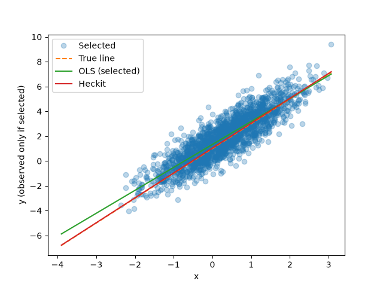
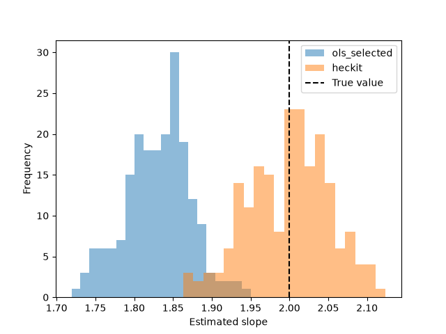

# 第 16 章: 標本選択とヘックマンの 2 段階推定

## 16.1 この章の地図

賃金は、**働いている人だけ**で観測されます。働くかどうかは、賃金に関係する要因（能力ややる気）にも、影響されます。働いている人だけで、賃金の式を OLS 推定すると、**選択された標本**の偏りが入ります（**標本選択バイアス**）。第 15 章のトービットは、「働くかどうか」と「何時間働くか」を、**同じ式**で扱いました。この章の**ヘックマンの 2 段階推定**は、選択の式と結果の式を、分けます。

1. **第 1 段階**: 働くかどうか（選択）を、プロビットで推定する（全標本）
2. **第 2 段階**: 働いている人だけで、賃金を、説明変数と**逆ミルズ比**（第 1 段階から作る補正項）で、回帰する

最後に、実際のデータ（既婚女性の労働参加・労働時間・賃金）で、第 14 章のロジット・プロビット、第 15 章のトービット、この章のヘックマンを使い、**第 4 部の到達チェック**を行います。



| 項目 | 内容 |
| :--- | :--- |
| 計量経済学の題材 | 標本選択バイアス、逆ミルズ比、ヘックマンの 2 段階推定、除外制約、ブートストラップ標準誤差 |
| 使う Python の機能 | pandas の列の結合・復元抽出（`iloc`）、第 14 章のプロビット、`scipy.stats.norm` |
| 新しく導入するライブラリ | なし（実際のデータは `wooldridge`。任意の依存グループ `realdata`） |
| 完成形 | `HeckitFit`、`inverse_mills_ratio`、`heckit_two_step`、`heckit_bootstrap_standard_errors`、`draw_selection_sample`、`selection_bias_experiment` |
| ファイル | 実装: `lib/chapter16/heckit.py`、`lib/chapter16/plot.py`（図）／テスト: `test/chapter16/test_heckit.py`、`test/chapter16/test_plot.py`（自分で書くときは、`practice/chapter16/` に、同じ名前で作ります） |
| データ | 乱数。16.6 節だけ、実際のデータ（`wooldridge` の `mroz`） |

### 計量経済学の式とコードの対応

| 計量経済学 | 式 | コード |
| :--- | :--- | :--- |
| 選択の式 | s = 1（w′γ + v > 0）。w は、x と除外変数 z | `fit_binary(selected, w, "probit")`（第 14 章） |
| 結果の式 | y = x′β + u（s = 1 の人だけで観測） | `draw_selection_sample(...)` |
| 選択された人の誤差の平均 | E[u \| s = 1] = ρ·σ_u·λ(w′γ) | `inverse_mills_ratio(c)` |
| 逆ミルズ比 | λ(c) = φ(c) ÷ Φ(c) | `inverse_mills_ratio(c)` |
| 2 段階推定 | y を x と λ̂ で回帰（選択された人だけ） | `heckit_two_step(df, x_columns, selection_columns)` |

> **記号について**: s は選択の指標（働いていれば 1）、v は選択の式の誤差、u は結果の式の誤差、ρ は u と v の相関、σ_u は u の標準偏差、λ は逆ミルズ比です。第 2 シリーズの λ（収束の速さ）とは別の意味です。一覧は、[記号について](how-to-read.md#symbols) を参照してください。

### 前提とする章

| できること | 章 |
| :--- | :--- |
| プロビット（最尤法） | [第 14 章](14-logit-probit.md) |
| トービット（同じ式で、選択と大きさ） | [第 15 章](15-truncated-tobit.md) |
| 欠落変数バイアス、ブートストラップの考え方 | [第 11 章](11-endogeneity.md)、[第 6 章](06-asymptotics.md) |

## 16.2 準備

```bash
cd apps/econometrics-programming/python
uv sync
uv run pytest test/chapter16
```

```text
22 passed
```

自分でコードを書くときは、`practice/chapter16/` に、完成形と同じ名前（`heckit.py`・`test_heckit.py`）のファイルを作ります。

## 16.3 予想する

選択の式 s* = 0.5 + x + z + v > 0 で、働くかが決まります。結果の式は y = 1 + 2x + u で、y は働く人だけで観測されます。z は、選択にだけ影響します（結果の式には入らない）。u と v の相関 ρ は 0.7 です。

1. 逆ミルズ比 λ(0) = φ(0) ÷ Φ(0) は、いくつですか（φ(0) = 1/√(2π)、Φ(0) = 0.5）
2. 働いている人だけで、y を x で OLS 回帰すると、傾きは、真の値 2 より大きいですか、小さいですか。ρ = 0 なら、どうですか
3. ヘックマンの 2 段階推定は、真の値を復元できますか。逆ミルズ比の係数は、いくつになるはずですか（ヒント: ρ·σ_u、σ_u = 1）
4. 第 2 段階の OLS の標準誤差は、正しいですか

## 16.4 標本選択の考え方

### 標本選択バイアス

働く人（s = 1）は、選択の式の誤差 v が大きい（働きやすい）人です。u と v が正に相関するなら、働く人は、結果の誤差 u も大きい人に偏ります。働いている人の中で、E[u | s = 1] ≠ 0 であり、しかも、**選択のされやすさ**（w′γ）によって変わります。x が、選択のされやすさと相関すると、E[u | x, s = 1] が x と相関するので、OLS が偏ります（欠落変数バイアス。第 11 章）。

### 逆ミルズ比

選択の式の誤差 v が正規分布のとき、E[u | s = 1] = ρ·σ_u·**λ(w′γ)**（λ = φ ÷ Φ）です。λ は、選択のされにくい人（w′γ が小さい）ほど大きく、選ばれにくい人が選ばれたとき、u が大きかったことを表します。**λ を回帰に足せば**、E[u | s = 1] を、コントロールできます。

### 2 段階推定

1. 選択を、プロビットで推定し、各人の w′γ̂ から、λ̂ = λ(w′γ̂) を作る
2. 選択された人だけで、y を x と λ̂ で回帰する。λ̂ の係数は、ρ·σ_u の推定値

### 除外制約

λ(w′γ) は、w′γ の滑らかな関数で、ほぼ線形に近い範囲では、x と、強く相関します。結果の式に入らない、選択の式の変数 **z**（除外変数）がないと、λ̂ と x の識別が弱くなります。除外変数は、操作変数（第 12 章）と、似た役割を持ちます。

### 標準誤差

第 2 段階の OLS の標準誤差は、正しくありません。(1) λ̂ は、第 1 段階の推定値（推定誤差を含む）、(2) 誤差項に、不均一分散が生じる、ためです。解析的な補正式もありますが、この章は、**ブートストラップ**（標本を復元抽出で取り直し、2 段階推定を繰り返して、標準偏差を求める）で求めます。

## 16.5 Red → Green → Refactor

### Red: 逆ミルズ比の手計算

予想 1 です。λ(0) = φ(0) ÷ Φ(0) = (1 ÷ √(2π)) ÷ 0.5 = √(2 ÷ π) ≈ **0.7979** です。λ(1) = φ(1) ÷ Φ(1) = 0.24197 ÷ 0.84134 ≈ 0.2876 です。

```python
import math

import numpy as np
import pandas as pd
import pytest
import statsmodels.api as sm
from scipy import stats

from lib.chapter16.heckit import inverse_mills_ratio
```

```python
def test_逆ミルズ比の手計算() -> None:
    assert inverse_mills_ratio(0.0) == pytest.approx(math.sqrt(2 / math.pi))
    assert inverse_mills_ratio(0.0) == pytest.approx(0.7979, abs=1e-4)
    expected = stats.norm.pdf(1.0) / stats.norm.cdf(1.0)
    assert inverse_mills_ratio(1.0) == pytest.approx(expected)
    assert inverse_mills_ratio(1.0) == pytest.approx(0.2876, abs=1e-4)


def test_逆ミルズ比は常に正で_c_が大きいほど小さい() -> None:
    values = inverse_mills_ratio(np.linspace(-5, 5, 41))
    assert (values > 0).all()
    assert (np.diff(values) < 0).all()


def test_逆ミルズ比は極端に小さい値でも有限で_c_の符号を変えた値に近い() -> None:
    values = inverse_mills_ratio([-38.0, -40.0, -100.0])
    assert np.all(np.isfinite(values))
    assert values == pytest.approx([38.0, 40.0, 100.0], rel=0.01)


def test_cが非常に小さいと逆ミルズ比はcの符号を変えた値に近づく() -> None:
    assert inverse_mills_ratio(-10.0) == pytest.approx(10.098, abs=0.01)
    assert inverse_mills_ratio(5.0) < 1e-5


def test_配列を渡すと配列が返る() -> None:
    assert inverse_mills_ratio([0.0, 1.0]).shape == (2,)
```

### Green: 逆ミルズ比を実装する

```python
def inverse_mills_ratio(c: ArrayLike) -> NDArray[np.float64]:
    """逆ミルズ比 λ(c) = φ(c) ÷ Φ(c)。選択された観測値の、誤差項の平均の補正に使う。"""
    values = np.asarray(c, dtype=float)
    # 対数の差から作る（c が非常に小さくても、0 ÷ 0 にならない）
    result: NDArray[np.float64] = np.exp(
        stats.norm.logpdf(values) - stats.norm.logcdf(values)
    )
    return result
```

```python
from lib.chapter16.heckit import inverse_mills_ratio

print(inverse_mills_ratio([-10, -1, 0, 1, 3]).round(4).tolist())
```

```text
[10.0981, 1.5251, 0.7979, 0.2876, 0.0044]
```

λ(0) = 0.7979、λ(1) = 0.2876 は、手計算と一致します。c が小さい（選ばれにくい）ほど、λ は大きく、c = −10 では、ほぼ −c（10.0981）です。

### 選択のある標本を作る

```python
def draw_selection_sample(
    n: int, correlation: float, rng: np.random.Generator
) -> pd.DataFrame:
    """選択（selected）と、選択された人だけで観測される y の標本。

    選択: 0.5 + x + z + v > 0、結果: y = 1 + 2x + u。z は結果の式に入らない。
    u = correlation·v + √(1 − correlation²)·w（選択と結果の誤差の相関が correlation）。
    """
    x, z, v, w = rng.standard_normal((4, n))
    u = correlation * v + math.sqrt(1 - correlation**2) * w
    selected = (0.5 + x + z + v > 0).astype(float)
    y = np.where(selected == 1, 1 + 2 * x + u, np.nan)
    return pd.DataFrame({"x": x, "z": z, "selected": selected, "y": y})
```

```python
def sample(correlation: float = 0.7, n: int = 5000, seed: int = 0) -> pd.DataFrame:
    return draw_selection_sample(n, correlation, np.random.default_rng(seed))


def test_標本は乱数列から決まる式で作られる() -> None:
    x, z, v, w = np.random.default_rng(11).standard_normal((4, 300))
    u = 0.7 * v + math.sqrt(1 - 0.7**2) * w
    selected = (0.5 + x + z + v > 0).astype(float)
    df = draw_selection_sample(300, 0.7, np.random.default_rng(11))
    assert df["x"].to_numpy() == pytest.approx(x)
    assert df["selected"].to_numpy() == pytest.approx(selected)
    chosen = selected == 1
    assert df["y"].to_numpy()[chosen] == pytest.approx((1 + 2 * x + u)[chosen])


def test_標本の形() -> None:
    df = sample(n=50000)
    assert list(df.columns) == ["x", "z", "selected", "y"]
    assert df["selected"].mean() == pytest.approx(
        stats.norm.cdf(0.5 / 3**0.5), abs=0.01
    )
    assert (df["y"].isna() == (df["selected"] == 0)).all()


def test_選択された人の結果は選択の誤差と相関するときだけ偏る() -> None:
    biased = sample(0.7, 50000)
    independent = sample(0.0, 50000)
    for df, expect_bias in ((biased, True), (independent, False)):
        chosen = df[df["selected"] == 1]
        residual = chosen["y"] - 1 - 2 * chosen["x"]
        assert (abs(residual.mean()) > 0.2) == expect_bias
```

### ヘックマンの 2 段階推定を実装する

```python
@dataclass(frozen=True)
class HeckitFit:
    """2 段階推定の結果。係数の最後の `lambda` は、逆ミルズ比の係数（= ρ·σ_u）。"""

    coefficients: pd.Series
    naive_standard_errors: pd.Series
    selection: BinaryFit
    n_selected: int


def heckit_two_step(
    df: pd.DataFrame, x_columns: list[str], selection_columns: list[str]
) -> HeckitFit:
    """ヘックマンの 2 段階推定。

    第 1 段階: 選択（selected）を、selection_columns でプロビット（全標本）。
    第 2 段階: 選択された観測値だけで、y を、x_columns と逆ミルズ比 λ で回帰する。
    selection_columns には、x_columns に入らない変数（除外制約）を、含める。
    """
    selection = fit_binary(df["selected"], df[selection_columns], "probit")
    index = selection.coefficients.drop("const")
    linear = selection.coefficients["const"] + df[selection_columns] @ index
    chosen = df["selected"] == 1
    mills = pd.Series(inverse_mills_ratio(linear), index=df.index, name="lambda")
    columns = df.loc[chosen, x_columns].join(mills[chosen])
    second = fit_ols(df.loc[chosen, "y"], columns)
    return HeckitFit(
        coefficients=second.coefficients,
        naive_standard_errors=second.standard_errors,
        selection=selection,
        n_selected=int(chosen.sum()),
    )
```

第 1 段階のプロビットは、第 14 章の `fit_binary` です。`statsmodels` の `Probit` と、逆ミルズ比・OLS で作った値と、一致することを、テストで確認します。

```python
def test_2段階推定はstatsmodelsのプロビットとOLSで作った値に一致する() -> None:
    df = sample()
    fit = heckit_two_step(df, ["x"], ["x", "z"])
    probit = sm.Probit(df["selected"], sm.add_constant(df[["x", "z"]])).fit(disp=0)
    linear = probit.params["const"] + df[["x", "z"]] @ probit.params[["x", "z"]]
    chosen = df["selected"] == 1
    columns = df.loc[chosen, ["x"]].assign(
        **{"lambda": inverse_mills_ratio(linear[chosen])}
    )
    reference = fit_ols(df.loc[chosen, "y"], columns)
    assert fit.coefficients.to_numpy() == pytest.approx(
        reference.coefficients.to_numpy()
    )
    assert fit.naive_standard_errors.to_numpy() == pytest.approx(
        reference.standard_errors.to_numpy()
    )
    assert fit.n_selected == int(chosen.sum())
    assert list(fit.coefficients.index) == ["const", "x", "lambda"]


def test_第1段階の選択の係数は真の値に近い() -> None:
    fit = heckit_two_step(sample(), ["x"], ["x", "z"])
    truth = {"const": 0.5, "x": 1.0, "z": 1.0}
    for name, value in truth.items():
        error = fit.selection.standard_errors[name]
        assert abs(fit.selection.coefficients[name] - value) < 4 * error
```

```python
import numpy as np

from lib.chapter03.multiple import fit_ols
from lib.chapter16.heckit import draw_selection_sample, heckit_two_step

df = draw_selection_sample(5000, 0.7, np.random.default_rng(0))
print(round(float(df["selected"].mean()), 4))
chosen = df[df["selected"] == 1]
print(fit_ols(chosen["y"], chosen[["x"]]).coefficients.round(4).to_dict())
fit = heckit_two_step(df, ["x"], ["x", "z"])
print(fit.coefficients.round(4).to_dict(), fit.n_selected)
print(fit.selection.coefficients.round(4).to_dict())
print(fit.naive_standard_errors.round(4).to_dict())
```

```text
0.6174
{'const': 1.3102, 'x': 1.8108}
{'const': 1.0008, 'x': 1.9694, 'lambda': 0.7186} 3087
{'const': 0.4952, 'x': 0.9864, 'z': 1.029}
{'const': 0.0281, 'x': 0.0212, 'lambda': 0.0513}
```

n = 5000 のうち、61.7%（3087 人）が選択されました。**選択された人だけの OLS は、傾き 1.8108、切片 1.3102** で、真の値（2、1）から、偏っています（予想 2）。ヘックマンの 2 段階推定は、**傾き 1.9694、切片 1.0008**、逆ミルズ比の係数 **0.7186**（真の値 ρ·σ_u = 0.7）です（予想 3）。第 1 段階のプロビットも、真の値（0.5、1、1）に近い（0.4952、0.9864、1.029）。

### 標準誤差

第 2 段階の OLS の標準誤差（上の最後の行）は、正しくありません。ブートストラップで、標本を復元抽出し、2 段階推定を 200 回繰り返して、標準偏差を求めます。

```python
def heckit_bootstrap_standard_errors(
    df: pd.DataFrame,
    x_columns: list[str],
    selection_columns: list[str],
    repetitions: int,
    rng: np.random.Generator,
) -> pd.Series:
    """ブートストラップ標準誤差: 全標本から復元抽出して、2 段階推定を繰り返す。

    λ は、第 1 段階の推定値なので、第 2 段階の OLS の標準誤差は、正しくない。
    """
    rows = []
    for _ in range(repetitions):
        sample = df.iloc[rng.integers(0, len(df), len(df))].reset_index(drop=True)
        rows.append(heckit_two_step(sample, x_columns, selection_columns).coefficients)
    return pd.DataFrame(rows).std(ddof=1)
```

```python
def test_選択された標本のOLSは偏りヘックマンは真の値を復元する() -> None:
    df = sample()
    chosen = df[df["selected"] == 1]
    ols = fit_ols(chosen["y"], chosen[["x"]]).coefficients["x"]
    fit = heckit_two_step(df, ["x"], ["x", "z"])
    errors = heckit_bootstrap_standard_errors(
        df, ["x"], ["x", "z"], 200, np.random.default_rng(1)
    )
    assert ols < 1.9
    truth = {"const": 1.0, "x": 2.0, "lambda": 0.7}
    for name, value in truth.items():
        assert abs(fit.coefficients[name] - value) < 4 * errors[name]


def test_ブートストラップ標準誤差は標本標準偏差_n_引く1で割る() -> None:
    df = sample(n=500)
    errors = heckit_bootstrap_standard_errors(
        df, ["x"], ["x", "z"], 2, np.random.default_rng(5)
    )
    rng = np.random.default_rng(5)
    rows = []
    for _ in range(2):
        resampled = df.iloc[rng.integers(0, len(df), len(df))].reset_index(drop=True)
        rows.append(heckit_two_step(resampled, ["x"], ["x", "z"]).coefficients)
    expected = pd.DataFrame(rows).std(ddof=1)
    assert errors.to_numpy() == pytest.approx(expected.to_numpy())


def test_ブートストラップは全標本から復元抽出する(
    monkeypatch: pytest.MonkeyPatch,
) -> None:
    df = sample(n=400)
    seen: list[pd.DataFrame] = []
    original = heckit_two_step

    def spy(
        frame: pd.DataFrame, x_columns: list[str], selection_columns: list[str]
    ) -> HeckitFit:
        seen.append(frame)
        return original(frame, x_columns, selection_columns)

    monkeypatch.setattr("lib.chapter16.heckit.heckit_two_step", spy)
    heckit_bootstrap_standard_errors(df, ["x"], ["x", "z"], 3, np.random.default_rng(0))
    second_half = set(df["x"].iloc[200:])
    assert len(seen) == 3
    for frame in seen:
        assert len(frame) == 400
        assert set(frame["x"]) & second_half


def test_ブートストラップ標準誤差は同じ種なら同じ() -> None:
    df = sample(n=500)
    a = heckit_bootstrap_standard_errors(
        df, ["x"], ["x", "z"], 30, np.random.default_rng(3)
    )
    b = heckit_bootstrap_standard_errors(
        df, ["x"], ["x", "z"], 30, np.random.default_rng(3)
    )
    assert a.tolist() == b.tolist()
    assert list(a.index) == ["const", "x", "lambda"]


def test_ブートストラップ標準誤差は第2段階のOLSの標準誤差と違う() -> None:
    df = sample(n=2000)
    fit = heckit_two_step(df, ["x"], ["x", "z"])
    errors = heckit_bootstrap_standard_errors(
        df, ["x"], ["x", "z"], 100, np.random.default_rng(3)
    )
    assert errors["x"] != pytest.approx(fit.naive_standard_errors["x"], rel=1e-3)


def test_ブートストラップ標準誤差は推定値の実際のばらつきに近い() -> None:
    table = selection_bias_experiment(1000, 0.7, 150, np.random.default_rng(0))
    errors = heckit_bootstrap_standard_errors(
        sample(n=1000), ["x"], ["x", "z"], 150, np.random.default_rng(1)
    )
    assert errors["x"] == pytest.approx(table["heckit"].std(), rel=0.3)
```

```python
from lib.chapter16.heckit import heckit_bootstrap_standard_errors

errors = heckit_bootstrap_standard_errors(df, ["x"], ["x", "z"], 200, np.random.default_rng(1))
print(errors.round(4).to_dict())
```

```text
{'const': 0.0303, 'x': 0.0228, 'lambda': 0.0513}
```

ブートストラップの標準誤差は、x で 0.0228（第 2 段階の OLS では 0.0212）、切片で 0.0303（0.0281）と、少し大きい値です（予想 4: 正しくない。この標本では、差は 1 割程度）。逆ミルズ比の係数の標準誤差は、同じ 0.0513 です。

### 偏りと、ヘックマンの効果を、繰り返しで確かめる

```python
def selection_bias_experiment(
    n: int, correlation: float, repetitions: int, rng: np.random.Generator
) -> pd.DataFrame:
    """選択された標本の OLS と、2 段階推定の x の傾き（真の値 2）を繰り返す。"""
    rows = []
    for _ in range(repetitions):
        df = draw_selection_sample(n, correlation, rng)
        chosen = df[df["selected"] == 1]
        ols = fit_ols(chosen["y"], chosen[["x"]]).coefficients["x"]
        heckit = heckit_two_step(df, ["x"], ["x", "z"]).coefficients["x"]
        rows.append((ols, heckit))
    return pd.DataFrame(rows, columns=["ols_selected", "heckit"])
```

```python
def test_相関があるとOLSは偏りヘックマンは偏らない() -> None:
    table = selection_bias_experiment(1000, 0.7, 200, np.random.default_rng(0))
    se = table.std() / 200**0.5
    assert list(table.columns) == ["ols_selected", "heckit"]
    assert abs(table["heckit"].mean() - 2.0) < 4 * se["heckit"]
    assert table["ols_selected"].mean() < 1.9
    assert abs(table["ols_selected"].mean() - 2.0) > 4 * se["ols_selected"]


def test_相関がなければOLSも偏らない() -> None:
    table = selection_bias_experiment(1000, 0.0, 200, np.random.default_rng(0))
    se = table.std() / 200**0.5
    assert abs(table["ols_selected"].mean() - 2.0) < 4 * se["ols_selected"]
    assert abs(table["heckit"].mean() - 2.0) < 4 * se["heckit"]


def test_相関がなければ選択のバイアスもなくlambdaの係数は0に近い() -> None:
    df = sample(0.0, 20000, seed=2)
    chosen = df[df["selected"] == 1]
    ols = fit_ols(chosen["y"], chosen[["x"]])
    fit = heckit_two_step(df, ["x"], ["x", "z"])
    assert abs(ols.coefficients["x"] - 2.0) < 4 * ols.standard_errors["x"]
    assert abs(fit.coefficients["lambda"]) < 4 * fit.naive_standard_errors["lambda"]
```

```python
from lib.chapter16.heckit import selection_bias_experiment

for correlation in (0.0, 0.7):
    table = selection_bias_experiment(1000, correlation, 200, np.random.default_rng(0))
    print(correlation, table.mean().round(4).to_dict(), table.std().round(4).to_dict())
```

```text
0.0 {'ols_selected': 1.9956, 'heckit': 1.9967} {'ols_selected': 0.0441, 'heckit': 0.0522}
0.7 {'ols_selected': 1.8309, 'heckit': 1.9988} {'ols_selected': 0.0419, 'heckit': 0.0523}
```

列は、推定値の平均と標準偏差です（真の値は 2）。

- **ρ = 0**（選択と結果の誤差が無関係）: OLS（1.9956）も、ヘックマン（1.9967）も、偏りません。**選択があっても、誤差が無関係なら、バイアスは起きません。** OLS のほうが、標準偏差が小さい（0.0441 < 0.0522）ので、効率的です
- **ρ = 0.7**: OLS は **1.8309** と偏り、ヘックマンは **1.9988** で、真の値を復元します。標準偏差は、ヘックマンのほうが、わずかに大きい（0.0523）が、同程度です



### 図

```python
def xs(line: Any) -> list[float]:
    values: Any = line.get_xdata()
    return [float(v) for v in values]


def ys(line: Any) -> list[float]:
    values: Any = line.get_ydata()
    return [float(v) for v in values]


def slope(line: Any) -> float:
    x, y = xs(line), ys(line)
    return (y[1] - y[0]) / (x[1] - x[0])


def test_選択されたデータと3本の直線() -> None:
    df = draw_selection_sample(3000, 0.7, np.random.default_rng(0))
    ax = plot_selection(df).axes[0]
    assert [line.get_label() for line in ax.lines] == [
        "Selected",
        "True line",
        "OLS (selected)",
        "Heckit",
    ]
    chosen = df[df["selected"] == 1]
    assert len(xs(ax.lines[0])) == len(chosen)


def test_直線の傾き() -> None:
    df = draw_selection_sample(3000, 0.7, np.random.default_rng(0))
    ax = plot_selection(df).axes[0]
    chosen = df[df["selected"] == 1]
    assert slope(ax.lines[1]) == pytest.approx(2)
    assert slope(ax.lines[2]) == pytest.approx(
        fit_ols(chosen["y"], chosen[["x"]]).coefficients["x"]
    )
    assert slope(ax.lines[3]) == pytest.approx(
        heckit_two_step(df, ["x"], ["x", "z"]).coefficients["x"]
    )
    assert slope(ax.lines[2]) < slope(ax.lines[3])
```

```python
def plot_selection(df: pd.DataFrame) -> Figure:
    """選択された人のデータと、真の直線、OLS（選択された標本）、ヘックマンの直線を描く。"""
    chosen = df[df["selected"] == 1]
    ends = np.array([float(df["x"].min()), float(df["x"].max())])
    ols = fit_ols(chosen["y"], chosen[["x"]]).coefficients
    heckit = heckit_two_step(df, ["x"], ["x", "z"]).coefficients
    fig, ax = plt.subplots()
    ax.plot(chosen["x"], chosen["y"], "o", alpha=0.3, label="Selected")
    ax.plot(ends, 1 + 2 * ends, "--", label="True line")
    ax.plot(ends, ols["const"] + ols["x"] * ends, label="OLS (selected)")
    ax.plot(ends, heckit["const"] + heckit["x"] * ends, label="Heckit")
    ax.set_xlabel("x")
    ax.set_ylabel("y (observed only if selected)")
    ax.legend()
    plt.close(fig)
    return fig
```

### 実行結果

```bash
uv run pytest test/chapter16
```

```text
22 passed
```

## 16.6 実際のデータで試す（既婚女性の労働参加・労働時間・賃金）

第 4 部の仕上げに、**実際のデータ**で、第 14〜16 章の関数を使います。問いは、「既婚女性の、労働参加・労働時間・賃金は、何に影響されるか」です。

### データを取得する

第 13 章と同じ、`wooldridge` パッケージ（MIT ライセンス）の `mroz` を使います。出典は、T.A. Mroz (1987), Econometrica 55, 765-799 です（第 13 章 13.6 節）。**データの利用条件は、確認していません**。各自で確認し、使うときは、出典を明記してください。

### ファイルの形（実物で確かめたこと）

**753 行、22 列**の、1975 年の既婚女性のデータです。`inlf`（労働力に入っているか）が 1 の人は **428 人**、`hours`（労働時間）が 0 の人は **325 人**です。`wage`・`lwage` は、働いている 428 人だけで観測され、残りの 325 行は欠損です。説明変数は、`nwifeinc`（パッケージの説明では (世帯所得 − 本人の賃金 × 労働時間) ÷ 1000。本人の稼ぎ以外の所得）、`educ`、`exper`、`expersq`、`age`、`kidslt6`（6 歳未満の子の数）、`kidsge6`（6〜18 歳の子の数）です。

### 自分の関数を、実際のデータに使う

次のスクリプトを `practice/chapter16/mroz.py` として保存し、アプリの根で、`uv run --group realdata python -m practice.chapter16.mroz` で実行します。

```python
import numpy as np
import statsmodels.api as sm
import wooldridge

from lib.chapter03.multiple import fit_ols
from lib.chapter14.discrete import (
    average_marginal_effects,
    fit_binary,
    likelihood_ratio_test,
    linear_probability,
)
from lib.chapter15.limited import fit_tobit, tobit_marginal_effects
from lib.chapter16.heckit import (
    heckit_bootstrap_standard_errors,
    heckit_two_step,
)

df = wooldridge.data("mroz")
print(df.shape, int(df["inlf"].sum()), int((df["hours"] == 0).sum()))
columns = ["nwifeinc", "educ", "exper", "expersq", "age", "kidslt6", "kidsge6"]
x = df[columns]

logit = fit_binary(df["inlf"], x, "logit")
probit = fit_binary(df["inlf"], x, "probit")
reference = sm.Logit(df["inlf"], sm.add_constant(x)).fit(disp=0)
print("logit", logit.coefficients.round(4).to_dict())
print("max |logit - statsmodels|", float(np.abs(logit.coefficients - reference.params).max()) < 1e-6)
print("probit", probit.coefficients.round(4).to_dict())
print("log-likelihood", round(logit.log_likelihood, 2), round(probit.log_likelihood, 2))
null = fit_binary(df["inlf"], np.empty((len(df), 0)), "logit")
lr = likelihood_ratio_test(logit.log_likelihood, null.log_likelihood, len(columns))
print("LR", round(lr.statistic, 2), lr.p_value)
print("AME logit", average_marginal_effects(logit, x).round(4).to_dict())
print("AME probit", average_marginal_effects(probit, x).round(4).to_dict())
print("LPM", linear_probability(df["inlf"], x).drop("const").round(4).to_dict())

tobit = fit_tobit(df["hours"], x)
print("tobit", tobit.coefficients.round(2).to_dict())
print("tobit se", tobit.standard_errors.round(2).to_dict())
print("ols hours", fit_ols(df["hours"], x).coefficients.drop("const").round(2).to_dict())
print("tobit ME", tobit_marginal_effects(tobit, x).round(2).to_dict())

wages = df.assign(selected=df["inlf"], y=df["lwage"])
heckit = heckit_two_step(wages, ["educ", "exper", "expersq"], columns)
working = df[df["inlf"] == 1]
ols = fit_ols(np.log(working["wage"]), working[["educ", "exper", "expersq"]])
print("ols wage", ols.coefficients.round(4).to_dict())
print("heckit", heckit.coefficients.round(4).to_dict(), heckit.n_selected)
print("heckit naive se", heckit.naive_standard_errors.round(4).to_dict())
errors = heckit_bootstrap_standard_errors(
    wages, ["educ", "exper", "expersq"], columns, 200, np.random.default_rng(0)
)
print("heckit bootstrap se", errors.round(4).to_dict())
```

```text
(753, 22) 428 325
logit {'const': 0.4255, 'nwifeinc': -0.0213, 'educ': 0.2212, 'exper': 0.2059, 'expersq': -0.0032, 'age': -0.088, 'kidslt6': -1.4434, 'kidsge6': 0.0601}
max |logit - statsmodels| True
probit {'const': 0.2701, 'nwifeinc': -0.012, 'educ': 0.1309, 'exper': 0.1233, 'expersq': -0.0019, 'age': -0.0529, 'kidslt6': -0.8683, 'kidsge6': 0.036}
log-likelihood -401.77 -401.3
LR 226.22 3.159175738673322e-45
AME logit {'nwifeinc': -0.0038, 'educ': 0.0395, 'exper': 0.0368, 'expersq': -0.0006, 'age': -0.0157, 'kidslt6': -0.2578, 'kidsge6': 0.0107}
AME probit {'nwifeinc': -0.0036, 'educ': 0.0394, 'exper': 0.0371, 'expersq': -0.0006, 'age': -0.0159, 'kidslt6': -0.2612, 'kidsge6': 0.0108}
LPM {'nwifeinc': -0.0034, 'educ': 0.038, 'exper': 0.0395, 'expersq': -0.0006, 'age': -0.0161, 'kidslt6': -0.2618, 'kidsge6': 0.013}
tobit {'const': 965.31, 'nwifeinc': -8.81, 'educ': 80.65, 'exper': 131.56, 'expersq': -1.86, 'age': -54.41, 'kidslt6': -894.02, 'kidsge6': -16.22, 'sigma': 1122.02}
tobit se {'const': 446.44, 'nwifeinc': 4.46, 'educ': 21.58, 'exper': 17.28, 'expersq': 0.54, 'age': 7.42, 'kidslt6': 111.88, 'kidsge6': 38.64, 'sigma': 41.58}
ols hours {'nwifeinc': -3.45, 'educ': 28.76, 'exper': 65.67, 'expersq': -0.7, 'age': -30.51, 'kidslt6': -442.09, 'kidsge6': -32.78}
tobit ME {'nwifeinc': -5.19, 'educ': 47.47, 'exper': 77.45, 'expersq': -1.1, 'age': -32.03, 'kidslt6': -526.28, 'kidsge6': -9.55}
ols wage {'const': -0.522, 'educ': 0.1075, 'exper': 0.0416, 'expersq': -0.0008}
heckit {'const': -0.5781, 'educ': 0.1091, 'exper': 0.0439, 'expersq': -0.0009, 'lambda': 0.0323} 428
heckit naive se {'const': 0.3067, 'educ': 0.0156, 'exper': 0.0164, 'expersq': 0.0004, 'lambda': 0.1344}
heckit bootstrap se {'const': 0.2869, 'educ': 0.0137, 'exper': 0.0154, 'expersq': 0.0004, 'lambda': 0.1654}
```

読み方です。

**労働参加（ロジット・プロビット）**

- 自分で書いたロジットは、`statsmodels` の `Logit` と、係数が 10⁻⁶ 以内で一致します（2 行目）
- **6 歳未満の子（`kidslt6`）が 1 人増えると、働く確率は、平均して約 26 ポイント下がります**（平均限界効果 −0.2578〜−0.2618）。教育が 1 年増えると、約 4 ポイント（0.0395）、年齢が 1 歳上がると、約 1.6 ポイント下がります（−0.0157）
- ロジットとプロビットの平均限界効果は、ほぼ同じで（0.0395 と 0.0394、−0.2578 と −0.2612）、線形確率モデルの係数とも近い（0.038、−0.2618）。**第 14 章の結論**どおりです
- 尤度比検定は、LR = 226.22、p 値 3 × 10⁻⁴⁵ で、7 つの説明変数が、すべて 0 という仮説を、強く棄却します

**労働時間（トービット）**

- 労働時間 0 は 325 人で、**打ち切り**です。トービットの教育の係数は 80.65（標準誤差 21.58）で、教育が 1 年増えると、**潜在的な**労働時間が、約 81 時間増えます
- OLS の係数は 28.76 と、小さい。**6 歳未満の子**は、トービット −894 に対し、OLS −442 と、約半分です。**打ち切りを無視した OLS は、効果を、小さく見積もります**（第 15 章）
- 打ち切りを含む労働時間の期待値への、平均限界効果は、教育で 47.47 時間、6 歳未満の子で −526 時間です（潜在変数への効果 80.65、−894 の、約 59% で、これは、働いている人の割合に近い値です）
- **標準誤差は、第 15 章の落とし穴（数値微分の精度）を直したあとの値**です。最初の実装は、収束が足りず、係数（切片 1278 対 965）も標準誤差も、正しくありませんでした

**賃金（ヘックマン）**

- 教育の係数は、OLS（働いている人だけ）0.1075、ヘックマン **0.1091** で、ほとんど変わりません。逆ミルズ比の係数は **0.0323**（ブートストラップ標準誤差 0.1654）で、**0 と区別できません**（t 値 0.2）。ただし、「0 と区別できない」ことは、「選択のバイアスがない」ことを意味しません。標準誤差が大きい（0.1654）ので、**この標本では、選択のバイアスを検出できない**だけです（検出力が低い可能性があります）。教育の係数が、OLS と、ほとんど変わらないことは、バイアスが小さいことと整合しますが、証明はしません。
- 除外変数（`nwifeinc`・`age`・`kidslt6`・`kidsge6`）が、賃金の式に影響しないという仮定が成り立たないと、逆ミルズ比の係数の解釈も崩れます
- 第 2 段階の OLS の標準誤差（0.0156）と、ブートストラップ（0.0137）は、少し違います（教育）。逆ミルズ比の係数では、ブートストラップ 0.1654 が、OLS の 0.1344 より、大きくなっています

> **ここで言えること、言えないこと。** トービットは、「働くか」と「何時間か」が、同じ式で決まると仮定します。6 歳未満の子の限界効果（−526 時間）は、働くかどうか（確率が 26 ポイント下がる）と、働く場合の時間の、両方の合計です。この 2 つを、分けて知りたいときは、選択の式と、時間の式を分ける（ヘックマンのような）モデルを使います。また、ヘックマンの結果は、除外変数（`nwifeinc`・`age`・`kidslt6`・`kidsge6`）が、賃金の式に影響しない、という仮定に依存します。**自作の、トービットとヘックマンの結果は、外部のソフトウェアで照合できていません**（`py4etrics` は、この環境の `statsmodels` で動かない。第 14 章の調査）。勾配が 0 であること、打ち切りがなければ OLS と一致すること、シミュレーションで真の値を復元することを、代わりの検証にしました。

## 16.7 規則で言うと

1. **選択された標本の OLS は、選択が結果の誤差と相関すると、偏る。** 無関係なら、選択があっても、偏らない
2. **ヘックマンは、選択の式から作った補正項で、バイアスを直す。** 除外変数（選択にだけ影響する変数）が、識別に必要
3. **第 2 段階の標準誤差は、そのままでは使えない。** ブートストラップで求める。逆ミルズ比の係数が 0 と区別できないときは、**選択のバイアスを検出できない**（バイアスがない、ではない。標準誤差が大きいと、バイアスがあっても、検出できない）

混同しやすい点を、表にまとめます。

| 混同しやすい点 | 違い |
| :--- | :--- |
| ヘックマン と トービット | トービットは、選択と大きさが、同じ式（同じ係数）。ヘックマンは、選択の式と結果の式が、別（別の係数と、誤差の相関を許す） |
| 標本選択 と 打ち切り | 標本選択: 選ばれない人の、結果が観測できない（x は観測できる場合が多い）。打ち切り: 結果が、下限として観測される |
| 逆ミルズ比の係数 と 選択の効果 | 逆ミルズ比の係数は ρ·σ_u（選択と結果の誤差の相関）で、選択の式の係数とは別。0 なら、選択のバイアスはない |

### この方法が成り立たない場面

- **誤差項の、同時正規分布を仮定します。** 正規でないと、ヘックマンは、一致性を失います（OLS より悪くなることもある）
- **除外変数が、結果の式に影響しない、という仮定は、検定できません。** 選択の式と結果の式に、同じ変数しかないと、逆ミルズ比の非線形性だけに頼ることになり、不安定です
- **標準誤差を、ブートストラップで求めるには、標本が十分に大きい必要があります。** 選択された人が少ない（まれ）と、2 段階推定が、不安定になります

## 16.8 第 4 部の到達チェック

第 4 部（第 14〜16 章）の終わりです。何も見ずに、できるかどうかを、自分で確かめます。

### できること

| できること | 検証の方法 | 戻る章 |
| :--- | :--- | :--- |
| ロジット・プロビットを、最尤法（ニュートン法）で推定する | 割合 0.75 の定数項だけで、ロジット ln 3 ≈ 1.0986、プロビット Φ⁻¹(0.75) ≈ 0.6745。2 × 2 の表で、傾き ln 9。`statsmodels` と一致する | 第 14 章 |
| 係数と限界効果を区別して読む | 平均限界効果は、ロジット・プロビット・線形確率モデルで、ほぼ同じ | 第 14 章 |
| トービットと切断回帰の対数尤度を書く | x = 0、1、β = (0.5, 1)、σ = 1 で、トービット −2.2199、切断回帰 −1.6498。打ち切りがなければ OLS と一致する | 第 15 章 |
| 打ち切りと切断で、OLS が偏ることを再現する | 打ち切りの OLS の傾き 1.2796（真の値 2）。トービットは 2.0056 | 第 15 章 |
| 最尤法の実装を、検証する | 勾配を数値微分と比べる。単位を変えても結果が同じ | 第 15 章 |
| ヘックマンの 2 段階推定を書く | λ(0) ≈ 0.7979。ρ = 0.7 で、OLS 1.8309、ヘックマン 1.9988 | 第 16 章 |
| 実際のデータで、結果を読み、限界を書く | 6 歳未満の子で、働く確率 −26 ポイント。逆ミルズ比の係数が 0 と区別できないことを、書く | 第 16 章（16.6 節） |

### 時間を決めて書く課題

何も見ずに、時間を計って、関数とテストを書きます。

| 課題 | 目安の時間 |
| :--- | :--- |
| ロジットの最尤推定（ニュートン法）と、定数項だけ・2 × 2 の表での、手計算のテスト | 25 分 |
| トービットの対数尤度と、手計算（−2.2199）のテスト。打ち切りがなければ OLS と一致するテスト | 25 分 |
| 逆ミルズ比と、ヘックマンの 2 段階推定。ρ = 0 と 0.7 で、OLS のバイアスを比べるシミュレーション | 30 分 |

### 誤りの原因の分類

できなかったときは、原因を分類して、戻る章に戻ります。

| 原因 | 例（第 4 部） | 対策 |
| :--- | :--- | :--- |
| 知らない | 対数オッズ。打ち切りと切断の違い。逆ミルズ比 | 第 14〜16 章に戻る |
| 見抜けない | 勾配の式の誤り。スケールによる収束の失敗。完全分離 | 第 14・15 章の「成り立たない場面」と、テストの工夫を読む |
| 混同した | 係数と限界効果。トービットとヘックマン。ロジットとプロビットの係数の大きさ | 各章の「混同しやすい点」の表を読む |
| 手順の誤り | 数値微分で最適化し、収束を確かめない。第 2 段階の標準誤差を、そのまま使う | 手計算・恒等式・単位変更のテストを、先に書く |

## 16.9 練習問題

| 種類 | 問題 |
| :--- | :--- |
| 想起 | 本文を閉じて、逆ミルズ比 λ(0) = √(2 ÷ π) のテストを書いてください |
| 生成 | 解説を見る前に、選択された人の、結果の誤差の平均 E[u \| s = 1] = ρ·σ_u·λ(c) を返す `expected_error_given_selection(rho, sigma_u, c)` を、テストから書いてください。ρ = 0.7、σ_u = 1、c = 0 では、いくつですか |
| 多様 | 選択と結果の誤差の相関を 0.7 から −0.7 に変えると、選択された標本の OLS の傾きは、真の値 2 より大きくなりますか、小さくなりますか。先に予想してから、`selection_bias_experiment` で確かめてください |
| 交互 | [第 14 章](14-logit-probit.md)の `fit_binary` の結果（`fit.selection`）で、除外変数 z の係数が、選択の式で有意か（係数 ÷ 標準誤差）を確かめてください。除外変数は、強い必要がありますか |

??? note "解答（先に自分で取り組んでから、開いてください）"

    **想起**:

    ```python
    def test_逆ミルズ比の0での値() -> None:
        assert inverse_mills_ratio(0.0) == pytest.approx(math.sqrt(2 / math.pi))
    ```

    **生成**: 0.7 × 1 × 0.7979 ≈ 0.5585 です。

    ```python
    def expected_error_given_selection(rho, sigma_u, c):
        return rho * sigma_u * float(inverse_mills_ratio(c))
    ```

    ```python
    def test_選択された人の誤差の平均() -> None:
        assert expected_error_given_selection(0.7, 1.0, 0.0) == pytest.approx(0.5585, abs=1e-4)
        assert expected_error_given_selection(0.0, 1.0, 0.0) == 0
    ```

    **多様**: 相関が負だと、選択のバイアスの向きが、逆になります。OLS の傾きは、真の値 2 より**大きく**なります（相関 0.7 で、2 − 0.17 だったので、相関 −0.7 では、2 + 0.17 程度）。ヘックマンは、どちらでも 2 に近いままです。

    ```python
    def test_相関が負ならOLSは真の値より大きくなる() -> None:
        table = selection_bias_experiment(1000, -0.7, 100, np.random.default_rng(0))
        assert table["ols_selected"].mean() > 2.1
        assert table["heckit"].mean() == pytest.approx(2.0, abs=0.1)
    ```

    **交互**: z の係数は 1.029 で、標準誤差は約 0.05 なので、t 値は 20 以上です。除外変数は、選択の式で強く効く必要があります（弱いと、逆ミルズ比と x が、強く相関して、識別が弱くなる）。

    ```python
    def test_除外変数の係数は選択の式で有意() -> None:
        df = draw_selection_sample(5000, 0.7, np.random.default_rng(0))
        fit = heckit_two_step(df, ["x"], ["x", "z"])
        assert fit.selection.coefficients["z"] / fit.selection.standard_errors["z"] > 10
    ```

## 16.10 振り返り

- 予想した 4 つは、当たりましたか。選択があっても、OLS が偏らない場合を、説明できますか
- 第 4 部の、3 つのモデル（ロジット・トービット・ヘックマン）を、問いに応じて、使い分けられますか
- 実際のデータの結果で、「言えること」と「言えないこと」を、書き分けられますか

## 16.11 まとめ

- 逆ミルズ比（λ(0) = 0.7979）と、ヘックマンの 2 段階推定を書いた。選択された標本の OLS は、ρ = 0.7 で 1.8309 と偏り、ヘックマンは 1.9988 で復元する。ρ = 0 なら、OLS も偏らない。第 2 段階の標準誤差は、ブートストラップで求める
- 実際のデータ（既婚女性 753 人）で、6 歳未満の子が 1 人増えると、働く確率が約 26 ポイント下がる（ロジット・プロビット・線形確率モデルで、ほぼ同じ）。トービットの教育の係数は 80.65 時間（OLS は 28.76）。ヘックマンの逆ミルズ比の係数は 0.0323（標準誤差 0.1654）で、0 と区別できず、賃金の式の選択のバイアスは、この標本では検出できない（ないとは言えない）
- 実際のデータが、最尤法の実装の不具合（数値微分による、収束不足と標準誤差の誤り）を、明らかにした。単位を変えても結果が同じ、というテストを、第 15 章に足した
- 第 4 部の到達チェックを行った。これで、全 16 章が完成した。ここまでの章で、推定量を自分で書き、真の値を知るデータと、恒等式で確かめる方法を、学んだ
