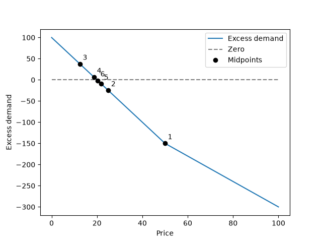

# 第 6 章: モジュール・エラー・アルゴリズム

## 6.1 この章の地図

この章では、第 1〜5 章で作った関数を、モジュールとして組み合わせます。そして、エラーの扱い方と、二分法というアルゴリズムを学びます。最後に、第 1 部の到達チェックを行います。

| 項目 | 内容 |
| :--- | :--- |
| 経済学の題材 | 均衡価格を求める（マインドマップ [5-3](<../経済学・経済政策 トピック別マインドマップ.md#t3>)） |
| 使う Python の機能 | `import`、モジュールとパッケージ、例外（`raise`・独自の例外）、クロージャ（`nonlocal`）、アルゴリズム |
| 完成形 | `make_excess_demand`、`find_equilibrium_price`、`NoEquilibriumError` |
| ファイル | 実装: `lib/chapter06/bisection.py`、`lib/chapter06/plot.py`（二分法の図）／テスト: `test/chapter06/test_bisection.py`、`test/chapter06/test_plot.py`（自分で書くときは、`practice/chapter06/` に、同じ名前で作ります） |

### 経済学の式とコードの対応

| 経済学 | 意味 | コード |
| :--- | :--- | :--- |
| 超過需要 = 需要量 − 供給量 | 価格を決めると値が決まる関数 | `make_excess_demand(...)` が返す関数 |
| 均衡価格 | 超過需要が 0 になる価格 | `find_equilibrium_price(...)` |
| 超過需要は価格の減少関数 | 価格が低いと正、高いと負 | 区間の両端で符号が逆になる |

第 3 章では、価格の表（0・10・20・30）にある価格の中からしか、均衡を見つけられませんでした。第 5 章の調整は、調整の速さ k を間違えると収束しませんでした。この章の二分法は、均衡が含まれる区間さえ指定すれば、必ず見つかります。

## 6.2 予想する

超過需要が、価格 0 で +100、価格 100 で −300 のとき、均衡価格は 0 と 100 の間にあるでしょうか。

- 区間 [0, 100] の真ん中、価格 50 の超過需要が負なら、均衡は [0, 50] と [50, 100] のどちらにありますか
- 区間を半分にする操作を繰り返すと、区間の幅は何回で 1 未満になりますか

答えは、符号が逆なので、間に必ずあります（超過需要は連続だからです）。真ん中の価格が負なら、[0, 50] にあります。幅は 100 → 50 → 25 → 12.5 → 6.25 → 3.125 → 1.5625 → 0.78 で、7 回です。

## 6.3 モジュール・エラー・アルゴリズム

### モジュールとパッケージ

Python のファイル 1 つが、モジュールです。他のモジュールの関数は、`import` で使います。

```python
from lib.chapter01.demand import quantity_demanded
from lib.chapter03.schedule import quantity_supplied
```

`lib.chapter01.demand` は、`lib` ディレクトリの中の `chapter01` ディレクトリの中の `demand.py` を指します。ディレクトリのまとまりを、パッケージと呼びます。

第 1 章の需要関数と第 3 章の供給関数を、この章で再利用します。同じ式を何度も書かずに済み、式を直すときも 1 か所で済みます。

### エラーと例外

エラーが起きると、Python は例外を発生させます。例外を処理しないと、プログラムは止まります。

```python
quantity_demanded(price=-1, intercept=100, slope=2)
# ValueError: 価格は 0 以上でなければならない
```

自分で例外を発生させるのが `raise` です。例外を受け取って処理するのが `try` / `except` です。

```python
try:
    quantity_demanded(price=-1, intercept=100, slope=2)
except ValueError as error:
    print(error)    # 価格は 0 以上でなければならない
```

### 独自の例外

「均衡が見つからない」という経済学の意味を持つ例外は、`ValueError` から派生させて名前を付けます。

```python
class NoEquilibriumError(ValueError):
    """均衡が見つからない（存在しない）ときの例外。"""
```

`ValueError` の一種なので、`except ValueError` でも受け取れますが、`except NoEquilibriumError` と書けば、この場面だけを狙って処理できます。この例外は、二分法だけでなく、第 7 章の `equilibrium` と第 9 章の連立方程式も、均衡がない市場で使います（第 7 章の 7.4 節で説明します）。

### アルゴリズム: 二分法

均衡が含まれる区間を、半分ずつに絞っていく方法です。真ん中の点で超過需要を調べ、符号が変わる側の半分を残します。

| 回 | 区間 | 真ん中の価格 | 超過需要 | 残す区間 |
| ---: | :--- | ---: | ---: | :--- |
| 1 | [0, 100] | 50 | −150 | [0, 50] |
| 2 | [0, 50] | 25 | −25 | [0, 25] |
| 3 | [0, 25] | 12.5 | 37.5 | [12.5, 25] |
| 4 | [12.5, 25] | 18.75 | 6.25 | [18.75, 25] |
| 5 | [18.75, 25] | 21.875 | −9.375 | [18.75, 21.875] |

このように区間が縮み、均衡の 20 を含んだまま狭まります。幅が 1 回ごとに半分になるので、幅 100 を 1e-9 未満にするのに、37 回かかります（36 回では、約 1.46e-9 で、まだ足りません）。

## 6.4 プログラミング

### 超過需要の関数を作る

価格を受け取り、超過需要を返す関数を、関数として返す関数が、`make_excess_demand` です。

```python
def test_超過需要の関数は需要量から供給量を引く() -> None:
    excess = make_excess_demand(
        demand_intercept=100, demand_slope=2, supply_intercept=0, supply_slope=3
    )
    assert excess(10) == 50
```

```python
def make_excess_demand(
    demand_intercept: float,
    demand_slope: float,
    supply_intercept: float,
    supply_slope: float,
) -> Callable[[float], float]:
    """価格を受け取り超過需要（需要量 - 供給量）を返す関数を作る。"""

    def excess_demand(price: float) -> float:
        demand = quantity_demanded(price, demand_intercept, demand_slope)
        supply = quantity_supplied(price, supply_intercept, supply_slope)
        return demand - supply

    return excess_demand
```

内側の関数 `excess_demand` は、外側の引数（切片と傾き）を覚えています。このような仕組みを、クロージャと呼びます。第 5 章で関数を引数に渡したのと同じく、関数を値として扱う例です。

二分法の動きを、図にします。超過需要の曲線が 0 になる価格を、区間を半分ずつに絞って探します。



図の読み方:

- 青い線が、超過需要（需要量 − 供給量）です。価格が上がると下がり、価格 20 で 0 になります
- 黒い点の番号が、中点を調べる順番です。区間 [0, 100] の中点 50（1 番）は、超過需要が負なので、均衡は左にあります。次は 25（2 番）、12.5（3 番、正なので右へ）、18.75（4 番）、21.875（5 番）、20.3125（6 番）と、0 の線の近くに集まります
- 毎回、符号が変わる側の半分を残すので、6 回で区間の幅は 100 ÷ 64 ≈ 1.6 になります
- 価格 50 で線の傾きが変わるのは、需要量が 0 で頭打ちになる（負にならない）ためです

この図は、`lib/chapter06/plot.py` の `plot_bisection` が描きます。

### 二分法のテスト

```python
def test_二分法で均衡価格20を求める() -> None:
    excess = make_excess_demand(
        demand_intercept=100, demand_slope=2, supply_intercept=0, supply_slope=3
    )
    assert find_equilibrium_price(excess, low=0, high=100) == pytest.approx(20)


def test_表にない価格の均衡も求められる() -> None:
    # 100 - 2P = 10 + 3P のとき P = 18。第 3 章の表（0, 10, 20, 30）には載っていない
    excess = make_excess_demand(
        demand_intercept=100, demand_slope=2, supply_intercept=10, supply_slope=3
    )
    assert find_equilibrium_price(excess, low=0, high=100) == pytest.approx(18)
```

### 二分法の実装

```python
def find_equilibrium_price(
    excess_demand: Callable[[float], float],
    low: float,
    high: float,
    tolerance: float = 1e-9,
    max_iterations: int = 100,
) -> float:
    """区間 [low, high] を半分ずつに絞り、超過需要が 0 になる価格を返す。

    区間の幅が tolerance 未満になる前に、max_iterations 回の反復に達したときは、
    収束していない値を返さず、RuntimeError にする。
    """
    if low >= high:
        raise ValueError("下限は上限より小さくなければならない")
    excess_low = excess_demand(low)
    if excess_low * excess_demand(high) > 0:
        raise NoEquilibriumError(
            "区間の両端で超過需要の符号が同じなので均衡が見つからない"
        )
    for _ in range(max_iterations):
        if high - low < tolerance:
            break
        middle = (low + high) / 2
        excess_middle = excess_demand(middle)
        if excess_low * excess_middle <= 0:
            high = middle
        else:
            low, excess_low = middle, excess_middle
    if high - low >= tolerance:
        raise RuntimeError("区間が縮まらなかった。max_iterations を増やす")
    return (low + high) / 2
```

2 つの数をかけて負（または 0）なら、符号が逆（または片方が 0）なので、その間に均衡があります。実際に動かすと、均衡が 20 のとき 20.00000000007276、18 のとき 17.999999999665306 を返し、どちらも許容誤差 1e-9 の範囲に収まっています。

超過需要は、反復 1 回につき 1 回だけ計算します。下端の値 `excess_low` を覚えておき、区間の下端を動かしたときだけ更新するので、同じ価格の超過需要を、何度も計算しません。第 14 章では、1 回の評価ごとに IS-LM の連立方程式を解くので、この差は、そのまま計算時間の差になります。

### 収束しないときの扱い

反復の上限（`max_iterations`）までに、区間が縮まらなかったとき、収束していない値を返してはいけません。第 5 章の調整過程と同じように、`RuntimeError` にします。「入力が不正」は `ValueError`、「計算が収束しない」は `RuntimeError` と使い分けます。

```python
def test_反復の上限までに区間が縮まらなければ例外になる() -> None:
    excess = make_excess_demand(
        demand_intercept=100, demand_slope=2, supply_intercept=0, supply_slope=3
    )
    with pytest.raises(RuntimeError):
        find_equilibrium_price(excess, low=0, high=100, max_iterations=1)


def test_区間の幅を1e_9未満にするには37回の反復が必要() -> None:
    # 幅 100 を半分ずつにすると、36 回で約 1.46e-9、37 回で約 7.3e-10
    excess = make_excess_demand(
        demand_intercept=100, demand_slope=2, supply_intercept=0, supply_slope=3
    )
    assert find_equilibrium_price(
        excess, low=0, high=100, max_iterations=37
    ) == pytest.approx(20)
    with pytest.raises(RuntimeError):
        find_equilibrium_price(excess, low=0, high=100, max_iterations=36)
```

1 つ目は、上限が 1 回では、区間が縮まらないので例外になることを、2 つ目は、ちょうど 37 回で収束し、36 回では足りないという境目を、確かめます。

```python
def test_超過需要の評価は1回の反復につき1回だけ() -> None:
    inner = make_excess_demand(
        demand_intercept=100, demand_slope=2, supply_intercept=0, supply_slope=3
    )
    calls = 0

    def counting(price: float) -> float:
        nonlocal calls
        calls += 1
        return inner(price)

    find_equilibrium_price(counting, low=0, high=100)
    # 両端の符号の確認で 2 回、反復 37 回で 37 回
    assert calls == 2 + 37
```

超過需要の関数を、呼び出した回数を数える関数で包んで、評価の回数も、テストで固定します（両端の確認で 2 回、反復で 37 回）。

`def counting` の中の `nonlocal calls` は、外側の関数の変数 `calls` を、内側の関数から書き換える、という宣言です。`nonlocal` がないと、`calls += 1` は、内側だけの新しい変数を作ろうとして、エラー（`UnboundLocalError`）になります。

端点がちょうど均衡のときも、テストで確かめています。

```python
def test_区間の下端がちょうど均衡ならその価格を返す() -> None:
    excess = make_excess_demand(
        demand_intercept=100, demand_slope=2, supply_intercept=0, supply_slope=3
    )
    assert find_equilibrium_price(excess, low=20, high=100) == pytest.approx(20)
```

### エラーの扱いをテストで決める

均衡が区間に含まれないときと、区間の指定が不正なときを、テストで決めます。

```python
def test_区間の両端で超過需要の符号が同じなら均衡は見つからない() -> None:
    excess = make_excess_demand(
        demand_intercept=100, demand_slope=2, supply_intercept=0, supply_slope=3
    )
    with pytest.raises(NoEquilibriumError):
        find_equilibrium_price(excess, low=30, high=100)


def test_均衡が見つからない例外は値の誤りの一種() -> None:
    assert issubclass(NoEquilibriumError, ValueError)


def test_下限が上限以上なら区間として成り立たない() -> None:
    excess = make_excess_demand(
        demand_intercept=100, demand_slope=2, supply_intercept=0, supply_slope=3
    )
    with pytest.raises(ValueError):
        find_equilibrium_price(excess, low=50, high=10)
```

区間 [30, 100] は、どちらの端も超過需要が負（−50 と −300）です。このとき、間に均衡があるかどうかは、この方法では判断できないので、例外にします。

### 実行結果

```bash
cd apps/economics-programming/python
uv run pytest test/chapter06
```

```text
17 passed
```

## 6.5 規則で言うと

1. **ファイルを分けて、`import` で再利用する。** 同じ式は、1 か所にだけ書く
2. **起きてはいけない入力は、意味の分かる例外にする。** 経済学の意味を持つ場面（均衡が見つからない）は、独自の例外にする。計算が収束しないときは、値を返さず `RuntimeError` にする
3. **アルゴリズムは、「何を保ったまま、何を縮めるか」で理解する。** 二分法では、「均衡を含む」ことを保ったまま、区間を半分にする

混同しやすい点を、表にまとめます。

| 混同しやすい点 | 違い |
| :--- | :--- |
| 第 3 章の表 / 第 5 章の調整 / 二分法 | 表は表にある価格だけ。調整は k を間違えると収束しない。二分法は、均衡を含む区間があれば必ず見つかる |
| 例外を `raise` する / `except` で受け取る | `raise` は「問題を知らせる」側、`except` は「問題に対処する」側 |

### このモデルが成り立たない場面

二分法は、区間の両端で超過需要の符号が逆のときだけ使えます。均衡が複数あるモデル（需要や供給が複雑な形のとき）では、区間に均衡が 2 つ以上含まれ、どの均衡が見つかるかは、区間の取り方で決まります。また、超過需要が途中でとびとびになる場合は、符号が変わっても 0 になる点がないことがあります。

## 6.6 練習問題

| 種類 | 問題 |
| :--- | :--- |
| 想起 | 本文を閉じて、`find_equilibrium_price` を自分で書いてください |
| 生成 | 解説を見る前に、二分法が何回で終わるかを数える関数を、テストから書いてください（区間の幅 100、許容誤差 1 のとき、幅が 1 未満になる回数を、手計算してから、テストにします） |
| 多様 | 需要を Q = 150 − 2P、供給を Q = 20 + 3P に変えて、均衡価格を手計算し、テストで確かめてください |
| 交互 | 第 5 章のワルラス調整と二分法で、同じ均衡を求め、答えと、かかった回数を比べてください。ただし、止める条件が違います。ワルラス調整は超過需要が 1e-6 未満、二分法は区間の幅が 1e-9 未満なので、回数の単純な比較には注意してください |

??? note "解答（先に自分で取り組んでから、開いてください）"

    **想起**: 本文と見比べて、次の 3 点を確かめます。

    - 区間の両端の符号が同じとき、`NoEquilibriumError` を出しているか
    - 区間の下端を覚えて、超過需要を反復 1 回につき 1 回だけ評価しているか
    - 反復の上限までに縮まらないとき、`RuntimeError` にしているか

    **生成**: 幅が 1 回ごとに半分になるので、「半分にして、許容誤差未満になるまでの回数」を数えます。

    ```python
    def count_iterations(width: float, tolerance: float) -> int:
        count = 0
        while width >= tolerance:
            width /= 2
            count += 1
        return count
    ```

    ```python
    def test_幅100を1未満にするには7回() -> None:
        # 100 → 50 → 25 → 12.5 → 6.25 → 3.125 → 1.5625 → 0.78125
        assert count_iterations(100, 1) == 7


    def test_幅100を1e_9未満にするには37回() -> None:
        assert count_iterations(100, 1e-9) == 37
    ```

    `while` は、条件が成り立つ間、繰り返します。`math.ceil(math.log2(幅 ÷ 許容誤差))` でも、7 と 37 になります（幅 ÷ 許容誤差が、ちょうど 2 のべき乗になる場合を除きます）。

    **多様**: 150 − 2P = 20 + 3P から、5P = 130 で、P = 26 です（そのときの数量は 98）。

    ```python
    def test_需要が150_2Pで供給が20_3Pのときの均衡価格は26() -> None:
        excess = make_excess_demand(
            demand_intercept=150, demand_slope=2, supply_intercept=20, supply_slope=3
        )
        assert find_equilibrium_price(excess, low=0, high=100) == pytest.approx(26)
    ```

    **交互**:

    | 方法 | 答え | 回数 | 止める条件 |
    | :--- | ---: | ---: | :--- |
    | ワルラス調整（k = 0.1） | 19.999999850988388 | 27 回 | 超過需要が 1e-6 未満 |
    | 二分法 | 20.00000000007276 | 37 回 | 区間の幅が 1e-9 未満 |

    どちらも 20 に近づきます。回数が違うのは、止める条件の厳しさが違うためで、二分法が遅いとは言えません。二分法は、区間が必ず半分になるので、回数が事前に分かり（37 回）、調整の速さ k を選ぶ必要もありません。

## 6.7 振り返り

- 二分法の回数の予想は当たりましたか
- 例外を使ったとき、使わずに値（`None` など）を返す方法と比べて、何が違いましたか
- 第 3 章の方法に戻って、また使いたい場面はありますか

## 6.8 第 1 部の到達チェック

第 1 部（第 1〜6 章）で、何も見ずにできるようになったかを、確かめてください。

| できること | 検証の方法 | できた |
| :--- | :--- | :--- |
| 需要曲線・弾力性・費用関数を関数にし、テストで確かめる | 自作の関数が、各章のテストを通る | □ |
| 辞書で需要表を作り、超過需要を求める | 手計算の表と、結果が一致する | □ |
| 均衡価格を、調整と二分法の 2 通りで求める | 2 つの答えが 20 に近い値になる | □ |

### 時間を決めて書く課題

何も見ずに、時間を計って、次を書いてください。

1. 需要曲線 Q = 120 − 2P と供給曲線 Q = 20 + 3P の、超過需要の関数を作る（10 分）
2. 二分法で均衡価格を求め、20 になることを確かめるテストを書く（15 分）

詰まった所は、その章に戻ってください。

### 誤りの原因の分類

テストが通らなかったときは、原因を次のように分けると、戻る先が分かります。

| 原因 | 例 | 戻る章 |
| :--- | :--- | :--- |
| 知らない | `pytest.approx` の使い方が分からない | 第 2 章 |
| 見抜けない | 辞書で表すのか、関数で表すのか決められない | 第 3・4 章 |
| 混同した | ワルラス調整とマーシャル調整を取り違えた | 第 5 章 |
| 手順の誤り | 繰り返しの終わりの条件を書き忘れた | 第 5・6 章 |

## 6.9 まとめ

- モジュールの `import`、例外の `raise` と `try` / `except`、独自の例外を学んだ
- 二分法で、表にない均衡価格を求めた（18 → 17.999999999665306）
- 第 1 部で、経済モデルを関数にして、テストで確かめる型を身につけた

次の第 2 部では、matplotlib で需要曲線・供給曲線を描き、乱数でシミュレーションを行います。
