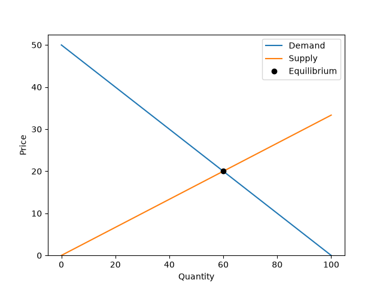

# 第 7 章: Matplotlib による図示

## 7.1 この章の地図

第 2 部の最初の章です。これまで数値で確かめてきた需要曲線と供給曲線を、図として描きます。さらに、余剰と課税の効果を、計算と図の両方で確かめます。

| 項目 | 内容 |
| :--- | :--- |
| 経済学の題材 | 市場均衡、消費者余剰・生産者余剰、従量税と死荷重（マインドマップ [5-3](<../経済学・経済政策 トピック別マインドマップ.md#t3>)） |
| 使う Python の機能 | matplotlib（`Figure` と `Axes`）、データクラス（`dataclass`）、タプル |
| 新しく導入するライブラリ | [matplotlib](https://matplotlib.org/)（図を描く） |
| 完成形 | `equilibrium`、`consumer_surplus`、`producer_surplus`、`equilibrium_with_tax`、`draw_market` |
| ファイル | 実装: `lib/chapter07/plot.py`、`lib/chapter07/surplus.py`／テスト: `test/chapter07/test_surplus_and_plot.py`（自分で書くときは、`practice/chapter07/` に、同じ名前で作ります） |

### 経済学の式とコードの対応

需要曲線 Q = a − bP、供給曲線 Q = c + dP を使います。第 6 章までと同じ値（a = 100、b = 2、c = 0、d = 3）です。

| 経済学 | 式 | コード |
| :--- | :--- | :--- |
| 均衡価格 | P* = (a − c) ÷ (b + d) | `equilibrium` の 1 つ目の戻り値 |
| 均衡数量 | Q* = a − bP* | `equilibrium` の 2 つ目の戻り値 |
| 消費者余剰 | ½ × Q* × (a ÷ b − P*) | `consumer_surplus` |
| 生産者余剰 | ½ × Q* × (P* − (−c ÷ d)) | `producer_surplus` |
| 従量税（売り手に課す） | 買い手の価格 Pc = (a − c + d·t) ÷ (b + d)、売り手の受取 Ps = Pc − t | `equilibrium_with_tax` |
| 死荷重 | ½ × t × (Q* − 課税後の数量) | `TaxEquilibrium.deadweight_loss` |

縦軸を価格、横軸を数量にします。経済学の教科書と同じ向きです。そのため、需要曲線は P = (a − Q) ÷ b のように、式を P について解いて描きます。

## 7.2 予想する

需要曲線 Q = 100 − 2P、供給曲線 Q = 3P のとき、紙に図を描いて、次を求めてください。

- 均衡価格と均衡数量は、いくつですか
- 消費者余剰（需要曲線と価格の間の三角形）は、いくつですか。縦軸の切片は、Q = 0 のときの価格 100 ÷ 2 = 50 です
- 売り手に 1 単位あたり 5 の税を課すと、買い手が払う価格と、売り手の受取は、いくつになりますか。どちらの負担が大きいと思いますか

答えは、均衡が価格 20・数量 60、消費者余剰が ½ × 60 × (50 − 20) = 900 です。税については、先に予想を書いてから、次へ進んでください。

## 7.3 Matplotlib の基本

### Figure と Axes

matplotlib では、図全体を `Figure`、その中の 1 つの絵を `Axes` と呼びます。`plt.subplots()` で、この 2 つを同時に作ります。

```python
import matplotlib.pyplot as plt

fig, ax = plt.subplots()
ax.plot([0, 60, 100], [50, 20, 0], label="Demand")   # 線を描く
ax.set_xlabel("Quantity")                            # 横軸の名前
ax.set_ylabel("Price")                               # 縦軸の名前
ax.legend()                                          # 凡例
fig.savefig("market.png")                            # ファイルに保存する
```

「図を作って、その部品（`ax`）に命令する」というこの書き方を、オブジェクト指向の書き方と呼びます。複数の図を描くときも、どの図に描くかを間違えません。

### 日本語の表示

matplotlib の標準のフォントには日本語の字形がないので、ラベルを日本語にすると文字が表示されません。本書の図は、英語のラベル（Quantity、Price など）にしています。日本語を使いたいときは、日本語のフォントを設定します（練習問題の「多様」を参照）。

### データクラス

関連する複数の値をまとめて返したいときは、データクラスを使います。次は説明用に、項目を 3 つに減らした形です（完成形は 7.4 節にあります）。

```python
from dataclasses import dataclass


@dataclass(frozen=True)
class TaxEquilibrium:
    consumer_price: float
    producer_price: float
    quantity: float
```

`frozen=True` は、作ったあとに値を書き換えられない、という指定です。`result.quantity` のように、名前で値を取り出せます。

## 7.4 Red → Green → Refactor

### 均衡と余剰

```python
# 需要曲線 Q = 100 - 2P、供給曲線 Q = 3P
MARKET = {
    "demand_intercept": 100,
    "demand_slope": 2,
    "supply_intercept": 0,
    "supply_slope": 3,
}


def test_均衡価格は20で均衡数量は60() -> None:
    assert equilibrium(**MARKET) == pytest.approx((20, 60))


def test_消費者余剰は需要曲線と価格の間の三角形の面積() -> None:
    # 需要曲線の縦軸の切片は 100 / 2 = 50。底辺 60、高さ 50 - 20 = 30
    assert consumer_surplus(**MARKET) == pytest.approx(900)


def test_生産者余剰は価格と供給曲線の間の三角形の面積() -> None:
    # 供給曲線の縦軸の切片は 0。底辺 60、高さ 20 - 0 = 20
    assert producer_surplus(**MARKET) == pytest.approx(600)
```

`**MARKET` は、辞書の中身を、名前付きの引数として展開する書き方です。同じ需要曲線・供給曲線を、何度も書かずに済みます。

```python
def check_equilibrium_exists(price: float, quantity: float) -> None:
    """価格が 0 以上、数量が正の均衡があることを確かめる。なければ例外にする。

    第 1 章の「価格も需要量も負にならない」を、均衡にも課す。
    """
    if price < 0:
        raise NoEquilibriumError(
            "均衡価格が負になる。価格が 0 でも供給が需要を上回るので、均衡がない"
        )
    if quantity <= 0:
        raise NoEquilibriumError(
            "均衡数量が 0 以下になる。取引が成立しないので、均衡がない"
        )


def equilibrium(
    demand_intercept: float,
    demand_slope: float,
    supply_intercept: float,
    supply_slope: float,
) -> tuple[float, float]:
    """均衡価格と均衡数量を返す。a - bP = c + dP を P について解く。

    価格が負、または数量が 0 以下になる市場には、均衡がないので、
    NoEquilibriumError にする。
    """
    price = (demand_intercept - supply_intercept) / (demand_slope + supply_slope)
    quantity = demand_intercept - demand_slope * price
    check_equilibrium_exists(price, quantity)
    return price, quantity


def consumer_surplus(
    demand_intercept: float,
    demand_slope: float,
    supply_intercept: float,
    supply_slope: float,
) -> float:
    """消費者余剰: 需要曲線と均衡価格の間の三角形の面積。"""
    price, quantity = equilibrium(
        demand_intercept, demand_slope, supply_intercept, supply_slope
    )
    highest_price = demand_intercept / demand_slope
    return 0.5 * quantity * (highest_price - price)


def producer_surplus(
    demand_intercept: float,
    demand_slope: float,
    supply_intercept: float,
    supply_slope: float,
) -> float:
    """生産者余剰: 均衡価格と供給曲線の間の三角形の面積。"""
    if supply_intercept > 0:
        raise ValueError("供給曲線の切片が正の場合は、この関数では求められない")
    price, quantity = equilibrium(
        demand_intercept, demand_slope, supply_intercept, supply_slope
    )
    lowest_price = -supply_intercept / supply_slope
    return 0.5 * quantity * (price - lowest_price)
```

`equilibrium` は、価格と数量の 2 つの値を、まとめて（タプルで）返します。`price, quantity = equilibrium(...)` のように、2 つの変数に分けて受け取れます。

`producer_surplus` が、供給曲線の切片が正のときを受け付けないのは、そのとき価格が 0 でも供給量があり、三角形の面積では表せないからです。これは、この章の三角形による計算の限界です。

### 均衡がない市場

式を P について解けば、均衡価格は、どんな係数でも求まります。しかし、その値が経済学の意味を持つとは限りません。次の 2 つの市場で、確かめます。

| 市場 | 需要曲線 | 供給曲線 | 解 | 何が起きているか |
| :--- | :--- | :--- | :--- | :--- |
| 価格が負になる | Q = 100 − 2P | Q = 120 + 3P | P = −4、Q = 108 | 価格が 0 でも、供給（120）が、需要（100）を上回る。価格は、0 より下がれない |
| 数量が負になる | Q = 10 − P | Q = −30 + P | P = 20、Q = −10 | 需要は価格 10 でなくなり、供給は価格 30 まで始まらない。取引が成立しない |

どちらも、式の解は出ますが、負の価格や負の数量は、第 1 章で決めた「価格も需要量も負にならない」に反します。均衡がない市場として、`NoEquilibriumError` にします。

```python
# 需要の切片が供給の切片より小さい市場: 価格が 0 でも供給が需要を上回る（P* = -4）
MARKET_WITH_NEGATIVE_PRICE = {
    "demand_intercept": 100,
    "demand_slope": 2,
    "supply_intercept": 120,
    "supply_slope": 3,
}

# 価格は正でも取引量が負になる市場: 需要は価格 10 でなくなり、供給は価格 30 まで始まらない
MARKET_WITH_NEGATIVE_QUANTITY = {
    "demand_intercept": 10,
    "demand_slope": 1,
    "supply_intercept": -30,
    "supply_slope": 1,
}


def test_価格が負になる市場では均衡を求められない() -> None:
    with pytest.raises(NoEquilibriumError):
        equilibrium(**MARKET_WITH_NEGATIVE_PRICE)


def test_取引量が負になる市場では均衡を求められない() -> None:
    with pytest.raises(NoEquilibriumError):
        equilibrium(**MARKET_WITH_NEGATIVE_QUANTITY)


def test_価格がちょうど0になる市場の均衡は許される() -> None:
    # 100 - 2P = 100 + 3P から P = 0、Q = 100
    assert equilibrium(100, 2, 100, 3) == pytest.approx((0, 100))
```

価格がちょうど 0 になる市場の均衡は、許します（価格は 0 以上であればよいからです）。余剰や図、従量税も、`equilibrium` を使っているので、均衡がない市場では、同じ例外になります。

```python
def test_均衡のない市場では余剰も図も求められない() -> None:
    with pytest.raises(NoEquilibriumError):
        consumer_surplus(**MARKET_WITH_NEGATIVE_PRICE)
    with pytest.raises(NoEquilibriumError):
        draw_market(**MARKET_WITH_NEGATIVE_PRICE)
    with pytest.raises(NoEquilibriumError):
        producer_surplus(**MARKET_WITH_NEGATIVE_QUANTITY)
    with pytest.raises(NoEquilibriumError):
        equilibrium_with_tax(**MARKET_WITH_NEGATIVE_PRICE, tax=5)
```

この確認を、`equilibrium` の 1 か所に置いたことで、第 9 章の連立方程式（後述）も、同じ関数 `check_equilibrium_exists` で確かめられます。均衡の求め方が違っても（式、連立方程式、二分法）、「均衡がない市場は、例外にする」という前提を、そろえるためです。

### 従量税と死荷重

売り手に 1 単位あたり 5 の税を課します。買い手の払う価格を P とすると、売り手の受取は P − 5 です。需要量と供給量が等しい条件 a − bP = c + d(P − t) を、P について解きます。

```python
def test_従量税を課すと買い手の価格は上がり売り手の受取は下がる() -> None:
    result = equilibrium_with_tax(**MARKET, tax=5)
    assert result.consumer_price == pytest.approx(23)
    assert result.producer_price == pytest.approx(18)
    assert result.quantity == pytest.approx(54)


def test_従量税の税収は税額かける取引量() -> None:
    assert equilibrium_with_tax(**MARKET, tax=5).tax_revenue == pytest.approx(270)


def test_死荷重は取引量の減少分と税額でできる三角形の面積() -> None:
    # 底辺は取引量の減少 60 - 54 = 6、高さは税額 5
    assert equilibrium_with_tax(**MARKET, tax=5).deadweight_loss == pytest.approx(15)
```

```python
@dataclass(frozen=True)
class TaxEquilibrium:
    """従量税を課したときの市場均衡。"""

    consumer_price: float
    producer_price: float
    quantity: float
    tax_revenue: float
    deadweight_loss: float


def equilibrium_with_tax(
    demand_intercept: float,
    demand_slope: float,
    supply_intercept: float,
    supply_slope: float,
    tax: float,
) -> TaxEquilibrium:
    """売り手に 1 単位あたり tax の従量税を課したときの均衡を返す。

    買い手の払う価格を P とすると、売り手の受取は P - tax になる。
    a - bP = c + d(P - tax) を P について解く。
    """
    if tax < 0:
        raise ValueError("税額は 0 以上でなければならない")
    consumer_price = (demand_intercept - supply_intercept + supply_slope * tax) / (
        demand_slope + supply_slope
    )
    quantity = demand_intercept - demand_slope * consumer_price
    _, quantity_without_tax = equilibrium(
        demand_intercept, demand_slope, supply_intercept, supply_slope
    )
    return TaxEquilibrium(
        consumer_price=consumer_price,
        producer_price=consumer_price - tax,
        quantity=quantity,
        tax_revenue=tax * quantity,
        deadweight_loss=0.5 * tax * (quantity_without_tax - quantity),
    )
```

結果は、買い手の価格が 23（税なしより 3 上がる）、売り手の受取が 18（2 下がる）、取引量が 54（6 減る）、税収が 270、死荷重が 15 です。

予想した問いの答えは、「買い手の負担が 3、売り手の負担が 2」です。税を課した側（売り手）より、買い手の方が多く負担していることに注意してください。誰に課税しても、負担の割合は同じです。需要の傾き b = 2 と供給の傾き d = 3 の比で決まり、買い手の負担割合は d ÷ (b + d) = 3 ÷ 5 = 60% です。

死荷重は、税のせいで失われた取引から生まれるはずだった余剰です。次のテストで、「課税前の余剰の合計」と「課税後の余剰の合計と税収の合計」の差が、死荷重と等しいことを確かめます。

```python
def test_余剰の合計と税収の合計は課税前より死荷重の分だけ減る() -> None:
    tax = 5
    result = equilibrium_with_tax(**MARKET, tax=tax)
    # 課税後の消費者余剰: 底辺 54、高さ 50 - 23。生産者余剰: 底辺 54、高さ 18 - 0
    consumer = 0.5 * 54 * (50 - result.consumer_price)
    producer = 0.5 * 54 * (result.producer_price - 0)
    before = consumer_surplus(**MARKET) + producer_surplus(**MARKET)
    after = consumer + producer + result.tax_revenue
    assert before - after == pytest.approx(result.deadweight_loss)
```

課税前の余剰の合計は 900 + 600 = 1500 です。課税後は、消費者余剰 729、生産者余剰 486、税収 270 で合計 1485 となり、差の 15 が死荷重と一致します。

### 図を描く

図そのものは、ピクセルを比べるのではなく、「描いた線のデータが正しいか」をテストします。

```python
def curve_points(line: Line2D) -> dict[float, float]:
    """線の (数量, 価格) の組を、数量をキーにした辞書にする。"""
    points: Any = line.get_xydata()
    return {float(x): float(y) for x, y in points}


def test_市場の図には需要曲線と供給曲線の2本の線がある() -> None:
    fig = draw_market(**MARKET)
    ax = fig.axes[0]
    assert isinstance(fig, Figure)
    assert [line.get_label() for line in ax.lines[:2]] == ["Demand", "Supply"]


def test_需要曲線は数量が0のとき価格50で数量60のとき価格20() -> None:
    ax = draw_market(**MARKET).axes[0]
    points = curve_points(ax.lines[0])
    assert points[0] == pytest.approx(50)
    assert points[60] == pytest.approx(20)
```

```python
def draw_market(
    demand_intercept: float,
    demand_slope: float,
    supply_intercept: float,
    supply_slope: float,
) -> Figure:
    """需要曲線・供給曲線・均衡点を描いた図を返す。"""
    quantities = [float(q) for q in range(int(demand_intercept) + 1)]
    # 需要曲線 Q = a - bP を P について解くと P = (a - Q) / b
    demand_prices = [(demand_intercept - q) / demand_slope for q in quantities]
    # 供給曲線 Q = c + dP を P について解くと P = (Q - c) / d
    supply_prices = [(q - supply_intercept) / supply_slope for q in quantities]
    price, quantity = equilibrium(
        demand_intercept, demand_slope, supply_intercept, supply_slope
    )

    fig, ax = plt.subplots()
    ax.plot(quantities, demand_prices, label="Demand")
    ax.plot(quantities, supply_prices, label="Supply")
    ax.plot([quantity], [price], "o", color="black", label="Equilibrium")
    ax.set_xlabel("Quantity")
    ax.set_ylabel("Price")
    ax.set_ylim(bottom=0)
    ax.legend()
    plt.close(fig)
    return fig
```

`plt.close(fig)` は、図を画面に出さずに、関数から返すための後始末です。テストのときは、画面を開かない設定（`test/conftest.py` の `matplotlib.use("Agg")`）にしています。

図を保存するには、次のコマンドを実行します。

```bash
cd apps/economics-programming/python
uv run python -c "from lib.chapter07.plot import draw_market; draw_market(100, 2, 0, 3).savefig('market.png')"
```



### 実行結果

```bash
cd apps/economics-programming/python
uv run pytest test/chapter07
```

```text
23 passed
```

## 7.5 規則で言うと

1. **図を描く関数は、図（`Figure`）を返す。** 画面に出す・ファイルに保存する、は呼び出す側が決める。こうすると、テストもできる
2. **図は、データが正しいかをテストする。** 描いた線の座標を調べる。見た目の確認は、人が図を見て行う
3. **面積の計算は、図形に分けて式にする。** 余剰は三角形、死荷重も三角形。底辺と高さを、テストの注釈に書く

混同しやすい点を、表にまとめます。

| 混同しやすい点 | 違い |
| :--- | :--- |
| 売り手に課税 / 買い手に課税 | 負担の割合は同じ。法律上の納税者は、経済上の負担者と一致しない |
| 税収と死荷重 | 税収は政府に移る（失われない）。死荷重は、取引が減って誰にも渡らず失われる分 |
| 数量が縦軸 / 価格が縦軸 | 式（Q = a − bP）は数量が左辺だが、図は価格を縦軸にする。式を P について解いてから描く |

死荷重は、税額の 2 乗に比例して増えます。税額 5 のとき 15 ですが、税額を 2 倍の 10 にすると、取引量は 48 になり、死荷重は 60（4 倍）になります。

### このモデルが成り立たない場面

この章の余剰は、需要曲線と供給曲線が直線であることを使った、三角形の面積です。曲線の形が直線でなければ、面積は積分で求めます。また、課税で買い手の行動が変わらない（需要が完全に非弾力的）なら、死荷重は 0 になります。需要が完全に非弾力的な場面では、この章の式（b > 0）が成り立ちません。

## 7.6 練習問題

| 種類 | 問題 |
| :--- | :--- |
| 想起 | 本文を閉じて、`draw_market` を自分で書いてください。凡例と軸の名前を忘れないようにします |
| 生成 | 解説を見る前に、税額 10 のときの買い手の価格・取引量・死荷重を、手計算してから、テストを書いてください（26、48、60 になります） |
| 多様 | 需要を Q = 120 − 2P に変えて、均衡と余剰を手計算し、テストで確かめてください（価格 24、数量 72、消費者余剰 1296、生産者余剰 864）。余裕があれば、日本語のフォントを設定して、ラベルを日本語にしてみてください |
| 交互 | 第 2 章の弾力性を使って、均衡点（価格 20、数量 60）での、需要の価格弾力性（b × P ÷ Q）と供給の価格弾力性（d × P ÷ Q）を求め、買い手の負担割合（60%）との関係を説明してください（0.67 と 1 です） |

## 7.7 振り返り

- 税の負担についての予想は、当たりましたか。当たらなかったなら、どこで考え違いをしましたか
- 図を描いてみて、数値だけでは気づかなかったことはありましたか
- 図のテストを、データで行うことの良い点と悪い点は何でしょうか

## 7.8 まとめ

- matplotlib の `Figure` と `Axes` を使って、需要曲線・供給曲線を描いた
- 消費者余剰・生産者余剰・従量税・死荷重を、関数にして、手計算の値とテストで確かめた
- 税の負担は、課税される側ではなく、需要と供給の傾き（弾力性）で決まることを確かめた

次の章では、乱数を使ったシミュレーションで、需要のばらつきを扱います。
