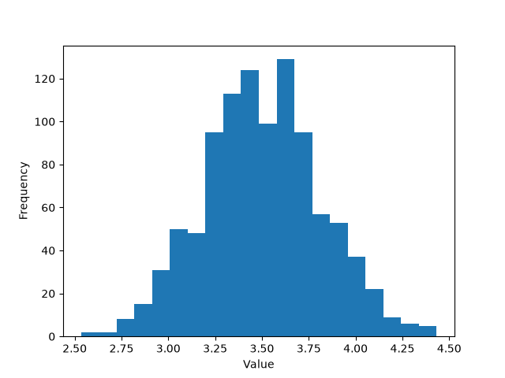

# 第 8 章: 乱数とシミュレーション

## 8.1 この章の地図

ここまでの需要曲線は、価格を決めると需要量がぴったり決まりました。現実の需要は、天気や流行で、毎回ばらつきます。この章では、乱数でそのばらつきを作り、「たくさん観測すると平均が安定する」ことを、シミュレーションで確かめます。

| 項目 | 内容 |
| :--- | :--- |
| 経済学の題材 | 需要のばらつき、標本平均、大数の法則、中心極限定理 |
| 使う Python の機能 | 標準ライブラリの `random`（乱数）と `statistics`（平均・標準偏差）、`itertools.accumulate`、ヒストグラム |
| 完成形 | `simulate_demand`、`running_means`、`roll_dice`、`sample_means`、`plot_histogram` |

### 経済学の式とコードの対応

| 統計・経済学 | 意味 | コード |
| :--- | :--- | :--- |
| 需要 = 需要曲線の値 + ばらつき | Q = a − bP + ε（ε は平均 0、標準偏差 σ の正規分布） | `simulate_demand` |
| 標本平均 | n 個の観測値の平均 | `statistics.mean` |
| 大数の法則 | 観測値が増えると、標本平均が期待値に近づく | `running_means` |
| 中心極限定理 | 標本平均の分布は、n が大きいと正規分布に近づく。標準偏差は σ ÷ √n | `sample_means` |

標準ライブラリだけで、シミュレーションを書きます。数値計算の専用ライブラリ（NumPy）は、第 9 章で導入します。

## 8.2 予想する

次の問いに、シミュレーションする前に答えてください。

- 需要曲線 Q = 100 − 2P で、価格が 10 のとき、需要の期待値は 80 です。標準偏差 10 のばらつきがあるとき、1 回の観測値は、80 にどのくらい近いでしょうか。観測値を増やしていくと、平均は何に近づきますか
- サイコロを 1 回振った目の平均は 3.5 です。サイコロを 30 回振って平均を求める試行を 1000 回行うと、その 1000 個の平均は、どのくらいばらつくでしょうか。サイコロ 1 回のばらつき（標準偏差 約 1.71）より、大きいですか、小さいですか

答えは、平均は 80 に近づきます。2 つ目は、小さくなり、1.71 ÷ √30 = 約 0.31 です。

## 8.3 乱数

### 疑似乱数と種

コンピュータの乱数は、決まった計算で作る疑似乱数です。最初の値（種）を決めると、同じ乱数の列が、何度でも再現できます。

```python
import random

rng = random.Random(0)        # 種 0 の乱数の生成器
rng.randint(1, 6)             # 1 から 6 の整数（サイコロ）
rng.gauss(0, 10)              # 平均 0、標準偏差 10 の正規分布の乱数
```

乱数の生成器を、関数の引数として渡します。こうすると、テストでは種を固定して、いつも同じ結果を確かめられます。

### 標準ライブラリの統計

```python
import statistics

statistics.mean([4, 8, 6])    # 6
statistics.stdev([4, 8, 6])   # 2.0  標本標準偏差
```

## 8.4 Red → Green → Refactor

### 需要のばらつき

乱数のテストは、「同じ種なら同じ結果になる」ことと、「ばらつきを 0 にすれば決まった値になる」ことから始めます。

```python
def test_同じ種なら同じ乱数列になる() -> None:
    first = simulate_demand(10, 100, 2, 10, 5, random.Random(0))
    second = simulate_demand(10, 100, 2, 10, 5, random.Random(0))
    assert first == second


def test_ばらつきが0なら需要は需要曲線のとおりになる() -> None:
    assert simulate_demand(10, 100, 2, 0, 3, random.Random(0)) == [80, 80, 80]


def test_負のばらつきは受け付けない() -> None:
    with pytest.raises(ValueError):
        simulate_demand(10, 100, 2, -1, 3, random.Random(0))
```

```python
def simulate_demand(
    price: float,
    intercept: float,
    slope: float,
    sigma: float,
    n: int,
    rng: random.Random,
) -> list[float]:
    """需要曲線の値に、標準偏差 sigma の正規分布のばらつきを足した観測値を n 個作る。"""
    if sigma < 0:
        raise ValueError("ばらつきは 0 以上でなければならない")
    expected = quantity_demanded(price, intercept, slope)
    return [expected + rng.gauss(0, sigma) for _ in range(n)]
```

第 1 章の `quantity_demanded` を再利用しています。種 0 のとき、最初の 3 個の観測値は 89.417、66.034、73.203 です。80 を中心にばらついています。

### 大数の法則

観測値を 1 個ずつ増やしながら、その時点までの平均（累積平均）を求めます。

```python
def test_累積平均は1個目なら観測値そのもの() -> None:
    assert running_means([4, 8, 6]) == pytest.approx([4, 6, 6])


def test_大数の法則_観測値が増えると平均は需要曲線の値80に近づく() -> None:
    values = simulate_demand(10, 100, 2, 10, 10_000, random.Random(0))
    means = running_means(values)
    assert abs(means[-1] - 80) < 0.5
```

```python
def running_means(values: list[float]) -> list[float]:
    """先頭から i 個目までの平均（累積平均）を並べて返す。"""
    return [total / count for count, total in enumerate(accumulate(values), start=1)]
```

`accumulate` は、先頭からの合計を順に作ります。`enumerate(..., start=1)` で、何個目かの番号を付けています。

実際に動かすと、累積平均は次のように 80 に近づきます。

| 観測値の個数 | 累積平均 | 80 との差 |
| ---: | ---: | ---: |
| 1 | 89.417 | 9.417 |
| 10 | 76.380 | 3.620 |
| 100 | 79.163 | 0.837 |
| 1,000 | 80.178 | 0.178 |
| 10,000 | 79.992 | 0.008 |

差は、観測値の個数が増えるにつれて小さくなります。この表では差が単調に小さくなっていますが、いつもそうなるとは限りません。種を変えると、途中で差が一時的に大きくなることもあります。また、1,000 個のときの平均は、80 を上回っています。平均は、80 の上下を行き来しながら近づきます。

テストの許容誤差 0.5 は、理由があって決めています。10,000 個の平均の標準誤差は 10 ÷ √10,000 = 0.1 なので、0.5 は 5 倍です。種を固定していても、種を変えたときに、まれにしか失敗しない幅にしています。

### 中心極限定理

サイコロを振って平均を求める試行を、何度も繰り返します。

```python
def test_サイコロの目は1から6() -> None:
    rolls = roll_dice(1000, random.Random(0))
    assert set(rolls) == {1, 2, 3, 4, 5, 6}


def test_中心極限定理_標本平均の平均は3_5に近い() -> None:
    means = sample_means(30, 1000, random.Random(0))
    assert statistics.mean(means) == pytest.approx(3.5, abs=0.05)


def test_中心極限定理_標本平均の標準偏差は母集団の標準偏差を平方根nで割った値に近い() -> (
    None
):
    # サイコロの標準偏差は約 1.7078。n = 30 のとき 1.7078 / sqrt(30) = 約 0.3118
    means = sample_means(30, 1000, random.Random(0))
    assert statistics.stdev(means) == pytest.approx(0.3118, abs=0.03)
```

```python
def roll_dice(n: int, rng: random.Random) -> list[int]:
    """サイコロを n 回振った目を返す。"""
    return [rng.randint(1, 6) for _ in range(n)]


def sample_means(sample_size: int, trials: int, rng: random.Random) -> list[float]:
    """サイコロを sample_size 回振って平均を求める試行を trials 回行う。"""
    return [statistics.mean(roll_dice(sample_size, rng)) for _ in range(trials)]
```

動かした結果は、次のとおりです（種 0）。

| 対象 | 平均 | 標準偏差 | 理論値 |
| :--- | ---: | ---: | :--- |
| サイコロ 1,000 回の目 | 3.445 | 1.740 | 平均 3.5、標準偏差 1.708 |
| 30 回の平均を 1,000 回（標本平均） | 3.5023 | 0.3138 | 平均 3.5、標準偏差 0.3118 |

標本平均の標準偏差は、サイコロ 1 回の標準偏差の約 5.5 分の 1（√30）です。

### ヒストグラム

観測値の分布は、ヒストグラムで見ます。

```python
def test_ヒストグラムの棒の高さの合計は観測値の個数() -> None:
    values = sample_means(30, 500, random.Random(0))
    fig = plot_histogram(values, bins=20)
    ax = fig.axes[0]
    assert isinstance(fig, Figure)
    assert sum(p.get_height() for p in ax.patches if isinstance(p, Rectangle)) == 500
```

```python
def plot_histogram(values: list[float], bins: int) -> Figure:
    """観測値のヒストグラムを描いた図を返す。"""
    fig, ax = plt.subplots()
    ax.hist(values, bins=bins)
    ax.set_xlabel("Value")
    ax.set_ylabel("Frequency")
    plt.close(fig)
    return fig
```

サイコロ 1 回の目は 1〜6 が同じ確率（一様分布）なのに、30 回の平均を 1,000 回集めた分布は、3.5 を中心にした釣り鐘の形になります。



### 実行結果

```bash
cd apps/python
uv run pytest
```

```text
77 passed
```

## 8.5 規則で言うと

1. **乱数の生成器は引数で渡す。** 種を固定すれば、テストが毎回同じ結果になる
2. **乱数のテストは、理論値と許容誤差で書く。** 許容誤差は、標準誤差の数倍にして、根拠を書く
3. **大数の法則は「平均が近づく」、中心極限定理は「平均の分布の形が決まる」。** 前者は値の話、後者は分布の話

混同しやすい点を、表にまとめます。

| 混同しやすい点 | 違い |
| :--- | :--- |
| 大数の法則と中心極限定理 | 大数の法則は、標本平均が期待値に近づくこと。中心極限定理は、標本平均の分布が正規分布に近づくこと |
| 標準偏差と標準誤差 | 標準偏差は観測値のばらつき（σ）。標準誤差は標本平均のばらつき（σ ÷ √n） |
| 「小さな標本でも平均は期待値に近い」 | 近づくのは、観測値が多いとき。1 個の観測値は、80 から 9 以上ずれていた |

### このモデルが成り立たない場面

シミュレーションは、観測値が独立で、同じ分布に従う前提です。需要は、前の日の需要に影響されることがあり、その場合、観測値が増えても、平均がこの章の式の速さでは安定しません。また、この章の需要は、`max` で 0 に切り捨てていません。ばらつきの標準偏差 10 が、期待値 80 に比べて十分小さいので、負になる確率は無視できますが、期待値が小さくなると、無視できなくなります。

## 8.6 練習問題

| 種類 | 問題 |
| :--- | :--- |
| 想起 | 本文を閉じて、`running_means` を、`accumulate` を使わずに（`for` で）書いてください |
| 生成 | 解説を見る前に、1 回の標本の大きさ（サイコロを振る回数）を 10、30、100 に変えたとき、標本平均の標準偏差がどうなるか予想し、実行して確かめてください（理論値は 0.540、0.312、0.171） |
| 多様 | ばらつき σ を 10 から 20 に変えて、累積平均が 80 に近づく速さを比べてください。標準誤差は、σ に比例します |
| 交互 | 第 2 章の `price_elasticity` を使い、価格 10 と 12 のそれぞれで、`simulate_demand` の平均を求めて、価格弾力性を計算してください（理論値は 0.25 ですが、観測値が少ないと大きくずれます） |

## 8.7 振り返り

- 予想した標準偏差は、実測値と合っていましたか
- 種を変えると、結果はどのくらい変わりましたか。試してみてください
- 乱数のテストで、許容誤差をどう決めるのが適切だと思いますか

## 8.8 まとめ

- 疑似乱数と種、`random` と `statistics` の使い方を学んだ
- 大数の法則と中心極限定理を、再現できるシミュレーションとテストで確かめた
- ヒストグラムで、標本平均の分布が釣り鐘の形になることを見た

次の章から、NumPy で配列を使った計算を学びます。まず、乗数効果と連立方程式を題材にします。
