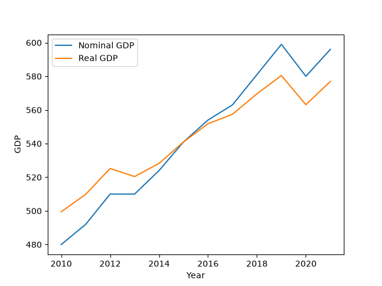
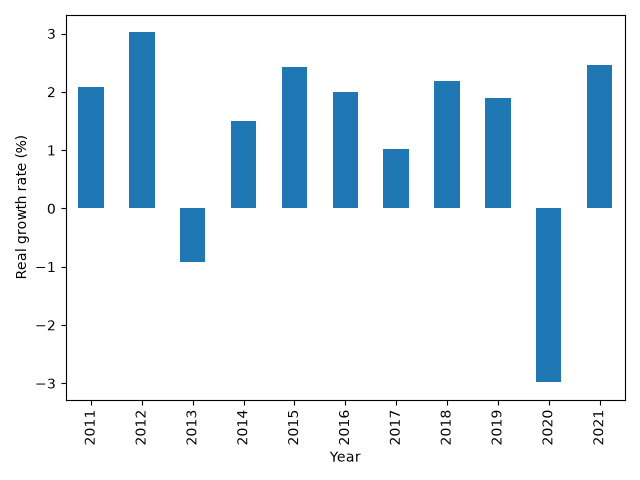

# 第 12 章: Pandas による図示

## 12.1 この章の地図

第 11 章で計算した指標を、図にします。pandas には、`DataFrame` や `Series` から、直接図を描く機能があります。裏では、第 7 章の matplotlib が動いています。そして、移動平均と景気動向指数で、景気の動きを読みます。

| 項目 | 内容 |
| :--- | :--- |
| 経済学の題材 | 名目と実質の GDP の推移、成長率、景気の判断（移動平均・景気動向指数）（マインドマップ [5-5](<../経済学・経済政策 トピック別マインドマップ.md#t5>)） |
| 使う Python の機能 | `DataFrame.plot`、`Series.plot.bar`、`rolling`、`diff`、`DataFrame` の列の平均 |
| 完成形 | `moving_average`、`diffusion_index`、`plot_gdp_chart`、`plot_growth_chart` |
| ファイル | 実装: `lib/chapter12/charts.py`／テスト: `test/chapter12/test_charts.py`（自分で書くときは、`practice/chapter12/` に、同じ名前で作ります） |

データは、第 11 章と同じ、架空の国の統計（`apps/economics-programming/python/data/economy.csv`）です。

### 経済学の式とコードの対応

| 経済学 | 意味 | コード |
| :--- | :--- | :--- |
| 移動平均 | 直近 n 期の平均。短期の上下を均して、傾向を見る | `moving_average(series, window)` |
| 景気動向指数（DI） | 前の期より増えた系列の割合（%）。50% を超えると、景気は拡張とみなす | `diffusion_index(df)` |
| 景気後退 | 実質成長率がマイナスの時期 | 第 11 章の `recession_years` |

実際の景気動向指数は、内閣府が公表する、先行・一致・遅行の多数の系列から作ります。ここでは、仕組みを確かめるために、4 つの支出項目（消費・投資・政府支出・輸出）で作ります。

## 12.2 予想する

次の問いに、図を描く前に答えてください。

- 2010 年から 2021 年の、名目 GDP の線と実質 GDP の線は、2015 年で交わるでしょうか。ヒント: 2015 年は基準年です
- 2010 年は、名目と実質のどちらが高いでしょうか。デフレーターは 96.1 で、100 より小さいです
- 2013 年と 2020 年の、景気動向指数は、いくつぐらいになるでしょうか

答えは、2015 年で交わり、2010 年は実質の方が高い（デフレーターが 96.1 と 100 未満なので、名目をデフレーターで割って 100 を掛けると、値が大きくなる）です。2013 年と 2020 年は、第 11 章で、実質成長率がマイナスだった年です。

## 12.3 Pandas のプロット

### 線グラフ

`DataFrame` の `plot()` は、列ごとに 1 本の線を描きます。行の名前（年）が、横軸になります。

```python
import matplotlib.pyplot as plt
import pandas as pd

fig, ax = plt.subplots()
data.plot(ax=ax)          # data は、列が 2 つの DataFrame
```

第 7 章の `ax.plot(...)` と違い、データを渡す手間が少なくて済みます。`ax=ax` で、どの図に描くかを指定します。

### 棒グラフ

```python
growth.plot.bar(ax=ax)    # growth は Series
```

### 移動平均

`rolling(n)` は、n 個ごとの窓を作り、`mean()` でその平均を求めます。

```python
series.rolling(3).mean()
```

### 差と前年比較

`diff()` は、前の行との差です。正なら増加、負なら減少です。

```python
df.diff() > 0        # 前の年より増えたかどうか（True / False の表）
```

## 12.4 プログラミング

### 移動平均

```python
def test_3期移動平均は3つの値の平均で最初の2つは計算できない() -> None:
    result = moving_average(pd.Series([1.0, 2.0, 3.0, 4.0, 5.0]), window=3)
    assert math.isnan(result.iloc[0])
    assert math.isnan(result.iloc[1])
    assert result.iloc[2:].tolist() == [2.0, 3.0, 4.0]


def test_窓の幅が1未満の移動平均は求められない() -> None:
    with pytest.raises(ValueError):
        moving_average(pd.Series([1.0, 2.0, 3.0]), window=0)
```

```python
def moving_average(series: pd.Series, window: int) -> pd.Series:
    """window 個ごとの移動平均。最初の window - 1 個は計算できず欠損値になる。"""
    if window < 1:
        raise ValueError("窓の幅は 1 以上でなければならない")
    return series.rolling(window).mean()
```

実質成長率の 3 期移動平均を求めると、2013 年から順に 1.39、1.20、1.00、1.97、1.81、1.73、1.70、0.37、0.46（%）です。単年では、2013 年が −0.92%、2020 年が −2.98% だったのに、移動平均では、どの年もプラスです。移動平均は、傾向をつかむのに向きますが、景気後退の底のような、短い期間の変化は、均されて見えにくくなります。

### 景気動向指数

小さな表で、手計算できるテストを書きます。

```python
def test_景気動向指数は前の年より増えた系列の割合() -> None:
    df = pd.DataFrame(
        {"a": [1, 2, 1], "b": [1, 1, 2], "c": [5, 6, 6]}, index=[2000, 2001, 2002]
    )
    result = diffusion_index(df)
    # 2001 年は a と c の 2 系列が増加、2002 年は b の 1 系列だけが増加
    assert result.index.tolist() == [2001, 2002]
    assert result.tolist() == pytest.approx([200 / 3, 100 / 3])
```

```python
def diffusion_index(df: pd.DataFrame) -> pd.Series:
    """景気動向指数（DI）: 前の年より増えた系列の割合（%）。最初の年は含まない。"""
    increased = df.diff().iloc[1:] > 0
    return increased.mean(axis=1) * 100
```

`df.diff().iloc[1:]` で、最初の年（前がないので、差が欠損値）を除いています。`increased.mean(axis=1)` は、`True` を 1、`False` を 0 として、行ごと（`axis=1` は、列の方向）に平均を取るので、「増えた系列の割合」になります。

支出の 4 項目に使います。

```python
EXPENDITURE = ["consumption", "investment", "government", "exports"]


def test_すべての支出が減った2020年の景気動向指数は0() -> None:
    df = load_economy()[EXPENDITURE]
    assert diffusion_index(df)[2020] == 0


def test_すべての支出が増えた2012年の景気動向指数は100() -> None:
    df = load_economy()[EXPENDITURE]
    assert diffusion_index(df)[2012] == 100
```

結果は、2013 年と 2020 年が 0、それ以外の年は 100 です。2013 年は、4 項目がすべて前年と同じ値（増えていない）で、2020 年は、すべてが減っています。第 11 章の景気後退の年と、ちょうど一致します。4 項目では、「ほぼ全部が同じ方向に動く」ので、0 か 100 になります。実際の景気動向指数は、多数の系列を使うので、0 と 100 の間の値を取ります。

### GDP の図

```python
def curve_points(line: Line2D) -> dict[float, float]:
    """線の (横軸, 縦軸) の組を、横軸をキーにした辞書にする。"""
    points: Any = line.get_xydata()
    return {float(x): float(y) for x, y in points}


def test_GDPの図には名目と実質の2本の線がある() -> None:
    fig = plot_gdp_chart(load_economy())
    ax = fig.axes[0]
    assert isinstance(fig, Figure)
    assert [line.get_label() for line in ax.lines] == ["Nominal GDP", "Real GDP"]


def test_基準年の2015年では名目と実質のGDPが同じ高さ() -> None:
    ax = plot_gdp_chart(load_economy()).axes[0]
    nominal = curve_points(ax.lines[0])
    real = curve_points(ax.lines[1])
    assert nominal[2015] == pytest.approx(541)
    assert real[2015] == pytest.approx(541)
```

```python
def plot_gdp_chart(df: pd.DataFrame) -> Figure:
    """名目 GDP と実質 GDP の推移を、1 つの図に描いて返す。"""
    data = pd.DataFrame({"Nominal GDP": production_gdp(df), "Real GDP": real_gdp(df)})
    fig, ax = plt.subplots()
    data.plot(ax=ax)
    ax.set_xlabel("Year")
    ax.set_ylabel("GDP")
    plt.close(fig)
    return fig
```



2015 年（基準年）で、2 本の線が交わります。2015 年より前は、実質の方が高く（デフレーターが 100 未満）、2015 年より後は、名目の方が高く（デフレーターが 100 超）なっています。

### 成長率の図

```python
def test_成長率の図は最初の年を除く11本の棒() -> None:
    ax = plot_growth_chart(load_economy()).axes[0]
    bars = [p for p in ax.patches if isinstance(p, Rectangle)]
    assert len(bars) == 11


def test_成長率の図で一番低い棒は2020年のマイナス3パーセント() -> None:
    ax = plot_growth_chart(load_economy()).axes[0]
    heights = [p.get_height() for p in ax.patches if isinstance(p, Rectangle)]
    assert min(heights) == pytest.approx(-3.0, abs=0.1)
```

```python
def plot_growth_chart(df: pd.DataFrame) -> Figure:
    """実質成長率（%）を、棒グラフにして返す。最初の年は計算できないので除く。"""
    growth = growth_rates(real_gdp(df)).dropna()
    fig, ax = plt.subplots()
    growth.plot.bar(ax=ax)
    ax.set_xlabel("Year")
    ax.set_ylabel("Real growth rate (%)")
    fig.tight_layout()
    plt.close(fig)
    return fig
```



`dropna()` は、欠損値の行を除きます。`fig.tight_layout()` は、軸のラベルが図からはみ出さないように、余白を調整します（最初に描いたとき、横軸のラベルが切れていたので、足しました）。

### 実行結果

```bash
cd apps/economics-programming/python
uv run pytest test/chapter12
```

```text
10 passed
```

## 12.5 規則で言うと

1. **図の元になる表は、先に計算して、テストする。** 描く関数は、計算済みの値を図にするだけにする
2. **傾向は移動平均、転換点は元の系列で見る。** 移動平均は、短い変化を均す
3. **指標は、何を数えているかを、決めてから使う。** DI は、系列の「数」の割合で、増減の「大きさ」を見ていない

混同しやすい点を、表にまとめます。

| 混同しやすい点 | 違い |
| :--- | :--- |
| DI が 50% を超える / 成長率がプラス | DI は、増えた系列の割合。成長率は、増えた量。DI が高くても、1 つ 1 つの増え方が小さいことがある |
| 移動平均と単年の値 | 移動平均は、過去の値を含むので、転換点が遅れて見える |
| 先行・一致・遅行 | 先行系列は景気に先立って動き、一致は同時に、遅行は遅れて動く。この章の DI は、同時点の系列だけを使った |

### このモデルが成り立たない場面

DI は、系列の増減の「数」しか見ないので、少し減った系列も、大きく減った系列も、同じ 1 つとして数えます。また、4 つの系列では、0% か 100% になりやすく、景気の強さを区別できません。移動平均は、窓の幅によって、結論が変わります。幅を変えて、結論が変わらないかを確かめる必要があります。

## 12.6 練習問題

| 種類 | 問題 |
| :--- | :--- |
| 想起 | 本文を閉じて、`diffusion_index` を自分で書いてください。`diff` と `iloc[1:]` と `mean(axis=1)` を使います |
| 生成 | 解説を見る前に、窓の幅を 5 にした移動平均が、何年目から計算できるかを予想し、確かめてください |
| 多様 | 支出の 4 項目に、輸入を加えた 5 項目で DI を求め、結果がどう変わるかを調べてください（輸入は、景気がよいと増えます） |
| 交互 | 第 11 章の `expenditure_shares` を、年ごとに求めて、消費の構成比の推移を、線グラフにしてください。第 7 章の `Figure` を返す作りに、そろえてください |

??? note "解答（先に自分で取り組んでから、開いてください）"

    **想起**:

    ```python
    def diffusion_index(df: pd.DataFrame) -> pd.Series:
        increased = df.diff().iloc[1:] > 0
        return increased.mean(axis=1) * 100
    ```

    **生成**: 5 年目からです。最初の 4 個（窓の幅 − 1 個）は、5 個そろわないので、欠損値になります。

    ```python
    ma = moving_average(pd.Series(range(1, 13), dtype=float), window=5)
    ma.first_valid_index()   # 4（0 から数えて 5 番目）
    ```

    **多様**:

    ```python
    items = ["consumption", "investment", "government", "exports", "imports"]
    diffusion_index(df[items])
    ```

    | 年 | 4 項目 | 5 項目（輸入を加える） |
    | ---: | ---: | ---: |
    | 2012 | 100 | 80（輸入が前年と同じで、増えていない） |
    | 2013 | 0 | 20（4 項目は前年と同じで、輸入だけが増えた） |
    | 2020 | 0 | 0（5 項目すべてが減った） |
    | 2021 | 100 | 80（輸入が前年と同じ） |

    輸入が加わると、「景気後退の年でも 0 にならない」「好況の年でも 100 にならない」年が出ます。DI は、どの系列を選ぶかで、結果が変わります。

    **交互**:

    ```python
    def plot_consumption_share(df: pd.DataFrame) -> Figure:
        shares = pd.Series(
            {year: expenditure_shares(df, year)["consumption"] for year in df.index}
        )
        fig, ax = plt.subplots()
        shares.plot(ax=ax)
        ax.set_xlabel("Year")
        ax.set_ylabel("Consumption share (%)")
        plt.close(fig)
        return fig
    ```

    消費の構成比は、12 年間で、およそ 54.9% から 55.1% の間で、ほとんど動きません。この架空のデータでは、消費が、GDP の約 55% になるように作ってあるためです。

## 12.7 振り返り

- 名目と実質の線が交わる位置の予想は、当たりましたか
- 移動平均と単年の値で、読み取れることはどう違いましたか
- 実際のデータで DI を作るなら、どの系列を選びますか。選ぶ基準は何ですか

## 12.8 まとめ

- `DataFrame.plot` と `Series.plot.bar` で、図を描いた
- 移動平均と景気動向指数を、手計算できる小さな表でテストしてから、データに使った
- 実質成長率がマイナスの年（2013 年と 2020 年）が、DI が 0（前の年より増えた系列がない）の年と一致することを確かめた

次の第 4 部では、これまでの道具を組み合わせて、IS-LM 分析などのマクロ経済モデルを実装します。

## 12.9 第 3 部の到達チェック

| できること | 検証の方法 | できた |
| :--- | :--- | :--- |
| 表形式の統計を読み込み、三面等価を確かめる | 生産面と分配面が一致し、不突合が小さい | □ |
| 名目から実質を求め、成長率と景気後退の年を調べる | 手計算の値と一致する | □ |
| 指標を図にして、傾向と転換点を説明する | 図と数値の説明が一致する | □ |

### 時間を決めて書く課題

何も見ずに、時間を計って、次を書いてください。

1. 表から、実質 GDP を求めて、成長率がマイナスの年を取り出す（15 分）
2. 移動平均と DI を、手計算できる小さな表でテストする（15 分）

### 誤りの原因の分類

| 原因 | 例 | 戻る章 |
| :--- | :--- | :--- |
| 知らない | `.loc` や `rolling` の使い方が分からない | 第 11・12 章 |
| 見抜けない | 名目と実質のどちらで比べるべきか決められない | 第 11 章 |
| 混同した | `.loc[a:b]` が終わりを含むことを忘れた | 第 11 章 |
| 手順の誤り | 欠損値の行を除き忘れた | 第 12 章 |
