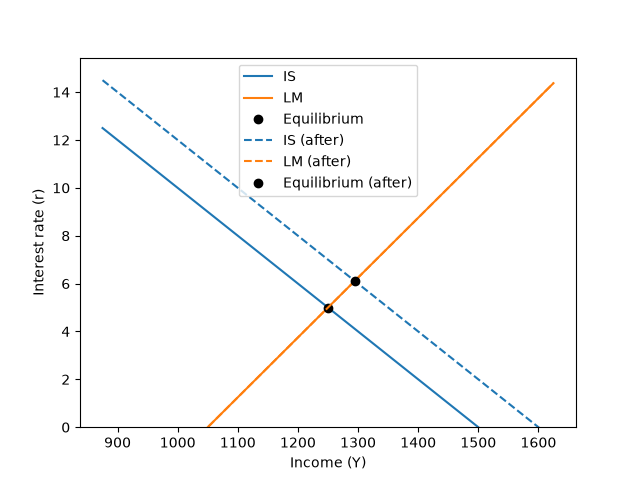
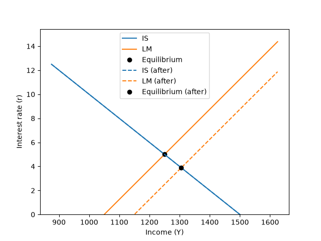

# 第 13 章: IS-LM 分析

## 13.1 この章の地図

第 4 部の最初の章です。これまでの道具（関数、データクラス、NumPy の連立方程式、matplotlib の図）を組み合わせて、マクロ経済学の中心的なモデルである IS-LM を実装します。

| 項目 | 内容 |
| :--- | :--- |
| 経済学の題材 | IS 曲線、LM 曲線、財政政策、金融政策、クラウディングアウト、流動性のわな（マインドマップ [5-6](<../経済学・経済政策 トピック別マインドマップ.md#t6>)） |
| 使う Python の機能 | データクラスの既定値と検証（`__post_init__`）、`dataclasses.replace`、`np.linalg.solve`、図の重ね描き |
| 完成形 | `IsLmModel`、`is_income`、`lm_interest`、`solve_equilibrium`、`plot_islm` |
| ファイル | 実装: `lib/chapter13/islm.py`／テスト: `test/chapter13/test_islm.py`（自分で書くときは、`practice/chapter13/` に、同じ名前で作ります） |

### 経済学の式とコードの対応

財市場と貨幣市場を、直線の式で表します。

| 市場 | 式 | コード |
| :--- | :--- | :--- |
| 消費 | C = C0 + c(Y − T) | `autonomous_consumption`、`mpc`、`tax` |
| 投資 | I = I0 − b·r（利子率が高いと減る） | `autonomous_investment`、`investment_sensitivity` |
| 財市場の均衡（IS 曲線） | (1 − c)·Y + b·r = C0 − cT + I0 + G | `is_income(model, rate)` |
| 貨幣需要 | L = k·Y − h·r（所得で増え、利子率で減る） | `money_income_sensitivity`、`money_interest_sensitivity` |
| 貨幣市場の均衡（LM 曲線） | M ÷ P = k·Y − h·r | `lm_interest(model, income)` |
| 均衡 | IS と LM の交点 | `solve_equilibrium(model)` |

本書の標準のモデルは、C0 = 100、c = 0.8、T = 50、I0 = 140、b = 10、G = 100、M ÷ P = 525、k = 0.5、h = 20 です。このとき、IS 曲線は 0.2Y + 10r = 300、LM 曲線は 0.5Y − 20r = 525 です。

## 13.2 予想する

標準のモデルについて、紙に、次のことを書いてください。

- IS 曲線は、右下がりですか、右上がりですか。利子率が 0 のとき、所得はいくつですか
- LM 曲線は、右下がりですか、右上がりですか。所得が 1050 のとき、利子率はいくつですか
- 均衡の所得と利子率は、いくつですか。ヒント: 利子率 5 のとき、IS 曲線の所得は 1250 です
- 政府支出を 100 から 120 に増やすと、所得はいくつ増えますか。利子率が変わらなければ、乗数 5 を使って 100 増えます。実際は、それより多いか、少ないか

答えは、IS は右下がりで、利子率 0 のとき所得 1500。LM は右上がりで、所得 1050 のとき利子率 0。均衡は所得 1250、利子率 5 です。最後の問いは、**少ない**です。利子率が上がり、民間の投資が減る（クラウディングアウト）からです。具体的な値は、テストで確かめます。

## 13.3 データクラスの使い方

### 係数をまとめる

モデルの係数は、10 個あります。バラバラの引数にすると、関数の呼び出しが長くなります。第 7 章で使ったデータクラスにまとめ、**既定値を標準のモデルの値**にします。

```python
@dataclass(frozen=True)
class IsLmModel:
    """IS-LM モデルの係数。既定値は、本書の標準のモデル。"""

    autonomous_consumption: float = 100  # C0: 基礎消費
    mpc: float = 0.8  # c: 限界消費性向
    tax: float = 50  # T: 定額税
    autonomous_investment: float = 140  # I0: 利子率が 0 のときの投資
    investment_sensitivity: float = 10  # b: 投資の利子率感応度
    government: float = 100  # G: 政府支出
    money_supply: float = 525  # M: 名目貨幣供給
    price_level: float = 1  # P: 物価水準
    money_income_sensitivity: float = 0.5  # k: 貨幣需要の所得感応度
    money_interest_sensitivity: float = 20  # h: 貨幣需要の利子率感応度
    interest_floor: float | None = None  # 利子率の下限（流動性のわな）

    def __post_init__(self) -> None:
        if not 0 <= self.mpc < 1:
            raise ValueError("限界消費性向は 0 以上 1 未満でなければならない")
        if self.investment_sensitivity <= 0:
            raise ValueError("投資の利子率感応度は正でなければならない")
        if self.money_interest_sensitivity <= 0:
            raise ValueError("貨幣需要の利子率感応度は正でなければならない")
        if self.money_income_sensitivity <= 0:
            raise ValueError("貨幣需要の所得感応度は正でなければならない")
        if self.price_level <= 0:
            raise ValueError("物価水準は正でなければならない")
```

`__post_init__` は、データクラスが作られた直後に呼ばれる、検証のための場所です。経済学で意味のない係数（限界消費性向が 1 以上など）では、モデルを作れないようにします。

### 政策を試す

政策は、「係数を 1 つだけ変えたモデル」を作ることで表します。

```python
IsLmModel(government=120)             # 標準のモデルの政府支出だけを 120 にする
dataclasses.replace(model, tax=40)    # 既にあるモデルから、税だけを変えたコピーを作る
```

`frozen=True` で、作ったモデルの値は書き換えられません。「元のモデル」と「政策後のモデル」を、並べて比べられます。

## 13.4 Red → Green → Refactor

### IS 曲線と LM 曲線

予想した値を、テストにします。

```python
def test_IS曲線は利子率が5のとき所得1250で利子率が0のとき所得1500() -> None:
    model = IsLmModel()
    assert is_income(model, 5) == pytest.approx(1250)
    assert is_income(model, 0) == pytest.approx(1500)


def test_LM曲線は所得が1250のとき利子率5で所得が1050のとき利子率0() -> None:
    model = IsLmModel()
    assert lm_interest(model, 1250) == pytest.approx(5)
    assert lm_interest(model, 1050) == pytest.approx(0)
```

```python
def autonomous_spending(model: IsLmModel) -> float:
    """利子率と所得に依存しない支出 A = C0 - c·T + I0 + G。"""
    return (
        model.autonomous_consumption
        - model.mpc * model.tax
        + model.autonomous_investment
        + model.government
    )


def is_income(model: IsLmModel, rate: float) -> float:
    """IS 曲線: 利子率 r のときに財市場を均衡させる所得。"""
    return (autonomous_spending(model) - model.investment_sensitivity * rate) / (
        1 - model.mpc
    )


def lm_interest(model: IsLmModel, income: float) -> float:
    """LM 曲線: 所得 Y のときに貨幣市場を均衡させる利子率（下限があれば、それ以上）。"""
    rate = (
        model.money_income_sensitivity * income - model.money_supply / model.price_level
    ) / model.money_interest_sensitivity
    if model.interest_floor is not None:
        return max(rate, model.interest_floor)
    return rate
```

IS 曲線は、利子率から所得を、LM 曲線は、所得から利子率を求めます。図では、横軸が所得、縦軸が利子率なので、どちらも描けます。

### 均衡を連立方程式で解く

IS と LM の 2 つの式を、未知数 (Y, r) の連立方程式として、第 9 章の `np.linalg.solve` で解きます。

```python
def test_標準のモデルの均衡は所得1250で利子率5() -> None:
    income, rate = solve_equilibrium(IsLmModel())
    assert income == pytest.approx(1250)
    assert rate == pytest.approx(5)


def test_均衡はIS曲線とLM曲線の両方の上にある() -> None:
    model = IsLmModel()
    income, rate = solve_equilibrium(model)
    assert is_income(model, rate) == pytest.approx(income)
    assert lm_interest(model, income) == pytest.approx(rate)
```

```python
def solve_equilibrium(model: IsLmModel) -> tuple[float, float]:
    """IS 曲線と LM 曲線の交点（所得, 利子率）を、連立方程式として解く。

    利子率に下限があり、解がそれを下回るときは、利子率を下限に固定して、
    IS 曲線から所得を求める（流動性のわな: LM 曲線が水平になる）。
    """
    coefficients = np.array(
        [
            [1 - model.mpc, model.investment_sensitivity],
            [model.money_income_sensitivity, -model.money_interest_sensitivity],
        ]
    )
    constants = np.array(
        [autonomous_spending(model), model.money_supply / model.price_level]
    )
    income, rate = np.linalg.solve(coefficients, constants)
    if model.interest_floor is not None and rate < model.interest_floor:
        rate = model.interest_floor
        income = is_income(model, rate)
    return float(income), float(rate)
```

標準のモデルでは、均衡は (1250.0, 5.0) です。IS 曲線と LM 曲線の両方の上にあることも、テストで確かめました。

### 財政政策とクラウディングアウト

政府支出を 100 から 120 に増やします。

```python
def test_財政支出を増やすと所得と利子率が上がる() -> None:
    before = solve_equilibrium(IsLmModel())
    after = solve_equilibrium(IsLmModel(government=120))
    assert after[0] == pytest.approx(1294.4444, abs=1e-3)
    assert after[1] == pytest.approx(6.1111, abs=1e-3)
    assert after[0] > before[0]
    assert after[1] > before[1]


def test_クラウディングアウトで所得の増加は乗数効果より小さい() -> None:
    before_income, _ = solve_equilibrium(IsLmModel())
    after_income, _ = solve_equilibrium(IsLmModel(government=120))
    # 利子率が一定なら、所得は 20 / (1 - 0.8) = 100 増える
    assert after_income - before_income == pytest.approx(44.444, abs=1e-3)
    assert after_income - before_income < 100
```

結果は、所得が 1250 から 1294.44 に増え（+44.44）、利子率が 5 から 6.11 に上がります。利子率が変わらなければ 100 増えるはずが、約 44 しか増えていません。残りの約 56 は、利子率の上昇で民間の投資が減ったことで失われています。これが、マインドマップの「クラウディングアウト」です。



破線が政策後です。IS 曲線だけが右へ動き、LM 曲線は動かないので、破線の LM 曲線は元の LM 曲線に重なって見えません。

### 金融政策

名目貨幣供給を 525 から 575 に増やします。

```python
def test_貨幣供給を増やすと所得が増え利子率が下がる() -> None:
    before = solve_equilibrium(IsLmModel())
    after = solve_equilibrium(IsLmModel(money_supply=575))
    assert after[0] == pytest.approx(1305.5556, abs=1e-3)
    assert after[1] == pytest.approx(3.8889, abs=1e-3)
    assert after[0] > before[0]
    assert after[1] < before[1]
```

所得は 1305.56（+55.56）に増え、利子率は 3.89 に下がります。財政政策とは逆に、利子率が下がるので、民間投資が増え、クラウディングアウトは起きません。



減税（T を 50 から 40 に）も、IS 曲線を右へ動かします。結果は、所得 1267.78（+17.78）、利子率 5.44 です。減税 10 の効果（+17.78）が、政府支出 20 の効果（+44.44）の 40% なのは、減税額が半分で、さらにその 80%（限界消費性向 c）しか消費に回らないからです（0.5 × 0.8 = 0.4）。

### 傾きで政策の効果が変わる

マインドマップの「財政は LM が緩やかなほど有効、金融は IS が緩やかなほど有効」を、テストにします。

```python
def test_IS曲線が緩やかなほど金融政策は有効() -> None:
    # 投資の利子率感応度 b を 10 から 20 にすると、IS 曲線は緩やかになる
    gentle = IsLmModel(investment_sensitivity=20)
    steep_gain = (
        solve_equilibrium(IsLmModel(money_supply=575))[0]
        - solve_equilibrium(IsLmModel())[0]
    )
    gentle_gain = (
        solve_equilibrium(dataclasses.replace(gentle, money_supply=575))[0]
        - solve_equilibrium(gentle)[0]
    )
    assert gentle_gain == pytest.approx(71.4286, abs=1e-3)
    assert gentle_gain > steep_gain


def test_LM曲線が緩やかなほど財政政策は有効() -> None:
    # 貨幣需要の利子率感応度 h を 20 から 40 にすると、LM 曲線は緩やかになる
    gentle = IsLmModel(money_interest_sensitivity=40)
    steep_gain = (
        solve_equilibrium(IsLmModel(government=120))[0]
        - solve_equilibrium(IsLmModel())[0]
    )
    gentle_gain = (
        solve_equilibrium(dataclasses.replace(gentle, government=120))[0]
        - solve_equilibrium(gentle)[0]
    )
    assert gentle_gain == pytest.approx(61.5385, abs=1e-3)
    assert gentle_gain > steep_gain
```

| 設定 | 貨幣供給 +50 の効果（金融政策） | 政府支出 +20 の効果（財政政策） |
| :--- | ---: | ---: |
| 標準（b = 10、h = 20） | +55.56 | +44.44 |
| IS が緩やか（b = 20） | +71.43 | — |
| LM が緩やか（h = 40） | — | +61.54 |

IS 曲線が緩やか（投資が利子率に敏感）だと、金融政策で利子率が下がったときの、投資の増え方が大きいので、効果が大きくなります。LM 曲線が緩やか（貨幣需要が利子率に敏感）だと、政府支出で所得が増えても、利子率があまり上がらず、クラウディングアウトが小さくなるので、財政政策の効果が大きくなります。

### 流動性のわな

利子率には、下限があります。利子率が下限に達すると、債券の価格はこれ以上上がらず、むしろ下がると予想されるので、人々は債券を買わず、追加の貨幣をそのまま持とうとします。貨幣需要が、利子率に対して無限に弾力的になり、LM 曲線が水平になります。モデルには、`interest_floor`（利子率の下限）で表します。

```python
def test_流動性のわなで金融政策を強めても所得は増えない() -> None:
    trap = IsLmModel(interest_floor=2)
    # 通常の範囲では、下限は効かない
    assert solve_equilibrium(trap) == pytest.approx((1250, 5))
    # 貨幣供給を大きく増やすと、利子率は下限の 2 に張り付き、所得は 1400 で止まる
    big = solve_equilibrium(dataclasses.replace(trap, money_supply=2000))
    bigger = solve_equilibrium(dataclasses.replace(trap, money_supply=3000))
    assert big == pytest.approx((1400, 2))
    assert bigger == pytest.approx((1400, 2))


def test_流動性のわなで財政政策は乗数どおりの効果がある() -> None:
    trap = IsLmModel(interest_floor=2, money_supply=2000)
    before = solve_equilibrium(trap)[0]
    after = solve_equilibrium(dataclasses.replace(trap, government=120))[0]
    # クラウディングアウトがないので、20 / (1 - 0.8) = 100 だけ増える
    assert after - before == pytest.approx(100)
```

貨幣供給が 2000 でも 3000 でも、均衡は (1400, 2) で変わりません。金融政策は、**無効**です。一方、政府支出を 20 増やすと、所得は 1400 から 1500（+100）と、乗数どおりに増えます。クラウディングアウトがなく、財政政策が**最も有効**になります。マインドマップの「描いて確認: 流動性のわなで財政有効・金融無効」を、数値で確かめました。

### 図を描く

```python
def _draw_curves(
    ax: Axes, model: IsLmModel, incomes: list[float], suffix: str, style: str
) -> None:
    is_rates = [
        (autonomous_spending(model) - (1 - model.mpc) * y)
        / model.investment_sensitivity
        for y in incomes
    ]
    lm_rates = [lm_interest(model, y) for y in incomes]
    income, rate = solve_equilibrium(model)
    ax.plot(incomes, is_rates, style, color="tab:blue", label=f"IS{suffix}")
    ax.plot(incomes, lm_rates, style, color="tab:orange", label=f"LM{suffix}")
    ax.plot([income], [rate], "o", color="black", label=f"Equilibrium{suffix}")


def plot_islm(model: IsLmModel, after: IsLmModel | None = None) -> Figure:
    """IS 曲線・LM 曲線・均衡点の図を返す。after があれば、政策後を破線で重ねる。"""
    base_income, _ = solve_equilibrium(model)
    incomes = [base_income * (0.7 + 0.01 * i) for i in range(61)]
    fig, ax = plt.subplots()
    _draw_curves(ax, model, incomes, suffix="", style="-")
    if after is not None:
        _draw_curves(ax, after, incomes, suffix=" (after)", style="--")
    ax.set_xlabel("Income (Y)")
    ax.set_ylabel("Interest rate (r)")
    ax.set_ylim(bottom=0)
    ax.legend()
    plt.close(fig)
    return fig
```

```python
def test_IS_LMの図にはIS曲線とLM曲線と均衡点がある() -> None:
    fig = plot_islm(IsLmModel())
    ax = fig.axes[0]
    assert isinstance(fig, Figure)
    assert [line.get_label() for line in ax.lines] == ["IS", "LM", "Equilibrium"]


def test_政策後のモデルを渡すと移動後の曲線も描く() -> None:
    after = IsLmModel(government=120)
    ax = plot_islm(IsLmModel(), after=after).axes[0]
    labels = [line.get_label() for line in ax.lines]
    assert labels == [
        "IS",
        "LM",
        "Equilibrium",
        "IS (after)",
        "LM (after)",
        "Equilibrium (after)",
    ]
```

図を描く部分は、曲線を描く処理を `_draw_curves` に分け、元のモデルと政策後のモデルの両方に使っています（先頭の `_` は、この中だけで使う関数という印です）。

### 実行結果

```bash
cd apps/economics-programming/python
uv run pytest test/chapter13
```

```text
25 passed
```

## 13.5 規則で言うと

1. **係数が多いモデルは、データクラスにまとめて、既定値を標準の値にする。** 政策は、「係数を 1 つ変えたモデル」を作って、元と並べて比べる
2. **係数の検証は、モデルを作る場所（`__post_init__`）に 1 か所だけ書く。** どの関数でも、不正な係数が入らない
3. **政策の効果は、「元との差」で見る。** 均衡の値だけでなく、所得の差・利子率の差を、手計算と突き合わせる

混同しやすい点を、表にまとめます。

| 混同しやすい点 | 違い |
| :--- | :--- |
| 財政政策と金融政策の利子率への影響 | 財政（IS が右へ）は利子率を上げる。金融（LM が右へ）は利子率を下げる |
| クラウディングアウトの有無 | 財政政策にはある（利子率の上昇で投資が減る）。金融政策にはない |
| 流動性のわなで効くのは | 財政政策。金融政策は効かない（利子率が下限で動けない） |
| 財政は LM、金融は IS | 財政は LM が緩やかなほど有効。金融は IS が緩やかなほど有効 |

### このモデルが成り立たない場面

IS-LM は、物価が一定で、供給の制約がない（需要が増えれば、その分だけ生産が増える）前提です。完全雇用に近いと、需要の増加は、所得ではなく、物価を上げます（第 14 章）。また、この章のモデルは、直線の式です。実際の IS 曲線や LM 曲線は、曲線で、傾きが場所によって変わります。さらに、利子率の下限（流動性のわな）は、下限の値と、そこに達する条件を、実際のデータで確かめる必要があります。

## 13.6 練習問題

| 種類 | 問題 |
| :--- | :--- |
| 想起 | 本文を閉じて、`IsLmModel` と `solve_equilibrium` を自分で書いてください。連立方程式の係数の行列を間違えないようにします |
| 生成 | 解説を見る前に、「政府支出を 20 増やすと同時に、貨幣供給を増やして、利子率を元の 5 に保つには、貨幣供給をいくつにすればよいか」を考えて、テストを書いてください |
| 多様 | 限界消費性向を 0.8 から 0.6 に、基礎投資 `autonomous_investment` を 140 から 340 に変えて、均衡と、政府支出 +20 の効果を、手計算とテストで確かめてください。続けて、基礎投資を 140 のまま、限界消費性向だけを 0.6 にすると、均衡の利子率が負になります。なぜ負になるのかを、IS 曲線と LM 曲線の図で説明してください |
| 交互 | 第 9 章の乗数 1 ÷ (1 − c) と、この章の政府支出 +20 の効果を比べ、その差が、クラウディングアウトの大きさになることを、説明してください |

??? note "解答（先に自分で取り組んでから、開いてください）"

    **想起**: 本文と見比べて、`__post_init__` の検証、係数の行列 `[[1 - c, b], [k, -h]]`、定数 `[A, M / P]` を確かめます。

    **生成**: 政府支出 120 で、IS 曲線は 0.2Y + 10r = 320 です。利子率 5 のとき、Y = (320 − 50) ÷ 0.2 = 1350 です。LM 曲線で、M ÷ P = 0.5 × 1350 − 20 × 5 = 575 です。

    ```python
    def test_政府支出を増やしても貨幣供給を575にすれば利子率は5のまま() -> None:
        income, rate = solve_equilibrium(IsLmModel(government=120, money_supply=575))
        assert income == pytest.approx(1350)
        assert rate == pytest.approx(5)
    ```

    財政政策だけなら、利子率は 5 から 6.11 に上がります。金融政策（貨幣供給を 525 から 575 に）を組み合わせると、利子率が上がらず、クラウディングアウトなしに、所得が 1350（+100）まで増えます。

    **多様**:

    | | 所得 | 利子率 |
    | :--- | ---: | ---: |
    | 限界消費性向 0.6、基礎投資 340 | 1188.46 | 3.46 |
    | 政府支出 +20 | 1219.23 | 4.23 |
    | 限界消費性向 0.6、基礎投資 140（利子率が負） | 880.77 | −4.23 |

    政府支出 +20 で、所得は 30.77 増えます。乗数は 1 ÷ (1 − 0.6) = 2.5 なので、利子率が一定なら +50 のはずです。差は、クラウディングアウトです。

    利子率が負になる理由: 限界消費性向 0.6、基礎投資 140 のとき、IS 曲線は 0.4Y + 10r = 310 で、r = 0 のとき Y = 775 です。LM 曲線は 0.5Y − 20r = 525 で、r = 0 のとき Y = 1050 です。IS 曲線が、LM 曲線の r = 0 の点（Y = 1050）より、左にあるので、交点は r < 0 の側にできます。需要が小さい（乗数が小さく、基礎投資も小さい）のに、貨幣が余っている状況です。このモデルは、利子率に下限（0）を置いていないので、負の利子率が出ます。利子率の下限は、`interest_floor` で表せます（流動性のわなの節を参照）。

    **交互**: 利子率が一定なら、所得は 20 × 5 = 100 増えるはずです。実際は +44.44 なので、差は 55.56 です。この差は、利子率が 5 から 6.11 に上がり（+1.11）、投資が 10 × 1.11 = 11.1 減って、それに乗数 5 を掛けた値（11.1 × 5 = 55.6）と一致します。

## 13.7 振り返り

- クラウディングアウトで、所得の増加が小さくなることを、予想できましたか
- 流動性のわなで、財政政策だけが効くことを、グラフと数値のどちらで理解しましたか
- このモデルに足りないものは、何だと思いますか

## 13.8 まとめ

- 係数をデータクラスにまとめ、IS 曲線・LM 曲線の交点を、連立方程式で解いた
- 財政政策（クラウディングアウトあり）と金融政策（なし）の効果、曲線の傾きによる違い、流動性のわなを、手計算の値とテストで確かめた
- IS-LM の図を、政策の前後で重ねて描いた

次の章では、このモデルから総需要曲線を導き、総供給曲線と組み合わせて、物価も含めた分析を行います。
