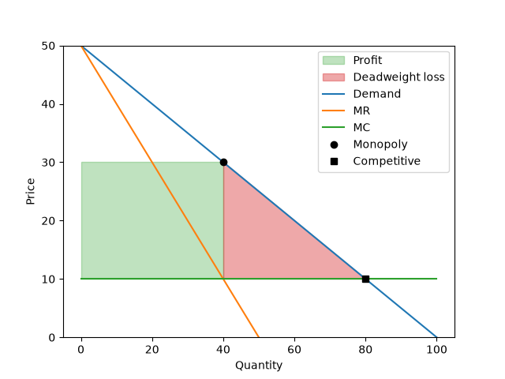
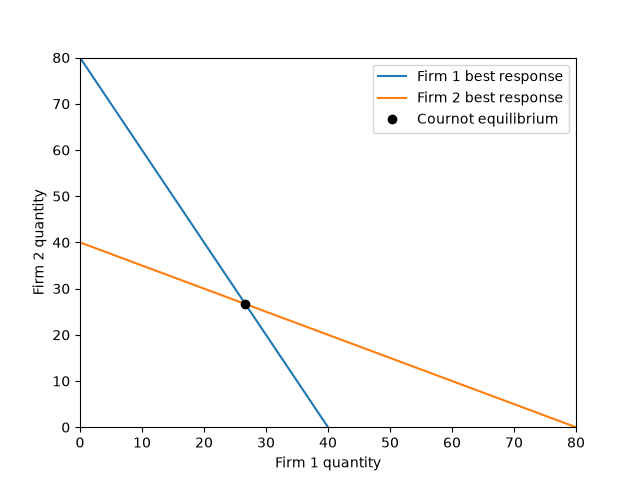
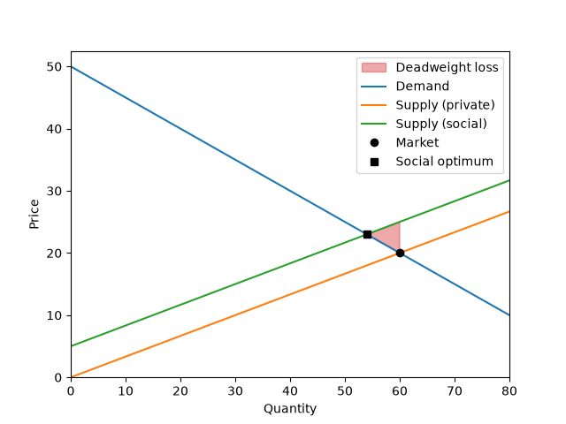

# 第 15 章: 不完全競争とゲーム理論

## 15.1 この章の地図

ここまでの市場は、企業が価格を決められない完全競争でした。この章では、企業が価格に影響を与える独占・寡占と、市場がうまくいかない外部不経済を扱います。企業どうしが互いの行動を読み合う状況は、ゲーム理論で表します。

| 項目 | 内容 |
| :--- | :--- |
| 経済学の題材 | 独占（MR = MC、死荷重）、寡占（クールノー均衡、囚人のジレンマ、ナッシュ均衡）、外部不経済とピグー税（マインドマップ [5-4](<../経済学・経済政策 トピック別マインドマップ.md#t4>)） |
| 使う Python の機能 | タプルをキーにした辞書、繰り返しによる均衡の探索（第 5 章の復習）、`TypedDict`（テストの型）、第 7 章の関数の再利用 |
| 完成形 | `monopoly_outcome`、`best_response`、`cournot_by_iteration`、`cournot_symmetric`、`duopoly_profits`、`pure_nash_equilibria`、`social_optimum_quantity` |
| ファイル | 実装: `lib/chapter15/externality.py`、`lib/chapter15/game.py`、`lib/chapter15/monopoly.py`、`lib/chapter15/oligopoly.py`、`lib/chapter15/plot.py`（独占の図）／テスト: `test/chapter15/test_externality.py`、`test/chapter15/test_monopoly.py`、`test/chapter15/test_oligopoly_and_game.py`、`test/chapter15/test_plot.py`（自分で書くときは、`practice/chapter15/` に、同じ名前で作ります） |

### 経済学の式とコードの対応

需要曲線 Q = 100 − 2P（逆需要曲線 P = 50 − Q ÷ 2）、限界費用は一定で 10 とします。

| 経済学 | 式 | コード |
| :--- | :--- | :--- |
| 限界収入 | MR = (a − 2Q) ÷ b（需要曲線の 2 倍の傾き） | `marginal_revenue` |
| 完全競争 | P = MC | `competitive_quantity` |
| 独占 | MR = MC で数量を決め、価格は需要曲線の上で決まる | `monopoly_outcome` |
| ラーナー指数 | (P − MC) ÷ P = 1 ÷ 価格弾力性 | `lerner_index` |
| クールノー競争 | 各社が、相手の生産量を所与として、利潤を最大にする | `best_response`、`cournot_by_iteration` |
| ナッシュ均衡 | 互いに、相手の選択に対して最適な組 | `pure_nash_equilibria` |
| 外部不経済 | 社会的限界費用 = 私的限界費用 + 外部費用 | `social_optimum_quantity` |

> **記号について**: a・b は、第 1 章と同じ、需要曲線の切片と傾きです。A = a ÷ b、B = 1 ÷ b は、逆需要曲線 P = A − B·Q の切片と傾きです（第 13 章の A（独立支出）とは別）。n は企業の数です（第 8 章の n は、標本の大きさ）。e は 1 単位あたりの外部費用、q は企業 1 社の生産量です（Q は市場全体の数量）。一覧は、[記号について](how-to-read.md#symbols) を参照してください。

## 15.2 予想する

次の問いに、手計算で答えてください。

- 完全競争では、価格が限界費用 10 に等しくなります。数量はいくつですか
- 独占企業は、MR = MC の数量を選びます。MR = 50 − Q と MC = 10 から、数量と価格はいくつですか。完全競争より、高いですか、低いですか
- 同じ市場に、独占でなく、同じ費用の企業が 2 社いて、お互いの生産量を見ながら生産量を決めたら、合計の生産量は、独占と完全競争のどちらに近いでしょうか

答えは、完全競争の数量が 80。独占は、数量 40、価格 30（完全競争より価格が高く、数量が少ない）。2 社は、その間（合計約 53.3）になります。具体的な値は、テストで確かめます。

## 15.3 ゲーム理論の用語

| 用語 | 意味 |
| :--- | :--- |
| 戦略 | 各プレイヤーが選べる行動 |
| 利得（ペイオフ） | 結果として各プレイヤーが得る値（利潤など） |
| ペイオフ行列 | 戦略の組ごとの、利得を並べた表 |
| 最適反応 | 相手の選択を所与としたときの、自分にとって最適な選択 |
| ナッシュ均衡 | 全員が、互いに、相手の選択に対して最適反応をとっている組 |

ペイオフ行列は、「(行の戦略, 列の戦略) → (行の利得, 列の利得)」の辞書で表します。

```python
payoffs = {
    ("協力", "協力"): (3, 3),
    ("協力", "裏切り"): (0, 5),
    ("裏切り", "協力"): (5, 0),
    ("裏切り", "裏切り"): (1, 1),
}
```

## 15.4 プログラミング

### 独占

限界収入は、需要曲線の 2 倍の傾きです。逆需要曲線 P = 50 − 0.5Q の傾きが −0.5 なので、MR = 50 − Q の傾きは −1 です。

```python
DEMAND = {"demand_intercept": 100, "demand_slope": 2}


def test_限界収入は需要曲線の2倍の傾き() -> None:
    # 逆需要曲線 P = 50 - 0.5Q の傾きは -0.5。限界収入 MR = 50 - Q の傾きは -1
    assert marginal_revenue(0, **DEMAND) == pytest.approx(50)
    assert marginal_revenue(10, **DEMAND) == pytest.approx(40)
    assert marginal_revenue(20, **DEMAND) == pytest.approx(30)


def test_独占の数量は40で価格は30() -> None:
    result = monopoly_outcome(**DEMAND, marginal_cost=10)
    assert result.quantity == pytest.approx(40)
    assert result.price == pytest.approx(30)


def test_独占の数量では限界収入が限界費用に等しい() -> None:
    result = monopoly_outcome(**DEMAND, marginal_cost=10)
    assert marginal_revenue(result.quantity, **DEMAND) == pytest.approx(10)


def test_独占は完全競争より価格が高く数量が少ない() -> None:
    result = monopoly_outcome(**DEMAND, marginal_cost=10)
    assert result.price > 10
    assert result.quantity < competitive_quantity(**DEMAND, marginal_cost=10)
```

```python
def marginal_revenue(
    quantity: float, demand_intercept: float, demand_slope: float
) -> float:
    """限界収入 MR = (a - 2Q) ÷ b。逆需要曲線 P = (a - Q) ÷ b の 2 倍の傾き。"""
    check_slope(demand_slope, "需要曲線の傾き")
    return (demand_intercept - 2 * quantity) / demand_slope


def competitive_quantity(
    demand_intercept: float, demand_slope: float, marginal_cost: float
) -> float:
    """完全競争の数量: 価格が限界費用に等しくなる点の需要量。"""
    _check_cost(demand_intercept, demand_slope, marginal_cost)
    return demand_intercept - demand_slope * marginal_cost
```

```python
@dataclass(frozen=True)
class MonopolyOutcome:
    """独占の結果。"""

    quantity: float
    price: float
    profit: float
    consumer_surplus: float
    deadweight_loss: float


def monopoly_outcome(
    demand_intercept: float, demand_slope: float, marginal_cost: float
) -> MonopolyOutcome:
    """MR = MC で数量を決め、価格は需要曲線の上で決まる。"""
    competitive = competitive_quantity(demand_intercept, demand_slope, marginal_cost)
    quantity = (demand_intercept - demand_slope * marginal_cost) / 2
    price = inverse_demand(quantity, demand_intercept, demand_slope)
    highest_price = choke_price(demand_intercept, demand_slope)
    return MonopolyOutcome(
        quantity=quantity,
        price=price,
        profit=(price - marginal_cost) * quantity,
        consumer_surplus=0.5 * quantity * (highest_price - price),
        deadweight_loss=0.5 * (competitive - quantity) * (price - marginal_cost),
    )
```

第 1 章の `choke_price` と、第 7 章の `inverse_demand` を使って、需要曲線の縦軸の切片と、数量から価格を求める式を、新しく書かずに済ませています。傾きが 0 以下の需要曲線は、第 1 章の `check_slope` で、受け付けません。

MR = (100 − 2Q) ÷ 2 = MC = 10 から、Q = 40 です。価格は、需要曲線 P = (100 − 40) ÷ 2 = 30 の上で決まります。結果は、次のとおりです。

| | 完全競争 | 独占 |
| :--- | ---: | ---: |
| 数量 | 80 | 40 |
| 価格 | 10 | 30 |
| 消費者余剰 | 1600 | 400 |
| 企業の利潤 | 0 | 800 |
| 死荷重 | 0 | 400 |

完全競争の総余剰（1600）は、独占では、消費者余剰（400）、企業の利潤（800）、死荷重（400）に分かれます。消費者から企業に移った分（800）と、誰にも渡らず失われた分（400）があります。

独占と完全競争の違いは、図で見ると、すぐに分かります。



図の読み方:

- 青い線が需要曲線、オレンジの線が限界収入（MR）。MR は、需要曲線の**2 倍の傾き**で、数量 50 で 0 になる
- 緑の水平線が限界費用（MC = 10）。独占は、MR と MC が交わる点（数量 40）で数量を決め、価格は、その数量での**需要曲線の上**（30、黒い丸）で決まる
- 完全競争は、価格と MC が等しい点（数量 80、価格 10、黒い四角）。独占は、数量が半分で、価格が 3 倍
- 薄い緑の長方形が**利潤**（40 × 20 = 800）。赤い三角形が**死荷重**（0.5 × 40 × 20 = 400）。取引されなくなった分で、誰にも渡らない

テストでは、長方形の面積が利潤、三角形の面積が死荷重と一致することを確かめています。この図は、`lib/chapter15/plot.py` の `plot_monopoly` が描きます。

```python
def test_完全競争の総余剰は独占の消費者余剰と利潤と死荷重の合計() -> None:
    result = monopoly_outcome(**DEMAND, marginal_cost=10)
    # 完全競争の消費者余剰: 底辺 80、高さ 50 - 10 = 1600
    competitive = 0.5 * 80 * (50 - 10)
    assert competitive == pytest.approx(1600)
    total = result.consumer_surplus + result.profit + result.deadweight_loss
    assert total == pytest.approx(competitive)
```

### 独占力の大きさ: ラーナー指数

独占点（価格 30、数量 40）での価格弾力性は、第 2 章の式（b × P ÷ Q）で 2 × 30 ÷ 40 = 1.5 です。ラーナー指数（P − MC）÷ P = (30 − 10) ÷ 30 = 2 ÷ 3 は、この弾力性の逆数と、ちょうど一致します。需要が非弾力的なほど、独占企業は価格を高くできます。

```python
def test_ラーナー指数は価格弾力性の逆数に等しい() -> None:
    result = monopoly_outcome(**DEMAND, marginal_cost=10)
    # 独占点での価格弾力性は b × P ÷ Q = 2 × 30 ÷ 40 = 1.5
    elasticity = 2 * result.price / result.quantity
    assert lerner_index(result.price, marginal_cost=10) == pytest.approx(1 / elasticity)
    assert lerner_index(result.price, marginal_cost=10) == pytest.approx(2 / 3)
```

```python
def lerner_index(price: float, marginal_cost: float) -> float:
    """ラーナー指数 (P - MC) ÷ P。独占力の大きさで、独占では弾力性の逆数に等しい。"""
    if price <= 0:
        raise ValueError("価格は正でなければならない")
    return (price - marginal_cost) / price
```

### 寡占: クールノー競争

2 社が、相手の生産量を所与として、自社の利潤を最大にする生産量を選びます。これが、最適反応です。相手の生産量が q2 のとき、自社の最適な生産量は、独占と同じ考え方で、q1 = 40 − 0.5 × q2 になります。

```python
class Market(TypedDict):
    demand_intercept: float
    demand_slope: float
    marginal_cost: float


MARKET: Market = {"demand_intercept": 100, "demand_slope": 2, "marginal_cost": 10}


def test_相手が生産しなければ最適反応は独占の数量40() -> None:
    assert best_response(0, **MARKET) == pytest.approx(40)


def test_相手の生産量が増えると最適反応は減る() -> None:
    # 最適反応 q = 40 - 0.5 × (相手の生産量)
    assert best_response(20, **MARKET) == pytest.approx(30)
    assert best_response(40, **MARKET) == pytest.approx(20)


def test_相手が非常に多く生産すれば最適反応は0() -> None:
    assert best_response(100, **MARKET) == 0
```

`TypedDict` は、辞書に、「どんなキーがあり、値がどんな型か」を書く型ヒントです。`**MARKET` で関数に渡すときに、検査の道具（mypy）が、引数の名前と型を確かめられるようにするために使っています。実行には、影響しません（`MARKET` は、ふつうの辞書です）。

```python
def best_response(
    opponent_quantity: float,
    demand_intercept: float,
    demand_slope: float,
    marginal_cost: float,
) -> float:
    """相手の生産量が与えられたときの、自社の利潤を最大にする生産量。

    q = (A - MC - B × 相手の生産量) ÷ 2B（A = a/b、B = 1/b）。負にはならない。
    """
    highest_price = choke_price(demand_intercept, demand_slope)
    price_slope = 1 / demand_slope
    quantity = (highest_price - marginal_cost - price_slope * opponent_quantity) / (
        2 * price_slope
    )
    return max(quantity, 0)
```

ナッシュ均衡は、「互いが、相手の最適反応に対する最適反応になっている点」です。2 社が、交互に最適反応をとり続けると、第 5 章の調整過程のように、均衡に近づきます。

```python
def test_2社のクールノー均衡は各社80_3で価格は70_3() -> None:
    q1, q2 = cournot_by_iteration(**MARKET)
    assert q1 == pytest.approx(80 / 3, abs=1e-6)
    assert q2 == pytest.approx(80 / 3, abs=1e-6)


def test_均衡では互いが相手の生産量に対して最適反応をとっている() -> None:
    q1, q2 = cournot_by_iteration(**MARKET)
    assert best_response(q2, **MARKET) == pytest.approx(q1, abs=1e-6)
    assert best_response(q1, **MARKET) == pytest.approx(q2, abs=1e-6)


def test_初期値が違っても同じ均衡に収束する() -> None:
    q1, q2 = cournot_by_iteration(**MARKET, initial=(80, 0))
    assert q1 == pytest.approx(80 / 3, abs=1e-6)
    assert q2 == pytest.approx(80 / 3, abs=1e-6)


def test_収束しなければ例外になる() -> None:
    with pytest.raises(RuntimeError):
        cournot_by_iteration(**MARKET, max_iterations=1)
```

```python
def cournot_by_iteration(
    demand_intercept: float,
    demand_slope: float,
    marginal_cost: float,
    initial: tuple[float, float] = (0.0, 0.0),
    tolerance: float = 1e-9,
    max_iterations: int = 1000,
) -> tuple[float, float]:
    """2 社が交互に最適反応をとり続けて、クールノー・ナッシュ均衡を求める。"""
    q1, q2 = initial
    for _ in range(max_iterations):
        new_q1 = best_response(q2, demand_intercept, demand_slope, marginal_cost)
        new_q2 = best_response(new_q1, demand_intercept, demand_slope, marginal_cost)
        if abs(new_q1 - q1) < tolerance and abs(new_q2 - q2) < tolerance:
            return new_q1, new_q2
        q1, q2 = new_q1, new_q2
    raise RuntimeError("均衡に収束しなかった")
```

動かすと、最初の 5 回の生産量は、次のように均衡の 26.667 に近づきます。

| 回 | 企業 1 | 企業 2 |
| ---: | ---: | ---: |
| 1 | 40.000 | 20.000 |
| 2 | 30.000 | 25.000 |
| 3 | 27.500 | 26.250 |
| 4 | 26.875 | 26.562 |
| 5 | 26.719 | 26.641 |

均衡は、各社 80 ÷ 3 = 26.667、合計 53.33、価格 23.33、各社の利潤 355.56 です。初期値を (80, 0) に変えても、同じ均衡に収束します。

クールノー均衡を、図にします。2 社が、お互いの生産量に最適に反応する点です。



図の読み方:

- 横軸が企業 1 の生産量、縦軸が企業 2 の生産量です
- 青い線は、企業 2 の生産量が決まっているとき、企業 1 が選ぶ最適な生産量です。企業 2 が 0 なら、企業 1 は独占の数量（40）を選び、企業 2 が多いほど、少なく選びます。企業 2 が 80（完全競争の数量）なら、企業 1 は 0 です
- オレンジの線は、企業 1 に対する、企業 2 の最適反応です（対称です）
- **2 本の線の交点**（黒い丸）が、クールノー均衡で、各社 80 ÷ 3 ≈ 26.67 です。お互いに、相手の生産量を前提に、最適な生産量を選んでいる点です

この図は、`lib/chapter15/plot.py` の `plot_cournot` が描きます。

### 企業の数と競争

企業が n 社の対称なクールノー競争には、閉じた式があります。各社の生産量は q = (A − MC) ÷ (B × (n + 1)) です（A = 50、B = 0.5）。

```python
def test_企業が1社なら独占と同じ() -> None:
    quantity, price, profit = cournot_symmetric(1, **MARKET)
    assert quantity == pytest.approx(40)
    assert price == pytest.approx(30)
    assert profit == pytest.approx(800)


def test_企業が2社なら生産量の合計は独占より多く完全競争より少ない() -> None:
    quantity, price, profit = cournot_symmetric(2, **MARKET)
    assert quantity * 2 == pytest.approx(160 / 3)
    assert price == pytest.approx(70 / 3)
    assert profit == pytest.approx(3200 / 9)
    assert 40 < quantity * 2 < 80


def test_企業が増えると完全競争に近づく() -> None:
    quantity, price, _ = cournot_symmetric(100, **MARKET)
    assert quantity * 100 == pytest.approx(79.2, abs=0.1)
    assert price == pytest.approx(10.4, abs=0.1)
```

```python
def cournot_symmetric(
    firms: int,
    demand_intercept: float,
    demand_slope: float,
    marginal_cost: float,
) -> tuple[float, float, float]:
    """同じ費用の企業が firms 社あるときの、各社の生産量・価格・各社の利潤。

    各社の生産量 q = (A - MC) ÷ (B × (n + 1))。
    1 社なら独占、n が大きいと完全競争に近づく。
    """
    if firms < 1:
        raise ValueError("企業の数は 1 以上でなければならない")
    highest_price = choke_price(demand_intercept, demand_slope)
    price_slope = 1 / demand_slope
    quantity = (highest_price - marginal_cost) / (price_slope * (firms + 1))
    price = highest_price - price_slope * firms * quantity
    return quantity, price, (price - marginal_cost) * quantity
```

| 企業の数 | 合計の生産量 | 価格 | 各社の利潤 |
| ---: | ---: | ---: | ---: |
| 1（独占） | 40.0 | 30.00 | 800.00 |
| 2 | 53.3 | 23.33 | 355.56 |
| 3 | 60.0 | 20.00 | 200.00 |
| 10 | 72.7 | 13.64 | 26.45 |
| 100 | 79.2 | 10.40 | 0.31 |
| （完全競争） | 80.0 | 10.00 | 0 |

企業が増えるほど、価格は限界費用に近づき、各社の利潤は 0 に近づきます。独占（1 社）から、完全競争（無数の企業）まで、1 つの式でつながっています。

### 囚人のジレンマとナッシュ均衡

ペイオフ行列から、ナッシュ均衡を探します。ある組が均衡であるとは、行のプレイヤーがその行より得になる行がなく、列のプレイヤーもその列より得になる列がないことです。

```python
def test_囚人のジレンマの均衡は両者が裏切る() -> None:
    payoffs = {
        ("協力", "協力"): (3, 3),
        ("協力", "裏切り"): (0, 5),
        ("裏切り", "協力"): (5, 0),
        ("裏切り", "裏切り"): (1, 1),
    }
    assert pure_nash_equilibria(payoffs) == [("裏切り", "裏切り")]


def test_調整ゲームには均衡が2つある() -> None:
    payoffs = {
        ("A", "A"): (2, 2),
        ("A", "B"): (0, 0),
        ("B", "A"): (0, 0),
        ("B", "B"): (1, 1),
    }
    assert pure_nash_equilibria(payoffs) == [("A", "A"), ("B", "B")]


def test_コイン合わせには純粋戦略の均衡がない() -> None:
    payoffs = {
        ("表", "表"): (1, -1),
        ("表", "裏"): (-1, 1),
        ("裏", "表"): (-1, 1),
        ("裏", "裏"): (1, -1),
    }
    assert pure_nash_equilibria(payoffs) == []
```

```python
def _is_best_for_row(payoffs: Payoffs, rows: list[str], row: str, col: str) -> bool:
    """列プレイヤーが col を選んでいるとき、行プレイヤーにとって row が最適か。"""
    return all(payoffs[(r, col)][0] <= payoffs[(row, col)][0] + _EPSILON for r in rows)


def _is_best_for_col(payoffs: Payoffs, cols: list[str], row: str, col: str) -> bool:
    """行プレイヤーが row を選んでいるとき、列プレイヤーにとって col が最適か。"""
    return all(payoffs[(row, c)][1] <= payoffs[(row, col)][1] + _EPSILON for c in cols)


def pure_nash_equilibria(payoffs: Payoffs) -> list[tuple[str, str]]:
    """互いに相手の選択に対して最適な組（純粋戦略のナッシュ均衡）をすべて返す。

    payoffs は {(行の戦略, 列の戦略): (行の利得, 列の利得)}。
    """
    rows = list(dict.fromkeys(row for row, _ in payoffs))
    cols = list(dict.fromkeys(col for _, col in payoffs))
    return [
        (row, col)
        for row in rows
        for col in cols
        if _is_best_for_row(payoffs, rows, row, col)
        and _is_best_for_col(payoffs, cols, row, col)
    ]
```

コードの読み方を補います。引数の型に出てくる `Payoffs` は、`Mapping[tuple[str, str], tuple[float, float]]` という長い型に付けた、別名です。`dict.fromkeys(...)` は、重複を除いて、出てきた順を保つ書き方で、戦略の一覧（行と列）を作るのに使っています。`all(条件 for ...)` は、すべての要素で条件が成り立つときだけ `True` になります。`for row in rows for col in cols` と続く内包表記は、行と列の、すべての組を調べる 2 重の繰り返しです。

囚人のジレンマでは、両者が協力すれば (3, 3) で、両者が裏切るより得なのに、均衡は両者が裏切る (1, 1) です。相手が協力しても裏切っても、自分は裏切った方が得だからです（支配戦略）。調整ゲームには、均衡が 2 つあります。コイン合わせには、純粋戦略の均衡がありません（確率的に選ぶ「混合戦略」が必要で、この章では扱いません）。

### 生産量の選択は囚人のジレンマになる

2 社が、「協調（独占の半分、各社 20）」か「クールノー（各社 80 ÷ 3）」のどちらかを選ぶ、とします。寡占の生産量の選択が、囚人のジレンマと同じ構造になっていることを、テストで確かめます。

```python
def duopoly_profits(
    quantity1: float,
    quantity2: float,
    demand_intercept: float,
    demand_slope: float,
    marginal_cost: float,
) -> tuple[float, float]:
    """2 社の生産量が決まったときの、各社の利潤。"""
    price = (demand_intercept - quantity1 - quantity2) / demand_slope
    return (price - marginal_cost) * quantity1, (price - marginal_cost) * quantity2
```

```python
def test_生産量の選択も囚人のジレンマになる() -> None:
    # 各社が「協調（独占の半分の 20）」か「クールノー（80 / 3）」を選ぶ
    cooperate, cournot = 20.0, 80 / 3
    quantities = {"協調": cooperate, "クールノー": cournot}
    payoffs = {
        (a, b): duopoly_profits(quantities[a], quantities[b], **MARKET)
        for a in quantities
        for b in quantities
    }
    assert payoffs[("協調", "協調")] == pytest.approx((400, 400))
    assert payoffs[("クールノー", "クールノー")] == pytest.approx((3200 / 9, 3200 / 9))
    # 協調すれば両社とも得なのに、均衡は両社がクールノーの生産量を選ぶ点
    assert pure_nash_equilibria(payoffs) == [("クールノー", "クールノー")]
```

| | 相手: 協調（20） | 相手: クールノー（26.67） |
| :--- | :--- | :--- |
| 自社: 協調（20） | (400.0, 400.0) | (333.3, 444.4) |
| 自社: クールノー（26.67） | (444.4, 333.3) | (355.6, 355.6) |

両社が協調すれば、各社の利潤は 400 で、クールノー均衡の 355.6 より大きくなります。しかし、相手が協調しているとき、自社がクールノーの生産量に切り替えれば、利潤は 444.4 に増えます（裏切り）。だから、均衡は両社がクールノー (355.6, 355.6) です。マインドマップの「値下げ競争と同じ構造」「協力した方が得なのに裏切る」が、数値で確かめられました。カルテルは、このため、不安定です（そして、独占禁止法で禁じられています）。

### 外部不経済とピグー税

外部不経済は、市場を介さずに、他者に費用を押しつけます。第 7 章の需要曲線 Q = 100 − 2P、供給曲線 Q = 3P で、1 単位あたり 5 の外部費用があるとします。社会的限界費用 = 私的限界費用 + 外部費用なので、社会的な供給曲線は、5 だけ上にずれます。

```python
MARKET = {
    "demand_intercept": 100,
    "demand_slope": 2,
    "supply_intercept": 0,
    "supply_slope": 3,
}


def test_社会的に最適な数量は市場の数量60より少ない54() -> None:
    # 社会的限界費用 = 私的限界費用 + 外部費用。(100 - Q) / 2 = Q / 3 + 5 を解く
    assert social_optimum_quantity(**MARKET, external_cost=5) == pytest.approx(54)
    assert equilibrium(**MARKET)[1] == pytest.approx(60)


def test_放任すると過剰供給になり死荷重が出る() -> None:
    # 底辺は過剰供給の分 60 - 54 = 6、高さは外部費用 5
    assert externality_deadweight_loss(**MARKET, external_cost=5) == pytest.approx(15)
```

```python
def social_optimum_quantity(
    demand_intercept: float,
    demand_slope: float,
    supply_intercept: float,
    supply_slope: float,
    external_cost: float,
) -> float:
    """社会的に最適な数量。(a - Q) ÷ b = (Q - c) ÷ d + e を Q について解く。

    社会的な供給曲線は、私的な供給曲線を e だけ上にずらしたもの。
    Q = c + d(P - e) = (c - d·e) + dP なので、第 7 章の従量税（税額 e）と同じ形で、
    供給曲線の切片を c - d·e にずらした市場の均衡数量になる。
    外部費用が大きく、最適な数量が 0 以下になるときは、NoEquilibriumError にする。
    """
    if external_cost < 0:
        raise ValueError("外部費用は 0 以上でなければならない")
    _, quantity = equilibrium(
        demand_intercept,
        demand_slope,
        supply_intercept - supply_slope * external_cost,
        supply_slope,
    )
    return quantity
```

社会的な供給曲線は、私的な供給曲線を、外部費用 e だけ上にずらしたものです。式 Q = c + d(P − e) は、(c − d·e) + dP と変形できます。これは、第 7 章の従量税（税額 e）と同じ形で、**供給曲線の切片を c − d·e にずらした市場の均衡数量**です。そのため、`social_optimum_quantity` は、新しい式を書かずに、第 7 章の `equilibrium` を呼んでいます。外部費用が大きすぎて、最適な数量が 0 以下になるときは、`equilibrium` が `NoEquilibriumError` にします。

放任すると、数量は 60 ですが、社会的に最適なのは 54 です。6 だけ過剰供給で、死荷重は 0.5 × 5 × 6 = 15 です。

ピグー税は、外部費用と同じ額の税を課して、外部費用を価格に織り込ませます。第 7 章の `equilibrium_with_tax` が、そのまま使えます。税額 e の従量税も、外部費用 e の社会的な供給曲線も、同じ「切片を c − d·e にずらした市場」なので、「ピグー税 = 外部費用と同額の税」が、コードの構造にも現れています。

```python
def test_外部費用と同じ額のピグー税で社会的に最適な数量になる() -> None:
    taxed = equilibrium_with_tax(**MARKET, tax=5)
    assert taxed.quantity == pytest.approx(
        social_optimum_quantity(**MARKET, external_cost=5)
    )


def test_ピグー税で解消される死荷重は第7章の死荷重の式と同じ値() -> None:
    # 第 7 章では税が死荷重を生んだが、外部費用があるときは、税が死荷重を解消する
    assert equilibrium_with_tax(**MARKET, tax=5).deadweight_loss == pytest.approx(
        externality_deadweight_loss(**MARKET, external_cost=5)
    )
```

第 7 章では、税が死荷重（15）を生みました。外部費用があるときは、同じ税が、放任で生じる死荷重（15）を解消します。税そのものが悪いのではなく、**税額が外部費用と一致しているか**が、重要です。

外部不経済を、図にします。



図の読み方:

- オレンジの線が、企業にとっての費用（私的な供給曲線）、緑の線が、外部費用 5 を足した、社会にとっての費用（社会的な供給曲線）です。緑は、オレンジを 5 だけ上にずらしたものです
- 放任の市場は、需要曲線と私的な供給曲線の交点（黒い丸、数量 60、価格 20）で取引します
- 社会的に最適なのは、需要曲線と社会的な供給曲線の交点（黒い四角、数量 54、価格 23）です
- 数量が 54 から 60 の間は、買い手の価値（需要曲線）より、社会の費用（緑の線）が高い取引です。この差でできる赤い三角形が**死荷重**で、面積は 0.5 × 5 × 6 = 15 です

この図は、`lib/chapter15/plot.py` の `plot_externality` が描きます。第 7 章の課税の図と、同じ形です。外部費用と同額のピグー税で、供給曲線が緑の線に移り、均衡が黒い四角に動きます。

### 実行結果

```bash
cd apps/economics-programming/python
uv run pytest test/chapter15
```

```text
55 passed
```

## 15.5 規則で言うと

1. **独占は MR = MC、完全競争は P = MC。** 独占の価格は、MC ではなく、需要曲線の上で決まる
2. **均衡は、「互いが相手の最適反応」になっている点。** 最適反応を繰り返し、動かなくなった点を探せば、均衡が見つかる
3. **外部費用は、税額で価格に織り込む。** 税額が外部費用と同じなら、社会的に最適な数量になる

混同しやすい点を、表にまとめます。

| 混同しやすい点 | 違い |
| :--- | :--- |
| 独占の利潤と死荷重 | 利潤（800）は、消費者から企業に移った余剰で、失われていない。死荷重（400）が、誰にも渡らず失われた分 |
| ナッシュ均衡と社会的に最適 | ナッシュ均衡は、全員にとって、もっとよい組があっても成り立つ（囚人のジレンマ） |
| 税が死荷重を生む / 解消する | 外部費用がなければ、税は死荷重を生む（第 7 章）。外部費用があれば、同額の税が解消する |
| 完全競争の企業の利潤 | 利潤 0（超過利潤なし）。企業が 100 社のとき、各社の利潤は 0.31 で、0 に近い |

### このモデルが成り立たない場面

この章のモデルは、1 回きりのゲームで、費用が一定で、需要が直線の場合です。同じゲームを繰り返すと、「相手が裏切ったら次から裏切る」という脅しで、協調が均衡になりえます（繰り返しゲーム、しっぺ返し戦略）。また、企業の数が変わる（参入・退出）と、利潤は 0 に近づきます。外部費用の大きさは、実際には、測るのが難しく、ピグー税の額を、正確に決められません。コースの定理が言うように、交渉の費用がなければ、課税せずに当事者の交渉で解決することもあります。

## 15.6 練習問題

| 種類 | 問題 |
| :--- | :--- |
| 想起 | 本文を閉じて、`monopoly_outcome` を書き、独占の数量が 40、価格が 30 になることを確かめてください |
| 生成 | 解説を見る前に、限界費用が 10 から 20 に上がったとき、独占の数量と価格を、手計算してから、テストを書いてください |
| 多様 | 3 社のクールノー競争の合計の生産量と、価格を、手計算して確かめてください |
| 交互 | 第 7 章の課税の関数で、税額を 5 から 10 に変えて、外部費用 5 のときの死荷重を求めてください。税が外部費用より大きすぎると、また死荷重が出ることを確かめてください |

??? note "解答（先に自分で取り組んでから、開いてください）"

    **想起**: 本文と見比べて、`MR = MC` の数量 `(a - b × MC) ÷ 2`、価格が需要曲線の上で決まること、消費者余剰・利潤・死荷重の計算を確かめます。

    **生成**: 数量は (100 − 2 × 20) ÷ 2 = 30、価格は (100 − 30) ÷ 2 = 35 です。限界費用が 10 から 20 に上がると、数量は 40 から 30 に減り、価格は 30 から 35 に上がります（利潤は (35 − 20) × 30 = 450）。

    ```python
    def test_限界費用が20のときの独占() -> None:
        result = monopoly_outcome(demand_intercept=100, demand_slope=2, marginal_cost=20)
        assert result.quantity == pytest.approx(30)
        assert result.price == pytest.approx(35)
        assert result.profit == pytest.approx(450)
    ```

    **多様**: 各社の生産量は 40 ÷ (0.5 × (3 + 1)) = 20、合計は 60、価格は 50 − 0.5 × 60 = 20 です。各社の利潤は (20 − 10) × 20 = 200 です。

    ```python
    def test_3社のクールノー競争() -> None:
        # 需要 Q = 100 − 2P、限界費用 10（本文の寡占のテストと同じ市場）
        quantity, price, profit = cournot_symmetric(3, 100, 2, 10)
        assert quantity * 3 == pytest.approx(60)
        assert price == pytest.approx(20)
        assert profit == pytest.approx(200)
    ```

    企業が 1 社（合計 40）、2 社（53.3）、3 社（60）と増えるにつれて、完全競争の 80 に近づきます。

    **交互**: 税額 10 のとき、取引量は 48 です（第 7 章の答え）。社会的に最適な数量は 54 なので、6 だけ取引が減りすぎです。この減りすぎから生じる損失は、0.5 × (10 − 5) × (54 − 48) = 15 です。

    ```python
    taxed = equilibrium_with_tax(100, 2, 0, 3, tax=10)
    optimum = social_optimum_quantity(100, 2, 0, 3, external_cost=5)
    taxed.quantity     # 48
    optimum            # 54
    ```

    税額が外部費用（5）と同じなら、取引量が最適な 54 になり、死荷重は 0 になります。税額が外部費用より大きい（10）と、取引が最適な量より減りすぎて、別の死荷重（15）が出ます。税額は、外部費用に合わせることが大切です。

## 15.7 振り返り

- 独占の数量と価格の予想は、当たりましたか
- 囚人のジレンマで、「協力した方が得なのに、裏切る」ことを、自分の言葉で説明できますか
- 現実の産業で、この章のモデルに近いものは、何ですか。近くない点は、何ですか

## 15.8 まとめ

- 独占の MR = MC、完全競争との比較（価格、数量、余剰、死荷重）を、数値で確かめた
- クールノー均衡を、最適反応の繰り返しで求め、企業の数が増えると完全競争に近づくことを確かめた
- ペイオフ行列からナッシュ均衡を探し、生産量の選択が囚人のジレンマになることを確かめた
- 外部不経済と、外部費用と同額のピグー税を、第 7 章の関数で結びつけた

## 15.9 第 4 部の到達チェック

| できること | 検証の方法 | できた |
| :--- | :--- | :--- |
| IS-LM のモデルを関数にし、政策変更の効果を示す | 手計算の値（所得 +44.44 など）と一致し、曲線の向きが教科書と一致する | □ |
| AD-AS で、古典派とケインズの違いを示す | 古典派は所得が変わらず、ケインズは右上がりで所得が増える | □ |
| 独占・寡占・ゲームの均衡を求める | 独占 40、2 社各 26.67、囚人のジレンマの均衡が一致する | □ |

### 時間を決めて書く課題

何も見ずに、時間を計って、次を書いてください。

1. 需要 Q = 120 − 2P、限界費用 20 の独占企業の、数量・価格・利潤を求める（15 分）。手計算では、数量 (120 − 40) ÷ 2 = 40、価格 (120 − 40) ÷ 2 = 40、利潤 (40 − 20) × 40 = 800
2. 2 つの均衡を持つペイオフ行列を作り、`pure_nash_equilibria` で確かめる（15 分）

### 誤りの原因の分類

| 原因 | 例 | 戻る章 |
| :--- | :--- | :--- |
| 知らない | 限界収入の式、ナッシュ均衡の定義 | 第 15 章 |
| 見抜けない | 問題が、独占・寡占・ゲームのどれか決められない | 第 15 章 |
| 混同した | 財政政策と金融政策の利子率への影響を取り違えた | 第 13 章 |
| 手順の誤り | 均衡の探索で、収束の確認を忘れた | 第 5・15 章 |

次の付録では、これまでシミュレーションで作ってきたデータから、逆に、需要曲線を推定する方法（回帰分析）を紹介します。
