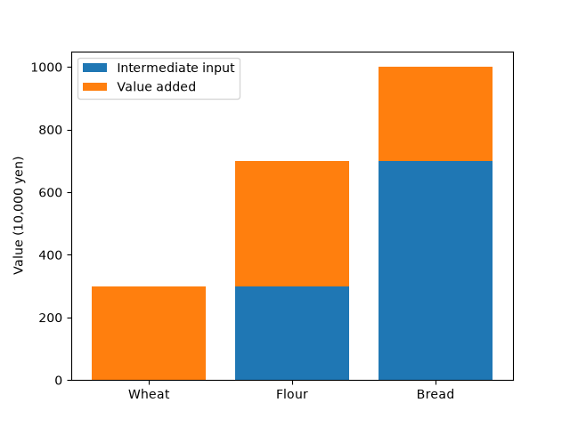
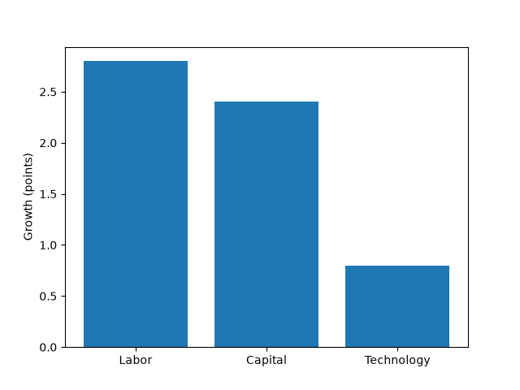

# 第 1 章: GDP と付加価値

## 1.1 この章の地図

マクロ経済学は、国全体の経済活動を、**数字で測る**ことから始まります。その中心が、**GDP（国内総生産）**です。この章では、GDP を、**付加価値の合計**として計算し、GNI・NDP との違い、フローとストックの違い、成長率を要因に分ける成長会計を、関数とテストで確かめます。



| 項目 | 内容 |
| :--- | :--- |
| 経済学の題材 | 付加価値と GDP、GNI・NDP、帰属計算、フローとストック、成長会計 |
| 使う Python の機能 | 関数、リスト、`dataclass`、テスト（`pytest`）。NumPy・pandas は、この章では使いません |
| 新しく導入するライブラリ | Matplotlib（図。[第 1 シリーズ](../economics-programming/index.md) の第 7 章で学習済み） |
| 完成形 | `value_added`、`gdp_from_stages`、`gni`、`ndp`、`is_in_gdp`、`stock_path`、`GrowthAccounting`、`growth_accounting` |
| ファイル | 実装: `lib/chapter01/gdp.py`、`lib/chapter01/plot.py`（図）／テスト: `test/chapter01/test_gdp.py`、`test/chapter01/test_plot.py`（自分で書くときは、`practice/chapter01/` に、同じ名前で作ります） |
| データ | なし（手計算できる小さな例だけ） |

### 経済学の式とコードの対応

| 経済学 | 式 | コード |
| :--- | :--- | :--- |
| 付加価値 | 付加価値 = 生産額 − 中間投入 | `value_added(output, intermediate)` |
| GDP | GDP = 付加価値の合計（= 最終財の価値） | `gdp_from_stages(output, intermediate)` |
| GNI | GNI = GDP + 海外からの受取 − 海外への支払 | `gni(gdp, income_from_abroad, income_to_abroad)` |
| NDP | NDP = GDP − 固定資本減耗 | `ndp(gdp, depreciation)` |
| ストック | 今期のストック = 前期のストック + 今期のフロー | `stock_path(initial, flows)` |
| 成長会計 | 成長率 = 労働分配率 × 労働増加率 + 資本分配率 × 資本増加率 + 技術進歩率 | `growth_accounting(...)` |

### 前提とする第 1 シリーズの章

この記事は、Python の基礎を繰り返しません。次ができれば、読み進められます。

| できること | 第 1 シリーズの章 |
| :--- | :--- |
| 関数と pytest のテストを書く（Red → Green → Refactor） | 第 1〜6 章 |
| リスト・辞書・内包表記を使う | 第 3・4 章 |
| Matplotlib で、棒グラフを描く | 第 7 章 |

三面等価（第 2 章）や乗数（第 4 章）など、第 1 シリーズの第 9・11〜14 章と**題材が重なる**章があります。この記事は、独立して読めるように、自分のコードを持ちます。

## 1.2 準備

サンプルコードは、リポジトリの `apps/macro-basics-programming/python/` にあります。uv のインストールは、[第 1 シリーズの第 1 章](../economics-programming/01-preparation-and-first-test.md) の 1.2 節を見てください。

```bash
cd apps/macro-basics-programming/python
uv sync
uv run pytest test/chapter01
```

```text
20 passed
```

自分でコードを書くときは、`practice/chapter01/` を作って、完成形と同じ名前（`gdp.py`・`test_gdp.py`）のファイルに書きます。テストは、`uv run pytest practice/chapter01` で動かします。**完成形（`lib/` と `test/`）は、答え合わせ用です。** 自分で書き終えてから、開いてください。

## 1.3 予想する

小麦を作る農家、小麦を買って小麦粉にする製粉業者、小麦粉を買ってパンを作るパン屋の、3 つの段階があります。**1 年間の生産額（万円）と、前の段階から買った中間投入（万円）**は、次のとおりです。

| 段階 | 生産額 | 中間投入 |
| :--- | ---: | ---: |
| 小麦（農家） | 300 | 0 |
| 小麦粉（製粉業者） | 700 | 300 |
| パン（パン屋） | 1000 | 700 |

- 各段階の**付加価値**は、いくつですか。3 つを足すと、いくつですか。パンの値段 1000 と比べて、どうですか
- GDP が 1000 万円のとき、日本人が海外から受け取った所得が 30、外国人に支払った所得が 20 なら、**GNI**は、いくつですか。固定資本減耗が 150 なら、**NDP**は、いくつですか
- 成長率が 6%、労働が 7% 増え（労働分配率 0.4）、資本が 4% 増えた（資本分配率 0.6）とき、**技術進歩率**は、いくつですか
- 資本ストックが 100 のとき、投資などのフローが、3 期続けて +10、−5、+20 でした。3 期後の**ストック**は、いくつですか

## 1.4 GDP の考え方

### 付加価値

GDP は、**一定期間に、国内で新しく生まれた付加価値の総額**です。付加価値は、生産額から、前の段階で作られたもの（中間投入）を引いた値です。

> 付加価値 = 生産額 − 中間投入

パンの値段 1000 万円のなかには、小麦や小麦粉の値段が、すでに含まれています。各段階の生産額をそのまま足すと、同じものを、何度も数えてしまいます（二重計算）。**付加価値だけを足す**と、二重計算が消え、最終財の価値に一致します。

### GNI と NDP

GDP は、**国内**で生まれた付加価値で、外国人や外国企業の活動も含みます。**国民**（その国の居住者）が受け取った所得で数えるのが、GNI（国民総所得）です。

> GNI = GDP + 海外からの受取 − 海外への支払

機械や建物は、使うと古くなって、価値が減ります（固定資本減耗）。この分を、GDP から引くと、NDP（国内純生産）になります。

> NDP = GDP − 固定資本減耗

### 帰属計算

市場で売買されないものも、GDP に含めるものがあります（帰属計算）。

| GDP に含める | GDP に含めない |
| :--- | :--- |
| 政府サービス、持ち家の家賃、農家の自家消費 | キャピタルゲイン、中古品の売買、家事労働 |

持ち家の家賃は、「もし借りていたら払う家賃」を、持ち主が自分に払っていると見なして、GDP に含めます。中古品の売買は、新しい付加価値を生まないので、含めません。

### フローとストック

マクロの量は、**フロー**（一定期間の量）と**ストック**（ある時点の残高）に分かれます。GDP・消費・投資は、フローです。資本ストックや貨幣供給量は、ストックです。ストックは、フローが積み重なって、変わります。

> 今期のストック = 前期のストック + 今期のフロー

### 成長会計

経済成長を、**労働・資本・技術進歩**の寄与に分けるのが、成長会計です。

> 成長率 = 労働分配率 × 労働増加率 + 資本分配率 × 資本増加率 + 技術進歩率

技術進歩率（全要素生産性の成長率）は、直接測れないので、**成長率から、労働と資本の寄与を引いた残り**として求めます。

## 1.5 プログラミング

### Red: 付加価値のテスト

最初のテストを書きます。3 段階の例で、付加価値は、手計算できます。

```python
import pytest

from lib.chapter01.gdp import (
    GrowthAccounting,
    gdp_from_stages,
    gni,
    growth_accounting,
    is_in_gdp,
    ndp,
    stock_path,
    value_added,
)
```

```python
OUTPUT = [300, 700, 1000]


INTERMEDIATE = [0, 300, 700]


def test_付加価値は生産額から中間投入を引いた値() -> None:
    assert value_added(OUTPUT, INTERMEDIATE) == [300, 400, 300]


def test_付加価値の合計は最終財の価値に等しい() -> None:
    assert gdp_from_stages(OUTPUT, INTERMEDIATE) == 1000
    assert gdp_from_stages(OUTPUT, INTERMEDIATE) == OUTPUT[-1]
```

`value_added` がまだないので、テストは失敗します（**Red**）。

### Green: 付加価値を実装する

```python
def value_added(output: Sequence[float], intermediate: Sequence[float]) -> list[float]:
    """各段階の付加価値 = 生産額 − 中間投入。"""
    if len(output) != len(intermediate):
        raise ValueError("生産額と中間投入は、同じ長さ（段階の数）にする")
    if any(i > o for o, i in zip(output, intermediate, strict=True)):
        raise ValueError("中間投入が、生産額より大きい段階がある")
    return [o - i for o, i in zip(output, intermediate, strict=True)]


def gdp_from_stages(output: Sequence[float], intermediate: Sequence[float]) -> float:
    """付加価値の合計。最終財の価値に等しい。"""
    return sum(value_added(output, intermediate))
```

```python
from lib.chapter01.gdp import gdp_from_stages, value_added

output = [300, 700, 1000]
intermediate = [0, 300, 700]
print(value_added(output, intermediate))
print(gdp_from_stages(output, intermediate))
```

```text
[300, 400, 300]
1000
```

付加価値は [300, 400, 300] で、合計は 1000 です。パンの値段と、一致しています。

入力が、おかしいときは、エラーにします。段階の数が違うときと、中間投入が生産額より大きいとき（付加価値が負になる）です。これも、先にテストを書きます。

```python
def test_段階の数が違えばエラー() -> None:
    with pytest.raises(ValueError, match="同じ長さ"):
        value_added([300, 700], [0, 300, 700])


def test_中間投入が生産額より大きいとエラー() -> None:
    with pytest.raises(ValueError, match="中間投入"):
        value_added([300, 700], [0, 800])


def test_中間投入が生産額に等しければ付加価値は0で有効() -> None:
    assert value_added([100, 100], [0, 100]) == [100, 0]
```

### GNI・NDP・帰属計算

GNI と NDP は、足し算・引き算です。帰属計算は、含めるものと、含めないものを、集合で持ちます。

```python
def test_GNIは国内のGDPに海外からの受取を足し海外への支払を引く() -> None:
    assert gni(1000, income_from_abroad=30, income_to_abroad=20) == 1010


def test_NDPはGDPから固定資本減耗を引く() -> None:
    assert ndp(1000, depreciation=150) == 850


def test_帰属計算で含めるものと含めないもの() -> None:
    for item in ("政府サービス", "持ち家の家賃", "農家の自家消費"):
        assert is_in_gdp(item)
    for item in ("キャピタルゲイン", "中古品の売買", "家事労働"):
        assert not is_in_gdp(item)


def test_知らない項目はエラー() -> None:
    with pytest.raises(ValueError, match="知らない項目"):
        is_in_gdp("宝くじの当せん金")
```

```python
_INCLUDED = {"政府サービス", "持ち家の家賃", "農家の自家消費"}


_EXCLUDED = {"キャピタルゲイン", "中古品の売買", "家事労働"}


def gni(gdp: float, income_from_abroad: float, income_to_abroad: float) -> float:
    """GNI = GDP + 海外からの受取 − 海外への支払。"""
    return gdp + income_from_abroad - income_to_abroad


def ndp(gdp: float, depreciation: float) -> float:
    """NDP = GDP − 固定資本減耗。"""
    return gdp - depreciation


def is_in_gdp(item: str) -> bool:
    """項目が、GDP に含まれるか。政府サービス・持ち家の家賃などは、帰属計算で含める。"""
    if item in _INCLUDED:
        return True
    if item in _EXCLUDED:
        return False
    raise ValueError(f"知らない項目: {item}")
```

`is_in_gdp` は、知らない項目を、`False` にせず、**エラー**にします。「含めない」と、「知らない」は、別のことだからです。

```python
from lib.chapter01.gdp import is_in_gdp

for item in ("持ち家の家賃", "中古品の売買"):
    print(item, is_in_gdp(item))
```

```text
持ち家の家賃 True
中古品の売買 False
```

### フローとストック

ストックの経路は、前の期のストックに、その期のフローを足して、作ります。

```python
def test_ストックはフローを足し上げた経路() -> None:
    assert stock_path(100, [10, -5, 20]) == [100, 110, 105, 125]


def test_フローがなければストックは動かない() -> None:
    assert stock_path(100, []) == [100]
```

```python
def stock_path(initial: float, flows: Sequence[float]) -> list[float]:
    """ストックの経路。各期のストック = 前の期のストック + その期のフロー。"""
    path = [initial]
    for flow in flows:
        path.append(path[-1] + flow)
    return path
```

### 成長会計

成長会計の、技術進歩率は、残りです。手計算できる例を、先にテストにします。成長率 6%、労働増加率 7%（分配率 0.4）、資本増加率 4%（分配率 0.6）なら、労働の寄与は 0.4 × 7 = 2.8、資本の寄与は 0.6 × 4 = 2.4 なので、技術進歩率は 6 − 2.8 − 2.4 = 0.8 です。

```python
def test_成長会計の技術進歩率は残差() -> None:
    result = growth_accounting(
        growth=6.0,
        labor_growth=7.0,
        labor_share=0.4,
        capital_growth=4.0,
        capital_share=0.6,
    )
    assert result.labor == pytest.approx(2.8)
    assert result.capital == pytest.approx(2.4)
    assert result.technology == pytest.approx(0.8)


def test_成長率は3つの寄与の和() -> None:
    result = growth_accounting(5.0, 2.0, 0.7, 3.0, 0.3)
    assert isinstance(result, GrowthAccounting)
    total = result.labor + result.capital + result.technology
    assert total == pytest.approx(result.growth)


def test_分配率の合計が1でなければエラー() -> None:
    with pytest.raises(ValueError, match="合計が 1"):
        growth_accounting(6.0, 7.0, 0.4, 4.0, 0.5)


def test_要素の増加がなければ成長はすべて技術進歩() -> None:
    result = growth_accounting(3.0, 0.0, 0.5, 0.0, 0.5)
    assert result.technology == pytest.approx(3.0)
```

```python
@dataclass(frozen=True)
class GrowthAccounting:
    """成長会計の結果（単位は、すべて % ポイント）。"""

    growth: float
    labor: float
    capital: float
    technology: float


def growth_accounting(
    growth: float,
    labor_growth: float,
    labor_share: float,
    capital_growth: float,
    capital_share: float,
) -> GrowthAccounting:
    """成長率 = 労働分配率 × 労働増加率 + 資本分配率 × 資本増加率 + 技術進歩率。

    技術進歩率（全要素生産性の成長率）は、残差として求める。
    """
    if abs(labor_share + capital_share - 1) > 1e-9:
        raise ValueError("労働分配率と資本分配率の合計が 1 でない")
    labor = labor_share * labor_growth
    capital = capital_share * capital_growth
    return GrowthAccounting(growth, labor, capital, growth - labor - capital)
```

```python
from lib.chapter01.gdp import growth_accounting

result = growth_accounting(6.0, 7.0, 0.4, 4.0, 0.6)
print(result)
print(round(result.labor, 4), round(result.capital, 4), round(result.technology, 4))
```

```text
GrowthAccounting(growth=6.0, labor=2.8000000000000003, capital=2.4, technology=0.7999999999999998)
2.8 2.4 0.8
```

1 行目に、**浮動小数点数の誤差**が見えます（2.8000000000000003、0.7999999999999998）。コンピューターは、小数を、2 進数で近似するためです。**テストで、小数の値を比べるときは、`==` ではなく、`pytest.approx` を使う**のは、このためです。

### 予想の答え合わせ

予想した答えを、プログラムで確かめます。

```python
from lib.chapter01.gdp import gni, growth_accounting, ndp, stock_path, value_added

output = [300, 700, 1000]
intermediate = [0, 300, 700]
added = value_added(output, intermediate)
print("各段階の付加価値:", added)
print("付加価値の合計:", sum(added), "最終財の価値:", output[-1])
print("GNI:", gni(1000, income_from_abroad=30, income_to_abroad=20))
print("NDP:", ndp(1000, depreciation=150))
result = growth_accounting(6.0, 7.0, 0.4, 4.0, 0.6)
print("技術進歩率:", round(result.technology, 4))
print("3 期後のストック:", stock_path(100, [10, -5, 20])[-1])
```

```text
各段階の付加価値: [300, 400, 300]
付加価値の合計: 1000 最終財の価値: 1000
GNI: 1010
NDP: 850
技術進歩率: 0.8
3 期後のストック: 125
```

- **1 つ目の問い**: 付加価値は、小麦 300、小麦粉 400、パン 300 で、合計は 1000 です。パンの値段 1000 と、**一致します**。各段階の生産額（300 + 700 + 1000 = 2000）をそのまま足すと、2 倍になってしまいます（二重計算）
- **2 つ目の問い**: GNI は 1000 + 30 − 20 = 1010、NDP は 1000 − 150 = 850 です。GNI が GDP より大きいのは、海外から受け取った所得が、支払った所得より多いからです
- **3 つ目の問い**: 技術進歩率は 0.8 です。6% の成長のうち、約 13%（0.8 ÷ 6）が、労働・資本の増加で説明できない部分です
- **4 つ目の問い**: 3 期後のストックは 125 です（100 + 10 − 5 + 20）。フローが負（−5）の期は、ストックが減ります

### 図

付加価値と成長会計の図を、描く関数を、テストから書きます。棒の数と高さが、手計算の値と一致することを、確かめます。

```python
def heights(ax_patches: Iterable[Artist]) -> list[float]:
    return [p.get_height() for p in ax_patches if isinstance(p, Rectangle)]


def test_付加価値の図は段階ごとに中間投入と付加価値の2本の積み上げ() -> None:
    ax = plot_value_added(["Wheat", "Flour", "Bread"], OUTPUT, INTERMEDIATE).axes[0]
    assert len(ax.patches) == 6
    assert [t.get_text() for t in ax.get_xticklabels()] == ["Wheat", "Flour", "Bread"]


def test_積み上げた高さは生産額に等しい() -> None:
    ax = plot_value_added(["Wheat", "Flour", "Bread"], OUTPUT, INTERMEDIATE).axes[0]
    values = heights(ax.patches)
    intermediate, added = values[:3], values[3:]
    assert intermediate == pytest.approx(INTERMEDIATE)
    assert added == pytest.approx([300, 400, 300])
    totals = [i + a for i, a in zip(intermediate, added, strict=True)]
    assert totals == pytest.approx(OUTPUT)


def test_付加価値の棒は中間投入の上に積み上がる() -> None:
    ax = plot_value_added(["Wheat", "Flour", "Bread"], OUTPUT, INTERMEDIATE).axes[0]
    bars = [p for p in ax.patches if isinstance(p, Rectangle)]
    intermediate_bars, added_bars = bars[:3], bars[3:]
    assert [b.get_y() for b in intermediate_bars] == pytest.approx([0, 0, 0])
    assert [b.get_y() for b in added_bars] == pytest.approx(INTERMEDIATE)


def test_成長会計の図は3本の棒で高さは各寄与() -> None:
    result = growth_accounting(6.0, 7.0, 0.4, 4.0, 0.6)
    ax = plot_growth_accounting(result).axes[0]
    assert [t.get_text() for t in ax.get_xticklabels()] == [
        "Labor",
        "Capital",
        "Technology",
    ]
    assert heights(ax.patches) == pytest.approx([2.8, 2.4, 0.8])


def test_軸の名前() -> None:
    ax = plot_value_added(["A"], [1], [0]).axes[0]
    assert ax.get_ylabel() == "Value (10,000 yen)"
    result = growth_accounting(6.0, 7.0, 0.4, 4.0, 0.6)
    assert plot_growth_accounting(result).axes[0].get_ylabel() == "Growth (points)"
```

```python
def plot_value_added(
    stages: Sequence[str], output: Sequence[float], intermediate: Sequence[float]
) -> Figure:
    """段階ごとの生産額を、中間投入（下）と付加価値（上）の積み上げ棒で描く。

    積み上げた高さが、その段階の生産額。付加価値の部分だけを足すと、GDP になる。
    """
    added = value_added(output, intermediate)
    fig, ax = plt.subplots()
    ax.bar(stages, intermediate, label="Intermediate input")
    ax.bar(stages, added, bottom=intermediate, label="Value added")
    ax.set_ylabel("Value (10,000 yen)")
    ax.legend()
    plt.close(fig)
    return fig


def plot_growth_accounting(result: GrowthAccounting) -> Figure:
    """成長会計の、労働・資本・技術進歩の寄与（% ポイント）を、3 本の棒で描く。"""
    fig, ax = plt.subplots()
    ax.bar(
        ["Labor", "Capital", "Technology"],
        [result.labor, result.capital, result.technology],
    )
    ax.set_ylabel("Growth (points)")
    plt.close(fig)
    return fig
```



### 実行結果

```bash
uv run pytest test/chapter01
```

```text
20 passed
```

## 1.6 規則で言うと

1. **GDP は、付加価値の合計である。** 生産額を足すと、二重計算になる。最終財の価値でも、付加価値の合計でも、同じ値になる
2. **測れないものは、残りとして求める。** 技術進歩率は、成長率から、労働と資本の寄与を引いた残り
3. **小数の比較は、誤差を許す。** 手計算の値と比べるときは、`pytest.approx` を使う

混同しやすい点を、表にまとめます。

| 混同しやすい点 | 違い |
| :--- | :--- |
| GDP と GNI | GDP は、**国内**で生まれた付加価値（外国人の活動も含む）。GNI は、**国民**が受け取った所得（海外での所得も含む）。差は、海外からの純所得 |
| GDP と NDP | NDP は、GDP から、固定資本減耗（設備の摩耗）を引いた値 |
| フローとストック | フロー: 一定期間の量（GDP・投資）。ストック: ある時点の残高（資本ストック・貨幣量）。ストックは、フローの積み重ね |
| 含める と 市場で売買される | 持ち家の家賃や政府サービスは、市場で売買されなくても、帰属計算で含める。中古品の売買は、売買されても、含めない |

### このモデルが成り立たない場面

- **成長会計の分配率は、仮定です。** 労働分配率 0.4、資本分配率 0.6 は、この章の例の値です。実際の国で、同じとは限りません。分配率を変えると、技術進歩率が変わります（練習問題の「多様」）
- **技術進歩率は、「測定されなかったもの」の集まりです。** 技術だけでなく、制度・資源配分・測定の誤差も含みます
- **GDP は、豊かさそのものではありません。** 家事労働や、環境の悪化は、GDP に反映されません

## 1.7 練習問題

| 種類 | 問題 |
| :--- | :--- |
| 想起 | 本文を閉じて、`value_added` の最初のテスト（生産額 [300, 700, 1000]、中間投入 [0, 300, 700] で、付加価値 [300, 400, 300]）を書いてください |
| 生成 | 解説を見る前に、各段階の付加価値が、GDP に占める割合を返す `value_added_share(output, intermediate)` を、テストから書いてください。3 段階の例では、いくつになりますか |
| 多様 | 労働分配率を 0.4 から 0.3（資本分配率 0.7）に変えると、技術進歩率は、0.8 より大きくなりますか、小さくなりますか。先に予想してから、確かめてください |
| 交互 | [第 1 シリーズ](../economics-programming/index.md)の第 3・4 章のリスト内包表記で、3 か国（成長率・労働増加率・資本増加率が、A は 6・7・4、B は 3・2・3、C は 5・0・6）の成長会計を、一度に計算してください。どの国も、3 つの寄与の和が成長率になりますか |

??? note "解答（先に自分で取り組んでから、開いてください）"

    **想起**:

    ```python
    def test_付加価値は生産額から中間投入を引いた値() -> None:
        assert value_added([300, 700, 1000], [0, 300, 700]) == [300, 400, 300]
    ```

    **生成**: 各段階の付加価値を、合計（GDP）で割ります。3 段階の例では、[0.3, 0.4, 0.3] です。

    ```python
    def value_added_share(output, intermediate):
        added = value_added(output, intermediate)
        total = sum(added)
        return [a / total for a in added]
    ```

    ```python
    def test_付加価値の割合の合計は1() -> None:
        shares = value_added_share([300, 700, 1000], [0, 300, 700])
        assert shares == pytest.approx([0.3, 0.4, 0.3])
        assert sum(shares) == pytest.approx(1)
    ```

    **多様**: 資本の増加率（4%）は、労働の増加率（7%）より小さいので、分配率を、資本に多く配ると、説明される部分（寄与）が小さくなります。残りの、技術進歩率は、**大きくなる**と予想できます。

    ```python
    def test_資本分配率が大きいほど技術進歩率は大きい() -> None:
        base = growth_accounting(6.0, 7.0, 0.4, 4.0, 0.6)
        other = growth_accounting(6.0, 7.0, 0.3, 4.0, 0.7)
        assert other.technology == pytest.approx(1.1)
        assert other.technology > base.technology
    ```

    6 − (0.3 × 7 + 0.7 × 4) = 6 − 4.9 = 1.1 です。**分配率の仮定で、技術進歩率が、0.8 から 1.1 に変わりました。**

    **交互**:

    ```python
    def test_3か国の成長会計は寄与の和が成長率() -> None:
        countries = {"A": (6.0, 7.0, 4.0), "B": (3.0, 2.0, 3.0), "C": (5.0, 0.0, 6.0)}
        results = {
            name: growth_accounting(g, gl, 0.4, gk, 0.6)
            for name, (g, gl, gk) in countries.items()
        }
        for result in results.values():
            total = result.labor + result.capital + result.technology
            assert total == pytest.approx(result.growth)
        assert results["B"].technology == pytest.approx(0.4)
        assert results["C"].technology == pytest.approx(1.4)
    ```

    技術進歩率は、A が 0.8、B が 0.4、C が 1.4 です。C は、労働が増えていない（0%）のに、5% 成長しているので、残りの技術進歩が、大きく見えます。

## 1.8 振り返り

- 付加価値の合計が、最終財の価値に一致することを、二重計算の言葉で、説明できますか
- GDP と GNI の違いは、どんな場面で大きくなりますか
- 分配率を変えると、技術進歩率が変わりました。「技術進歩率は残り」とは、どういうことですか

## 1.9 まとめ

- GDP を、付加価値の合計として計算した。3 段階の例で、合計 1000 が、最終財の価値に一致する（二重計算を避ける）
- GNI（GDP + 海外からの受取 − 海外への支払）と NDP（GDP − 固定資本減耗）、帰属計算で含めるもの・含めないものを、関数にした
- ストックを、フローの積み重ねとして計算した（100 + 10 − 5 + 20 = 125）
- 成長会計で、成長率 6% を、労働 2.8・資本 2.4・技術進歩 0.8 に分けた。技術進歩率は、残りとして求める。小数の比較には、`pytest.approx` を使う
- 次の章では、GDP を、**生産・分配・支出の 3 つの面**から計算し、一致すること（三面等価）と、産業連関表を、確かめます
