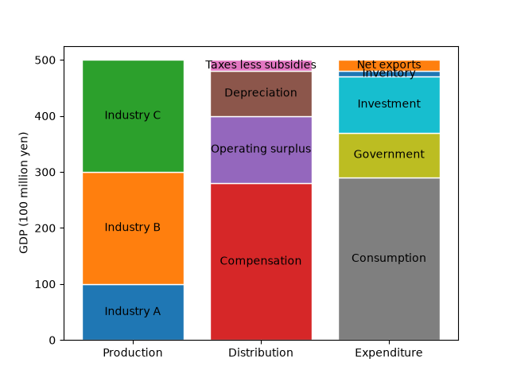
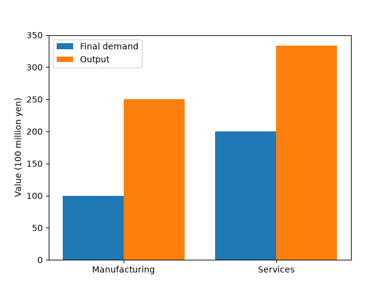

# 第 2 章: 三面等価と産業連関表

## 2.1 この章の地図

第 1 章では、GDP を、**生産**の側から（付加価値の合計として）計算しました。GDP は、**分配**（誰の所得になったか）と、**支出**（何に使われたか）の側からも、計算できます。この 3 つの値は、**事後的に一致**します（三面等価）。この章では、一致する理由（在庫品増加）を、関数とテストで確かめます。

もう 1 つの題材は、**産業連関表**です。産業どうしが、中間財を売り買いする関係を、表（行列）にしたものです。最終需要が決まったとき、各産業が、どれだけ作ればよいかを、連立方程式で求めます。ここで、**NumPy**を、初めて使います。



| 項目 | 内容 |
| :--- | :--- |
| 経済学の題材 | 三面等価（生産・分配・支出）、在庫品増加、産業連関表（縦計＝横計）、投入係数、レオンチェフ逆行列 |
| 使う Python の機能 | 関数、リスト、テスト（`pytest`）、**NumPy**（配列・行列の積・連立方程式） |
| 新しく導入するライブラリ | NumPy（この章で、必要な分だけ） |
| 完成形 | `gdp_production`、`gdp_distribution`、`gdp_expenditure`、`inventory_change`、`is_three_way_equal`、`input_coefficients`、`leontief_inverse`、`output_for_demand`、`io_totals`、`is_io_balanced` |
| ファイル | 実装: `lib/chapter02/three_way.py`、`lib/chapter02/input_output.py`、`lib/chapter02/plot.py`（図）／テスト: `test/chapter02/test_three_way.py`、`test/chapter02/test_input_output.py`、`test/chapter02/test_plot.py`（自分で書くときは、`practice/chapter02/` に、同じ名前で作ります） |
| データ | なし（手計算できる小さな例だけ） |

### 経済学の式とコードの対応

| 経済学 | 式 | コード |
| :--- | :--- | :--- |
| 生産面の GDP | 産出額の合計 − 中間投入の合計 | `gdp_production(output, intermediate)` |
| 分配面の GDP | 雇用者報酬 + 営業余剰 + 固定資本減耗 + 間接税 − 補助金 | `gdp_distribution(...)` |
| 支出面の GDP | 民間消費 + 政府消費 + 総固定資本形成 + 在庫品増加 + 純輸出 | `gdp_expenditure(...)` |
| 在庫品増加 | 生産 − 販売 | `inventory_change(production, sales)` |
| 投入係数 | a_ij = 部門 j が部門 i から買った額 ÷ 部門 j の産出 | `input_coefficients(transactions, output)` |
| 生産量 | (I − A) x = f を解く | `output_for_demand(coefficients, final_demand)` |
| レオンチェフ逆行列 | (I − A)⁻¹ | `leontief_inverse(coefficients)` |
| 縦計・横計 | 横計 = 販売先の合計、縦計 = 投入の合計 | `io_totals(...)`、`is_io_balanced(...)` |

この記事の[第 1 章](01-gdp-and-value-added.md)（付加価値の合計としての GDP）と、[第 1 シリーズ](../economics-programming/index.md)の第 1〜7 章（関数・pytest・Matplotlib の棒グラフ）を、前提とします。

第 1 シリーズの第 9 章（NumPy）・第 11 章（三面等価）と**題材が重なります**。この記事は、独立して読めるように、自分のコードを持ち、NumPy も、この章で必要な分だけ説明します。第 1 シリーズの NumPy を、先に読む必要はありません。

## 2.2 準備

サンプルコードは、リポジトリの `apps/macro-basics-programming/python/` にあります。環境の準備は、[第 1 章](01-gdp-and-value-added.md)の 1.2 節と同じです。NumPy は、`uv sync` で、すでに入っています。

```bash
cd apps/macro-basics-programming/python
uv sync
uv run pytest test/chapter02
```

```text
37 passed
```

自分でコードを書くときは、`practice/chapter02/` を作って、完成形と同じ名前（`three_way.py`・`test_three_way.py` など）のファイルに書きます。**完成形（`lib/` と `test/`）は、答え合わせ用です。** 自分で書き終えてから、開いてください。

## 2.3 予想する

次の問いに、**コードを見る前に**、予想してください（紙に書いてもかまいません）。

**三面等価**（単位は億円）

- **分配面**: 雇用者報酬 280、営業余剰 120、固定資本減耗 80、間接税 25、補助金 5 のとき、GDP は、いくつですか。**支出面**: 民間消費 290、政府消費 80、総固定資本形成 100、在庫品増加 10、純輸出 20 のとき、GDP は、いくつですか。2 つは、一致しますか
- 企業が、1 年間に、500 の財を作りました。消費・政府消費・設備投資・純輸出の合計（**販売**）が、490 のとき、**在庫品増加**は、いくつですか。販売が 520 だったら、いくつですか。どちらの場合も、支出面の GDP は、500 になりますか

**産業連関表**

- 2 つの部門（製造とサービス）があります。投入係数は、A = [[0.2, 0.3], [0.4, 0.1]]（行 i、列 j の値は、部門 j が部門 i から買う量の、部門 j の産出に対する割合）です。最終需要が [100, 200] のとき、各部門の**生産量**は、最終需要より大きくなりますか、小さくなりますか。いくつになりますか
- 次の表（億円）で、部門 1 の**横計**と**縦計**は、いくつですか。**最終需要の合計**と**付加価値の合計**は、どうですか

| | 部門 1 への販売 | 部門 2 への販売 | 最終需要 | 産出（横計） |
| :--- | ---: | ---: | ---: | ---: |
| 部門 1（製造） | 60 | 120 | 120 | ? |
| 部門 2（サービス） | 90 | 80 | 230 | ? |
| 付加価値 | 150 | 200 | | |
| 産出（縦計） | ? | ? | | |

## 2.4 三面等価と産業連関表の考え方

### 三面等価

GDP は、同じ経済活動を、3 つの側から、数えたものです。

| 面 | 数え方 | 式 |
| :--- | :--- | :--- |
| 生産 | 国内で生まれた付加価値 | 産出額の合計 − 中間投入の合計 |
| 分配 | 付加価値が、誰の所得になったか | 雇用者報酬 + 営業余剰・混合所得 + 固定資本減耗 + 間接税 − 補助金 |
| 支出 | 生産物が、何に使われたか | 民間消費 + 政府消費 + 総固定資本形成 + 在庫品増加 + 純輸出 |

分配面は、生産で生まれた付加価値が、**すべて、誰かの所得か、減耗か、税になる**と見て、数えます。「間接税 − 補助金」は、価格に含まれる税から、価格から差し引かれる補助金を引いたものです。企業の所得にはなりませんが、市場価格で測る GDP には、含まれます。

### 在庫品増加

作ったものは、すべて、売れるとは限りません。**売れ残りは、企業が、自分で買った**（在庫への投資をした）と、見なして、支出に数えます。

> 在庫品増加 = 生産 − 販売

こう数えるので、支出面は、**事前の計画**がどうであっても、**事後の結果**として、生産面に一致します。販売が、作った量を超えて、在庫を取り崩したときは、在庫品増加が**負**になります。

### 産業連関表

産業連関表は、産業どうしの取引を、行列にしたものです。

- **行（横）**: その部門の産出が、どこに売られたか（各部門への中間需要と、最終需要）
- **列（縦）**: その部門が、何を、どれだけ買って作ったか（各部門からの中間投入と、付加価値）

同じ部門の、**横計（販売の合計）と縦計（投入の合計）は、等しく**なります。どちらも、その部門の産出だからです。

> 産出 = 中間需要の合計 + 最終需要（横計）= 中間投入の合計 + 付加価値（縦計）

全部門で足すと、中間需要と中間投入は、同じ額なので、**最終需要の合計 = 付加価値の合計**（= GDP）になります。

### 投入係数とレオンチェフ逆行列

部門 j が、1 単位を作るのに、部門 i から、いくら買うかが、**投入係数** a_ij です。

> a_ij = 部門 j が部門 i から買った額 ÷ 部門 j の産出

投入係数を並べた行列を A、各部門の生産量を x、最終需要を f とすると、部門ごとの需給の式は、次のとおりです。

> x = A x + f（中間需要 + 最終需要 = 産出）

x について解くために、整理します。I は単位行列です。

> (I − A) x = f、つまり x = (I − A)⁻¹ f

(I − A)⁻¹ を、**レオンチェフ逆行列**と呼びます。最終需要を、必要な生産量に、変える行列です。製造の最終需要が増えると、製造に部品を売るサービスも、生産が増えます。生産量が、最終需要より、**大きく**なる理由です。

## 2.5 プログラミング

### NumPy を、なぜ使うのか

産業連関表の計算は、連立方程式です。2 部門なら、手で解けます。

> 0.8 x1 − 0.3 x2 = 100、−0.4 x1 + 0.9 x2 = 200

しかし、部門が 3 つ、10 になると、手では解けず、標準ライブラリだけで書くと、長くなります。**NumPy**は、配列と行列の計算を、短く、速く、書くための、Python の標準的なライブラリです。この章では、次の 4 つだけを、使います。

- `np.array(...)`: リストから、配列（ベクトル・行列）を作る。`.shape` が、形
- `A @ x`: 行列の積。行列とベクトルの積も、同じ記号
- `np.linalg.solve(M, f)`: 連立方程式 M x = f を解く。`np.linalg.inv(M)` は、逆行列
- `np.allclose(a, b)`: 配列が、誤差の範囲で、等しいか

実際に、動かします。

```python
import numpy as np

a = np.array([[0.2, 0.3], [0.4, 0.1]])
f = np.array([100, 200])
print(a.shape, f.shape)
print((a @ f).tolist())

m = np.eye(2) - a
x = np.linalg.solve(m, f)
print(x.round(2).tolist())
print(np.linalg.inv(m).round(3).tolist())
print(np.allclose(m @ x, f))
print(0.1 + 0.2 == 0.3, np.allclose(0.1 + 0.2, 0.3))
```

```text
(2, 2) (2,)
[80.0, 60.0]
[250.0, 333.33]
[[1.5, 0.5], [0.667, 1.333]]
True
False True
```

- `a @ f` は、行列とベクトルの積で、`[0.2 × 100 + 0.3 × 200, 0.4 × 100 + 0.1 × 200]` = `[80.0, 60.0]` です
- `np.eye(2)` は、2 × 2 の単位行列 I で、`np.eye(2) - a` が I − A です。`np.linalg.solve(m, f)` が、連立方程式 (I − A) x = f の解 `[250.0, 333.33]` を返します
- 解を、元の式に戻した `m @ x` が、`f` に一致するかは、`np.allclose` で確かめます。**小数の等しさに、`==` を使わない**のは、第 1 章の `pytest.approx` と、同じ理由です（最後の行のとおり、`0.1 + 0.2 == 0.3` は、`False`）
- 連立方程式は、逆行列を作ってかけるよりも、`np.linalg.solve` で解くほうが、安定しています。逆行列は、「最終需要が 1 増えたとき、生産量が、どれだけ増えるか」を、知りたいときに、使います

### Red: 三面等価のテスト

まず、三面等価の 3 つの面を、テストから書きます。生産面は、3 つの産業の産出額と中間投入、分配面と支出面は、予想で見た値です。

```python
OUTPUT = [300, 500, 700]


INTERMEDIATE = [200, 300, 500]


def test_生産面のGDPは産出額の合計から中間投入の合計を引いた値() -> None:
    assert gdp_production(OUTPUT, INTERMEDIATE) == 500


def test_分配面のGDPは4つの所得の合計() -> None:
    gdp = gdp_distribution(
        compensation=280,
        operating_surplus=120,
        depreciation=80,
        indirect_taxes=25,
        subsidies=5,
    )
    assert gdp == 500
```

支出面のテスト（民間消費 290・政府消費 80・総固定資本形成 100・在庫品増加 10・純輸出 20 で、500）も、同じ形です。`gdp_production` などが、まだないので、テストは失敗します（**Red**）。

### Green: 3 つの面を実装する

3 つの面は、足し算と引き算です。入力の産業の数が違うときは、エラーにします（このテストは、`test/chapter02/test_three_way.py` にあります）。分配面は、補助金を**引く**ことを、補助金が増えたときに、GDP が減るテストでも、確かめています。

```python
def gdp_production(output: Sequence[float], intermediate: Sequence[float]) -> float:
    """生産面の GDP = 産出額の合計 − 中間投入の合計（付加価値の合計）。"""
    if len(output) != len(intermediate):
        raise ValueError("産出額と中間投入は、同じ長さ（産業の数）にする")
    return sum(output) - sum(intermediate)


def gdp_distribution(
    compensation: float,
    operating_surplus: float,
    depreciation: float,
    indirect_taxes: float,
    subsidies: float,
) -> float:
    """分配面の GDP = 雇用者報酬 + 営業余剰 + 固定資本減耗 + 間接税 − 補助金。"""
    return compensation + operating_surplus + depreciation + indirect_taxes - subsidies


def gdp_expenditure(
    consumption: float,
    government: float,
    fixed_capital_formation: float,
    inventory: float,
    net_exports: float,
) -> float:
    """支出面の GDP = 民間消費 + 政府消費 + 総固定資本形成 + 在庫品増加 + 純輸出。"""
    return consumption + government + fixed_capital_formation + inventory + net_exports
```

### 在庫品増加で、事後的に一致する

3 つの面は、別々に計算した値です。**一致する理由**は、在庫品増加が、「生産 − 販売」で決まるからです。販売がどう変わっても、支出面の合計は、生産に一致する、という性質を、テストにします（`inventory_change` 自身の、生産 500・販売 490 で +10、販売が生産を超えると負、というテストは、`test/chapter02/test_three_way.py` にあります）。

```python
@pytest.mark.parametrize("sales", [470, 500, 520])
def test_在庫品増加を含めれば支出面は販売によらず生産面に一致する(sales: float) -> None:
    production = 500
    inventory = inventory_change(production, sales)
    # 販売 sales を、消費・政府消費・総固定資本形成・純輸出に分けて数える
    expenditure = gdp_expenditure(sales - 200, 80, 100, inventory, 20)
    assert expenditure == production
```

```python
def inventory_change(production: float, sales: float) -> float:
    """在庫品増加 = 生産 − 販売。売れ残りは、在庫への投資として、支出に数える。"""
    return production - sales
```

テストの中の `sales - 200` は、販売のうち、政府消費 80・総固定資本形成 100・純輸出 20 を、除いた残り（消費）です。販売が、470 でも 500 でも 520 でも、支出面は、500 になります。販売が 520 のときは、在庫品増加が −20（在庫の取り崩し）です。

最後に、3 つの面が、一致するかを、判定する関数です。小数の誤差を許すので、**最大と最小の差が、誤差以内か**で、判定します（ずれたら `False`、1e-12 の誤差は許す、というテストを、先に書いています）。

```python
def is_three_way_equal(
    production: float,
    distribution: float,
    expenditure: float,
    tolerance: float = 1e-9,
) -> bool:
    """3 つの面の GDP の、最大と最小の差が、誤差 tolerance 以内か。"""
    values = (production, distribution, expenditure)
    return max(values) - min(values) <= tolerance
```

### 産業連関表: Red

産業連関表のテストを書きます。投入係数と最終需要から、生産量を求める例は、手計算できます。(I − A) = [[0.8, −0.3], [−0.4, 0.9]] で、行列式は 0.8 × 0.9 − 0.3 × 0.4 = 0.6 です。x1 = (0.9 × 100 + 0.3 × 200) ÷ 0.6 = 250、x2 = (0.4 × 100 + 0.8 × 200) ÷ 0.6 = 1000 ÷ 3 ≈ 333.3 です。

```python
A = [[0.2, 0.3], [0.4, 0.1]]


FINAL_DEMAND = [100, 200]


TRANSACTIONS = [[60, 120], [90, 80]]


TABLE_OUTPUT = [300, 400]


def test_最終需要から生産量を求める() -> None:
    output = output_for_demand(A, FINAL_DEMAND)
    assert output == pytest.approx([250, 1000 / 3])


def test_投入係数は中間取引を産出で割った値() -> None:
    coefficients = input_coefficients(TRANSACTIONS, TABLE_OUTPUT)
    assert np.allclose(coefficients, [[0.2, 0.3], [0.3, 0.2]])
```

### 産業連関表: Green

入力の検査（形・負の係数・特異）は、まとめて、小さな補助関数にします。`np.linalg.solve` は、特異な行列に、NumPy 独自のエラー（`LinAlgError`）を出しますが、経済学の言葉で、分かるエラーにするため、先に、行列式を調べます。行列式が、正でないときは、特異、または、生産が成り立たない（ある部門が、自分の産出より多くを、投入に使う）ので、同じエラーにします。

補助関数 `_square`（正方行列か）と `_vector`（長さが、部門の数か）は、形が違うときに、エラーにします。

```python
_SINGULAR = 1e-12


def _leontief_matrix(coefficients: ArrayLike) -> NDArray[np.float64]:
    """I − A を返す。A が不正、または I − A が特異なら、エラー。"""
    a = _square(coefficients)
    if (a < 0).any():
        raise ValueError("投入係数は、負にならない")
    m = np.eye(len(a)) - a
    if np.linalg.det(m) < _SINGULAR:
        raise ValueError(
            "単位行列から投入係数を引いた行列が特異（行列式が 0 以下）で、解けない"
        )
    return m


def input_coefficients(
    transactions: ArrayLike, output: ArrayLike
) -> NDArray[np.float64]:
    """投入係数 a_ij = 部門 j が部門 i から買った額 ÷ 部門 j の産出。"""
    z = _square(transactions)
    x = _vector(output, len(z))
    if (x == 0).any():
        raise ValueError("産出が 0 の部門があり、投入係数を計算できない")
    return z / x


def output_for_demand(
    coefficients: ArrayLike, final_demand: ArrayLike
) -> NDArray[np.float64]:
    """最終需要 f を満たす生産量 x。(I − A) x = f を解く。"""
    m = _leontief_matrix(coefficients)
    f = _vector(final_demand, len(m))
    return np.linalg.solve(m, f)
```

エラーの経路も、先にテストを書きます。形が違う・産出が 0・最終需要の長さが違う・投入係数が負・行列式が負のときのテストは、`test/chapter02/test_input_output.py` にあります。ここでは、特異な行列のテストだけを示します。

```python
def test_単位行列から投入係数を引いた行列が特異ならエラー() -> None:
    singular = [[1.0, 0.0], [0.0, 0.5]]
    with pytest.raises(ValueError, match="特異"):
        leontief_inverse(singular)
    with pytest.raises(ValueError, match="特異"):
        output_for_demand(singular, FINAL_DEMAND)
```

### レオンチェフ逆行列と縦計・横計

逆行列は、最終需要が、1 増えたときの影響を、知るために使います（値は、下の確認で見ます）。縦計・横計は、表が、整合しているかの検査です。最終需要か付加価値を、1 だけずらすと、整合しなくなるテストも、あります。

```python
TABLE_FINAL_DEMAND = [120, 230]


TABLE_VALUE_ADDED = [150, 200]


def test_横計は販売先の合計で縦計は投入の合計() -> None:
    rows, columns = io_totals(TRANSACTIONS, TABLE_FINAL_DEMAND, TABLE_VALUE_ADDED)
    assert rows == pytest.approx([300, 400])
    assert columns == pytest.approx([300, 400])
```

```python
def leontief_inverse(coefficients: ArrayLike) -> NDArray[np.float64]:
    """レオンチェフ逆行列 (I − A)⁻¹。"""
    return np.linalg.inv(_leontief_matrix(coefficients))


def io_totals(
    transactions: ArrayLike, final_demand: ArrayLike, value_added: ArrayLike
) -> tuple[NDArray[np.float64], NDArray[np.float64]]:
    """（横計, 縦計）。横計 = 販売先の合計、縦計 = 投入の合計。"""
    z = _square(transactions)
    f = _vector(final_demand, len(z))
    v = _vector(value_added, len(z))
    return z.sum(axis=1) + f, z.sum(axis=0) + v


def is_io_balanced(
    transactions: ArrayLike, final_demand: ArrayLike, value_added: ArrayLike
) -> bool:
    """部門ごとに、縦計と横計が一致するか。"""
    rows, columns = io_totals(transactions, final_demand, value_added)
    return bool(np.allclose(rows, columns))
```

逆行列の読み方を、確かめます。製造の最終需要を、100 から 101 に 1 だけ増やしたときの、生産量の変化です。

```python
from lib.chapter02.input_output import leontief_inverse, output_for_demand

a = [[0.2, 0.3], [0.4, 0.1]]
inverse = leontief_inverse(a)
print(inverse.round(3).tolist())
before = output_for_demand(a, [100, 200])
after = output_for_demand(a, [101, 200])
print((after - before).round(3).tolist())
```

```text
[[1.5, 0.5], [0.667, 1.333]]
[1.5, 0.667]
```

- 2 行目は、逆行列の**第 1 列** [1.5, 0.667] と、一致しています。製造の最終需要が 1 増えると、製造の生産は 1.5、サービスの生産は 0.667 増えます。製造が 1 増えるのに、製造自身は、1.5 増えるのは、**製造の部品に、製造が必要**だからです

### 予想の答え合わせ

予想した答えを、プログラムで確かめます。

```python
from lib.chapter02.input_output import io_totals, output_for_demand
from lib.chapter02.three_way import (
    gdp_distribution,
    gdp_expenditure,
    gdp_production,
    inventory_change,
)

print("生産面:", gdp_production([300, 500, 700], [200, 300, 500]))
print("分配面:", gdp_distribution(280, 120, 80, 25, 5))
print("支出面:", gdp_expenditure(290, 80, 100, 10, 20))
for sales in (490, 520):
    inventory = inventory_change(500, sales)
    print("販売", sales, "在庫品増加", inventory, "支出面", sales + inventory)
output = output_for_demand([[0.2, 0.3], [0.4, 0.1]], [100, 200])
print("生産量:", output.round(2).tolist())
rows, columns = io_totals([[60, 120], [90, 80]], [120, 230], [150, 200])
print("横計:", rows.tolist(), "縦計:", columns.tolist())
print("最終需要の合計:", 120 + 230, "付加価値の合計:", 150 + 200)
```

```text
生産面: 500
分配面: 500
支出面: 500
販売 490 在庫品増加 10 支出面 500
販売 520 在庫品増加 -20 支出面 500
生産量: [250.0, 333.33]
横計: [300.0, 400.0] 縦計: [300.0, 400.0]
最終需要の合計: 350 付加価値の合計: 350
```

- **1 つ目の問い**: 分配面も支出面も 500 で、**一致します**。生産面（産出額の合計 1500 − 中間投入の合計 1000）も 500 で、3 つの面が、そろいます
- **2 つ目の問い**: 販売が 490 なら、在庫品増加は +10（売れ残り）、520 なら −20（在庫の取り崩し）です。**どちらも、支出面は 500 で、生産に一致します**。販売が、どうであっても、在庫品増加が、差を埋めるからです
- **3 つ目の問い**: 生産量は [250, 333.33] で、最終需要 [100, 200] より、**大きく**なります。部門どうしが、中間財を買い合うからです
- **4 つ目の問い**: 部門 1 の横計は 60 + 120 + 120 = 300、縦計は 60 + 90 + 150 = 300 で、一致します。部門 2 は、400 と 400 です。最終需要の合計と、付加価値の合計は、どちらも 350（= GDP）で、一致します

### 図

三面等価の図と、産業連関表の図を、描く関数を、テストから書きます。棒の高さ・積み上げの位置・部分の名前の位置・軸の名前を、手計算の値と、確かめます。たとえば、三面等価の図では、**積み上げた高さが、3 つの面で、すべて 500 になる**ことを、確かめます（テストは、`test/chapter02/test_plot.py` にあります）。

```python
def plot_three_way(sides: Mapping[str, Mapping[str, float]]) -> Figure:
    """生産・分配・支出の GDP を、部分を積み上げた棒で描く。

    面の名前 -> {部分の名前: 値}。三面等価が成り立てば、積み上げた高さは、すべて等しい。
    """
    fig, ax = plt.subplots()
    for position, (side, parts) in enumerate(sides.items()):
        bottom = 0.0
        for name, value in parts.items():
            ax.bar(side, value, bottom=bottom, edgecolor="white")
            ax.text(position, bottom + value / 2, name, ha="center", va="center")
            bottom += value
    ax.set_ylabel("GDP (100 million yen)")
    plt.close(fig)
    return fig
```

産業連関表の図 `plot_io_output` は、`output_for_demand` で、生産量を求めて、最終需要と並べる棒グラフです（`lib/chapter02/plot.py`）。



### 実行結果

```bash
uv run pytest test/chapter02
```

```text
37 passed
```

## 2.6 規則で言うと

1. **三面等価は、事後的な恒等式である。** 在庫品増加が、計画と実績の差を、埋めるので、どんな経済でも、3 つの面は、一致する。**一致しなかったら、統計か、計算が、間違っている**
2. **産業連関表は、部門ごとに、縦計 = 横計である。** 全部門で足すと、最終需要の合計 = 付加価値の合計（= GDP）
3. **連立方程式は、`solve` で解く。** 逆行列は、最終需要の変化の影響を、調べるときに作る

混同しやすい点を、表にまとめます。

| 混同しやすい点 | 違い |
| :--- | :--- |
| 事前と事後 | 企業が**計画**した在庫と、結果として**実現**した在庫は、違う。三面等価が一致するのは、**事後**（実現した値） |
| 縦計と横計 | 縦計は、**投入**（何を買って作ったか）。横計は、**販売**（どこに売ったか）。部門ごとに、どちらも産出に等しい |
| 投入係数とレオンチェフ逆行列 | 投入係数は、**直接**に必要な量。逆行列は、部品の部品まで含めた、**直接と間接**の合計 |
| 在庫品増加と在庫残高 | 在庫品増加は、**フロー**。在庫残高は、**ストック**。GDP の支出に入るのは、在庫品増加 |

### このモデルが成り立たない場面

- **投入係数は、一定という仮定です。** 実際には、価格や技術が変わると、係数も変わります。この章の生産量は、係数が、変わらないときの値です
- **供給の制約を、考えていません。** 必要な生産量が、設備や人手の限界を超えると、この計算どおりには、なりません
- **この章の表は、輸入と輸出を、省いています。** 実際の産業連関表は、輸入を控除する列（または、行）を持ちます。この章では、最終需要は、純輸出を含む、国内の最終需要とみなしています
- **統計では、3 つの面が、完全には一致しません。** 推計の方法が、面ごとに違うので、統計上の不突合が、残ります

## 2.7 練習問題

| 種類 | 問題 |
| :--- | :--- |
| 想起 | 本文を閉じて、`gdp_distribution` のテスト（雇用者報酬 280、営業余剰 120、固定資本減耗 80、間接税 25、補助金 5 で、GDP は 500）を書いてください |
| 生成 | 解説を見る前に、生産量から、それを満たす最終需要を求める `final_demand_for_output(coefficients, output)` を、テストから書いてください。生産量が [250, 1000 / 3] のとき、最終需要は、いくつになりますか |
| 多様 | 製造が、製造から買う割合（投入係数 a11）を、0.2 から 0.4 に増やすと、最終需要 [100, 200] のときの、製造の生産量は、250 より、大きくなりますか、小さくなりますか。サービスの生産量は、どうですか。先に予想してから、確かめてください |
| 交互 | [第 1 章](01-gdp-and-value-added.md)の `gdp_from_stages` と、この章の `gdp_production` に、同じ産出額・中間投入（[300, 500, 700]、[200, 300, 500]）を渡すと、同じ値になりますか。さらに、`gdp_production` の値が、産業連関表の付加価値の合計と、同じになる場合を、テストにしてください |

??? note "解答（先に自分で取り組んでから、開いてください）"

    **想起**:

    ```python
    def test_分配面のGDPは500() -> None:
        assert gdp_distribution(280, 120, 80, 25, 5) == 500
    ```

    **生成**: 需給の式 x = A x + f を、f について解きます。f = x − A x です。

    ```python
    def final_demand_for_output(coefficients, output):
        a = np.asarray(coefficients, dtype=float)
        x = np.asarray(output, dtype=float)
        return x - a @ x


    def test_生産量から最終需要を求める() -> None:
        a = [[0.2, 0.3], [0.4, 0.1]]
        demand = final_demand_for_output(a, [250, 1000 / 3])
        assert demand == pytest.approx([100, 200])
    ```

    **多様**: 製造が、製造から、より多く買うので、製造の生産は、**大きくなる**と予想できます。サービスも、製造の生産が増えて、サービスから、買う量が増えるので、大きくなります。

    ```python
    def test_製造の自己投入が増えると生産量が増える() -> None:
        base = output_for_demand([[0.2, 0.3], [0.4, 0.1]], [100, 200])
        more = output_for_demand([[0.4, 0.3], [0.4, 0.1]], [100, 200])
        assert more == pytest.approx([150 / 0.42, 160 / 0.42])
        assert all(more > base)
    ```

    (I − A) の行列式は 0.6 × 0.9 − 0.3 × 0.4 = 0.42 になり、製造は 150 ÷ 0.42 ≈ 357.1、サービスは 160 ÷ 0.42 ≈ 381.0 です。**係数が、少し変わるだけで、生産量は、大きく変わります。**

    **交互**:

    ```python
    def test_第1章の付加価値の合計と生産面のGDPは一致する() -> None:
        output = [300, 500, 700]
        intermediate = [200, 300, 500]
        assert gdp_from_stages(output, intermediate) == 500
        assert gdp_production(output, intermediate) == 500


    def test_生産面のGDPは産業連関表の付加価値の合計に一致する() -> None:
        transactions = [[60, 120], [90, 80]]
        value_added_by_sector = [150, 200]
        output = [300, 400]
        intermediate = list(np.sum(transactions, axis=0))
        assert gdp_production(output, intermediate) == sum(value_added_by_sector)
    ```

    産業連関表の、中間投入（列の合計）を渡すと、生産面の GDP が、付加価値の合計 350 に一致します。

## 2.8 振り返り

- 三面等価が、**在庫品増加**によって、事後的に成り立つことを、販売が違う 3 つの場合で、説明できますか
- 産業連関表の、縦計と横計が、一致する理由を、説明できますか。全部門で足すと、何と何が、等しくなりますか
- `np.linalg.solve` と `np.linalg.inv` を、どう使い分けますか

## 2.9 まとめ

- GDP を、生産（産出 1500 − 中間投入 1000）・分配（280 + 120 + 80 + 25 − 5）・支出（290 + 80 + 100 + 10 + 20）の 3 つの面から計算し、**すべて 500 で一致**した
- 在庫品増加（生産 − 販売）が、計画と実績の差を埋めるので、販売が 470 でも 520 でも、支出面は生産に一致する
- NumPy の、配列・行列の積（`@`）・連立方程式（`np.linalg.solve`）・逆行列（`np.linalg.inv`）・`np.allclose` を使った
- 投入係数 [[0.2, 0.3], [0.4, 0.1]] と最終需要 [100, 200] から、生産量 [250, 333.33] を求めた。最終需要より大きいのは、部門どうしが、中間財を買い合うため
- 産業連関表の、縦計と横計が一致し、最終需要の合計と付加価値の合計が、どちらも 350 になることを確かめた
- 次の章では、**物価指数**（GDP デフレータ・CPI）と、景気・雇用の指標を、計算します。そこで、**pandas** を、初めて使います
