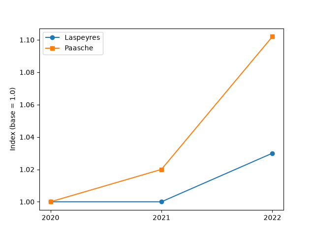
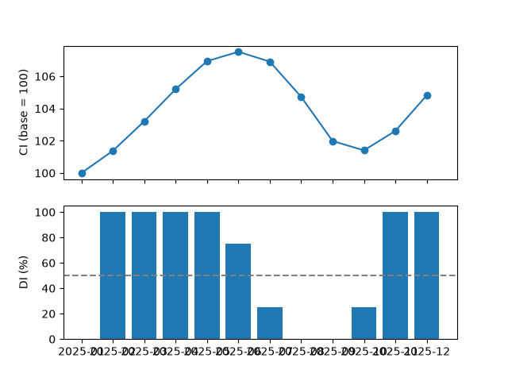

# 第 3 章: 物価指数と景気・雇用の指標

## 3.1 この章の地図

第 1・2 章では、GDP の**大きさ**を測りました。この章では、GDP を、**物価の変化**と、**数量の変化**に分けます。物価の変化を測るのが、**物価指数**です。同じ「物価」でも、数量を、基準の時点のものにするか（ラスパイレス）、比べる時点のものにするか（パーシェ）で、値が変わります。

あわせて、**景気の方向と大きさ**を測る景気動向指数（DI・CI）と、**雇用**の指標（有効求人倍率・完全失業率）を、計算します。月ごとの、表のデータを扱うので、ここで、**pandas**を、初めて使います。



| 項目 | 内容 |
| :--- | :--- |
| 経済学の題材 | 名目・実質 GDP、GDP デフレータ（パーシェ）、CPI・CGPI（ラスパイレス）、景気動向指数（DI・CI）、有効求人倍率、完全失業率 |
| 使う Python の機能 | 関数、リスト、テスト（`pytest`）、**pandas**（`DataFrame`・`Series`・列の計算・`diff`・`pct_change`・CSV の読み込み） |
| 新しく導入するライブラリ | pandas（この章で、必要な分だけ） |
| 完成形 | `laspeyres`、`paasche`、`real_gdp`、`gdp_deflator`、`price_indexes`、`diffusion_index`、`composite_index`、`job_openings_ratio`、`unemployment_rate`、`load_indicators` |
| ファイル | 実装: `lib/chapter03/price_index.py`、`lib/chapter03/indicators.py`、`lib/chapter03/plot.py`（図）／テスト: `test/chapter03/test_price_index.py`、`test/chapter03/test_indicators.py`、`test/chapter03/test_plot.py`（自分で書くときは、`practice/chapter03/` に、同じ名前で作ります） |
| 前提 | この記事の[第 1 章](01-gdp-and-value-added.md)・[第 2 章](02-three-way-equivalence.md)と、[第 1 シリーズ](../economics-programming/index.md)の第 1〜7 章。第 1 シリーズの第 11 章（pandas）・第 12 章（実質 GDP）と**題材が重なります**が、この記事は、独立して読めます |
| データ | 手計算できる小さな例と、**架空の**月次指標 `data/ch03_indicators.csv`（実在の統計ではありません。`data/README.md` に、作り方があります） |

### 経済学の式とコードの対応

| 経済学 | 式 | コード |
| :--- | :--- | :--- |
| ラスパイレス指数 | Σ(比較時の価格 × **基準時**の数量) ÷ Σ(基準時の価格 × 基準時の数量) | `laspeyres(base_prices, base_quantities, current_prices)` |
| パーシェ指数 | Σ(比較時の価格 × **比較時**の数量) ÷ Σ(基準時の価格 × 比較時の数量) | `paasche(base_prices, current_prices, current_quantities)` |
| 実質 GDP | 名目 GDP ÷ GDP デフレータ × 100 | `real_gdp(nominal, deflator)` |
| GDP デフレータ | 名目 GDP ÷ 実質 GDP × 100 | `gdp_deflator(nominal, real)` |
| DI | 上昇した系列の割合（％）。50％超で上向き | `diffusion_index(indicators)` |
| CI | 系列の変化率の平均を積み上げる。基準 = 100 | `composite_index(indicators, base)` |
| 有効求人倍率 | 有効求人数 ÷ 有効求職者数 | `job_openings_ratio(openings, applicants)` |
| 完全失業率 | 完全失業者 ÷ 労働力人口 × 100 | `unemployment_rate(employed, unemployed)` |

## 3.2 準備

サンプルコードは、リポジトリの `apps/macro-basics-programming/python/` にあります。環境の準備は、[第 1 章](01-gdp-and-value-added.md)の 1.2 節と同じです。pandas は、`uv sync` で、すでに入っています。

```bash
cd apps/macro-basics-programming/python
uv sync
uv run pytest test/chapter03
```

```text
36 passed
```

自分でコードを書くときは、`practice/chapter03/` を作って、完成形と同じ名前（`price_index.py`・`test_price_index.py` など）のファイルに書きます。CSV は、`data/ch03_indicators.csv` を、そのまま使います。**完成形（`lib/` と `test/`）は、答え合わせ用です。** 自分で書き終えてから、開いてください。

## 3.3 予想する

次の問いに、**コードを見る前に**、予想してください（紙に書いてもかまいません）。

**物価指数**

- 2 つの財の、基準時の価格が [100, 200]、数量が [10, 5] でした。比較時には、価格が [110, 180]、数量が [12, 4] になりました。**ラスパイレス指数**（基準時の数量を使う）と、**パーシェ指数**（比較時の数量を使う）は、それぞれ、いくつですか。どちらが大きいですか
- 比較時の名目 GDP（価格 × 数量の合計）が 2040、基準時の価格で測った実質 GDP が 2000 のとき、**GDP デフレータ**は、いくつですか。デフレータが 102 のとき、名目 GDP 2040 を、**実質 GDP**に直すと、いくつですか

**景気と雇用**

- 3 つの系列の、4 か月の値は、次のとおりです。月ごとの **DI**は、いくつですか。DI が 50％を超えて、景気が**上向き**なのは、どの月ですか

| 月 | 系列 a | 系列 b | 系列 c |
| :--- | ---: | ---: | ---: |
| m0 | 100 | 50 | 200 |
| m1 | 110 | 50 | 190 |
| m2 | 105 | 55 | 195 |
| m3 | 120 | 60 | 210 |

- 就業者が 6500、完全失業者が 200 のとき、**完全失業率**は、いくつですか。有効求人数が 1500、有効求職者数が 1000 のとき、**有効求人倍率**は、いくつですか

## 3.4 物価指数と景気・雇用の指標の考え方

### 名目と実質

**名目 GDP** は、その年の価格で測った GDP です。物価が上がると、数量が変わらなくても、増えます。**実質 GDP** は、基準の年の価格で測った GDP で、**数量の変化だけ**を表します。

> 名目 GDP = 実質 GDP × GDP デフレータ ÷ 100

デフレータは、基準年を 100 とする指数です。1.02 倍ではなく、102 と書くので、÷ 100 が、必要です。

### ラスパイレスとパーシェ

物価指数は、**固定した買い物かご**の値段が、基準時から、どれだけ変わったかを測ります。かごの中身（数量）を、どの時点のものにするかで、2 種類あります。

| 指数 | 数量 | 使われる指標 |
| :--- | :--- | :--- |
| ラスパイレス | **基準時**の数量 | CPI（消費者物価指数。家計の消費）、CGPI（企業物価指数。企業間取引） |
| パーシェ | **比較時**の数量 | GDP デフレータ |

GDP デフレータが、パーシェ型なのは、**名目 GDP ÷ 実質 GDP** だからです。名目 GDP は、比較時の価格 × 比較時の数量、実質 GDP は、基準時の価格 × 比較時の数量です。

### 景気動向指数

景気動向指数は、景気に関係する、いくつもの系列を、まとめた指標です。系列は、景気に先行するもの（新規求人数・株価）、一致するもの（生産指数・有効求人倍率・商業販売額）、遅れるもの（完全失業率・家計消費支出・法人税収入）に、分けます。

- **DI**（ディフュージョン・インデックス）は、景気の**方向**を表します。前の月より上昇した系列の割合です。**一致 DI が 50％を超える**と、景気は上向きです
- **CI**（コンポジット・インデックス）は、景気の**大きさ**（勢い）を表します。系列の変化率の平均を、積み上げた指数で、基準年を 100 とします

### 雇用の指標

> 有効求人倍率 = 有効求人数 ÷ 有効求職者数

1 を超えると、求職者 1 人あたりの求人が、1 件より多い、という意味です。
> 完全失業率 = 完全失業者 ÷ 労働力人口、労働力人口 = 就業者 + 完全失業者

分母は、**就業者を含む、労働力人口**です。完全失業者を、就業者で割るのではありません。

## 3.5 プログラミング

### pandas を、なぜ使うのか

物価の表（期間 × 品目）や、景気の指標の表（月 × 系列）は、**行と列に、名前の付いた表**です。リストの、リストで書くと、「何行目の、何列目」を、番号で覚えることになります。**pandas**は、表を、行と列の**名前**で扱えます。この章では、次だけを、使います。

- `pd.DataFrame({...}, index=[...])`: 表を作る。`pd.Series`: 表の 1 列（名前の付いた 1 次元の値）
- `df["列"]`、`df.loc["行"]`: 列、行を、名前で選ぶ
- `df * other`、`df.sum(axis=1)`: 列の名前をそろえて、計算する。行ごとの合計
- `df.diff()`、`df.pct_change()`: 前の行との差、変化率
- `pd.read_csv(...)`: CSV を読む

実際に、動かします。

```python
import pandas as pd

prices = pd.DataFrame(
    {"bread": [100, 110], "milk": [200, 180]}, index=["2020", "2021"]
)
quantities = pd.DataFrame({"bread": [10, 12], "milk": [5, 4]}, index=["2020", "2021"])
print(prices)
print(prices.loc["2021"].tolist())
print((prices * quantities).sum(axis=1).tolist())
print(prices.pct_change().round(3))
```

```text
      bread  milk
2020    100   200
2021    110   180
[110, 180]
[2000, 2040]
      bread  milk
2020    NaN   NaN
2021    0.1  -0.1
```

- `prices["bread"]` は、パンの列、`prices.loc["2021"]` は、2021 年の行です（上は、行を選んだ値）
- `prices * quantities` は、同じ行・同じ列どうしを、かけます。`.sum(axis=1)` で、行ごと（年ごと）に足して、**支出の合計**（2000、2040）です
- `pct_change()` の、最初の行は、前の行がないので、`NaN`（欠けた値）です。0.1 は、パンが 10％ 上がったこと、−0.1 は、牛乳が 10％ 下がったことを、表します（`diff()` は、差を返します。DI で使います）

### Red: ラスパイレスとパーシェ

予想の最初の問いの値を、テストにします。

```python
import pytest

from lib.chapter03.price_index import laspeyres, paasche
```

```python
BASE_PRICES = [100, 200]
BASE_QUANTITIES = [10, 5]
PRICES = [110, 180]
QUANTITIES = [12, 4]


def test_ラスパイレスは基準時の数量で比較時の価格を評価する() -> None:
    # (110 × 10 + 180 × 5) ÷ (100 × 10 + 200 × 5) = 2000 ÷ 2000
    assert laspeyres(BASE_PRICES, BASE_QUANTITIES, PRICES) == pytest.approx(1.0)


def test_パーシェは比較時の数量で価格の変化を評価する() -> None:
    # (110 × 12 + 180 × 4) ÷ (100 × 12 + 200 × 4) = 2040 ÷ 2000
    assert paasche(BASE_PRICES, PRICES, QUANTITIES) == pytest.approx(1.02)
```

`laspeyres` と `paasche` が、まだないので、テストは失敗します（**Red**）。

### Green: 物価指数を実装する

分子と分母は、どちらも、「価格 × 数量の合計」です。まず、その合計を、補助関数 `_spending` にします（割り算は、分母が 0 なら、エラーにする `_ratio` に、まとめています）。

```python
def _spending(prices: Sequence[float], quantities: Sequence[float]) -> float:
    """支出額 = 価格 × 数量 の合計。品目の数が違えばエラー。"""
    if len(prices) != len(quantities):
        raise ValueError("価格と数量は、同じ長さ（品目の数）にする")
    return sum(p * q for p, q in zip(prices, quantities, strict=True))


def laspeyres(
    base_prices: Sequence[float],
    base_quantities: Sequence[float],
    current_prices: Sequence[float],
) -> float:
    """ラスパイレス指数 = Σ(比較時の価格 × 基準時の数量) ÷ Σ(基準時の支出)。

    数量は、基準時のものを使う。
    """
    return _ratio(
        _spending(current_prices, base_quantities),
        _spending(base_prices, base_quantities),
    )


def paasche(
    base_prices: Sequence[float],
    current_prices: Sequence[float],
    current_quantities: Sequence[float],
) -> float:
    """パーシェ指数 = Σ(比較時の価格 × 比較時の数量) ÷ Σ(基準時の価格 × 比較時の数量)。

    数量は、比較時のものを使う。
    """
    return _ratio(
        _spending(current_prices, current_quantities),
        _spending(base_prices, current_quantities),
    )
```

??? note "import と補助関数（写すときに足す）"

    記事の抜粋には、import と、先頭が `_` の補助関数・定数を、省いています。完成形のファイルの先頭にある、次の部分を、写してください。

    **lib/chapter03/indicators.py**

    ```python
    from pathlib import Path
    ```

    ```python
    import pandas as pd
    ```

    **lib/chapter03/price_index.py**

    ```python
    from collections.abc import Sequence
    ```

    ```python
    import pandas as pd
    ```

    ```python
    def _spending(prices: Sequence[float], quantities: Sequence[float]) -> float:
        """支出額 = 価格 × 数量 の合計。品目の数が違えばエラー。"""
        if len(prices) != len(quantities):
            raise ValueError("価格と数量は、同じ長さ（品目の数）にする")
        return sum(p * q for p, q in zip(prices, quantities, strict=True))
    ```

    ```python
    def _ratio(numerator: float, denominator: float) -> float:
        if denominator == 0:
            raise ValueError("基準時の支出が 0 で、指数を計算できない")
        return numerator / denominator
    ```

ラスパイレスは、**数量を、基準時のものだけ**受け取ります。比較時の数量は、引数にありません。比較時の数量が、どう変わっても、ラスパイレスは、変わりません。品目の数が違うとき（`_spending`）と、基準時の支出が 0 のとき（`_ratio`）は、エラーです（どちらもテストがあります）。

数量が、基準時から変わらなければ、2 つの指数は、一致します（`test_数量が変わらなければラスパイレスとパーシェは一致する`）。

### 名目 GDP・実質 GDP・GDP デフレータ

GDP デフレータは、名目 GDP ÷ 実質 GDP × 100 です。**基準時の価格で測った実質 GDP**を使うと、パーシェ指数の 100 倍に、一致します。これを、テストにします。

```python
def test_GDPデフレータは基準時価格で測った実質GDPで名目GDPを割る() -> None:
    nominal = sum(p * q for p, q in zip(PRICES, QUANTITIES, strict=True))
    real = sum(p * q for p, q in zip(BASE_PRICES, QUANTITIES, strict=True))
    assert (nominal, real) == (2040, 2000)
    assert gdp_deflator(nominal, real) == pytest.approx(
        100 * paasche(BASE_PRICES, PRICES, QUANTITIES)
    )
```

```python
def gdp_deflator(nominal: float, real: float) -> float:
    """GDP デフレータ = 名目 GDP ÷ 実質 GDP × 100。"""
    if real == 0:
        raise ValueError("実質 GDP が 0 で、デフレータを計算できない")
    return nominal / real * 100
```

逆に、実質 GDP を求める `real_gdp` は、名目 GDP ÷ デフレータ × 100 です。デフレータが 0 以下、実質 GDP が 0 のときは、エラーです。

### 表で計算する: pandas

品目や期間が増えると、リストを、1 つずつ渡すのは、面倒です。期間 × 品目の表（上）を、そのまま渡して、**各期のラスパイレスとパーシェを、一度に**求める関数 `price_indexes` を、作ります。テストは、表の列が `laspeyres`・`paasche` で、値が、リストで 1 つずつ計算した値に一致することを、確かめます。

```python
PRICE_TABLE = pd.DataFrame(
    {"bread": [100, 110, 121], "milk": [200, 180, 170]},
    index=["2020", "2021", "2022"],
)


QUANTITY_TABLE = pd.DataFrame(
    {"bread": [10, 12, 14], "milk": [5, 4, 3]},
    index=["2020", "2021", "2022"],
)
```

```python
def price_indexes(
    prices: pd.DataFrame, quantities: pd.DataFrame, base: str
) -> pd.DataFrame:
    """各期のラスパイレス指数とパーシェ指数の表（行は期間、列は laspeyres・paasche）。

    prices・quantities は、行が期間、列が品目の表。base は、基準時の期間の名前。
    """
    if not (
        prices.index.equals(quantities.index)
        and prices.columns.equals(quantities.columns)
    ):
        raise ValueError("価格と数量の表は、期間と品目をそろえる")
    if base not in prices.index:
        raise ValueError(f"基準時 {base} が、表の期間にない")
    base_prices, base_quantities = prices.loc[base], quantities.loc[base]
    # 基準時の価格で測った、各期の支出。基準時の値が、基準時の支出
    paasche_base = (quantities * base_prices).sum(axis=1)
    if (paasche_base == 0).any():
        raise ValueError("基準時の支出が 0 の期間があり、指数を計算できない")
    base_spending = paasche_base[base]
    return pd.DataFrame(
        {
            "laspeyres": (prices * base_quantities).sum(axis=1) / base_spending,
            "paasche": (prices * quantities).sum(axis=1) / paasche_base,
        }
    )
```

`prices * base_quantities` は、表（期間 × 品目）の各行に、基準時の数量（品目ごとの値）を、**品目の名前をそろえて**かけます。表の形が違うときと、基準時が表にないときは、エラーにします。

表は、2020 年が（1.0、1.0）、2021 年が（1.0、1.02）、2022 年が（1.03、1.102）です。この例では、パンが値上がりしたのに、パンの数量が増えるように、数量を作ったので、パーシェが、ラスパイレスより大きくなりました。**値上がりした財を減らす**ふつうの買い方なら、逆に、パーシェのほうが小さくなります（練習問題の「多様」）。

### 景気動向指数: DI と CI

DI は、「前の月より上昇した系列の割合」です。`diff()` で、前の月との差を作り、正の数を数えます。変わらない系列は、半分と数えます。

```python
SERIES = pd.DataFrame(
    {
        "a": [100, 110, 105, 120],
        "b": [50, 50, 55, 60],
        "c": [200, 190, 195, 210],
    },
    index=["m0", "m1", "m2", "m3"],
)


def test_DIは上昇した系列の割合で変わらない系列は半分と数える() -> None:
    di = diffusion_index(SERIES)
    assert math.isnan(di["m0"])
    # m1: a が上昇（1）、b が変わらない（0.5）、c が低下（0）→ 1.5 ÷ 3
    assert di["m1"] == pytest.approx(50)
    assert di["m2"] == pytest.approx(200 / 3)
    assert di["m3"] == pytest.approx(100)
```

```python
def diffusion_index(indicators: pd.DataFrame) -> pd.Series:
    """DI（％）。前の月より上昇した系列の割合。変わらない系列は半分と数える。

    行は月、列は系列。最初の月と、欠損のある月は、計算できないので NaN。
    50％を超えると、景気は上向き。
    """
    change = indicators.diff()
    score = (change > 0).sum(axis=1) + 0.5 * (change == 0).sum(axis=1)
    di = score / indicators.shape[1] * 100
    known: pd.Series = di.where(change.notna().all(axis=1))
    return known
```

最初の月は、前の月がないので、DI を計算できず、`NaN` です（`.where(...)` で、`NaN` にします）。CI は、各系列の変化率の平均を、**積み上げて**、基準の月を 100 に、そろえます。たとえば、2 つの系列 [100, 110, 121] と [200, 200, 220] なら、変化率の平均は、5％ と 10％ なので、CI は [100, 105, 115.5] です（このテストも、あります）。

```python
def composite_index(indicators: pd.DataFrame, base: str) -> pd.Series:
    """CI。各系列の前の月からの変化率の平均を、積み上げた指数。base の月が 100。"""
    if base not in indicators.index:
        raise ValueError(f"基準の月 {base} が、表にない")
    change = indicators.pct_change().mean(axis=1).fillna(0)
    index = (1 + change).cumprod() * 100
    rebased: pd.Series = index / index[base] * 100
    return rebased
```

### 雇用の指標

有効求人倍率（1500 ÷ 1000 = 1.5）と完全失業率は、割り算です。分母が 0（求職者数が 0 以下、労働力人口が 0）のときは、エラーにします。

```python
def test_完全失業率は完全失業者を労働力人口で割った値() -> None:
    # 労働力人口 = 6500 + 200 = 6700、200 ÷ 6700 × 100
    assert unemployment_rate(employed=6500, unemployed=200) == pytest.approx(2.9850746)
```

```python
def unemployment_rate(employed: float, unemployed: float) -> float:
    """完全失業率（％）= 完全失業者 ÷ 労働力人口 × 100。

    労働力人口 = 就業者 + 完全失業者。
    """
    if employed < 0 or unemployed < 0:
        raise ValueError("就業者数と完全失業者数は、負にならない")
    labor_force = employed + unemployed
    if labor_force == 0:
        raise ValueError("労働力人口が 0 で、完全失業率を計算できない")
    return unemployed / labor_force * 100
```

`job_openings_ratio` も、同じ形です（求人数が負、求職者数が 0 以下ならエラー）。

### データを読み込む: CSV

月次の指標は、CSV に置きます（架空のデータ。`data/README.md`）。1 列目の `month` を、行の名前にして、読み込みます。欠損が、あれば、エラーにします。

```python
def load_indicators(path: Path | str) -> pd.DataFrame:
    """CSV の指標を読み込む。1 列目（month）を行の名前にする。欠損があればエラー。"""
    table = pd.read_csv(path, index_col="month", dtype={"month": str})
    if table.isna().any().any():
        raise ValueError("指標の CSV に、欠損がある")
    return table
```

```python
from pathlib import Path

from lib.chapter03.indicators import (
    composite_index,
    diffusion_index,
    load_indicators,
)

table = load_indicators(Path("data/ch03_indicators.csv"))
print(table.shape)
print(list(table.columns))
print(table.loc["2025-01"].tolist())
di = diffusion_index(table)
ci = composite_index(table, base="2025-01")
print(di.round(1).tolist())
print(ci.round(2).tolist())
print("上向きの月:", list(di[di > 50].index))
```

```text
(12, 4)
['production', 'retail_sales', 'job_openings_ratio', 'income']
[100.0, 200.0, 1.2, 300.0]
[nan, 100.0, 100.0, 100.0, 100.0, 75.0, 25.0, 0.0, 0.0, 25.0, 100.0, 100.0]
[100.0, 101.38, 103.21, 105.2, 106.94, 107.52, 106.92, 104.73, 101.99, 101.41, 102.61, 104.82]
上向きの月: ['2025-02', '2025-03', '2025-04', '2025-05', '2025-06', '2025-11', '2025-12']
```

DI は、2〜5 月に 100（4 系列すべてが上昇）、6 月に 75、7 月に 25、8・9 月に 0 と下がり、11・12 月に、100 に戻ります。50％を超えるのは、2〜6 月と、11・12 月です。CI は、6 月に、いちばん高く（107.52）、そのあと、9 月にかけて、下がります。**DI が 50％を割った 7 月に、CI は、まだ、106.92 と、高い水準**です。方向（DI）と、大きさ（CI）が、別のことを表している、ということです。

### 予想の答え合わせ

予想した答えを、プログラムで確かめます。

```python
import pandas as pd

from lib.chapter03.indicators import (
    diffusion_index,
    job_openings_ratio,
    unemployment_rate,
)
from lib.chapter03.price_index import gdp_deflator, laspeyres, paasche, real_gdp

print("ラスパイレス:", laspeyres([100, 200], [10, 5], [110, 180]))
print("パーシェ:", paasche([100, 200], [110, 180], [12, 4]))
print("GDP デフレータ:", gdp_deflator(2040, 2000))
print("実質 GDP:", real_gdp(2040, 102))
series = pd.DataFrame(
    {"a": [100, 110, 105, 120], "b": [50, 50, 55, 60], "c": [200, 190, 195, 210]},
    index=["m0", "m1", "m2", "m3"],
)
di = diffusion_index(series)
print("DI:", di.dropna().round(1).tolist())
print("上向きの月:", list(di[di > 50].index))
print("完全失業率:", round(unemployment_rate(6500, 200), 3))
print("有効求人倍率:", job_openings_ratio(1500, 1000))
```

```text
ラスパイレス: 1.0
パーシェ: 1.02
GDP デフレータ: 102.0
実質 GDP: 2000.0
DI: [50.0, 66.7, 100.0]
上向きの月: ['m2', 'm3']
完全失業率: 2.985
有効求人倍率: 1.5
```

- **1 つ目の問い**: ラスパイレスは (110 × 10 + 180 × 5) ÷ (100 × 10 + 200 × 5) = 2000 ÷ 2000 = 1.0、パーシェは (110 × 12 + 180 × 4) ÷ (100 × 12 + 200 × 4) = 2040 ÷ 2000 = 1.02 です。**パーシェのほうが大きい**です。同じ価格の変化でも、数量を、どの時点のものにするかで、値が変わります
- **2 つ目の問い**: GDP デフレータは 2040 ÷ 2000 × 100 = 102、実質 GDP は 2040 ÷ 102 × 100 = 2000 です。デフレータ 102 は、パーシェ指数 1.02 の 100 倍で、一致しています
- **3 つ目の問い**: m1 は、a が上昇、b が変わらない（半分）、c が低下なので、(1 + 0.5 + 0) ÷ 3 = 50％ です。m2 は、b と c が上昇し、a が低下なので 66.7％、m3 は、3 つとも上昇なので 100％ です。**50％を超えるのは、m2 と m3**です。m1 の 50％ は、ちょうど 50 で、「超えて」いないので、上向きとは、言いません
- **4 つ目の問い**: 労働力人口は 6500 + 200 = 6700 なので、完全失業率は 200 ÷ 6700 × 100 ≈ 2.985％ です。有効求人倍率は 1500 ÷ 1000 = 1.5 で、求人のほうが、求職者より多い状態です

### 図

物価指数の図と、景気動向指数の図を、描く関数を、テストから書きます。線の値、棒の高さ、50％の線、軸の名前を、確かめます（テストは、`test/chapter03/test_plot.py` にあります）。

```python
def plot_price_indexes(table: pd.DataFrame) -> Figure:
    """ラスパイレス指数とパーシェ指数を、期間ごとに、2 本の線で描く。"""
    fig, ax = plt.subplots()
    ax.plot(table.index, table["laspeyres"], marker="o", label="Laspeyres")
    ax.plot(table.index, table["paasche"], marker="s", label="Paasche")
    ax.set_ylabel("Index (base = 1.0)")
    ax.legend()
    plt.close(fig)
    return fig
```

景気動向指数の図 `plot_business_indexes` は、上の段に CI の線を、下の段に DI の棒と 50％の点線を、描きます（`lib/chapter03/plot.py`）。



### 実行結果

```bash
uv run pytest test/chapter03
```

```text
36 passed
```

## 3.6 規則で言うと

1. **名目 GDP = 実質 GDP × GDP デフレータ ÷ 100。** デフレータは、基準年が 100 の指数なので、÷ 100 を、忘れない
2. **ラスパイレスは基準時の数量、パーシェは比較時の数量。** 数量を渡す引数が、どちらの指数に、あるかで、区別できる
3. **DI は方向、CI は大きさ。** DI が 50％を超えれば上向きだが、CI の水準が高いとは、限らない

混同しやすい点を、表にまとめます。

| 混同しやすい点 | 違い |
| :--- | :--- |
| GDP デフレータと CPI | GDP デフレータは**パーシェ**型（比較時の数量。国内で作られたもの全体）。CPI・CGPI は**ラスパイレス**型（基準時の数量。家計の消費・企業間取引の、固定した買い物かご） |
| 名目と実質 | 名目は、その年の価格。実質は、基準年の価格。実質の変化は、数量の変化だけ |
| DI と CI | DI は、上昇した系列の**割合**（方向）。CI は、変化率の**平均を積み上げた値**（大きさ） |
| 労働力人口と就業者 | 労働力人口 = 就業者 + 完全失業者。完全失業率の分母は、労働力人口。非労働力人口（学生・専業主婦など）は、含まない |

### このモデルが成り立たない場面

- **固定した買い物かごは、現実と、ずれます。** 値上がりした財を、減らす（代替）と、ラスパイレスは、生活費の上昇を、大きく見積もります。新しい商品や、品質の向上も、固定したかごでは、扱えません
- **この章の DI・CI は、簡略版です。** 実際の景気動向指数は、系列ごとに、変動の大きさをそろえる処理や、季節調整が、あります。この章のデータは、架空です

## 3.7 練習問題

| 種類 | 問題 |
| :--- | :--- |
| 想起 | 本文を閉じて、`laspeyres` の最初のテスト（基準時 p = [100, 200]、q = [10, 5]、比較時 p = [110, 180] で、1.0）を書いてください |
| 生成 | 解説を見る前に、物価指数の系列から、前の期からの上昇率（％）を返す `index_growth_rate(index)` を、テストから書いてください。pandas の `pct_change` を使います。[100, 102, 104.04] のとき、いくつになりますか |
| 多様 | 比較時の数量が [12, 4] ではなく、値上がりした財（パン）を減らし、値下がりした財（牛乳）を増やした [8, 6] だったら、パーシェ指数は、ラスパイレス指数（1.0）より、大きくなりますか、小さくなりますか。先に予想してから、確かめてください |
| 交互 | [第 2 章](02-three-way-equivalence.md)の `gdp_expenditure`（民間消費 290・政府消費 80・総固定資本形成 100・在庫品増加 10・純輸出 20）で求めた名目の支出面 GDP を、GDP デフレータ 102 で、実質 GDP に直してください。実質 GDP は、名目より、大きいですか、小さいですか |

??? note "解答（先に自分で取り組んでから、開いてください）"

    **想起**:

    ```python
    def test_ラスパイレスは1() -> None:
        assert laspeyres([100, 200], [10, 5], [110, 180]) == pytest.approx(1.0)
    ```

    **生成**:

    ```python
    def index_growth_rate(index):
        return index.pct_change() * 100


    def test_物価上昇率は前の期からの変化率() -> None:
        rates = index_growth_rate(pd.Series([100, 102, 104.04]))
        assert pd.isna(rates.iloc[0])
        assert rates.iloc[1:].tolist() == pytest.approx([2.0, 2.0])
    ```

    **多様**: 値上がりした財を減らすと、比較時の数量での、価格の上昇は、小さくなります。パーシェは、ラスパイレスより、**小さくなる**と予想できます。

    ```python
    def test_値上がりした財を減らすとパーシェはラスパイレスより小さい() -> None:
        base_prices, base_quantities, prices = [100, 200], [10, 5], [110, 180]
        lasp = laspeyres(base_prices, base_quantities, prices)
        paas = paasche(base_prices, prices, [8, 6])
        assert lasp == pytest.approx(1.0)
        assert paas == pytest.approx(1960 / 2000)
        assert paas < lasp
    ```

    パーシェは 1960 ÷ 2000 = 0.98 です。**値上がりした財を減らす、ふつうの代替では、ラスパイレスのほうが大きく**なります。

    **交互**:

    ```python
    def test_名目の支出面GDPを実質に直すと名目より小さい() -> None:
        nominal = gdp_expenditure(290, 80, 100, 10, 20)
        real = real_gdp(nominal, 102)
        assert nominal == 500
        assert real == pytest.approx(500 / 1.02)
        assert real < nominal
    ```

    デフレータが 100 より大きい（物価が上がった）ので、実質 GDP は、名目より小さく（約 490.2）なります。

## 3.8 振り返り

- ラスパイレスとパーシェの違いを、「どの時点の数量を使うか」で、説明できますか。GDP デフレータが、パーシェ型になる理由は、何ですか
- DI が 50％を割っても、CI が高いままなのは、なぜですか

## 3.9 まとめ

- 物価指数を、ラスパイレス（基準時の数量。1.0）とパーシェ（比較時の数量。1.02）で、計算した。GDP デフレータ（102）は、パーシェ指数の 100 倍で、名目 GDP（2040）÷ 実質 GDP（2000）に、一致する
- pandas の、`DataFrame`・列の計算・`diff`・`pct_change`・`read_csv` を使って、期間 × 品目の表から、物価指数を、一度に求めた
- DI（上昇した系列の割合。50％超で上向き）と CI（変化率の平均の積み上げ。基準 = 100）を、架空の月次指標から求めた。DI が 50％を割ったあとも、CI は、しばらく高かった
- 有効求人倍率（1500 ÷ 1000 = 1.5）と、完全失業率（200 ÷ 6700 ≈ 2.985％）を、計算した。分母は、労働力人口
- 次の章では、**45 度線分析**で、消費関数から、均衡国民所得と乗数を、求めます
