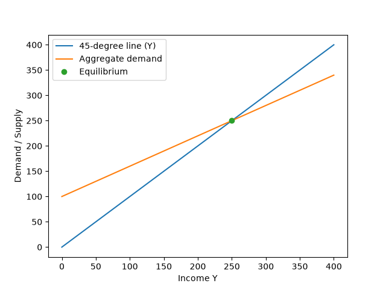
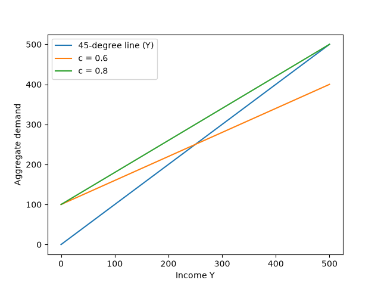
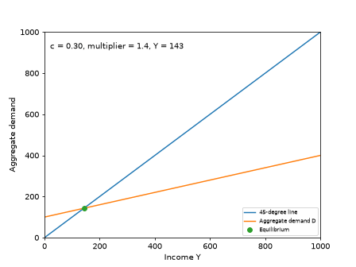

# 第 4 章: 45 度線分析と乗数

## 4.1 この章の地図

財市場（モノの市場）では、**需要が所得を決めます**（有効需要の原理）。この章では、消費関数・貯蓄関数・総需要から、**均衡国民所得**を求め、政府支出や税が所得をどれだけ動かすか（**乗数**）を、関数とテストで確かめます。



| 項目 | 内容 |
| :--- | :--- |
| 経済学の題材 | 消費関数・貯蓄関数、総需要と総供給（45 度線）、均衡国民所得、政府支出・租税・均衡予算の乗数 |
| 使う Python の機能 | 関数、キーワード引数、辞書の展開（`**`）、テスト（`pytest`）。NumPy・pandas は、この章では使いません |
| 新しく導入するライブラリ | なし（Matplotlib は、第 1 章で導入済み） |
| 完成形 | `validate_mpc`、`consumption`、`saving`、`aggregate_demand`、`equilibrium_income`、`spending_multiplier`、`tax_multiplier`、`balanced_budget_multiplier`、`income_change` |
| ファイル | 実装: `lib/chapter04/multiplier.py`、`lib/chapter04/plot.py`（図）／テスト: `test/chapter04/test_multiplier.py`、`test/chapter04/test_plot.py`（自分で書くときは、`practice/chapter04/` に、同じ名前で作ります） |
| データ | なし（手計算できる小さな例だけ） |

### 経済学の式とコードの対応

| 経済学 | 式 | コード |
| :--- | :--- | :--- |
| 消費関数 | C = c(Y − T) + C0（c は限界消費性向、C0 は独立消費、T は定額税） | `consumption(income, mpc, autonomous_consumption, tax)` |
| 貯蓄関数 | S = (Y − T) − C = (1 − c)(Y − T) − C0 | `saving(income, mpc, autonomous_consumption, tax)` |
| 総需要 | D = C + I + G + X | `aggregate_demand(...)` |
| 均衡国民所得 | Y = A ÷ (1 − c)（A は独立支出） | `equilibrium_income(...)` |
| 政府支出乗数 | 1 ÷ (1 − c) | `spending_multiplier(mpc)` |
| 租税乗数 | −c ÷ (1 − c)（符号は負） | `tax_multiplier(mpc)` |
| 均衡予算乗数 | 政府支出乗数 + 租税乗数 = 1 | `balanced_budget_multiplier(mpc)` |
| 所得の変化 | ΔY = 政府支出乗数 × ΔG + 租税乗数 × ΔT | `income_change(mpc, delta_government, delta_tax)` |

### 前提とする既存の章

| できること | 場所 |
| :--- | :--- |
| 関数と pytest のテストを書く（Red → Green → Refactor） | 第 1 シリーズ 第 1〜6 章 |
| Matplotlib で、線を描く | 第 1 シリーズ 第 7 章 |

乗数は、[第 1 シリーズの第 9 章](../economics-programming/09-numpy-arrays.md) でも扱っています。**題材が重なりますが、この章だけで読めるように、自分のコードを持ちます。**

## 4.2 準備

サンプルコードは、リポジトリの `apps/macro-basics-programming/python/` にあります。環境の作り方は、[第 1 章](01-gdp-and-value-added.md) の 1.2 節と同じです。

```bash
cd apps/macro-basics-programming/python
uv sync
uv run pytest test/chapter04
```

```text
29 passed
```

自分でコードを書くときは、`practice/chapter04/` を作って、完成形と同じ名前（`multiplier.py`・`test_multiplier.py`）のファイルに書きます。テストは、`uv run pytest practice/chapter04` で動かします。**完成形（`lib/` と `test/`）は、答え合わせ用です。** 自分で書き終えてから、開いてください。

## 4.3 予想する

ある国の財市場で、**独立消費 C0 = 40、投資 I = 30、政府支出 G = 30、純輸出 X = 0**（単位は兆円）、**限界消費性向 c = 0.6**、税はなし（T = 0）とします。

- **均衡国民所得**は、いくつですか。その所得で、**総需要**は、いくつですか。**貯蓄**は、いくつですか
- 限界消費性向が 0.6 のときと 0.8 のときで、**政府支出乗数**と**租税乗数**は、それぞれ、いくつですか。租税乗数の符号は、正ですか、負ですか
- 政府支出を 10 増やすのと、税を 10 減らすのとでは、**どちらが**、均衡所得を大きく増やしますか。それぞれ、いくら増えますか
- 政府支出を 10 増やし、同時に、税も 10 増やすと、均衡所得は、いくら増えますか
- 定額税 T = 10 を課すと、均衡所得は、いくつになりますか

## 4.4 45 度線分析の考え方

### 消費関数と貯蓄関数

消費は、所得（税を引いた可処分所得）が増えると増えます。いちばん簡単な形が、次の式です。

> C = c(Y − T) + C0

c（**限界消費性向**）は、可処分所得が 1 増えたときに、消費が増える量で、0 以上 1 未満です。C0（**独立消費**）は、所得がなくても行う消費です。課税すると、可処分所得が T 減るので、消費関数は、**c × T だけ下へ**動きます。

使わなかった所得が、**貯蓄**です。貯蓄関数の傾き（**限界貯蓄性向**）は 1 − c です。

> S = (Y − T) − C = (1 − c)(Y − T) − C0

### 総需要と 45 度線

総需要は、消費・投資・政府支出・純輸出の合計です。

> D = C + I + G + X

総供給は、作られた量 Y そのものです。横軸に Y、縦軸に D と供給をとると、総供給の線は、傾き 1 の直線（**45 度線**）になります。**総需要の線が 45 度線と交わる点**が、需要と供給が一致する点で、均衡国民所得です。

### 均衡国民所得

均衡では、Y = D です。所得に関係なく決まる部分をまとめて、**独立支出** A = C0 − cT + I + G + X とすると、Y = cY + A なので、次のようになります。

> Y = A ÷ (1 − c)

均衡より所得が低いと、総需要が総供給を上回り、生産が増えます。高いと、総需要が総供給を下回り、生産が減ります。**需要が所得を決める**（有効需要の原理）のが、この見方の特徴です。

### 乗数

独立支出が 1 増えると、所得は、1 ÷ (1 − c) 増えます。支出が誰かの所得になり、その一部（c）が、また消費されて、所得になる、という波及が続くからです。

| 乗数 | 式 | c = 0.6 | c = 0.8 |
| :--- | :--- | ---: | ---: |
| 政府支出・投資 | 1 ÷ (1 − c) | 2.5 | 5 |
| 租税（符号つき） | −c ÷ (1 − c) | −1.5 | −4 |
| 均衡予算 | 上の 2 つの和 | 1 | 1 |

マインドマップでは、租税乗数が「c ÷ (1 − c)」と、**大きさ**だけで書かれています。この記事では、**増税が所得を減らす**ことを式に残すため、符号つき（−c ÷ (1 − c)）で定義します。減税は、T を減らす（ΔT が負）ので、負の乗数に負の ΔT を掛けて、所得は増えます。

政府支出と、同額の税を、同時に増やす（**均衡予算**）と、所得は、その額だけ増えます。政府支出乗数 + 租税乗数 = (1 − c) ÷ (1 − c) = 1 だからです。**減税より公共投資が効く**のは、減税された分のうち、(1 − c) は、消費されずに貯蓄にまわるからです。

## 4.5 プログラミング

### Red: 消費関数と貯蓄関数のテスト

最初のテストを書きます。c = 0.6、C0 = 40 で、所得 100 のとき、消費は 0.6 × 100 + 40 = 100、貯蓄は 0 です。

```python
import pytest

from lib.chapter04.multiplier import (
    aggregate_demand,
    balanced_budget_multiplier,
    consumption,
    equilibrium_income,
    income_change,
    saving,
    spending_multiplier,
    tax_multiplier,
)
```

```python
def test_消費は限界消費性向と所得の積に独立消費を足した値() -> None:
    assert consumption(100, mpc=0.6, autonomous_consumption=40) == pytest.approx(100)


def test_貯蓄は可処分所得から消費を引いた値() -> None:
    assert saving(100, mpc=0.6, autonomous_consumption=40) == pytest.approx(0)
    assert saving(250, mpc=0.6, autonomous_consumption=40) == pytest.approx(60)
```

`consumption` がまだないので、テストは失敗します（**Red**）。

### Green: 消費関数・貯蓄関数・総需要を実装する

```python
def consumption(
    income: float, mpc: float, autonomous_consumption: float, tax: float = 0
) -> float:
    """消費関数 C = c(Y − T) + C0。課税で、c × T だけ下へ動く。"""
    return mpc * (income - tax) + autonomous_consumption


def saving(
    income: float, mpc: float, autonomous_consumption: float, tax: float = 0
) -> float:
    """貯蓄関数 S = (Y − T) − C = (1 − c)(Y − T) − C0。"""
    disposable = income - tax
    return disposable - consumption(income, mpc, autonomous_consumption, tax)


def aggregate_demand(
    income: float,
    mpc: float,
    autonomous_consumption: float,
    investment: float,
    government: float,
    net_exports: float,
    tax: float = 0,
) -> float:
    """総需要 D = C + I + G + X。"""
    c = consumption(income, mpc, autonomous_consumption, tax)
    return c + investment + government + net_exports
```

所得ごとに、消費・貯蓄・総需要を並べます。

```python
from lib.chapter04.multiplier import aggregate_demand, consumption, saving

for income in (0, 100, 250, 400):
    c = consumption(income, 0.6, 40)
    s = saving(income, 0.6, 40)
    d = aggregate_demand(income, 0.6, 40, 30, 30, 0)
    print(income, c, s, d)
```

```text
0 40.0 -40.0 100.0
100 100.0 0.0 160.0
250 190.0 60.0 250.0
400 280.0 120.0 340.0
```

所得が 250 のとき、総需要（250）が、総供給（所得 250）に、ちょうど等しくなっています。所得が 100 では、総需要 160 が、総供給 100 を上回ります。所得が 400 では、総需要 340 が、総供給 400 を下回ります。

### 均衡国民所得

均衡国民所得の、手計算の値を、先にテストにします。A = 40 + 30 + 30 = 100 なので、Y = 100 ÷ 0.4 = 250 です。**均衡では、総需要が総供給に等しい**という性質も、テストにします（貯蓄と投資の関係は、`test_均衡では貯蓄が投資と政府赤字と純輸出の和に等しい` で確かめています）。

```python
BASE = {
    "mpc": 0.6,
    "autonomous_consumption": 40,
    "investment": 30,
    "government": 30,
    "net_exports": 0,
}


def test_均衡国民所得は独立支出を1引くcで割った値() -> None:
    assert equilibrium_income(**BASE) == pytest.approx(250)


def test_均衡では総需要が総供給に等しい() -> None:
    y = equilibrium_income(**BASE)
    assert aggregate_demand(y, **BASE) == pytest.approx(y)
```

```python
def equilibrium_income(
    mpc: float,
    autonomous_consumption: float,
    investment: float,
    government: float,
    net_exports: float,
    tax: float = 0,
) -> float:
    """均衡国民所得 Y = A ÷ (1 − c)。A = C0 − cT + I + G + X（独立支出）。"""
    validate_mpc(mpc)
    autonomous = (
        autonomous_consumption - mpc * tax + investment + government + net_exports
    )
    return autonomous / (1 - mpc)
```

`equilibrium_income` は、先に `validate_mpc` で、限界消費性向を確かめます。c = 1 だと、分母が 0 になるからです。c が負、または 1 以上のときは、**分かるエラー**にします。これも、先にテストを書きます。

```python
def test_限界消費性向が1以上はエラー() -> None:
    with pytest.raises(ValueError, match="1 未満"):
        spending_multiplier(1.0)
    with pytest.raises(ValueError, match="1 未満"):
        equilibrium_income(**{**BASE, "mpc": 1.2})


def test_限界消費性向が負はエラー() -> None:
    with pytest.raises(ValueError, match="0 以上"):
        tax_multiplier(-0.1)
```

```python
def validate_mpc(mpc: float) -> None:
    """限界消費性向は 0 以上 1 未満。1 は、乗数の分母が 0 になる。"""
    if mpc < 0:
        raise ValueError("限界消費性向は、0 以上にする")
    if mpc >= 1:
        raise ValueError("限界消費性向は、1 未満にする（1 では乗数の分母が 0）")
```

### 乗数

乗数は、c だけで決まります。マインドマップの値（c = 0.6 で 2.5 と 1.5、c = 0.8 で 5 と 4）を、テストにします。**租税乗数の符号**は、テストで固定します（増税は所得を減らすので、負）。

```python
def test_政府支出乗数は1を1引くcで割った値() -> None:
    assert spending_multiplier(0.6) == pytest.approx(2.5)
    assert spending_multiplier(0.8) == pytest.approx(5)


def test_租税乗数は負でcを1引くcで割った大きさ() -> None:
    assert tax_multiplier(0.6) == pytest.approx(-1.5)
    assert tax_multiplier(0.8) == pytest.approx(-4)


def test_均衡予算乗数は常に1() -> None:
    for mpc in (0.0, 0.3, 0.6, 0.8, 0.95):
        total = spending_multiplier(mpc) + tax_multiplier(mpc)
        assert total == pytest.approx(1)
        assert balanced_budget_multiplier(mpc) == pytest.approx(1)
```

```python
def spending_multiplier(mpc: float) -> float:
    """政府支出・投資の乗数 1 ÷ (1 − c)。"""
    validate_mpc(mpc)
    return 1 / (1 - mpc)


def tax_multiplier(mpc: float) -> float:
    """租税乗数 −c ÷ (1 − c)。増税（T の増加）は所得を減らすので、符号は負。"""
    validate_mpc(mpc)
    return -mpc / (1 - mpc)


def balanced_budget_multiplier(mpc: float) -> float:
    """均衡予算乗数 = 政府支出乗数 + 租税乗数（常に 1）。"""
    return spending_multiplier(mpc) + tax_multiplier(mpc)
```

政府支出と租税を変えたときの、均衡所得の変化は、2 つの乗数の和です。

```python
def test_政府支出を増やすと所得は乗数倍に増える() -> None:
    assert income_change(0.6, delta_government=10) == pytest.approx(25)


def test_減税は所得を増やし増税は減らす() -> None:
    assert income_change(0.6, delta_tax=-10) == pytest.approx(15)
    assert income_change(0.6, delta_tax=10) == pytest.approx(-15)


def test_減税より公共投資が効く() -> None:
    spending = income_change(0.6, delta_government=10)
    tax_cut = income_change(0.6, delta_tax=-10)
    assert spending > tax_cut


def test_変化は均衡所得の差と一致する() -> None:
    before = equilibrium_income(**BASE)
    after = equilibrium_income(**{**BASE, "government": 40}, tax=5)
    assert after - before == pytest.approx(income_change(0.6, 10, 5))
```

```python
def income_change(
    mpc: float, delta_government: float = 0, delta_tax: float = 0
) -> float:
    """政府支出の変化と租税の変化による、均衡所得の変化。"""
    government = spending_multiplier(mpc) * delta_government
    return government + tax_multiplier(mpc) * delta_tax
```

最後のテストは、乗数の式が、均衡国民所得の式と**矛盾しない**ことを確かめます。

### 予想の答え合わせ

予想した答えを、プログラムで確かめます。

```python
from lib.chapter04.multiplier import (
    aggregate_demand,
    equilibrium_income,
    income_change,
    saving,
    spending_multiplier,
    tax_multiplier,
)

spec = {
    "mpc": 0.6,
    "autonomous_consumption": 40,
    "investment": 30,
    "government": 30,
    "net_exports": 0,
}
y = equilibrium_income(**spec)
print("均衡国民所得:", y)
print("その所得での総需要:", aggregate_demand(y, **spec))
print("その所得での貯蓄:", round(saving(y, 0.6, 40), 4))
for mpc in (0.6, 0.8):
    spending = round(spending_multiplier(mpc), 4)
    tax = round(tax_multiplier(mpc), 4)
    print(f"c = {mpc}: 政府支出乗数 {spending}、租税乗数 {tax}")
print("政府支出 +10:", round(income_change(0.6, delta_government=10), 4))
print("減税 10:", round(income_change(0.6, delta_tax=-10), 4))
print("同額 10 の政府支出と増税:", round(income_change(0.6, 10, 10), 4))
print("定額税 T = 10 の均衡所得:", equilibrium_income(**spec, tax=10))
```

```text
均衡国民所得: 250.0
その所得での総需要: 250.0
その所得での貯蓄: 60.0
c = 0.6: 政府支出乗数 2.5、租税乗数 -1.5
c = 0.8: 政府支出乗数 5.0、租税乗数 -4.0
政府支出 +10: 25.0
減税 10: 15.0
同額 10 の政府支出と増税: 10.0
定額税 T = 10 の均衡所得: 235.0
```

- **1 つ目の問い**: 均衡国民所得は 250 で、その所得での総需要も 250 です（総需要 = 総供給）。貯蓄は 60 で、投資 30 と政府支出 30 の和に等しくなっています（税がないので、政府は 30 の赤字）
- **2 つ目の問い**: c = 0.6 では政府支出乗数 2.5、租税乗数 −1.5、c = 0.8 では 5 と −4 です。租税乗数の符号は、**負**です（増税は、所得を減らす）
- **3 つ目の問い**: 政府支出 10 の増加は、所得を 25 増やし、10 の減税は、15 増やします。**公共投資のほうが効きます**。減税された 10 のうち、4（= 10 × (1 − c)）は、貯蓄にまわるからです
- **4 つ目の問い**: 同額の政府支出と増税で、所得は 10 増えます。25 − 15 = 10 で、**均衡予算乗数は 1** です
- **5 つ目の問い**: 定額税 T = 10 で、均衡所得は 235 に下がります。250 から 15（= 1.5 × 10）の減少で、租税乗数どおりです

### 図

45 度線と総需要の図を、描く関数を、テストから書きます。線の端点の座標と、均衡点の位置を、手計算の値と比べます。

??? note "描画のテストと実装（後回しにしても、学習は成り立ちます）"

    ```python
    def xs(line: Line2D) -> list[float]:
        return [float(v) for v in np.asarray(line.get_xdata())]


    def ys(line: Line2D) -> list[float]:
        return [float(v) for v in np.asarray(line.get_ydata())]


    def test_45度線は原点を通る傾き1の線() -> None:
        ax = plot_keynesian_cross(**BASE, income_max=400).axes[0]
        line = ax.lines[0]
        assert line.get_label() == "45-degree line (Y)"
        assert xs(line) == pytest.approx([0, 400])
        assert ys(line) == pytest.approx([0, 400])


    def test_総需要の線は切片が独立支出で傾きがc() -> None:
        ax = plot_keynesian_cross(**BASE, income_max=400).axes[0]
        line = ax.lines[1]
        assert line.get_label() == "Aggregate demand"
        assert ys(line) == pytest.approx([100, 100 + 0.6 * 400])


    def test_均衡点は45度線上で所得250() -> None:
        ax = plot_keynesian_cross(**BASE, income_max=400).axes[0]
        point = ax.lines[2]
        assert xs(point) == pytest.approx([250])
        assert ys(point) == pytest.approx([250])
    ```

??? note "描画のテストと実装（後回しにしても、学習は成り立ちます）"

    ```python
    def plot_keynesian_cross(
        mpc: float,
        autonomous_consumption: float,
        investment: float,
        government: float,
        net_exports: float,
        income_max: float,
        tax: float = 0,
    ) -> Figure:
        """45 度線（総供給 Y）と総需要の線を描き、交点（均衡）に印を付ける。"""
        spec = (mpc, autonomous_consumption, investment, government, net_exports)
        incomes = [0, income_max]
        demand = [aggregate_demand(y, *spec, tax=tax) for y in incomes]
        y_star = equilibrium_income(*spec, tax=tax)
        fig, ax = plt.subplots()
        ax.plot(incomes, incomes, label="45-degree line (Y)")
        ax.plot(incomes, demand, label="Aggregate demand")
        ax.plot([y_star], [y_star], "o", label="Equilibrium")
        ax.set_xlabel("Income Y")
        ax.set_ylabel("Demand / Supply")
        ax.legend()
        plt.close(fig)
        return fig
    ```

限界消費性向が大きいほど、総需要の線は急になり、45 度線との交点が右へ動きます。これが、**乗数が大きい**ということです。

??? note "描画のテストと実装（後回しにしても、学習は成り立ちます）"

    ```python
    def test_乗数の図は限界消費性向ごとに総需要の線を描く() -> None:
        ax = plot_multiplier_slopes([0.6, 0.8], autonomous=100, income_max=500).axes[0]
        assert [line.get_label() for line in ax.lines] == [
            "45-degree line (Y)",
            "c = 0.6",
            "c = 0.8",
        ]
        assert xs(ax.lines[0]) == pytest.approx([0, 500])
        assert ys(ax.lines[0]) == pytest.approx([0, 500])
        assert ys(ax.lines[1]) == pytest.approx([100, 400])
        assert ys(ax.lines[2]) == pytest.approx([100, 500])
    ```

??? note "描画のテストと実装（後回しにしても、学習は成り立ちます）"

    ```python
    def plot_multiplier_slopes(
        mpcs: Sequence[float], autonomous: float, income_max: float
    ) -> Figure:
        """限界消費性向ごとの総需要の線。c が大きいほど傾きが急で、乗数が大きい。"""
        fig, ax = plt.subplots()
        ax.plot([0, income_max], [0, income_max], label="45-degree line (Y)")
        for mpc in mpcs:
            ax.plot(
                [0, income_max],
                [autonomous, autonomous + mpc * income_max],
                label=f"c = {mpc}",
            )
        ax.set_xlabel("Income Y")
        ax.set_ylabel("Aggregate demand")
        ax.legend()
        plt.close(fig)
        return fig
    ```



### ノートブックで試す

数字を書き換えて、結果と図が変わるのを、手軽に確かめられます。`apps/macro-basics-programming/python/notebooks/ch04_45_degree_line_and_multiplier.ipynb` を開き、「Parameters」のセルの数字（限界消費性向、基礎消費、投資、政府支出、租税）を書き換えて、上から順に実行します。起動は、アプリのディレクトリで `uv run --with jupyterlab jupyter lab notebooks/` です。

### 動かして見る

限界消費性向 c を 0.3 から 0.9 へ上げます。総需要の線が 45 度線に近づいて急になり、均衡国民所得が右へ大きく動きます。乗数 1 ÷ (1 − c) が、c とともに大きくなる様子です。



このアニメーションは、`lib/animations/` の関数で作っています（`uv run python -m tools.render_animations` で、GIF を書き出します）。**写経は、不要**です。動きを見て、式と図の対応を、確かめてください。

### 実行結果

```bash
uv run pytest test/chapter04
```

```text
29 passed
```

## 4.6 規則で言うと

1. **均衡では、総需要が、総供給（所得）に等しい。** 均衡国民所得は、独立支出 A を、1 − c で割った値
2. **乗数は、限界消費性向 c だけで決まる。** c が大きいほど、乗数は大きい。c = 1 では、分母が 0 で、定義できない
3. **租税乗数は、符号つきで持つ。** 増税は所得を減らす（負）。減税（負の ΔT）は、所得を増やす。符号は、テストで固定する。**政府支出乗数と租税乗数の和は、常に 1**（均衡予算乗数）

混同しやすい点を、表にまとめます。

| 混同しやすい点 | 違い |
| :--- | :--- |
| 租税乗数の符号 | この記事では、**−c ÷ (1 − c)**（増税は負）。マインドマップの「c ÷ (1 − c)」は、**大きさ**。減税の効果は、−c ÷ (1 − c) に、負の ΔT を掛けて、正になる |
| 政府支出乗数と租税乗数 | 政府支出は、**1 ÷ (1 − c)**。租税は、c が、さらに掛かって、符号が負になる。大きさの差は、**ちょうど 1**（これが、均衡予算乗数が 1 になる理由） |
| 限界消費性向と平均消費性向 | 限界は、所得が 1 増えたときの消費の増加（傾き）。平均は、C ÷ Y。独立消費があるので、所得が増えると、平均消費性向は下がる（練習問題の「生成」） |

### このモデルが成り立たない場面

- **投資・純輸出は、所得と無関係と仮定しています。** 実際には、所得が増えると、輸入も増えます。輸入が増えると、乗数は、小さくなります
- **物価は、変わらないと仮定しています。** 完全雇用に近づくと、需要の増加は、物価の上昇になります（第 5 章のインフレギャップ）
- **税は、所得に関係ない、定額税です。** 所得に比例する税は、乗数を小さくします（第 5 章）

## 4.7 練習問題

| 種類 | 問題 |
| :--- | :--- |
| 想起 | 本文を閉じて、`equilibrium_income` の最初のテスト（c = 0.6、独立支出 A = 100 で、均衡所得 250）を書いてください |
| 生成 | 解説を見る前に、平均消費性向 C ÷ Y を返す `average_propensity_to_consume(income, mpc, autonomous_consumption)` を、テストから書いてください。所得が増えると、平均消費性向は、どう変わりますか |
| 多様 | 限界消費性向を 0.6 から 0.9 に変えると、政府支出 10 の増加と、10 の減税の、所得への効果は、それぞれ、いくつになりますか。先に予想してから、確かめてください |
| 交互 | [第 1 シリーズ](../economics-programming/index.md)の第 3 章のリスト内包表記で、c が 0.5、0.6、0.7、0.8、0.9 のときの、政府支出乗数と租税乗数と均衡予算乗数を、一度に計算してください。均衡予算乗数は、すべて 1 になりますか |

??? note "解答（先に自分で取り組んでから、開いてください）"

    **想起**:

    ```python
    def test_均衡国民所得は独立支出を1引くcで割った値() -> None:
        y = equilibrium_income(0.6, 40, 30, 30, 0)
        assert y == pytest.approx(250)
    ```

    **生成**: 消費を、所得で割ります。

    ```python
    def average_propensity_to_consume(income, mpc, autonomous_consumption):
        return consumption(income, mpc, autonomous_consumption) / income
    ```

    ```python
    def test_平均消費性向は所得が増えると下がる() -> None:
        incomes = [100, 250, 1000, 100000]
        apc = [average_propensity_to_consume(y, 0.6, 40) for y in incomes]
        assert apc[:3] == pytest.approx([1.0, 0.76, 0.64])
        assert apc == sorted(apc, reverse=True)
        assert apc[-1] == pytest.approx(0.6, abs=1e-3)
    ```

    所得が増えると、独立消費 40 の割合が小さくなるので、平均消費性向は、下がります。所得が非常に大きいと、限界消費性向 0.6 に近づきます。

    **多様**: c = 0.9 なら、政府支出乗数は 1 ÷ 0.1 = 10、租税乗数は −0.9 ÷ 0.1 = −9 なので、政府支出 10 の増加で 100、10 の減税で 90 です。**c = 0.6 のとき（25 と 15）より、効果は、ずっと大きくなります。**

    ```python
    def test_限界消費性向が大きいと同じ政策の効果は大きい() -> None:
        assert income_change(0.9, delta_government=10) == pytest.approx(100)
        assert income_change(0.9, delta_tax=-10) == pytest.approx(90)
        assert income_change(0.9, delta_government=10) > income_change(
            0.6, delta_government=10
        )
    ```

    **交互**:

    ```python
    def test_均衡予算乗数はどのcでも1() -> None:
        mpcs = [0.5, 0.6, 0.7, 0.8, 0.9]
        spending = [spending_multiplier(c) for c in mpcs]
        tax = [tax_multiplier(c) for c in mpcs]
        balanced = [balanced_budget_multiplier(c) for c in mpcs]
        assert spending == pytest.approx([2, 2.5, 10 / 3, 5, 10])
        assert tax == pytest.approx([-1, -1.5, -7 / 3, -4, -9])
        assert balanced == pytest.approx([1, 1, 1, 1, 1])
    ```

    c が大きいほど、2 つの乗数の大きさは、どちらも大きくなりますが、**和は、いつも 1** です。

## 4.8 振り返り

- 乗数が、c だけで決まるのは、なぜですか。c = 1 で、定義できないのは、なぜですか
- 「減税より公共投資が効く」のは、なぜですか。租税乗数の符号を、どう決めましたか

## 4.9 まとめ

- 消費関数・貯蓄関数・総需要から、均衡国民所得 Y = A ÷ (1 − c) を求めた。c = 0.6、A = 100 で 250 になり、そこで総需要 = 総供給になる
- 政府支出乗数 1 ÷ (1 − c)、租税乗数 −c ÷ (1 − c)（符号つき）、均衡予算乗数 1 を関数にした。c = 0.6 で 2.5 と −1.5、c = 0.8 で 5 と −4
- 政府支出 10 の増加は所得を 25 増やし、10 の減税は 15 増やす。公共投資のほうが効く
- c ≥ 1 と c < 0 は、分かるエラーにした。乗数の式は、均衡所得の式と、テストで一致を確かめた
- 次の章では、**完全雇用国民所得**を基準に、需要の過不足（ギャップ）を求め、必要な政策の大きさと、ビルトイン・スタビライザーを確かめます
