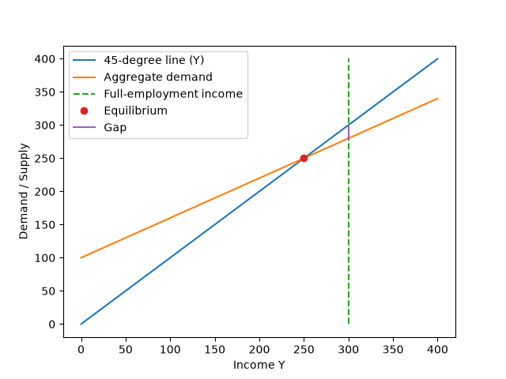
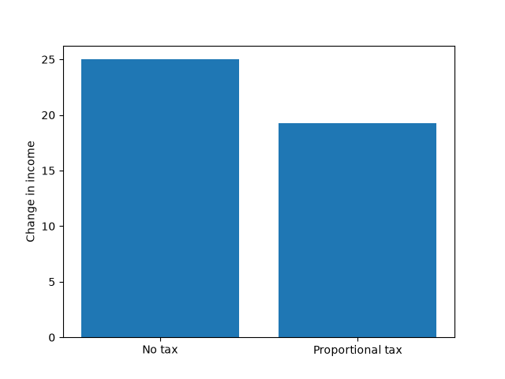

# 第 5 章: ギャップと安定化政策

## 5.1 この章の地図

均衡国民所得は、完全雇用の所得と、一致するとは限りません。**需要が足りない**（デフレギャップ）ことも、**多すぎる**（インフレギャップ）こともあります。この章では、完全雇用国民所得を基準にギャップを求め、**ギャップを埋めるのに必要な政府支出・租税の大きさ**を計算します。さらに、景気の変動を自動的に和らげる**ビルトイン・スタビライザー**を、比例税のある乗数で確かめます。最後に、**第 1 部（第 1〜5 章）の到達チェック**を行います。



| 項目 | 内容 |
| :--- | :--- |
| 経済学の題材 | 完全雇用国民所得、インフレギャップ・デフレギャップ、総需要管理政策（ケインズ政策）、ビルトイン・スタビライザー |
| 使う Python の機能 | 関数、`math.isclose`、テスト（`pytest`）、第 4 章の関数の再利用。NumPy・pandas は、この章では使いません |
| 新しく導入するライブラリ | なし |
| 完成形 | `output_gap`、`classify_gap`、`required_spending_change`、`required_tax_change`、`stabilizer_multiplier`、`income_swing`、`swing_reduction` |
| ファイル | 実装: `lib/chapter05/stabilization.py`、`lib/chapter05/plot.py`（図）／テスト: `test/chapter05/test_stabilization.py`、`test/chapter05/test_plot.py`（自分で書くときは、`practice/chapter05/` に、同じ名前で作ります） |
| データ | なし（手計算できる小さな例だけ） |

### 経済学の式とコードの対応

| 経済学 | 式 | コード |
| :--- | :--- | :--- |
| ギャップ | ギャップ = 完全雇用所得 − 均衡所得（正: デフレギャップ、負: インフレギャップ） | `output_gap(full_employment_income, equilibrium_income)` |
| 必要な政府支出の変化 | ΔG = ギャップ ÷ 政府支出乗数 | `required_spending_change(gap, mpc)` |
| 必要な租税の変化 | ΔT = ギャップ ÷ 租税乗数（負なら減税） | `required_tax_change(gap, mpc)` |
| 比例税のある乗数 | 1 ÷ (1 − c(1 − t))（t は税率） | `stabilizer_multiplier(mpc, tax_rate)` |
| 所得の振れ幅 | 乗数 × 独立支出の変動 | `income_swing(mpc, tax_rate, shock)` |

### 前提とする既存の章

| できること | 場所 |
| :--- | :--- |
| 均衡国民所得と、政府支出乗数・租税乗数を、関数にする | この連載の[第 4 章](04-45-degree-line-and-multiplier.md)（**この章の前提**） |
| 関数と pytest のテストを書く、Matplotlib で線を描く | 第 1 シリーズ 第 1〜7 章 |

## 5.2 準備

サンプルコードは、リポジトリの `apps/macro-basics-programming/python/` にあります。環境の作り方は、[第 1 章](01-gdp-and-value-added.md) の 1.2 節と同じです。

```bash
cd apps/macro-basics-programming/python
uv sync
uv run pytest test/chapter05
```

```text
25 passed
```

自分でコードを書くときは、`practice/chapter05/` を作って、完成形と同じ名前（`stabilization.py`・`test_stabilization.py`）のファイルに書きます。テストは、`uv run pytest practice/chapter05` で動かします。**完成形（`lib/` と `test/`）は、答え合わせ用です。** 自分で書き終えてから、開いてください。

## 5.3 予想する

第 4 章と同じ国（独立消費 40、投資 30、政府支出 30、純輸出 0、限界消費性向 c = 0.6。均衡国民所得は 250）で、**完全雇用国民所得**が 300 だったとします。

- **ギャップ**は、いくつですか。**デフレギャップ**ですか、**インフレギャップ**ですか
- ギャップを埋めるのに、**政府支出**を、いくら増やせばよいですか。**減税**で埋めるなら、いくら減税しますか
- 所得に**比例する税**（税率 t = 0.2）があると、**乗数**は、2.5 より大きくなりますか、小さくなりますか。いくつになりますか
- 独立支出が 10 減ったとき、所得は、税率 0 と税率 0.2 で、それぞれ、いくら減りますか。ビルトイン・スタビライザーは、振れ幅を、何割小さくしますか
- 完全雇用国民所得が 200 だったら、ギャップは、いくつで、どちらのギャップですか。政府支出は、どう変えますか

## 5.4 ギャップと安定化の考え方

### 完全雇用国民所得とギャップ

**完全雇用国民所得**は、資源（労働・設備）を、無理なく使い切ったときの所得です。均衡国民所得が、これより小さいと、**需要が足りず**、失業が残ります。大きいと、**需要が多すぎ**て、物価が上がります。

| ギャップ | 状況 | 対策 |
| :--- | :--- | :--- |
| **デフレギャップ**（需要不足） | 均衡所得 < 完全雇用所得 | 支出を増やす、減税する |
| **インフレギャップ**（需要超過） | 均衡所得 > 完全雇用所得 | 支出を減らす、増税する |

この記事では、ギャップを、所得の差として定義します。

> ギャップ = 完全雇用所得 − 均衡所得

**符号は、正がデフレギャップ、負がインフレギャップ**です。なお、教科書や試験では、次に述べる縦の差（20）を「デフレギャップ」と呼ぶことが多いので、他の本と照らすときは、定義を確かめてください。この記事の「ギャップ」（50）は、**GDP ギャップ（所得の差）**にあたります。図の中で見える縦の差（完全雇用所得の上の、45 度線と総需要の差）は、これとは別で、ギャップの (1 − c) 倍です。デフレギャップ 50 のとき、縦の差は 50 × 0.4 = 20 で、これが、**ギャップを埋めるのに必要な政府支出**に、等しくなります（次の節）。

### 必要な政策の大きさ

ギャップ（所得の差）を、政策で埋めるには、乗数で割ります。

> 必要な政府支出の変化 = ギャップ ÷ 政府支出乗数
>
> 必要な租税の変化 = ギャップ ÷ 租税乗数

租税乗数は、符号つき（−c ÷ (1 − c)）なので、デフレギャップでは、必要な租税の変化が**負**（減税）になります。**総需要管理政策**（ケインズ政策）は、このように、政府が、総需要の大きさを調整して、完全雇用に近づける政策です。

### ビルトイン・スタビライザー

**累進課税・法人税・失業保険・社会保障**は、景気が良いと、税収が増え、給付が減って、需要の増加を抑えます。悪いと、税収が減り、給付が増えて、需要の減少を和らげます。政策を決めなくても、**自動的に**景気の変動を小さくするので、ビルトイン・スタビライザー（自動安定化装置）と呼びます。

もっとも簡単なモデルは、所得に**比例する税**（税率 t）です。可処分所得は (1 − t)Y なので、消費は c(1 − t)Y だけ増え、乗数は次のようになります。

> 乗数 = 1 ÷ (1 − c(1 − t))

t > 0 なら、分母が大きくなるので、乗数は小さくなります。独立支出が同じだけ変動しても、所得の振れ幅が、小さくなります。

## 5.5 プログラミング

### Red: ギャップのテスト

最初のテストを書きます。完全雇用国民所得 300、均衡国民所得 250 なら、ギャップは 50 で、デフレギャップです。**符号は、テストで固定します。**

```python
import pytest

from lib.chapter04.multiplier import equilibrium_income, income_change
from lib.chapter05.stabilization import (
    classify_gap,
    income_swing,
    output_gap,
    required_spending_change,
    required_tax_change,
    stabilizer_multiplier,
    swing_reduction,
)
```

```python
FULL = 300
EQUILIBRIUM = 250


def test_ギャップは完全雇用所得から均衡所得を引いた値() -> None:
    assert output_gap(FULL, EQUILIBRIUM) == 50
    assert output_gap(200, EQUILIBRIUM) == -50


def test_正のギャップはデフレギャップで負はインフレギャップ() -> None:
    assert classify_gap(50) == "デフレギャップ"
    assert classify_gap(-50) == "インフレギャップ"


def test_ギャップが0なら均衡() -> None:
    assert classify_gap(0) == "ギャップなし"
    assert classify_gap(1e-12) == "ギャップなし"
```

`output_gap` がまだないので、テストは失敗します（**Red**）。

### Green: ギャップを実装する

```python
def output_gap(full_employment_income: float, equilibrium_income: float) -> float:
    """ギャップ = 完全雇用所得 − 均衡所得。正がデフレギャップ、負がインフレギャップ。"""
    return full_employment_income - equilibrium_income


def classify_gap(gap: float) -> str:
    """ギャップの符号から、デフレギャップ・インフレギャップ・ギャップなしを返す。"""
    if math.isclose(gap, 0, abs_tol=1e-9):
        return "ギャップなし"
    return "デフレギャップ" if gap > 0 else "インフレギャップ"
```

??? note "import と補助関数（写すときに足す）"

    記事の抜粋には、import と、先頭が `_` の補助関数・定数を、省いています。完成形のファイルの先頭にある、次の部分を、写してください。

    **lib/chapter05/stabilization.py**

    ```python
    import math
    ```

    ```python
    from lib.chapter04.multiplier import (
        spending_multiplier,
        tax_multiplier,
        validate_mpc,
    )
    ```

`classify_gap` は、`0` との比較に、`math.isclose` を使います。小数の計算では、0 になるはずの値が、ごくわずかにずれるからです。**ごく小さい値だけを、ギャップなしと見なし**、0.5 のような小さなギャップは、ギャップとして扱います。

```python
def test_小さなギャップでも0でなければギャップがある() -> None:
    assert classify_gap(0.5) == "デフレギャップ"
    assert classify_gap(-0.5) == "インフレギャップ"
```

### 必要な政策の大きさ

必要な政府支出の増加は、50 ÷ 2.5 = 20 です。減税なら、50 ÷ (−1.5) ≈ −33.33（33.33 の減税）です。**同じギャップを埋めるのに、減税は、支出増より、大きな額が要る**ことも、テストにします。

```python
def test_デフレギャップを埋める政府支出の増加は20() -> None:
    assert required_spending_change(50, mpc=0.6) == pytest.approx(20)


def test_インフレギャップには支出削減が必要で符号は負() -> None:
    assert required_spending_change(-50, mpc=0.6) == pytest.approx(-20)


def test_デフレギャップを埋める租税の変化は減税で符号は負() -> None:
    assert required_tax_change(50, mpc=0.6) == pytest.approx(-50 / 1.5)
    assert required_tax_change(-50, mpc=0.6) > 0


def test_同じギャップを埋めるのに減税は支出増より大きな額が要る() -> None:
    spending = required_spending_change(50, mpc=0.6)
    tax = required_tax_change(50, mpc=0.6)
    assert abs(tax) > abs(spending)
```

```python
def required_spending_change(gap: float, mpc: float) -> float:
    """ギャップを埋めるのに必要な政府支出の変化 = ギャップ ÷ 政府支出乗数。"""
    return gap / spending_multiplier(mpc)


def required_tax_change(gap: float, mpc: float) -> float:
    """ギャップを埋めるのに必要な租税の変化 = ギャップ ÷ 租税乗数。負なら減税。"""
    return gap / tax_multiplier(mpc)
```

第 4 章の `spending_multiplier`・`tax_multiplier` を、そのまま使っています。限界消費性向が範囲外のときは、第 4 章のエラーが、そのまま出ます。**政策を実行したあとの均衡所得が、完全雇用に届く**ことを、第 4 章の関数で確かめます。2 つの章の関数が、**矛盾しない**ことの確認です。

```python
def test_必要な政府支出増を実行すると均衡所得は完全雇用に届く() -> None:
    base = {
        "mpc": 0.6,
        "autonomous_consumption": 40,
        "investment": 30,
        "net_exports": 0,
    }
    y = equilibrium_income(**base, government=30)
    gap = output_gap(FULL, y)
    delta = required_spending_change(gap, 0.6)
    assert equilibrium_income(**base, government=30 + delta) == pytest.approx(FULL)
    assert income_change(0.6, delta_government=delta) == pytest.approx(gap)


def test_必要な減税を実行すると均衡所得は完全雇用に届く() -> None:
    delta_tax = required_tax_change(50, 0.6)
    assert income_change(0.6, delta_tax=delta_tax) == pytest.approx(50)
```

### ビルトイン・スタビライザー

比例税のある乗数は、税率 0 のとき、第 4 章の乗数 2.5 に一致します。t = 0.2 なら、1 ÷ (1 − 0.6 × 0.8) = 1 ÷ 0.52 ≈ 1.923 です。

```python
def test_税率0の乗数は通常の乗数に等しい() -> None:
    assert stabilizer_multiplier(0.6, 0.0) == pytest.approx(2.5)


def test_比例税があると乗数は小さくなる() -> None:
    assert stabilizer_multiplier(0.6, 0.2) == pytest.approx(1 / 0.52)
    assert stabilizer_multiplier(0.6, 0.2) < 2.5


def test_独立支出が変動したときの所得の振れ幅は比例税で小さくなる() -> None:
    assert income_swing(0.6, 0.0, 10) == pytest.approx(25)
    assert income_swing(0.6, 0.2, 10) == pytest.approx(10 / 0.52)
    assert income_swing(0.6, 0.2, 10) < income_swing(0.6, 0.0, 10)


def test_振れ幅の縮小の割合は乗数の比で決まる() -> None:
    assert swing_reduction(0.6, 0.0) == pytest.approx(0)
    assert swing_reduction(0.6, 0.2) == pytest.approx(1 - 0.4 / 0.52)
    assert 0 < swing_reduction(0.6, 0.2) < 1


def test_税率が範囲外ならエラー() -> None:
    with pytest.raises(ValueError, match="税率"):
        stabilizer_multiplier(0.6, -0.1)
    with pytest.raises(ValueError, match="税率"):
        stabilizer_multiplier(0.6, 1.0)
```

```python
def stabilizer_multiplier(mpc: float, tax_rate: float) -> float:
    """比例税（税率 t）のある乗数 1 ÷ (1 − c(1 − t))。"""
    validate_mpc(mpc)
    if not 0 <= tax_rate < 1:
        raise ValueError("税率は、0 以上 1 未満にする")
    return 1 / (1 - mpc * (1 - tax_rate))


def income_swing(mpc: float, tax_rate: float, shock: float) -> float:
    """独立支出が shock だけ変動したときの、均衡所得の変動。"""
    return stabilizer_multiplier(mpc, tax_rate) * shock


def swing_reduction(mpc: float, tax_rate: float) -> float:
    """比例税がないときと比べた、所得の振れ幅の縮小の割合（0〜1）。"""
    with_tax = stabilizer_multiplier(mpc, tax_rate)
    return 1 - with_tax / stabilizer_multiplier(mpc, 0)
```

### 予想の答え合わせ

予想した答えを、プログラムで確かめます。

```python
from lib.chapter04.multiplier import equilibrium_income
from lib.chapter05.stabilization import (
    classify_gap,
    income_swing,
    output_gap,
    required_spending_change,
    required_tax_change,
    stabilizer_multiplier,
    swing_reduction,
)

y = equilibrium_income(0.6, 40, 30, 30, 0)
gap = output_gap(300, y)
print("ギャップ:", gap, classify_gap(gap))
print("必要な政府支出の変化:", round(required_spending_change(gap, 0.6), 4))
print("必要な租税の変化:", round(required_tax_change(gap, 0.6), 4))
print("比例税（t = 0.2）の乗数:", round(stabilizer_multiplier(0.6, 0.2), 4))
for rate in (0.0, 0.2):
    swing = round(income_swing(0.6, rate, -10), 4)
    print(f"独立支出 -10 のときの所得の変化（t = {rate}）:", swing)
print("振れ幅の縮小の割合:", round(swing_reduction(0.6, 0.2), 4))
gap2 = output_gap(200, y)
print("完全雇用所得 200 のギャップ:", gap2, classify_gap(gap2))
print("必要な政府支出の変化:", round(required_spending_change(gap2, 0.6), 4))
```

```text
ギャップ: 50.0 デフレギャップ
必要な政府支出の変化: 20.0
必要な租税の変化: -33.3333
比例税（t = 0.2）の乗数: 1.9231
独立支出 -10 のときの所得の変化（t = 0.0）: -25.0
独立支出 -10 のときの所得の変化（t = 0.2）: -19.2308
振れ幅の縮小の割合: 0.2308
完全雇用所得 200 のギャップ: -50.0 インフレギャップ
必要な政府支出の変化: -20.0
```

- **1 つ目の問い**: ギャップは 50 で、**デフレギャップ**（需要不足）です
- **2 つ目の問い**: 必要な政府支出の増加は 20（= 50 ÷ 2.5）です。減税なら −33.33（= 50 ÷ (−1.5)）、つまり、約 33.33 の減税が要ります。**公共投資のほうが、小さな額で、足ります**
- **3 つ目の問い**: 比例税のある乗数は 1.9231 で、2.5 より**小さく**なります。税収が、所得とともに増えるので、消費の波及が、弱まるからです
- **4 つ目の問い**: 独立支出が 10 減ると、所得は、税率 0 で 25、税率 0.2 で約 19.23 減ります。ビルトイン・スタビライザーは、振れ幅を、約 23% 小さくします
- **5 つ目の問い**: 完全雇用所得 200 だと、ギャップは −50 で、**インフレギャップ**（需要超過）です。政府支出は、20 **減らす**（または、増税する）必要があります

### 図

ギャップの図を、描く関数を、テストから書きます。45 度線・総需要・完全雇用所得の位置と、ギャップを表す線分の長さ（20）を、手計算の値と比べます。

??? note "描画のテストと実装（後回しにしても、学習は成り立ちます）"

    ```python
    def xs(line: Line2D) -> list[float]:
        return [float(v) for v in np.asarray(line.get_xdata())]


    def ys(line: Line2D) -> list[float]:
        return [float(v) for v in np.asarray(line.get_ydata())]


    def deflation_gap_axes() -> Axes:
        fig = plot_gap(mpc=0.6, autonomous=100, full_employment_income=300, income_max=400)
        return fig.axes[0]


    def test_ギャップの図は45度線と総需要と完全雇用所得の線を描く() -> None:
        ax = deflation_gap_axes()
        labels = [line.get_label() for line in ax.lines]
        assert labels[:3] == [
            "45-degree line (Y)",
            "Aggregate demand",
            "Full-employment income",
        ]
        assert xs(ax.lines[2]) == pytest.approx([300, 300])


    def test_均衡点は250で総需要の線の上にある() -> None:
        point = deflation_gap_axes().lines[3]
        assert xs(point) == pytest.approx([250])
        assert ys(point) == pytest.approx([250])


    def test_ギャップの線分は完全雇用所得の上で総需要から45度線までの長さ20() -> None:
        segment = deflation_gap_axes().lines[4]
        assert xs(segment) == pytest.approx([300, 300])
        assert ys(segment) == pytest.approx([280, 300])


    def test_インフレギャップでは線分の向きが逆になる() -> None:
        fig = plot_gap(mpc=0.6, autonomous=100, full_employment_income=200, income_max=400)
        segment = fig.axes[0].lines[4]
        assert ys(segment) == pytest.approx([220, 200])
    ```

??? note "描画のテストと実装（後回しにしても、学習は成り立ちます）"

    ```python
    def plot_gap(
        mpc: float,
        autonomous: float,
        full_employment_income: float,
        income_max: float,
    ) -> Figure:
        """45 度線・総需要・完全雇用所得を描く。

        完全雇用所得の上の線分は、総需要と 45 度線の縦の差で、ギャップを埋めるのに
        必要な支出の大きさ（デフレギャップでは総需要が下、インフレギャップでは上）。
        """
        incomes = [0, income_max]
        demand = [autonomous + mpc * y for y in incomes]
        y_star = autonomous / (1 - mpc)
        y_full = full_employment_income
        fig, ax = plt.subplots()
        ax.plot(incomes, incomes, label="45-degree line (Y)")
        ax.plot(incomes, demand, label="Aggregate demand")
        ax.plot([y_full, y_full], [0, income_max], "--", label="Full-employment income")
        ax.plot([y_star], [y_star], "o", label="Equilibrium")
        ax.plot([y_full, y_full], [autonomous + mpc * y_full, y_full], label="Gap")
        ax.set_xlabel("Income Y")
        ax.set_ylabel("Demand / Supply")
        ax.legend()
        plt.close(fig)
        return fig
    ```

ビルトイン・スタビライザーの図は、独立支出が 10 変動したときの、所得の変動を、2 本の棒で比べます。

??? note "描画のテストと実装（後回しにしても、学習は成り立ちます）"

    ```python
    def test_振れ幅の図は2本の棒で比例税のほうが低い() -> None:
        ax = plot_income_swing(mpc=0.6, tax_rate=0.2, shock=10).axes[0]
        bars = [p for p in ax.patches if isinstance(p, Rectangle)]
        assert [t.get_text() for t in ax.get_xticklabels()] == [
            "No tax",
            "Proportional tax",
        ]
        assert [b.get_height() for b in bars] == pytest.approx([25, 10 / 0.52])
    ```

??? note "描画のテストと実装（後回しにしても、学習は成り立ちます）"

    ```python
    def plot_income_swing(mpc: float, tax_rate: float, shock: float) -> Figure:
        """独立支出が shock だけ変動したときの、所得の変動を、比例税の有無で比べる。"""
        fig, ax = plt.subplots()
        ax.bar(
            ["No tax", "Proportional tax"],
            [income_swing(mpc, 0, shock), income_swing(mpc, tax_rate, shock)],
        )
        ax.set_ylabel("Change in income")
        plt.close(fig)
        return fig
    ```



### 実行結果

```bash
uv run pytest test/chapter05
```

```text
25 passed
```

## 5.6 規則で言うと

1. **ギャップ = 完全雇用所得 − 均衡所得。** 正がデフレギャップ（需要不足）、負がインフレギャップ（需要超過）。符号は、テストで固定する
2. **必要な政策の大きさ = ギャップ ÷ 乗数。** 政府支出乗数で割れば政府支出の変化、租税乗数（負）で割れば租税の変化（負なら減税）
3. **比例税は、乗数を小さくする。** 1 ÷ (1 − c(1 − t)) は、t が大きいほど小さい。独立支出の変動に対する、所得の振れ幅が、小さくなる

混同しやすい点を、表にまとめます。

| 混同しやすい点 | 違い |
| :--- | :--- |
| ギャップの符号 | この記事では、**正がデフレギャップ**（完全雇用所得が、均衡所得より大きい）。教科書によって、符号の向きが違うので、定義を、確かめる |
| 所得のギャップと、図の縦の差 | 所得の差が 50 のとき、図の縦の差は 20（= 50 × (1 − c)）。縦の差は、必要な**政府支出**に等しい |
| 必要な政府支出と必要な減税 | 同じギャップに、政府支出は 20、減税は約 33.33（大きさ）。比は、1 ÷ c |
| 定額税と比例税 | 定額税は、乗数を変えず、水準を下げる（第 4 章）。比例税は、**乗数そのもの**を、小さくする |

### このモデルが成り立たない場面

- **ギャップを埋める政策は、時間がかかります。** 政策を決めて実行するまでに、景気が、変わってしまうことがあります（裁量的な政策の限界）
- **完全雇用国民所得は、観測できません。** 推計に頼るので、ギャップの大きさも、推計の誤差を含みます
- **ビルトイン・スタビライザーは、景気の山も谷も、小さくします。** 回復の速さも、鈍らせることがあります
- **物価が動くと、このモデルは、成り立ちません。** インフレギャップでは、需要が、物価を上げます（第 10 章の AD-AS 分析）

## 5.7 第 1 部の到達チェック

第 1 部（第 1〜5 章）の終わりです。何も見ずに、できるかどうかを、自分で確かめます。

### できること

| できること | 検証の方法 | 戻る章 |
| :--- | :--- | :--- |
| 付加価値から GDP を求め、GNI・NDP を求める | 生産額 [300, 700, 1000]、中間投入 [0, 300, 700] で付加価値の合計 1000。GDP 1000、海外からの受取 30・支払 20、固定資本減耗 150 で、GNI 1010、NDP 850 | 第 1 章 |
| 成長率を、労働・資本・技術進歩に分ける | 成長率 6%、労働 7%（0.4）、資本 4%（0.6）で、技術進歩率 0.8 | 第 1 章 |
| 3 つの面の GDP が、在庫品増加で一致することを確かめる | 生産面・分配面・支出面が、すべて 500。販売が 490 なら、在庫品増加は 10 | 第 2 章 |
| 産業連関表から、必要な生産量を求める | 投入係数 [[0.2, 0.3], [0.4, 0.1]]、最終需要 [100, 200] で、生産量 [250, 333.33] | 第 2 章 |
| 2 つの物価指数を求め、違いを言う | 基準時の価格 [100, 200]・数量 [10, 5]、比較時の価格 [110, 180]・数量 [12, 4] で、ラスパイレス 1.0、パーシェ 1.02 | 第 3 章 |
| 完全失業率を求める | 就業者 6500・完全失業者 200 で、約 2.99% | 第 3 章 |
| 消費関数から、均衡国民所得を求める | c = 0.6、C0 = 40、I = 30、G = 30、X = 0 で、Y = 250。総需要 = 総供給 | 第 4 章 |
| 乗数を求め、符号を言う | c = 0.6 で、政府支出乗数 2.5、租税乗数 −1.5、均衡予算乗数 1。c = 0.8 で、5 と −4 | 第 4 章 |
| ギャップを求め、必要な政策の大きさを求める | 完全雇用所得 300、均衡 250 で、デフレギャップ 50、必要な政府支出増 20、必要な減税 約 33.33 | 第 5 章 |
| ビルトイン・スタビライザーの効果を言う | c = 0.6、t = 0.2 で、乗数 約 1.923（2.5 より小さい） | 第 5 章 |

### 時間を決めて書く課題

何も見ずに、時間を計って、関数とテストを書きます。

| 課題 | 目安の時間 |
| :--- | :--- |
| 付加価値・GNI・NDP の関数と、3 段階の例（合計 1000、GNI 1010、NDP 850）のテスト | 15 分 |
| 消費関数・総需要・均衡国民所得・乗数の関数と、「均衡で総需要 = 総供給」「乗数の和 = 1」のテスト | 25 分 |
| ギャップ・必要な政府支出・必要な減税の関数と、「実行すると均衡所得が完全雇用に届く」テスト | 20 分 |

### 誤りの原因の分類

できなかったときは、原因を分類して、戻る章に戻ります。

| 原因 | 例（第 1 部） | 対策 |
| :--- | :--- | :--- |
| 知らない | 付加価値の定義。帰属計算で含めるもの。均衡国民所得の式 Y = A ÷ (1 − c)。ビルトイン・スタビライザーの仕組み | 第 1・4・5 章に戻る |
| 見抜けない | 生産額を足すと二重計算になること。在庫品増加が、三面等価を成り立たせていること。投資が所得に依存しない仮定 | 各章の「成り立たない場面」を読む |
| 混同した | GDP と GNI。ラスパイレスとパーシェ。租税乗数の符号と大きさ。ギャップの符号（正がデフレギャップ）。所得の差と、図の縦の差 | 各章の「混同しやすい点」の表を読む |
| 手順の誤り | 中間投入を引き忘れる。租税乗数で割るときに、符号を落とす。税率を、(1 − t) でなく t で掛ける | テストを先に書き、手計算の値と比べる |

## 5.8 練習問題

| 種類 | 問題 |
| :--- | :--- |
| 想起 | 本文を閉じて、`output_gap` の最初のテスト（完全雇用所得 300、均衡所得 250 で、ギャップ 50。デフレギャップ）を書いてください |
| 生成 | 解説を見る前に、同じギャップを埋めるのに、必要な減税が、必要な政府支出増の**何倍か**を返す `tax_to_spending_ratio(gap, mpc)` を、テストから書いてください。c = 0.6 では、いくつになりますか |
| 多様 | 税率を 0.2 から 0.4 に上げると、乗数と、振れ幅の縮小の割合は、いくつになりますか。先に予想してから、確かめてください |
| 交互 | [第 1 シリーズ](../economics-programming/index.md)の第 3 章のリスト内包表記で、税率が 0、0.1、0.2、0.3、0.4、0.5 のときの乗数を、一度に計算してください。税率が上がるほど、乗数は、小さくなっていますか |

??? note "解答（先に自分で取り組んでから、開いてください）"

    **想起**:

    ```python
    def test_ギャップは完全雇用所得から均衡所得を引いた値() -> None:
        assert output_gap(300, 250) == 50
        assert classify_gap(output_gap(300, 250)) == "デフレギャップ"
    ```

    **生成**: 必要な減税の大きさを、必要な政府支出増で割ります。

    ```python
    def tax_to_spending_ratio(gap, mpc):
        spending = required_spending_change(gap, mpc)
        return abs(required_tax_change(gap, mpc)) / abs(spending)
    ```

    ```python
    def test_減税は支出増の1割るc倍の大きさが要る() -> None:
        assert tax_to_spending_ratio(50, 0.6) == pytest.approx(1 / 0.6)
        assert tax_to_spending_ratio(50, 0.8) == pytest.approx(1.25)
    ```

    c = 0.6 では、約 1.667 倍です。c が大きいほど、減税の効果が、支出増に近づき、比は 1 に近づきます。

    **多様**: 税率が 0.4 なら、乗数は 1 ÷ (1 − 0.6 × 0.6) = 1 ÷ 0.64 = 1.5625、振れ幅の縮小の割合は、1 − 1.5625 ÷ 2.5 = 0.375 です。**税率が高いほど、乗数は小さく、安定化の効果は大きく**なります。

    ```python
    def test_税率が高いほど安定化の効果は大きい() -> None:
        assert stabilizer_multiplier(0.6, 0.4) == pytest.approx(1.5625)
        assert swing_reduction(0.6, 0.4) == pytest.approx(0.375)
        assert swing_reduction(0.6, 0.4) > swing_reduction(0.6, 0.2)
    ```

    **交互**:

    ```python
    def test_税率が上がるほど乗数は小さい() -> None:
        rates = [0.0, 0.1, 0.2, 0.3, 0.4, 0.5]
        values = [stabilizer_multiplier(0.6, t) for t in rates]
        assert values[0] == pytest.approx(2.5)
        assert values == sorted(values, reverse=True)
        assert len(set(values)) == len(values)
    ```

    乗数は、2.5 から、税率 0.5 の約 1.43 まで、単調に小さくなります。

## 5.9 振り返り

- デフレギャップとインフレギャップを、所得の差の符号で、説明できますか。所得の差と、図の縦の差は、どう違いますか
- 減税より、政府支出のほうが、小さな額で、ギャップを埋められるのは、なぜですか
- 第 1 部の到達チェックで、できなかった項目は、どの原因（知らない・見抜けない・混同した・手順の誤り）でしたか

## 5.10 まとめ

- 完全雇用所得 300、均衡所得 250 から、ギャップ 50（デフレギャップ）を求めた。必要な政府支出の増加は 20、必要な減税は約 33.33 で、第 4 章の関数で、実行後の均衡所得が 300 に届くことを確かめた
- 比例税のある乗数 1 ÷ (1 − c(1 − t)) は、t = 0.2 で約 1.923 となり、2.5 より小さい。独立支出が 10 減ったときの所得の減少は、25 から約 19.23 に小さくなる（ビルトイン・スタビライザー）
- 第 1 部の到達チェックで、GDP の計算から、乗数・ギャップまでを、何も見ずにできるかを確かめた
- 次の章からは、第 2 部「貨幣市場と IS-LM」に進みます。まず、貨幣の供給（貨幣乗数）を学びます
