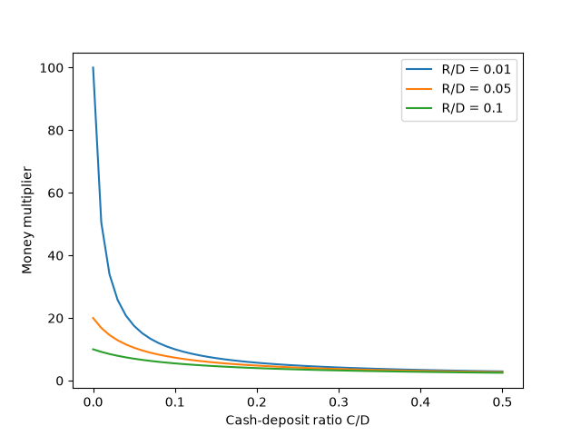
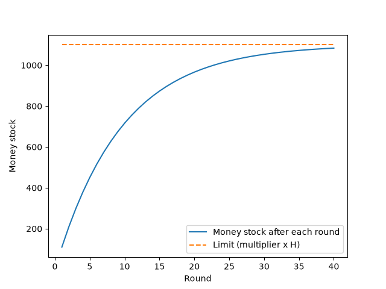
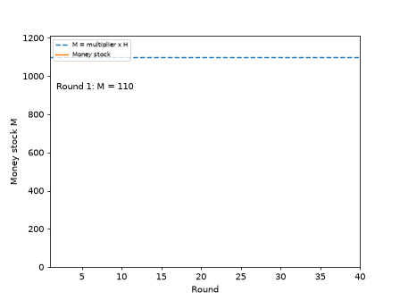

# 第 6 章: 貨幣供給と貨幣乗数

## 6.1 この章の地図

第 2 部は、**貨幣市場と IS-LM** です。その入口が、**貨幣の供給**です。経済に出回る貨幣（マネーストック）は、中央銀行が好きな量に決めるものではありません。中央銀行が直接動かせるのは、**ハイパワードマネー**（現金通貨と準備預金）です。民間の銀行が、預金を貸し出し、その貸出が、また預金になることで、貨幣は、ハイパワードマネーの**何倍にも増えます**。この章では、その倍率（**貨幣乗数**）を関数にして、金融政策の手段（公開市場操作・法定準備率操作）の効果と、信用創造が一定の値に収束する様子を、テストで確かめます。



| 項目 | 内容 |
| :--- | :--- |
| 経済学の題材 | マネーストック統計（M1・M2・M3・広義流動性）、ハイパワードマネー、貨幣乗数、金融政策の手段、信用創造 |
| 使う Python の機能 | 関数、リスト、`for` ループ、テスト（`pytest`）。NumPy・pandas は、この章では使いません |
| 新しく導入するライブラリ | なし（Matplotlib は、第 1 章で導入済み） |
| 完成形 | `m1`、`m3`、`broad_liquidity`、`monetary_base`、`money_multiplier`、`money_stock`、`open_market_operation`、`reserve_requirement_change`、`credit_creation_path` |
| ファイル | 実装: `lib/chapter06/money_supply.py`、`lib/chapter06/plot.py`（図）／テスト: `test/chapter06/test_money_supply.py`、`test/chapter06/test_plot.py`（自分で書くときは、`practice/chapter06/` に、同じ名前で作ります） |
| データ | なし（手計算できる小さな例だけ） |

### 経済学の式とコードの対応

| 経済学 | 式 | コード |
| :--- | :--- | :--- |
| M1 | M1 = 現金通貨 + 預金通貨 | `m1(currency, demand_deposits)` |
| M3 | M3 = M1 + 準通貨 + CD | `m3(m1_value, quasi_money, cd)` |
| 広義流動性 | 広義流動性 = M3 + 投資信託・国債など | `broad_liquidity(m3_value, investment_trusts, bonds)` |
| ハイパワードマネー | H = 現金通貨 + 準備預金 | `monetary_base(currency, reserves)` |
| 貨幣乗数 | (C/D + 1) ÷ (C/D + R/D) | `money_multiplier(cash_ratio, reserve_ratio)` |
| マネーストック | M = 貨幣乗数 × H | `money_stock(cash_ratio, reserve_ratio, base)` |
| 公開市場操作 | 買いオペで H が増え、売りオペで減る | `open_market_operation(base, amount, operation)` |
| 法定準備率操作 | 準備率を変えたあとの M | `reserve_requirement_change(base, cash_ratio, new_reserve_ratio)` |
| 信用創造 | 貸出と預金のくり返しで M が増える | `credit_creation_path(base, cash_ratio, reserve_ratio, rounds)` |

### 前提とする既存の章

この章は、**独立した話題**です。この連載の第 1〜5 章を、前提にしません。

| できること | 場所 |
| :--- | :--- |
| 関数と pytest のテストを書く（Red → Green → Refactor）、リストと `for` ループを使う、Matplotlib で線を描く | 第 1 シリーズ 第 1〜7 章 |

貨幣と金融政策は、第 1 シリーズの第 13 章（IS-LM）にも出てきます。この記事は、独立して読めるように、自分のコードを持ちます。

## 6.2 準備

サンプルコードは、リポジトリの `apps/macro-basics-programming/python/` にあります。環境の作り方は、[第 1 章](01-gdp-and-value-added.md) の 1.2 節と同じです。

```bash
cd apps/macro-basics-programming/python
uv sync
uv run pytest test/chapter06
```

```text
34 passed
```

自分でコードを書くときは、`practice/chapter06/` を作って、完成形と同じ名前（`money_supply.py`・`test_money_supply.py`）のファイルに書きます。テストは、`uv run pytest practice/chapter06` で動かします。**完成形（`lib/` と `test/`）は、答え合わせ用です。** 自分で書き終えてから、開いてください。

## 6.3 予想する

ある国の、**現金通貨**は 100、**預金**は 1000、銀行が中央銀行に預けた**準備預金**は 10 です（単位は、兆円とします。架空の数値です）。

- **現金預金比率 C/D** と **準備預金比率 R/D** は、いくつですか。**ハイパワードマネー H**は、いくつですか。**貨幣乗数**と、**マネーストック**（現金 + 預金）は、いくつですか
- 現金預金比率が 0.2 に上がると、貨幣乗数は、いくつになりますか。準備預金比率が 0.02 に上がると、いくつになりますか。どちらも、乗数は、下がりますか
- 中央銀行が、**買いオペ**で、ハイパワードマネーを 22 増やすと、マネーストックは、いくら増えますか
- 現金を持たない（C/D = 0）社会で、準備率が 0.1 のとき、100 の預金が新しく生まれると、銀行は、その 90% を貸し出し、貸出は、また預金になります。これをくり返すと、**預金の合計**は、いくつに近づきますか
- 現金通貨 80、預金通貨 520、準通貨 300、CD 20、投資信託 60、国債など 40 のとき、**M1・M3・広義流動性**は、いくつですか

## 6.4 貨幣供給の考え方

### 貨幣とマネーストック

**貨幣 = 現金 + 預金**です。経済全体の貨幣の量を、**マネーストック**と呼びます。日本銀行は、貨幣に近いものを、範囲の広さで、いくつかの指標にしています。

| 指標 | 内容 |
| :--- | :--- |
| M1 | 現金通貨 + 預金通貨（全預金取扱機関） |
| M2 | 現金通貨 + 預金通貨 + 準通貨 + CD の、**国内銀行等**の分だけに限る |
| M3 | M1 + 準通貨 + CD（全預金取扱機関）。代表的な指標 |
| 広義流動性 | M3 + 投資信託・国債など |

範囲が広いほど、大きな値になります。M2 は、M3 と、**数える金融機関の範囲**が違うだけで、足し算の形は同じです。この章では、関数にしません。

### ハイパワードマネー

**ハイパワードマネー**（別名マネタリーベース）は、**現金通貨 + 準備預金**です。中央銀行が、**直接動かせる**貨幣です。マネーストックは、民間の銀行と家計の行動で決まるので、中央銀行が直接決められません。

### 貨幣乗数

**現金預金比率** C/D（家計が、預金に対して持つ現金の割合）と、**準備預金比率** R/D（銀行が、預金に対して準備として置く割合）を使うと、マネーストックとハイパワードマネーの関係が、1 つの式になります。

> M = 現金 C + 預金 D
>
> H = 現金 C + 準備預金 R

H の分子と分母を、D で割ると、次のようになります。

> M ÷ H = (C/D + 1) ÷ (C/D + R/D)

この右辺が、**貨幣乗数**です。**M = 貨幣乗数 × H** と書けます。C/D = 0.1、R/D = 0.01 なら、乗数は 1.1 ÷ 0.11 = 10 です。現金預金比率が上がると、銀行に戻らない現金が増えるので、乗数は下がります。準備預金比率が上がると、貸し出せる額が減るので、乗数は下がります。

### 金融政策の手段

| 手段 | 動かすもの | 効果 |
| :--- | :--- | :--- |
| **公開市場操作** | ハイパワードマネー H | 買いオペ（債券を買い、貨幣を出す）で増え、売りオペで減る |
| **法定準備率操作** | 準備預金比率 R/D | 準備率の引上げで、貨幣乗数が下がる |
| **金利政策** | 金利 | 貨幣の需要に働きかける（次の章以降） |

この章では、H を動かす公開市場操作と、貨幣乗数を動かす法定準備率操作を、関数にします。**準備預金比率 R/D は、法定準備率に等しい**（銀行は、法定準備だけを置く）と簡単にします。

### 信用創造

銀行は、預金の一部を準備に置き、残りを貸し出します。貸し出された貨幣は、使われて、別の人の預金になります。この預金から、また一部が貸し出されます。この**くり返し**が、**信用創造**です。

C/D = 0、R/D = 0.1 で、100 の預金が生まれる場合を考えます。90 が貸し出されて、90 の預金が生まれ、81、72.9、… と続きます。預金の合計は、100 + 90 + 81 + … = 100 ÷ 0.1 = 1000 に収束します。ラウンドを続けるほど、合計は、貨幣乗数 × H に近づきます。

## 6.5 プログラミング

### Red: ストックのテスト

最初のテストを書きます。M1・M3・広義流動性は、足し算です。**範囲が広いほど大きい**ことも、テストにします。

```python
import pytest

from lib.chapter06.money_supply import (
    broad_liquidity,
    credit_creation_path,
    m1,
    m3,
    monetary_base,
    money_multiplier,
    money_stock,
    open_market_operation,
    reserve_requirement_change,
)
```

```python
def test_M1は現金通貨と預金通貨の和() -> None:
    assert m1(80, 520) == 600


def test_M3はM1に準通貨とCDを足した値() -> None:
    assert m3(600, 300, 20) == 920


def test_広義流動性はM3に投資信託と国債などを足した値() -> None:
    assert broad_liquidity(920, 60, 40) == 1020
```

`m1` がまだないので、テストは失敗します（**Red**）。

### Green: ストックを実装する

```python
def _check_amount(value: float, name: str) -> None:
    if value < 0:
        raise ValueError(f"{name}は、0 以上にする")


def m1(currency: float, demand_deposits: float) -> float:
    """M1 = 現金通貨 + 預金通貨（全預金取扱機関）。"""
    _check_amount(currency, "現金通貨")
    _check_amount(demand_deposits, "預金通貨")
    return currency + demand_deposits


def m3(m1_value: float, quasi_money: float, cd: float) -> float:
    """M3 = M1 + 準通貨 + CD（譲渡性預金）。代表的なマネーストックの指標。"""
    _check_amount(m1_value, "M1")
    _check_amount(quasi_money, "準通貨")
    _check_amount(cd, "CD")
    return m1_value + quasi_money + cd


def broad_liquidity(m3_value: float, investment_trusts: float, bonds: float) -> float:
    """広義流動性 = M3 + 投資信託・国債など。"""
    _check_amount(m3_value, "M3")
    _check_amount(investment_trusts, "投資信託")
    _check_amount(bonds, "国債など")
    return m3_value + investment_trusts + bonds


def monetary_base(currency: float, reserves: float) -> float:
    """ハイパワードマネー（マネタリーベース）H = 現金通貨 + 準備預金。"""
    _check_amount(currency, "現金通貨")
    _check_amount(reserves, "準備預金")
    return currency + reserves
```

??? note "import と補助関数（写すときに足す）"

    記事の抜粋には、import と、先頭が `_` の補助関数・定数を、省いています。完成形のファイルの先頭にある、次の部分を、写してください。

    **lib/chapter06/money_supply.py**

    ```python
    _BUY = "買いオペ"
    _SELL = "売りオペ"
    ```

    ```python
    def _check_amount(value: float, name: str) -> None:
        if value < 0:
            raise ValueError(f"{name}は、0 以上にする")
    ```

    ```python
    def _check_ratios(cash_ratio: float, reserve_ratio: float) -> None:
        if cash_ratio < 0:
            raise ValueError("現金預金比率 C/D は、0 以上にする")
        if not 0 < reserve_ratio <= 1:
            raise ValueError("準備預金比率 R/D は、0 より大きく 1 以下にする")
    ```

ストックは、負になりません。負の値は、**どの量が負なのか**が分かるエラーにします（テストは、`test_ストックの要素が負ならエラー`）。

### 貨幣乗数

C/D = 0.1、R/D = 0.01 で、乗数は 10 です。C/D が上がる、R/D が上がるときに、乗数が**下がる**ことを、テストにします。

```python
CASH_RATIO = 0.1  # 現金預金比率 C/D
RESERVE_RATIO = 0.01  # 準備預金比率 R/D
BASE = 110.0  # ハイパワードマネー（現金 100 + 準備預金 10）


def test_貨幣乗数は現金預金比率0_1と準備率0_01で10() -> None:
    assert money_multiplier(CASH_RATIO, RESERVE_RATIO) == pytest.approx(10)


def test_現金預金比率が上がると貨幣乗数は下がる() -> None:
    assert money_multiplier(0.2, RESERVE_RATIO) == pytest.approx(1.2 / 0.21)
    assert money_multiplier(0.2, RESERVE_RATIO) < money_multiplier(0.1, RESERVE_RATIO)
```

```python
def _check_ratios(cash_ratio: float, reserve_ratio: float) -> None:
    if cash_ratio < 0:
        raise ValueError("現金預金比率 C/D は、0 以上にする")
    if not 0 < reserve_ratio <= 1:
        raise ValueError("準備預金比率 R/D は、0 より大きく 1 以下にする")


def money_multiplier(cash_ratio: float, reserve_ratio: float) -> float:
    """貨幣乗数 = (C/D + 1) ÷ (C/D + R/D)。C/D・R/D が上がると下がる。"""
    _check_ratios(cash_ratio, reserve_ratio)
    return (cash_ratio + 1) / (cash_ratio + reserve_ratio)
```

比率の範囲を、エラーで守ります。現金預金比率が負、準備預金比率が 0 以下や 1 超は、意味がありません。

C/D が 0 以上、R/D が 0 より大きいなら、分母 C/D + R/D は**必ず正**で、0 除算は、準備預金比率のチェックで先に止まります。乗数は**常に 1 以上**で、現金を持たず（C/D = 0）、全額を準備に置く（R/D = 1）と、信用創造が起きず、ちょうど 1 になります。

```python
def test_現金を持たず全額を準備に置くなら貨幣乗数は1() -> None:
    assert money_multiplier(0.0, 1.0) == pytest.approx(1)


def test_比率が範囲外ならエラー() -> None:
    with pytest.raises(ValueError, match="現金預金比率"):
        money_multiplier(-0.1, RESERVE_RATIO)
    with pytest.raises(ValueError, match="準備預金比率"):
        money_multiplier(CASH_RATIO, 0.0)
    with pytest.raises(ValueError, match="準備預金比率"):
        money_multiplier(CASH_RATIO, -0.01)
    with pytest.raises(ValueError, match="準備預金比率"):
        money_multiplier(CASH_RATIO, 1.01)
```

### マネーストック

マネーストックは、乗数 × H です。**式の変形が、正しい**ことを、定義から確かめます。預金 D は H ÷ (C/D + R/D)、現金は C/D × D で、現金 + 預金が、乗数 × H に一致し、現金 + 準備が、H に一致するはずです。

```python
def test_マネーストックは貨幣乗数にハイパワードマネーを掛けた値() -> None:
    assert money_stock(CASH_RATIO, RESERVE_RATIO, BASE) == pytest.approx(1100)


def test_マネーストックは現金と預金の和に一致する() -> None:
    deposits = BASE / (CASH_RATIO + RESERVE_RATIO)
    cash = CASH_RATIO * deposits
    assert cash + deposits == pytest.approx(
        money_stock(CASH_RATIO, RESERVE_RATIO, BASE)
    )
    assert cash + RESERVE_RATIO * deposits == pytest.approx(BASE)
```

```python
def money_stock(cash_ratio: float, reserve_ratio: float, base: float) -> float:
    """マネーストック M = 貨幣乗数 × ハイパワードマネー H。"""
    _check_amount(base, "ハイパワードマネー")
    return money_multiplier(cash_ratio, reserve_ratio) * base
```

### 金融政策の手段

買いオペは H を増やし、売りオペは H を減らします。**買いオペ後のマネーストックの増加は、貨幣乗数の倍**になることを、テストにします。

```python
def test_買いオペはハイパワードマネーを増やす() -> None:
    assert open_market_operation(BASE, 22, "買いオペ") == pytest.approx(132)


def test_買いオペ後のマネーストックの増加は貨幣乗数の倍() -> None:
    before = money_stock(CASH_RATIO, RESERVE_RATIO, BASE)
    after = money_stock(
        CASH_RATIO, RESERVE_RATIO, open_market_operation(BASE, 22, "買いオペ")
    )
    assert after - before == pytest.approx(10 * 22)
```

```python
def open_market_operation(base: float, amount: float, operation: str) -> float:
    """公開市場操作後のハイパワードマネー。買いオペで増え、売りオペで減る。"""
    _check_amount(base, "ハイパワードマネー")
    _check_amount(amount, "操作の額")
    if operation == _BUY:
        return base + amount
    if operation == _SELL:
        if amount > base:
            raise ValueError("売りオペの額が、ハイパワードマネーを超えている")
        return base - amount
    raise ValueError(f"操作は「{_BUY}」か「{_SELL}」にする: {operation}")
```

売りオペの額が、H を超えると、H が負になってしまいます。**ちょうど H と同じ額なら、0 になって有効**で、超えたらエラーです（境界）。操作の名前を間違えたときも、エラーにします。

```python
def test_売りオペの額がハイパワードマネーを超えるとエラー() -> None:
    assert open_market_operation(BASE, BASE, "売りオペ") == 0
    with pytest.raises(ValueError, match="超えて"):
        open_market_operation(BASE, BASE + 1, "売りオペ")
```

法定準備率の操作は、準備率を変えたあとのマネーストックです。準備率を**上げる**と減り、**下げる**と増えます。

```python
def test_準備率を上げるとマネーストックは減る() -> None:
    after = reserve_requirement_change(BASE, CASH_RATIO, 0.02)
    assert after == pytest.approx(BASE * 1.1 / 0.12)
    assert after < money_stock(CASH_RATIO, RESERVE_RATIO, BASE)
```

```python
def reserve_requirement_change(
    base: float, cash_ratio: float, new_reserve_ratio: float
) -> float:
    """法定準備率を new_reserve_ratio にしたあとのマネーストック。"""
    return money_stock(cash_ratio, new_reserve_ratio, base)
```

### 信用創造

信用創造を、ラウンドごとに、追います。各ラウンドで、手元の資金 x を、預金 d と、現金 C/D × d に分けます（x = (1 + C/D) d）。銀行は、預金の R/D を準備に置き、残りを貸し出します。貸出が、次のラウンドの手元の資金になります。

最初のテストは、手計算できる値にします。H = 110、C/D = 0.1 なら、1 回目の預金は 100、現金は 10 で、マネーストックは 110（= H）です。2 回目は、貸出が 0.99 × 100 = 99 で、預金は 90 になり、マネーストックは 110 + 99 = 209 です。

```python
def test_信用創造の2回目までの合計() -> None:
    path = credit_creation_path(BASE, CASH_RATIO, RESERVE_RATIO, 2)
    assert path == pytest.approx([110, 209])
```

```python
def credit_creation_path(
    base: float, cash_ratio: float, reserve_ratio: float, rounds: int
) -> list[float]:
    """信用創造を、ラウンドごとに追い、各ラウンド後のマネーストックを返す。

    各ラウンドで、手元の資金 x を、預金 d と現金 C/D × d に分ける（x = (1 + C/D) d）。
    銀行は、預金 d の R/D を準備に置き、残りを貸し出す。貸出は、次のラウンドの
    手元の資金になる。
    """
    _check_amount(base, "ハイパワードマネー")
    _check_ratios(cash_ratio, reserve_ratio)
    if rounds < 1:
        raise ValueError("ラウンド数は、1 以上にする")
    deposit = base / (1 + cash_ratio)
    total = 0.0
    path = []
    for _ in range(rounds):
        total += deposit
        path.append((1 + cash_ratio) * total)
        deposit *= (1 - reserve_ratio) / (1 + cash_ratio)
    return path
```

ラウンドを続けると、マネーストックは、**貨幣乗数 × H に近づき、超えません**。現金を持たない場合は、預金の合計が、準備率の逆数倍になります。

```python
def test_信用創造は現金を持たなければ預金が準備率の逆数倍になる() -> None:
    path = credit_creation_path(100, 0.0, 0.1, 200)
    assert path[0] == pytest.approx(100)
    assert path[1] == pytest.approx(190)
    assert path[-1] == pytest.approx(1000)


def test_信用創造は貨幣乗数とハイパワードマネーの積に近づく() -> None:
    path = credit_creation_path(BASE, CASH_RATIO, RESERVE_RATIO, 200)
    assert path[-1] == pytest.approx(money_stock(CASH_RATIO, RESERVE_RATIO, BASE))
    assert path == sorted(path)
    assert all(a < 1100 for a in path)
```

??? note "詳しく見る（収束の理由。必要なときに開く）"

    1 ラウンドごとに、預金は、前のラウンドの (1 − R/D) ÷ (1 + C/D) 倍になります。C/D = 0.1、R/D = 0.01 なら、0.99 ÷ 1.1 = 0.9 倍です。この比が 1 より小さいので、等比数列の和が、収束します。

    > 預金の合計 = 最初の預金 ÷ (1 − 比) = H ÷ (1 + C/D) ÷ ((C/D + R/D) ÷ (1 + C/D)) = H ÷ (C/D + R/D)

    マネーストックは、(1 + C/D) × 預金の合計 = 貨幣乗数 × H で、**ラウンドごとの計算と乗数の式は、同じことを別の方法で表している**ので、テストで突き合わせられます。

### 予想の答え合わせ

予想した答えを、プログラムで確かめます。

```python
from lib.chapter06.money_supply import (
    broad_liquidity,
    credit_creation_path,
    m1,
    m3,
    monetary_base,
    money_multiplier,
    money_stock,
    open_market_operation,
)

currency, deposits, reserves = 100, 1000, 10
cash_ratio = currency / deposits
reserve_ratio = reserves / deposits
base = monetary_base(currency, reserves)
print("C/D, R/D:", cash_ratio, reserve_ratio)
print("H:", base)
print("貨幣乗数:", round(money_multiplier(cash_ratio, reserve_ratio), 4))
print("マネーストック:", round(money_stock(cash_ratio, reserve_ratio, base), 4))
print("乗数（C/D = 0.2）:", round(money_multiplier(0.2, reserve_ratio), 4))
print("乗数（R/D = 0.02）:", round(money_multiplier(cash_ratio, 0.02), 4))
before = money_stock(cash_ratio, reserve_ratio, base)
bought = open_market_operation(base, 22, "買いオペ")
after = money_stock(cash_ratio, reserve_ratio, bought)
print("買いオペ 22 のマネーストック増加:", round(after - before, 4))
path = credit_creation_path(100, 0.0, 0.1, 200)
print("最初の 5 ラウンドの預金の合計:", [round(v, 2) for v in path[:5]])
print("200 ラウンド後の預金の合計:", round(path[-1], 4))
first = m1(80, 520)
second = m3(first, 300, 20)
print("M1, M3, 広義流動性:", first, second, broad_liquidity(second, 60, 40))
```

```text
C/D, R/D: 0.1 0.01
H: 110
貨幣乗数: 10.0
マネーストック: 1100.0
乗数（C/D = 0.2）: 5.7143
乗数（R/D = 0.02）: 9.1667
買いオペ 22 のマネーストック増加: 220.0
最初の 5 ラウンドの預金の合計: [100.0, 190.0, 271.0, 343.9, 409.51]
200 ラウンド後の預金の合計: 1000.0
M1, M3, 広義流動性: 600 920 1020
```

- **1 つ目の問い**: C/D は 0.1、R/D は 0.01、H は 110 です。貨幣乗数は 10 で、マネーストックは 1100 です。**現金 100 + 預金 1000 = 1100 と、一致します**
- **2 つ目の問い**: C/D が 0.2 なら、乗数は約 5.71、R/D が 0.02 なら、約 9.17 です。**どちらも、下がります**。動かした幅が違う（C/D は +0.1、R/D は +0.01）ので、下がり方の大きさは、単純には比べられません
- **3 つ目の問い**: 買いオペ 22 で、マネーストックは 220 増えます（乗数 10 × 22）。**ハイパワードマネーの増加の、10 倍**です
- **4 つ目の問い**: 預金の合計は、100、190、271、343.9、409.51、… と増えて、**1000 に近づきます**（100 ÷ 0.1）。現金を持たない場合の、マネーストックは、預金の合計に等しいので、この列は、マネーストックでもあります
- **5 つ目の問い**: M1 は 600、M3 は 920、広義流動性は 1020 です。範囲が広いほど、大きくなります

### 図

貨幣乗数の図を、描く関数を、テストから書きます。準備率ごとに 1 本の線を引き、座標が、手計算の値（C/D = 0 のとき 1 ÷ R/D など）と一致することを、確かめます。座標を取り出す補助関数 `xs`・`ys`、線の本数と軸の名前のテストは、`test/chapter06/test_plot.py` を見てください。

??? note "描画のテストと実装（後回しにしても、学習は成り立ちます）"

    ```python
    def test_貨幣乗数の線の座標() -> None:
        ax = plot_money_multiplier([0.0, 0.1, 0.2], [0.01, 0.1]).axes[0]
        assert xs(ax.lines[0]) == pytest.approx([0.0, 0.1, 0.2])
        assert ys(ax.lines[0]) == pytest.approx([100, 10, 1.2 / 0.21])
        assert ys(ax.lines[1]) == pytest.approx([10, 5.5, 1.2 / 0.3])
    ```

??? note "描画のテストと実装（後回しにしても、学習は成り立ちます）"

    ```python
    def plot_money_multiplier(
        cash_ratios: list[float], reserve_ratios: list[float]
    ) -> Figure:
        """現金預金比率 C/D を横軸に、準備預金比率 R/D ごとの貨幣乗数を描く。"""
        fig, ax = plt.subplots()
        for reserve_ratio in reserve_ratios:
            ax.plot(
                cash_ratios,
                [money_multiplier(c, reserve_ratio) for c in cash_ratios],
                label=f"R/D = {reserve_ratio}",
            )
        ax.set_xlabel("Cash-deposit ratio C/D")
        ax.set_ylabel("Money multiplier")
        ax.legend()
        plt.close(fig)
        return fig
    ```

信用創造の図（`plot_credit_creation`）は、同じ作りで、ラウンドごとのマネーストックと、上限（乗数 × H）を、1 つの図に描きます。テストと実装は、`test/chapter06/test_plot.py` と `lib/chapter06/plot.py` を見てください。



### 動かして見る

信用創造を、40 ラウンド追います。ラウンドを重ねるごとに、マネーストックが、貨幣乗数 × ハイパワードマネーという上限（破線）へ、近づきます。



このアニメーションは、`lib/animations/` の関数で作っています（`uv run python -m tools.render_animations` で、GIF を書き出します）。**写経は、不要**です。動きを見て、式と図の対応を、確かめてください。

### 実行結果

```bash
uv run pytest test/chapter06
```

```text
34 passed
```

## 6.6 規則で言うと

1. **マネーストック = 貨幣乗数 × ハイパワードマネー。** 乗数は (C/D + 1) ÷ (C/D + R/D)。C/D・R/D が上がると、下がる
2. **中央銀行が直接動かすのは、ハイパワードマネーと準備率。** 買いオペで H が増え、売りオペで減る。マネーストックは、乗数を通して、H の何倍も動く
3. **境界は、テストで固定する。** 売りオペの額が H と同じなら有効（0 になる）、超えたらエラー。準備預金比率 R/D は、0 より大きく、1 以下

混同しやすい点を、表にまとめます。

| 混同しやすい点 | 違い |
| :--- | :--- |
| マネーストックとハイパワードマネー | マネーストックは、現金 + 預金で、**民間の行動**を含んで決まる。ハイパワードマネーは、現金 + 準備預金で、**中央銀行が直接動かせる** |
| 現金預金比率 C/D と、準備預金比率 R/D | C/D は、**家計**が決める（現金をどれだけ持つか）。R/D は、**銀行**が置く準備（法定準備率で、下限が決まる） |
| 準備率の引上げと、売りオペ | どちらも、マネーストックを減らす。引上げは**乗数**を下げ、売りオペは **H** を減らす |
| M1 と M3 | M3 は、M1 に、準通貨と CD を足した、範囲の広い指標 |

### このモデルが成り立たない場面

- **現金預金比率と準備預金比率は、一定とは限りません。** 景気や、金融不安で、家計は現金を多く持ち、銀行は準備を多く置きます。乗数は、**不安定**です
- **貸出を、銀行が、自由に増やせるとは限りません。** 貸出先（資金需要）が、なければ、信用創造は、進みません。H を増やしても、マネーストックが、思ったほど増えないことがあります
- **準備預金は、法定準備だけとは限りません。** 実際は、法定を超えた準備（超過準備）も、置かれます。この章は、R/D を、法定準備率に等しいと、簡単にしています

## 6.7 練習問題

| 種類 | 問題 |
| :--- | :--- |
| 想起 | 本文を閉じて、`money_multiplier` の最初のテスト（C/D = 0.1、R/D = 0.01 で、乗数 10）を書いてください |
| 生成 | 解説を見る前に、ハイパワードマネーを 1 だけ増やしたときの、マネーストックの増加を返す `money_per_base(cash_ratio, reserve_ratio)` を、テストから書いてください。C/D = 0.1、R/D = 0.01 では、いくつになりますか |
| 多様 | 準備率を 0.01 から 0.1 に上げると、乗数は、いくつになりますか。先に予想してから、確かめてください。現金預金比率が 0 のとき、乗数は、準備率の逆数になりますか |
| 交互 | [第 1 シリーズ](../economics-programming/index.md)の第 3 章のリスト内包表記で、現金預金比率が 0、0.1、0.2、0.3、0.4 のときの乗数（R/D = 0.01）を、一度に計算してください。比率が上がるほど、乗数は、小さくなっていますか |

??? note "解答（先に自分で取り組んでから、開いてください）"

    **想起**:

    ```python
    def test_貨幣乗数は現金預金比率0_1と準備率0_01で10() -> None:
        assert money_multiplier(0.1, 0.01) == pytest.approx(10)
    ```

    **生成**: H = 1 のときのマネーストックが、そのまま、貨幣乗数です。

    ```python
    def money_per_base(cash_ratio, reserve_ratio):
        return money_stock(cash_ratio, reserve_ratio, 1.0)
    ```

    ```python
    def test_Hを1増やしたときのマネーストックの増加は乗数に等しい() -> None:
        assert money_per_base(0.1, 0.01) == pytest.approx(10)
        assert money_per_base(0.2, 0.01) == pytest.approx(1.2 / 0.21)
    ```

    C/D = 0.1、R/D = 0.01 では、10 です。

    **多様**: 準備率が 0.1 なら、乗数は 1.1 ÷ 0.2 = 5.5 です。**準備率を 10 倍にしても、乗数は、10 分の 1 にはなりません**（5.5 は、10 の約半分）。現金預金比率が 0 なら、乗数は 1 ÷ R/D で、**準備率の逆数**になります（R/D = 0.1 なら 10）。

    ```python
    def test_準備率を上げると乗数は下がり現金がなければ逆数になる() -> None:
        assert money_multiplier(0.1, 0.1) == pytest.approx(5.5)
        assert money_multiplier(0.1, 0.1) < money_multiplier(0.1, 0.01)
        assert money_multiplier(0.0, 0.1) == pytest.approx(10)
        assert money_multiplier(0.0, 0.05) == pytest.approx(20)
    ```

    **交互**:

    ```python
    def test_現金預金比率が上がるほど乗数は小さい() -> None:
        ratios = [0.0, 0.1, 0.2, 0.3, 0.4]
        values = [money_multiplier(c, 0.01) for c in ratios]
        assert values[:2] == pytest.approx([100, 10])
        assert values == sorted(values, reverse=True)
        assert len(set(values)) == len(values)
    ```

    乗数は、100、10、約 5.71、約 4.19、約 3.41 と、単調に小さくなります。**現金預金比率が 0 から 0.1 になるだけで、乗数は、10 分の 1 に**なります。

## 6.8 振り返り

- マネーストックとハイパワードマネーの違いを、「誰が直接動かせるか」で、説明できますか
- 現金預金比率が上がると、乗数が下がるのは、なぜですか。準備率の引上げと売りオペは、どう違いますか
- 信用創造のラウンドごとの計算と乗数の式が、同じ値になることを、どう確かめましたか

## 6.9 まとめ

- M1（現金通貨 + 預金通貨）= 600、M3（M1 + 準通貨 + CD）= 920、広義流動性（M3 + 投資信託・国債など）= 1020 を、関数にした。範囲が広いほど大きい
- ハイパワードマネー H = 現金 + 準備預金 = 110 と、貨幣乗数 (C/D + 1) ÷ (C/D + R/D) = 10 から、マネーストック M = 乗数 × H = 1100（現金 100 + 預金 1000）を求めた
- 買いオペで H を 22 増やすと、M は 220 増える。準備率を 0.02 に上げると、乗数は約 9.17 に下がり、M は約 1008.33 に減る
- 信用創造を、ラウンドごとに追うと、マネーストックは、乗数 × H（1100）に、超えずに近づく。現金を持たない場合は、預金の合計が、準備率の逆数倍（1000）になる
- 次の章では、貨幣の**需要**と、貨幣市場を均衡させる **LM 曲線**を、学びます
