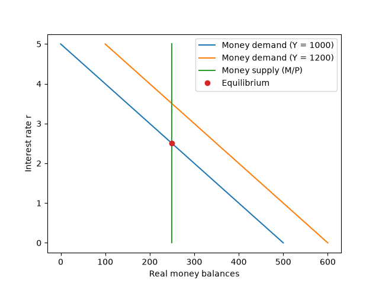
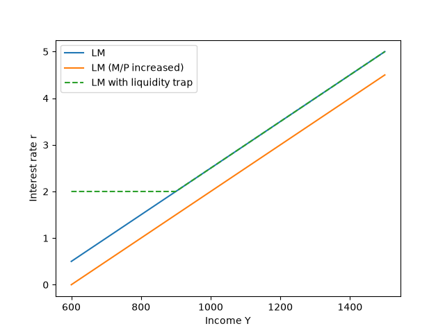

# 第 7 章: 貨幣需要と LM 曲線

## 7.1 この章の地図

前の章では、貨幣の**供給**を調べました。この章では、貨幣の**需要**を調べ、**貨幣市場を均衡させる所得と利子率の組**（**LM 曲線**）を導きます。人は、取引のために貨幣を持ち（所得が増えると、貨幣需要が増える）、資産の持ち方として貨幣を持ちます（利子率が下がると、貨幣需要が増える）。この 2 つから、貨幣需要は、**所得の増加関数で、利子率の減少関数**になります。LM 曲線の**傾き**と**シフト**、利子率が下限に達したときの**流動性のわな**を、テストで確かめます。



| 項目 | 内容 |
| :--- | :--- |
| 経済学の題材 | 取引需要・資産需要、貨幣市場の均衡、LM 曲線の傾きとシフト、流動性のわな、LM 曲線の上側と下側 |
| 使う Python の機能 | 関数、`max`、`math.inf`、テスト（`pytest`）。NumPy・pandas は、この章では使いません |
| 新しく導入するライブラリ | なし（Matplotlib は、第 1 章で導入済み） |
| 完成形 | `money_demand`、`lm_interest`、`lm_income`、`lm_slope`、`transaction_demand`、`asset_demand`、`money_demand_shift`、`lm_shift`、`lm_interest_with_trap`、`trap_income`、`money_demand_with_trap`、`excess_money_demand`、`money_market_state` |
| ファイル | 実装: `lib/chapter07/money_market.py`（中核）、`lib/chapter07/liquidity.py`、`lib/chapter07/plot.py`（図）／テスト: `test/chapter07/test_money_market.py`、`test/chapter07/test_liquidity.py`、`test/chapter07/test_plot.py`（自分で書くときは、`practice/chapter07/` に、同じ名前で作ります） |
| データ | なし（手計算できる小さな例だけ） |

### 経済学の式とコードの対応

| 経済学 | 式 | コード |
| :--- | :--- | :--- |
| 貨幣需要 | L = k·Y − h·r | `money_demand(income, interest, k, h)` |
| 取引需要・資産需要 | 取引需要 = k·Y、資産需要 = −h·r | `transaction_demand(income, k)`、`asset_demand(interest, h)` |
| LM 曲線（利子率） | r = (k·Y − M/P) ÷ h | `lm_interest(income, real_money, k, h)` |
| LM 曲線（所得） | Y = (M/P + h·r) ÷ k | `lm_income(interest, real_money, k, h)` |
| LM 曲線の傾き | dr/dY = k ÷ h | `lm_slope(k, h)` |
| 貨幣需要曲線のシフト | k·ΔY | `money_demand_shift(income_before, income_after, k)` |
| LM 曲線のシフト | Δ(M/P) ÷ k | `lm_shift(real_money_before, real_money_after, k)` |
| 流動性のわな | r = max(LM 上の r, 下限) | `lm_interest_with_trap(income, real_money, k, h, floor)` |
| 貨幣の超過需要 | L − M/P | `excess_money_demand(income, interest, real_money, k, h)` |

### 前提とする既存の章

| できること | 場所 |
| :--- | :--- |
| 関数と pytest のテストを書く（Red → Green → Refactor）、Matplotlib で線を描く | 第 1 シリーズ 第 1〜7 章 |

IS-LM は、第 1 シリーズの第 13 章にも出てきます。この記事は、**独立して読めます**。この連載の第 4 章（45 度線）も、前提にしません。財市場の側（IS 曲線）は、第 8 章で導きます。

## 7.2 準備

サンプルコードは、リポジトリの `apps/macro-basics-programming/python/` にあります。環境の作り方は、[第 1 章](01-gdp-and-value-added.md) の 1.2 節と同じです。

```bash
cd apps/macro-basics-programming/python
uv sync
uv run pytest test/chapter07
```

```text
34 passed
```

自分でコードを書くときは、`practice/chapter07/` を作って、完成形と同じ名前のファイル（`money_market.py`・`test_money_market.py` など）に書きます。テストは、`uv run pytest practice/chapter07` で動かします。**完成形（`lib/` と `test/`）は、答え合わせ用です。** 自分で書き終えてから、開いてください。

## 7.3 予想する

貨幣需要が、L = 0.5 × Y − 100 × r（k = 0.5、h = 100）で、**実質貨幣供給 M/P** が 250 です。

- 所得 Y = 1000、利子率 r = 2.5 のときの**貨幣需要**は、いくつですか。貨幣市場を均衡させる**利子率**は、いくつですか。所得が 1200 に増えると、いくつになりますか
- 実質貨幣供給が 300 に増えると、Y = 1000 での均衡の利子率は、いくつになりますか。LM 曲線は、**右**と**左**のどちらにシフトしますか。同じ利子率で見て、所得は、いくつ動きますか
- LM 曲線の**傾き**は、いくつですか。h を 200 にすると、k を 1.0 にすると、それぞれ、いくつになりますか。**緩やか**になるのは、どちらですか
- 利子率に**下限 2.0**（流動性のわな）があります。Y = 600 のとき、LM 曲線上の利子率は、いくつですか。わなの下で、M/P を 250 から 270 に増やすと、Y = 600 での利子率は、どうなりますか
- 点（Y = 1000、r = 3.5）は、LM 曲線の**上側**ですか、**下側**ですか。貨幣は、**供給超過**ですか、**需要超過**ですか。利子率は、どちらに動きますか

## 7.4 貨幣需要と LM 曲線の考え方

### 貨幣需要

貨幣は、**安全で流動的**ですが、**収益を生みません**。持つ理由が、2 つあります。

| 需要 | 動機 | 決まり方 |
| :--- | :--- | :--- |
| 取引需要 | 買い物や支払いのために持つ | 所得の**増加関数**。所得が増えると、取引が増える |
| 資産需要 | 資産の持ち方として持つ | 利子率の**減少関数**。利子率が高いほど、貨幣を持つ損（収益を逃す）が大きい |

この 2 つを合わせた、簡単な形が、次の式です。

> L = k·Y − h·r

k は、所得に対する感応度（所得 1 単位あたりの貨幣需要）、h は、利子率に対する感応度です。資産需要の部分（−h·r）は、**利子率の減少関数**であることだけが、ここでは大事で、水準そのものは意味を持ちません（定数項は、含めて考えません）。

### 貨幣市場の均衡と LM 曲線

貨幣供給（実質）M/P が与えられると、貨幣市場は、**L = M/P** のときに均衡します。これを、利子率について解いた式が、LM 曲線です。

> r = (k·Y − M/P) ÷ h

所得 Y が増えると、貨幣需要が増えるので、均衡を保つには、利子率が**上がる**必要があります。**LM 曲線は、右上がり**です。貨幣供給は、利子率に依存しないので、貨幣市場の図（横軸が貨幣量）では**垂直**です。

### 傾きとシフト

所得を横軸、利子率を縦軸にとると、LM 曲線の傾きは、**k ÷ h** です。

| 変化 | 傾き | 理由 |
| :--- | :--- | :--- |
| h（利子率弾力性）が大きい | **緩やか** | 利子率が少し動くだけで、貨幣需要が大きく変わる |
| k（所得弾力性）が大きい | **急** | 所得が増えると、貨幣需要が大きく増え、利子率を大きく上げる必要がある |

LM 曲線は、**実質貨幣供給 M/P が増える**と、右にシフトします。同じ利子率で、より大きい所得でも、貨幣市場が均衡するからです。所得が増えると、貨幣需要曲線（貨幣市場の図）が、右にシフトします。

### 流動性のわな

利子率が、**ごく低い水準**まで下がると、人は、債券を買っても、収益がほとんどなく、損失（価格の下落）のおそれだけが残ります。そのため、いくら貨幣が増えても、すべて、貨幣のまま持とうとします。貨幣需要が、**無限大**になり、貨幣需要曲線は、**水平**になります。この状態を、**流動性のわな**と呼びます。LM 曲線は、利子率の下限で、**水平**になります。

### LM 曲線の上側と下側

LM 曲線の**上側**の点は、均衡より利子率が高く、貨幣需要が小さいので、貨幣が**供給超過**で、利子率が**下がり**ます。**下側**の点は、貨幣が**需要超過**で、利子率が**上がり**ます。

## 7.5 プログラミング

### Red: 貨幣需要のテスト（中核）

最初のテストを書きます。k = 0.5、h = 100、Y = 1000、r = 2.5 なら、L = 500 − 250 = 250 です。**所得の増加関数で、利子率の減少関数**であることも、テストにします。

```python
import pytest

from lib.chapter07.money_market import (
    lm_income,
    lm_interest,
    lm_slope,
    money_demand,
)
```

```python
K = 0.5  # 所得に対する貨幣需要の感応度


H = 100.0  # 利子率に対する貨幣需要の感応度


def test_貨幣需要は所得の増加関数で利子率の減少関数() -> None:
    assert money_demand(1000, 2.5, K, H) == pytest.approx(250)
    assert money_demand(1200, 2.5, K, H) > money_demand(1000, 2.5, K, H)
    assert money_demand(1000, 4.0, K, H) < money_demand(1000, 2.5, K, H)
```

`money_demand` がまだないので、テストは失敗します（**Red**）。

### Green: 貨幣需要を実装する

```python
def _check_k(k: float) -> None:
    if k <= 0:
        raise ValueError("貨幣需要の所得への感応度 k は、正にする")


def _check_h(h: float) -> None:
    if h <= 0:
        raise ValueError("貨幣需要の利子率への感応度 h は、正にする")


def money_demand(income: float, interest: float, k: float, h: float) -> float:
    """貨幣需要 L = k·Y − h·r。所得の増加関数で、利子率の減少関数。"""
    _check_k(k)
    _check_h(h)
    return k * income - h * interest
```

感応度 k・h が正でないとき（0 では、傾き k ÷ h や、利子率の式が、定義できません）は、どちらの値が悪いのか分かるエラーにします。

```python
def test_感応度が正でなければエラー() -> None:
    with pytest.raises(ValueError, match="所得への感応度"):
        money_demand(1000, 2.5, 0.0, H)
    with pytest.raises(ValueError, match="利子率への感応度"):
        lm_interest(1000, 250, K, 0.0)
    with pytest.raises(ValueError, match="利子率への感応度"):
        lm_slope(K, -1.0)
```

### LM 曲線

LM 曲線上の利子率は、貨幣需要を、貨幣供給に等しくする値です。**この利子率で、貨幣需要を計算すると、M/P に戻る**ことを、テストにします。

```python
def test_LM曲線上の利子率は貨幣市場を均衡させる() -> None:
    assert lm_interest(1000, 250, K, H) == pytest.approx(2.5)
    demand = money_demand(1000, lm_interest(1000, 250, K, H), K, H)
    assert demand == pytest.approx(250)


def test_LM曲線は右上がりで所得が増えると利子率が上がる() -> None:
    assert lm_interest(1200, 250, K, H) > lm_interest(1000, 250, K, H)


def test_所得から利子率を求める式と逆の関係() -> None:
    interest = lm_interest(1000, 250, K, H)
    assert lm_income(interest, 250, K, H) == pytest.approx(1000)
```

```python
def lm_interest(income: float, real_money: float, k: float, h: float) -> float:
    """LM 曲線: 貨幣市場を均衡させる利子率 r = (k·Y − M/P) ÷ h。"""
    _check_k(k)
    _check_h(h)
    return (k * income - real_money) / h


def lm_income(interest: float, real_money: float, k: float, h: float) -> float:
    """LM 曲線: 貨幣市場を均衡させる所得 Y = (M/P + h·r) ÷ k。"""
    _check_k(k)
    _check_h(h)
    return (real_money + h * interest) / k
```

### 傾きとシフト

傾き k ÷ h は、**所得を 1 増やしたときの、利子率の上昇**に等しいはずです。これを、傾きの式と、LM 曲線の関数の、**突き合わせ**でテストします。

```python
def test_LM曲線の傾きは_k_を_h_で割った値() -> None:
    assert lm_slope(K, H) == pytest.approx(0.005)
    assert lm_slope(K, 200.0) < lm_slope(K, H)
```

```python
def test_傾きは所得を1増やしたときの利子率の上昇に等しい() -> None:
    rise = lm_interest(1001, 250, K, H) - lm_interest(1000, 250, K, H)
    assert rise == pytest.approx(lm_slope(K, H))
```

`k` が大きいほど急になること、`h` を大きくすると傾きが 0 に近づく（水平に近づく）ことのテストも、`test/chapter07/test_liquidity.py` にあります。

```python
def lm_slope(k: float, h: float) -> float:
    """LM 曲線の傾き dr/dY = k ÷ h（所得を横軸、利子率を縦軸にしたとき）。"""
    _check_k(k)
    _check_h(h)
    return k / h
```

シフトは、2 つあります。**実質貨幣供給が増えると、LM 曲線が右にシフト**する幅は、Δ(M/P) ÷ k です。**所得が増えると、貨幣需要曲線が右にシフト**する幅は、k·ΔY です。

```python
def test_実質貨幣供給が増えるとLM曲線は右にシフトする() -> None:
    assert lm_income(2.5, 300, K, H) > lm_income(2.5, 250, K, H)
    assert lm_interest(1000, 300, K, H) < lm_interest(1000, 250, K, H)
```

```python
def test_マネーサプライが増えるとLM曲線は右にシフトする() -> None:
    assert lm_shift(250, 300, K) == pytest.approx(100)
    gap = lm_income(2.5, 300, K, H) - lm_income(2.5, 250, K, H)
    assert gap == pytest.approx(lm_shift(250, 300, K))
```

```python
def money_demand_shift(income_before: float, income_after: float, k: float) -> float:
    """所得の変化による、貨幣需要曲線の右へのシフト幅 k·ΔY（利子率を縦軸にとる）。"""
    _check_k(k)
    return k * (income_after - income_before)


def lm_shift(real_money_before: float, real_money_after: float, k: float) -> float:
    """実質貨幣供給の変化による、LM 曲線の右へのシフト幅 Δ(M/P) ÷ k。"""
    _check_k(k)
    return (real_money_after - real_money_before) / k
```

### 取引需要と資産需要

貨幣需要を、2 つに分けます。**和が、貨幣需要に一致する**ことを、テストにします。

```python
def test_取引需要と資産需要の和は貨幣需要() -> None:
    total = transaction_demand(1000, K) + asset_demand(2.5, H)
    assert total == pytest.approx(money_demand(1000, 2.5, K, H))
```

```python
def transaction_demand(income: float, k: float) -> float:
    """取引需要 k·Y。所得の増加関数。"""
    _check_k(k)
    return k * income


def asset_demand(interest: float, h: float) -> float:
    """資産需要 −h·r。利子率の減少関数（定数項は、シフトに含めて考えない）。"""
    _check_h(h)
    return -h * interest
```

### 流動性のわな

利子率に下限（例: 2.0）があると、LM 曲線は、下限で水平になります。**通常の LM 曲線の利子率と、下限の、大きいほう**が、わなのある LM 曲線の利子率です。Y = 600 では、通常は 0.5 ですが、下限の 2.0 になります。**わなでは、貨幣供給を増やしても、利子率は下がりません**。これも、テストにします。

```python
FLOOR = 2.0  # 利子率の下限


def test_下限より低くなるはずの所得では利子率は下限で水平() -> None:
    assert lm_interest(600, 250, K, H) == pytest.approx(0.5)
    for income in (0, 600, 900):
        assert lm_interest_with_trap(income, 250, K, H, FLOOR) == pytest.approx(2.0)


def test_わなでは貨幣供給を増やしても利子率は下がらない() -> None:
    assert lm_interest_with_trap(600, 250, K, H, FLOOR) == pytest.approx(
        lm_interest_with_trap(600, 270, K, H, FLOOR)
    )
    assert lm_interest_with_trap(1000, 300, K, H, FLOOR) < lm_interest_with_trap(
        1000, 250, K, H, FLOOR
    )
```

```python
def lm_interest_with_trap(
    income: float, real_money: float, k: float, h: float, floor: float
) -> float:
    """流動性のわなのある LM 曲線。利子率は、下限 floor を下回らない（水平になる）。"""
    return max(lm_interest(income, real_money, k, h), floor)


def trap_income(real_money: float, k: float, h: float, floor: float) -> float:
    """LM 曲線が、下限 floor で水平になる、所得の上限。"""
    return lm_income(floor, real_money, k, h)
```

貨幣需要の側では、利子率が下限のとき、貨幣需要は**無限大**です。下限を**下回る**利子率は、エラーにします。

```python
def test_下限の利子率では貨幣需要は無限大() -> None:
    assert math.isinf(money_demand_with_trap(1000, FLOOR, K, H, FLOOR))
    assert money_demand_with_trap(1000, 2.5, K, H, FLOOR) == pytest.approx(250)


def test_利子率が下限を下回ればエラー() -> None:
    with pytest.raises(ValueError, match="下限"):
        money_demand_with_trap(1000, 1.0, K, H, FLOOR)
```

```python
def money_demand_with_trap(
    income: float, interest: float, k: float, h: float, floor: float
) -> float:
    """流動性のわなのある貨幣需要。利子率が下限なら、貨幣需要は無限大。"""
    if interest < floor:
        raise ValueError("利子率は、下限を下回らない")
    if math.isclose(interest, floor):
        return math.inf
    return money_demand(income, interest, k, h)
```

### LM 曲線の上側と下側

貨幣の超過需要 L − M/P の符号で、点が、LM 曲線の上側か、下側かが分かります。

```python
def test_LM曲線の上側は供給超過で下側は需要超過() -> None:
    assert excess_money_demand(1000, 3.5, 250, K, H) == pytest.approx(-100)
    assert excess_money_demand(1000, 1.5, 250, K, H) == pytest.approx(100)


def test_貨幣市場の状態の判定() -> None:
    assert money_market_state(1000, 3.5, 250, K, H) == "供給超過（利子率が下がる）"
    assert money_market_state(1000, 1.5, 250, K, H) == "需要超過（利子率が上がる）"
    assert money_market_state(1000, 2.5, 250, K, H) == "均衡"
```

```python
def excess_money_demand(
    income: float, interest: float, real_money: float, k: float, h: float
) -> float:
    """貨幣の超過需要 L − M/P。正なら需要超過、負なら供給超過。"""
    return money_demand(income, interest, k, h) - real_money


def money_market_state(
    income: float, interest: float, real_money: float, k: float, h: float
) -> str:
    """点 (Y, r) が、LM 曲線の上側・下側・上のどれかを判定する。"""
    excess = excess_money_demand(income, interest, real_money, k, h)
    if math.isclose(excess, 0, abs_tol=1e-9):
        return "均衡"
    if excess < 0:
        return "供給超過（利子率が下がる）"
    return "需要超過（利子率が上がる）"
```

### 予想の答え合わせ

予想した答えを、プログラムで確かめます。

```python
from lib.chapter07.liquidity import (
    lm_interest_with_trap,
    lm_shift,
    money_market_state,
)
from lib.chapter07.money_market import lm_income, lm_interest, lm_slope, money_demand

k, h, real_money = 0.5, 100.0, 250.0
print("貨幣需要（Y = 1000, r = 2.5）:", money_demand(1000, 2.5, k, h))
print("均衡の利子率（Y = 1000）:", lm_interest(1000, real_money, k, h))
print("均衡の利子率（Y = 1200）:", lm_interest(1200, real_money, k, h))
print("M/P = 300 の利子率（Y = 1000）:", lm_interest(1000, 300, k, h))
print("LM のシフト幅:", lm_shift(250, 300, k))
print("同じ利子率 2.5 での所得:", lm_income(2.5, 250, k, h), "→", lm_income(2.5, 300, k, h))
print("傾き k/h:", lm_slope(k, h))
print("傾き（h = 200）:", lm_slope(k, 200.0))
print("傾き（k = 1.0）:", lm_slope(1.0, h))
print("通常の LM（Y = 600）:", lm_interest(600, real_money, k, h))
print("わなのある LM（Y = 600）:", lm_interest_with_trap(600, 250, k, h, 2.0))
print("わなで M/P = 270（Y = 600）:", lm_interest_with_trap(600, 270, k, h, 2.0))
print("点 (1000, 3.5):", money_market_state(1000, 3.5, real_money, k, h))
```

```text
貨幣需要（Y = 1000, r = 2.5）: 250.0
均衡の利子率（Y = 1000）: 2.5
均衡の利子率（Y = 1200）: 3.5
M/P = 300 の利子率（Y = 1000）: 2.0
LM のシフト幅: 100.0
同じ利子率 2.5 での所得: 1000.0 → 1100.0
傾き k/h: 0.005
傾き（h = 200）: 0.0025
傾き（k = 1.0）: 0.01
通常の LM（Y = 600）: 0.5
わなのある LM（Y = 600）: 2.0
わなで M/P = 270（Y = 600）: 2.0
点 (1000, 3.5): 供給超過（利子率が下がる）
```

- **1 つ目の問い**: 貨幣需要は 250 で、実質貨幣供給 250 と等しいので、貨幣市場は均衡し、均衡の利子率は **2.5** です。所得が 1200 に増えると、貨幣需要が増えるので、利子率が **3.5** に上がります（右上がり）
- **2 つ目の問い**: M/P が 300 になると、Y = 1000 での利子率は **2.0** に下がります。LM 曲線は**右**にシフトし、同じ利子率 2.5 で、所得は 1000 から **1100** になります（シフト幅は 50 ÷ 0.5 = 100）
- **3 つ目の問い**: 傾きは 0.005 です。h を 200 にすると 0.0025、k を 1.0 にすると 0.01 です。**h が大きいほう（0.0025）が、緩やか**で、k が大きいほうは、急になります
- **4 つ目の問い**: 通常の LM 曲線では、Y = 600 の利子率は 0.5 ですが、下限があると **2.0** です。M/P を 270 に増やしても、利子率は、**2.0 のまま**です。**流動性のわなでは、貨幣供給を増やしても、利子率は下がりません**
- **5 つ目の問い**: 点（1000、3.5）は、LM 曲線（Y = 1000 で r = 2.5）の**上側**です。貨幣は**供給超過**で、利子率は、**下がり**ます

### 図

貨幣市場の図と、LM 曲線の図を、描く関数を、テストから書きます。貨幣需要の線は、右下がりで、**所得が増えると右にシフトする**ことを、手計算の値と比べます。座標を取り出す補助関数（`xs`・`ys`）や、貨幣供給の垂直な線・均衡点のテストは、`test/chapter07/test_plot.py` を見てください。

```python
def test_貨幣需要曲線は右下がりで所得が増えると右にシフトする() -> None:
    ax = money_market_axes()
    assert xs(ax.lines[0]) == pytest.approx([500, 0])
    assert ys(ax.lines[0]) == pytest.approx([0, 5])
    assert xs(ax.lines[1]) == pytest.approx([600, 100])
```

```python
def plot_money_market(
    income: float,
    income_after: float,
    real_money: float,
    k: float,
    h: float,
    interest_max: float,
) -> Figure:
    """貨幣市場の均衡。貨幣供給は垂直、貨幣需要は右下がり（所得が増えると右へ）。"""
    fig, ax = plt.subplots()
    for y in (income, income_after):
        demand = [money_demand(y, r, k, h) for r in (0, interest_max)]
        ax.plot(demand, [0, interest_max], label=f"Money demand (Y = {y:g})")
    ax.plot([real_money, real_money], [0, interest_max], label="Money supply (M/P)")
    ax.plot(
        [real_money], [lm_interest(income, real_money, k, h)], "o", label="Equilibrium"
    )
    ax.set_xlabel("Real money balances")
    ax.set_ylabel("Interest rate r")
    ax.legend()
    plt.close(fig)
    return fig
```

LM 曲線の図（`plot_lm_curves`）は、通常の LM 曲線、実質貨幣供給が増えたあとの LM 曲線、わなのある LM 曲線の、3 本を描きます。テストと実装は、`test/chapter07/test_plot.py` と `lib/chapter07/plot.py` を見てください。



### 実行結果

```bash
uv run pytest test/chapter07
```

```text
34 passed
```

## 7.6 規則で言うと

1. **貨幣需要は、所得の増加関数で、利子率の減少関数。** L = k·Y − h·r。貨幣市場は、L = M/P で均衡する
2. **LM 曲線は、右上がり。** 傾き k ÷ h。h が大きいと緩やか、k が大きいと急。M/P が増えると、右にシフトする
3. **流動性のわなでは、LM 曲線が水平になる。** 下限の利子率では、貨幣供給を増やしても、利子率は下がらない
4. **LM 曲線の上側は、貨幣の供給超過（利子率が下がる）、下側は、需要超過（利子率が上がる）。**

混同しやすい点を、表にまとめます。

| 混同しやすい点 | 違い |
| :--- | :--- |
| 貨幣需要曲線のシフトと LM 曲線のシフト | 所得が増える → 貨幣需要曲線が右（貨幣市場の図、**縦軸が利子率、横軸が貨幣量**）。M/P が増える → LM 曲線が右（**横軸が所得**）。図の軸が違う |
| h と k | h（利子率への感応度）が**大きい**と LM は**緩やか**。k（所得への感応度）が**大きい**と LM は**急**。傾きは k ÷ h |
| LM 曲線の上側と下側 | **上側**は、貨幣の**供給超過**（利子率が下がる）。**下側**は、**需要超過**（利子率が上がる） |
| 流動性のわなと貨幣供給 | わなでは、貨幣供給を増やしても、利子率は下がらない（LM の水平な部分で、M/P の増加は、効かない） |

### このモデルが成り立たない場面

- **貨幣需要は、線形とは限りません。** L = k·Y − h·r は、近似です。実際の貨幣需要は、k と h が一定ではありません
- **LM 曲線は、物価 P を、一定と見ています。** P が動くと、実質貨幣供給 M/P が動いて、LM 曲線がシフトします（第 10 章の AD-AS 分析）
- **貨幣供給は、利子率に依存しないと仮定しています。** 実際は、利子率が上がると、銀行が貸出を増やして、貨幣供給が増えることがあります（前の章の貨幣乗数は、一定の前提でした）
- **流動性のわなの下限は、観測しにくい値です。** 下限は、0 近くとされますが、いくつなのかは、はっきり決まりません。この章の 2.0 は、図を見やすくするための値です

## 7.7 練習問題

| 種類 | 問題 |
| :--- | :--- |
| 想起 | 本文を閉じて、`lm_interest` の最初のテスト（k = 0.5、h = 100、M/P = 250、Y = 1000 で、利子率 2.5）を書いてください |
| 生成 | 解説を見る前に、同じ利子率で、所得が `income` のときに、貨幣市場が**需要超過か供給超過か**を、真偽値で返す `is_demand_excess(income, interest, real_money, k, h)` を、テストから書いてください。点（Y = 1000、r = 1.5）では、どうなりますか |
| 多様 | h を 100 から 200 に変えると、同じ所得 1200 での、LM 曲線上の利子率は、いくつになりますか。先に予想してから、確かめてください（M/P = 250） |
| 交互 | [第 1 シリーズ](../economics-programming/index.md)の第 3・4 章のリスト内包表記で、所得が 600、800、1000、1200、1400 のときの、わなのある LM 曲線（下限 2.0）の利子率を、一度に計算してください。わなの端の所得は、いくつですか |

??? note "解答（先に自分で取り組んでから、開いてください）"

    **想起**:

    ```python
    def test_LM曲線上の利子率は貨幣市場を均衡させる_最初のテスト() -> None:
        assert lm_interest(1000, 250, 0.5, 100.0) == pytest.approx(2.5)
    ```

    **生成**: 貨幣の超過需要が正なら、需要超過です。

    ```python
    def is_demand_excess(income, interest, real_money, k, h):
        return excess_money_demand(income, interest, real_money, k, h) > 0
    ```

    ```python
    def test_LMの下側は需要超過で上側はそうでない() -> None:
        assert is_demand_excess(1000, 1.5, 250, 0.5, 100.0)
        assert not is_demand_excess(1000, 3.5, 250, 0.5, 100.0)
        assert not is_demand_excess(1000, 2.5, 250, 0.5, 100.0)
    ```

    点（Y = 1000、r = 1.5）は、LM 曲線（r = 2.5）の**下側**で、貨幣は**需要超過**（利子率は上がる）です。均衡の上（r = 2.5）は、需要超過では**ありません**（0 は、正ではない）。

    **多様**: h = 200 なら、r = (0.5 × 1200 − 250) ÷ 200 = 1.75 です。h = 100 のときは 3.5 でした。**h が大きいと、同じ所得の増加で、利子率の上昇が小さい**（LM が緩やか）ことの、数値での確認です。

    ```python
    def test_hが大きいと同じ所得でも利子率は低い() -> None:
        assert lm_interest(1200, 250, 0.5, 100.0) == pytest.approx(3.5)
        assert lm_interest(1200, 250, 0.5, 200.0) == pytest.approx(1.75)
    ```

    **交互**:

    ```python
    def test_わなのあるLM曲線は下限で水平になってから上がる() -> None:
        incomes = [600, 800, 1000, 1200, 1400]
        rates = [lm_interest_with_trap(y, 250, 0.5, 100.0, 2.0) for y in incomes]
        assert rates == pytest.approx([2.0, 2.0, 2.5, 3.5, 4.5])
        assert trap_income(250, 0.5, 100.0, 2.0) == pytest.approx(900)
    ```

    利子率は、2.0、2.0、2.5、3.5、4.5 です。わなの端の所得は 900 で、それ以下では水平です（800 と 600 が、同じ 2.0）。

## 7.8 振り返り

- 取引需要と資産需要は、それぞれ、何の関数ですか。貨幣需要曲線が右にシフトするのは、どんなときですか
- LM 曲線の傾きが k ÷ h であることを、「所得を 1 増やしたときの利子率の上昇」という言葉で、説明できますか
- 流動性のわなで、貨幣供給を増やしても利子率が下がらないのは、なぜですか。**第 9 章**で、金融政策は、どうなりますか（予想してみてください）

## 7.9 まとめ

- 貨幣需要 L = k·Y − h·r を、取引需要（k·Y）と資産需要（−h·r）に分けた。k = 0.5、h = 100、Y = 1000、r = 2.5 で、L = 250（M/P と等しく、貨幣市場は均衡）
- LM 曲線 r = (k·Y − M/P) ÷ h は、右上がりで、傾きは k ÷ h = 0.005。h が大きいと緩やかで、k が大きいと急。M/P が 250 から 300 に増えると、右に 100 シフトする
- 利子率に下限があると、LM 曲線は、下限（2.0）で水平になる（流動性のわな）。わなでは、貨幣供給を増やしても利子率は下がらない
- LM 曲線の上側は貨幣の供給超過（利子率が下がる）、下側は需要超過（利子率が上がる）
- 次の章では、財市場の均衡（IS 曲線）を導き、IS 曲線と LM 曲線の交点で、**均衡の所得と利子率**を求めます
