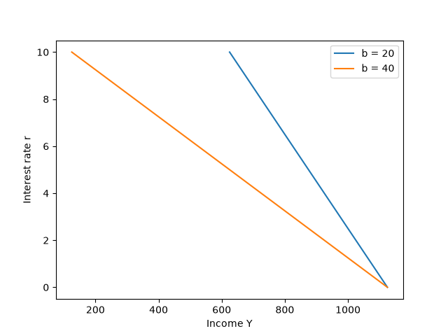
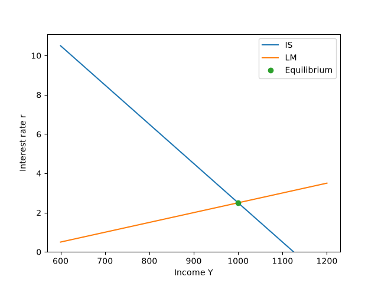

# 第 8 章: IS 曲線と IS-LM の均衡

## 8.1 この章の地図

第 4 章の 45 度線では、投資を**一定**と置いて、均衡国民所得を求めました。しかし、投資は、**利子率**に左右されます。利子率が低ければ、借金して投資する企業が増えます。この章では、投資を利子率の減少関数 I = I0 − b·r とし、財市場を均衡させる**所得と利子率の組**を、線として表します。これが **IS 曲線**です。さらに、第 7 章の LM 曲線と組み合わせ、**連立方程式**を `np.linalg.solve` で解いて、均衡の所得と利子率を求めます。



| 項目 | 内容 |
| :--- | :--- |
| 経済学の題材 | 投資の限界効率、IS 曲線（右下がり）、傾きとシフト、財市場の超過供給・超過需要、IS-LM の均衡 |
| 使う Python の機能 | 関数、タプル、`numpy.linalg.solve`（連立方程式）、第 4 章・第 7 章の関数の再利用 |
| 新しく導入するライブラリ | なし（NumPy は、[第 2 章](02-three-way-equivalence.md) で導入済み） |
| 完成形 | `investment_demand`、`is_intercept`、`is_income`、`is_interest`、`is_slope`、`is_shift_for_government`、`goods_market_state`、`solve_is_lm`、`is_lm_residuals` |
| ファイル | 実装: `lib/chapter08/is_lm.py`、`lib/chapter08/plot.py`（図）／テスト: `test/chapter08/test_is_lm.py`、`test/chapter08/test_plot.py`（自分で書くときは、`practice/chapter08/` に、同じ名前で作ります） |

### 経済学の式とコードの対応

| 経済学 | 式 | コード |
| :--- | :--- | :--- |
| 投資関数 | I = I0 − b·r（利子率の減少関数） | `investment_demand(interest, autonomous_investment, b)` |
| IS 曲線の切片 | A = C0 − c·T + I0 + G | `is_intercept(mpc, C0, I0, G, tax)` |
| IS 曲線（所得） | Y = (A − b·r) ÷ (1 − c) | `is_income(interest, intercept, mpc, b)` |
| IS 曲線（利子率） | r = (A − (1 − c)·Y) ÷ b | `is_interest(income, intercept, mpc, b)` |
| IS 曲線の傾き | −(1 − c) ÷ b | `is_slope(mpc, b)` |
| 政府支出による右シフト | ΔG ÷ (1 − c) | `is_shift_for_government(mpc, delta_government)` |
| IS-LM の均衡 | (1 − c)Y + b·r = A と k·Y − h·r = M/P の連立方程式 | `solve_is_lm(mpc, b, intercept, k, h, real_money)` |

### 前提とする既存の章

| できること | 場所 |
| :--- | :--- |
| 45 度線から均衡国民所得 Y = A ÷ (1 − c) を求める | この連載の[第 4 章](04-45-degree-line-and-multiplier.md)（**IS 曲線は、これから導きます**） |
| LM 曲線 r = (k·Y − M/P) ÷ h を、関数にする | この連載の[第 7 章](07-money-demand-and-lm.md)（この章は、第 7 章の `lm_interest` と `money_demand` を使います） |

第 1 シリーズの[第 13 章（IS-LM 分析）](../economics-programming/13-is-lm-analysis.md)と題材が重なりますが、この記事は、**独立して読めます**。

## 8.2 準備

サンプルコードは、リポジトリの `apps/macro-basics-programming/python/` にあります。環境の作り方は、[第 1 章](01-gdp-and-value-added.md) の 1.2 節と同じです。

```bash
cd apps/macro-basics-programming/python
uv sync
uv run pytest test/chapter08
```

```text
34 passed
```

自分でコードを書くときは、`practice/chapter08/` を作って、完成形と同じ名前（`is_lm.py`・`test_is_lm.py`）のファイルに書きます。テストは、`uv run pytest practice/chapter08` で動かします。**完成形（`lib/` と `test/`）は、答え合わせ用です。** 自分で書き終えてから、開いてください。

## 8.3 予想する

限界消費性向 c = 0.6、独立消費 C0 = 100、独立投資 I0 = 300、政府支出 G = 50、租税 T = 0 の国です。投資の利子感応度は b = 20（利子率が 1 上がると、投資が 20 減る）です。貨幣市場は、k = 0.5、h = 100、実質貨幣供給 M/P = 250 です。

- IS 曲線の**切片** A = C0 − c·T + I0 + G は、いくつですか。利子率 r = 2.5 のとき、IS 曲線上の**所得**は、いくつですか
- IS 曲線と LM 曲線の**均衡**の、所得と利子率は、いくつですか。その点は、IS の式と LM の式の、**両方**を満たしますか
- b を 20 から 40 に変えると、IS 曲線の傾きは、**急に**なりますか、**緩やか**になりますか。限界消費性向 c を、0.6 から 0.8 に変えると、どうですか
- 政府支出が 10 増えると、IS 曲線は、**右へ**何だけ動きますか
- 点（所得 1100、利子率 2.5）は、財市場で、**供給超過**ですか、**需要超過**ですか
- IS 曲線が右へ 25 動くと、均衡の所得も、25 増えますか。それとも、25 より**小さい**ですか

## 8.4 IS 曲線の考え方

### 投資は利子率の減少関数

企業は、**投資の限界効率**（投資から得られる収益率）が、**利子率**より大きければ、投資をします。利子率が下がるほど、割に合う投資が増えるので、投資は、利子率の減少関数になります。

> I = I0 − b·r

b は、投資の**利子感応度**です。b が大きいほど、利子率の変化に、投資が、敏感に反応します。

### 45 度線から IS 曲線を導く

第 4 章の 45 度線の式に、この投資関数を入れます。Y = C + I + G、C = c(Y − T) + C0 から、

> Y = c(Y − T) + C0 + (I0 − b·r) + G
>
> (1 − c)Y + b·r = C0 − c·T + I0 + G ≡ A

これが **IS 曲線**です。利子率 r を決めると、**財市場を均衡させる所得**が、1 つ決まります。

> Y = (A − b·r) ÷ (1 − c)　　r = (A − (1 − c)·Y) ÷ b

利子率が下がる → 投資が増える → 乗数を通じて所得が増える、という流れなので、IS 曲線は**右下がり**です。所得を横軸、利子率を縦軸にしたときの傾きは、−(1 − c) ÷ b です。

| 傾きが緩やかになる条件 | 理由 |
| :--- | :--- |
| 投資の利子感応度 b が大きい | 利子率が少し下がるだけで、投資が大きく増え、所得が大きく増える |
| 限界消費性向 c が大きい | 乗数 1 ÷ (1 − c) が大きく、投資の増加が、所得を大きく増やす |

### シフトと、財市場の超過

政府支出の増加や減税（A が増えること）は、どの利子率でも、均衡所得を増やすので、IS 曲線は**右へシフト**します。シフト幅は、乗数の分、ΔG ÷ (1 − c) です。

IS 曲線の**右上**の点では、同じ利子率で、所得が、均衡より大きく、財の**供給超過**です。**左下**の点は、財の**需要超過**です。

### IS-LM の均衡

IS と LM が同時に成り立つ点が、IS-LM の均衡です。(Y, r) の連立一次方程式として解きます（NumPy は、[第 2 章](02-three-way-equivalence.md)で導入済み）。

> (1 − c)·Y + b·r = A
>
> k·Y − h·r = M/P

## 8.5 プログラミング

### Red: 投資と IS 曲線のテスト

最初に、手計算できる例で、テストを書きます。関数がまだないので、失敗します（**Red**）。c = 0.6、b = 20、A = 450 なら、r = 2.5 のとき、Y = (450 − 20 × 2.5) ÷ 0.4 = 1000 です。

```python
import pytest

from lib.chapter04.multiplier import equilibrium_income
from lib.chapter07.money_market import lm_interest
from lib.chapter08.is_lm import (
    goods_market_state,
    investment_demand,
    is_income,
    is_interest,
    is_intercept,
    is_lm_residuals,
    is_shift_for_government,
    is_slope,
    solve_is_lm,
)
```

```python
MPC = 0.6
B = 20
A = 450
K = 0.5
H = 100
M = 250


def test_投資は利子率の減少関数() -> None:
    assert investment_demand(0, 300, B) == 300
    assert investment_demand(2.5, 300, B) == 250
    assert investment_demand(5, 300, B) < investment_demand(2.5, 300, B)


def test_ISの切片は独立支出の合計() -> None:
    assert is_intercept(MPC, 100, 300, 50) == 450


def test_IS曲線上の所得() -> None:
    assert is_income(2.5, A, MPC, B) == pytest.approx(1000)
    assert is_income(0, A, MPC, B) == pytest.approx(1125)


def test_所得と利子率は逆関数の関係() -> None:
    for r in (0, 1, 2.5, 10):
        y = is_income(r, A, MPC, B)
        assert is_interest(y, A, MPC, B) == pytest.approx(r)
```

### Green: IS 曲線を実装する

```python
def investment_demand(interest: float, autonomous_investment: float, b: float) -> float:
    """投資関数 I = I0 − b·r。利子率の減少関数。"""
    validate_b(b)
    return autonomous_investment - b * interest


def is_intercept(
    mpc: float,
    autonomous_consumption: float,
    autonomous_investment: float,
    government: float,
    tax: float = 0,
) -> float:
    """IS 曲線の右辺 A = C0 − c·T + I0 + G（利子率に依存しない支出）。"""
    return autonomous_consumption - mpc * tax + autonomous_investment + government


def is_income(interest: float, intercept: float, mpc: float, b: float) -> float:
    """IS 曲線: 財市場を均衡させる所得 Y = (A − b·r) ÷ (1 − c)。"""
    validate_mpc(mpc)
    validate_b(b)
    return (intercept - b * interest) / (1 - mpc)


def is_interest(income: float, intercept: float, mpc: float, b: float) -> float:
    """IS 曲線: 財市場を均衡させる利子率 r = (A − (1 − c)Y) ÷ b。"""
    validate_mpc(mpc)
    _check_b_positive(b)
    return (intercept - (1 - mpc) * income) / b
```

??? note "import と補助関数（写すときに足す）"

    記事の抜粋には、import と、先頭が `_` の補助関数・定数を、省いています。完成形のファイルの先頭にある、次の部分を、写してください。

    **lib/chapter08/is_lm.py**

    ```python
    import math
    ```

    ```python
    import numpy as np
    ```

    ```python
    from lib.chapter01.validation import validate_non_negative, validate_positive
    from lib.chapter04.multiplier import validate_mpc
    from lib.chapter07.money_market import money_demand, validate_h, validate_k
    ```

    ```python
    def _check_b_positive(b: float) -> None:
        validate_positive(
            b, "投資の利子感応度 b が 0 の IS 曲線は垂直で、利子率が決まらない"
        )
    ```

    ```python
    def _check_lm_finite(k: float, h: float) -> None:
        validate_k(k)
        validate_h(h)
        if not math.isfinite(h):
            raise ValueError("連立方程式のソルバーは、有限の h だけ扱える")
    ```

```python
from lib.chapter08.is_lm import is_income, is_interest, is_intercept

a = is_intercept(0.6, 100, 300, 50)
print(a)
print(is_income(2.5, a, 0.6, 20))
print(is_interest(1000, a, 0.6, 20))
```

```text
450.0
1000.0
2.5
```

`is_income` は、利子率から所得を、`is_interest` は、所得から利子率を求めます。2 つは、**逆関数**の関係です。

**投資の利子感応度が 0 のときは、IS 曲線が垂直**になります（利子率が、投資を動かさない）。このとき、所得は求められますが、利子率は決まりません。`is_interest` と `is_slope` は、b = 0 を、エラーにします（`test_利子感応度が0のISは垂直で利子率を求められない`）。第 9 章で、この極端なケースを使います。

### 45 度線との一致

IS 曲線は、第 4 章の 45 度線から導いたものです。利子率ごとに、投資を決めて、第 4 章の `equilibrium_income` で均衡所得を求めると、IS 曲線の所得と、一致するはずです。

```python
def test_IS曲線は第4章の45度線の均衡所得と一致する() -> None:
    for r in (0, 2.5, 5):
        investment = investment_demand(r, 300, B)
        y45 = equilibrium_income(MPC, 100, investment, 50, 0)
        assert is_income(r, A, MPC, B) == pytest.approx(y45)
```

```python
from lib.chapter04.multiplier import equilibrium_income
from lib.chapter08.is_lm import investment_demand, is_income

for r in (0, 2.5, 5):
    investment = investment_demand(r, 300, 20)
    y45 = equilibrium_income(0.6, 100, investment, 50, 0)
    print(r, y45, is_income(r, 450, 0.6, 20))
```

```text
0 1125.0 1125.0
2.5 1000.0 1000.0
5 875.0 875.0
```

**IS 曲線は、利子率ごとの 45 度線の均衡を、並べたもの**です。

### 傾きとシフト

傾きと、政府支出の増加によるシフトを、テストにします。

```python
def test_政府支出が増えるとISは右へ動く() -> None:
    assert is_shift_for_government(MPC, 10) == pytest.approx(25)
    shifted = is_income(2.5, A + 10, MPC, B)
    assert shifted - is_income(2.5, A, MPC, B) == pytest.approx(25)
```

```python
def is_slope(mpc: float, b: float) -> float:
    """IS 曲線の傾き dr/dY = −(1 − c) ÷ b（所得を横軸、利子率を縦軸にしたとき）。"""
    validate_mpc(mpc)
    _check_b_positive(b)
    return -(1 - mpc) / b


def is_shift_for_government(mpc: float, delta_government: float) -> float:
    """政府支出が ΔG 増えたときの、IS 曲線の右シフト幅 ΔG ÷ (1 − c)。"""
    validate_mpc(mpc)
    return delta_government / (1 - mpc)
```

```python
from lib.chapter08.is_lm import is_slope

for mpc, b in ((0.6, 20), (0.6, 40), (0.8, 20)):
    print(f"c = {mpc}, b = {b}: 傾き", round(is_slope(mpc, b), 4))
```

```text
c = 0.6, b = 20: 傾き -0.02
c = 0.6, b = 40: 傾き -0.01
c = 0.8, b = 20: 傾き -0.01
```

b が大きくても、c が大きくても、傾きの大きさ（絶対値）は小さく、**緩やか**になります。

### 財市場の超過供給・超過需要

IS 曲線の式の左辺から右辺を引いた値 (1 − c)Y + b·r − A は、**財の供給超過**を表します。正なら、供給（Y）が、需要（C + I + G）より大きく、IS の右上の点です。

```python
def goods_market_state(
    income: float, interest: float, intercept: float, mpc: float, b: float
) -> str:
    """点 (Y, r) での財市場。IS の右上は供給超過、左下は需要超過。"""
    validate_mpc(mpc)
    validate_b(b)
    excess_supply = (1 - mpc) * income + b * interest - intercept
    if math.isclose(excess_supply, 0, abs_tol=1e-9):
        return "均衡"
    return "供給超過" if excess_supply > 0 else "需要超過"
```

```python
from lib.chapter08.is_lm import goods_market_state, is_shift_for_government

print("ΔG = 10 の右シフト幅:", is_shift_for_government(0.6, 10))
for point in ((1100, 2.5), (900, 2.5), (1000, 2.5)):
    print(point, goods_market_state(*point, 450, 0.6, 20))
```

```text
ΔG = 10 の右シフト幅: 25.0
(1100, 2.5) 供給超過
(900, 2.5) 需要超過
(1000, 2.5) 均衡
```

### IS-LM の均衡を、連立方程式で解く

IS の式と LM の式は、(Y, r) の連立一次方程式です。係数の行列を作り、`np.linalg.solve` で解きます。均衡は、**IS と LM の両方の式を満たす**はずです。満たさない量（残差）を返す関数を作り、テストで、残差が 0 であることを確かめます。

```python
def test_IS_LMの均衡は所得1000で利子率2_5() -> None:
    y, r = solve_is_lm(MPC, B, A, K, H, M)
    assert y == pytest.approx(1000)
    assert r == pytest.approx(2.5)


def test_均衡はISとLMの両方の式を満たす() -> None:
    y, r = solve_is_lm(MPC, B, A, K, H, M)
    is_residual, lm_residual = is_lm_residuals(y, r, MPC, B, A, K, H, M)
    assert is_residual == pytest.approx(0, abs=1e-9)
    assert lm_residual == pytest.approx(0, abs=1e-9)
```

```python
def solve_is_lm(
    mpc: float,
    b: float,
    intercept: float,
    k: float,
    h: float,
    real_money: float,
) -> tuple[float, float]:
    """IS と LM の連立方程式を解いて、均衡の所得と利子率 (Y, r) を返す。

    (1 − c)Y + b·r = A
    k·Y − h·r = M/P
    """
    validate_mpc(mpc)
    validate_b(b)
    _check_lm_finite(k, h)
    coefficients = np.array([[1 - mpc, b], [k, -h]])
    constants = np.array([intercept, real_money])
    income, interest = np.linalg.solve(coefficients, constants)
    return float(income), float(interest)


def is_lm_residuals(
    income: float,
    interest: float,
    mpc: float,
    b: float,
    intercept: float,
    k: float,
    h: float,
    real_money: float,
) -> tuple[float, float]:
    """点 (Y, r) が IS の式と LM の式を満たさない量。均衡では、どちらも 0。"""
    validate_mpc(mpc)
    validate_b(b)
    is_residual = (1 - mpc) * income + b * interest - intercept
    lm_residual = money_demand(income, interest, k, h) - real_money
    return is_residual, lm_residual
```

```python
from lib.chapter08.is_lm import is_lm_residuals, solve_is_lm

y, r = solve_is_lm(0.6, 20, 450, 0.5, 100, 250)
print(y, r)
print(is_lm_residuals(y, r, 0.6, 20, 450, 0.5, 100, 250))
```

```text
1000.0 2.5
(0.0, 0.0)
```

均衡は、所得 1000、利子率 2.5 です。IS の式にも、LM の式にも、ぴったり当てはまります（残差は、どちらも 0）。

ソルバーは、**有限の** h だけを扱い、k・h が正でないときと、限界消費性向 1 以上、b が負のときは、エラーにします（エラーのテストは、`test/chapter08/test_is_lm.py` にあります）。h が無限大の、流動性のわなは、次の章で、閉じた式で扱います。

政府支出が増える（IS が右へ）と、所得も利子率も上がり、実質貨幣供給が増える（LM が右へ）と、所得は上がり、利子率は下がります。これも、テスト（`test_政府支出が増えると所得も利子率も上がる`、`test_実質貨幣供給が増えると所得は上がり利子率は下がる`）で固定しています。

### 予想の答え合わせ

予想した答えを、プログラムで確かめます。

```python
from lib.chapter07.money_market import lm_interest
from lib.chapter08.is_lm import (
    goods_market_state,
    is_income,
    is_intercept,
    is_lm_residuals,
    is_shift_for_government,
    is_slope,
    solve_is_lm,
)

a = is_intercept(0.6, 100, 300, 50)
print("IS の切片 A:", a)
print("r = 2.5 のときの IS 上の所得:", is_income(2.5, a, 0.6, 20))
y, r = solve_is_lm(0.6, 20, a, 0.5, 100, 250)
print("均衡の所得と利子率:", round(y, 4), round(r, 4))
print("LM 上の利子率:", lm_interest(y, 250, 0.5, 100))
residuals = is_lm_residuals(y, r, 0.6, 20, a, 0.5, 100, 250)
print("残差:", [round(v, 9) for v in residuals])
print("b = 40 の傾き:", is_slope(0.6, 40), "（b = 20 は", is_slope(0.6, 20), "）")
print("ΔG = 10 の右シフト幅:", is_shift_for_government(0.6, 10))
print("点 (1100, 2.5):", goods_market_state(1100, 2.5, a, 0.6, 20))
y2, r2 = solve_is_lm(0.6, 20, a + 10, 0.5, 100, 250)
print("ΔG = 10 の均衡:", round(y2, 4), round(r2, 4))
print("均衡の所得の増加:", round(y2 - y, 4))
```

```text
IS の切片 A: 450.0
r = 2.5 のときの IS 上の所得: 1000.0
均衡の所得と利子率: 1000.0 2.5
LM 上の利子率: 2.5
残差: [0.0, 0.0]
b = 40 の傾き: -0.01 （b = 20 は -0.02 ）
ΔG = 10 の右シフト幅: 25.0
点 (1100, 2.5): 供給超過
ΔG = 10 の均衡: 1020.0 2.6
均衡の所得の増加: 20.0
```

- **1 つ目の問い**: 切片 A は 450（= 100 + 300 + 50）です。r = 2.5 のとき、IS 曲線上の所得は 1000 です
- **2 つ目の問い**: 均衡は、所得 1000、利子率 2.5 です。LM の式から求めた利子率も 2.5 で、残差は、IS も LM も 0 です。**両方の式を満たします**
- **3 つ目の問い**: b = 40 の傾きは −0.01 で、b = 20 の −0.02 より**緩やか**です。c = 0.6 から 0.8 でも、傾きは −0.01 になり、**緩やか**になります
- **4 つ目の問い**: 政府支出が 10 増えると、IS 曲線は、**右へ 25**（= 10 ÷ 0.4）動きます
- **5 つ目の問い**: 点（1100、2.5）は、IS の右上で、財の**供給超過**です
- **6 つ目の問い**: 均衡の所得は、25 ではなく、**20** しか増えません（利子率も、2.5 から 2.6 に上がります）。IS が右へ動くと、所得が増えて、貨幣需要が増え、利子率が上がります。利子率の上昇が、投資を減らすので、IS の動きほどには、均衡が右へ動きません。**この差が、クラウディングアウト**です。次の章で、くわしく扱います

### 図

IS 曲線と、IS-LM の均衡を描く関数を、テストから書きます（`test/chapter08/test_plot.py`）。線の端点（利子率 0 のとき所得 1125、利子率 10 のとき 625 など）と、均衡点の座標（1000、2.5）が、手計算の値と一致することを、確かめています。

??? note "描画のテストと実装（後回しにしても、学習は成り立ちます）"

    ```python
    def plot_is_lm_equilibrium(
        mpc: float,
        b: float,
        intercept: float,
        k: float,
        h: float,
        real_money: float,
        income_min: float,
        income_max: float,
    ) -> Figure:
        """IS 曲線と LM 曲線を描き、交点（均衡）に印を付ける。"""
        incomes = [income_min, income_max]
        y_star, r_star = solve_is_lm(mpc, b, intercept, k, h, real_money)
        fig, ax = plt.subplots()
        ax.plot(incomes, [is_interest(y, intercept, mpc, b) for y in incomes], label="IS")
        ax.plot(incomes, [lm_interest(y, real_money, k, h) for y in incomes], label="LM")
        ax.plot([y_star], [r_star], "o", label="Equilibrium")
        ax.set_xlabel("Income Y")
        ax.set_ylabel("Interest rate r")
        ax.set_ylim(bottom=0)
        ax.legend()
        plt.close(fig)
        return fig
    ```



### 実行結果

```bash
uv run pytest test/chapter08
```

```text
34 passed
```

## 8.6 規則で言うと

1. **IS 曲線は、利子率ごとの 45 度線の均衡を並べたもの。** 投資が利子率の減少関数なので、右下がり。切片 A に、独立消費・独立投資・政府支出が入る
2. **傾き −(1 − c) ÷ b。** 投資の利子感応度 b が大きいほど、限界消費性向 c が大きいほど、緩やか。
3. **IS-LM の均衡は、連立方程式の解。** 解いたら、**両方の式に代入して、残差が 0 か**を確かめる

混同しやすい点を、表にまとめます。

| 混同しやすい点 | 違い |
| :--- | :--- |
| IS と LM の傾き | IS は財市場で**右下がり**（利子率が下がると、投資と所得が増える）。LM は貨幣市場で**右上がり**（所得が増えると、貨幣需要が増え、利子率が上がる） |
| IS の右上と左下 | 右上は、財の**供給超過**（所得が、均衡より大きい）。左下は、財の**需要超過** |
| IS のシフト幅と、均衡の所得の増加 | IS が右へ ΔG ÷ (1 − c) 動いても、均衡の所得は、それより**小さく**しか増えない（利子率が上がるため） |

### このモデルが成り立たない場面

- **投資を、利子率だけで説明するのは、単純化です。** 実際の投資は、将来の売上の見込みや、企業の資金繰りにも、左右されます（第 12 章）
- **物価は、一定と置いています。** 物価が動くと、実質貨幣供給 M/P が動き、LM が動きます（第 10 章の AD-AS 分析）
- **b を大きくすると、均衡の所得が、小さくなることがあります。** 独立投資 I0 を、一定に保つと、利子率が正のとき、b が大きいほど投資が減るためです（練習問題の「多様」）

## 8.7 練習問題

| 種類 | 問題 |
| :--- | :--- |
| 想起 | 本文を閉じて、`is_income` の最初のテスト（利子率 2.5、切片 450、c = 0.6、b = 20 で、所得 1000）を書いてください |
| 生成 | 解説を見る前に、IS 曲線上で、利子率が 1 下がったとき、所得がいくつ増えるかを返す `income_gain_per_interest_cut(mpc, b)` を、テストから書いてください。c = 0.6、b = 20 では、いくつですか |
| 多様 | b を 20 から 40 に変えると、均衡の所得は、増えますか、減りますか（A = 450、LM は、これまでと同じ）。先に予想してから、確かめてください |
| 交互 | [第 1 シリーズ](../economics-programming/index.md)の第 3 章のリスト内包表記で、b が 10、20、30、40、50 のときの、均衡の所得を、一度に計算してください。b が大きいほど、所得は、減っていますか |

??? note "解答（先に自分で取り組んでから、開いてください）"

    **想起**:

    ```python
    def test_IS曲線上の所得は1000() -> None:
        assert is_income(2.5, 450, 0.6, 20) == pytest.approx(1000)
    ```

    **生成**: 利子率が 1 下がると、投資が b 増え、乗数 1 ÷ (1 − c) 倍の所得が増えます。

    ```python
    def income_gain_per_interest_cut(mpc, b):
        return b / (1 - mpc)
    ```

    ```python
    def test_利子率が1下がると所得はb割る1_cだけ増える() -> None:
        assert income_gain_per_interest_cut(0.6, 20) == pytest.approx(50)
        y1 = is_income(2.5, 450, 0.6, 20)
        y2 = is_income(1.5, 450, 0.6, 20)
        assert y2 - y1 == pytest.approx(50)
    ```

    c = 0.6、b = 20 では、50 です。これは、IS 曲線の傾きの逆数の大きさ（1 ÷ 0.02）です。

    **多様**: IS 曲線は、r = 0 の点（Y = A ÷ (1 − c) = 1125）を軸に、b が大きいほど、**寝る**ように動きます。LM 曲線との交点は、利子率が正の範囲にあるので、IS が寝ると、交点は、左へ動きます。**減る**と予想できます。

    ```python
    def test_利子感応度が大きいと均衡の所得は減る() -> None:
        y20, r20 = solve_is_lm(0.6, 20, 450, 0.5, 100, 250)
        y40, r40 = solve_is_lm(0.6, 40, 450, 0.5, 100, 250)
        assert y40 == pytest.approx(916.6667, abs=1e-3)
        assert y40 < y20
        assert r40 < r20
    ```

    b = 40 では、所得は約 916.67、利子率は約 2.08 です。「投資が利子率に敏感なら、所得が増える」とは、限りません。**独立投資 I0 を一定にしているので、利子率が正のとき、b が大きいほど、投資そのものが減る**からです。

    **交互**:

    ```python
    def test_利子感応度が大きいほど均衡の所得は小さい() -> None:
        bs = [10, 20, 30, 40, 50]
        incomes = [solve_is_lm(0.6, b, 450, 0.5, 100, 250)[0] for b in bs]
        assert incomes[1] == pytest.approx(1000)
        assert incomes == sorted(incomes, reverse=True)
        assert len(set(incomes)) == len(incomes)
    ```

    所得は、約 1055.6、1000、954.5、916.7、884.6 と、単調に減ります。

## 8.8 振り返り

- IS 曲線が右下がりである理由を、「利子率 → 投資 → 乗数 → 所得」の順に、説明できますか
- IS が右へ 25 動いたのに、均衡の所得が 20 しか増えませんでした。この差は、どこから来ますか

## 8.9 まとめ

- 投資を、利子率の減少関数 I = I0 − b·r とし、45 度線から IS 曲線 (1 − c)Y + b·r = A を導いた。c = 0.6、b = 20、A = 450 で、r = 2.5 のとき、Y = 1000
- IS 曲線の傾きは −(1 − c) ÷ b。b が大きいほど、c が大きいほど緩やか。政府支出が ΔG 増えると、IS は ΔG ÷ (1 − c) だけ右へ動く（ΔG = 10 で 25）
- IS と LM の連立方程式を `np.linalg.solve` で解き、均衡の所得 1000、利子率 2.5 を得た。両方の式に代入した残差は、0 になる
- ΔG = 10 のとき、IS は 25 動くが、均衡の所得は 20 しか増えない（利子率が 2.5 から 2.6 に上がる）。この差が、クラウディングアウト
- 次の章では、財政政策・金融政策の効果を、閉じた式と連立方程式の**両方**で計算し、第 2 部の到達チェックを行います
