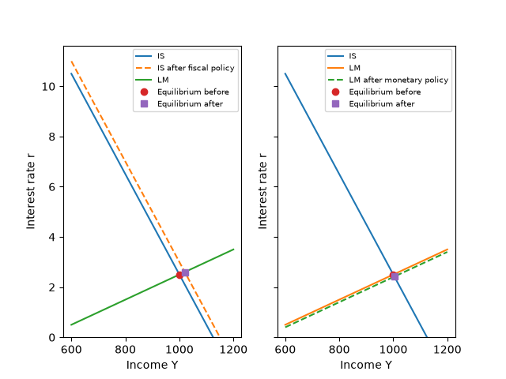
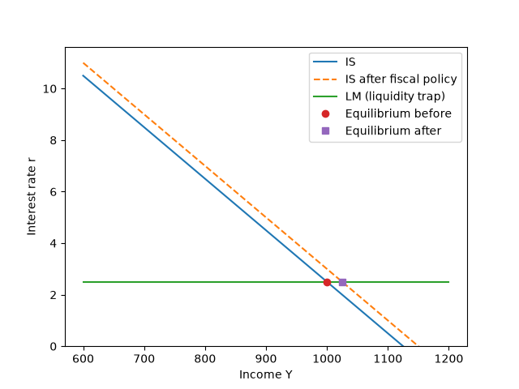

# 第 9 章: 財政政策と金融政策の効果

## 9.1 この章の地図

第 8 章で、IS-LM の均衡を、連立方程式で解きました。この章では、**政策で、IS や LM を動かしたとき**、均衡が、どれだけ動くかを求めます。財政政策（IS が右へ動く）は、所得を増やしますが、**利子率も上げる**ので、民間投資を締め出します（**クラウディングアウト**）。金融政策（LM が右へ動く）は、利子率を下げて、所得を増やします。効果の大きさは、**LM と IS の傾き**で変わります。最後に、**第 2 部（第 6〜9 章）の到達チェック**を行います。



| 項目 | 内容 |
| :--- | :--- |
| 経済学の題材 | 財政政策の効果とクラウディングアウト、金融政策の効果、曲線の傾きと政策の有効性、流動性のわな |
| 使う Python の機能 | 関数、`dataclass`、`math.inf`（無限大）、`pytest.mark.parametrize`、第 4・8 章の関数の再利用 |
| 新しく導入するライブラリ | なし |
| 完成形 | `fiscal_effect`、`monetary_effect`、`crowding_out`、`fiscal_effect_solved`、`monetary_effect_solved`、`policy_interest_change`、`PolicyRow`、`policy_effectiveness` |
| ファイル | 実装: `lib/chapter09/policy.py`、`lib/chapter09/plot.py`（図）／テスト: `test/chapter09/test_policy.py`、`test/chapter09/test_plot.py`（自分で書くときは、`practice/chapter09/` に、同じ名前で作ります） |

### 経済学の式とコードの対応

| 経済学 | 式 | コード |
| :--- | :--- | :--- |
| 財政政策の効果 | ΔY = ΔG ÷ [(1 − c) + b·k ÷ h] | `fiscal_effect(mpc, b, k, h, delta_government)` |
| 金融政策の効果 | ΔY = (b ÷ h)·Δ(M/P) ÷ [(1 − c) + b·k ÷ h] | `monetary_effect(mpc, b, k, h, delta_real_money)` |
| クラウディングアウト | 単純な乗数による増加 − 実際の増加 | `crowding_out(mpc, b, k, h, delta_government)` |
| 利子率の変化 | Δr = (k·ΔY − Δ(M/P)) ÷ h | `policy_interest_change(k, h, delta_income, delta_real_money)` |

### 前提とする既存の章

| できること | 場所 |
| :--- | :--- |
| IS 曲線と、IS-LM の均衡を、`solve_is_lm` で求める | この連載の[第 8 章](08-is-curve-and-is-lm.md)（**この章の前提**） |
| LM 曲線の傾き k ÷ h を、言う | この連載の[第 7 章](07-money-demand-and-lm.md) |

第 1 シリーズの[第 13 章（IS-LM 分析）](../economics-programming/13-is-lm-analysis.md)と題材が重なりますが、この記事は、**独立して読めます**。

## 9.2 準備

サンプルコードは、リポジトリの `apps/macro-basics-programming/python/` にあります。環境の作り方は、[第 1 章](01-gdp-and-value-added.md) の 1.2 節と同じです。

```bash
cd apps/macro-basics-programming/python
uv sync
uv run pytest test/chapter09
```

```text
34 passed
```

自分でコードを書くときは、`practice/chapter09/` を作って、完成形と同じ名前（`policy.py`・`test_policy.py`）のファイルに書きます。テストは、`uv run pytest practice/chapter09` で動かします。**完成形（`lib/` と `test/`）は、答え合わせ用です。** 自分で書き終えてから、開いてください。

## 9.3 予想する

第 8 章と同じ国（c = 0.6、投資の利子感応度 b = 20、貨幣需要 k = 0.5・h = 100、均衡は、所得 1000・利子率 2.5）で、政策を行います。

- 政府支出を 10 増やすと、単純な乗数 ΔG ÷ (1 − c) では、所得は、いくつ増えますか。IS-LM では、いくつ増えますか。**差**は、いくつですか。利子率は、**上がり**ますか、**下がり**ますか
- 実質貨幣供給を 10 増やすと、所得と利子率は、どうなりますか
- LM が**緩やか**（h = 1000）だと、LM が**急**（h = 10）なときより、財政政策の効果は、大きいですか、小さいですか
- **流動性のわな**（h が無限大で、LM が水平）では、財政政策と金融政策の効果は、それぞれ、どうなりますか
- IS が**垂直**（b = 0）のとき、財政政策と金融政策の効果は、どうなりますか
- IS が**緩やか**（b = 40）だと、金融政策の効果は、b = 20 のときより、大きいですか、小さいですか

## 9.4 政策の効果の考え方

### 財政政策とクラウディングアウト

政府支出が増えると、IS が右へ動きます。所得が増えると、貨幣需要が増え、貨幣供給が一定なので、**利子率が上がり**ます。利子率の上昇は、**民間投資を減らします**（クラウディングアウト）。このため、所得の増加は、単純な乗数 ΔG ÷ (1 − c) より、小さくなります。

第 8 章の IS と LM から、r を消すと、所得の増加が、閉じた式で求まります。

> ΔY = ΔG ÷ [(1 − c) + b·k ÷ h]

分母の第 2 項 b·k ÷ h が、**クラウディングアウトの強さ**です。これが 0 なら、単純な乗数（ΔG ÷ (1 − c)）に戻ります。

### 金融政策

実質貨幣供給が増えると、LM が右へ動きます。利子率が下がり、投資が増え、所得が増えます。

> ΔY = (b ÷ h)·Δ(M/P) ÷ [(1 − c) + b·k ÷ h]

財政政策のクラウディングアウトの大きさは、**単純な乗数による増加と、実際の増加の差**です。たとえば h = 100 のとき、ΔG = 10 の単純な乗数は 25、実際は 20 で、差の 5 がクラウディングアウトです。利子率が上がって、投資が 2 減り（b × Δr = 20 × 0.1）、それが乗数 2.5 倍になって、所得を 5 減らしたことになります。

金融政策では、利子率が**下がる**ので、クラウディングアウトは、ありません。

### 傾きと有効性

| 条件 | 財政政策 | 金融政策 |
| :--- | :--- | :--- |
| LM が緩やか（h が大きい） | **有効**（利子率が上がりにくい） | 効きにくい |
| 流動性のわな（h → ∞、LM が水平） | **最も有効**（単純な乗数どおり） | **無効**（貨幣を増やしても、利子率が下がらない） |
| IS が緩やか（b が大きい） | クラウディングアウトが大きい | **有効**（利子率の低下が、投資を大きく増やす） |
| IS が垂直（b = 0） | 単純な乗数どおり | **無効**（投資が、利子率に反応しない） |

> 混同注意: **財政政策は LM が緩やかなほど有効、金融政策は IS が緩やかなほど有効**です。

## 9.5 プログラミング

### Red: 財政政策のテスト

第 8 章の数値で、手計算できる例を、テストにします。ΔG = 10 のとき、分母は 0.4 + 20 × 0.5 ÷ 100 = 0.5 なので、ΔY = 10 ÷ 0.5 = 20 です。単純な乗数なら 25 なので、差の 5 が、クラウディングアウトです。関数がまだないので、テストは失敗します（**Red**）。

```python
import math

import pytest

from lib.chapter04.multiplier import spending_multiplier
from lib.chapter08.is_lm import solve_is_lm
from lib.chapter09.policy import (
    PolicyRow,
    crowding_out,
    fiscal_effect,
    fiscal_effect_solved,
    monetary_effect,
    monetary_effect_solved,
    policy_effectiveness,
    policy_interest_change,
)
```

```python
MPC = 0.6
B = 20
A = 450
K = 0.5
H = 100
M = 250


def test_財政政策の効果は単純な乗数より小さい() -> None:
    assert spending_multiplier(MPC) * 10 == pytest.approx(25)
    assert fiscal_effect(MPC, B, K, H, 10) == pytest.approx(20)
    assert fiscal_effect(MPC, B, K, H, 10) < spending_multiplier(MPC) * 10


def test_クラウディングアウトは単純な乗数との差() -> None:
    assert crowding_out(MPC, B, K, H, 10) == pytest.approx(5)


def test_金融政策の効果() -> None:
    assert monetary_effect(MPC, B, K, H, 10) == pytest.approx(4)
```

### Green: 閉じた式を実装する

```python
def _denominator(mpc: float, b: float, k: float, h: float) -> float:
    """分母 (1 − c) + b·k ÷ h。h = math.inf なら、第 2 項は 0。"""
    validate_mpc(mpc)
    validate_b(b)
    validate_k(k)
    validate_h(h)
    return (1 - mpc) + b * k / h


def fiscal_effect(
    mpc: float, b: float, k: float, h: float, delta_government: float
) -> float:
    """財政政策の効果 ΔY = ΔG ÷ [(1 − c) + b·k ÷ h]。単純な乗数より小さい。"""
    return delta_government / _denominator(mpc, b, k, h)


def monetary_effect(
    mpc: float, b: float, k: float, h: float, delta_real_money: float
) -> float:
    """金融政策の効果 ΔY = (b ÷ h)·Δ(M/P) ÷ [(1 − c) + b·k ÷ h]。"""
    return (b / h) * delta_real_money / _denominator(mpc, b, k, h)


def crowding_out(
    mpc: float, b: float, k: float, h: float, delta_government: float
) -> float:
    """クラウディングアウト = 単純な乗数による増加 − 実際の増加。"""
    simple = spending_multiplier(mpc) * delta_government
    return simple - fiscal_effect(mpc, b, k, h, delta_government)
```

??? note "import と補助関数（写すときに足す）"

    記事の抜粋には、import と、先頭が `_` の補助関数・定数を、省いています。完成形のファイルの先頭にある、次の部分を、写してください。

    **lib/chapter09/policy.py**

    ```python
    from collections.abc import Sequence
    from dataclasses import dataclass
    ```

    ```python
    from lib.chapter04.multiplier import spending_multiplier, validate_mpc
    from lib.chapter07.money_market import validate_h, validate_k
    from lib.chapter08.is_lm import solve_is_lm, validate_b
    ```

    ```python
    def _denominator(mpc: float, b: float, k: float, h: float) -> float:
        """分母 (1 − c) + b·k ÷ h。h = math.inf なら、第 2 項は 0。"""
        validate_mpc(mpc)
        validate_b(b)
        validate_k(k)
        validate_h(h)
        return (1 - mpc) + b * k / h
    ```

```python
from lib.chapter09.policy import (
    crowding_out,
    fiscal_effect,
    fiscal_effect_solved,
    policy_interest_change,
)

args = (0.6, 20, 0.5, 100)
closed = fiscal_effect(*args, 10)
solved = fiscal_effect_solved(0.6, 20, 450, 0.5, 100, 250, 10)
print("閉じた式:", round(closed, 4))
print("連立方程式:", round(solved, 4))
print("クラウディングアウト:", round(crowding_out(*args, 10), 4))
print("利子率の変化:", round(policy_interest_change(0.5, 100, closed), 4))
```

```text
閉じた式: 20.0
連立方程式: 20.0
クラウディングアウト: 5.0
利子率の変化: 0.1
```

### 連立方程式でも、確かめる

閉じた式は、手で導いた式なので、**間違えているかもしれません**。別の方法で、確かめます。政策の前後で、第 8 章の `solve_is_lm` を解き、均衡の所得の**差**を取ります。2 つの方法が、一致すれば、式が正しいと、自信が持てます。

```python
def test_財政政策の効果は連立方程式を解いた結果と一致する() -> None:
    y0, _ = solve_is_lm(MPC, B, A, K, H, M)
    y1, _ = solve_is_lm(MPC, B, A + 10, K, H, M)
    assert y1 - y0 == pytest.approx(fiscal_effect(MPC, B, K, H, 10))
    assert fiscal_effect_solved(MPC, B, A, K, H, M, 10) == pytest.approx(20)


def test_金融政策の効果は連立方程式を解いた結果と一致する() -> None:
    assert monetary_effect_solved(MPC, B, A, K, H, M, 10) == pytest.approx(4)
    assert monetary_effect_solved(MPC, B, A, K, H, M, 10) == pytest.approx(
        monetary_effect(MPC, B, K, H, 10)
    )


@pytest.mark.parametrize("h", [10, 1000])
@pytest.mark.parametrize("b", [0, 40])
def test_どの条件でも閉じた式と連立方程式が一致する(h: float, b: float) -> None:
    fiscal = fiscal_effect(MPC, b, K, h, 10)
    monetary = monetary_effect(MPC, b, K, h, 10)
    assert fiscal == pytest.approx(fiscal_effect_solved(MPC, b, A, K, h, M, 10))
    assert monetary == pytest.approx(monetary_effect_solved(MPC, b, A, K, h, M, 10))
```

```python
def fiscal_effect_solved(
    mpc: float,
    b: float,
    intercept: float,
    k: float,
    h: float,
    real_money: float,
    delta_government: float,
) -> float:
    """財政政策の効果を、前後の均衡を連立方程式で解いて求める（有限の h だけ）。"""
    before, _ = solve_is_lm(mpc, b, intercept, k, h, real_money)
    after, _ = solve_is_lm(mpc, b, intercept + delta_government, k, h, real_money)
    return after - before
```

金融政策の `monetary_effect_solved` も、同じ形です（実質貨幣供給を、`real_money + delta_real_money` に変えて、解く）。

`pytest.mark.parametrize` は、同じテストを、条件を変えて、何度も動かします。h と b の組み合わせ（4 通り）で、閉じた式と連立方程式が、一致しています。

### 流動性のわな（h が無限大）

第 7 章では、流動性のわなを「**利子率の下限**」で表しました（下限で、貨幣需要が無限大になる）。この章では、「**h が無限大で、LM が水平**」という、極端な傾きで表します。同じ現象の、**別の切り取り方**で、モデルは別です（第 7 章は、LM が下限で折れる。この章は、LM が全体で水平）。

h が無限大（LM が水平）の極端なケースは、`math.inf` で、閉じた式に渡せます。b·k ÷ h が 0 になり、財政政策の効果は単純な乗数、金融政策の効果は 0 になります。連立方程式のソルバーは、**有限の** h だけなので、**十分大きい h** で、閉じた式に近づくことを、確かめます。

```python
def test_流動性のわなでは財政政策は単純な乗数で金融政策は無効() -> None:
    assert fiscal_effect(MPC, B, K, math.inf, 10) == pytest.approx(25)
    assert monetary_effect(MPC, B, K, math.inf, 10) == 0
    assert crowding_out(MPC, B, K, math.inf, 10) == pytest.approx(0)
    assert policy_interest_change(K, math.inf, 25) == 0


def test_十分大きいhで流動性のわなの閉じた式に近づく() -> None:
    big = 1e9
    assert fiscal_effect(MPC, B, K, big, 10) == pytest.approx(25, rel=1e-6)
    assert monetary_effect(MPC, B, K, big, 10) == pytest.approx(0, abs=1e-6)
    assert fiscal_effect_solved(MPC, B, A, K, big, M, 10) == pytest.approx(25, rel=1e-6)
    assert monetary_effect_solved(MPC, B, A, K, big, M, 10) == pytest.approx(
        0, abs=1e-6
    )
```

```python
from lib.chapter09.policy import fiscal_effect, fiscal_effect_solved

for h in (1e3, 1e6, 1e9):
    solved = fiscal_effect_solved(0.6, 20, 450, 0.5, h, 250, 10)
    closed = fiscal_effect(0.6, 20, 0.5, h, 10)
    print(f"h = {h:g}: 連立方程式 {solved:.6f}、閉じた式 {closed:.6f}")
```

```text
h = 1000: 連立方程式 24.390244、閉じた式 24.390244
h = 1e+06: 連立方程式 24.999375、閉じた式 24.999375
h = 1e+09: 連立方程式 24.999999、閉じた式 24.999999
```

h が大きくなるほど、財政政策の効果は、25 に近づきます。

### 条件を変えて、表にまとめる

h と b を変えて、2 つの政策の効果を、表にします。1 行を、`dataclass` の `PolicyRow` に持たせます。

```python
@dataclass(frozen=True)
class PolicyRow:
    """条件 (h, b) ごとの、財政政策・金融政策の効果。"""

    h: float
    b: float
    fiscal: float
    monetary: float
    crowding_out: float


def policy_effectiveness(
    mpc: float,
    k: float,
    conditions: Sequence[tuple[float, float]],
    delta_government: float,
    delta_real_money: float,
) -> list[PolicyRow]:
    """条件 (h, b) を変えて、2 つの政策の効果を表にまとめる。"""
    return [
        PolicyRow(
            h,
            b,
            fiscal_effect(mpc, b, k, h, delta_government),
            monetary_effect(mpc, b, k, h, delta_real_money),
            crowding_out(mpc, b, k, h, delta_government),
        )
        for h, b in conditions
    ]
```

```python
import math

from lib.chapter09.policy import policy_effectiveness

conditions = [(100, 20), (10, 20), (1000, 20), (math.inf, 20), (100, 0), (100, 40)]
print("      h    b   財政  金融  クラウディングアウト")
for row in policy_effectiveness(0.6, 0.5, conditions, 10, 10):
    print(f"{row.h:>7} {row.b:>4} {row.fiscal:6.2f} {row.monetary:5.2f} {row.crowding_out:8.2f}")
```

```text
      h    b   財政  金融  クラウディングアウト
    100   20  20.00  4.00     5.00
     10   20   7.14 14.29    17.86
   1000   20  24.39  0.49     0.61
    inf   20  25.00  0.00     0.00
    100    0  25.00  0.00     0.00
    100   40  16.67  6.67     8.33
```

h が大きい（LM が緩やか）ほど、財政政策は有効で、金融政策は効きにくくなります。h が無限大（流動性のわな）と、b = 0（IS が垂直）では、財政政策は 25（単純な乗数）、金融政策は 0 です。b が大きい（IS が緩やか）ほど、金融政策は有効です。

### 予想の答え合わせ

予想した答えを、プログラムで確かめます。

```python
import math

from lib.chapter04.multiplier import spending_multiplier
from lib.chapter09.policy import (
    crowding_out,
    fiscal_effect,
    monetary_effect,
    policy_interest_change,
)

mpc, b, k, h = 0.6, 20, 0.5, 100
print("単純な乗数による増加:", round(spending_multiplier(mpc) * 10, 4))
fiscal = fiscal_effect(mpc, b, k, h, 10)
print("財政政策 ΔG = 10 の所得の増加:", round(fiscal, 4))
print("クラウディングアウト:", round(crowding_out(mpc, b, k, h, 10), 4))
print("利子率の変化（財政）:", round(policy_interest_change(k, h, fiscal), 4))
monetary = monetary_effect(mpc, b, k, h, 10)
print("金融政策 Δ(M/P) = 10 の所得の増加:", round(monetary, 4))
print("利子率の変化（金融）:", round(policy_interest_change(k, h, monetary, 10), 4))
for label, h2 in (("LM が緩やか（h = 1000）", 1000), ("LM が急（h = 10）", 10)):
    print(label, "の財政政策:", round(fiscal_effect(mpc, b, k, h2, 10), 4))
print("流動性のわな 財政:", round(fiscal_effect(mpc, b, k, math.inf, 10), 4))
print("流動性のわな 金融:", monetary_effect(mpc, b, k, math.inf, 10))
print("IS が垂直（b = 0） 財政:", round(fiscal_effect(mpc, 0, k, h, 10), 4))
print("IS が垂直（b = 0） 金融:", monetary_effect(mpc, 0, k, h, 10))
print("IS が緩やか（b = 40） 金融:", round(monetary_effect(mpc, 40, k, h, 10), 4))
```

```text
単純な乗数による増加: 25.0
財政政策 ΔG = 10 の所得の増加: 20.0
クラウディングアウト: 5.0
利子率の変化（財政）: 0.1
金融政策 Δ(M/P) = 10 の所得の増加: 4.0
利子率の変化（金融）: -0.08
LM が緩やか（h = 1000） の財政政策: 24.3902
LM が急（h = 10） の財政政策: 7.1429
流動性のわな 財政: 25.0
流動性のわな 金融: 0.0
IS が垂直（b = 0） 財政: 25.0
IS が垂直（b = 0） 金融: 0.0
IS が緩やか（b = 40） 金融: 6.6667
```

- **1 つ目の問い**: 単純な乗数なら 25、IS-LM では **20** です。差の **5 が、クラウディングアウト**です。利子率は、0.1 **上がり**ます（2.5 から 2.6）。この上昇が、投資を、20 × 0.1 = 2 だけ減らします
- **2 つ目の問い**: 実質貨幣供給を 10 増やすと、所得は **4** 増え、利子率は 0.08 **下がり**ます。クラウディングアウトは、ありません
- **3 つ目の問い**: LM が緩やか（h = 1000）なら約 24.39、急（h = 10）なら約 7.14 です。**LM が緩やかなほど、財政政策は有効**です
- **4 つ目の問い**: 流動性のわなでは、財政政策は 25（単純な乗数どおり）、金融政策は **0**（無効）です
- **5 つ目の問い**: IS が垂直（b = 0）なら、財政政策は 25（クラウディングアウトなし）、金融政策は **0**（無効）です
- **6 つ目の問い**: b = 40 の金融政策は約 6.67 で、b = 20 の 4 より**大きい**です。**IS が緩やかなほど、金融政策は有効**です

### 図

左のグラフは、財政政策で、IS が右へ動く様子、右のグラフは、金融政策で、LM が右へ動く様子です。均衡の動きが、手計算の値（1020 と 2.6、1004 と 2.42）と一致することを、テストで確かめています（`test/chapter09/test_plot.py`）。

流動性のわなは、LM が水平な図で見ます。IS が右へ動くと、均衡は、水平な LM の上を、**25 だけ**右へ動きます。貨幣供給を増やしても、LM は動きません（描画は `plot_liquidity_trap`、`lib/chapter09/plot.py`）。



### 実行結果

```bash
uv run pytest test/chapter09
```

```text
34 passed
```

## 9.6 規則で言うと

1. **財政政策の効果は、単純な乗数より小さい。** 差が、クラウディングアウト。分母の b·k ÷ h で決まる
2. **財政政策は LM が緩やかなほど、金融政策は IS が緩やかなほど有効。** 流動性のわなでは、財政だけが効く。IS が垂直なら、金融は効かない
3. **式は、2 つの方法で確かめる。** 閉じた式と、連立方程式の差が 0 になることで、手で導いた式を、信頼できる

混同しやすい点を、表にまとめます。

| 混同しやすい点 | 違い |
| :--- | :--- |
| 財政政策が有効な条件と、金融政策が有効な条件 | 財政は、**LM が緩やか**なほど（利子率が上がりにくい）。金融は、**IS が緩やか**なほど（利子率の低下が、投資を増やす） |
| クラウディングアウトの大きさ | 単純な乗数 − 実際の増加。LM が急なほど、IS が緩やかなほど、大きい。流動性のわな・IS 垂直では 0 |
| 流動性のわなと、LM が垂直 | わな: LM が**水平**（h → ∞）。財政が最も有効、金融は無効。LM が垂直に近い（h → 0）と、財政は、ほとんど効かない（完全なクラウディングアウト） |

### このモデルが成り立たない場面

- **物価は一定と置いています。** 完全雇用に近いと、需要の増加は、物価を上げ、実質貨幣供給を減らします（第 10 章の AD-AS 分析）
- **b・h・k は、一定と置いています。** 実際の値は、推計しないと、分かりません

## 9.7 第 2 部の到達チェック

第 2 部（第 6〜9 章）の終わりです。何も見ずに、できるかどうかを、自分で確かめます。**先に、次の「時間を決めて書く課題」を、何も見ずに試してください。** そのあとで、「値の確かめ」と「できること」で、答えを見ます。

### 時間を決めて書く課題

何も見ずに、時間を計って、関数とテストを書きます。

| 課題 | 目安の時間 |
| :--- | :--- |
| 貨幣乗数・マネーストックの関数と、「C/D = 0.1、R/D = 0.01 で 10」「C/D が上がると下がる」のテスト | 15 分 |
| LM・IS の関数と、`np.linalg.solve` による均衡の関数、「均衡が、IS と LM の両方の式を満たす」テスト | 25 分 |
| 財政政策・金融政策の効果を、閉じた式と連立方程式の両方で書き、「一致する」「流動性のわなで、財政 25・金融 0」のテスト | 25 分 |

### 値の確かめ

到達チェックの値を、プログラムで確かめます。第 6 章の貨幣乗数、第 7 章の LM、第 8 章の IS と均衡、この章の政策の効果です。

```python
from lib.chapter06.money_supply import money_multiplier, money_stock
from lib.chapter07.money_market import lm_interest, lm_slope
from lib.chapter08.is_lm import is_income, is_lm_residuals, solve_is_lm
from lib.chapter09.policy import fiscal_effect, monetary_effect

print("貨幣乗数 C/D = 0.1:", round(money_multiplier(0.1, 0.01), 4))
print("貨幣乗数 C/D = 0.2:", round(money_multiplier(0.2, 0.01), 4))
print("M = 乗数 × H:", round(money_stock(0.1, 0.01, 100), 4))
print("LM 上の利子率:", lm_interest(1000, 250, 0.5, 100), "傾き:", lm_slope(0.5, 100))
print("IS 上の所得:", is_income(2.5, 450, 0.6, 20))
y, r = solve_is_lm(0.6, 20, 450, 0.5, 100, 250)
print("均衡:", y, r, "残差:", is_lm_residuals(y, r, 0.6, 20, 450, 0.5, 100, 250))
print("財政政策:", fiscal_effect(0.6, 20, 0.5, 100, 10))
print("金融政策:", monetary_effect(0.6, 20, 0.5, 100, 10))
```

```text
貨幣乗数 C/D = 0.1: 10.0
貨幣乗数 C/D = 0.2: 5.7143
M = 乗数 × H: 1000.0
LM 上の利子率: 2.5 傾き: 0.005
IS 上の所得: 1000.0
均衡: 1000.0 2.5 残差: (0.0, 0.0)
財政政策: 20.0
金融政策: 4.0
```

### できること

| できること | 検証の方法 | 戻る章 |
| :--- | :--- | :--- |
| 貨幣乗数を求め、現金預金比率・準備率との関係を言う | C/D = 0.1、R/D = 0.01 で、貨幣乗数 10。C/D = 0.2 で約 5.71（C/D が上がると、下がる）。H = 100 なら M = 1000 | [第 6 章](06-money-supply.md) |
| LM 曲線上の利子率を求め、傾きを言う | k = 0.5、h = 100、M/P = 250、Y = 1000 で、r = 2.5。傾き k ÷ h = 0.005（h が大きいほど緩やか） | [第 7 章](07-money-demand-and-lm.md) |
| IS 曲線上の所得を求め、傾きを言う | c = 0.6、b = 20、A = 450 で、r = 2.5 のとき Y = 1000。傾き −0.02（b・c が大きいほど緩やか） | [第 8 章](08-is-curve-and-is-lm.md) |
| IS-LM の均衡を、連立方程式で求める | 上の値で、Y = 1000、r = 2.5。IS と LM の両方の式の残差が 0 | 第 8 章 |
| 財政政策の効果とクラウディングアウトを求める | ΔG = 10 で、ΔY = 20。単純な乗数なら 25 で、差の 5 が、クラウディングアウト | 第 9 章 |
| 金融政策の効果を求める | Δ(M/P) = 10 で、ΔY = 4、利子率は 0.08 下がる | 第 9 章 |
| 流動性のわなでの政策の効果を言う | 財政政策は 25（単純な乗数）、金融政策は 0 | 第 9 章 |

### 誤りの原因の分類

できなかったときは、原因を分類して、戻る章に戻ります。

| 原因 | 例（第 2 部） | 対策 |
| :--- | :--- | :--- |
| 知らない | 貨幣乗数 (C/D + 1) ÷ (C/D + R/D)。LM と IS の式。クラウディングアウトの式の分母 | 第 6〜9 章に戻る |
| 見抜けない | 流動性のわなでは、金融政策が効かないこと。IS が垂直なら、金融政策が効かないこと。財政政策が、利子率を上げて、投資を減らすこと | 各章の「成り立たない場面」を読む |
| 混同した | 財政は LM が緩やか、金融は IS が緩やかなほど有効。IS（右下がり）と LM（右上がり）の傾き。名目貨幣供給 M と実質貨幣供給 M/P | 各章の「混同しやすい点」の表を読む |
| 手順の誤り | b·k ÷ h の h を、k と取り違える。単純な乗数から、実際の増加を引く順番を逆にする。LM の式の符号 | テストを先に書き、手計算の値と比べる |

## 9.8 練習問題

| 種類 | 問題 |
| :--- | :--- |
| 想起 | 本文を閉じて、`fiscal_effect` の最初のテスト（c = 0.6、b = 20、k = 0.5、h = 100 で、ΔG = 10 のとき、20）を書いてください |
| 生成 | 解説を見る前に、財政政策の効果が、単純な乗数による増加の**何割**かを返す `fiscal_share(mpc, b, k, h)` を、テストから書いてください。第 8 章の数値では、いくつですか |
| 多様 | 限界消費性向 c を 0.6 から 0.8 に変えると、ΔG = 10 のクラウディングアウトは、大きくなりますか、小さくなりますか。先に予想してから、確かめてください |
| 交互 | [第 1 シリーズ](../economics-programming/index.md)の第 3 章のリスト内包表記で、h が 10、50、100、500、1000 のときの、財政政策と金融政策の効果（ΔG = 10、Δ(M/P) = 10）を、一度に計算してください。h が大きいほど、財政政策は大きく、金融政策は小さくなっていますか |

??? note "解答（先に自分で取り組んでから、開いてください）"

    **想起**:

    ```python
    def test_財政政策の効果は20() -> None:
        assert fiscal_effect(0.6, 20, 0.5, 100, 10) == pytest.approx(20)
    ```

    **生成**: 効果を、単純な乗数による増加で割ります。ΔG に依らない比で、(1 − c) ÷ [(1 − c) + b·k ÷ h] です。

    ```python
    def fiscal_share(mpc, b, k, h):
        return fiscal_effect(mpc, b, k, h, 1) / (spending_multiplier(mpc) * 1)
    ```

    ```python
    def test_財政政策の効果は単純な乗数の8割() -> None:
        assert fiscal_share(0.6, 20, 0.5, 100) == pytest.approx(0.8)
        assert fiscal_share(0.6, 20, 0.5, math.inf) == pytest.approx(1)
    ```

    第 8 章の数値では、20 ÷ 25 = 0.8 で、**8 割**です。流動性のわなでは、b·k ÷ h が 0 になるので、1（10 割）に戻ります。

    **多様**: c が大きいと、乗数が大きく（5）、所得の増加が、利子率を、より大きく上げます。**クラウディングアウトは、大きくなる**と予想できます。

    ```python
    def test_限界消費性向が大きいとクラウディングアウトは大きい() -> None:
        assert fiscal_effect(0.8, 20, 0.5, 100, 10) == pytest.approx(10 / 0.3)
        assert crowding_out(0.8, 20, 0.5, 100, 10) == pytest.approx(50 - 10 / 0.3)
        assert crowding_out(0.8, 20, 0.5, 100, 10) > crowding_out(0.6, 20, 0.5, 100, 10)
    ```

    c = 0.8 では、単純な乗数で 50、IS-LM で約 33.33 なので、クラウディングアウトは約 16.67 です（c = 0.6 では 5）。

    **交互**:

    ```python
    def test_hが大きいほど財政は大きく金融は小さい() -> None:
        hs = [10, 50, 100, 500, 1000]
        fiscal = [fiscal_effect(0.6, 20, 0.5, h, 10) for h in hs]
        monetary = [monetary_effect(0.6, 20, 0.5, h, 10) for h in hs]
        assert fiscal == sorted(fiscal)
        assert monetary == sorted(monetary, reverse=True)
        assert fiscal[2] == pytest.approx(20)
        assert monetary[2] == pytest.approx(4)
    ```

    財政政策は、約 7.14、16.67、20、23.81、24.39 と増え、金融政策は、約 14.29、6.67、4、0.95、0.49 と減ります。

## 9.9 振り返り

- 財政政策で、所得が 25 でなく 20 しか増えない理由を、利子率と投資の言葉で、説明できますか
- 第 2 部の到達チェックで、できなかった項目は、どの原因（知らない・見抜けない・混同した・手順の誤り）でしたか

## 9.10 まとめ

- 財政政策の効果は ΔY = ΔG ÷ [(1 − c) + b·k ÷ h]。ΔG = 10 で 20（単純な乗数なら 25）。差の 5 が、クラウディングアウトで、利子率は 2.5 から 2.6 に上がる
- 金融政策の効果は ΔY = (b ÷ h)·Δ(M/P) ÷ [(1 − c) + b·k ÷ h]。Δ(M/P) = 10 で 4、利子率は 0.08 下がる。クラウディングアウトは、ない
- 閉じた式と、`solve_is_lm` で政策の前後を解いた差が、一致することを、テストで確かめた。h が無限大の極端なケースは、閉じた式（`math.inf`）で扱い、十分大きい h の連立方程式が近づくことを確かめた
- 財政政策は LM が緩やかなほど有効（流動性のわなで、25）、金融政策は IS が緩やかなほど有効（流動性のわな・IS 垂直で、0）
- 第 2 部の到達チェックで、貨幣乗数（10）から、IS-LM の均衡（1000、2.5）、政策の効果（20 と 4）までを、何も見ずにできるかを確かめた
- 次の章からは、第 3 部「労働市場と主要理論」に進みます。まず、労働市場と、物価が動く AD-AS 分析を学びます
