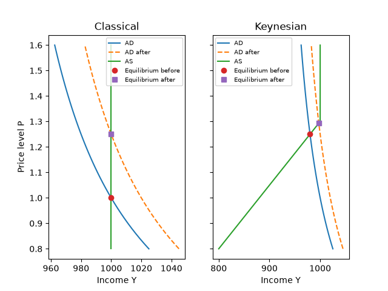
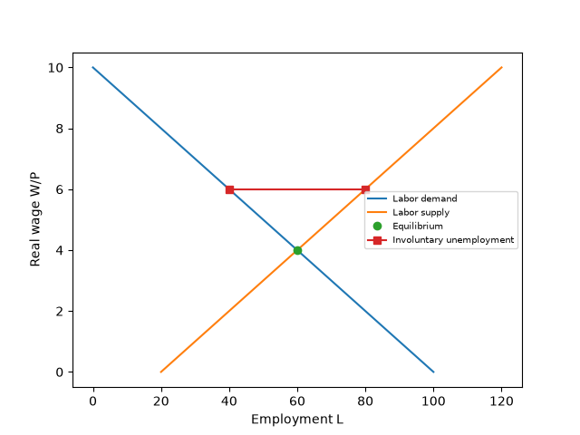

# 第 10 章: 労働市場と AD-AS 分析

## 10.1 この章の地図

第 9 章までは、**物価を一定**として、財市場と貨幣市場を見てきました。この章では、**物価が動く**経済を扱います。まず、**労働市場**で、実質賃金と雇用が決まる仕組みと、失業が生まれる理由を計算します。次に、IS-LM から**総需要（AD）**を導き、労働市場に基づく**総供給（AS）**と合わせて、**AD-AS の均衡**を求めます。**古典派**（AS が垂直）と**ケインズ**（AS が右上がりのち垂直）で、同じ政策の効果が、どう違うかを比べます。



| 項目 | 内容 |
| :--- | :--- |
| 経済学の題材 | 労働需要・供給、非自発的失業、効率賃金、総需要と総供給、AD-AS の均衡、政策と生産性向上の効果 |
| 使う Python の機能 | 関数、`dataclass`（`frozen=True` と `replace`）、関数を引数に渡す（`Callable`）、二分法、第 8 章の `solve_is_lm` の再利用 |
| 新しく導入するライブラリ | なし |
| 完成形 | `LaborCurves`、`real_wage`、`labor_demand`、`labor_supply`、`labor_equilibrium`、`involuntary_unemployment`、`effort_level`、`best_efficiency_wage`、`AdEconomy`、`aggregate_demand_income`、`classical_supply`、`keynesian_supply`、`solve_ad_as`、`expand_demand`、`shift_supply` |
| ファイル | 実装: `lib/chapter10/labor.py`、`lib/chapter10/ad_as.py`、`lib/chapter10/plot.py`（図）／テスト: `test/chapter10/test_labor.py`、`test/chapter10/test_ad_as.py`、`test/chapter10/test_plot.py`（自分で書くときは、`practice/chapter10/` に、同じ名前で作ります） |
| データ | なし（手計算できる小さな例だけ） |

### 経済学の式とコードの対応

| 経済学 | 式 | コード |
| :--- | :--- | :--- |
| 実質賃金 | w = W ÷ P | `real_wage(nominal_wage, price)` |
| 労働需要 | Ld = a − b·w | `labor_demand(curves, wage)` |
| 労働供給 | Ls = c + d·w | `labor_supply(curves, wage)` |
| 労働市場の均衡 | w* = (a − c) ÷ (b + d) | `labor_equilibrium(curves)` |
| 非自発的失業 | Ls − Ld（w が w* より高いとき） | `involuntary_unemployment(curves, wage)` |
| 効率賃金 | 賃金あたりの努力 e(w) ÷ w を最大にする w | `best_efficiency_wage(wages, subsistence)` |
| 総需要 AD | 実質貨幣供給 M ÷ P での IS-LM の所得 | `aggregate_demand_income(economy, price)` |
| 古典派の総供給 | Y = 完全雇用所得 | `classical_supply(price, full_employment_income)` |
| ケインズの総供給 | Y = min(完全雇用所得, 基準の所得 + 傾き × P) | `keynesian_supply(price, ...)` |
| AD-AS の均衡 | AD(P) = AS(P) となる P と Y | `solve_ad_as(economy, supply)` |

### 前提とする既存の章

この章の前提は、IS-LM の均衡を `solve_is_lm` で求める[第 8 章](08-is-curve-and-is-lm.md)と、政策で IS や LM を動かす[第 9 章](09-fiscal-and-monetary-policy.md)です。

第 1 シリーズの[第 14 章（AD-AS と主要理論）](../economics-programming/14-ad-as-and-major-theories.md)と題材が重なりますが、この記事は、**独立して読めます**。

## 10.2 準備

サンプルコードは、リポジトリの `apps/macro-basics-programming/python/` にあります。環境の作り方は、[第 1 章](01-gdp-and-value-added.md) の 1.2 節と同じです。

```bash
cd apps/macro-basics-programming/python
uv sync
uv run pytest test/chapter10
```

```text
54 passed
```

自分でコードを書くときは、`practice/chapter10/` を作って、完成形と同じ名前（`labor.py`・`test_labor.py` など）のファイルに書きます。テストは、`uv run pytest practice/chapter10` で動かします。**完成形（`lib/` と `test/`）は、答え合わせ用です。** 自分で書き終えてから、開いてください。

## 10.3 予想する

**労働市場**は、労働需要 Ld = 100 − 10w、労働供給 Ls = 20 + 10w です（w は実質賃金）。

- 需要と供給が一致する、**実質賃金**と**雇用量**は、いくつですか
- 実質賃金が 6 のとき、**非自発的失業**は、いくつですか
- 名目賃金が 4 で**下がらない**とします。物価が 1 から 0.5 に下がると、非自発的失業は、いくつになりますか
- 賃金が高いほど、労働者は、よく働きます（努力 e(w) = √(w − 4)）。賃金 1 単位あたりの努力 e(w) ÷ w が最大になる賃金は、いくつですか。それは、市場の均衡賃金と比べて、高いですか、低いですか

**AD-AS** は、第 9 章と同じ国（c = 0.6、b = 20、k = 0.5、h = 100、名目貨幣供給 250、IS の切片 450）で、完全雇用所得は 1000 です。

- 物価が 1 から 2 に上がると、総需要（AD 上の所得）は、増えますか、減りますか。いくつになりますか
- **古典派**（AS が垂直）で、政府支出を 10 増やすと、物価と所得は、どうなりますか
- **ケインズ**（AS が、Y = 480 + 400P で右上がり。1000 で垂直）では、同じ政策で、物価と所得は、どうなりますか。政府支出を 20 増やすと、どうなりますか
- **生産性**が上がって、AS が右へ動くと、所得と物価は、どうなりますか

## 10.4 労働市場と AD-AS の考え方

### 労働市場

労働市場では、**実質賃金** w = W ÷ P（名目賃金を物価で割った値）が、価格の役割をします。企業は、実質賃金が低いほど、多く雇うので、**労働需要は実質賃金の減少関数**です。労働者は、実質賃金が高いほど、働きたいので、**労働供給は実質賃金の増加関数**です。

> Ld = a − b·w、Ls = c + d·w、均衡 w* = (a − c) ÷ (b + d)

均衡では、働きたい人が、みな、働けます。それでも、条件の合わない仕事を選ばない人（自発的失業）は残ります。働きたいのに、働けない人（**非自発的失業**）は、いません。

- **古典派**: 名目賃金が伸縮的なので、超過供給があれば、賃金が下がり、すぐに均衡へ戻る。非自発的失業は、ない
- **ケインズ**: 名目賃金は**下方に硬直的**で、下がらない。実質賃金が均衡より高いままなら、供給が需要を上回り、その差が非自発的失業になる

### 効率賃金

企業は、市場の均衡賃金より高い賃金を、あえて払うことがあります（**効率賃金仮説**）。賃金を上げると、離職率が下がり、労働者の質が上がり、労働意欲が高まるからです。企業が、賃金 1 単位あたりの努力 e(w) ÷ w を最大にするなら、賃金は、均衡より高くなり、その分、非自発的失業が残ります。

### 総需要と総供給

**総需要（AD）**は、物価と、財市場・貨幣市場を均衡させる所得の関係です。物価 P が上がると、実質貨幣供給 M ÷ P が減り、LM が左へ動くので、均衡の所得が減ります。そのため、AD は**右下がり**です。

**総供給（AS）**は、物価と、企業が供給する所得の関係で、労働市場から導きます。

- **古典派**: 労働市場が、いつも均衡するので、所得は、完全雇用所得で決まる。物価によらず、**垂直**（セイの法則: 供給が、自分の需要を作る）
- **ケインズ**: 名目賃金が硬直的で、物価が上がると、実質賃金が下がり、雇用と生産が増える。物価とともに、所得は増える（**右上がり**）。完全雇用所得に達すると、**垂直**になる

この章では、ケインズの AS を、`Y = min(完全雇用所得, 基準の所得 + 傾き × P)` と、**仮定して**与えます。生産関数から導く手順は、扱いません。

## 10.5 プログラミング

### Red: 労働市場のテスト

最初のテストを書きます。需要と供給の式が、手計算できる値になるようにします。均衡は、100 − 10w = 20 + 10w から、w = 4、L = 60 です。

```python
CURVES = LaborCurves(
    demand_intercept=100, demand_slope=10, supply_intercept=20, supply_slope=10
)


def test_均衡では実質賃金4で雇用60() -> None:
    wage, employment = labor_equilibrium(CURVES)
    assert wage == pytest.approx(4)
    assert employment == pytest.approx(60)
    assert labor_demand(CURVES, wage) == pytest.approx(labor_supply(CURVES, wage))
```

`LaborCurves` がまだないので、テストは失敗します（**Red**）。

### Green: 労働市場を実装する

需要と供給の 4 つの定数は、`dataclass` にまとめます。`frozen=True` で、作ったあとは、書き換えられません。

```python
@dataclass(frozen=True)
class LaborCurves:
    """労働需要 Ld = demand_intercept − demand_slope·w と、
    労働供給 Ls = supply_intercept + supply_slope·w。"""

    demand_intercept: float
    demand_slope: float
    supply_intercept: float
    supply_slope: float


def labor_equilibrium(curves: LaborCurves) -> tuple[float, float]:
    """需給が一致する、実質賃金と雇用量 (w*, L*)。"""
    _check_curves(curves)
    wage = (curves.demand_intercept - curves.supply_intercept) / (
        curves.demand_slope + curves.supply_slope
    )
    if wage < 0:
        raise ValueError("均衡の実質賃金が負になる。需要と供給の切片を見直す")
    return wage, labor_demand(curves, wage)
```

需要の傾きと供給の傾きが、0 以下のときや、均衡の賃金が負になる設定は、エラーにします（`_check_curves`。`labor_demand`・`labor_supply` は、`a − b·w`・`c + d·w` を返すだけです）。

### 非自発的失業と名目賃金の硬直性

実質賃金が均衡より高いと、供給が需要を上回ります。この差が、非自発的失業です。均衡より低いときは、需要が供給を上回る（人手不足）ので、失業は 0 です。名目賃金が硬直的なら、**物価が下がると、実質賃金 W ÷ P が上がる**ので、失業が生まれます。

```python
def test_均衡より高い賃金では非自発的失業が生まれる() -> None:
    assert involuntary_unemployment(CURVES, 6) == pytest.approx(40)


def test_名目賃金が硬直的だと物価の下落が失業を生む() -> None:
    nominal_wage = 4
    assert involuntary_unemployment(CURVES, real_wage(nominal_wage, 1)) == 0
    unemployment = involuntary_unemployment(CURVES, real_wage(nominal_wage, 0.5))
    assert unemployment == pytest.approx(80)
```

```python
def real_wage(nominal_wage: float, price: float) -> float:
    """実質賃金 w = W ÷ P。"""
    if nominal_wage < 0:
        raise ValueError("名目賃金は、0 以上にする")
    if price <= 0:
        raise ValueError("物価は、正にする")
    return nominal_wage / price


def involuntary_unemployment(curves: LaborCurves, wage: float) -> float:
    """非自発的失業 = 供給 − 需要。賃金が均衡より低いときは、超過需要で、失業は 0。"""
    return max(0.0, labor_supply(curves, wage) - labor_demand(curves, wage))
```

### 効率賃金

努力を e(w) = √(w − 生存水準) とします。賃金が生存水準以下だと、努力は 0 です。企業は、賃金の候補から、賃金 1 単位あたりの努力 e(w) ÷ w が最大のものを選びます。生存水準が 4 なら、e(w) ÷ w は、w = 8 で最大です（e(8) ÷ 8 = 2 ÷ 8 = 0.25）。

```python
def test_効率賃金は市場の均衡賃金より高く失業が残る() -> None:
    wage = best_efficiency_wage([5, 6, 7, 8, 9, 10, 12], 4)
    assert wage > labor_equilibrium(CURVES)[0]
    assert involuntary_unemployment(CURVES, wage) == pytest.approx(80)
```

```python
def best_efficiency_wage(wages: Sequence[float], subsistence: float) -> float:
    """賃金 1 単位あたりの努力 e(w) ÷ w を、最大にする賃金。"""
    if not wages:
        raise ValueError("賃金の候補が空")
    if any(w <= 0 for w in wages):
        raise ValueError("賃金の候補は、すべて正にする")
    return max(wages, key=lambda w: effort_level(w, subsistence) / w)
```

### 総需要を IS-LM から導く

物価 P のときの、実質貨幣供給 M ÷ P を、第 8 章の `solve_is_lm` に渡すと、AD 上の所得が求まります。IS-LM を作る 6 つの定数は、`AdEconomy` にまとめます。この例では、AD は Y = 900 + 100 ÷ P と書けます（第 9 章の閉じた式で、M ÷ P を 250 ÷ P にしたもの）。

```python
ECONOMY = AdEconomy(mpc=0.6, b=20, intercept=450, k=0.5, h=100, nominal_money=250)


FULL = 1000


BASE = 480


SLOPE = 400


def test_総需要は右下がりで物価が上がると所得は減る() -> None:
    assert aggregate_demand_income(ECONOMY, 2) == pytest.approx(950)
    assert aggregate_demand_income(ECONOMY, 0.5) == pytest.approx(1100)
    assert aggregate_demand_income(ECONOMY, 2) < aggregate_demand_income(ECONOMY, 1)
```

```python
@dataclass(frozen=True)
class AdEconomy:
    """IS-LM を作る定数。IS: (1 − c)Y + b·r = A、LM: k·Y − h·r = M/P。"""

    mpc: float
    b: float
    intercept: float
    k: float
    h: float
    nominal_money: float


def aggregate_demand_income(economy: AdEconomy, price: float) -> float:
    """AD 上の所得。実質貨幣供給 M/P で、第 8 章の IS-LM を解いた均衡所得。"""
    _check_price(price)
    income, _ = solve_is_lm(
        economy.mpc,
        economy.b,
        economy.intercept,
        economy.k,
        economy.h,
        economy.nominal_money / price,
    )
    return income
```

### 総供給を実装する

古典派の AS は、物価を受け取っても、使いません。ケインズの AS は、`min` で、右上がりと垂直をつなぎます（物価 0.5 で 680、1.25 で 980、1.3 以上で 1000。テストは `test/chapter10/test_ad_as.py`）。

```python
def classical_supply(price: float, full_employment_income: float) -> float:
    """古典派の AS。物価によらず、完全雇用所得（垂直）。"""
    _check_price(price)
    return full_employment_income


def keynesian_supply(
    price: float, full_employment_income: float, base_income: float, slope: float
) -> float:
    """ケインズの AS。Y = min(完全雇用所得, 基準の所得 + 傾き × P)。"""
    _check_price(price)
    if slope <= 0:
        raise ValueError("総供給の傾きは、正にする")
    return min(full_employment_income, base_income + slope * price)
```

### AD と AS の交点を求める

AD と AS の交点は、AD − AS = 0 となる物価です。AD は物価とともに減り、AS は減らないので、AD − AS は、物価とともに減ります。そこで、**二分法**（範囲の真ん中で、符号を見て、範囲を半分に狭める）で、物価を探します。AS は、関数として、引数に渡します（古典派でもケインズでも、同じ `solve_ad_as` が使えます）。

手計算の値を、先にテストにします。古典派は、900 + 100 ÷ P = 1000 から、P = 1 です。ケインズは、480 + 400P = 900 + 100 ÷ P から、4P² − 4.2P − 1 = 0 で、P = 1.25、Y = 980 です。

```python
def classical(price: float) -> float:
    return classical_supply(price, FULL)


def keynesian(price: float) -> float:
    return keynesian_supply(price, FULL, BASE, SLOPE)


def test_古典派の均衡は物価1で所得は完全雇用所得() -> None:
    price, income = solve_ad_as(ECONOMY, classical)
    assert price == pytest.approx(1)
    assert income == pytest.approx(1000)


def test_ケインズの均衡は右上がりの部分で物価1_25所得980() -> None:
    price, income = solve_ad_as(ECONOMY, keynesian)
    assert price == pytest.approx(1.25)
    assert income == pytest.approx(980)
```

```python
def solve_ad_as(
    economy: AdEconomy,
    supply: Callable[[float], float],
    price_low: float = 0.01,
    price_high: float = 100.0,
) -> tuple[float, float]:
    """AD と AS の交点 (物価, 所得)。二分法で、AD − AS = 0 となる物価を探す。

    AD は物価の減少関数、AS は非減少関数なので、AD − AS は物価とともに減る。
    """

    def gap(price: float) -> float:
        return aggregate_demand_income(economy, price) - supply(price)

    low, high = price_low, price_high
    if gap(low) < 0 or gap(high) > 0:
        raise ValueError("探す範囲に、AD と AS の交点が無い")
    for _ in range(_BISECTION_STEPS):
        middle = (low + high) / 2
        if gap(middle) > 0:
            low = middle
        else:
            high = middle
    price = (low + high) / 2
    return price, supply(price)
```

交点が、探す範囲に無いとき（たとえば、完全雇用所得が、AD の下限 900 より小さいとき）は、エラーにします。

### 政策の効果と生産性の向上

AD を右へ動かす政策（政府支出の増加、貨幣供給の増加）は、`expand_demand` で表します。`replace` は、`dataclass` の一部だけを変えた、新しいものを作ります。もとの経済は、変わりません。AS を動かすのが、`shift_supply` です。生産性が上がると、完全雇用所得と基準の所得が、ともに増えます。負の値なら、AS は左へ動きます（次の章で使います）。

```python
def test_古典派では拡張的な財政政策は物価だけを上げる() -> None:
    expanded = expand_demand(ECONOMY, delta_government=10)
    price, income = solve_ad_as(expanded, classical)
    assert income == pytest.approx(1000)
    assert price == pytest.approx(1.25)


def test_ケインズの右上がり部分では所得も物価も上がる() -> None:
    price0, income0 = solve_ad_as(ECONOMY, keynesian)
    expanded = expand_demand(ECONOMY, delta_government=10)
    price, income = solve_ad_as(expanded, keynesian)
    assert price == pytest.approx((4.4 + math.sqrt(35.36)) / 8)
    assert income == pytest.approx(BASE + SLOPE * price)
    assert price > price0
    assert income > income0
    assert income < FULL
```

```python
def expand_demand(
    economy: AdEconomy, delta_government: float = 0, delta_nominal_money: float = 0
) -> AdEconomy:
    """政府支出の増加 ΔG と、名目貨幣供給の増加で、AD を右へ動かした経済。"""
    return replace(
        economy,
        intercept=economy.intercept + delta_government,
        nominal_money=economy.nominal_money + delta_nominal_money,
    )


def shift_supply(
    full_employment_income: float, base_income: float, gain: float
) -> tuple[float, float]:
    """生産性の向上（gain > 0）で AS を右へ。負なら左へ。動かした後の両方の値を返す。"""
    if full_employment_income + gain <= 0:
        raise ValueError("動かしたあとの完全雇用所得が、0 以下になる")
    return full_employment_income + gain, base_income + gain
```

### 予想の答え合わせ

予想した答えを、プログラムで確かめます。

```python
from functools import partial

from lib.chapter10.ad_as import (
    AdEconomy,
    aggregate_demand_income,
    classical_supply,
    expand_demand,
    keynesian_supply,
    shift_supply,
    solve_ad_as,
)
from lib.chapter10.labor import (
    LaborCurves,
    best_efficiency_wage,
    involuntary_unemployment,
    labor_equilibrium,
    real_wage,
)

curves = LaborCurves(100, 10, 20, 10)
wage, employment = labor_equilibrium(curves)
print("均衡の実質賃金と雇用:", wage, employment)
print("実質賃金 6 の失業:", involuntary_unemployment(curves, 6))
print("名目賃金 4・物価 0.5 の失業:", involuntary_unemployment(curves, real_wage(4, 0.5)))
print("効率賃金:", best_efficiency_wage([5, 6, 7, 8, 9, 10, 12], 4))

economy = AdEconomy(mpc=0.6, b=20, intercept=450, k=0.5, h=100, nominal_money=250)
print("AD 物価 1 と 2:", aggregate_demand_income(economy, 1), aggregate_demand_income(economy, 2))

classical = partial(classical_supply, full_employment_income=1000)
keynesian = partial(keynesian_supply, full_employment_income=1000, base_income=480, slope=400)
for name, supply in (("古典派", classical), ("ケインズ", keynesian)):
    for delta in (0, 10, 20):
        moved = expand_demand(economy, delta_government=delta)
        price, income = solve_ad_as(moved, supply)
        print(f"{name} ΔG={delta}: 物価 {price:.4f} 所得 {income:.2f}")

full, base = shift_supply(1000, 480, 50)
supply = partial(keynesian_supply, full_employment_income=full, base_income=base, slope=400)
price, income = solve_ad_as(economy, supply)
print(f"ケインズ 生産性向上 50: 物価 {price:.4f} 所得 {income:.2f}")
full, _ = shift_supply(1000, 480, 100)
price, income = solve_ad_as(economy, partial(classical_supply, full_employment_income=full))
print(f"古典派 生産性向上 100: 物価 {price:.4f} 所得 {income:.2f}")
```

```text
均衡の実質賃金と雇用: 4.0 60.0
実質賃金 6 の失業: 40
名目賃金 4・物価 0.5 の失業: 80.0
効率賃金: 8
AD 物価 1 と 2: 1000.0 950.0
古典派 ΔG=0: 物価 1.0000 所得 1000.00
古典派 ΔG=10: 物価 1.2500 所得 1000.00
古典派 ΔG=20: 物価 1.6667 所得 1000.00
ケインズ ΔG=0: 物価 1.2500 所得 980.00
ケインズ ΔG=10: 物価 1.2933 所得 997.32
ケインズ ΔG=20: 物価 1.6667 所得 1000.00
ケインズ 生産性向上 50: 物価 1.1436 所得 987.44
古典派 生産性向上 100: 物価 0.5000 所得 1100.00
```

- **1 つ目の問い**: 均衡は、実質賃金 4、雇用 60 です
- **2 つ目の問い**: 実質賃金 6 では、需要 40、供給 80 で、非自発的失業は 40 です
- **3 つ目の問い**: 名目賃金 4 のまま、物価が 0.5 に下がると、実質賃金は 8 に上がり、需要 20、供給 100 で、失業は 80 です。**物価が下がるだけで、失業が増えました**。名目賃金が、下がらないからです
- **4 つ目の問い**: e(w) ÷ w を最大にする賃金は 8 で、均衡の賃金 4 の 2 倍です。この賃金では、失業が 80 残ります。**均衡より高い賃金を、企業が、自分で選ぶ**ので、失業が消えません
- **5 つ目の問い**: 物価が 1 から 2 に上がると、AD 上の所得は、1000 から 950 に**減ります**。実質貨幣供給が半分になり、LM が左へ動くからです（右下がり）
- **6 つ目の問い**（古典派）: 政府支出を 10 増やすと、物価は 1 から 1.25 に上がり、所得は 1000 のまま**変わりません**。20 増やしても、所得は 1000 で、物価だけが 1.6667 に上がります。所得は、供給で決まるからです
- **7 つ目の問い**（ケインズ）: 政府支出を 10 増やすと、**物価も所得も上がります**（物価 1.25 → 1.2933、所得 980 → 997.32）。20 増やすと、AS の垂直な部分に達し、所得は 1000 のまま、物価だけが 1.6667 に上がります
- **8 つ目の問い**: 生産性が上がると、AS が右へ動き、**所得が増え、物価が下がります**。ケインズでは、物価 1.25 → 1.1436、所得 980 → 987.44。古典派では、物価 1 → 0.5、所得 1000 → 1100 です

### 図

労働市場と AD-AS の図を、描く関数（`plot_labor_market`・`plot_ad_as`。`lib/chapter10/plot.py`）を、テストから書きます。曲線の端の座標と、均衡の点を、手計算の値と比べます。

```python
def xs(ln: Line2D) -> list[float]:
    return [float(v) for v in np.asarray(ln.get_xdata(), dtype=float)]


def ys(ln: Line2D) -> list[float]:
    return [float(v) for v in np.asarray(ln.get_ydata(), dtype=float)]


def test_労働市場の図の失業は硬直的な賃金での需要から供給まで() -> None:
    ax = plot_labor_market(CURVES, sticky_wage=6, wage_max=10).axes[0]
    gap = line(ax, "Involuntary unemployment")
    assert xs(gap) == pytest.approx([40, 80])
    assert ys(gap) == pytest.approx([6, 6])


def test_古典派の均衡は所得が動かず物価だけが動く() -> None:
    left, _ = draw()
    before, after = line(left, "Equilibrium before"), line(left, "Equilibrium after")
    assert xs(before) == pytest.approx([1000])
    assert ys(before) == pytest.approx([1.0])
    assert xs(after) == pytest.approx([1000])
    assert ys(after) == pytest.approx([1.25])
```



AD-AS の図は、左右 2 枚（古典派・ケインズ）で、AD の移動と、均衡の動きを描きます（章頭の図。`plot_ad_as`）。

### 実行結果

```bash
uv run pytest test/chapter10
```

```text
54 passed
```

## 10.6 規則で言うと

1. **均衡より高い実質賃金は、非自発的失業を生む。** 名目賃金が下がらないと、物価の下落で、実質賃金が上がり、失業が増える
2. **AD は右下がり、AS は、古典派で垂直、ケインズで右上がりのち垂直。** 交点が、物価と所得の均衡
3. **同じ政策でも、AS の形で、効果が違う。** AS が垂直なら、物価だけが上がる。AS が右上がりなら、所得も物価も上がる。生産性の向上は、AS を右へ動かし、所得を増やし、物価を下げる

混同しやすい点を、表にまとめます。

| 混同しやすい点 | 違い |
| :--- | :--- |
| 自発的失業と非自発的失業 | 自発的失業は、今の賃金では働かない人（均衡でも、残る）。非自発的失業は、今の賃金で働きたいのに、働けない人（賃金が均衡より高いときの、供給 − 需要） |
| 名目賃金と実質賃金 | 名目賃金 W は、金額。実質賃金 w = W ÷ P は、買える量。硬直的なのは、名目賃金 |
| 古典派とケインズ | 古典派は、名目賃金が伸縮的で、AS が垂直。ケインズは、名目賃金が下方硬直的で、AS が右上がり（垂直になるまで） |
| IS-LM と AD | IS-LM は、**物価を一定**とした、所得と利子率の均衡。AD は、物価を変えたときの、IS-LM の所得をつないだ曲線 |
| AD の移動と AD 上の移動 | 物価の変化では、AD **上**を動く。政府支出や貨幣供給の変化では、AD **そのもの**が動く |

### このモデルが成り立たない場面

- **ケインズの AS は、仮定です。** この章では、基準の所得 480 と傾き 400 を、与えました。生産関数と労働市場から導いたものではありません。値を変えれば、均衡も変わります
- **AD は、実質貨幣供給の変化だけで、右下がりです。** 物価が下がると、資産の実質価値が増えて消費が増える効果（ピグー効果）や、物価が下がると、借金の負担が増える効果（第 11 章で扱います）は、含みません
- **名目賃金が、永久に硬直的とは限りません。** 長い期間では、賃金も動き、AS は垂直に近づきます。効率賃金の努力の式 e(w) = √(w − 4) も、例です

## 10.7 練習問題

| 種類 | 問題 |
| :--- | :--- |
| 想起 | 本文を閉じて、`labor_equilibrium` のテスト（労働需要 100 − 10w、労働供給 20 + 10w で、実質賃金 4、雇用 60）を書いてください |
| 生成 | 解説を見る前に、非自発的失業が、労働供給の何割かを返す `unemployment_share(curves, wage)` を、テストから書いてください。実質賃金 6 では、いくつになりますか |
| 多様 | 労働供給の切片を 20 から 40 に増やす（働きたい人が増える）と、均衡の実質賃金と雇用は、どうなりますか。先に予想してから、確かめてください |
| 交互 | 第 1 シリーズの第 3・4 章の内包表記と、この章の `solve_ad_as` を組み合わせて、ケインズの経済で、政府支出の増加 0・10・20・30 の 4 通りの、物価と所得を、一度に計算してください。所得は、いつまで増えますか |

??? note "解答（先に自分で取り組んでから、開いてください）"

    **想起**:

    ```python
    def test_均衡の実質賃金は4で雇用は60() -> None:
        curves = LaborCurves(100, 10, 20, 10)
        assert labor_equilibrium(curves) == pytest.approx((4, 60))
    ```

    **生成**: 非自発的失業を、労働供給で割ります。実質賃金 6 では、40 ÷ 80 = 0.5 です。

    ```python
    def unemployment_share(curves, wage):
        return involuntary_unemployment(curves, wage) / labor_supply(curves, wage)


    def test_失業の割合は供給に対する非自発的失業() -> None:
        curves = LaborCurves(100, 10, 20, 10)
        assert unemployment_share(curves, 6) == pytest.approx(0.5)
        assert unemployment_share(curves, 4) == pytest.approx(0)
    ```

    **多様**: 供給が増えると、賃金は下がり、雇用は増えると予想できます。

    ```python
    def test_労働供給が増えると賃金は下がり雇用は増える() -> None:
        wage, employment = labor_equilibrium(LaborCurves(100, 10, 40, 10))
        assert wage == pytest.approx(3)
        assert employment == pytest.approx(70)
    ```

    100 − 10w = 40 + 10w から、w = 3、L = 70 です。**均衡の賃金が 4 から 3 に下がり、雇用が 60 から 70 に増えました。**

    **交互**:

    ```python
    def test_ケインズの政府支出と物価と所得() -> None:
        economy = AdEconomy(mpc=0.6, b=20, intercept=450, k=0.5, h=100, nominal_money=250)

        def supply(price: float) -> float:
            return keynesian_supply(price, 1000, 480, 400)

        results = [
            solve_ad_as(expand_demand(economy, delta_government=d), supply)
            for d in (0, 10, 20, 30)
        ]
        prices = [p for p, _ in results]
        incomes = [y for _, y in results]
        assert prices == sorted(prices)
        assert incomes[0] < incomes[1] < incomes[2] == pytest.approx(incomes[3])
    ```

    物価は、政府支出とともに、ずっと上がります。所得は、完全雇用所得の 1000 に達するまで（政府支出 20 まで）は、増え、そのあとは、1000 のままです。

## 10.8 振り返り

- 名目賃金が下がらないと、物価が下がっただけで、失業が増えました。これは、実質賃金で考えると、どういうことですか
- 古典派とケインズで、同じ政府支出の増加の効果が違いました。違いを生んだのは、AS のどんな性質でしたか
- 効率賃金では、企業が、自分で、均衡より高い賃金を選びました。それでも、企業にとって合理的なのは、なぜですか

## 10.9 まとめ

- 労働市場の需要 100 − 10w と供給 20 + 10w から、均衡の実質賃金 4・雇用 60 を求めた。実質賃金が 6 なら、非自発的失業は 40。名目賃金 4 が硬直的で、物価が 0.5 に下がると、実質賃金 8 で、失業は 80
- 効率賃金（e(w) ÷ w を最大にする賃金 8）は、均衡の賃金より高く、失業が残る
- IS-LM（第 8 章の `solve_is_lm`）から、総需要 Y = 900 + 100 ÷ P を導いた。右下がり
- 古典派の AS は垂直で、政府支出の増加は、物価だけを上げる（1 → 1.25）。ケインズの右上がり部分では、所得も物価も上がり（980 → 997.32、1.25 → 1.2933）、垂直部分では、物価だけが上がる。生産性の向上は、所得を増やし、物価を下げる
- 次の章では、AD や AS が動いたときの、物価と失業の関係（**フィリップス曲線**、デフレ、オークンの法則）を確かめます
