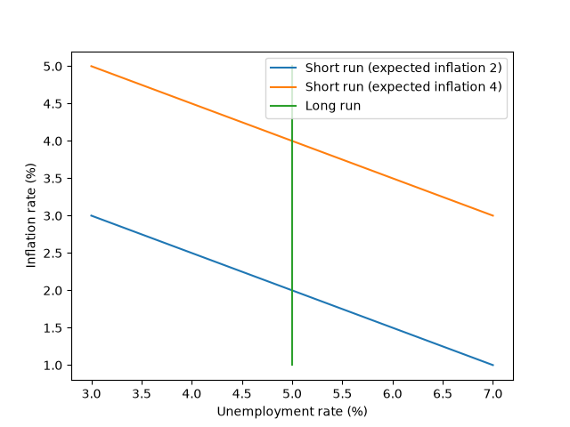
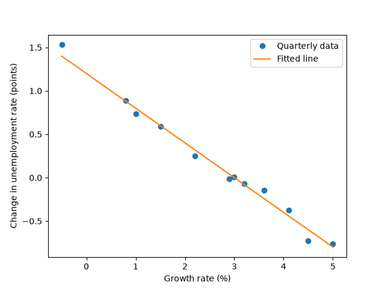

# 第 11 章: 物価・失業とフィリップス曲線

## 11.1 この章の地図

第 10 章で、AD-AS の均衡（物価と所得）を求めました。この章では、**物価と失業**の関係を見ます。物価が上がる理由には、需要が増える**ディマンドプル**と、費用が増える**コストプッシュ**があります。物価が**下がる**（デフレ）と、実質利子率が上がり、借金の負担が重くなります。物価上昇率と失業率には、短期には**トレードオフ**（フィリップス曲線）がありますが、長期には、**自然失業率**で垂直になります。最後に、成長率と失業率の関係（**オークンの法則**）を、**自作の最小二乗法**で求めます。



| 項目 | 内容 |
| :--- | :--- |
| 経済学の題材 | ディマンドプルとコストプッシュ、デフレとフィッシャー方程式、フィリップス曲線と自然失業率、需給ギャップ、オークンの法則 |
| 使う Python の機能 | 関数、`dataclass`、`functools.partial`、NumPy の配列計算、乱数の種（`default_rng`）、第 10 章の関数の再利用 |
| 新しく導入するライブラリ | なし（NumPy は、[第 2 章](02-three-way-equivalence.md)で導入済み） |
| 完成形 | `real_interest_rate`、`debt_burden`、`demand_pull_effect`、`cost_push_effect`、`short_run_inflation`、`implied_natural_rate`、`accelerating_inflation_path`、`output_gap_ratio`、`OkunFit`、`okun_coefficients`、`okun_breakeven_growth`、`synthetic_unemployment_change` |
| ファイル | 実装: `lib/chapter11/deflation.py`、`price_shocks.py`、`phillips.py`、`okun.py`、`plot.py`（図）／テスト: `test/chapter11/` の `test_deflation.py`、`test_phillips.py`、`test_okun.py`、`test_plot.py`（自分で書くときは、`practice/chapter11/` に、同じ名前で作ります） |
| データ | 架空のデータ（成長率の系列と、関係に雑音を足した失業率の変化）を、コードの中で、種を固定して作る |

### 経済学の式とコードの対応

| 経済学 | 式 | コード |
| :--- | :--- | :--- |
| フィッシャー方程式 | 実質利子率 = 名目利子率 − インフレ率 | `real_interest_rate(nominal, inflation)` |
| 借金の実質的な負担 | D ÷ (1 + π)^年数 | `debt_burden(nominal_debt, inflation, years)` |
| ディマンドプル | AD の右シフト → ΔP > 0、ΔY > 0 | `demand_pull_effect(...)` |
| コストプッシュ | AS の左シフト → ΔP > 0、ΔY < 0 | `cost_push_effect(...)` |
| 短期のフィリップス曲線 | π = π^e − β·(u − u_n) | `short_run_inflation(u, u_n, pe, beta)` |
| 自然失業率の逆算 | u_n = u + (π − π^e) ÷ β | `implied_natural_rate(u, pi, pe, beta)` |
| 需給ギャップ | (実際の GDP − 潜在 GDP) ÷ 潜在 GDP | `output_gap_ratio(actual, potential)` |
| オークンの法則 | Δu = 切片 + 傾き × 成長率（傾きは負） | `okun_coefficients(growth, change)` |

### 前提とする既存の章

この章の前提は、AD-AS の均衡を `solve_ad_as` で求める[第 10 章](10-labor-market-and-ad-as.md)です。物価指数や需給ギャップの基本は、第 3・5 章にありますが、この記事は、自分のコードを持ちます。第 1 シリーズの[第 14 章](../economics-programming/14-ad-as-and-major-theories.md)と題材が重なりますが、**独立して読めます**。

## 11.2 準備

サンプルコードは、リポジトリの `apps/macro-basics-programming/python/` にあります。環境の作り方は、[第 1 章](01-gdp-and-value-added.md) の 1.2 節と同じです。

```bash
cd apps/macro-basics-programming/python
uv sync
uv run pytest test/chapter11
```

```text
53 passed
```

自分でコードを書くときは、`practice/chapter11/` を作って、完成形と同じ名前のファイルに書きます。テストは、`uv run pytest practice/chapter11` で動かします。**完成形（`lib/` と `test/`）は、答え合わせ用です。** 自分で書き終えてから、開いてください。

## 11.3 予想する

- 名目利子率が 2%、インフレ率が −1%（デフレ）のとき、**実質利子率**は、いくつですか。名目利子率が 0% で、インフレ率が −2% なら、どうですか
- 1000 の借金があります。物価が 10% 下がると、借金の**実質的な負担**は、いくつになりますか。債務者と債権者の、どちらが得をしますか
- 実際の GDP が 950、潜在 GDP が 1000 のとき、**需給ギャップ**は、いくつですか
- 第 10 章のケインズの経済（AS は、Y = 480 + 400P で、1000 で垂直）で、**ディマンドプル**（政府支出 +10）と、**コストプッシュ**（供給が 20 減る）では、物価と所得は、それぞれ、どう動きますか。物価の動きは、同じ大きさですか
- 自然失業率 5%、期待インフレ率 2%、感応度 β = 0.5 のとき、失業率が 5% なら、インフレ率は、いくつですか。4% なら、6% なら、どうですか
- 失業率を 4% に**保ち続ける**と、期待が現実に追いつくとき、インフレ率は、どうなりますか
- 成長率 g と失業率の変化 Δu が、Δu = 1.2 − 0.4g の関係（雑音つき）にあるとき、最小二乗法で求めた傾きは、いくつに近いですか。失業率が変わらない成長率は、いくつですか

## 11.4 物価と失業の考え方

### 物価上昇の 2 つの型

- **ディマンドプル**: 需要が増える（AD が右へ動く）。物価も所得も、上がる。失業は、減る
- **コストプッシュ**: 費用（賃金・原材料）が増える（AS が左へ動く）。物価は上がるが、所得は下がる。失業は、増える（**スタグフレーション**）

### デフレの影響

物価が下がる（デフレ）と、次のことが起こります。

- **実質利子率が上がる。** フィッシャー方程式: 実質利子率 = 名目利子率 − インフレ率。インフレ率が負なら、名目利子率が同じでも、実質利子率は高い。投資が減る
- **債務者から債権者への再分配。** 名目の借金の額面は、変わらない。物価が下がると、借金の実質的な負担が、増える
- **デフレ・スパイラル。** 物価の下落 → 実質的な負担の増加と、実質賃金の上昇 → 需要と雇用の減少 → さらに、物価の下落
- **実質賃金が上がる。** 名目賃金が下がらないと、W ÷ P が上がり、失業が生まれる（第 10 章）

### フィリップス曲線

失業率とインフレ率の関係です。

> 短期: π = π^e − β·(u − u_n)

u_n は**自然失業率**（フリードマン。インフレ率が、期待に等しいときの失業率）、π^e は期待インフレ率です。短期には、人々が物価の上昇に気づかず（貨幣錯覚）、失業率が下がると、インフレ率が上がります（**右下がり**）。長期には、期待が現実に追いつきます。失業率を u_n より低く保つと、インフレ率は、毎期、上がり続けます。したがって、長期の曲線は、**自然失業率で垂直**です。

### 需給ギャップとオークンの法則

> 需給ギャップ = (実際の GDP − 潜在 GDP) ÷ 潜在 GDP

負なら、需要不足（失業が多い）です。**オークンの法則**は、成長率が高いほど、失業率が下がる、という負の相関です。この章では、失業率の**変化** Δu と成長率 g の、直線の関係を、最小二乗法で求めます。

> Δu = 切片 + 傾き × g、傾きは負。失業率が変わらない成長率は、−切片 ÷ 傾き

## 11.5 プログラミング

### Red: フィッシャー方程式のテスト

手計算できる値で、最初のテストを書きます。名目 2%、インフレ −1% なら、実質は 2 − (−1) = 3% です。

```python
def test_デフレでは実質利子率が名目利子率より高い() -> None:
    assert real_interest_rate(0.02, -0.01) == pytest.approx(0.03)


def test_名目利子率が0でもデフレなら実質利子率は正() -> None:
    assert real_interest_rate(0.0, -0.02) == pytest.approx(0.02)
```

`real_interest_rate` がまだないので、テストは失敗します（**Red**）。

### Green: フィッシャー方程式と借金の負担

```python
def real_interest_rate(nominal: float, inflation: float) -> float:
    """フィッシャー方程式 実質利子率 = 名目利子率 − インフレ率。

    デフレ（インフレ率が負）では、実質利子率は、名目利子率より高い。
    """
    return nominal - inflation
```

借金の負担は、物価が (1 + π)^年数 倍になると、その分の 1 になります。デフレ（π = −0.1）なら、1000 ÷ 0.9 = 1111.11 で、**負担が増えます**。

```python
def test_デフレで名目の借金の実質的な負担は増える() -> None:
    assert debt_burden(1000, -0.1) == pytest.approx(1000 / 0.9)
    assert debt_burden(1000, -0.1) > 1000


def test_インフレで名目の借金の実質的な負担は減る() -> None:
    assert debt_burden(1000, 0.25) == pytest.approx(800)


def test_物価が0以下になる下落はエラー() -> None:
    with pytest.raises(ValueError, match="インフレ率"):
        debt_burden(1000, -1.0)
```

```python
def debt_burden(nominal_debt: float, inflation: float, years: int = 1) -> float:
    """名目の借金の、実質的な負担（もとの物価で測った値）。

    名目の借金は、物価が変わっても、額面が変わらない。物価が (1 + インフレ率)^年数 倍に
    なると、実質的な負担は、その分の 1 になる。デフレでは、負担が増える（債務者から
    債権者への所得の再分配）。
    """
    if inflation <= -1:
        raise ValueError("インフレ率は、−1 より大きくする（物価が 0 以下になる）")
    if years < 0:
        raise ValueError("年数は、0 以上にする")
    return nominal_debt / (1 + inflation) ** years
```

### ディマンドプルとコストプッシュ

第 10 章の `solve_ad_as` を再利用します。政策の前後で、物価と所得の差 (ΔP, ΔY) を返します。コストプッシュは、`shift_supply` に**負の値**を渡して、AS を左へ動かします。

```python
ECONOMY = AdEconomy(mpc=0.6, b=20, intercept=450, k=0.5, h=100, nominal_money=250)


def test_ディマンドプルは物価も所得も上げる() -> None:
    d_price, d_income = demand_pull_effect(ECONOMY, 1000, 480, 400, 10)
    assert d_price == pytest.approx((4.4 + math.sqrt(35.36)) / 8 - 1.25)
    assert d_income == pytest.approx(480 + 400 * (1.25 + d_price) - 980)
    assert d_price > 0
    assert d_income > 0


def test_コストプッシュは物価を上げ所得を下げる() -> None:
    d_price, d_income = cost_push_effect(ECONOMY, 1000, 480, 400, 20)
    assert d_price == pytest.approx((440 + math.sqrt(353600)) / 800 - 1.25)
    assert d_price > 0
    assert d_income < 0


def test_0年後の負担は額面のまま() -> None:
    assert debt_burden(1000, 0.1, years=0) == pytest.approx(1000)
```

```python
def cost_push_effect(
    economy: AdEconomy,
    full_employment_income: float,
    base_income: float,
    slope: float,
    supply_loss: float,
) -> tuple[float, float]:
    """コストプッシュ（AS の左シフト）による、物価と所得の変化 (ΔP, ΔY)。"""
    if supply_loss <= 0:
        raise ValueError("供給の減少は、正にする")
    before = partial(
        keynesian_supply,
        full_employment_income=full_employment_income,
        base_income=base_income,
        slope=slope,
    )
    full, base = shift_supply(full_employment_income, base_income, -supply_loss)
    after = partial(
        keynesian_supply, full_employment_income=full, base_income=base, slope=slope
    )
    price0, income0 = solve_ad_as(economy, before)
    price1, income1 = solve_ad_as(economy, after)
    return price1 - price0, income1 - income0
```

`demand_pull_effect` は、`expand_demand` で AD を動かす点だけが違います。

### フィリップス曲線

手計算の値で、テストを書きます。u = u_n = 5 なら、π = π^e = 2。u = 4 なら、2 − 0.5 × (4 − 5) = 2.5 です。

```python
NATURAL = 5


EXPECTED = 2


BETA = 0.5


def test_自然失業率ではインフレ率は期待インフレ率に等しい() -> None:
    assert short_run_inflation(NATURAL, NATURAL, EXPECTED, BETA) == pytest.approx(2)


def test_失業率が自然失業率より低いとインフレ率は期待より高い() -> None:
    assert short_run_inflation(4, NATURAL, EXPECTED, BETA) == pytest.approx(2.5)
```

```python
def short_run_inflation(
    unemployment: float,
    natural_rate: float,
    expected_inflation: float,
    beta: float,
) -> float:
    """短期のフィリップス曲線 π = π^e − β·(u − u_n)。"""
    _check_beta(beta)
    return expected_inflation - beta * (unemployment - natural_rate)
```

観測された (u, π) から、自然失業率を**逆算**することもできます。u = 4、π = 3、π^e = 2、β = 0.5 なら、u_n = 4 + (3 − 2) ÷ 0.5 = 6 です。逆算した u_n を、もとの式に入れると、観測の π が戻ります。

```python
def implied_natural_rate(
    unemployment: float,
    inflation: float,
    expected_inflation: float,
    beta: float,
) -> float:
    """観測 (u, π) から逆算した自然失業率 u_n = u + (π − π^e) ÷ β。"""
    _check_beta(beta)
    return unemployment + (inflation - expected_inflation) / beta
```

**長期のトレードオフは、ない**ことも、確かめます。期待インフレ率を、前の期のインフレ率にして、失業率を 4% に保ち続けます。

```python
def test_失業率を自然失業率より低く保つとインフレ率は加速する() -> None:
    path = accelerating_inflation_path(4, NATURAL, EXPECTED, BETA, 3)
    assert path == pytest.approx([2.0, 2.5, 3.0, 3.5])


def test_期間が0なら経路は初期のインフレ率だけ() -> None:
    path = accelerating_inflation_path(4, 5, 2.0, 0.5, periods=0)
    assert path == [2.0]
```

```python
def accelerating_inflation_path(
    unemployment: float,
    natural_rate: float,
    initial_inflation: float,
    beta: float,
    periods: int,
) -> list[float]:
    """失業率を u に保ち続けたときの、インフレ率の経路。

    期待インフレ率は、前の期のインフレ率に等しい（期待が、現実に追いつく）。
    u が u_n より低いと、毎期、インフレ率が上がり続ける（長期のトレードオフは無い）。
    """
    _check_beta(beta)
    if periods < 0:
        raise ValueError("期間は、0 以上にする")
    path = [initial_inflation]
    for _ in range(periods):
        path.append(
            short_run_inflation(unemployment, natural_rate, path[-1], beta),
        )
    return path
```

### 需給ギャップ

```python
def test_需給ギャップは実際のGDPが潜在GDPを下回ると負() -> None:
    assert output_gap_ratio(950, 1000) == pytest.approx(-0.05)
```

```python
def output_gap_ratio(actual_gdp: float, potential_gdp: float) -> float:
    """需給ギャップ = (実際の GDP − 潜在 GDP) ÷ 潜在 GDP。負なら、需要不足。"""
    if potential_gdp <= 0:
        raise ValueError("潜在 GDP は、正にする")
    return (actual_gdp - potential_gdp) / potential_gdp
```

### オークンの法則（自作の最小二乗法）

直線 Δu = 切片 + 傾き × g を、データに当てはめます。**最小二乗法**は、点と直線の縦の差の二乗の和を、最小にする直線で、傾きは Σ(x − x̄)(y − ȳ) ÷ Σ(x − x̄)²、切片は ȳ − 傾き × x̄ です。`statsmodels` は使わず、NumPy の配列計算だけで書きます。

関係を、**ぴったり満たすデータ**（Δu = 1.2 − 0.4g）を作って、**傾きと切片が復元される**ことを、先にテストにします。

```python
GROWTH = [3.2, 1.5, 4.1, 0.8, 2.9, 5.0, -0.5, 3.6, 2.2, 4.5, 1.0, 3.0]


def test_関係を満たすデータから傾きと切片が復元される() -> None:
    change = [1.2 - 0.4 * g for g in GROWTH]
    fit = okun_coefficients(GROWTH, change)
    assert fit.slope == pytest.approx(-0.4)
    assert fit.intercept == pytest.approx(1.2)


def test_成長率がすべて同じなら傾きは求まらずエラー() -> None:
    with pytest.raises(ValueError, match="すべて同じ"):
        okun_coefficients([2, 2, 2], [1, 2, 3])
```

```python
@dataclass(frozen=True)
class OkunFit:
    """Δu = intercept + slope × 成長率 の係数。"""

    slope: float
    intercept: float


def okun_coefficients(
    growth: Sequence[float], unemployment_change: Sequence[float]
) -> OkunFit:
    """最小二乗法で、Δu = 切片 + 傾き × 成長率 の係数を求める。

    傾き = Σ(x − x̄)(y − ȳ) ÷ Σ(x − x̄)²、切片 = ȳ − 傾き × x̄。
    """
    if len(growth) != len(unemployment_change):
        raise ValueError("成長率と失業率の変化は、同じ長さにする")
    if len(growth) < 2:
        raise ValueError("回帰には、2 点以上が必要")
    x = np.asarray(growth, dtype=float)
    y = np.asarray(unemployment_change, dtype=float)
    dx = x - x.mean()
    if not dx.any():
        raise ValueError("成長率がすべて同じで、傾きが決まらない")
    slope = float((dx * (y - y.mean())).sum() / (dx**2).sum())
    return OkunFit(slope=slope, intercept=float(y.mean() - slope * x.mean()))


def okun_breakeven_growth(fit: OkunFit) -> float:
    """失業率が変わらない（Δu = 0）成長率 = −切片 ÷ 傾き。"""
    if fit.slope == 0:
        raise ValueError("傾きが 0 で、失業率が変わらない成長率は決まらない")
    return -fit.intercept / fit.slope
```

実際のデータには、雑音があります。架空のデータに、**種を固定した**乱数で雑音を足します。種が同じなら、毎回、同じデータになります。

```python
def test_種が同じなら同じデータ() -> None:
    first = synthetic_unemployment_change(GROWTH, -0.4, 1.2, noise=0.1, seed=7)
    again = synthetic_unemployment_change(GROWTH, -0.4, 1.2, noise=0.1, seed=7)
    assert first == again


def test_雑音があっても傾きはおおよそ復元される() -> None:
    change = synthetic_unemployment_change(GROWTH, -0.4, 1.2, noise=0.1, seed=0)
    fit = okun_coefficients(GROWTH, change)
    assert fit.slope == pytest.approx(-0.4, abs=0.05)
    assert fit.intercept == pytest.approx(1.2, abs=0.2)


def test_2点だけでも直線が決まる() -> None:
    fit = okun_coefficients([1.0, 3.0], [1.0, -1.0])
    assert fit.slope == pytest.approx(-1.0)
    assert fit.intercept == pytest.approx(2.0)
```

```python
def synthetic_unemployment_change(
    growth: Sequence[float],
    slope: float,
    intercept: float,
    noise: float,
    seed: int,
) -> list[float]:
    """関係 Δu = 切片 + 傾き × 成長率 に、正規分布の雑音を足した、架空のデータ。"""
    rng = np.random.default_rng(seed)
    x = np.asarray(growth, dtype=float)
    values = intercept + slope * x + rng.normal(0.0, noise, size=len(x))
    return [float(v) for v in values]
```

### 予想の答え合わせ

予想した答えを、プログラムで確かめます。

```python
from lib.chapter10.ad_as import AdEconomy
from lib.chapter11.deflation import debt_burden, real_interest_rate
from lib.chapter11.okun import (
    okun_breakeven_growth,
    okun_coefficients,
    output_gap_ratio,
    synthetic_unemployment_change,
)
from lib.chapter11.phillips import accelerating_inflation_path, short_run_inflation
from lib.chapter11.price_shocks import cost_push_effect, demand_pull_effect

print("実質利子率（名目 2%、インフレ -1%）:", round(real_interest_rate(0.02, -0.01), 4))
print("実質利子率（名目 0%、インフレ -2%）:", round(real_interest_rate(0.0, -0.02), 4))
print("借金 1000 の負担（デフレ -10%）:", round(debt_burden(1000, -0.1), 2))
print("需給ギャップ:", round(output_gap_ratio(950, 1000), 4))

economy = AdEconomy(mpc=0.6, b=20, intercept=450, k=0.5, h=100, nominal_money=250)
d_price, d_income = demand_pull_effect(economy, 1000, 480, 400, 10)
print(f"ディマンドプル: 物価 {d_price:+.4f} 所得 {d_income:+.2f}")
d_price, d_income = cost_push_effect(economy, 1000, 480, 400, 20)
print(f"コストプッシュ: 物価 {d_price:+.4f} 所得 {d_income:+.2f}")

print("u = 5:", short_run_inflation(5, 5, 2, 0.5))
print("u = 4:", short_run_inflation(4, 5, 2, 0.5))
print("u = 6:", short_run_inflation(6, 5, 2, 0.5))
print("失業率 4% を保つと:", accelerating_inflation_path(4, 5, 2, 0.5, 3))

growth = [3.2, 1.5, 4.1, 0.8, 2.9, 5.0, -0.5, 3.6, 2.2, 4.5, 1.0, 3.0]
change = synthetic_unemployment_change(growth, -0.4, 1.2, noise=0.1, seed=0)
fit = okun_coefficients(growth, change)
print(f"傾き {fit.slope:.3f}、切片 {fit.intercept:.3f}")
print(f"失業率が変わらない成長率: {okun_breakeven_growth(fit):.2f}")
```

```text
実質利子率（名目 2%、インフレ -1%）: 0.03
実質利子率（名目 0%、インフレ -2%）: 0.02
借金 1000 の負担（デフレ -10%）: 1111.11
需給ギャップ: -0.05
ディマンドプル: 物価 +0.0433 所得 +17.32
コストプッシュ: 物価 +0.0433 所得 -2.68
u = 5: 2.0
u = 4: 2.5
u = 6: 1.5
失業率 4% を保つと: [2, 2.5, 3.0, 3.5]
傾き -0.408、切片 1.224
失業率が変わらない成長率: 3.00
```

- **1 つ目の問い**: 名目 2%、インフレ −1% なら、実質利子率は 3% です。名目が 0% でも、インフレ −2% なら、実質は 2% です。**名目利子率を 0 まで下げても、デフレだと、実質利子率は正のまま**で、金融緩和の余地が限られます
- **2 つ目の問い**: 借金 1000 の実質的な負担は、1111.11 に増えます。債務者が損をして、債権者が得をします（再分配）
- **3 つ目の問い**: 需給ギャップは −0.05（−5%）で、需要不足です
- **4 つ目の問い**: ディマンドプルは、物価が 0.0433 上がり、所得が 17.32 増えます。コストプッシュは、物価が 0.0433 上がり、所得が 2.68 減ります。**物価の上がり幅は、同じ**です（AD を右へ 20、AS を左へ 20 動かす大きさが、同じだからです）。所得の動きは、反対です
- **5 つ目の問い**: u = 5（自然失業率）なら、インフレ率は期待と同じ 2。u = 4 なら 2.5、u = 6 なら 1.5 です（右下がり）
- **6 つ目の問い**: 失業率を 4% に保つと、インフレ率は、2、2.5、3、3.5 と、**毎期 0.5 ずつ上がり続けます**。長期には、失業率を自然失業率より低く保つトレードオフは、ありません
- **7 つ目の問い**: 傾きは −0.408、切片は 1.224 で、本当の値（−0.4、1.2）に近い値です。失業率が変わらない成長率は 3.00% です

### 図

図を描く関数と、座標のテストです。短期の曲線の端と、長期の垂直線の座標を、手計算の値と比べます。

```python
def phillips() -> Axes:
    return plot_phillips(
        natural_rate=5, expected_inflations=[2, 4], beta=0.5, u_min=3, u_max=7
    ).axes[0]


def test_短期の曲線は右下がりで自然失業率では期待インフレ率() -> None:
    ax = phillips()
    curve = line(ax, "Short run (expected inflation 2)")
    assert xs(curve) == [3, 7]
    assert ys(curve) == pytest.approx([3.0, 1.0])


def test_長期の曲線は自然失業率で垂直() -> None:
    ax = phillips()
    vertical = line(ax, "Long run")
    assert xs(vertical) == [5, 5]
    assert ys(vertical) == pytest.approx([1.0, 5.0])
```

オークンの法則の図（`plot_okun`）も、散布図の点と、回帰直線の端の座標を、同じようにテストします。



### 実行結果

```bash
uv run pytest test/chapter11
```

```text
53 passed
```

## 11.6 規則で言うと

1. **実質利子率 = 名目利子率 − インフレ率。** デフレでは、名目が同じでも、実質利子率が高く、借金の負担も重い
2. **ディマンドプルは、物価も所得も上げる。コストプッシュは、物価を上げ、所得を下げる。** 物価が上がっても、原因で、所得の動きが違う
3. **フィリップス曲線は、短期に右下がり、長期に垂直。** 失業率を自然失業率より低く保つと、インフレ率は、加速し続ける

混同しやすい点を、表にまとめます。

| 混同しやすい点 | 違い |
| :--- | :--- |
| ディマンドプルとコストプッシュ | ディマンドプルは、AD の右シフトで、所得が増える。コストプッシュは、AS の左シフトで、所得が減る |
| 名目利子率と実質利子率 | 名目は、表示された利子率。実質は、物価の変化を引いた値（フィッシャー方程式） |
| 短期と長期のフィリップス曲線 | 短期は、期待インフレ率が一定で右下がり。長期は、期待が追いつき、自然失業率で垂直 |
| 失業率と失業率の変化 | フィリップス曲線は、失業率の**水準**。オークンの法則は、失業率の**変化**と成長率 |
| 自然失業率と 0 | 自然失業率は、0 ではない。インフレ率が、期待と一致するときの失業率 |

### このモデルが成り立たない場面

- **フィリップス曲線は、安定しません。** 期待インフレ率が変わると、曲線が動きます（1970 年代の、失業とインフレの同時発生）。この章の β と u_n は、例の値です
- **架空のデータで、回帰は、うまくいきます。** 関係を、自分で作ったからです。実際のデータは、制度や時期で、傾きが変わります。**相関は、因果ではありません**
- **借金の負担は、単純化しています。** 利子や、返済不能（債務不履行）は、含みません。実質賃金の上昇や、デフレ・スパイラルの動きは、この章のコードでは、計算していません
- **ケインズの AS の値は、第 10 章の仮定です。** 値を変えると、ΔP や ΔY も変わります

## 11.7 練習問題

| 種類 | 問題 |
| :--- | :--- |
| 想起 | 本文を閉じて、`real_interest_rate` の最初のテスト（名目 2%、インフレ −1% で、実質 3%）を書いてください |
| 生成 | 解説を見る前に、借金の負担が、額面より、どれだけ増えるか（再分配の大きさ）を返す `debt_transfer(nominal_debt, inflation)` を、テストから書いてください。デフレ −10% では、いくつですか |
| 多様 | 感応度 β を 0.5 から 1.0 に変えると、u = 4% のときのインフレ率は、2.5 より大きくなりますか。失業率 4% を保ったときの経路は、どうなりますか。先に予想してから、確かめてください |
| 交互 | 第 1 シリーズの第 3・4 章の内包表記で、実際の GDP が [980, 1000, 1020, 970]、潜在 GDP が 1000 の 4 期の、需給ギャップを、一度に計算してください。需要不足（負）の期は、いくつですか |

??? note "解答（先に自分で取り組んでから、開いてください）"

    **想起**:

    ```python
    def test_デフレの実質利子率は3パーセント() -> None:
        assert real_interest_rate(0.02, -0.01) == pytest.approx(0.03)
    ```

    **生成**: 負担から、額面を引きます。デフレ −10% では、1111.11 − 1000 = 111.11 です。インフレなら、負（負担が軽くなる）です。

    ```python
    def debt_transfer(nominal_debt, inflation):
        return debt_burden(nominal_debt, inflation) - nominal_debt
    ```

    ```python
    def test_デフレでは債務者から債権者へ再分配される() -> None:
        assert debt_transfer(1000, -0.1) == pytest.approx(111.11, abs=0.01)
        assert debt_transfer(1000, 0.25) == pytest.approx(-200)
        assert debt_transfer(1000, 0.0) == pytest.approx(0)
    ```

    **多様**: β が大きいほど、失業率の動きに、インフレ率が敏感に反応します。

    ```python
    def test_感応度が大きいとインフレ率は大きく動く() -> None:
        assert short_run_inflation(4, 5, 2, 1.0) == pytest.approx(3.0)
        path = accelerating_inflation_path(4, 5, 2, 1.0, 3)
        assert path == pytest.approx([2, 3, 4, 5])
    ```

    u = 4% のインフレ率は 3.0 に、経路は、毎期 1 ずつ上がります。**感応度が大きいと、トレードオフが急になり、加速も速い**です。

    **交互**:

    ```python
    def test_4期の需給ギャップ() -> None:
        gaps = [output_gap_ratio(y, 1000) for y in [980, 1000, 1020, 970]]
        assert gaps == pytest.approx([-0.02, 0.0, 0.02, -0.03])
        assert sum(g < 0 for g in gaps) == 2
    ```

    需要不足（負）の期は、1 期目（−2%）と 4 期目（−3%）の 2 期です。

## 11.8 振り返り

- デフレで、名目利子率が 0 でも、実質利子率が、正のままでした。金融政策には、どんな限界がありますか
- ディマンドプルとコストプッシュで、物価の動きは同じで、所得の動きは反対でした。政策担当者は、2 つを、どう見分けますか
- 長期にトレードオフがない、とは、どういうことですか。失業率を自然失業率より低く保つと、何が起こりますか

## 11.9 まとめ

- フィッシャー方程式で、名目 2%・インフレ −1% の実質利子率 3% を求めた。デフレで、借金 1000 の負担は 1111.11 に増える（債務者から債権者への再分配）
- 第 10 章の AD-AS で、ディマンドプル（ΔP = +0.0433、ΔY = +17.32）と、コストプッシュ（ΔP = +0.0433、ΔY = −2.68）を比べた
- 短期のフィリップス曲線は右下がりで、u = u_n ならインフレ率は期待に等しい。失業率を自然失業率より低く保つと、インフレ率は、毎期 0.5 ずつ上がり続ける（長期は垂直）
- 需給ギャップ（950 と 1000 で −5%）と、自作の最小二乗法による、オークンの法則（傾き −0.408、失業率が変わらない成長率 3.00%）を、求めた。関係を満たすデータで、傾きと切片が復元される
- 次の章では、消費と投資の理論（ライフサイクル仮説、加速度原理、トービンの q）を、関数にします
