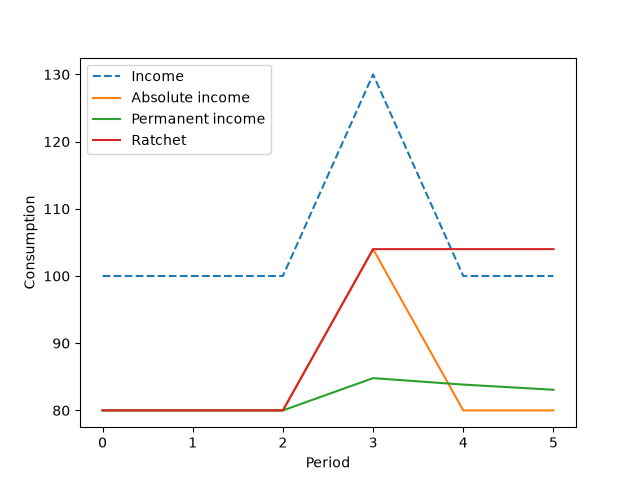
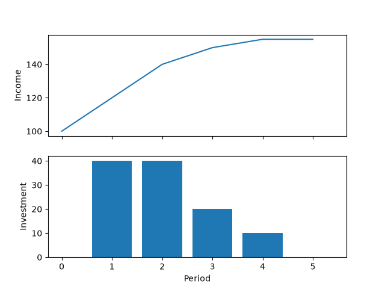

# 第 12 章: 消費と投資の理論

## 12.1 この章の地図

第 4 章では、消費を、**今期の所得**で決まる C = cY + C0 と置きました。しかし、ボーナスで所得が一時的に増えても、人は、その分をすべて使うでしょうか。この章では、消費を決める**5 つの仮説**を、同じ所得の変化に当てて、反応の違いを比べます。後半では、投資を決める**3 つの理論**（加速度原理・資本ストック調整原理・トービンの q）を、関数にします。



| 項目 | 内容 |
| :--- | :--- |
| 経済学の題材 | 絶対所得仮説、ライフサイクル仮説、恒常所得仮説、相対所得仮説（ラチェット効果）、流動資産仮説、加速度原理、資本ストック調整原理、トービンの q |
| 使う Python の機能 | 関数、リスト、`zip`、`pytest.mark.parametrize`。NumPy・pandas は、この章では使いません |
| 新しく導入するライブラリ | なし |
| 完成形 | `consumption_from_absolute_income`、`average_propensity`、`lifecycle_consumption`、`lifecycle_saving`、`permanent_income`、`permanent_consumption`、`ratchet_consumption`、`consumption_from_liquid_assets`、`accelerator_investment`、`accelerator_path`、`desired_capital`、`stock_adjustment_investment`、`tobins_q`、`should_invest` |
| ファイル | 実装: `lib/chapter12/consumption.py`、`lib/chapter12/investment.py`、`lib/chapter12/plot.py`（図）／テスト: `test/chapter12/test_consumption.py`、`test/chapter12/test_investment.py`、`test/chapter12/test_plot.py`（自分で書くときは、`practice/chapter12/` に、同じ名前で作ります） |

### 経済学の式とコードの対応

| 経済学 | 式 | コード |
| :--- | :--- | :--- |
| 絶対所得仮説 | C = cY + C₀ | `consumption_from_absolute_income(income, mpc, autonomous)` |
| 平均消費性向 | C ÷ Y = c + C₀ ÷ Y | `average_propensity(income, mpc, autonomous)` |
| ライフサイクル仮説 | 毎年の消費 = 年収 × 働く年数 ÷ 生涯の年数 | `lifecycle_consumption(annual_income, working_years, lifetime_years)` |
| 恒常所得仮説 | Yp(t) = λY(t) + (1 − λ)Yp(t − 1)、C = kYp | `permanent_income(incomes, adjust)`、`permanent_consumption(incomes, propensity, adjust)` |
| 相対所得仮説 | C = c × 過去の最高所得 | `ratchet_consumption(incomes, mpc)` |
| 流動資産仮説 | C = c₁Y + c₂A | `consumption_from_liquid_assets(income, assets, mpc_income, mpc_assets)` |
| 加速度原理 | I = V × ΔY | `accelerator_investment(capital_coefficient, income_change)` |
| 資本ストック調整原理 | I = 加速子 × (K* − K₋₁) | `stock_adjustment_investment(adjust, desired, previous_capital)` |
| トービンの q | q = 市場価値 ÷ 再取得価格 | `tobins_q(market_value, replacement_cost)`、`should_invest(q)` |

### 前提とする既存の章

| できること | 場所 |
| :--- | :--- |
| 消費関数 C = cY + C₀ と、限界消費性向 c を言う | この連載の[第 4 章](04-45-degree-line-and-multiplier.md) |

第 1 シリーズの[第 14 章（AD-AS と主要理論）](../economics-programming/14-ad-as-and-major-theories.md)と題材が重なりますが、この記事は、**独立して読めます**。

## 12.2 準備

サンプルコードは、リポジトリの `apps/macro-basics-programming/python/` にあります。環境の作り方は、[第 1 章](01-gdp-and-value-added.md) の 1.2 節と同じです。

```bash
cd apps/macro-basics-programming/python
uv sync
uv run pytest test/chapter12
```

```text
49 passed
```

自分でコードを書くときは、`practice/chapter12/` を作って、完成形と同じ名前（`consumption.py`・`investment.py`・`test_*.py`）のファイルに書きます。テストは、`uv run pytest practice/chapter12` で動かします。**完成形（`lib/` と `test/`）は、答え合わせ用です。** 自分で書き終えてから、開いてください。

## 12.3 予想する

次の問いに、先に、自分の予想を書いてください。

- 60 年生きる人が、40 年間、年収 600 を得ます。**毎年の消費**は、いくつですか（ライフサイクル仮説）。働いている間の**貯蓄**は、年いくらですか
- 消費関数 C = 0.8Y + 20 で、所得が 100、200、400 のときの**平均消費性向**（C ÷ Y）は、それぞれ、いくつですか。基礎消費がない（C₀ = 0）長期の関数では、どうなりますか
- 所得が、100 の状態が続くなかで、**1 期だけ 130** になり、すぐ 100 に戻ります。限界消費性向（所得が増えたときに、消費に回る割合）を 0.8 とすると、その期の消費は、**絶対所得仮説**で、いくつになりますか。**恒常所得仮説**（調整係数 0.2）では、どうですか。**ラチェット効果**では、所得が 100 に戻った後の消費は、どうなりますか
- 資本係数 V = 2 のとき、国民所得が 50 増えると、**加速度原理**の投資は、いくつですか。所得の増加が止まる（増加額が 0）と、投資は、どうなりますか
- 所得 100、資本係数 2 の企業で、最適な資本ストックは、いくつですか。前期の資本が 120 で、調整の速さ（加速子）が 0.5 なら、**資本ストック調整原理**の投資は、いくつですか
- 企業の市場価値が 120、資本の再取得価格が 100 のとき、**トービンの q** は、いくつですか。この企業は、投資しますか。市場価値が 80 なら、どうですか

## 12.4 消費と投資の理論の考え方

### 消費の 5 つの仮説

消費は、GDP の半分以上を占めます。何が消費を決めるかについて、5 つの考え方があります。

| 仮説 | 消費を決めるもの | 考え方 |
| :--- | :--- | :--- |
| 絶対所得仮説（ケインズ） | **今期の所得** | 短期は C = cY + C₀、長期は C = cY。短期では、所得が増えると、平均消費性向が下がる |
| ライフサイクル仮説 | **生涯所得** | 人生全体の所得を、生涯で、均等に使う（消費の平準化）。働く間は貯蓄し、引退後に取り崩す |
| 恒常所得仮説 | **恒常所得** | 過去の所得の加重平均（長期的に得られる所得）で決まる。一時的な所得は、あまり消費されない |
| 相対所得仮説 | **過去の最高所得** | 一度上がった消費水準は、所得が下がっても、すぐには下がらない（ラチェット効果） |
| 流動資産仮説 | **所得と、預貯金などの資産** | 所得が同じでも、流動資産が多いほど、消費が多い |

絶対所得仮説は、短期の統計（家計の所得が高いほど、貯蓄率が高い）と合いますが、長期の統計（長い年月で、平均消費性向はほぼ一定）と合いません。ほかの仮説は、**この食い違いを説明する**ために、考えられました。

### 投資の 3 つの理論

| 理論 | 投資を決めるもの | 式 |
| :--- | :--- | :--- |
| 加速度原理 | **国民所得の増加分** | I = V × ΔY（資本係数 V は一定） |
| 資本ストック調整原理 | **最適な資本ストックと、前期の資本ストックの差** | I = 加速子 × (K* − K₋₁)。K* = V × Y |
| トービンの q | **企業の市場価値 ÷ 資本の再取得価格** | q > 1 なら投資する、q < 1 なら投資しない |

加速度原理は、**所得の水準ではなく、増加分**に投資が比例します。所得が増え続けていても、増え方が小さくなれば、投資は減ります。このため、景気の変動が、**増幅されます**。資本ストック調整原理は、これを、「一度に調整せず、差の一部ずつ埋める」形に直したものです。トービンの q は、株式市場の評価（市場価値）と、設備を買い直す費用を比べます。

## 12.5 プログラミング

### Red: 絶対所得仮説のテスト

最初のテストを書きます。C = 0.8Y + 20 で、所得が 100 なら消費は 100、200 なら 180 です。短期では、平均消費性向が、所得の増加とともに下がります。

```python
import pytest

from lib.chapter12.consumption import (
    average_propensity,
    consumption_from_absolute_income,
    consumption_from_liquid_assets,
    lifecycle_consumption,
    lifecycle_saving,
    permanent_consumption,
    permanent_income,
    ratchet_consumption,
)
```

```python
def test_絶対所得仮説の消費は所得の一定割合と基礎消費の和() -> None:
    assert consumption_from_absolute_income(100, 0.8, 20) == pytest.approx(100)
    assert consumption_from_absolute_income(200, 0.8, 20) == pytest.approx(180)


def test_短期では所得が増えると平均消費性向が下がる() -> None:
    low = average_propensity(100, 0.8, 20)
    high = average_propensity(200, 0.8, 20)
    assert low == pytest.approx(1.0)
    assert high == pytest.approx(0.9)
    assert high < low


def test_長期は基礎消費がないので平均消費性向は一定() -> None:
    rates = [average_propensity(y, 0.8, 0) for y in (100, 200, 400)]
    assert rates == pytest.approx([0.8, 0.8, 0.8])
```

実装は、まだないので、テストは失敗します（**Red**）。

### Green: 絶対所得仮説を実装する

```python
def consumption_from_absolute_income(
    income: float, mpc: float, autonomous: float = 0
) -> float:
    """絶対所得仮説 C = cY + C0。長期は C0 = 0 で、C = cY。"""
    return mpc * income + autonomous


def average_propensity(income: float, mpc: float, autonomous: float = 0) -> float:
    """平均消費性向 C ÷ Y = c + C0 ÷ Y。C0 > 0 なら、所得が増えると下がる。"""
    if income == 0:
        raise ValueError("所得が 0 のとき、平均消費性向は計算できない")
    return consumption_from_absolute_income(income, mpc, autonomous) / income
```

??? note "import と補助関数（写すときに足す）"

    記事の抜粋には、import と、先頭が `_` の補助関数・定数を、省いています。完成形のファイルの先頭にある、次の部分を、写してください。

    **lib/chapter12/consumption.py**

    ```python
    from collections.abc import Sequence
    ```

    ```python
    from lib.chapter01.validation import validate_positive
    ```

    ```python
    def _validate_years(working_years: float, lifetime_years: float) -> None:
        validate_positive(lifetime_years, "生涯の年数は、正にする")
        if working_years < 0 or working_years > lifetime_years:
            raise ValueError("働く年数は、0 以上、生涯の年数以下にする")
    ```

    **lib/chapter12/investment.py**

    ```python
    from collections.abc import Sequence
    ```

    ```python
    from lib.chapter01.validation import validate_non_negative, validate_positive
    ```

C₀ = 20 のとき、平均消費性向は、c + C₀ ÷ Y なので、所得が大きいほど、c（0.8）に近づきます。C₀ = 0（長期）なら、いつも 0.8 です。第 4 章の `consumption` は、課税を含む関数で、名前が違います。この章では、仮説の違いを見るため、課税を省いた、別の関数にしました。

### ライフサイクル仮説

生涯所得を、生涯の年数で割ると、毎年の消費になります。60 年の人生で、40 年間、年収 600 を得る人は、生涯所得 24000 を 60 年で使うので、毎年 400 を消費します。働く間は、年 200 を貯蓄し（40 年で 8000）、引退後の 20 年間、毎年 400 ずつ取り崩して、貯蓄が 0 で終わります。

```python
def test_ライフサイクル仮説は生涯所得を生涯の年数で割る() -> None:
    assert lifecycle_consumption(600, 40, 60) == pytest.approx(400)


def test_働いている間の貯蓄は年収から消費を引いた額() -> None:
    assert lifecycle_saving(600, 40, 60) == pytest.approx(200)
```

```python
def lifecycle_consumption(
    annual_income: float, working_years: float, lifetime_years: float
) -> float:
    """ライフサイクル仮説。生涯所得を生涯の年数で割った、毎年の消費（平準化）。"""
    _validate_years(working_years, lifetime_years)
    return annual_income * working_years / lifetime_years


def lifecycle_saving(
    annual_income: float, working_years: float, lifetime_years: float
) -> float:
    """働いている間の、年間の貯蓄 = 年収 − 毎年の消費。"""
    return annual_income - lifecycle_consumption(
        annual_income, working_years, lifetime_years
    )
```

生涯の年数が 0 以下（0 除算になる）の場合と、働く年数が生涯より長い場合は、`_validate_years`（`lib/chapter12/consumption.py`）が、エラーにします。そのテスト（`test_ライフサイクル仮説の年数が不正ならエラー`）と、所得 0 の平均消費性向のエラーのテストは、`test/chapter12/test_consumption.py` にあります。

### 恒常所得仮説

恒常所得は、過去の所得の**加重平均**です。ここでは、今期の恒常所得を、「今期の所得 × λ + 前期の恒常所得 × (1 − λ)」と置きます（λ は調整係数）。λ が小さいほど、今期の所得の影響が小さく、**一時的な所得の変動に鈍感**です。

```python
def test_恒常所得は過去の所得の加重平均() -> None:
    path = permanent_income([100, 100, 130, 100], 0.5)
    assert path == pytest.approx([100, 100, 115, 107.5])


def test_一時的な所得の増加は恒常所得仮説ではあまり消費されない() -> None:
    incomes = [100, 100, 130, 100]
    absolute = [consumption_from_absolute_income(y, 0.8, 0) for y in incomes]
    permanent = permanent_consumption(incomes, 0.8, 0.2)
    assert absolute[2] - absolute[1] == pytest.approx(24)
    assert permanent[2] - permanent[1] == pytest.approx(4.8)
```

```python
def permanent_income(incomes: Sequence[float], adjust: float) -> list[float]:
    """恒常所得 Yp(t) = λ·Y(t) + (1 − λ)·Yp(t−1)。過去の所得の加重平均。

    最初の恒常所得は、最初の所得とする。λ は調整係数で、1 なら今期の所得に等しい。
    """
    if not incomes:
        raise ValueError("所得の系列が空")
    if adjust <= 0 or adjust > 1:
        raise ValueError("調整係数は、0 より大きく 1 以下にする")
    path = [float(incomes[0])]
    for income in incomes[1:]:
        path.append(adjust * income + (1 - adjust) * path[-1])
    return path


def permanent_consumption(
    incomes: Sequence[float], propensity: float, adjust: float
) -> list[float]:
    """恒常所得仮説の消費 C = k·Yp。今期の所得ではなく、恒常所得で決まる。"""
    return [propensity * yp for yp in permanent_income(incomes, adjust)]
```

最後のテストが、この章の中心です。所得が 100 から 130 になった期に、絶対所得仮説の消費は 24 増えますが、恒常所得仮説（λ = 0.2）では、4.8 しか増えません。

### 相対所得仮説と流動資産仮説

この章の相対所得仮説は、**自分の過去の最高所得**との比較（ラチェット効果）だけを扱います。他人との比較（デモンストレーション効果）は、扱いません。

ラチェット効果は、消費が、**過去の最高所得**に引きずられることです。流動資産仮説は、消費に、資産の項を足します。

```python
def test_ラチェット効果で所得が下がっても消費は下がらない() -> None:
    incomes = [100, 120, 90, 110, 130]
    assert ratchet_consumption(incomes, 0.8) == pytest.approx([80, 96, 96, 96, 104])
```

```python
def ratchet_consumption(incomes: Sequence[float], mpc: float) -> list[float]:
    """相対所得仮説（ラチェット効果）。消費は、過去の最高所得 × c で決まる。"""
    peak = float("-inf")
    path = []
    for income in incomes:
        peak = max(peak, income)
        path.append(mpc * peak)
    return path


def consumption_from_liquid_assets(
    income: float, assets: float, mpc_income: float, mpc_assets: float
) -> float:
    """流動資産仮説 C = c1·Y + c2·A。預貯金などの流動資産にも依存する。"""
    return mpc_income * income + mpc_assets * assets
```

流動資産仮説のテスト（`test_流動資産仮説の消費は所得と資産の両方に依存する`）は、`test/chapter12/test_consumption.py` にあります。

### 加速度原理

投資は、国民所得の**増加分**に、資本係数 V をかけた値です。V が負だと意味がないので、エラーにします。所得が減ると、投資は負（資本を減らす）になります（`test_所得が減ると投資は負になる`）。資本係数のエラーなど、エラー経路のテストは、`test/chapter12/test_investment.py` にあります。

```python
from lib.chapter12.investment import (
    accelerator_investment,
    accelerator_path,
    desired_capital,
    should_invest,
    stock_adjustment_investment,
    tobins_q,
)
```

```python
def test_加速度原理の投資は資本係数と所得の増加分の積() -> None:
    assert accelerator_investment(2, 50) == pytest.approx(100)


def test_所得の増加が止まると投資は0になる() -> None:
    assert accelerator_investment(2, 0) == 0


def test_所得の増加率が下がると投資は所得より先に減る() -> None:
    incomes = [100, 120, 140, 150, 155, 155]
    assert accelerator_path(2, incomes) == pytest.approx([40, 40, 20, 10, 0])
```

```python
def accelerator_investment(capital_coefficient: float, income_change: float) -> float:
    """加速度原理 I = V × ΔY。資本係数 V は一定。所得の増加が止まると、0。"""
    validate_non_negative(capital_coefficient, "資本係数は、0 以上にする")
    return capital_coefficient * income_change


def accelerator_path(
    capital_coefficient: float, incomes: Sequence[float]
) -> list[float]:
    """所得の系列から、2 期目以降の投資を求める。"""
    return [
        accelerator_investment(capital_coefficient, now - before)
        for before, now in zip(incomes, incomes[1:], strict=False)
    ]
```

### 資本ストック調整原理

最適な資本ストックは、V × Y です。実際の資本との差を、加速子の割合だけ、1 期で埋めます。加速子が 1 なら、1 期で全部埋め、小さいほど、ゆっくり埋めます。

```python
def test_最適な資本ストックは資本係数と所得の積() -> None:
    assert desired_capital(2, 100) == pytest.approx(200)


def test_資本ストック調整原理は最適な資本との差の一部だけ投資する() -> None:
    assert stock_adjustment_investment(0.5, 200, 120) == pytest.approx(40)


def test_加速子が1なら差を一度に埋める() -> None:
    assert stock_adjustment_investment(1, 200, 120) == pytest.approx(80)
```

```python
def desired_capital(capital_coefficient: float, income: float) -> float:
    """最適な資本ストック K* = V × Y。"""
    return capital_coefficient * income


def stock_adjustment_investment(
    adjust: float, desired: float, previous_capital: float
) -> float:
    """資本ストック調整原理 I = 加速子 × (最適な資本 − 前期の資本)。"""
    if adjust <= 0 or adjust > 1:
        raise ValueError("加速子は、0 より大きく 1 以下にする")
    return adjust * (desired - previous_capital)
```

### トービンの q

```python
def test_トービンのqは市場価値を再取得価格で割る() -> None:
    assert tobins_q(120, 100) == pytest.approx(1.2)


def test_qが1より大きければ投資する() -> None:
    assert should_invest(1.2) is True
    assert should_invest(0.8) is False


def test_qがちょうど1なら投資しない() -> None:
    assert should_invest(1.0) is False
```

```python
def tobins_q(market_value: float, replacement_cost: float) -> float:
    """トービンの q = 企業の市場価値 ÷ 資本の再取得価格。"""
    validate_positive(replacement_cost, "再取得価格は、正にする")
    return market_value / replacement_cost


def should_invest(q: float) -> bool:
    """q > 1 なら投資する。q ≤ 1 なら、投資しない。"""
    return q > 1
```

q がちょうど 1 のときは、設備を増やしても、市場価値が費用と釣り合うだけなので、投資しない（`False`）と決めました。

### 予想の答え合わせ

予想した答えを、プログラムで確かめます。

```python
from lib.chapter12.consumption import (
    average_propensity,
    consumption_from_absolute_income,
    lifecycle_consumption,
    lifecycle_saving,
    permanent_consumption,
    ratchet_consumption,
)
from lib.chapter12.investment import (
    accelerator_investment,
    desired_capital,
    should_invest,
    stock_adjustment_investment,
    tobins_q,
)

print("ライフサイクル 毎年の消費:", lifecycle_consumption(600, 40, 60))
print("ライフサイクル 働く間の貯蓄:", lifecycle_saving(600, 40, 60))
for autonomous in (20, 0):
    rates = [round(average_propensity(y, 0.8, autonomous), 4) for y in (100, 200, 400)]
    print(f"平均消費性向（C0 = {autonomous}）:", rates)
incomes = [100, 100, 100, 130, 100, 100]
absolute = [consumption_from_absolute_income(y, 0.8) for y in incomes]
permanent = permanent_consumption(incomes, 0.8, 0.2)
print("絶対所得仮説:", [round(c, 2) for c in absolute])
print("恒常所得仮説:", [round(c, 2) for c in permanent])
print("ラチェット効果:", [round(c, 2) for c in ratchet_consumption(incomes, 0.8)])
print("加速度原理 ΔY = 50:", accelerator_investment(2, 50))
print("加速度原理 ΔY = 0:", accelerator_investment(2, 0))
k_star = desired_capital(2, 100)
print("最適な資本:", k_star)
print("資本ストック調整:", stock_adjustment_investment(0.5, k_star, 120))
for value in (120, 80):
    q = tobins_q(value, 100)
    print(f"市場価値 {value}: q = {round(q, 2)}、投資する: {should_invest(q)}")
```

```text
ライフサイクル 毎年の消費: 400.0
ライフサイクル 働く間の貯蓄: 200.0
平均消費性向（C0 = 20）: [1.0, 0.9, 0.85]
平均消費性向（C0 = 0）: [0.8, 0.8, 0.8]
絶対所得仮説: [80.0, 80.0, 80.0, 104.0, 80.0, 80.0]
恒常所得仮説: [80.0, 80.0, 80.0, 84.8, 83.84, 83.07]
ラチェット効果: [80.0, 80.0, 80.0, 104.0, 104.0, 104.0]
加速度原理 ΔY = 50: 100
加速度原理 ΔY = 0: 0
最適な資本: 200
資本ストック調整: 40.0
市場価値 120: q = 1.2、投資する: True
市場価値 80: q = 0.8、投資する: False
```

- **1 つ目の問い**: 毎年の消費は 400 で、働く間の貯蓄は年 200 です。年収 600 を、そのまま使い切るのではなく、**生涯で均して**使います
- **2 つ目の問い**: C₀ = 20 のとき、平均消費性向は 1.0、0.9、0.85 と、所得が増えるほど下がります。C₀ = 0 なら、いつも 0.8 です。**短期の統計と長期の統計の違い**を、基礎消費の有無で、説明できます
- **3 つ目の問い**: 所得が 130 になった期の消費は、絶対所得仮説で 104（80 から 24 増）、恒常所得仮説で 84.8（80 から 4.8 増）です。所得が 100 に戻ると、恒常所得仮説の消費は、ゆっくり 80 へ戻ります（83.84、83.07）。ラチェット効果では、消費が 104 のまま**下がりません**
- **4 つ目の問い**: 投資は 2 × 50 = 100 です。所得の増加が止まると、投資は **0** になります。所得は高いままなのに、投資がなくなる、つまり、景気の変動が**増幅される**のが、加速度原理の特徴です
- **5 つ目の問い**: 最適な資本は 200 で、投資は 0.5 × (200 − 120) = 40 です。差の半分だけ、投資します
- **6 つ目の問い**: q = 120 ÷ 100 = 1.2 で、1 より大きいので、**投資します**。市場価値が 80 なら、q = 0.8 で、投資しません

### 図

最初の図は、所得が 1 期だけ 130 になったときの、3 つの仮説の消費です。

次の図は、加速度原理です。所得は、100、120、140、150、155、155 と、増え方が小さくなり、最後に止まります。V = 2 の投資は、40、40、20、10、0 です。**所得は、まだ増えている（150 → 155）のに、投資は、すでに減っています。**

図の線の高さと棒の高さは、`test/chapter12/test_plot.py` で、手計算の値と比べています。描画の関数は、次のとおりです。

??? note "描画のテストと実装（後回しにしても、学習は成り立ちます）"

    ```python
    def plot_consumption_theories(
        incomes: Sequence[float], mpc: float, adjust: float
    ) -> Figure:
        """所得が一時的に増えたときの、3 つの仮説の消費の反応を、重ねて描く。"""
        periods = list(range(len(incomes)))
        absolute = [consumption_from_absolute_income(y, mpc) for y in incomes]
        fig, ax = plt.subplots()
        ax.plot(periods, incomes, linestyle="--", label="Income")
        ax.plot(periods, absolute, label="Absolute income")
        ax.plot(
            periods, permanent_consumption(incomes, mpc, adjust), label="Permanent income"
        )
        ax.plot(periods, ratchet_consumption(incomes, mpc), label="Ratchet")
        ax.set_xlabel("Period")
        ax.set_ylabel("Consumption")
        ax.legend()
        plt.close(fig)
        return fig


    def plot_accelerator(capital_coefficient: float, incomes: Sequence[float]) -> Figure:
        """上に所得の線、下に、加速度原理による投資の棒を描く。

        所得の増加が小さくなると、所得はまだ増えているのに、投資は減る。
        """
        investment = accelerator_path(capital_coefficient, incomes)
        fig, (top, bottom) = plt.subplots(2, 1, sharex=True)
        top.plot(range(len(incomes)), incomes)
        top.set_ylabel("Income")
        bottom.bar(range(1, len(incomes)), investment)
        bottom.set_xlabel("Period")
        bottom.set_ylabel("Investment")
        plt.close(fig)
        return fig
    ```



### 実行結果

```bash
uv run pytest test/chapter12
```

```text
49 passed
```

## 12.6 規則で言うと

1. **消費は、今期の所得だけでは、決まらない。** 生涯所得（ライフサイクル）、恒常所得、過去の最高所得、資産が、消費に影響する。一時的な所得の増加は、あまり消費されない
2. **投資は、所得の水準ではなく、増加分に反応する（加速度原理）。** 所得の増え方が小さくなると、所得が増えていても、投資は減る
3. **投資は、市場の評価と、再取得の費用を比べて決まる（トービンの q）。** q > 1 なら、投資で価値が増える

混同しやすい点を、表にまとめます。

| 混同しやすい点 | 違い |
| :--- | :--- |
| 恒常所得仮説とライフサイクル仮説 | どちらも、「一時的な所得」を、あまり消費しない。恒常所得は、**過去の所得の平均**。ライフサイクルは、**一生の所得を、生涯で均す** |
| 加速度原理と資本ストック調整原理 | 加速度原理は、**所得の増加分**に比例する。資本ストック調整原理は、**最適な資本と実際の資本の差**に比例する（差を、少しずつ埋める） |

### このモデルが成り立たない場面

- **恒常所得は、仮定した平均です。** 調整係数 λ は、この章の例の値で、人によって違います。恒常所得を、直接測ることは、できません
- **加速度原理は、資本係数 V が一定で、設備に余裕がない、と仮定します。** 設備に余裕があれば、所得が増えても、投資は増えません

## 12.7 練習問題

| 種類 | 問題 |
| :--- | :--- |
| 想起 | 本文を閉じて、`lifecycle_consumption` の最初のテスト（60 年の人生で、40 年間、年収 600 を得る人の、毎年の消費 400）を書いてください |
| 生成 | 解説を見る前に、ライフサイクル仮説の人の、毎年の終わりの**貯蓄残高**の系列を返す `lifetime_assets(annual_income, working_years, lifetime_years)` を、テストから書いてください。最も多くなるのは、何年目ですか。最後の残高は、いくつですか |
| 多様 | 恒常所得仮説の調整係数 λ を、0.2 から 0.5 に変えると、所得が 1 期だけ 100 から 130 になったときの、消費の増加は、大きくなりますか、小さくなりますか。先に予想してから、確かめてください |
| 交互 | [第 1 シリーズ](../economics-programming/index.md)の第 3 章のリスト内包表記で、3 つの企業（市場価値と再取得価格が、A は 120 と 100、B は 90 と 100、C は 100 と 100）の、トービンの q と、投資するかどうかを、一度に求めてください。投資するのは、どの企業ですか |

??? note "解答（先に自分で取り組んでから、開いてください）"

    **想起**:

    ```python
    def test_毎年の消費は400() -> None:
        assert lifecycle_consumption(600, 40, 60) == pytest.approx(400)
    ```

    **生成**: 働く間は、毎年、年収と消費の差だけ増え、引退後は、毎年、消費の分だけ減ります。

    ```python
    def lifetime_assets(annual_income, working_years, lifetime_years):
        consume = lifecycle_consumption(annual_income, working_years, lifetime_years)
        assets = 0.0
        path = []
        for year in range(lifetime_years):
            income = annual_income if year < working_years else 0
            assets += income - consume
            path.append(assets)
        return path
    ```

    ```python
    def test_貯蓄残高は引退の年に最大で最後は0() -> None:
        path = lifetime_assets(600, 40, 60)
        assert len(path) == 60
        assert max(path) == pytest.approx(8000)
        assert path.index(max(path)) + 1 == 40
        assert path[-1] == pytest.approx(0)
    ```

    貯蓄残高は、40 年目に最大の 8000（200 × 40）になり、60 年目に 0 になります。

    **多様**: λ が大きいほど、今期の所得の影響が大きくなるので、一時的な所得の増加にも、より反応します。消費の増加は、**大きくなる**と予想できます。

    ```python
    def test_調整係数が大きいほど一時的な所得の増加に反応する() -> None:
        incomes = [100, 100, 130]
        slow = permanent_consumption(incomes, 0.8, 0.2)
        fast = permanent_consumption(incomes, 0.8, 0.5)
        assert slow[2] - slow[1] == pytest.approx(4.8)
        assert fast[2] - fast[1] == pytest.approx(12)
        assert fast[2] - fast[1] > slow[2] - slow[1]
    ```

    λ = 0.2 では 4.8、λ = 0.5 では 12 です。λ = 1 なら、絶対所得仮説と同じ 24 になります。

    **交互**:

    ```python
    def test_3つの企業のqと投資の判断() -> None:
        firms = {"A": (120, 100), "B": (90, 100), "C": (100, 100)}
        qs = {name: tobins_q(v, cost) for name, (v, cost) in firms.items()}
        decisions = {name: should_invest(q) for name, q in qs.items()}
        assert qs == pytest.approx({"A": 1.2, "B": 0.9, "C": 1.0})
        assert decisions == {"A": True, "B": False, "C": False}
    ```

    q は、A が 1.2、B が 0.9、C が 1.0 で、投資するのは A だけです。C は、q がちょうど 1 なので、投資しません。

## 12.8 振り返り

- 同じ所得の変化に、5 つの仮説は、どう反応しましたか
- 所得が増えているのに投資が減るのは、なぜですか。景気の変動は、どう変わりますか

## 12.9 まとめ

- 消費の 5 つの仮説（絶対所得・ライフサイクル・恒常所得・相対所得・流動資産）を、関数にした。C = 0.8Y + 20 では、平均消費性向が、所得 100・200・400 で 1.0・0.9・0.85 と下がり、C₀ = 0（長期）では、いつも 0.8
- ライフサイクル仮説では、60 年の人生で 40 年間、年収 600 を得る人は、毎年 400 を消費し、働く間は年 200 を貯蓄する
- 所得が 1 期だけ 100 から 130 になると、消費は、絶対所得仮説で 24、恒常所得仮説（λ = 0.2）で 4.8 増える。ラチェット効果では、消費が 104 のまま下がらない
- 加速度原理で、V = 2、所得の増加 50 の投資は 100。所得の増加が止まると、投資は 0（景気の変動が増幅される）
- 資本ストック調整原理で、最適な資本 200、前期の資本 120、加速子 0.5 の投資は 40。トービンの q = 1.2（> 1）なら、投資する
- 次の章では、貨幣数量説（MV = PY）と、為替・購買力平価・IS バランスを学びます
