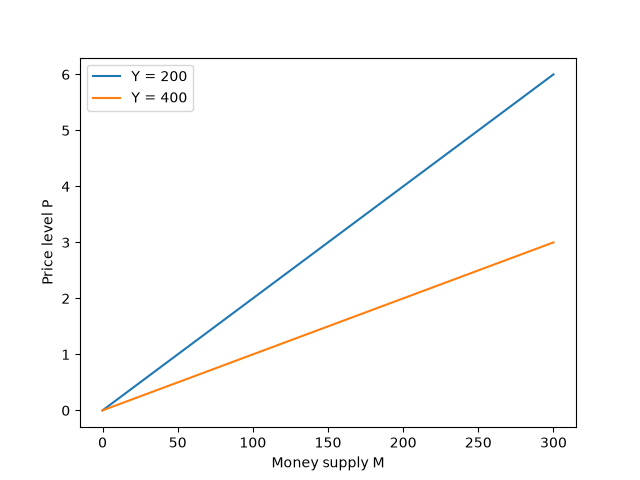
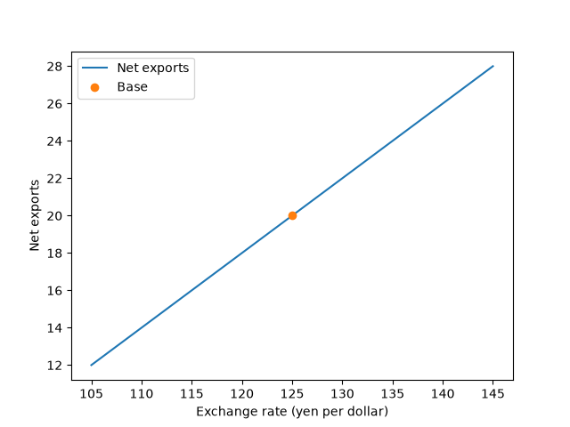

# 第 13 章: 貨幣数量説と為替・国際収支

## 13.1 この章の地図

第 7 章では、貨幣需要が、所得と利子率で決まると考えました。**貨幣数量説（マネタリズム）**は、もっと単純に、貨幣量と物価を結びます。**貨幣量が 2 倍になれば、物価も 2 倍になる**という考え方です。この章の後半では、国を**外**へ広げます。為替レートが動くと純輸出がどう変わるか、為替レートは、物価の違いでどう決まるか（購買力平価）、貯蓄と投資と財政の差が、純輸出に等しくなること（IS バランス）を、関数にします。



| 項目 | 内容 |
| :--- | :--- |
| 経済学の題材 | 貨幣数量説（MV = PY・マーシャルの k）、為替レートと純輸出、購買力平価、IS バランス |
| 使う Python の機能 | 関数、`math.isclose`、`pytest.mark.parametrize`。NumPy・pandas は、この章では使いません |
| 新しく導入するライブラリ | なし |
| 完成形 | `price_level_from_quantity`、`marshall_k`、`nominal_money_demand`、`inflation_from_money_growth`、`net_exports_from_exchange_rate`、`ppp_exchange_rate`、`ppp_after_inflation`、`net_exports_from_balance`、`is_balance_consistent` |
| ファイル | 実装: `lib/chapter13/quantity.py`、`lib/chapter13/open_economy.py`、`lib/chapter13/plot.py`（図）／テスト: `test/chapter13/test_quantity.py`、`test/chapter13/test_open_economy.py`、`test/chapter13/test_plot.py`（自分で書くときは、`practice/chapter13/` に、同じ名前で作ります） |

### 経済学の式とコードの対応

| 経済学 | 式 | コード |
| :--- | :--- | :--- |
| 交換方程式 | MV = PY、つまり P = MV ÷ Y | `price_level_from_quantity(money, velocity, output)` |
| マーシャルの k | k = 1 ÷ V、M = kPY | `marshall_k(velocity)`、`nominal_money_demand(k, price_level, output)` |
| インフレ率の近似 | π ≈ μ + Δv − g | `inflation_from_money_growth(money_growth, real_growth, velocity_change)` |
| 為替と純輸出 | X = X₀ + s(e − e₀)（e が上がると円安） | `net_exports_from_exchange_rate(exchange_rate, base_net_exports, base_rate, slope)` |
| 購買力平価 | 為替レート = 自国の価格 ÷ 外国の価格 | `ppp_exchange_rate(domestic_price, foreign_price)`、`ppp_after_inflation(...)` |
| IS バランス | X = (S − I) + (T − G) | `net_exports_from_balance(saving, investment, tax, government)`、`is_balance_consistent(...)` |

### 前提とする既存の章

| できること | 場所 |
| :--- | :--- |
| 総需要 Y = C + I + G + X（X は純輸出）を言う | この連載の[第 2 章](02-three-way-equivalence.md)と[第 4 章](04-45-degree-line-and-multiplier.md) |
| 貨幣需要が、所得と利子率で決まることを言う（比べるため） | この連載の[第 7 章](07-money-demand-and-lm.md) |

第 1 シリーズの貨幣数量説の章（第 14 章）や、中級＋の連載の購買力平価の章（第 7 章）と題材が重なりますが、この記事は、**独立して読めます**。

## 13.2 準備

サンプルコードは、リポジトリの `apps/macro-basics-programming/python/` にあります。環境の作り方は、[第 1 章](01-gdp-and-value-added.md) の 1.2 節と同じです。

```bash
cd apps/macro-basics-programming/python
uv sync
uv run pytest test/chapter13
```

```text
39 passed
```

自分でコードを書くときは、`practice/chapter13/` を作って、完成形と同じ名前（`quantity.py`・`open_economy.py`・`test_*.py`）のファイルに書きます。テストは、`uv run pytest practice/chapter13` で動かします。**完成形（`lib/` と `test/`）は、答え合わせ用です。** 自分で書き終えてから、開いてください。

## 13.3 予想する

次の問いに、先に、自分の予想を書いてください。

- 貨幣量 M = 100、流通速度 V = 4、実質生産量 Y = 200 のとき、**物価水準 P** は、いくつですか。M が 2 倍の 200 になると、P は、いくつになりますか（V・Y は一定）
- マーシャルの **k**（V = 4 のとき）は、いくつですか。物価 2、生産量 200 のとき、貨幣需要は、いくつですか。この貨幣需要は、**利子率**に依存しますか
- 貨幣が 10% 増え、実質生産量が 2% 増え、流通速度が変わらないとき、**インフレ率**は、約何 % ですか。交換方程式から、厳密に計算した値と、どれだけ違いますか
- 為替レートが 1 ドル 125 円のとき、純輸出が 20 です。レートが 135 円（**円安**）になると、純輸出は、増えますか、減りますか。115 円（**円高**）では、どうですか（為替レートが 1 円動くと、純輸出が 0.4 動くと置きます）
- 500 円のものが、アメリカでは 4 ドルで売られています。**購買力平価**の為替レートは、1 ドル何円ですか。日本の物価が 10% 上がると、購買力平価は、何円になりますか。円高ですか、円安ですか
- 民間の貯蓄が 130、投資が 100、税収が 80、政府支出が 90 のとき、**純輸出**は、いくつですか。民間の貯蓄超過 S − I と、財政収支 T − G は、それぞれ、いくつですか
- 国民所得 500、消費 290、投資 110、政府支出 80、税収 80、純輸出 20 は、**IS バランス**と、支出面（Y = C + I + G + X）の、どちらでも矛盾しませんか。純輸出が 30 なら、どうですか

## 13.4 貨幣数量説と、開放経済の考え方

### 貨幣数量説

**フィッシャーの交換方程式**は、「貨幣が、1 年に何回、持ち主を変えるか」で、取引を表します。

> MV = PY

M は貨幣量、V は流通速度（貨幣が 1 年に使われる回数）、P は物価水準、Y は実質生産量です。**マネタリズム**は、V と Y を一定とみなし、「M が 2 倍になれば、P も 2 倍」と考えます。貨幣量の変化は、物価だけを動かし、実質の量を動かしません。

**マーシャルの k** は、同じ式を、貨幣の**需要**の言葉で書き直したものです。k = 1 ÷ V とおくと、M = kPY になります。貨幣需要は、**名目所得（PY）の一定割合**で、**利子率には依存しません**。第 7 章の貨幣需要（利子率に依存する）と違う点です。

変化率で書くと、インフレ率 π は、近似的に、貨幣増加率 μ と、流通速度の変化率 Δv の和から、実質成長率 g を引いた値になります。

> π ≈ μ + Δv − g

### 為替と購買力平価

為替レートは、ここでは、**1 ドルあたりの円**で表します。数字が上がると、円の価値が下がる（円安）ことになります。

| 為替の動き | 輸出 | 輸入 | 純輸出 |
| :--- | :--- | :--- | :--- |
| 円安（レートが上がる） | 増える | 減る | **増える** |
| 円高（レートが下がる） | 減る | 増える | **減る** |

**購買力平価説**は、長期の為替レートが、2 国の物価の比で決まると考えます。同じものが、500 円と 4 ドルなら、1 ドル 125 円が、購買力平価です。自国の物価が上がると、同じ為替レートでは、自国の財が割高になるので、通貨の価値が下がる（通貨安）と考えます。

### IS バランス

支出面の Y = C + I + G + X と、Y = C + S + T の 2 つの式から、Y を消すと、次の式になります。

> X = (S − I) + (T − G)

**純輸出 = 民間の貯蓄超過 + 財政黒字**です。国内の貯蓄が、国内の投資より多ければ、余りは、海外への貸し出し（純輸出）になります。

## 13.5 プログラミング

### Red: 交換方程式のテスト

最初のテストを書きます。M = 100、V = 4、Y = 200 なら、MV = 400 で、P = 400 ÷ 200 = 2 です。

```python
import pytest

from lib.chapter13.quantity import (
    inflation_from_money_growth,
    marshall_k,
    nominal_money_demand,
    price_level_from_quantity,
)
```

```python
def test_交換方程式から物価水準を求める() -> None:
    assert price_level_from_quantity(100, 4, 200) == pytest.approx(2)


def test_貨幣量が2倍なら物価も2倍() -> None:
    before = price_level_from_quantity(100, 4, 200)
    after = price_level_from_quantity(200, 4, 200)
    assert after == pytest.approx(2 * before)


def test_生産量が0なら物価は計算できない() -> None:
    with pytest.raises(ValueError, match="生産量"):
        price_level_from_quantity(100, 4, 0)
```

実装は、まだないので、テストは失敗します（**Red**）。

### Green: 交換方程式を実装する

```python
def price_level_from_quantity(money: float, velocity: float, output: float) -> float:
    """交換方程式 MV = PY から、物価水準 P = MV ÷ Y。"""
    if output == 0:
        raise ValueError("生産量が 0 のとき、物価水準は計算できない")
    return money * velocity / output
```

生産量が 0 だと、割り算ができません。エラーにします。

### マーシャルの k とインフレ率の近似

```python
def test_マーシャルのkは流通速度の逆数() -> None:
    assert marshall_k(4) == pytest.approx(0.25)


def test_貨幣需要は交換方程式の貨幣量と一致する() -> None:
    money, velocity, output = 100, 4, 200
    price = price_level_from_quantity(money, velocity, output)
    assert nominal_money_demand(marshall_k(velocity), price, output) == pytest.approx(
        money
    )


def test_インフレ率は貨幣増加率と流通速度の変化率から実質成長率を引いた値() -> None:
    assert inflation_from_money_growth(10, 2, 0) == pytest.approx(8)
    assert inflation_from_money_growth(10, 2, -3) == pytest.approx(5)


def test_インフレ率の近似は交換方程式の厳密な値に近い() -> None:
    exact = price_level_from_quantity(110, 4, 204) / price_level_from_quantity(
        100, 4, 200
    )
    approx = inflation_from_money_growth(10, 2, 0)
    assert (exact - 1) * 100 == pytest.approx(approx, abs=0.2)
```

```python
def marshall_k(velocity: float) -> float:
    """マーシャルの k = 1 ÷ V。貨幣需要は、名目所得の k 倍。"""
    if velocity <= 0:
        raise ValueError("流通速度は、正にする")
    return 1 / velocity


def nominal_money_demand(k: float, price_level: float, output: float) -> float:
    """貨幣需要 M = k·P·Y。名目所得で決まり、利子率には依存しない。"""
    return k * price_level * output


def inflation_from_money_growth(
    money_growth: float, real_growth: float, velocity_change: float
) -> float:
    """変化率の近似 π ≈ μ + Δv − g（すべて % の値）。"""
    return money_growth + velocity_change - real_growth
```

`nominal_money_demand` の引数に、利子率は、**ありません**。「貨幣需要は、利子率に依存しない」ことが、関数の形に出ています。流通速度が 0 以下のときの、エラーのテストは、`test/chapter13/test_quantity.py` にあります。

### 為替レートと純輸出

円安（為替レートが上がる）と、純輸出が増える、簡単な線形の式で表します。傾き s は、**0 以上**に固定します（負だと、円安で純輸出が減ることになり、この章の前提と逆になる）。基準のレート 125 円で純輸出 20、傾き 0.4 のとき、135 円なら 24、115 円なら 16 です。

```python
import pytest

from lib.chapter13.open_economy import (
    is_balance_consistent,
    net_exports_from_balance,
    net_exports_from_exchange_rate,
    ppp_after_inflation,
    ppp_exchange_rate,
)
```

```python
def test_円安で為替レートが上がると純輸出が増える() -> None:
    weak_yen = net_exports_from_exchange_rate(135, 20, 125, 0.4)
    assert weak_yen == pytest.approx(24)
    assert weak_yen > 20


def test_円高で為替レートが下がると純輸出が減る() -> None:
    strong_yen = net_exports_from_exchange_rate(115, 20, 125, 0.4)
    assert strong_yen == pytest.approx(16)
    assert strong_yen < 20


def test_為替レートに対する純輸出の傾きが負ならエラー() -> None:
    with pytest.raises(ValueError, match="傾き"):
        net_exports_from_exchange_rate(125, 20, 125, -0.4)
```

```python
def net_exports_from_exchange_rate(
    exchange_rate: float,
    base_net_exports: float,
    base_rate: float,
    slope: float,
) -> float:
    """純輸出 X = X0 + s(e − e0)。e は、1 ドルあたりの円（上がると円安）。

    円安（e が上がる）と、輸出が増え、輸入が減るので、純輸出は増える。
    傾き s は、0 以上にする。
    """
    if slope < 0:
        raise ValueError("為替レートに対する純輸出の傾きは、0 以上にする")
    return base_net_exports + slope * (exchange_rate - base_rate)
```

### 購買力平価

```python
def test_購買力平価は自国の価格を外国の価格で割る() -> None:
    assert ppp_exchange_rate(500, 4) == pytest.approx(125)


def test_外国の価格が0なら購買力平価は計算できない() -> None:
    with pytest.raises(ValueError, match="外国の価格"):
        ppp_exchange_rate(500, 0)


def test_自国の物価が10パーセント上がると購買力平価は10パーセント円安() -> None:
    assert ppp_after_inflation(500, 4, 0.10) == pytest.approx(137.5)
```

```python
def ppp_exchange_rate(domestic_price: float, foreign_price: float) -> float:
    """購買力平価 = 自国の価格 ÷ 外国の価格（1 ドルあたりの円）。"""
    if foreign_price == 0:
        raise ValueError("外国の価格が 0 のとき、購買力平価は計算できない")
    return domestic_price / foreign_price


def ppp_after_inflation(
    domestic_price: float, foreign_price: float, domestic_inflation: float
) -> float:
    """自国の物価が上がったあとの、購買力平価。上がると、円安になる。"""
    if domestic_inflation <= -1:
        raise ValueError("物価上昇率は、−1（−100%）より大きくする")
    return ppp_exchange_rate(domestic_price * (1 + domestic_inflation), foreign_price)
```

物価上昇率が −100% 以下だと、価格が 0 以下になってしまうので、エラーにします（`test_物価が100パーセント以上下がることはない`）。

### IS バランス

```python
def test_貯蓄超過が財政赤字を上回る分が純輸出() -> None:
    # S − I = 30、T − G = −10
    assert net_exports_from_balance(130, 100, 80, 90) == pytest.approx(30 - 10)


def test_国内の支出面の恒等式とISバランスは同じ結論() -> None:
    # Y = C + I + G + X = 290 + 110 + 80 + 20 = 500、T = 80
    assert is_balance_consistent(500, 290, 110, 80, 80, 20) is True


def test_純輸出が合わなければ整合しない() -> None:
    assert is_balance_consistent(500, 290, 110, 80, 80, 30) is False


@pytest.mark.parametrize("net_exports", [-10, 0, 20, 30])
def test_ISバランスの整合は支出面の恒等式の成立と一致する(net_exports: float) -> None:
    income, consumption, investment, government, tax = 500, 290, 110, 80, 80
    expenditure = consumption + investment + government + net_exports
    consistent = is_balance_consistent(
        income, consumption, investment, government, tax, net_exports
    )
    assert consistent == (income == expenditure)
```

```python
def net_exports_from_balance(
    saving: float, investment: float, tax: float, government: float
) -> float:
    """IS バランス X = (S − I) + (T − G)。純輸出 = 民間の貯蓄超過 + 財政黒字。"""
    return (saving - investment) + (tax - government)


def is_balance_consistent(
    income: float,
    consumption: float,
    investment: float,
    government: float,
    tax: float,
    net_exports: float,
) -> bool:
    """支出面 Y = C + I + G + X と、IS バランスが、同じ結論になるかを確かめる。"""
    saving = income - tax - consumption
    balance = net_exports_from_balance(saving, investment, tax, government)
    return math.isclose(balance, net_exports, abs_tol=1e-9)
```

最後のテストが、**第 2 章の支出面の考え方と、同じ結論になる**ことの確認です。純輸出が 20 のときだけ、支出面の式（Y = C + I + G + X）も、IS バランスも、成り立ちます。浮動小数点数の比較には、`math.isclose` を使います。

### 予想の答え合わせ

予想した答えを、プログラムで確かめます。

```python
from lib.chapter13.open_economy import (
    is_balance_consistent,
    net_exports_from_balance,
    net_exports_from_exchange_rate,
    ppp_after_inflation,
    ppp_exchange_rate,
)
from lib.chapter13.quantity import (
    inflation_from_money_growth,
    marshall_k,
    nominal_money_demand,
    price_level_from_quantity,
)

print("P:", price_level_from_quantity(100, 4, 200))
print("M を 2 倍にしたときの P:", price_level_from_quantity(200, 4, 200))
k = marshall_k(4)
print("k:", k, "貨幣需要:", nominal_money_demand(k, 2, 200))
approx = inflation_from_money_growth(10, 2, 0)
exact = price_level_from_quantity(110, 4, 204) / price_level_from_quantity(100, 4, 200)
print("インフレ率（近似）:", approx, "厳密:", round((exact - 1) * 100, 2))
for rate in (135, 115):
    print(f"{rate} 円の純輸出:", round(net_exports_from_exchange_rate(rate, 20, 125, 0.4), 2))
print("購買力平価:", ppp_exchange_rate(500, 4))
print("物価が 10% 上がったあと:", ppp_after_inflation(500, 4, 0.10))
print("純輸出:", net_exports_from_balance(130, 100, 80, 90))
print("S − I:", 130 - 100, "T − G:", 80 - 90)
for x in (20, 30):
    print(f"X = {x} で整合:", is_balance_consistent(500, 290, 110, 80, 80, x))
```

```text
P: 2.0
M を 2 倍にしたときの P: 4.0
k: 0.25 貨幣需要: 100.0
インフレ率（近似）: 8 厳密: 7.84
135 円の純輸出: 24.0
115 円の純輸出: 16.0
購買力平価: 125.0
物価が 10% 上がったあと: 137.5
純輸出: 20
S − I: 30 T − G: -10
X = 20 で整合: True
X = 30 で整合: False
```

- **1 つ目の問い**: P = 100 × 4 ÷ 200 = 2 です。M が 2 倍の 200 になると、P は 4 で、**ちょうど 2 倍**になります
- **2 つ目の問い**: k = 1 ÷ 4 = 0.25 で、貨幣需要は 0.25 × 2 × 200 = 100 です。M = 100 に、一致します。この式に、利子率は出てこないので、**利子率に依存しません**
- **3 つ目の問い**: 近似のインフレ率は 10 − 2 = 8% です。交換方程式から計算した厳密な値は、約 7.84% で、**約 0.16 ポイントの差**があります。変化率が小さいほど、近似は、正確になります
- **4 つ目の問い**: 円安の 135 円では、純輸出は 24 に**増え**、円高の 115 円では、16 に**減ります**
- **5 つ目の問い**: 購買力平価は、500 ÷ 4 = 125 円です。日本の物価が 10% 上がると、137.5 円になり、**10% の円安**です。日本の財が割高になるので、通貨の価値が下がります
- **6 つ目の問い**: 純輸出は (130 − 100) + (80 − 90) = 20 です。民間の貯蓄超過は 30、財政収支は −10（赤字）で、貯蓄超過のほうが大きい分（20）が、海外への貸し出し（純輸出）になります
- **7 つ目の問い**: 純輸出が 20 なら、整合します。30 だと、整合しません。支出面で、Y = 290 + 110 + 80 + 30 = 510 になり、500 と合わないからです

### 図

最初の図は、貨幣量と物価水準の関係です。V = 4 のとき、Y = 200 の直線は、M = 200 で P = 4 に届きます。Y = 400 の直線は、傾きが半分です。**生産量が大きいと、同じ貨幣量でも、物価は低くなります。**

次の図は、為替レートと純輸出です。右へ行くほど円安で、純輸出が増えます。基準の点（125 円、20）に、印を付けました。

```python
def plot_money_and_prices(
    velocity: float, outputs: Sequence[float], moneys: Sequence[float]
) -> Figure:
    """貨幣量 M と物価水準 P の関係を、生産量 Y ごとの直線で描く。

    P = MV ÷ Y なので、M が 2 倍になると P も 2 倍。Y が大きいと、傾きが小さい。
    """
    fig, ax = plt.subplots()
    for output in outputs:
        prices = [price_level_from_quantity(m, velocity, output) for m in moneys]
        ax.plot(moneys, prices, label=f"Y = {output}")
    ax.set_xlabel("Money supply M")
    ax.set_ylabel("Price level P")
    ax.legend()
    plt.close(fig)
    return fig


def plot_net_exports(
    rates: Sequence[float], base_net_exports: float, base_rate: float, slope: float
) -> Figure:
    """為替レート（1 ドルあたりの円）と純輸出。右へ行くほど円安で、純輸出が増える。"""
    net_exports = [
        net_exports_from_exchange_rate(e, base_net_exports, base_rate, slope)
        for e in rates
    ]
    fig, ax = plt.subplots()
    ax.plot(rates, net_exports, label="Net exports")
    ax.plot([base_rate], [base_net_exports], "o", label="Base")
    ax.set_xlabel("Exchange rate (yen per dollar)")
    ax.set_ylabel("Net exports")
    ax.legend()
    plt.close(fig)
    return fig
```

線の座標と、軸の名前は、`test/chapter13/test_plot.py` で、手計算の値と比べています。



### 実行結果

```bash
uv run pytest test/chapter13
```

```text
39 passed
```

## 13.6 規則で言うと

1. **MV = PY で、V と Y が一定なら、M と P は比例する。** 貨幣量が 2 倍なら、物価も 2 倍。貨幣需要は、名目所得で決まり、利子率には依存しない（マネタリズム）
2. **為替レートは、円安で純輸出が増え、円高で減る。** 購買力平価は、物価の比。自国の物価が上がると、通貨安
3. **純輸出は、民間の貯蓄超過と財政黒字の和（IS バランス）。** 支出面の式から、導ける

混同しやすい点を、表にまとめます。

| 混同しやすい点 | 違い |
| :--- | :--- |
| 円安と、円の価値 | 為替レート（1 ドルあたりの円）が**上がる**のが円安。円の価値は、**下がる**。純輸出は、増える |
| 第 7 章の貨幣需要と、マーシャルの k | 第 7 章は、所得と**利子率**で決まる。マーシャルの k は、名目所得だけで決まる（利子率は無関係） |
| 貯蓄超過と純輸出 | S − I と T − G の和が、純輸出。民間が貯蓄超過でも、財政赤字が大きければ、純輸出は小さい |

### このモデルが成り立たない場面

- **V と Y を一定とみなすのは、仮定です。** 短期には、流通速度も、生産量も、変わります。インフレ率の近似は、変化率が大きいと、ずれます（予想の答え合わせで、7.84% と 8% の差を見ました）
- **為替と純輸出の線形の式は、近似です。** 傾き 0.4 は、この章の例の値です。実際の傾きは、輸出入の価格弾力性などで、決まります。購買力平価も、貿易できない財や、輸送費が、あると、成り立ちません

## 13.7 練習問題

| 種類 | 問題 |
| :--- | :--- |
| 想起 | 本文を閉じて、`price_level_from_quantity` の最初のテスト（M = 100、V = 4、Y = 200 で、P = 2）を書いてください |
| 生成 | 解説を見る前に、購買力平価と実際の為替レートから、**円が割高か割安か**を返す `yen_valuation(domestic_price, foreign_price, actual_rate)` を、テストから書いてください。500 円と 4 ドルで、実際のレートが 100 円のとき、どちらですか |
| 多様 | 日本の物価上昇率が 10%、アメリカの物価上昇率が 10% のとき、購買力平価は、どうなりますか。先に予想してから、`ppp_exchange_rate` で確かめてください |
| 交互 | [第 1 シリーズ](../economics-programming/index.md)の第 3・4 章のリスト内包表記で、貨幣量が 100、200、300 のときの物価水準（V = 4、Y = 200）を、一度に求めてください。貨幣量と物価水準の比は、いつも同じですか |

??? note "解答（先に自分で取り組んでから、開いてください）"

    **想起**:

    ```python
    def test_物価水準は2() -> None:
        assert price_level_from_quantity(100, 4, 200) == pytest.approx(2)
    ```

    **生成**: 実際のレートが、購買力平価より低い（円高）なら、円は、購買力から見て、**割高**です。

    ```python
    def yen_valuation(domestic_price, foreign_price, actual_rate):
        ppp = ppp_exchange_rate(domestic_price, foreign_price)
        if actual_rate < ppp:
            return "overvalued"
        if actual_rate > ppp:
            return "undervalued"
        return "fair"
    ```

    ```python
    def test_円高なら円は割高() -> None:
        assert yen_valuation(500, 4, 100) == "overvalued"
        assert yen_valuation(500, 4, 150) == "undervalued"
        assert yen_valuation(500, 4, 125) == "fair"
    ```

    購買力平価は 125 円なので、実際のレート 100 円は、円が割高（overvalued）です。

    **多様**: 日本の物価が 10% 上がり、アメリカの物価も 10% 上がると、比は変わらないので、購買力平価は、**変わりません**。

    ```python
    def test_両国の物価が同じ率で上がれば購買力平価は変わらない() -> None:
        before = ppp_exchange_rate(500, 4)
        after = ppp_exchange_rate(500 * 1.1, 4 * 1.1)
        assert after == pytest.approx(before)
        assert after == pytest.approx(125)
    ```

    為替レートを動かすのは、**物価の差**（相対的な物価）です。両国が同じ率で上がっても、動きません。

    **交互**:

    ```python
    def test_貨幣量と物価水準の比は一定() -> None:
        moneys = [100, 200, 300]
        prices = [price_level_from_quantity(m, 4, 200) for m in moneys]
        ratios = [p / m for p, m in zip(prices, moneys, strict=True)]
        assert prices == pytest.approx([2, 4, 6])
        assert ratios == pytest.approx([0.02, 0.02, 0.02])
    ```

    物価水準は 2、4、6 で、貨幣量との比は、いつも V ÷ Y = 0.02 です。

## 13.8 振り返り

- 貨幣量が 2 倍になると、物価が 2 倍になるのは、どんな仮定のもとでしたか
- 自国の物価が上がると、購買力平価は、なぜ円安の向きに動きましたか
- 純輸出が、民間の貯蓄超過と財政黒字の和になることを、支出面の式から、導けますか

## 13.9 まとめ

- 交換方程式 MV = PY で、M = 100、V = 4、Y = 200 のとき P = 2。M が 2 倍なら、P も 2 倍（V・Y 一定）。マーシャルの k = 1 ÷ V = 0.25 で、貨幣需要は、名目所得の k 倍（利子率には依存しない）
- インフレ率の近似 π ≈ μ + Δv − g は、10% の貨幣増加と、2% の成長で 8%。厳密な値は、約 7.84%
- 為替レート（1 ドルあたりの円）が上がる（円安）と、純輸出が増える（傾き 0.4 で、125 円の 20 が、135 円で 24）。傾きの符号は、テストで 0 以上に固定した
- 購買力平価は、500 円 ÷ 4 ドル = 125 円。日本の物価が 10% 上がると、137.5 円（10% の円安）
- IS バランス X = (S − I) + (T − G) で、S − I = 30、T − G = −10 から、純輸出は 20。支出面の式（Y = C + I + G + X）と、同じ結論になることを、テストで確かめた
- 第 14 章では、第 3 部の到達チェックで、ここまでの理論を、まとめて確かめます
