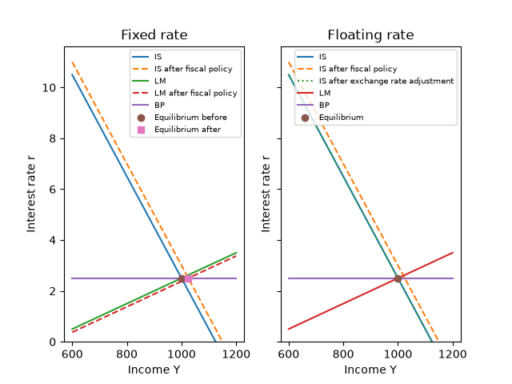
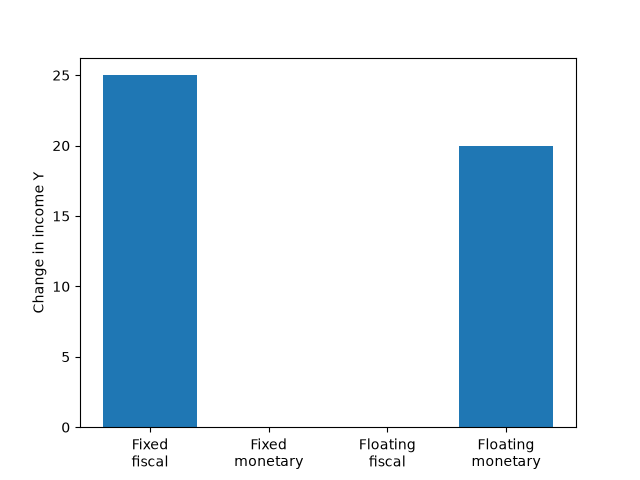
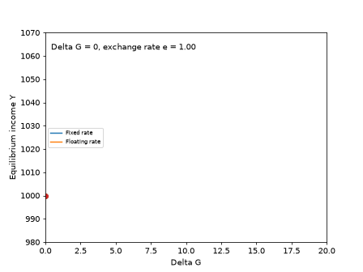

# 第 14 章: マンデル・フレミング・モデル

## 14.1 この章の地図

第 8・9 章の IS-LM は、**閉じた経済**（外国との取引がない経済）でした。この章では、**外国と資本が自由に行き来する小さな国**（小国開放経済）に、IS-LM を広げます。資本が自由に動くと、国内の利子率は、**世界の利子率 r\*** に、引き寄せられます。このとき、政策の効果は、**為替制度で、逆になります**。

- **固定相場**: 財政政策は**有効**、金融政策は**無効**
- **変動相場**: 財政政策は**無効**、金融政策は**有効**

この章では、この 4 通りを、連立方程式を解く関数で、求めます。最後に、**第 3 部（第 10〜14 章）の到達チェック**を行います。



| 項目 | 内容 |
| :--- | :--- |
| 経済学の題材 | 小国開放経済、BP 曲線（r = r\*）、固定相場と変動相場、為替介入、財政政策と金融政策の効果 |
| 使う Python の機能 | `dataclass(frozen=True)`、`__post_init__` での検査、`dataclasses.replace`、`pytest.mark.parametrize`、第 4・7・8 章の関数の再利用 |
| 新しく導入するライブラリ | なし |
| 完成形 | `SmallOpenEconomy`、`OpenEquilibrium`、`fixed_rate_equilibrium`、`floating_rate_equilibrium`、`open_economy_residuals`、`fixed_rate_fiscal_effect`、`fixed_rate_monetary_effect`、`floating_rate_fiscal_effect`、`floating_rate_monetary_effect`、`fixed_rate_devaluation_effect`、`PolicyEffect`、`policy_effects_table` |
| ファイル | 実装: `lib/chapter14/mundell_fleming.py`、`lib/chapter14/plot.py`（図）／テスト: `test/chapter14/test_mundell_fleming.py`、`test/chapter14/test_plot.py`（自分で書くときは、`practice/chapter14/` に、同じ名前で作ります） |

### 経済学の式とコードの対応

| 経済学 | 式 | コード |
| :--- | :--- | :--- |
| 固定相場の所得 | Y = (A + n·e − b·r\*) ÷ (1 − c) | `fixed_rate_equilibrium(economy)` |
| 固定相場の貨幣供給（内生） | M/P = k·Y − h·r\* | 同上（`real_money`） |
| 変動相場の所得 | Y = (M/P + h·r\*) ÷ k | `floating_rate_equilibrium(economy)` |
| 変動相場の為替レート（内生） | e = ((1 − c)·Y + b·r\* − A) ÷ n | 同上（`exchange_rate`） |
| 4 通りの効果 | 固定: ΔG ÷ (1 − c) と 0。変動: 0 と Δ(M/P) ÷ k | `policy_effects_table(economy, dg, dm)` |
| 均衡の確認 | IS・LM・BP の残差が 0 | `open_economy_residuals(economy, point)` |

### 前提とする既存の章

この連載の[第 8 章](08-is-curve-and-is-lm.md)・[第 9 章](09-fiscal-and-monetary-policy.md)（IS 曲線と LM 曲線、政策で曲線が動くこと）と、[第 4 章](04-45-degree-line-and-multiplier.md)の `validate_mpc` を使います。

第 1 シリーズの[第 13 章（IS-LM 分析）](../economics-programming/13-is-lm-analysis.md)と題材が重なりますが、この記事は、**独立して読めます**。

## 14.2 準備

サンプルコードは、リポジトリの `apps/macro-basics-programming/python/` にあります。環境の作り方は、[第 1 章](01-gdp-and-value-added.md) の 1.2 節と同じです。

```bash
cd apps/macro-basics-programming/python
uv sync
uv run pytest test/chapter14
```

```text
44 passed
```

自分でコードを書くときは、`practice/chapter14/` を作って、完成形と同じ名前（`mundell_fleming.py`・`test_mundell_fleming.py`）のファイルに書きます。テストは、`uv run pytest practice/chapter14` で動かします。**完成形（`lib/` と `test/`）は、答え合わせ用です。** 自分で書き終えてから、開いてください。

## 14.3 予想する

第 8 章と同じ数値の国を、小国開放経済にします。c = 0.6、投資の利子感応度 b = 20、貨幣需要 k = 0.5・h = 100、実質貨幣供給 M/P = 250、世界の利子率 r\* = 2.5 です。為替レート e = 1 のとき、為替レートに依らない支出 A = 400 と、純輸出の為替レートへの感応度 n = 50 を合わせて、IS の右辺は A + n·e = 450 になり、均衡は、第 8 章と同じ、所得 1000・利子率 2.5 です。

- **固定相場**で、政府支出を 10 増やすと、所得は、いくつ増えますか。実質貨幣供給を 10 増やそうとすると、所得は、いくつ増えますか
- **変動相場**で、政府支出を 10 増やすと、所得は、いくつ増えますか。実質貨幣供給を 10 増やすと、所得は、いくつ増えますか
- 変動相場で、政府支出を 10 増やすと、為替レートは、**上がり**ますか、**下がり**ますか（円安になりますか、円高になりますか）。動く幅は、いくつですか
- 固定相場で、政府支出を 10 増やしたとき、実質貨幣供給は、**増え**ますか、**減り**ますか。いくつ動きますか

## 14.4 マンデル・フレミング・モデルの考え方

### 3 本の式

| 市場 | 式 | 意味 |
| :--- | :--- | :--- |
| 財市場（IS） | (1 − c)·Y + b·r = A + n·e | 為替レート e が上がる（**円安**）と、純輸出が増えて、IS が右へ動く |
| 貨幣市場（LM） | k·Y − h·r = M/P | 第 7 章と同じ |
| 国際収支（BP） | r = r\* | 資本移動が自由な小国では、利子率が、世界の利子率に一致する。**水平な直線** |

e は、外国通貨 1 単位あたりの自国通貨の量です。e が上がるほど、自国通貨は安くなります。**未知数は、Y・r・e・M/P の 4 つ**で、式は 3 本です。だから、為替制度で、**1 つを固定**します。

### 固定相場と変動相場

| | 固定相場 | 変動相場 |
| :--- | :--- | :--- |
| 固定するもの | 為替レート e | 実質貨幣供給 M/P |
| 調整されるもの | M/P（中央銀行の**為替介入**で、LM が動く） | e（市場で決まり、IS が動く） |
| 所得 | Y = (A + n·e − b·r\*) ÷ (1 − c) | Y = (M/P + h·r\*) ÷ k |
| 財政政策（ΔG） | ΔY = ΔG ÷ (1 − c)（**有効**） | ΔY = 0（**無効**） |
| 金融政策（Δ(M/P)） | ΔY = 0（**無効**） | ΔY = Δ(M/P) ÷ k（**有効**） |

- **固定相場の金融政策**: 貨幣供給を増やすと、利子率が r\* より下がり、**資本が流出**します。自国通貨が売られるので、中央銀行は、為替レートを守るために、自国通貨を買い戻します。貨幣供給は、**元に戻ります**。
- **固定相場の財政政策**: IS が右へ動くと、利子率が r\* より上がり、**資本が流入**します。中央銀行は、自国通貨を売って、為替レートを守ります。貨幣供給が増えて、LM も右へ動きます。**クラウディングアウトが起きず**、単純な乗数どおり、所得が増えます。
- **変動相場の財政政策**: IS が右へ動くと、資本が流入して、自国通貨が**高く**なります（e が下がる、円高）。純輸出が減り、IS が元に戻ります。所得は変わりません。
- **変動相場の金融政策**: 貨幣供給が増えると、資本が流出して、自国通貨が**安く**なります（e が上がる、円安）。純輸出が増え、IS が右へ動きます。LM と r = r\* の交点まで、所得が増えます。

> 混同注意: **固定相場は、財政有効・金融無効。変動相場は、その逆**（財政無効・金融有効）です。

## 14.5 プログラミング

### Red: 固定相場のテスト

係数をまとめて 1 つの値にします（`SmallOpenEconomy`）。まず、固定相場で、均衡が、世界の利子率と一致し、財政政策が有効、金融政策が無効であるテストを書きます。手計算の値は、固定相場の財政政策が 10 ÷ 0.4 = 25 です。関数がまだないので、テストは失敗します（**Red**）。

```python
import pytest

from lib.chapter14.mundell_fleming import (
    SmallOpenEconomy,
    fixed_rate_equilibrium,
    fixed_rate_fiscal_effect,
    fixed_rate_monetary_effect,
)
```

```python
def make_economy(**changes: float) -> SmallOpenEconomy:
    base = {
        "mpc": 0.6,
        "b": 20,
        "intercept": 400,
        "n": 50,
        "k": 0.5,
        "h": 100,
        "real_money": 250,
        "world_rate": 2.5,
        "exchange_rate": 1,
    }
    return SmallOpenEconomy(**{**base, **changes})


def test_固定相場の均衡は世界の利子率と一致する() -> None:
    eq = fixed_rate_equilibrium(make_economy())
    assert eq.income == pytest.approx(1000)
    assert eq.interest == pytest.approx(2.5)
    assert eq.exchange_rate == pytest.approx(1)
    assert eq.real_money == pytest.approx(250)


def test_固定相場で財政政策は有効() -> None:
    economy = make_economy()
    assert fixed_rate_fiscal_effect(economy, 10) == pytest.approx(25)


def test_固定相場で金融政策は無効() -> None:
    assert fixed_rate_monetary_effect(make_economy(), 10) == 0
```

### Green: 係数のまとまりと、固定相場の均衡

係数は、`dataclass(frozen=True)` にまとめます。**退化した入力**（c = 1 や n = 0 など）は、作った時点で、日本語のエラーにします（`__post_init__`）。

```python
@dataclass(frozen=True)
class SmallOpenEconomy:
    """小国開放経済の係数。intercept は、為替レートに依らない支出 A。"""

    mpc: float
    b: float
    intercept: float
    n: float
    k: float
    h: float
    real_money: float
    world_rate: float
    exchange_rate: float

    def __post_init__(self) -> None:
        validate_mpc(self.mpc)
        validate_b(self.b)
        validate_positive(self.n, "為替レートへの純輸出の感応度 n は、正にする")
        validate_k(self.k)
        validate_h(self.h)
        if not math.isfinite(self.h):
            raise ValueError("貨幣需要の利子率への感応度 h は、有限にする")
        validate_non_negative(self.world_rate, "世界の利子率 r* は、0 以上にする")
        validate_positive(self.exchange_rate, "為替レート e は、正にする")


@dataclass(frozen=True)
class OpenEquilibrium:
    """均衡の所得・利子率・為替レート・実質貨幣供給。"""

    income: float
    interest: float
    exchange_rate: float
    real_money: float


def fixed_rate_equilibrium(economy: SmallOpenEconomy) -> OpenEquilibrium:
    """固定相場の均衡。r = r* を IS に入れて Y を決め、LM から M/P を逆算する。

    入力の real_money は使わない（内生）。逆算した M/P が負になる条件は、
    このモデルの範囲外だが、エラーにせず、そのまま返す。
    """
    e = economy
    income = (e.intercept + e.n * e.exchange_rate - e.b * e.world_rate) / (1 - e.mpc)
    real_money = e.k * income - e.h * e.world_rate
    return OpenEquilibrium(income, e.world_rate, e.exchange_rate, real_money)


def fixed_rate_fiscal_effect(
    economy: SmallOpenEconomy, delta_government: float
) -> float:
    """固定相場の財政政策 ΔY = ΔG ÷ (1 − c)。クラウディングアウトがない。"""
    return delta_government / (1 - economy.mpc)


def fixed_rate_monetary_effect(
    economy: SmallOpenEconomy, delta_real_money: float
) -> float:
    """固定相場の金融政策。資本流出で貨幣供給が元に戻るので、ΔY = 0。"""
    return 0.0
```

??? note "import と補助関数（写すときに足す）"

    記事の抜粋には、import と、先頭が `_` の補助関数・定数を、省いています。完成形のファイルの先頭にある、次の部分を、写してください。

    **lib/chapter14/mundell_fleming.py**

    ```python
    import math
    from dataclasses import dataclass, replace
    ```

    ```python
    from lib.chapter01.validation import validate_non_negative, validate_positive
    from lib.chapter04.multiplier import validate_mpc
    from lib.chapter07.money_market import validate_h, validate_k
    from lib.chapter08.is_lm import is_lm_residuals, validate_b
    ```

    ```python
    def _effect(
        regime: str,
        policy: str,
        before: OpenEquilibrium,
        after: OpenEquilibrium,
    ) -> PolicyEffect:
        return PolicyEffect(
            regime,
            policy,
            after.income - before.income,
            after.exchange_rate - before.exchange_rate,
            after.real_money - before.real_money,
        )
    ```

`fixed_rate_equilibrium` は、r = r\* を IS に入れて所得を決め、LM から、それに見合う貨幣供給を**逆算**します。貨幣供給の入力（`real_money`）は、**使いません**。固定相場では、貨幣供給は、内生だからです。

### 変動相場の均衡

変動相場では、順序が逆です。LM と r = r\* から所得を決め、IS から、それに見合う為替レートを**逆算**します。

```python
def test_変動相場の均衡は貨幣供給で所得が決まる() -> None:
    eq = floating_rate_equilibrium(make_economy())
    assert eq.income == pytest.approx(1000)
    assert eq.interest == pytest.approx(2.5)
    assert eq.exchange_rate == pytest.approx(1)
    assert eq.real_money == pytest.approx(250)
```

変動相場の財政政策（ΔY = 0）と金融政策（ΔY = Δ(M/P) ÷ k）も、同じ形のテストで確かめています。

```python
def floating_rate_equilibrium(economy: SmallOpenEconomy) -> OpenEquilibrium:
    """変動相場の均衡。LM と r = r* から Y を決め、IS から e を逆算する。

    入力の exchange_rate は使わない（内生）。逆算した e が 0 以下になる条件は、
    このモデルの範囲外だが、エラーにせず、そのまま返す（n が小さいと、政策で
    e が 0 になる）。
    """
    e = economy
    income = (e.real_money + e.h * e.world_rate) / e.k
    exchange_rate = ((1 - e.mpc) * income + e.b * e.world_rate - e.intercept) / e.n
    return OpenEquilibrium(income, e.world_rate, exchange_rate, e.real_money)
```

変動相場の財政政策・金融政策の閉じた式（`floating_rate_fiscal_effect` は 0、`floating_rate_monetary_effect` は Δ(M/P) ÷ k）は、`fixed_rate_*` と同じ形の関数です。

```python
from lib.chapter14.mundell_fleming import (
    SmallOpenEconomy,
    fixed_rate_equilibrium,
    floating_rate_equilibrium,
    open_economy_residuals,
)

economy = SmallOpenEconomy(0.6, 20, 400, 50, 0.5, 100, 250, 2.5, 1)
for name, solve in (
    ("固定相場", fixed_rate_equilibrium),
    ("変動相場", floating_rate_equilibrium),
):
    eq = solve(economy)
    print(name, eq)
    print("  残差 (IS, LM, BP):", open_economy_residuals(economy, eq))
```

```text
固定相場 OpenEquilibrium(income=1000.0, interest=2.5, exchange_rate=1, real_money=250.0)
  残差 (IS, LM, BP): (0.0, 0.0, 0.0)
変動相場 OpenEquilibrium(income=1000.0, interest=2.5, exchange_rate=1.0, real_money=250)
  残差 (IS, LM, BP): (0.0, 0.0, 0.0)
```

どちらの均衡も、所得 1000・利子率 2.5 で、第 8 章の均衡と同じです。IS・LM・BP の 3 つの式の**残差が、すべて 0** です。

### 政策の効果を、均衡の差で求める

閉じた式（`fixed_rate_fiscal_effect` など）は、手で導いた式なので、**間違えているかもしれません**。別の方法で確かめます。政策の前後で、均衡を解き、**差**を取ります。政府支出の増加は、IS の右辺 A の増加（`intercept`）、貨幣供給の増加は、`real_money` の増加として、`dataclasses.replace` で、作り直します。

1 つの結果は、`PolicyEffect`（為替制度・政策・所得の変化・為替レートの変化・貨幣供給の変化）に入れ、前後の差を取る小さな関数 `_effect` で作ります。

```python
def policy_effects_table(
    economy: SmallOpenEconomy, delta_government: float, delta_real_money: float
) -> list[PolicyEffect]:
    """固定・変動 × 財政・金融の 4 通りを、政策の前後の均衡の差で求める。"""
    fiscal = replace(economy, intercept=economy.intercept + delta_government)
    monetary = replace(economy, real_money=economy.real_money + delta_real_money)
    fixed_before = fixed_rate_equilibrium(economy)
    float_before = floating_rate_equilibrium(economy)
    return [
        _effect("固定相場", "財政政策", fixed_before, fixed_rate_equilibrium(fiscal)),
        _effect("固定相場", "金融政策", fixed_before, fixed_rate_equilibrium(monetary)),
        _effect(
            "変動相場", "財政政策", float_before, floating_rate_equilibrium(fiscal)
        ),
        _effect(
            "変動相場", "金融政策", float_before, floating_rate_equilibrium(monetary)
        ),
    ]
```

4 通りの効果（25、0、0、20）と、為替レート・貨幣供給の変化を確かめるテストは、`test_4通りの効果の表` です。

```python
from lib.chapter14.mundell_fleming import SmallOpenEconomy, policy_effects_table

economy = SmallOpenEconomy(0.6, 20, 400, 50, 0.5, 100, 250, 2.5, 1)
print("為替制度  政策      ΔY   Δe  Δ(M/P)")
for row in policy_effects_table(economy, 10, 10):
    print(
        f"{row.regime}  {row.policy}  {row.income_change:6.2f}"
        f" {row.exchange_rate_change:6.2f} {row.real_money_change:6.2f}"
    )
```

```text
為替制度  政策      ΔY   Δe  Δ(M/P)
固定相場  財政政策   25.00   0.00  12.50
固定相場  金融政策    0.00   0.00   0.00
変動相場  財政政策    0.00  -0.20   0.00
変動相場  金融政策   20.00   0.16  10.00
```

表は、所得の変化 ΔY のほかに、**為替レートの変化 Δe** と、**貨幣供給の変化 Δ(M/P)** も出します。固定相場の財政政策は、貨幣供給を、12.5 増やします（中央銀行が、内生的に供給します）。変動相場の財政政策は、為替レートを 0.2 下げます（円高）。

### 補足

固定相場で為替レートの水準を Δe 切り下げると、所得は n·Δe ÷ (1 − c) 増えます（`fixed_rate_devaluation_effect`）。変動相場の財政政策で動く為替レートは Δe = −ΔG ÷ n です。c と n を変えても 4 通りの効果の符号が変わらないこと、均衡が IS・LM・BP を満たすこと、退化した入力が日本語のエラーになることは、`test/chapter14/test_mundell_fleming.py` で確かめています。

### 予想の答え合わせ

予想した答えを、プログラムで確かめます。

```python
from lib.chapter14.mundell_fleming import SmallOpenEconomy, policy_effects_table

economy = SmallOpenEconomy(0.6, 20, 400, 50, 0.5, 100, 250, 2.5, 1)
rows = policy_effects_table(economy, 10, 10)
for row in rows:
    print(f"{row.regime}の{row.policy}: ΔY = {row.income_change:.2f}")
print("固定相場の財政政策で内生に増える M/P:", rows[0].real_money_change)
print("変動相場の財政政策の Δe（マイナスは円高）:", round(rows[2].exchange_rate_change, 4))
print("変動相場の金融政策の Δe（プラスは円安）:", round(rows[3].exchange_rate_change, 4))
```

```text
固定相場の財政政策: ΔY = 25.00
固定相場の金融政策: ΔY = 0.00
変動相場の財政政策: ΔY = 0.00
変動相場の金融政策: ΔY = 20.00
固定相場の財政政策で内生に増える M/P: 12.5
変動相場の財政政策の Δe（マイナスは円高）: -0.2
変動相場の金融政策の Δe（プラスは円安）: 0.16
```

- **1 つ目の問い**: 固定相場で、政府支出を 10 増やすと、所得は **25** 増えます（10 ÷ 0.4）。実質貨幣供給を 10 増やそうとしても、所得は **0** です（資本流出で、元に戻ります）
- **2 つ目の問い**: 変動相場で、政府支出を 10 増やしても、所得は **0** です。実質貨幣供給を 10 増やすと、所得は **20** 増えます（10 ÷ 0.5）
- **3 つ目の問い**: 為替レートは、**下がり**ます（**円高**）。幅は **0.2** です（−ΔG ÷ n = −10 ÷ 50）。純輸出が、政府支出の増加と同じ 10 だけ減ります
- **4 つ目の問い**: 実質貨幣供給は、**増え**ます。**12.5** です（k × 25）。固定相場を守るために、中央銀行が、自国通貨を売って、貨幣を供給します

### 図

左のグラフは、固定相場の財政政策です。IS が右へ動き、LM も（内生的な貨幣供給の増加で）右へ動きます。均衡は、水平な BP 曲線の上を、1000 から 1025 へ動きます。右のグラフは、変動相場です。IS は、いったん右へ動きますが、円高で、点線の位置（元の IS と重なる位置）に戻り、均衡は、1000 のままです。座標は、手計算の値と一致することを、テストで確かめています（`test/chapter14/test_plot.py`）。

4 通りの効果を、棒グラフにまとめます（描画は `plot_policy_effects`、`lib/chapter14/plot.py`）。



### 動かして見る

政府支出を 0 から 20 へ増やします。固定相場では、所得が増えますが、変動相場では、為替レートが動いて、純輸出が減り、所得は変わりません。



このアニメーションは、`lib/animations/` の関数で作っています（`uv run python -m tools.render_animations` で、GIF を書き出します）。**写経は、不要**です。動きを見て、式と図の対応を、確かめてください。

### 実行結果

```bash
uv run pytest test/chapter14
```

```text
44 passed
```

## 14.6 規則で言うと

1. **資本移動が自由な小国では、利子率は、世界の利子率で決まる。** BP 曲線は、水平な直線で、所得を決める式から、利子率が消える
2. **為替制度で、調整される変数が違う。** 固定相場は貨幣供給（LM）、変動相場は為替レート（IS）が、内生になる
3. **固定相場は、財政有効・金融無効。変動相場は、財政無効・金融有効。** 固定相場の財政政策は、クラウディングアウトがなく、単純な乗数どおり（25）

混同しやすい点を、表にまとめます。

| 混同しやすい点 | 違い |
| :--- | :--- |
| 固定相場と変動相場の、有効な政策 | **固定は財政、変動は金融**。覚え方: 固定相場では、貨幣供給を、自分で決められない（為替介入で、内生）。変動相場では、為替レートが、IS を動かして、財政政策を打ち消す |
| 為替レートの向き | e は、外国通貨 1 単位あたりの自国通貨。**e が上がる = 円安**。財政政策（変動）で、e が下がる = 円高 |
| 第 9 章の閉じた経済との違い | 閉じた経済では、財政政策は、利子率を上げて、**一部を**打ち消す（20）。小国開放・変動相場では、**すべて**を打ち消す（0）。小国開放・固定相場では、**まったく**打ち消さない（25） |

### このモデルが成り立たない場面

- **小国で、資本移動が完全に自由**と置いています。大国（世界の利子率に影響する）や、資本移動に制限がある国では、BP 曲線は、右上がりになり、結論は、中間になります
- **物価は一定と置いています。** 円安が、輸入物価を上げて、物価に影響する効果は、考えません（第 10 章の AD-AS 分析）
- **為替レートの期待は考えていません。** 固定相場が維持できないと、投機が起きます

## 14.7 第 3 部の到達チェック

第 3 部（第 10〜14 章）の終わりです。何も見ずに、できるかどうかを、自分で確かめます。**先に、次の「時間を決めて書く課題」を、何も見ずに試してください。** そのあとで、「値の確かめ」と「できること」で、答えを見ます。

### 時間を決めて書く課題

何も見ずに、時間を計って、関数とテストを書きます。

| 課題 | 目安の時間 |
| :--- | :--- |
| 労働市場の均衡と非自発的失業の関数と、「w\* = 4、L\* = 60、w = 6 で失業 40」のテスト | 15 分 |
| フィリップス曲線・購買力平価・IS バランスの関数と、「u = 5 で π = 2.0」「125 円 → 137.5 円」「純輸出 20」のテスト | 20 分 |
| 小国開放経済の固定相場・変動相場の均衡を解く関数と、「均衡が IS・LM・BP を満たす」「4 通りの効果が 25・0・0・20」のテスト | 30 分 |

### 値の確かめ

到達チェックの値を、プログラムで確かめます。各章の関数を、そのまま呼びます。

```python
from functools import partial

from lib.chapter10 import ad_as, labor
from lib.chapter11 import deflation, okun, phillips
from lib.chapter12 import consumption, investment
from lib.chapter13 import open_economy, quantity
from lib.chapter14 import mundell_fleming as mf

print("--- 第 10 章")
curves = labor.LaborCurves(100, 10, 20, 10)
print("労働市場の均衡 (w*, L*):", labor.labor_equilibrium(curves))
print("w = 6 の非自発的失業:", labor.involuntary_unemployment(curves, 6))
economy = ad_as.AdEconomy(mpc=0.6, b=20, intercept=450, k=0.5, h=100, nominal_money=250)
classical = partial(ad_as.classical_supply, full_employment_income=1000)
keynesian = partial(
    ad_as.keynesian_supply, full_employment_income=1000, base_income=480, slope=400
)
for name, supply in (("古典派", classical), ("ケインズ", keynesian)):
    for delta in (0, 10):
        price, income = ad_as.solve_ad_as(ad_as.expand_demand(economy, delta_government=delta), supply)
        print(f"{name} ΔG={delta}: 物価 {price:.4f} 所得 {income:.2f}")
print("--- 第 11 章")
print("実質利子率:", round(deflation.real_interest_rate(0.02, -0.01), 4))
print("需給ギャップ:", round(okun.output_gap_ratio(950, 1000), 4))
for u in (4, 5, 6):
    print(f"u = {u}: π =", phillips.short_run_inflation(u, 5, 2, 0.5))
growth = [3.2, 1.5, 4.1, 0.8, 2.9, 5.0, -0.5, 3.6, 2.2, 4.5, 1.0, 3.0]
change = okun.synthetic_unemployment_change(growth, -0.4, 1.2, noise=0.1, seed=0)
print("オークンの傾き:", round(okun.okun_coefficients(growth, change).slope, 3))
print("--- 第 12 章")
print("ライフサイクル 毎年の消費:", consumption.lifecycle_consumption(600, 40, 60))
print("加速度原理 ΔY = 50:", investment.accelerator_investment(2, 50))
q = investment.tobins_q(120, 100)
print(f"q = {q:.1f}、投資する: {investment.should_invest(q)}")
print("--- 第 13 章")
print("P = MV ÷ Y:", quantity.price_level_from_quantity(100, 4, 200))
print("購買力平価:", open_economy.ppp_exchange_rate(500, 4))
print("物価が 10% 上がったあと:", open_economy.ppp_after_inflation(500, 4, 0.10))
print("IS バランスの純輸出:", open_economy.net_exports_from_balance(130, 100, 80, 90))
print("--- 第 14 章")
open_economy = mf.SmallOpenEconomy(0.6, 20, 400, 50, 0.5, 100, 250, 2.5, 1)
for row in mf.policy_effects_table(open_economy, 10, 10):
    print(f"{row.regime}の{row.policy}: ΔY = {row.income_change:.2f}")
```

```text
--- 第 10 章
労働市場の均衡 (w*, L*): (4.0, 60.0)
w = 6 の非自発的失業: 40
古典派 ΔG=0: 物価 1.0000 所得 1000.00
古典派 ΔG=10: 物価 1.2500 所得 1000.00
ケインズ ΔG=0: 物価 1.2500 所得 980.00
ケインズ ΔG=10: 物価 1.2933 所得 997.32
--- 第 11 章
実質利子率: 0.03
需給ギャップ: -0.05
u = 4: π = 2.5
u = 5: π = 2.0
u = 6: π = 1.5
オークンの傾き: -0.408
--- 第 12 章
ライフサイクル 毎年の消費: 400.0
加速度原理 ΔY = 50: 100
q = 1.2、投資する: True
--- 第 13 章
P = MV ÷ Y: 2.0
購買力平価: 125.0
物価が 10% 上がったあと: 137.5
IS バランスの純輸出: 20
--- 第 14 章
固定相場の財政政策: ΔY = 25.00
固定相場の金融政策: ΔY = 0.00
変動相場の財政政策: ΔY = 0.00
変動相場の金融政策: ΔY = 20.00
```

### できること

| できること | 検証の方法 | 戻る章 |
| :--- | :--- | :--- |
| 労働市場の均衡と、非自発的失業を求める | 需要 100 − 10w、供給 20 + 10w で、w\* = 4、L\* = 60。w = 6 で失業 40 | [第 10 章](10-labor-market-and-ad-as.md) |
| AD-AS で、政策の効果を、古典派とケインズで比べる | G を 10 増やすと、古典派は物価 1 → 1.25 で所得 1000 のまま。ケインズは、物価も所得も上がる（1.2933、997.32） | 第 10 章 |
| 実質利子率と、需給ギャップを求める | 名目 2%・インフレ −1% で 3%。需給ギャップ（(950 − 1000) ÷ 1000）は −0.05 | [第 11 章](11-phillips-curve-and-okun.md) |
| フィリップス曲線とオークンの法則を言う | u\_n = 5、π^e = 2、β = 0.5 で、u = 5 なら π = 2.0（4 なら 2.5、6 なら 1.5）。オークンの傾きは負（約 −0.41） | 第 11 章 |
| 消費と投資の理論を計算する | ライフサイクルの毎年の消費 400。加速度原理（V = 2、ΔY = 50）で投資 100。q = 1.2 なら投資する | [第 12 章](12-consumption-and-investment.md) |
| 貨幣数量説・購買力平価・IS バランスを計算する | M = 100・V = 4・Y = 200 で P = 2。購買力平価 125 円は、物価 10% 上昇で 137.5 円。S − I = 30、T − G = −10 で純輸出 20 | [第 13 章](13-quantity-theory-and-exchange-rate.md) |
| 小国開放経済の 4 通りの効果を言う | 固定・財政 25、固定・金融 0、変動・財政 0、変動・金融 20 | 第 14 章 |

### 誤りの原因の分類

できなかったときは、原因を分類して、戻る章に戻ります。

| 原因 | 例（第 3 部） | 対策 |
| :--- | :--- | :--- |
| 知らない | フィリップス曲線 π = π^e − β·(u − u\_n)。購買力平価。IS バランス。トービンの q | 第 10〜14 章に戻る |
| 見抜けない | 古典派では、需要が増えても所得が動かないこと。長期のフィリップス曲線が垂直なこと。変動相場で、財政政策が円高で打ち消されること | 各章の「成り立たない場面」を読む |
| 混同した | 固定相場は財政有効・金融無効、変動相場はその逆。実質賃金と名目賃金。為替レート e の向き（上がると円安） | 各章の「混同しやすい点」の表を読む |
| 手順の誤り | 失業の符号（供給 − 需要）。為替レートを入れる位置。固定相場の貨幣供給を、入力にしてしまう | テストを先に書き、手計算の値と比べる |

## 14.8 練習問題

| 種類 | 問題 |
| :--- | :--- |
| 想起 | 本文を閉じて、固定相場の財政政策のテスト（c = 0.6、ΔG = 10 で、ΔY = 25）を書いてください |
| 生成 | 解説を見る前に、変動相場で、財政政策 ΔG に対して、為替レートが動く量を返す `floating_rate_fiscal_exchange_change(economy, delta_government)` を、テストから書いてください。この章の数値では、いくつですか |
| 多様 | 純輸出の為替レートへの感応度 n を 50 から 100 に変えると、変動相場の財政政策（ΔG = 10）で、為替レートの動く幅は、大きくなりますか、小さくなりますか。先に予想してから、確かめてください。所得の変化は、どうなりますか |
| 交互 | [第 1 シリーズ](../economics-programming/index.md)の第 3 章のリスト内包表記で、限界消費性向 c が 0.3、0.6、0.9 のときの、固定相場の財政政策（ΔG = 10）の効果を、一度に計算してください。c が大きいほど、効果は大きくなっていますか |

??? note "解答（先に自分で取り組んでから、開いてください）"

    **想起**:

    ```python
    def test_固定相場の財政政策は25() -> None:
        economy = SmallOpenEconomy(0.6, 20, 400, 50, 0.5, 100, 250, 2.5, 1)
        assert fixed_rate_fiscal_effect(economy, 10) == pytest.approx(25)
    ```

    **生成**: 変動相場の財政政策では、所得が動かないので、IS の式から、n·Δe = −ΔG です。

    ```python
    def floating_rate_fiscal_exchange_change(economy, delta_government):
        return -delta_government / economy.n
    ```

    ```python
    def test_変動相場の財政政策で為替レートは0点2下がる() -> None:
        economy = SmallOpenEconomy(0.6, 20, 400, 50, 0.5, 100, 250, 2.5, 1)
        change = floating_rate_fiscal_exchange_change(economy, 10)
        assert change == pytest.approx(-0.2)
        assert policy_effects_table(economy, 10, 10)[2].exchange_rate_change == (
            pytest.approx(change)
        )
    ```

    この章の数値では、−10 ÷ 50 = −0.2（円高）です。均衡の差から求めた値と、一致します。

    **多様**: n が大きいと、少しの為替レートの動きで、純輸出が大きく動くので、**動く幅は、小さくなる**と予想できます。

    ```python
    def test_nが大きいと為替レートの動きは小さい() -> None:
        small_n = SmallOpenEconomy(0.6, 20, 400, 50, 0.5, 100, 250, 2.5, 1)
        large_n = SmallOpenEconomy(0.6, 20, 350, 100, 0.5, 100, 250, 2.5, 1)
        small = policy_effects_table(small_n, 10, 10)[2]
        large = policy_effects_table(large_n, 10, 10)[2]
        assert small.exchange_rate_change == pytest.approx(-0.2)
        assert large.exchange_rate_change == pytest.approx(-0.1)
        assert large.income_change == pytest.approx(0)
    ```

    n = 100 では、動く幅は 0.1 で、n = 50 のときの半分です。**所得は、どちらも 0 のまま**です（動く幅が変わっても、無効という結論は、変わりません）。なお、n = 100 のとき、A = 350 にして、e = 1 で A + n·e = 450 になるようにしています（均衡を、同じにするため）。

    **交互**:

    ```python
    def test_cが大きいほど固定相場の財政政策は大きい() -> None:
        effects = [
            fixed_rate_fiscal_effect(
                SmallOpenEconomy(c, 20, 400, 50, 0.5, 100, 250, 2.5, 1), 10
            )
            for c in (0.3, 0.6, 0.9)
        ]
        assert effects == sorted(effects)
        assert effects == pytest.approx([10 / 0.7, 25, 100])
    ```

    効果は、約 14.29、25、100 です。固定相場の財政政策は、単純な乗数 1 ÷ (1 − c) の分だけ効くので、c が大きいほど、大きくなります。

## 14.9 振り返り

- 固定相場で、金融政策が効かない理由を、資本の動きと、中央銀行の為替介入の言葉で、説明できますか
- 変動相場で、財政政策が効かない理由を、為替レートと純輸出の言葉で、説明できますか
- 「固定相場は財政有効、変動相場は金融有効」を、**覚え方**ではなく、**式**から、導けますか

## 14.10 まとめ

- 小国開放経済では、資本移動が自由なので、BP 曲線は r = r\* の水平線。IS・LM・BP の 3 本の式で、Y・r・e・M/P のうち、為替制度で 1 つを固定して、残りを決める
- 固定相場の均衡は、Y = (A + n·e − b·r\*) ÷ (1 − c)。貨幣供給は、M/P = k·Y − h·r\* で、内生になる
- 変動相場の均衡は、Y = (M/P + h·r\*) ÷ k。為替レートは、e = ((1 − c)·Y + b·r\* − A) ÷ n で、内生になる
- 固定相場では、財政政策 ΔG = 10 で ΔY = 25（貨幣供給が 12.5 増える）、金融政策は ΔY = 0。変動相場では、財政政策は ΔY = 0（為替レートが 0.2 下がる）、金融政策 Δ(M/P) = 10 で ΔY = 20（為替レートが 0.16 上がる）
- 閉じた式と、政策の前後の均衡の差が、一致することを、テストで確かめた。均衡が、IS・LM・BP のすべてを満たす（残差 0）ことも確かめた
- 第 3 部の到達チェックで、労働市場・AD-AS から、フィリップス曲線、消費と投資、貨幣数量説と為替、小国開放経済の 4 通りの効果までを、何も見ずにできるかを確かめた
- 第 3 部（全 14 章）を終えた。第 1 部の GDP と乗数から、IS-LM、AD-AS、マンデル・フレミングまで、マクロ経済学の主要なモデルを、すべて、Python で、計算し、テストで確かめた
- **次に読むもの**: 実データと時間を通じた動き（動学）、ミクロ的基礎づけやニューケインジアンは、この連載の範囲外です。実データと動学は[マクロ経済学のためのプログラミング（中級＋）](../macro-programming/index.md)、統計的な推定と検定は[計量経済学のためのプログラミング](../econometrics-programming/index.md)で続けられます
