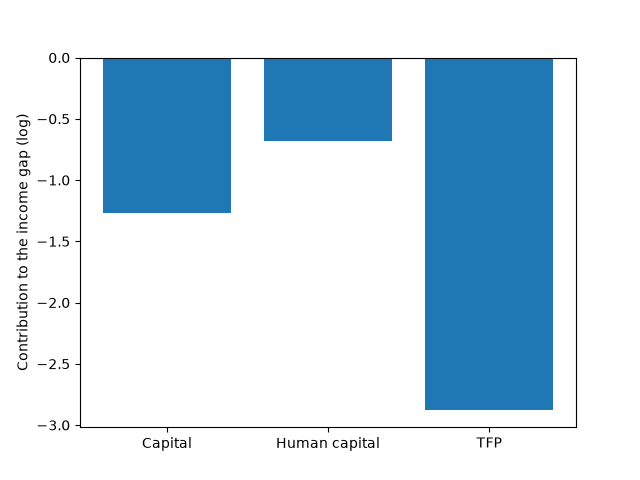
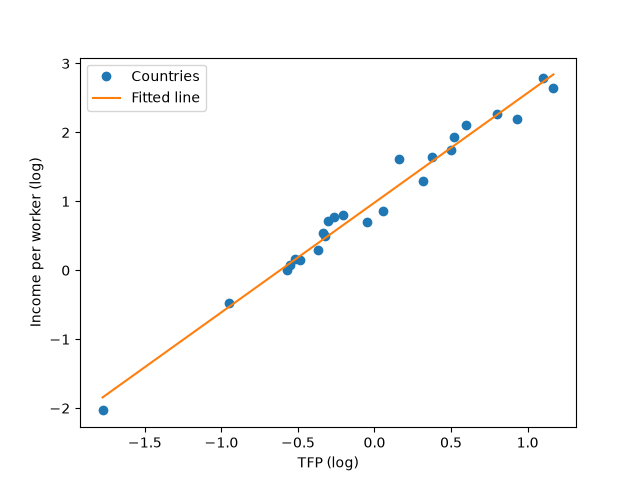

# 第 1 章: 発展会計

## 1.1 この章の地図

この章では、国によって所得が大きく違う理由を、生産関数から調べます。所得の差のうち、資本の差で説明できる部分と、説明できない部分（全要素生産性、TFP）を、関数とテストで求めます。

| 項目 | 内容 |
| :--- | :--- |
| 経済学の題材 | 発展会計: 生産関数 y = A·k^α·h^(1−α) と、所得の差の分解 |
| 使う Python の機能 | 関数、`pandas` の表（`DataFrame`）の列の計算、`numpy` の対数、テスト（`pytest`） |
| 新しく導入するライブラリ | なし（NumPy・pandas・Matplotlib は、[第 1 シリーズ](../economics-programming/index.md) で学習済み） |
| 完成形 | `tfp`、`load_countries`、`with_tfp`、`income_gap`、`variance_shares` |
| ファイル | 実装: `lib/chapter01/accounting.py`、`lib/chapter01/plot.py`（発展会計の図）／テスト: `test/chapter01/test_accounting.py`、`test/chapter01/test_plot.py`（自分で書くときは、`practice/chapter01/` に、同じ名前で作ります） |
| データ | `data/countries.csv`（**架空の 24 か国**。実在の統計ではありません） |

### 経済学の式とコードの対応

| 経済学 | 式 | コード |
| :--- | :--- | :--- |
| 生産関数 | y = A · k^α · h^(1−α) | （`tfp` が、この式を A について解く） |
| 全要素生産性 | A = y ÷ (k^α · h^(1−α)) | `tfp(output, capital, human_capital, alpha)` |
| 所得の差の分解 | ln(y ÷ y₀) = α·ln(k ÷ k₀) + (1−α)·ln(h ÷ h₀) + ln(A ÷ A₀) | `income_gap(df, reference, alpha)` |
| 所得の分散の分解 | Var(ln y) への、各項の共分散の割合 | `variance_shares(df, alpha)` |

> **記号について**: y は労働者 1 人当たりの所得、k は労働者 1 人当たりの物的資本、h は人的資本（労働者の技能の水準）、A は全要素生産性（TFP）、α は資本分配率です。一覧は、[記号について](how-to-read.md#symbols) を参照してください。

### 前提とする第 1 シリーズの章

この記事は、Python の基礎を繰り返しません。次ができれば、読み進められます。

| できること | 第 1 シリーズの章 |
| :--- | :--- |
| 関数と pytest のテストを書く（Red → Green → Refactor） | 第 1〜6 章 |
| NumPy の配列計算（`np.log` など） | 第 9 章 |
| pandas の表を読み込み、列を計算する | 第 11 章 |
| Matplotlib で図を描く | 第 7 章 |

## 1.2 準備

サンプルコードは、リポジトリの `apps/macro-programming/python/` にあります。uv のインストールは、[第 1 シリーズの第 1 章](../economics-programming/01-preparation-and-first-test.md) の 1.2 節にあります。インストール済みなら、次の 3 行で、準備ができます。

```bash
cd apps/macro-programming/python
uv sync
uv run pytest test/chapter01
```

```text
28 passed
```

自分でコードを書くときは、`practice/chapter01/` を作って、完成形と同じ名前（`accounting.py`・`test_accounting.py`）のファイルに書きます。テストは、`uv run pytest practice/chapter01` で実行します。完成形（`lib/` と `test/`）は、**答え合わせ用**です。先に、自分で書いてから、見比べてください。

## 1.3 予想する

生産関数 y = A · k^(1/3) · h^(2/3) の国が、2 つあります（α = 1/3）。

| | 所得 y | 物的資本 k | 人的資本 h |
| :--- | ---: | ---: | ---: |
| 国 A | 2 | 8 | 1 |
| 国 B | 0.5 | 1 | 1 |

- 国 A の TFP（A）は、いくつですか（8^(1/3) = 2 を使います）
- 国 B の TFP は、いくつですか
- 国 B の所得は、国 A の 4 分の 1 です。この差の、何割が資本の差で、何割が TFP の差ですか

## 1.4 発展会計の考え方

### 生産関数と TFP

労働者 1 人当たりの生産関数を、y = A · k^α · h^(1−α) とします。

- y: 労働者 1 人当たりの所得
- k: 労働者 1 人当たりの物的資本（機械・建物など）
- h: 人的資本（教育・経験による、労働者の技能の水準）
- A: 全要素生産性（TFP）。資本と人的資本が同じでも、どれだけ多くを生み出せるか（技術・制度・効率など）
- α: 資本分配率。所得のうち、資本に支払われる割合（ここでは 1/3 とします）

y・k・h は、データから分かります。A は、直接は測れません。**所得のうち、資本と人的資本では説明できない残り**として、求めます。これを、「残差」としての TFP と呼びます。

> **A は、測っているのではなく、残りです。** A には、技術だけでなく、制度・資源配分の効率・測定の誤差も含まれます。A が大きい、というのは、「資本と人的資本だけでは、所得の高さを説明できない」ということです。

### 所得の差を分ける

国 i と、基準の国（0）の、生産関数の対数をとります。

> ln y = ln A + α·ln k + (1−α)·ln h

2 つの国の差をとると、所得の差を、3 つの寄与に分けられます。

> ln(y ÷ y₀) = α·ln(k ÷ k₀) + (1−α)·ln(h ÷ h₀) + ln(A ÷ A₀)

右辺の第 1 項が資本、第 2 項が人的資本、第 3 項が TFP の寄与です。3 つの寄与の和が、所得の差（対数）に**ちょうど**等しくなります（式の変形だけで成り立つ恒等式です）。

### 世界全体の所得の差を分ける

1 つの国と基準の国の比較ではなく、「国による所得の差」全体を調べるには、対数の所得の**分散**を使います。ln y = α·ln k + (1−α)·ln h + ln A なので、両辺と ln y との共分散をとると、

> Var(ln y) = Cov(ln y, α·ln k) + Cov(ln y, (1−α)·ln h) + Cov(ln y, ln A)

両辺を Var(ln y) で割ると、3 つの割合の合計が 1 になります。各項の割合が、「その要因が、所得の差のどれだけを説明するか」です。

### この章のデータ

`data/countries.csv` は、**架空の 24 か国**の、労働者 1 人当たりの所得（y）、物的資本（k）、人的資本（h）です（単位は、架空のものです）。実在の国・年の統計ではありません。

| 項目 | 内容 |
| :--- | :--- |
| 列 | `country`（国名 C01〜C24）、`y`、`k`、`h` |
| 並び | 所得 y の高い順（C01 が最も豊か、C24 が最も貧しい） |
| 作り方 | 生産関数 y = A·k^(1/3)·h^(2/3) を、ちょうど満たすように作りました。「発展の度合い」が高い国ほど、k・h・A が、そろって高くなる設定です（種を固定した乱数で作成しました） |

実際の統計（Penn World Table）で試す手順は、第 1 部の終わり（第 7 章）にあります。

## 1.5 プログラミング

### Red: TFP のテスト

最初のテストは、手計算できる値にします。α = 1/3、k = 8 なら、k^(1/3) = 2 です。

```python
def test_TFPは所得を資本と人的資本の寄与で割った残差() -> None:
    # k^(1/3) = 2、h^(2/3) = 1 なので、y = 2 のとき、A = 2 ÷ 2 = 1
    assert tfp(output=2, capital=8, human_capital=1, alpha=ALPHA) == pytest.approx(1)
```

```python
def test_資本と人的資本が同じでも所得が2倍ならTFPも2倍() -> None:
    low = tfp(output=2, capital=8, human_capital=1, alpha=ALPHA)
    high = tfp(output=4, capital=8, human_capital=1, alpha=ALPHA)
    assert high == pytest.approx(2 * low)
```

```python
def test_資本分配率が0_5のとき() -> None:
    # y = 4、k = 4、h = 4 のとき、A = 4 ÷ (4^0.5 × 4^0.5) = 1
    assert tfp(output=4, capital=4, human_capital=4, alpha=0.5) == pytest.approx(1)
```

入力が経済学の意味を持たない場合（資本分配率が 0 以下や 1 以上、所得・資本・人的資本が 0 以下）も、テストで先に決めます。対数や累乗が、意味のない値を返す前に、エラーにします。

```python
@pytest.mark.parametrize("alpha", [0, 1, -0.1, 1.5])
def test_資本分配率は0より大きく1より小さくなければならない(alpha: float) -> None:
    with pytest.raises(ValueError, match="資本分配率"):
        tfp(output=2, capital=8, human_capital=1, alpha=alpha)


@pytest.mark.parametrize("name", ["output", "capital", "human_capital"])
def test_所得_資本_人的資本は正でなければならない(name: str) -> None:
    values = {"output": 2.0, "capital": 8.0, "human_capital": 1.0}
    values[name] = 0.0
    with pytest.raises(ValueError, match="正"):
        tfp(**values, alpha=ALPHA)
```

### Green: tfp を実装する

```python
def _check_alpha(alpha: float) -> None:
    if not 0 < alpha < 1:
        raise ValueError("資本分配率は 0 より大きく 1 より小さくなければならない")


def tfp(output: float, capital: float, human_capital: float, alpha: float) -> float:
    """TFP A = y ÷ (k^α · h^(1−α)) を返す。"""
    _check_alpha(alpha)
    if min(output, capital, human_capital) <= 0:
        raise ValueError("所得・資本・人的資本は正でなければならない")
    return float(output / (capital**alpha * human_capital ** (1 - alpha)))
```

### データを読み込む

テストは、一時ファイルに作った小さな CSV と、同梱のデータで書きます。

```python
def test_CSVを読むと国名が行の名前になる(tmp_path: Path) -> None:
    path = tmp_path / "countries.csv"
    path.write_text("country,y,k,h\nA,2.0,8.0,1.0\nB,0.5,1.0,1.0\n", encoding="utf-8")
    df = load_countries(path)
    assert list(df.index) == ["A", "B"]
    assert list(df.columns) == ["y", "k", "h"]
    assert df.loc["A", "k"] == 8.0


def test_同梱のデータは24か国で所得の高い順に並んでいる() -> None:
    df = load_countries()
    assert len(df) == 24
    assert df.index[0] == "C01"
    assert df["y"].is_monotonic_decreasing
```

```python
def load_countries(path: Path = DEFAULT_DATA_PATH) -> pd.DataFrame:
    """CSV を読み込み、国名を行の名前にした表（列は y・k・h）を返す。"""
    return pd.read_csv(path, index_col="country")
```

### TFP の列を足す

```python
def two_countries() -> pd.DataFrame:
    """基準の国（A = 1、k = 8、h = 1、y = 2）と、貧しい国（A = 0.5、k = 1、h = 1）。"""
    return pd.DataFrame(
        {"y": [2.0, 0.5], "k": [8.0, 1.0], "h": [1.0, 1.0]},
        index=pd.Index(["rich", "poor"], name="country"),
    )


def test_TFPの列を足しても元の表は変わらない() -> None:
    df = two_countries()
    result = with_tfp(df, ALPHA)
    assert result["tfp"].tolist() == pytest.approx([1.0, 0.5])
    assert "tfp" not in df.columns
```

`two_countries` は、予想する節の 2 つの国です。`DataFrame.assign` は、元の表を変えずに、列を足した新しい表を返します。

```python
def with_tfp(df: pd.DataFrame, alpha: float) -> pd.DataFrame:
    """TFP の列（tfp）を足した表を返す。元の表は変えない。"""
    _check_alpha(alpha)
    if (df[["y", "k", "h"]] <= 0).any().any():
        raise ValueError("所得・資本・人的資本は正でなければならない")
    return df.assign(tfp=df["y"] / (df["k"] ** alpha * df["h"] ** (1 - alpha)))
```

### 所得の差を 3 つに分ける

```python
def test_基準の国との所得の差を3つの寄与に分ける() -> None:
    gap = income_gap(two_countries(), reference="rich", alpha=ALPHA)
    # 所得の差 ln(0.5 ÷ 2) = ln(1 ÷ 4)。資本 (1/3)·ln(1 ÷ 8)、人的資本 0、TFP ln(0.5)
    assert gap.loc["poor", "total"] == pytest.approx(np.log(0.25))
    assert gap.loc["poor", "capital"] == pytest.approx(np.log(1 / 8) / 3)
    assert gap.loc["poor", "human_capital"] == pytest.approx(0)
    assert gap.loc["poor", "tfp"] == pytest.approx(np.log(0.5))


def test_所得の差の半分は資本で半分はTFP() -> None:
    gap = income_gap(two_countries(), reference="rich", alpha=ALPHA)
    row = gap.loc["poor"]
    assert row["capital"] / row["total"] == pytest.approx(0.5)
    assert row["tfp"] / row["total"] == pytest.approx(0.5)


def test_3つの寄与の和は所得の差と等しい() -> None:
    gap = income_gap(load_countries(), reference="C01", alpha=ALPHA)
    parts = gap["capital"] + gap["human_capital"] + gap["tfp"]
    assert parts.to_numpy() == pytest.approx(gap["total"].to_numpy())
```

3 つ目のテストは、手計算の値ではなく、**恒等式**を確かめています。全 24 か国で、3 つの寄与の和が、所得の差と一致します。

```python
def income_gap(df: pd.DataFrame, reference: str, alpha: float) -> pd.DataFrame:
    """基準の国との所得の差（対数の差）を、資本・人的資本・TFP の寄与に分ける。

    ln(y ÷ y₀) = α·ln(k ÷ k₀) + (1−α)·ln(h ÷ h₀) + ln(A ÷ A₀)。
    列は capital・human_capital・tfp・total（total は、3 つの寄与の和）。
    """
    table = with_tfp(df, alpha)
    if reference not in table.index:
        raise ValueError(f"基準の国 {reference} が、データにない")
    logs = table[["y", "k", "h", "tfp"]].apply(np.log)
    diff = logs - logs.loc[reference]
    return pd.DataFrame(
        {
            "capital": alpha * diff["k"],
            "human_capital": (1 - alpha) * diff["h"],
            "tfp": diff["tfp"],
            "total": diff["y"],
        }
    )
```

### 分散で、世界全体の差を分ける

```python
def test_分散の割合は3つで合計1() -> None:
    shares = variance_shares(load_countries(), alpha=ALPHA)
    assert shares.sum() == pytest.approx(1)
    assert list(shares.index) == ["capital", "human_capital", "tfp"]


def test_所得の差がすべてTFPの差ならTFPの割合は1() -> None:
    a = np.array([0.5, 1.0, 2.0, 4.0])
    df = pd.DataFrame(
        {"y": a * 2.0, "k": [8.0] * 4, "h": [1.0] * 4},
        index=pd.Index(list("wxyz"), name="country"),
    )
    shares = variance_shares(df, alpha=ALPHA)
    assert shares["tfp"] == pytest.approx(1)
    assert shares["capital"] == pytest.approx(0)


def test_所得に差がなければ分散の割合は求められない() -> None:
    df = pd.DataFrame(
        {"y": [2.0, 2.0], "k": [8.0, 1.0], "h": [1.0, 1.0]},
        index=pd.Index(["a", "b"], name="country"),
    )
    with pytest.raises(ValueError, match="差"):
        variance_shares(df, alpha=ALPHA)
```

```python
def variance_shares(df: pd.DataFrame, alpha: float) -> pd.Series:
    """所得（対数）の分散のうち、資本・人的資本・TFP が説明する割合を返す。

    ln y = α·ln k + (1−α)·ln h + ln A なので、割合 = Cov(ln y, 各項) ÷ Var(ln y)。
    3 つの割合の合計は 1 になる。
    """
    table = with_tfp(df, alpha)
    log_output = np.log(table["y"])
    variance = log_output.var()
    if np.isclose(variance, 0):
        raise ValueError("国による所得の差がないので、分散の割合は求められない")
    parts = {
        "capital": alpha * np.log(table["k"]),
        "human_capital": (1 - alpha) * np.log(table["h"]),
        "tfp": np.log(table["tfp"]),
    }
    return pd.Series(
        {name: log_output.cov(part) / variance for name, part in parts.items()}
    )
```

### 予想の答え合わせ

予想した答えを、プログラムで確かめます。資本の寄与は、資本の差の対数に α を掛けたものです。

```python
import math

from lib.chapter01.accounting import tfp

alpha = 1 / 3
a = tfp(output=2, capital=8, human_capital=1, alpha=alpha)
b = tfp(output=0.5, capital=1, human_capital=1, alpha=alpha)
gap = math.log(0.5 / 2)
capital_part = alpha * math.log(1 / 8)
tfp_part = math.log(b / a)
print("国 A の TFP:", round(a, 4))
print("国 B の TFP:", round(b, 4))
print("所得の差（対数）:", round(gap, 4))
print("資本の差の寄与の割合:", round(capital_part / gap, 4))
print("TFP の差の寄与の割合:", round(tfp_part / gap, 4))
```

```text
国 A の TFP: 1.0
国 B の TFP: 0.5
所得の差（対数）: -1.3863
資本の差の寄与の割合: 0.5
TFP の差の寄与の割合: 0.5
```

- 1 つ目の問い（国 A の TFP）: 1.0 です
- 2 つ目の問い（国 B の TFP）: 0.5 です
- 3 つ目の問い（差の内訳）: 所得の差は、対数で −1.3863（= ln(1 ÷ 4)）です。資本の差の寄与は (1/3)·ln(1 ÷ 8) = ln(1 ÷ 2)、TFP の差の寄与は ln(0.5) で、どちらも 0.5 の割合です。**半分ずつ**です（ln(1 ÷ 2) の 2 倍が ln(1 ÷ 4) です）

### 結果

最も貧しい国（C24）を、最も豊かな国（C01）と比べます。

```python
from lib.chapter01.accounting import income_gap, load_countries, variance_shares

df = load_countries()
gap = income_gap(df, reference="C01", alpha=1 / 3)
gap.loc["C24"]
```

| 項目 | 値（対数の差） | 所得の差に占める割合 |
| :--- | ---: | ---: |
| 物的資本（capital） | −1.266 | 26.3% |
| 人的資本（human_capital） | −0.678 | 14.1% |
| TFP（tfp） | −2.874 | 59.6% |
| 所得の差（total） | −4.818 | 100% |

C24 の所得は、C01 の約 124 分の 1（e^−4.818 ≈ 0.008）です。この差の約 6 割が、TFP の差です。



図の読み方:

- 3 本の棒の高さの和が、所得の差（−4.818）です（棒は、基準の国との差なので、すべて負です）
- 一番長い棒が TFP です。資本と人的資本を合わせても、TFP の寄与（−2.874）には届きません（−1.944）

24 か国全体では、次のとおりです。

```python
variance_shares(df, alpha=1 / 3)
```

| 要因 | 所得の分散を説明する割合 |
| :--- | ---: |
| 物的資本 | 25.7% |
| 人的資本 | 12.8% |
| TFP | 61.5% |
| 合計 | 100% |



図の読み方:

- 横軸が対数の TFP、縦軸が対数の所得です。点は国です
- TFP が高い国ほど、所得が高い、強い右上がりの関係です。これが、TFP の割合が大きい（61.5%）ことの、見た目です
- この図は、`lib/chapter01/plot.py` の `plot_income_and_tfp` と `plot_gap_decomposition` が描きます。図の座標は、テストで確かめています

> **これは、架空のデータの結果です。** 実際の国のデータで、同じ計算をした結果は、第 7 章の「実際の統計で試す」で確かめます。TFP の割合は、α の値や、人的資本・資本の測り方で変わります（練習問題の「多様」）。

### 実行結果

```bash
cd apps/macro-programming/python
uv run pytest test/chapter01
```

```text
28 passed
```

## 1.6 規則で言うと

1. **直接測れない量は、残りとして求める。** TFP は、所得から、資本と人的資本の寄与を引いた残り。測れないものを、測れるものとの差で表す
2. **対数をとると、掛け算が足し算になる。** y = A·k^α·h^(1−α) の対数は足し算なので、所得の差を、要因ごとの寄与に分けられる
3. **要因の分解は、恒等式で確かめる。** 3 つの寄与の和が、所得の差に等しいことを、全データでテストする。手計算できる例と、恒等式の、両方で確かめる

混同しやすい点を、表にまとめます。

| 混同しやすい点 | 違い |
| :--- | :--- |
| TFP が大きい国 と 所得が高い国 | TFP は、資本と人的資本を除いた「残り」。所得が高くても、資本が多いだけなら、TFP は低いことがある |
| 資本の寄与の割合 と 資本分配率 α | α は、生産関数の係数（所得のうち、資本に支払われる割合）。寄与の割合は、α·ln(k ÷ k₀) を所得の差で割った、データから求まる値 |
| 1 つの国の比較 と 全体の分散の分解 | `income_gap` は、基準の国との比較（国によって割合が違う）。`variance_shares` は、24 か国全体の差を、1 組の割合で表す |

### このモデルが成り立たない場面

- **TFP は、「測定されなかったもの」の集まりです。** 技術の差だけでなく、制度・資源配分・測定の誤差も含みます。TFP の差を、「技術の差」と読むのは、言いすぎです
- **資本分配率 α は、仮定です。** 実際の国で、α = 1/3 が成り立つとは限りません。α を変えると、結果が変わります（練習問題の「多様」）
- **生産関数の形（コブ・ダグラス型）は、仮定です。** 資本と人的資本が、同じ割合で代替できる、という前提です
- **人的資本 h の測り方で、結果が変わります。** この章の h は、教育年数などから作った指数を、そのまま与えたものです。h の差が小さいと、人的資本の寄与は、小さくなります

## 1.7 練習問題

| 種類 | 問題 |
| :--- | :--- |
| 想起 | 本文を閉じて、`tfp` の最初のテスト（α = 1/3、k = 8、h = 1、y = 2 のとき、TFP = 1）を書いてください |
| 生成 | 解説を見る前に、各国の所得の差のうち、TFP が説明する割合（TFP の寄与 ÷ 所得の差）を返す `tfp_share_of_gap(df, reference, alpha)` を、テストから書いてください。基準の国自身の値は、どうなりますか |
| 多様 | 資本分配率 α を 1/3 から 0.4、0.5 に変えて、`variance_shares` の TFP の割合が、どう変わるかを確かめてください。変わる方向を、先に予想してください |
| 交互 | [第 1 シリーズ](../economics-programming/index.md)の第 11 章の pandas の使い方で、所得の高い上位 12 か国と、下位 12 か国に分け、所得の平均の比と、TFP の平均の比を求めてください |

??? note "解答（先に自分で取り組んでから、開いてください）"

    **想起**:

    ```python
    def test_TFPは所得を資本と人的資本の寄与で割った残差() -> None:
        assert tfp(output=2, capital=8, human_capital=1, alpha=1 / 3) == pytest.approx(1)
    ```

    **生成**: TFP の寄与を、所得の差で割ります。基準の国は、どちらも 0 なので、0 ÷ 0 で、値がない（NaN）になります。

    ```python
    def tfp_share_of_gap(df, reference, alpha):
        gap = income_gap(df, reference, alpha)
        return gap["tfp"] / gap["total"]
    ```

    ```python
    def test_貧しい国の所得の差の半分はTFP() -> None:
        df = pd.DataFrame(
            {"y": [2.0, 0.5], "k": [8.0, 1.0], "h": [1.0, 1.0]},
            index=pd.Index(["rich", "poor"], name="country"),
        )
        shares = tfp_share_of_gap(df, "rich", 1 / 3)
        assert shares["poor"] == pytest.approx(0.5)
        assert np.isnan(shares["rich"])
    ```

    **多様**: α を大きくすると、資本の寄与（α·ln k）が大きくなり、残りの TFP の割合は、**小さくなる**と予想できます。

    ```python
    def test_資本分配率が大きいほどTFPの割合は小さい() -> None:
        df = load_countries()
        shares = [variance_shares(df, alpha)["tfp"] for alpha in (1 / 3, 0.4, 0.5)]
        assert shares == sorted(shares, reverse=True)
        assert shares == pytest.approx([0.615, 0.577, 0.519], abs=0.001)
    ```

    α = 1/3 で 61.5%、0.4 で 57.7%、0.5 で 51.9% です。それでも、半分前後が TFP で説明される、という結論は変わりません。

    **交互**:

    ```python
    def test_上位12か国と下位12か国のTFPの比() -> None:
        table = with_tfp(load_countries(), 1 / 3)
        top, bottom = table.iloc[:12], table.iloc[12:]
        assert top["y"].mean() / bottom["y"].mean() == pytest.approx(5.49, abs=0.01)
        assert top["tfp"].mean() / bottom["tfp"].mean() == pytest.approx(2.94, abs=0.01)
    ```

    所得の平均は、上位が下位の約 5.5 倍で、TFP の平均は約 2.9 倍です。資本の平均は約 3.4 倍、人的資本は約 1.4 倍です（平均の比は、寄与そのものではなく、目安です）。

## 1.8 振り返り

- 予想した「半分ずつ」は、当たりましたか。3 つの寄与の和が、所得の差に等しいことを、式で説明できますか
- TFP を「残り」として求めることの、利点と、注意点は何ですか
- α を変えると、結論はどれくらい変わりましたか

## 1.9 まとめ

- 生産関数 y = A·k^α·h^(1−α) から、TFP を「残り」として求める関数を、テストから書いた
- 国による所得の差を、対数をとって、資本・人的資本・TFP の寄与に分けた。3 つの寄与の和が、所得の差に等しいことを、恒等式のテストで確かめた
- 所得の分散を、共分散で 3 つの要因に分けた（架空のデータでは、TFP が約 6 割）
- 次の章では、所得の「水準」ではなく、「成長率」を、同じ要因に分けます（成長会計）
