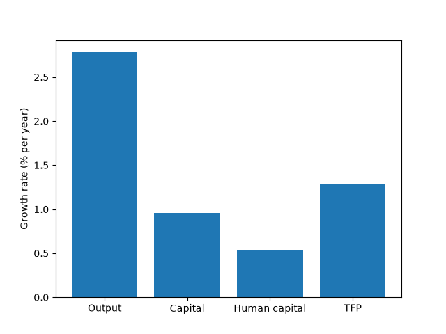
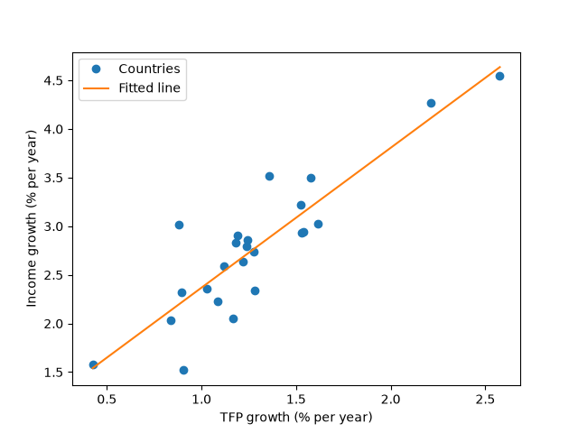

# 第 2 章: 成長会計

## 2.1 この章の地図

第 1 章の発展会計は、所得の「水準」の差を分けました。この章では、所得の「成長率」を、同じ 3 つの要因に分けます（成長会計）。国によって成長の速さが違う理由を、資本の蓄積と、TFP の伸びに分けて調べます。

| 項目 | 内容 |
| :--- | :--- |
| 経済学の題材 | 成長会計: g_y = g_A + α·g_k + (1−α)·g_h |
| 使う Python の機能 | 年を含む行の名前（`MultiIndex`）、`DataFrame.xs`、`np.log`、列の割り算 |
| 新しく導入するライブラリ | なし |
| 完成形 | `load_panel`、`log_growth_rate`、`growth_contribution`、`contribution_shares` |
| ファイル | 実装: `lib/chapter02/growth.py`、`lib/chapter02/plot.py`（成長会計の図）／テスト: `test/chapter02/test_growth.py`、`test/chapter02/test_plot.py`（自分で書くときは、`practice/chapter02/` に、同じ名前で作ります） |
| データ | `data/panel.csv`（**架空の 24 か国**の、1990〜2019 年の年次パネル。実在の統計ではありません） |

### 経済学の式とコードの対応

| 経済学 | 式 | コード |
| :--- | :--- | :--- |
| 成長率 | g = 100 × (ln x_T − ln x_0) ÷ T（% / 年） | `log_growth_rate(start_value, end_value, years)` |
| 成長会計の式 | g_y = g_A + α·g_k + (1−α)·g_h | `growth_contribution(panel, start, end, alpha)` |
| 寄与の割合 | 各寄与 ÷ g_y | `contribution_shares(table)` |

> **記号について**: g は成長率（% / 年）です。y・k・h・A・α は、第 1 章と同じ意味です。一覧は、[記号について](how-to-read.md#symbols) を参照してください。

## 2.2 予想する

生産関数 y = A · k^(1/3) · h^(2/3) の国で、10 年間、1 年当たり、物的資本が 6%、人的資本が 3%、TFP が 1% 伸びました（対数の成長率）。

- 所得は、1 年当たり何 % 伸びましたか
- 所得の成長率のうち、資本・人的資本・TFP は、それぞれ何 % 分ですか

答えは、資本が (1/3) × 6 = 2%、人的資本が (2/3) × 3 = 2%、TFP が 1% で、合計 5% です。TFP の寄与は、5 分の 1（20%）です。

## 2.3 成長会計の考え方

### 成長率を足し算にする

第 1 章の生産関数 ln y = ln A + α·ln k + (1−α)·ln h を、時間で差をとると、

> ln y_T − ln y_0 = (ln A_T − ln A_0) + α·(ln k_T − ln k_0) + (1−α)·(ln h_T − ln h_0)

両辺を年数 T で割って、100 を掛けると、成長率（%）の式になります。

> g_y = g_A + α·g_k + (1−α)·g_h

第 1 章と同じく、右辺の 3 つの寄与の和が、所得の成長率に**ちょうど**等しくなります。TFP の成長率 g_A は、所得の成長率から、資本と人的資本の寄与を引いた残りです。

> **対数の成長率と、ふつうの成長率は、少し違います。** 所得が 2 倍になる 10 年間の、1 年当たりの対数の成長率は、100 × ln 2 ÷ 10 ≈ 6.93% です（複利の年率 7.18% とは違います）。対数の成長率は、足し算で分けられるので、成長会計に向いています。

### この章のデータ

`data/panel.csv` は、第 1 章の 24 か国の、1990〜2019 年の年次データです。**2019 年の値は、第 1 章の `countries.csv` と同じ**です。それ以前は、国ごとの成長率で遡って作りました。

| 項目 | 内容 |
| :--- | :--- |
| 列 | `country`、`year`、`y`、`k`、`h`（行は 24 か国 × 30 年 = 720 行） |
| 作り方 | 「発展の度合い」が低い国ほど、資本・人的資本・TFP の成長が速くなる設定です（貧しい国が、追いつく様子）。年ごとの小さなゆらぎを足しています |

## 2.4 Red → Green → Refactor

### 成長率を求める

```python
def test_2倍になる系列の10年間の成長率は年6_93パーセント() -> None:
    assert log_growth_rate(1, 2, 10) == pytest.approx(100 * np.log(2) / 10)


def test_毎年の対数の成長率が5パーセントなら成長率は5() -> None:
    assert log_growth_rate(1, np.exp(0.5), 10) == pytest.approx(5)


def test_成長率は負にもなる() -> None:
    assert log_growth_rate(2, 1, 10) < 0
```

値が 0 以下では、対数がとれません。年数が 0 以下でも、意味がありません。これもテストで決めます。

```python
@pytest.mark.parametrize(
    ("start", "end", "years"), [(0, 1, 10), (1, 0, 10), (-1, 1, 10), (1, 2, 0)]
)
def test_値は正で年数も正でなければならない(
    start: float, end: float, years: float
) -> None:
    with pytest.raises(ValueError):
        log_growth_rate(start, end, years)
```

```python
def log_growth_rate(start_value: float, end_value: float, years: float) -> float:
    """1 年当たりの成長率（%）= 100 × (ln 終わり − ln 始まり) ÷ 年数。"""
    if min(start_value, end_value) <= 0:
        raise ValueError("値は正でなければならない")
    if years <= 0:
        raise ValueError("年数は正でなければならない")
    return float(100 * np.log(end_value / start_value) / years)
```

### パネルを読み込む

```python
def test_CSVを読むと国と年が行の名前になる(tmp_path: Path) -> None:
    path = tmp_path / "panel.csv"
    path.write_text(
        "country,year,y,k,h\nA,2000,2.0,8.0,1.0\nA,2001,2.1,8.5,1.0\n",
        encoding="utf-8",
    )
    df = load_panel(path)
    assert list(df.index.names) == ["country", "year"]
    assert df.loc[("A", 2001), "k"] == 8.5


def test_同梱のパネルは24か国の1990年から2019年まで() -> None:
    df = load_panel()
    assert len(df) == 24 * 30
    assert df.index.get_level_values("year").min() == 1990
    assert df.index.get_level_values("year").max() == 2019


def test_2019年の値は第1章のデータと同じ() -> None:
    latest = load_panel().xs(2019, level="year")
    countries = load_countries()
    assert latest.loc[countries.index].to_numpy() == pytest.approx(countries.to_numpy())
```

行の名前が、国と年の 2 段（`MultiIndex`）になります。`DataFrame.xs` で、ある年だけを取り出せます。

```python
def load_panel(path: Path = DEFAULT_DATA_PATH) -> pd.DataFrame:
    """CSV を読み込み、国と年を行の名前にした表（列は y・k・h）を返す。"""
    return pd.read_csv(path, index_col=["country", "year"])
```

### 成長率を 3 つの寄与に分ける

手計算できる例を作ります。10 年間、A が 1%、k が 6%、h が 3% 伸びる国です（予想する節）。

```python
def example_panel() -> pd.DataFrame:
    """2000〜2010 年。1 年当たりの対数の成長率は、A が 1%、k が 6%、h が 3%。"""
    rows = []
    for year in range(2000, 2011):
        t = year - 2000
        a = np.exp(0.01 * t)
        k = 8 * np.exp(0.06 * t)
        h = np.exp(0.03 * t)
        rows.append(("X", year, a * k ** (1 / 3) * h ** (2 / 3), k, h))
    df = pd.DataFrame(rows, columns=["country", "year", "y", "k", "h"])
    return df.set_index(["country", "year"])
```

```python
def test_成長率を資本_人的資本_TFPの寄与に分ける() -> None:
    table = growth_contribution(example_panel(), 2000, 2010, ALPHA)
    row = table.loc["X"]
    # g_y = 1 + (1/3)·6 + (2/3)·3 = 1 + 2 + 2 = 5
    assert row["output"] == pytest.approx(5)
    assert row["capital"] == pytest.approx(2)
    assert row["human_capital"] == pytest.approx(2)
    assert row["tfp"] == pytest.approx(1)


def test_3つの寄与の和は所得の成長率と等しい() -> None:
    table = growth_contribution(load_panel(), 1990, 2019, ALPHA)
    parts = table["capital"] + table["human_capital"] + table["tfp"]
    assert parts.to_numpy() == pytest.approx(table["output"].to_numpy())


def test_列は所得_資本_人的資本_TFPの順() -> None:
    table = growth_contribution(example_panel(), 2000, 2010, ALPHA)
    assert list(table.columns) == ["output", "capital", "human_capital", "tfp"]
```

期間や年が、おかしいときは、エラーにします。

```python
def test_期間の始まりは終わりより前でなければならない() -> None:
    with pytest.raises(ValueError, match="期間"):
        growth_contribution(example_panel(), 2010, 2000, ALPHA)


def test_パネルにない年は受け付けない() -> None:
    with pytest.raises(ValueError, match="年"):
        growth_contribution(example_panel(), 1990, 2010, ALPHA)
```

```python
def growth_contribution(
    panel: pd.DataFrame, start: int, end: int, alpha: float
) -> pd.DataFrame:
    """start 年から end 年までの平均の成長率を、資本・人的資本・TFP の寄与に分ける。

    列は output・capital・human_capital・tfp（% / 年）。
    3 つの寄与の和が、output（所得の成長率）に等しい。
    """
    if start >= end:
        raise ValueError("期間の始まりは終わりより前でなければならない")
    available = set(panel.index.get_level_values("year"))
    for year in (start, end):
        if year not in available:
            raise ValueError(f"パネルに {year} 年がない")
    first = with_tfp(pd.DataFrame(panel.xs(start, level="year")), alpha)
    last = with_tfp(pd.DataFrame(panel.xs(end, level="year")), alpha)
    growth = 100 * (last / first).apply(np.log) / (end - start)
    return pd.DataFrame(
        {
            "output": growth["y"],
            "capital": alpha * growth["k"],
            "human_capital": (1 - alpha) * growth["h"],
            "tfp": growth["tfp"],
        }
    )
```

第 1 章の `with_tfp` を使って、各年の TFP を求め、始まりの年と終わりの年の比の対数から、成長率を求めています。

### 寄与の割合

```python
def test_TFPの寄与の割合は5分の1() -> None:
    table = growth_contribution(example_panel(), 2000, 2010, ALPHA)
    shares = contribution_shares(table)
    assert shares.loc["X", "tfp"] == pytest.approx(0.2)
    assert shares.loc["X", "capital"] == pytest.approx(0.4)


def test_寄与の割合の合計は1() -> None:
    table = growth_contribution(load_panel(), 1990, 2019, ALPHA)
    shares = contribution_shares(table)
    assert shares.sum(axis=1).to_numpy() == pytest.approx(1)


def test_成長率が0の国があれば割合は求められない() -> None:
    table = pd.DataFrame(
        {"output": [0.0], "capital": [0.0], "human_capital": [0.0], "tfp": [0.0]},
        index=["Z"],
    )
    with pytest.raises(ValueError, match="0"):
        contribution_shares(table)
```

```python
def contribution_shares(table: pd.DataFrame) -> pd.DataFrame:
    """各寄与が、所得の成長率に占める割合を返す。3 つの割合の合計は 1。"""
    if (table["output"] == 0).any():
        raise ValueError("成長率が 0 の国があるので、割合は求められない")
    return table[["capital", "human_capital", "tfp"]].div(table["output"], axis=0)
```

### 結果

1990 年から 2019 年までの、国ごとの寄与を求めます。

```python
from lib.chapter02.growth import contribution_shares, growth_contribution, load_panel

table = growth_contribution(load_panel(), start=1990, end=2019, alpha=1 / 3)
table.loc[["C01", "C12", "C24"]]
```

| 国 | 所得 | 資本 | 人的資本 | TFP |
| :--- | ---: | ---: | ---: | ---: |
| C01（最も豊か） | 1.52 | 0.08 | 0.54 | 0.90 |
| C12 | 3.22 | 1.19 | 0.50 | 1.52 |
| C24（最も貧しい） | 4.55 | 1.33 | 0.65 | 2.58 |

（単位は、% / 年）貧しい国ほど、成長が速く、TFP の伸びが大きいことが分かります。24 か国の平均は、次のとおりです。

| 所得 | 資本 | 人的資本 | TFP |
| ---: | ---: | ---: | ---: |
| 2.78 | 0.96 | 0.54 | 1.29 |

平均の成長率 2.78% のうち、TFP が 1.29%（約 46%）、資本が 0.96%（約 34%）、人的資本が 0.54%（約 19%）です。



図の読み方:

- 一番左の棒が、所得の成長率（2.78%）です。右の 3 本（資本・人的資本・TFP）の高さを足すと、一番左の高さになります
- TFP の棒が、一番高い。成長の約半分は、資本の蓄積では説明できません



図の読み方:

- 横軸が TFP の成長率、縦軸が所得の成長率です。点は国です。TFP が速く伸びる国ほど、所得も速く伸びます（相関係数 0.89）
- 成長の速さの国による違いも、TFP の伸びの違いが、大きく関わっています

> **これは、架空のデータの結果です。** 実際の統計で試す手順は、第 7 章にあります。

### 実行結果

```bash
cd apps/macro-programming/python
uv run pytest test/chapter02
```

```text
25 passed
```

## 2.5 規則で言うと

1. **成長率も、対数の差で足し算にできる。** 対数をとって時間で差をとれば、成長を、要因ごとに分けられる
2. **「平均の寄与」と「国ごとの寄与」を、区別する。** 24 か国の平均の TFP の割合（46%）と、国ごとの割合は、違う。国ごとの割合は、成長率が小さい国で、不安定になる
3. **水準の分解と、成長の分解は、別の問い。** 第 1 章は「所得の差」を、この章は「成長の速さ」を、分けた

混同しやすい点を、表にまとめます。

| 混同しやすい点 | 違い |
| :--- | :--- |
| 対数の成長率 と ふつうの成長率 | 対数の成長率は、足し算で分けられる。ふつうの成長率（複利の年率）とは、少し違う（2 倍で、6.93% と 7.18%） |
| TFP の成長率 と 技術進歩率 | TFP の成長率は、所得の成長率から、資本と人的資本の寄与を引いた「残り」。技術以外も含む |
| 第 1 章の「TFP の割合 61.5%」 と この章の「46%」 | 第 1 章は、所得の水準の分散。この章は、成長率の平均。同じ「TFP の割合」でも、測っているものが違う |

### このモデルが成り立たない場面

- **TFP の成長率は、「残り」です。** 資本や人的資本の測定の誤差は、TFP に入ります。TFP が伸びた、と言っても、技術が進んだとは限りません
- **資本分配率 α が、国と時代によらず一定、という仮定です。** α を変えると、結果が変わります（練習問題の「多様」）
- **始まりの年と終わりの年だけで、平均の成長率を求めています。** 途中の景気の変動は、見えません。また、始まりの年が景気の山か谷かで、結果が変わります
- **資本の成長は、TFP の成長の「結果」でもありえます。** 技術が進むと、投資が増えて、資本が増える、という関係です。成長会計は、因果ではなく、会計（分解）です

## 2.6 練習問題

| 種類 | 問題 |
| :--- | :--- |
| 想起 | 本文を閉じて、`log_growth_rate` の最初のテスト（10 年で 2 倍になる系列の、年の成長率）を書いてください |
| 生成 | 解説を見る前に、24 か国の**平均**の寄与（所得・資本・人的資本・TFP の平均）から、各寄与の割合を求める `mean_contribution_shares(table)` を、テストから書いてください。本文の 46%（TFP）を確かめます |
| 多様 | 資本分配率 α を 0.3、0.4、0.5 に変えて、平均の TFP の寄与の割合が、どう変わるかを、先に予想してから確かめてください |
| 交互 | 第 1 章の `variance_shares`（2019 年の水準の差の、TFP の割合）と、この章の平均の割合を、同じ α = 1/3 で並べて、なぜ値が違うかを説明してください |

??? note "解答（先に自分で取り組んでから、開いてください）"

    **想起**:

    ```python
    def test_2倍になる系列の10年間の成長率は年6_93パーセント() -> None:
        assert log_growth_rate(1, 2, 10) == pytest.approx(100 * np.log(2) / 10)
    ```

    **生成**: 国ごとの割合ではなく、まず平均を求めてから、割ります。

    ```python
    def mean_contribution_shares(table):
        means = table.mean()
        return means[["capital", "human_capital", "tfp"]] / means["output"]
    ```

    ```python
    def test_平均の寄与の割合() -> None:
        table = pd.DataFrame(
            {
                "output": [5.0, 5.0],
                "capital": [2.0, 1.0],
                "human_capital": [2.0, 2.0],
                "tfp": [1.0, 2.0],
            }
        )
        shares = mean_contribution_shares(table)
        assert shares["tfp"] == pytest.approx(0.3)
        assert shares.sum() == pytest.approx(1)


    def test_同梱のデータではTFPが成長の46パーセント() -> None:
        table = growth_contribution(load_panel(), 1990, 2019, 1 / 3)
        assert mean_contribution_shares(table)["tfp"] == pytest.approx(0.463, abs=0.001)
    ```

    **多様**: α を大きくすると、資本の寄与（α·g_k）が大きくなって、残りの TFP は小さくなる、と予想できます。

    ```python
    def test_資本分配率が大きいほどTFPの割合は小さい() -> None:
        panel = load_panel()
        shares = [
            mean_contribution_shares(growth_contribution(panel, 1990, 2019, alpha))["tfp"]
            for alpha in (0.3, 0.4, 0.5)
        ]
        assert shares == sorted(shares, reverse=True)
        assert shares == pytest.approx([0.488, 0.413, 0.339], abs=0.001)
    ```

    α = 0.3 で 48.8%、0.4 で 41.3%、0.5 で 33.9% です。第 1 章の水準の分解と同じく、α を大きくすると、TFP の割合は小さくなります。ただし、成長の分解のほうが、α への感度が大きいことが分かります（0.3 から 0.5 で、約 15 ポイント下がります）。

    **交互**:

    ```python
    def test_水準の分解と成長の分解のTFPの割合() -> None:
        level = variance_shares(load_countries(), 1 / 3)["tfp"]
        table = growth_contribution(load_panel(), 1990, 2019, 1 / 3)
        growth = mean_contribution_shares(table)["tfp"]
        assert level == pytest.approx(0.615, abs=0.001)
        assert growth == pytest.approx(0.463, abs=0.001)
        assert level > growth
    ```

    水準の差（61.5%）のほうが大きい理由として、水準は**長い間の成長の積み重ね**で、TFP の水準の差には、1990 年より前の差も含まれることが考えられます。また、第 1 章は国による「ばらつき（分散）」を、この章は成長率の「平均」を分けていて、測っているものが違います。

## 2.7 振り返り

- 予想した 5 分の 1 は、当たりましたか。TFP の成長率を、「技術進歩率」と読むときの、注意点は何ですか
- 第 1 章の水準の分解と、この章の成長の分解で、TFP の割合の大きさが違ったのは、なぜですか
- α を変えたとき、結論はどれくらい変わりましたか

## 2.8 まとめ

- 成長率を、対数の差で、資本・人的資本・TFP の寄与に分ける関数を、テストから書いた
- 3 つの寄与の和が、所得の成長率に等しいことを、全データで確かめた（架空のデータでは、TFP が成長の約 46%）
- 次の章では、ここまでの分解を、回帰分析で言い換えます。最小二乗法を、行列で書いて、statsmodels と照合します
