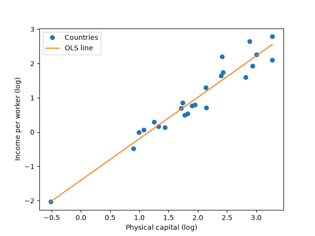

# 第 3 章: 回帰分析

## 3.1 この章の地図

この章では、回帰分析（最小二乗法）を、行列で書いて、関数にします。係数・標準誤差・決定係数を、自分で求めて、statsmodels の結果と照合します。そして、第 1 章の発展会計を、回帰で言い換えて、結果が、なぜ生産関数の係数とずれるのかを調べます。

| 項目 | 内容 |
| :--- | :--- |
| 経済学の題材 | 回帰による発展会計: ln y = c + a·ln k + b·ln h + 誤差 |
| 使う Python の機能 | 行列の積（`@`）、`np.linalg.solve`・`inv`・`matrix_rank`、`dataclass`（`frozen`）、`pytest.approx` |
| 新しく導入するライブラリ | [statsmodels](https://www.statsmodels.org/)（回帰の結果を照合する） |
| 完成形 | `fit_ols`、`OlsResult`、`development_accounting_regression` |
| ファイル | 実装: `lib/chapter03/regression.py`、`lib/chapter03/plot.py`（回帰の図）／テスト: `test/chapter03/test_regression.py`、`test/chapter03/test_plot.py`（自分で書くときは、`practice/chapter03/` に、同じ名前で作ります） |
| データ | 第 1 章の `data/countries.csv`（架空の 24 か国） |

### 経済学の式とコードの対応

| 統計学 | 式 | コード |
| :--- | :--- | :--- |
| 回帰モデル | y = X·β + 誤差 | `fit_ols(y, x)` |
| 係数（正規方程式） | β̂ = (X'X)⁻¹ X'y | `OlsResult.coefficients` |
| 標準誤差 | √(σ̂²·(X'X)⁻¹ の対角)、σ̂² = 残差の二乗和 ÷ (n − k) | `OlsResult.standard_errors` |
| 決定係数 | R² = 1 − 残差の二乗和 ÷ y の変動の二乗和 | `OlsResult.r_squared` |
| t 値 | 係数 ÷ 標準誤差 | `OlsResult.t_values()` |
| 発展会計の回帰 | ln y = c + a·ln k + b·ln h + 誤差 | `development_accounting_regression(df)` |

> **記号について**: この章の y は、回帰の「被説明変数」（対数の所得）で、X は説明変数の行列、β は係数、n は観測数、k は係数の数（定数項を含む）です。a・b は、回帰の係数で、第 1 シリーズの需要曲線の a・b とは別です。一覧は、[記号について](how-to-read.md#symbols) を参照してください。

### 前提とする第 1 シリーズの内容

| できること | 第 1 シリーズ |
| :--- | :--- |
| 連立方程式を、`np.linalg.solve` で解く | 第 9 章 |
| 最小二乗法の考え方（単回帰の傾きと切片） | 付録 A |

## 3.2 予想する

3 つの点 (1, 2)、(2, 4)、(3, 5) に、直線 y = c + b·x を当てはめます。

- 傾き b と切片 c は、いくつになりますか（傾きは、共分散 ÷ 分散で求められます）
- この直線は、データの変動のうち、どれくらい（決定係数）を説明しますか。1 に近いですか

## 3.3 回帰分析の考え方

### 最小二乗法を行列で書く

説明変数が 1 つでも 2 つ以上でも、同じ式で書けます。定数項の列（すべて 1）と、説明変数の列を、横に並べた行列を X とします。残差の二乗和を最小にする β̂ は、正規方程式の解です。

> (X'X)·β̂ = X'y

第 1 シリーズの第 9 章で解いた連立方程式と、同じ形です。係数の行列が X'X、定数の列が X'y です。

### 標準誤差・決定係数・t 値

- 残差 e = y − X·β̂ の二乗和を、自由度 n − k で割ったものが、誤差の分散の推定値 σ̂² です
- 係数の分散は、σ̂²·(X'X)⁻¹ の対角の要素で、その平方根が標準誤差です
- t 値は、係数を標準誤差で割った値です。係数が 0 から、どれくらい離れているかの目安です
- 決定係数 R² は、y の変動のうち、回帰が説明する割合です

### statsmodels の役割

statsmodels は、回帰分析の標準的なライブラリです。この章では、結果を使うのではなく、**自分の関数の答え合わせ**に使います。2 つが一致すれば、自分の関数が正しい、可能性が高まります。

## 3.4 プログラミング

### 手計算の例で、係数を求める

予想する節の 3 点を、テストにします。

```python
def small_example() -> tuple[pd.Series, pd.DataFrame]:
    y = pd.Series([2.0, 4.0, 5.0], name="y")
    x = pd.DataFrame({"x": [1.0, 2.0, 3.0]})
    return y, x


def test_傾き1_5と切片2_3を求める() -> None:
    y, x = small_example()
    result = fit_ols(y, x)
    assert result.coefficients["x"] == pytest.approx(1.5)
    assert result.coefficients["const"] == pytest.approx(2 / 3)


def test_係数の名前は定数項が先で説明変数が続く() -> None:
    y, x = small_example()
    assert list(fit_ols(y, x).coefficients.index) == ["const", "x"]
```

### 標準誤差と決定係数

手計算の値と比べます。傾きの標準誤差は √((1/6) ÷ 2) = √(1/12)、切片は √((1/6) × (1/3 + 4/2)) = √(7/18) です。

```python
def test_標準誤差を手計算と比べる() -> None:
    # 残差の二乗和 1/6、自由度 1。傾き: √((1/6) ÷ 2)、切片: √((1/6) × (1/3 + 4/2))
    y, x = small_example()
    result = fit_ols(y, x)
    assert result.standard_errors["x"] == pytest.approx(np.sqrt(1 / 12))
    assert result.standard_errors["const"] == pytest.approx(np.sqrt(7 / 18))


def test_決定係数は27_28() -> None:
    y, x = small_example()
    assert fit_ols(y, x).r_squared == pytest.approx(27 / 28)


def test_t値は係数を標準誤差で割った値() -> None:
    y, x = small_example()
    result = fit_ols(y, x)
    assert result.t_values()["x"] == pytest.approx(1.5 / np.sqrt(1 / 12))


def test_観測数と残差の自由度() -> None:
    y, x = small_example()
    result = fit_ols(y, x)
    assert result.n_obs == 3
    assert result.df_resid == 1
```

### そのほかの確かめ

```python
def test_直線上のデータなら決定係数は1で標準誤差は0() -> None:
    x = pd.DataFrame({"x": [0.0, 1.0, 2.0, 3.0]})
    y = pd.Series(1 + 2 * x["x"])
    result = fit_ols(y, x)
    assert result.coefficients.to_numpy() == pytest.approx([1, 2])
    assert result.r_squared == pytest.approx(1)
    assert result.standard_errors.to_numpy() == pytest.approx([0, 0], abs=1e-9)


def test_説明変数が2つでも既知の係数を復元できる() -> None:
    x = pd.DataFrame({"a": [1.0, 2.0, 3.0, 4.0, 5.0], "b": [2.0, 1.0, 4.0, 3.0, 7.0]})
    y = 3 + 2 * x["a"] - 1 * x["b"]
    result = fit_ols(y, x)
    assert result.coefficients.to_numpy() == pytest.approx([3, 2, -1])
```

回帰が、意味を持たない入力は、エラーにします。観測数が足りないとき、説明変数が完全に共線形（ほかの列の定数倍になっている）とき、y に差がないときです。

```python
def test_長さが違うときは受け付けない() -> None:
    y = pd.Series([1.0, 2.0, 3.0])
    x = pd.DataFrame({"x": [1.0, 2.0]})
    with pytest.raises(ValueError, match="長さ"):
        fit_ols(y, x)


def test_観測数が係数の数以下なら受け付けない() -> None:
    y = pd.Series([1.0, 2.0])
    x = pd.DataFrame({"x": [1.0, 2.0]})
    with pytest.raises(ValueError, match="観測"):
        fit_ols(y, x)


def test_説明変数が完全に共線形なら受け付けない() -> None:
    x = pd.DataFrame({"a": [1.0, 2.0, 3.0, 4.0], "b": [2.0, 4.0, 6.0, 8.0]})
    y = pd.Series([1.0, 3.0, 2.0, 5.0])
    with pytest.raises(ValueError, match="共線形"):
        fit_ols(y, x)


def test_yがすべて同じなら決定係数は求められない() -> None:
    x = pd.DataFrame({"x": [1.0, 2.0, 3.0]})
    y = pd.Series([2.0, 2.0, 2.0])
    with pytest.raises(ValueError, match="差"):
        fit_ols(y, x)
```

### fit_ols を実装する

```python
@dataclass(frozen=True)
class OlsResult:
    """最小二乗法の結果。"""

    coefficients: pd.Series
    standard_errors: pd.Series
    r_squared: float
    n_obs: int
    df_resid: int

    def t_values(self) -> pd.Series:
        """t 値 = 係数 ÷ 標準誤差。標準誤差が 0 なら、無限大になる。"""
        with np.errstate(divide="ignore", invalid="ignore"):
            return self.coefficients / self.standard_errors
```

```python
def fit_ols(y: pd.Series, x: pd.DataFrame) -> OlsResult:
    """y を、定数項と x の各列に回帰する。

    係数 = (X'X)⁻¹X'y、標準誤差 = √(σ²·(X'X)⁻¹ の対角)、σ² = 残差の二乗和 ÷ (n − k)、
    決定係数 = 1 − 残差の二乗和 ÷ y の変動の二乗和。
    """
    if len(y) != len(x):
        raise ValueError("y と x の長さが違う")
    design = np.column_stack([np.ones(len(x)), x.to_numpy(dtype=float)])
    n, k = design.shape
    if n <= k:
        raise ValueError("観測数は、係数の数より多くなければならない")
    if np.linalg.matrix_rank(design) < k:
        raise ValueError("説明変数が完全に共線形なので、係数が決まらない")
    values = y.to_numpy(dtype=float)
    gram = design.T @ design
    beta = np.linalg.solve(gram, design.T @ values)
    residuals = values - design @ beta
    sum_squared_residuals = float(residuals @ residuals)
    total_variation = float(((values - values.mean()) ** 2).sum())
    if total_variation == 0:
        raise ValueError("y に差がないので、決定係数は求められない")
    sigma_squared = sum_squared_residuals / (n - k)
    errors = np.sqrt(np.diag(sigma_squared * np.linalg.inv(gram)))
    names = ["const", *x.columns]
    return OlsResult(
        coefficients=pd.Series(beta, index=names),
        standard_errors=pd.Series(errors, index=names),
        r_squared=1 - sum_squared_residuals / total_variation,
        n_obs=n,
        df_resid=n - k,
    )
```

`design` が、定数項の列を足した X です。`@` は、行列の積です。`np.linalg.solve(gram, ...)` が、正規方程式を解いています（`np.linalg.inv` は、標準誤差のために、(X'X)⁻¹ を求めるときだけ使います）。

### statsmodels と照合する

```python
def test_statsmodelsの結果と一致する() -> None:
    df = load_countries()
    y = np.log(df["y"])
    x = pd.DataFrame({"ln_k": np.log(df["k"]), "ln_h": np.log(df["h"])})
    ours = fit_ols(y, x)
    theirs = sm.OLS(y, sm.add_constant(x)).fit()
    assert ours.coefficients.to_numpy() == pytest.approx(theirs.params.to_numpy())
    assert ours.standard_errors.to_numpy() == pytest.approx(theirs.bse.to_numpy())
    assert ours.r_squared == pytest.approx(theirs.rsquared)
    assert ours.t_values().to_numpy() == pytest.approx(theirs.tvalues.to_numpy())
```

係数・標準誤差・決定係数・t 値が、24 か国のデータで、statsmodels と一致します。

### 発展会計を回帰で言い換える

第 1 章の生産関数の対数 ln y = ln A + α·ln k + (1−α)·ln h は、ln A を誤差と見れば、ln k と ln h への回帰に見えます。回帰の係数が、α と 1 − α（1/3 と 2/3）になるでしょうか。

```python
def test_発展会計の回帰は対数の所得を対数の資本と人的資本に回帰する() -> None:
    df = load_countries()
    result = development_accounting_regression(df)
    assert list(result.coefficients.index) == ["const", "ln_k", "ln_h"]
    expected = fit_ols(
        np.log(df["y"]),
        pd.DataFrame({"ln_k": np.log(df["k"]), "ln_h": np.log(df["h"])}),
    )
    assert result.coefficients.to_numpy() == pytest.approx(
        expected.coefficients.to_numpy()
    )


def test_回帰で求めた資本の係数は真の資本分配率1_3を大きく上回る() -> None:
    # 同梱のデータでは、TFP が資本と相関しているので、係数は偏る（欠落変数バイアス）
    result = development_accounting_regression(load_countries())
    assert result.coefficients["ln_k"] == pytest.approx(0.878, abs=0.001)
    assert result.coefficients["ln_k"] > 1 / 3
```

```python
def development_accounting_regression(df: pd.DataFrame) -> OlsResult:
    """対数の所得を、対数の物的資本・対数の人的資本に回帰する（第 1 章のデータ）。

    係数は、資本分配率 α と 1 − α の推定値に見える。ただし、TFP が資本と
    相関していると、係数は偏る（欠落変数バイアス）。
    """
    y = np.log(df["y"])
    x = pd.DataFrame({"ln_k": np.log(df["k"]), "ln_h": np.log(df["h"])})
    return fit_ols(y, x)
```

### 予想の答え合わせ

予想した答えを、プログラムで確かめます。3 つの点に、`fit_ols` で直線を当てはめます。

```python
import pandas as pd

from lib.chapter03.regression import fit_ols

x = pd.DataFrame({"x": [1.0, 2.0, 3.0]})
y = pd.Series([2.0, 4.0, 5.0])
result = fit_ols(y, x)
print("傾き:", round(result.coefficients["x"], 4))
print("切片:", round(result.coefficients["const"], 4))
print("決定係数:", round(result.r_squared, 4))
```

```text
傾き: 1.5
切片: 0.6667
決定係数: 0.9643
```

- 1 つ目の問い（傾きと切片）: 傾きが 1.5、切片が 0.6667（= 2/3）です（x の平均は 2、y の平均は 11/3 で、傾きは 3 ÷ 2 = 1.5）
- 2 つ目の問い（決定係数）: 0.9643 で、1 に近いです。残差の二乗和は 1/6、y の変動の二乗和は 14/3 なので、1 − (1/6) ÷ (14/3) = 27/28 ≈ 0.964 です

### 結果

```python
from lib.chapter01.accounting import load_countries
from lib.chapter03.regression import development_accounting_regression

result = development_accounting_regression(load_countries())
result.coefficients, result.standard_errors, result.t_values(), result.r_squared
```

| 変数 | 係数 | 標準誤差 | t 値 |
| :--- | ---: | ---: | ---: |
| 定数項（const） | −1.439 | 0.134 | −10.74 |
| 対数の物的資本（ln_k） | 0.878 | 0.144 | 6.11 |
| 対数の人的資本（ln_h） | 1.414 | 0.556 | 2.55 |

決定係数は 0.948、観測数は 24、残差の自由度は 21 です。

**係数が、真の値からずれています。** このデータは、y = A·k^(1/3)·h^(2/3) をちょうど満たすように作りました。真の係数は、ln k が 1/3 ≈ 0.333、ln h が 2/3 ≈ 0.667 です。しかし、回帰の推定値は、0.878 と 1.414 で、**どちらも大きく上回ります**（合計は 2.29 で、1 を超えます）。



図の読み方:

- 横軸が対数の物的資本、縦軸が対数の所得です。点は国です。強い右上がりです
- 人的資本を入れない回帰直線の傾きは 1.21 で、決定係数は 0.932 です。真の資本の係数 1/3 より、**ずっと急**です

なぜずれるのでしょうか。このデータでは、豊かな国は、資本だけでなく、TFP（A）も高く、人的資本も高い（共通の「発展の度合い」が、そろって高くする設定です）。ln A は、回帰では、誤差に入ります。**誤差（ln A）が、説明変数（ln k・ln h）と相関している**ので、係数が、ln A の分まで、引き受けてしまいます。これを、**欠落変数バイアス**と呼びます。

> **回帰の係数を、生産関数の係数と読むと、間違えます。** 発展会計は、α を**外から与えて**、TFP を残りとして求めました。回帰で α を推定しようとすると、TFP が資本と相関している場合、α は過大になります。実際のデータでは、真の値が分からないので、ずれていることにも気づけません。この章のデータが架空で、真の値が分かっているから、確かめられました。

### ノートブックで試す

数字を書き換えて、結果と図が変わるのを、手軽に確かめられます。`apps/macro-programming/python/notebooks/ch03_regression.ipynb` を開き、「Parameters」のセルの数字（回帰する 3 つの点の座標）を書き換えて、上から順に実行します。起動は、アプリのディレクトリで `uv run --with jupyterlab jupyter lab notebooks/` です。

### 実行結果

```bash
cd apps/macro-programming/python
uv run pytest test/chapter03
```

```text
20 passed
```

## 3.5 規則で言うと

1. **回帰の係数は、正規方程式を解いて求まる。** 連立方程式を解く問題と、同じ形
2. **関数は、別の方法で答え合わせをする。** 手計算の例、直線上のデータ（既知の答え）、statsmodels の結果の 3 つで確かめる
3. **回帰の係数を、モデルの係数と読む前に、疑う。** 誤差が、説明変数と相関していると、係数は偏る

混同しやすい点を、表にまとめます。

| 混同しやすい点 | 違い |
| :--- | :--- |
| 決定係数が高い と 係数が正しい | 決定係数は、当てはまりの良さ。係数が偏っていても、決定係数は高くなる（この章では 0.948） |
| 標準誤差が小さい と 係数が正しい | 標準誤差は、ばらつき（精度）の目安。偏り（バイアス）は、標準誤差では分からない |
| 回帰の係数 と 生産関数の係数 | 回帰の係数は、データの相関から求まる。生産関数の係数は、モデルの仮定（因果）。欠落変数があると、ずれる |

### このモデルが成り立たない場面

- **誤差が、説明変数と無相関、という仮定が、必要です。** 成り立たないと、係数は偏ります（この章の結果）
- **観測数が少ないと、標準誤差が大きくなります。** この章は、24 か国で、人的資本の係数の標準誤差が 0.556 と大きい
- **説明変数どうしの相関が高いと、係数が不安定です。** 完全な共線形では、係数が決まりません（この章の関数は、エラーにします）
- **標準誤差の式は、誤差の分散が一定、という仮定で作られています。** 成り立たない場合は、別の式が必要です（この記事の範囲外です。py4etrics を参照してください）

## 3.6 練習問題

| 種類 | 問題 |
| :--- | :--- |
| 想起 | 本文を閉じて、(1, 2)、(2, 4)、(3, 5) の回帰の傾き（1.5）を確かめる、`fit_ols` のテストを書いてください |
| 生成 | 解説を見る前に、単回帰の傾きを、共分散 ÷ 分散で求める `simple_slope(x, y)` を、テストから書いてください。`fit_ols` の傾きと、一致することを確かめます |
| 多様 | 人的資本を入れない単回帰（ln y を ln k だけに回帰）で、資本の係数と決定係数が、どうなるかを、先に予想してから確かめてください。人的資本を入れたときと、何が違いますか |
| 交互 | 第 1 章の `with_tfp` で、対数の TFP の列を作り、ln y を、ln k・ln h・ln A の 3 つに回帰してください。係数と決定係数は、どうなると予想しますか |

??? note "解答（先に自分で取り組んでから、開いてください）"

    **想起**:

    ```python
    def test_傾き1_5() -> None:
        y = pd.Series([2.0, 4.0, 5.0])
        x = pd.DataFrame({"x": [1.0, 2.0, 3.0]})
        assert fit_ols(y, x).coefficients["x"] == pytest.approx(1.5)
    ```

    **生成**: 傾き = Cov(x, y) ÷ Var(x) です（どちらも、標本の分散・共分散で、同じ自由度を使います）。

    ```python
    def simple_slope(x, y):
        return np.cov(x, y, ddof=1)[0, 1] / np.var(x, ddof=1)
    ```

    ```python
    def test_共分散を分散で割った傾きは最小二乗法の傾きと等しい() -> None:
        x = pd.Series([1.0, 2.0, 3.0])
        y = pd.Series([2.0, 4.0, 5.0])
        assert simple_slope(x, y) == pytest.approx(1.5)
        assert simple_slope(x, y) == pytest.approx(
            fit_ols(y, pd.DataFrame({"x": x})).coefficients["x"]
        )
    ```

    **多様**: 人的資本を入れないと、人的資本の効果も、資本の係数に入ります（資本と人的資本は、正の相関）。係数は、**大きくなる**と予想できます。

    ```python
    def test_人的資本を入れない単回帰() -> None:
        df = load_countries()
        x = pd.DataFrame({"ln_k": np.log(df["k"])})
        result = fit_ols(np.log(df["y"]), x)
        assert result.coefficients["ln_k"] == pytest.approx(1.209, abs=0.001)
        assert result.r_squared == pytest.approx(0.932, abs=0.001)
    ```

    資本の係数は、0.878 から 1.209 に上がり、決定係数は、0.948 から 0.932 に下がります。人的資本を入れても、係数は、真の 1/3 に近づきません（欠落している TFP の影響が、大きいためです）。

    **交互**: ln A を入れると、生産関数の式 ln y = α·ln k + (1−α)·ln h + ln A が、そのまま成り立ちます。係数は（0、1/3、2/3、1）、決定係数は 1 になります。

    ```python
    def test_TFPを入れると生産関数を完全に復元する() -> None:
        table = with_tfp(load_countries(), 1 / 3)
        x = pd.DataFrame(
            {
                "ln_k": np.log(table["k"]),
                "ln_h": np.log(table["h"]),
                "ln_a": np.log(table["tfp"]),
            }
        )
        result = fit_ols(np.log(table["y"]), x)
        assert result.coefficients.to_numpy() == pytest.approx(
            [0, 1 / 3, 2 / 3, 1], abs=1e-6
        )
        assert result.r_squared == pytest.approx(1)
    ```

    TFP は、第 1 章で、「残り」として作った列なので、恒等式として、完全に当てはまります。**当てはまりが完全でも、何かが分かったわけではありません**（定義から、当たり前に成り立つだけです）。

## 3.7 振り返り

- 予想した傾き 1.5 は、当たりましたか。標準誤差を、手計算で求められましたか
- 回帰の係数が、真の 1/3 より大きくなる理由を、自分の言葉で説明できますか
- 実際のデータで、同じ偏りが起きているかを、どうすれば確かめられるでしょうか

## 3.8 まとめ

- 最小二乗法を、正規方程式で、行列で書き、係数・標準誤差・決定係数・t 値を求める関数を、テストから書いた
- 手計算の例・直線上のデータ・statsmodels との照合の 3 つで、関数を確かめた
- 発展会計を回帰で言い換えると、TFP が資本と相関するために、係数が偏ることを、確かめた
- 次の章では、時間を通じた動きを表す、差分方程式を学びます（ソロー・モデルの準備です）
