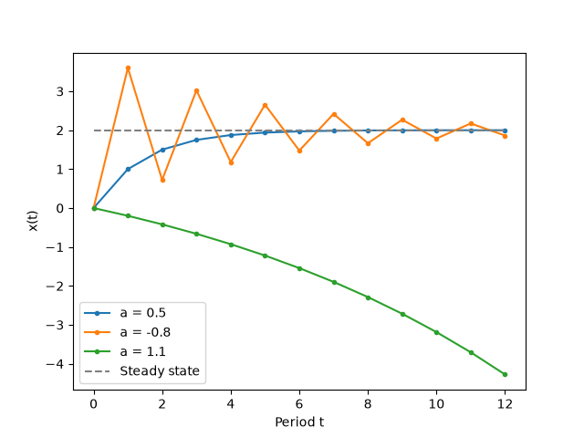
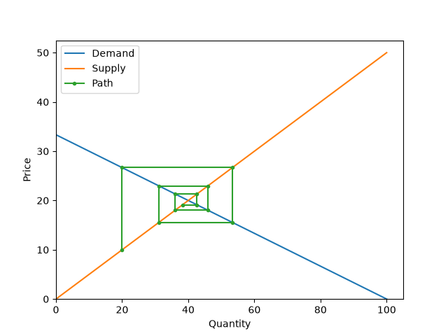
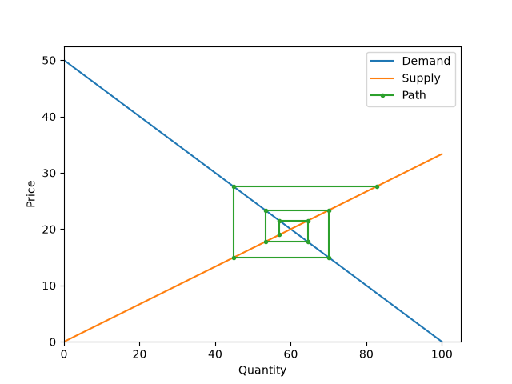

# 第 4 章: 差分方程式と経済分析

## 4.1 この章の地図

この章では、時間を通じた変数の動きを表す、**差分方程式**を学びます。「今期の値から、来期の値が決まる」という関係を、関数にして、繰り返し適用します。次の章のソロー・モデルの準備です。

| 項目 | 内容 |
| :--- | :--- |
| 経済学の題材 | 1 階差分方程式 x(t+1) = a·x(t) + b、45 度線モデルの所得の調整、蜘蛛の巣モデル |
| 使う Python の機能 | 関数を引数に渡す（`Callable`）、`lambda`、繰り返し、リスト |
| 新しく導入するライブラリ | なし |
| 完成形 | `iterate`、`linear_path`、`steady_state`、`is_stable`、`closed_form`、`income_adjustment`、`cobweb_coefficients` |
| ファイル | 実装: `lib/chapter04/difference.py`、`lib/chapter04/plot.py`（経路と蜘蛛の巣の図）／テスト: `test/chapter04/test_difference.py`、`test/chapter04/test_plot.py`（自分で書くときは、`practice/chapter04/` に、同じ名前で作ります） |

### 経済学の式とコードの対応

| 経済学 | 式 | コード |
| :--- | :--- | :--- |
| 1 階差分方程式 | x(t+1) = a·x(t) + b | `linear_path(a, b, initial, periods)` |
| 定常状態 | x* = b ÷ (1 − a) | `steady_state(a, b)` |
| 安定性 | \|a\| < 1 なら、x* に近づく | `is_stable(a)` |
| 閉じた形 | x(t) = a^t·(x(0) − x*) + x* | `closed_form(a, b, initial, t)` |
| 45 度線モデルの調整 | Y(t+1) = C0 + c·Y(t) + I | `income_adjustment(...)` |
| 蜘蛛の巣モデル | P(t) = (a₀ − c) ÷ b₀ − (d ÷ b₀)·P(t−1) | `cobweb_coefficients(...)` |

> **記号について**: この章の a・b は、差分方程式の**係数**です（第 3 章の回帰の係数や、第 1 シリーズの需要曲線の切片・傾きとは別です）。蜘蛛の巣モデルでは、需要曲線 Q = a₀ − b₀·P と、供給曲線 Q = c + d·P の係数が出てきます（コードの引数名は、`demand_intercept` などです）。一覧は、[記号について](how-to-read.md#symbols) を参照してください。

### 前提とする第 1 シリーズの内容

| できること | 第 1 シリーズ |
| :--- | :--- |
| 価格を少しずつ動かして、均衡に近づける（ワルラス調整） | 第 5 章 |
| 45 度線分析で、国民所得を求める | 第 9 章 |

## 4.2 予想する

x(t+1) = 0.5·x(t) + 1、x(0) = 0 とします。

- x(1)、x(2)、x(3) は、いくつですか
- 繰り返すと、x(t) は、どんな値に近づきますか（近づく値 x* は、x* = 0.5·x* + 1 を満たします）
- 係数を a = −0.8 に変えると、x(t) の動き方は、どう変わりますか

## 4.3 差分方程式の考え方

### 定常状態と安定性

x(t+1) = a·x(t) + b で、x(t+1) = x(t) = x* とすると、x* = b ÷ (1 − a) です。これが**定常状態**（動かなくなる値）です。

定常状態からのずれ x(t) − x* は、毎期 a 倍になります（x(t+1) − x* = a·(x(t) − x*)）。したがって、

- |a| < 1 なら、ずれは毎期縮み、x(t) は x* に近づきます（**安定**）
- |a| > 1 なら、ずれは広がり、x* から離れます（**不安定**）
- a > 0 なら、符号が変わらず、**単調に**動きます
- a < 0 なら、ずれの符号が毎期反転して、x* の上下を**往復**します

### 閉じた形

繰り返さなくても、t 期の値は、x(t) = a^t·(x(0) − x*) + x* で求まります。

## 4.4 プログラミング

### 繰り返す関数

差分方程式は、「来期の値を返す関数 f」を、繰り返し適用すれば、解けます。まず、一般の写像 f を繰り返す関数を、作ります。

```python
def test_写像を繰り返し適用した値を並べる() -> None:
    assert iterate(lambda x: 2 * x, 1, 3) == [1, 2, 4, 8]


def test_0回の繰り返しは初期値だけ() -> None:
    assert iterate(lambda x: x + 1, 5, 0) == [5]


def test_繰り返しの回数は負にできない() -> None:
    with pytest.raises(ValueError, match="回数"):
        iterate(lambda x: x, 1, -1)
```

```python
def iterate(f: Callable[[float], float], initial: float, periods: int) -> list[float]:
    """x(t+1) = f(x(t)) を periods 回繰り返した値を、初期値から順に並べる。"""
    if periods < 0:
        raise ValueError("繰り返しの回数は 0 以上でなければならない")
    path = [initial]
    for _ in range(periods):
        path.append(f(path[-1]))
    return path
```

`f` は、関数です。第 1 シリーズの第 5 章（ワルラス調整）で、需要・供給の関数を引数に渡したのと、同じ使い方です。

### 1 階差分方程式の経路と定常状態

```python
def test_a0_5_b1_x0が0の経路() -> None:
    assert linear_path(0.5, 1, 0, 3) == pytest.approx([0, 1, 1.5, 1.75])


def test_定常状態はb割る1引くa() -> None:
    assert steady_state(0.5, 1) == pytest.approx(2)


def test_aが1なら定常状態は求められない() -> None:
    with pytest.raises(ValueError, match="1"):
        steady_state(1, 1)


def test_定常状態から出発すれば動かない() -> None:
    assert linear_path(0.5, 1, 2, 5) == pytest.approx([2] * 6)
```

```python
def linear_path(a: float, b: float, initial: float, periods: int) -> list[float]:
    """x(t+1) = a·x(t) + b の経路（初期値を含めて periods + 1 個）を返す。"""
    return iterate(lambda x: a * x + b, initial, periods)


def steady_state(a: float, b: float) -> float:
    """定常状態 x* = b ÷ (1 − a)。a = 1 のときは、求められない。"""
    if a == 1:
        raise ValueError("a が 1 のときは、定常状態が決まらない")
    return b / (1 - a)
```

### 安定性と、閉じた形

```python
@pytest.mark.parametrize(("a", "expected"), [(0.5, True), (-0.8, True), (1.1, False)])
def test_aの絶対値が1より小さければ安定(a: float, expected: bool) -> None:
    assert is_stable(a) is expected


def test_aの絶対値がちょうど1なら安定ではない() -> None:
    assert not is_stable(1)
    assert not is_stable(-1)


def test_閉じた形は繰り返しの結果と一致する() -> None:
    path = linear_path(0.5, 1, 0, 10)
    for t, value in enumerate(path):
        assert closed_form(0.5, 1, 0, t) == pytest.approx(value)


def test_閉じた形はt3で1_75() -> None:
    # a^t·(x0 − x*) + x* = 0.125·(0 − 2) + 2
    assert closed_form(0.5, 1, 0, 3) == pytest.approx(1.75)
```

```python
def is_stable(a: float) -> bool:
    """|a| < 1 なら、どの初期値からでも、定常状態に近づく。"""
    return abs(a) < 1


def closed_form(a: float, b: float, initial: float, t: int) -> float:
    """t 期の値を、繰り返さずに求める。x(t) = a^t·(x(0) − x*) + x*。"""
    steady = steady_state(a, b)
    return a**t * (initial - steady) + steady
```

閉じた形のテストは、手計算（t = 3 で 0.125 × (0 − 2) + 2 = 1.75）と、繰り返しの結果との一致の、2 通りで確かめています。

### 往復と発散

```python
def test_aが負なら経路は定常状態の上下を往復する() -> None:
    path = linear_path(-0.8, 1, 0, 6)
    steady = steady_state(-0.8, 1)
    signs = [value > steady for value in path]
    assert all(signs[i] != signs[i + 1] for i in range(len(signs) - 1))


def test_aが1より大きければ定常状態から離れていく() -> None:
    path = linear_path(1.1, 1, 0, 5)
    steady = steady_state(1.1, 1)
    gaps = [abs(value - steady) for value in path]
    assert gaps == sorted(gaps)
    assert gaps[-1] > gaps[0]
```

3 つの係数で、経路を比べます。x* がすべて 2 になるように、b を決めました（b = 2·(1 − a)）。



図の読み方:

- 青（a = 0.5）は、x* = 2 に、単調に近づきます。ずれは、毎期半分になります
- オレンジ（a = −0.8）は、x* の上下を、往復しながら近づきます。ずれは、毎期 −0.8 倍（符号が変わって、20% 縮む）です
- 緑（a = 1.1）は、x* から離れていきます（0 から出発して、下に発散）。ずれは、毎期 1.1 倍です
- 動きの種類は、a の**符号**と**絶対値**で決まります

### 45 度線モデルの所得の調整

第 1 シリーズの第 9 章では、国民所得を連立方程式で解きました。これを、「今期の所得が、来期の消費を決める」調整過程として見ると、Y(t+1) = C0 + c·Y(t) + I は、a = c、b = C0 + I の差分方程式です。

```python
def test_45度線モデルの所得は定常状態250に近づく() -> None:
    # Y(t+1) = C0 + c·Y(t) + I = 20 + 0.8·Y(t) + 30。定常状態 50 ÷ (1 − 0.8) = 250
    path = income_adjustment(
        autonomous_consumption=20, mpc=0.8, investment=30, initial_income=0, periods=60
    )
    assert path[-1] == pytest.approx(250, abs=0.01)
    assert path[1] == pytest.approx(50)


def test_45度線モデルの調整経路の定常状態は乗数を使った国民所得と同じ() -> None:
    steady = steady_state(0.8, 20 + 30)
    assert steady == pytest.approx((20 + 30) * (1 / (1 - 0.8)))
```

```python
def income_adjustment(
    autonomous_consumption: float,
    mpc: float,
    investment: float,
    initial_income: float,
    periods: int,
) -> list[float]:
    """45 度線モデルの所得の調整: Y(t+1) = C0 + c·Y(t) + I の経路。

    今期の所得が、来期の消費を決める。定常状態は、乗数を使った国民所得と同じ。
    """
    return linear_path(
        mpc, autonomous_consumption + investment, initial_income, periods
    )
```

定常状態は (C0 + I) ÷ (1 − c) = 50 × 5 = 250 で、第 1 シリーズで求めた国民所得と、同じ値です。c = 0.8 は、1 より小さいので、安定です。

### 蜘蛛の巣モデル

農産物のように、供給量が**前の期の価格**で決まる市場を考えます。需要は今期の価格で決まります。

> 需要: Q = a₀ − b₀·P(t)　　供給: Q = c + d·P(t−1)

需要と供給が等しいとして、P(t) について解くと、P(t) = (a₀ − c) ÷ b₀ − (d ÷ b₀)·P(t−1) で、係数は a = −d ÷ b₀、b = (a₀ − c) ÷ b₀ の差分方程式です。a は**負**なので、価格は、均衡の上下を往復します。

```python
def test_蜘蛛の巣モデルの係数() -> None:
    # 需要 Q = 100 − 3P、供給（前期の価格）Q = 2P(t−1)。P(t) = 100/3 − (2/3)·P(t−1)
    a, b = cobweb_coefficients(100, 3, 0, 2)
    assert a == pytest.approx(-2 / 3)
    assert b == pytest.approx(100 / 3)


def test_蜘蛛の巣モデルの定常状態は需要と供給の均衡価格() -> None:
    a, b = cobweb_coefficients(100, 3, 0, 2)
    assert steady_state(a, b) == pytest.approx(100 / (3 + 2))


def test_供給の傾きが需要の傾きより小さければ蜘蛛の巣は収束する() -> None:
    a, _ = cobweb_coefficients(100, 3, 0, 2)
    assert is_stable(a)


def test_供給の傾きが需要の傾きより大きければ蜘蛛の巣は発散する() -> None:
    # 需要 Q = 100 − 2P、供給 Q = 3P(t−1)。傾きの比 −3/2
    a, _ = cobweb_coefficients(100, 2, 0, 3)
    assert a == pytest.approx(-1.5)
    assert not is_stable(a)


def test_蜘蛛の巣モデルでは需要曲線の傾きは正でなければならない() -> None:
    with pytest.raises(ValueError, match="傾き"):
        cobweb_coefficients(100, 0, 0, 2)
```

```python
def cobweb_coefficients(
    demand_intercept: float,
    demand_slope: float,
    supply_intercept: float,
    supply_slope: float,
) -> tuple[float, float]:
    """蜘蛛の巣モデルを、P(t) = a·P(t−1) + b の形にしたときの (a, b) を返す。

    需要 Q = a₀ − b₀·P(t)、供給は前期の価格で決まる Q = c + d·P(t−1) なので、
    P(t) = (a₀ − c) ÷ b₀ − (d ÷ b₀)·P(t−1)。
    """
    if demand_slope <= 0:
        raise ValueError("需要曲線の傾きは正でなければならない")
    return (
        -supply_slope / demand_slope,
        (demand_intercept - supply_intercept) / demand_slope,
    )
```

安定になる条件は、|a| = d ÷ b₀ < 1、つまり、**供給曲線の傾き d が、需要曲線の傾き b₀ より小さい**ことです（価格の傾きで見ると、供給曲線のほうが急です）。

需要 Q = 100 − 3P、供給 Q = 2·P(t−1) で、価格が 10 から始まる場合（d ÷ b₀ = 2/3 < 1）です。

| 期 | 0 | 1 | 2 | 3 | 4 | 均衡 |
| :--- | ---: | ---: | ---: | ---: | ---: | ---: |
| 価格 | 10 | 26.667 | 15.556 | 22.963 | 18.025 | 20 |



需要 Q = 100 − 2P、供給 Q = 3·P(t−1) で、均衡のすぐ近く（19）から始まる場合（d ÷ b₀ = 3/2 > 1）です。

| 期 | 0 | 1 | 2 | 3 | 4 | 均衡 |
| :--- | ---: | ---: | ---: | ---: | ---: | ---: |
| 価格 | 19 | 21.500 | 17.750 | 23.375 | 14.938 | 20 |



図の読み方:

- 青が需要曲線、オレンジが供給曲線です。緑の階段が、価格と数量の動きです
- 階段は、「価格 P(t−1) で供給量が決まる（横に動いて供給曲線へ）→ その数量で需要が価格 P(t) を決める（縦に動いて需要曲線へ）」の繰り返しです
- 安定なとき、階段は、内側に巻き込んで、均衡（2 本の曲線の交点）に近づきます。不安定なとき、外側に広がります

### 予想の答え合わせ

予想した答えを、プログラムで確かめます。`linear_path` が経路を、`steady_state` が定常状態を返します。

```python
from lib.chapter04.difference import linear_path, steady_state

path = linear_path(a=0.5, b=1, initial=0, periods=20)
print("x(1), x(2), x(3):", [round(v, 4) for v in path[1:4]])
print("定常状態 x*:", steady_state(0.5, 1))
print("x(20):", round(path[20], 4))
swing = linear_path(a=-0.8, b=1, initial=0, periods=20)
print("a = -0.8 の定常状態 x*:", round(steady_state(-0.8, 1), 4))
print("a = -0.8 の x(1) から x(6):", [round(v, 4) for v in swing[1:7]])
print("a = -0.8 の x(20):", round(swing[20], 4))
```

```text
x(1), x(2), x(3): [1.0, 1.5, 1.75]
定常状態 x*: 2.0
x(20): 2.0
a = -0.8 の定常状態 x*: 0.5556
a = -0.8 の x(1) から x(6): [1.0, 0.2, 0.84, 0.328, 0.7376, 0.4099]
a = -0.8 の x(20): 0.5492
```

- 1 つ目の問い: x(1) = 1、x(2) = 1.5、x(3) = 1.75 です
- 2 つ目の問い: x* = 2 に近づきます。20 期目には、x(20) = 2.0（小数第 4 位まで）です
- 3 つ目の問い: a = −0.8 なら、定常状態は x* = 0.5556 です。x(t) は、x* の上下を、往復しながら近づきます（0.2、0.84、0.328、0.7376、…）

### 実行結果

```bash
cd apps/macro-programming/python
uv run pytest test/chapter04
```

```text
27 passed
```

## 4.5 規則で言うと

1. **来期の値を返す関数を、繰り返し適用すれば、時間を通じた動きが分かる。** 関数を引数に渡す書き方が、そのまま使える
2. **動きは、係数 a だけで決まる。** |a| < 1 なら安定、a の符号が、単調か往復かを決める
3. **定常状態は、「動かない値」から、求められる。** x* = a·x* + b を解く。繰り返しの結果が、定常状態に近づくことを、テストで確かめる

混同しやすい点を、表にまとめます。

| 混同しやすい点 | 違い |
| :--- | :--- |
| 定常状態 と 均衡 | 定常状態は、動かなくなる値。蜘蛛の巣モデルでは、定常状態が、需要と供給の均衡価格と一致する。ただし、近づくかどうか（安定性）は別の問題 |
| 安定 と 単調に近づく | |a| < 1 なら、近づく。単調かどうかは、a の符号で決まる（a < 0 なら、往復しながら近づく） |
| 供給の傾き と 需要の傾き | 蜘蛛の巣では、傾き d ÷ b₀ が 1 より小さいことが、安定の条件 |

### このモデルが成り立たない場面

- **1 階の線形の式だけを扱っています。** 現実の経済は、非線形（曲線）で、2 期以上前の値にも依存します。非線形の式は、定常状態の近くで、線形に近似できます（第 5 章・第 17 章）
- **蜘蛛の巣モデルは、「前の期の価格だけで、生産量を決める」という、近視眼的な予想を前提にしています。** 生産者が、価格の往復を見抜けば、行動が変わり、モデルは成り立ちません
- **45 度線モデルの調整は、消費が 1 期遅れる、という仮定です。** 実際の調整の速さは、この仮定に依存します

## 4.6 練習問題

| 種類 | 問題 |
| :--- | :--- |
| 想起 | 本文を閉じて、`steady_state` のテスト（a = 0.5、b = 1 のとき、定常状態 2）を書いてください |
| 生成 | 解説を見る前に、定常状態との差が `tolerance` より小さくなるまでの期間を返す `periods_to_converge(a, b, initial, tolerance)` を、テストから書いてください。a = 0.5、b = 1、x(0) = 0、tolerance = 0.1 のとき、何期ですか（手計算してから、テストにします） |
| 多様 | 蜘蛛の巣モデルで、需要の傾き b₀ = 3 のまま、供給の傾き d を 1、3、5 に変えたとき、安定かどうかを、先に予想してから、確かめてください |
| 交互 | 第 1 シリーズの第 5 章のワルラス調整 P(t+1) = P(t) + k·(100 − 5·P(t)) は、差分方程式です。a と b を k で表し、k = 0.1、0.3、0.5 のときの安定性を、`is_stable` で確かめてください |

??? note "解答（先に自分で取り組んでから、開いてください）"

    **想起**:

    ```python
    def test_定常状態はb割る1引くa() -> None:
        assert steady_state(0.5, 1) == pytest.approx(2)
    ```

    **生成**: 差は毎期 a 倍になるので、|x* − x(0)|·|a|^t < tolerance を満たす最小の t です。手計算では、2·0.5^t < 0.1 より、0.5^t < 0.05 で、t > 4.32、つまり **5 期**です。

    ```python
    def periods_to_converge(a, b, initial, tolerance):
        steady = steady_state(a, b)
        t = 0
        while abs(closed_form(a, b, initial, t) - steady) >= tolerance:
            t += 1
        return t
    ```

    ```python
    def test_収束までの期間は5期() -> None:
        assert periods_to_converge(0.5, 1, 0, 0.1) == 5


    def test_すでに十分近ければ0期() -> None:
        assert periods_to_converge(0.5, 1, 1.95, 0.1) == 0
    ```

    この関数は、`is_stable(a)` が偽のとき、無限ループになります。使う前に、安定性を確かめる必要があります。

    **多様**: 安定の条件は、d ÷ b₀ < 1 です。d = 1（比 1/3）は安定、d = 3（比 1）は、ちょうど 1 なので、安定ではありません（振れが、縮みも広がりもせず、往復し続けます）、d = 5（比 5/3）は不安定です。

    ```python
    def test_供給の傾きによる安定性() -> None:
        for slope, stable in [(1, True), (3, False), (5, False)]:
            a, _ = cobweb_coefficients(100, 3, 0, slope)
            assert is_stable(a) is stable
    ```

    **交互**: P(t+1) = (1 − 5k)·P(t) + 100k なので、a = 1 − 5k、b = 100k です。定常状態は 100k ÷ (5k) = 20 で、需要と供給の均衡価格（第 1 シリーズの第 5 章）と同じです。

    ```python
    def test_ワルラス調整の安定性() -> None:
        for k, stable in [(0.1, True), (0.3, True), (0.5, False)]:
            assert is_stable(1 - 5 * k) is stable
        assert steady_state(1 - 5 * 0.1, 100 * 0.1) == pytest.approx(20)
    ```

    k = 0.1 は単調に収束（a = 0.5）、k = 0.3 は往復しながら収束（a = −0.5）、k = 0.5 は発散（a = −1.5）です。第 1 シリーズで、k を大きくしすぎると収束しなかった理由が、a の絶対値で説明できます。

## 4.7 振り返り

- 予想した x(1)〜x(3) は、当たりましたか。a の符号と絶対値で、経路の形を、説明できますか
- 蜘蛛の巣モデルで、価格が往復する理由を、自分の言葉で説明できますか
- 第 1 シリーズのワルラス調整と、この章の差分方程式の、関係に気づきましたか

## 4.8 まとめ

- 来期の値を返す関数を繰り返し適用して、差分方程式の経路を求めた
- 定常状態 x* = b ÷ (1 − a) と、安定性 |a| < 1 を、テストで確かめた
- 45 度線モデルと蜘蛛の巣モデルを、差分方程式として、解いた
- 次の章では、資本の蓄積を表す、非線形の差分方程式（ソロー・モデル）を、定常状態の近くで線形に近似して、収束の速さを求めます
