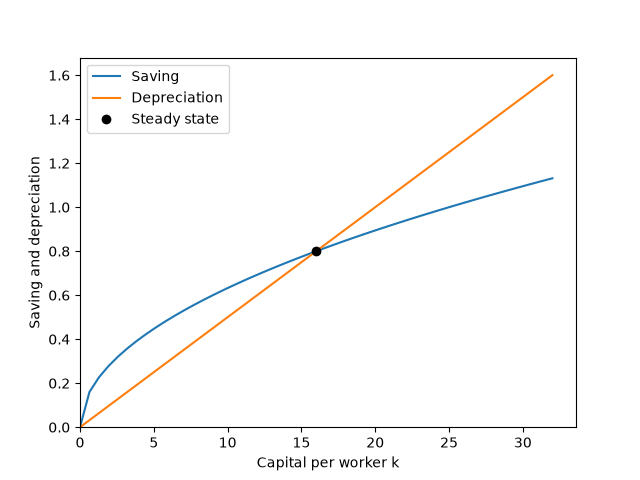
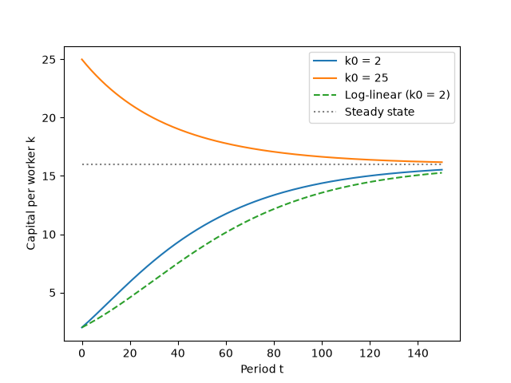
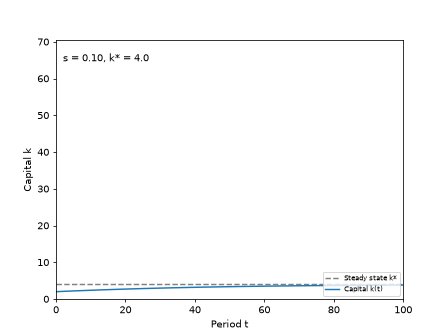

# 第 5 章: ソロー・モデル

## 5.1 この章の地図

この章では、経済成長の基本モデルである**ソロー・モデル**を、関数にします。貯蓄が資本を増やし、減耗が資本を減らす、という関係から、資本が定常状態に近づく様子を求めます。そして、定常状態の近くで、第 4 章の線形の差分方程式に近似して、**収束の速さ**を求めます。

| 項目 | 内容 |
| :--- | :--- |
| 経済学の題材 | ソロー・モデルの資本の動学、定常状態、収束の速さ |
| 使う Python の機能 | 第 4 章の差分方程式（`closed_form`）、`math`・`numpy` の対数と指数、`zip(..., strict=True)` |
| 新しく導入するライブラリ | なし |
| 完成形 | `steady_state_capital`、`steady_state_output`、`solow_step`、`solow_path`、`convergence_speed`、`half_life`、`log_linear_path`、`approximation_error` |
| ファイル | 実装: `lib/chapter05/solow.py`、`lib/chapter05/plot.py`（ソロー図と収束の図）／テスト: `test/chapter05/test_solow.py`、`test/chapter05/test_plot.py`（自分で書くときは、`practice/chapter05/` に、同じ名前で作ります） |

### 経済学の式とコードの対応

| 経済学 | 式 | コード |
| :--- | :--- | :--- |
| 資本の動学 | k(t+1) = s·A·k(t)^α + (1−δ)·k(t) | `solow_step(capital, ...)`・`solow_path(...)` |
| 定常状態の資本 | k* = (s·A ÷ δ)^(1 ÷ (1−α)) | `steady_state_capital(...)` |
| 定常状態の所得 | y* = A·k*^α | `steady_state_output(...)` |
| 収束の速さ | λ = (1 − α)·δ | `convergence_speed(alpha, depreciation)` |
| 半減期 | ln 2 ÷ (−ln(1 − λ)) | `half_life(speed)` |
| 対数線形近似 | ln k(t) − ln k* = (1−λ)^t·(ln k(0) − ln k*) | `log_linear_path(...)` |

> **記号について**: この章の s は貯蓄率、δ は減耗率、A は技術水準（第 1・2 章の TFP と同じ意味）、k は労働者 1 人当たりの資本、λ は収束の速さです。α は、第 1 章と同じ資本分配率です。人口の増加と技術進歩は、考えません。一覧は、[記号について](how-to-read.md#symbols) を参照してください。

## 5.2 予想する

α = 0.5、s = 0.2、δ = 0.05、A = 1 のソロー・モデルです。

- 定常状態の資本 k* は、いくつですか（定常状態では、貯蓄 s·A·k^α が、減耗 δ·k に等しくなります）
- 資本が 4 から始まると、次の期の資本は、いくつですか
- 資本が 4 から始まる国と、25 から始まる国は、どちらも、定常状態に近づきますか。近づく速さは、定常状態から遠いほど速いでしょうか

## 5.3 ソロー・モデルの考え方

### 貯蓄と減耗

労働者 1 人当たりの所得は y = A·k^α です。所得の一定割合 s が貯蓄され、資本になります。一方、資本は、毎期 δ の割合で減耗します。したがって、資本は、k(t+1) = s·A·k(t)^α + (1−δ)·k(t) で動きます。

- k が小さいうちは、**貯蓄（s·A·k^α）が減耗（δ·k）より多い**ので、資本は増えます
- k が大きくなると、減耗が貯蓄を上回り、資本は減ります
- 2 つが等しくなる k* が、定常状態です

### 収束の速さ（対数線形近似）

モデルは、k について非線形で、第 4 章の方法（閉じた形）が、そのままでは使えません。そこで、定常状態の近くで、**線形に近似**します。ln k の動きを、定常状態のまわりで、1 次の項までで近似すると、

> ln k(t+1) − ln k* ≈ (1 − λ)·(ln k(t) − ln k*)、　λ = (1 − α)·δ

これは、第 4 章の差分方程式（a = 1 − λ）です。**定常状態からの対数の乖離（％の乖離）は、毎期、λ の割合で縮みます。**

> **確かめ（`linearsolve`）**: Python のライブラリ `linearsolve`（pandas 2 の隔離環境で実行）で、同じモデルを対数線形近似した遷移係数は 0.975 でした。これは、1 − λ = 1 − 0.5 × 0.05 = 0.975 と、一致します。この記事では、`linearsolve` を使わず、自分で書きます（pandas 3 で動かないため）。

## 5.4 プログラミング

### 定常状態

```python
def test_定常状態の資本は16() -> None:
    assert steady_state_capital(**MODEL) == pytest.approx(16)


def test_定常状態の所得は4() -> None:
    assert steady_state_output(**MODEL) == pytest.approx(4)


def test_定常状態では貯蓄が減耗と等しい() -> None:
    k = steady_state_capital(**MODEL)
    assert 0.2 * k**0.5 == pytest.approx(0.05 * k)


def test_貯蓄率が2倍なら定常状態の資本は4倍() -> None:
    # (s ÷ δ)^(1 ÷ (1−α)) = (0.4 ÷ 0.05)² = 64
    k = steady_state_capital(saving_rate=0.4, depreciation=0.05, alpha=0.5)
    assert k == pytest.approx(64)


def test_技術水準が4倍なら定常状態の資本は16倍() -> None:
    k = steady_state_capital(**MODEL, technology=4)
    assert k == pytest.approx(256)
    assert steady_state_output(**MODEL, technology=4) == pytest.approx(64)
```

貯蓄率が 2 倍になると、定常状態の資本は 4 倍（(s ÷ δ)^(1 ÷ (1−α)) の指数が 2 のため）になります。技術水準 A が 4 倍なら、資本は 16 倍、所得は 64 になります。

入力の範囲も、テストで決めます（資本分配率・貯蓄率は 0 と 1 の間、減耗率は 0 より大きく 1 以下、技術水準は正）。

```python
@pytest.mark.parametrize("alpha", [0, 1, -0.5, 1.5])
def test_資本分配率は0より大きく1より小さくなければならない(alpha: float) -> None:
    with pytest.raises(ValueError, match="資本分配率"):
        steady_state_capital(0.2, 0.05, alpha)


@pytest.mark.parametrize("saving_rate", [0, 1, -0.1])
def test_貯蓄率は0より大きく1より小さくなければならない(saving_rate: float) -> None:
    with pytest.raises(ValueError, match="貯蓄率"):
        steady_state_capital(saving_rate, 0.05, 0.5)


@pytest.mark.parametrize("depreciation", [0, -0.1, 1.5])
def test_減耗率は0より大きく1以下でなければならない(depreciation: float) -> None:
    with pytest.raises(ValueError, match="減耗率"):
        steady_state_capital(0.2, depreciation, 0.5)


def test_減耗率は1ちょうどでもよい() -> None:
    # 資本が毎期すべて失われる。k* = (s·A)^(1 ÷ (1−α)) = 0.2² = 0.04
    assert steady_state_capital(0.2, 1, 0.5) == pytest.approx(0.04)


def test_技術水準は正でなければならない() -> None:
    with pytest.raises(ValueError, match="技術"):
        steady_state_capital(0.2, 0.05, 0.5, technology=0)
```

```python
def _check(
    saving_rate: float, depreciation: float, alpha: float, technology: float
) -> None:
    if not 0 < alpha < 1:
        raise ValueError("資本分配率は 0 より大きく 1 より小さくなければならない")
    if not 0 < saving_rate < 1:
        raise ValueError("貯蓄率は 0 より大きく 1 より小さくなければならない")
    if not 0 < depreciation <= 1:
        raise ValueError("減耗率は 0 より大きく 1 以下でなければならない")
    if technology <= 0:
        raise ValueError("技術水準は正でなければならない")


def steady_state_capital(
    saving_rate: float, depreciation: float, alpha: float, technology: float = 1
) -> float:
    """定常状態の資本 k* = (s·A ÷ δ)^(1 ÷ (1−α))（貯蓄 = 減耗となる資本）。"""
    _check(saving_rate, depreciation, alpha, technology)
    return float((saving_rate * technology / depreciation) ** (1 / (1 - alpha)))


def steady_state_output(
    saving_rate: float, depreciation: float, alpha: float, technology: float = 1
) -> float:
    """定常状態の所得 y* = A·k*^α。"""
    k = steady_state_capital(saving_rate, depreciation, alpha, technology)
    return float(technology * k**alpha)
```

### 1 期先と、経路

```python
def test_資本4の次の期は4_2() -> None:
    # 0.2·√4 + 0.95·4 = 0.4 + 3.8
    assert solow_step(4, **MODEL) == pytest.approx(4.2)


def test_定常状態から出発すれば動かない() -> None:
    assert solow_step(16, **MODEL) == pytest.approx(16)


def test_資本が少ない国は定常状態に向けて増え続ける() -> None:
    path = solow_path(4, **MODEL, periods=300)
    assert all(a < b for a, b in zip(path, path[1:], strict=False))
    assert max(path) < 16
    assert path[-1] == pytest.approx(16, abs=0.1)


def test_資本が多い国は定常状態に向けて減り続ける() -> None:
    path = solow_path(25, **MODEL, periods=200)
    assert all(a > b for a, b in zip(path, path[1:], strict=False))
    assert min(path) > 16
    assert path[-1] == pytest.approx(16, abs=0.1)


def test_資本は正でなければならない() -> None:
    with pytest.raises(ValueError, match="資本"):
        solow_step(0, **MODEL)


def test_繰り返しの回数は負にできない() -> None:
    with pytest.raises(ValueError, match="回数"):
        solow_path(4, **MODEL, periods=-1)
```

```python
def solow_step(
    capital: float,
    saving_rate: float,
    depreciation: float,
    alpha: float,
    technology: float = 1,
) -> float:
    """次の期の資本 s·A·k^α + (1−δ)·k を返す。"""
    _check(saving_rate, depreciation, alpha, technology)
    if capital <= 0:
        raise ValueError("資本は正でなければならない")
    return float(
        saving_rate * technology * capital**alpha + (1 - depreciation) * capital
    )


def solow_path(
    capital: float,
    saving_rate: float,
    depreciation: float,
    alpha: float,
    periods: int,
    technology: float = 1,
) -> list[float]:
    """初期の資本から、periods 期先までの資本の経路（初期値を含む）を返す。"""
    if periods < 0:
        raise ValueError("繰り返しの回数は 0 以上でなければならない")
    path = [capital]
    for _ in range(periods):
        path.append(solow_step(path[-1], saving_rate, depreciation, alpha, technology))
    return path
```

資本が少ない国は増え続けますが、定常状態を**超えません**。多い国は減り続けますが、定常状態を**下回りません**。



図の読み方:

- 青い曲線が貯蓄 s·A·k^α、オレンジの直線が減耗 δ·k です。黒い点が、2 つの交点（k = 16、貯蓄 = 減耗 = 0.8）です
- 点の左では、貯蓄が減耗より多く、資本が増えます。右では、減耗のほうが多く、資本が減ります
- 貯蓄の曲線は、k が大きくなるほど、傾きが緩やかになります（資本の収穫逓減）。そのため、必ず交点が 1 つだけできます

### 収束の速さと、半減期

```python
def test_収束の速さは1引くアルファかける減耗率() -> None:
    assert convergence_speed(alpha=0.5, depreciation=0.05) == pytest.approx(0.025)


def test_定常状態での写像の傾きは1引く収束の速さ() -> None:
    # 数値微分。linearsolve（pandas 2 の隔離環境）が返した遷移係数 0.975 と同じ値
    k = steady_state_capital(**MODEL)
    h = 1e-4
    slope = (solow_step(k + h, **MODEL) - solow_step(k - h, **MODEL)) / (2 * h)
    assert slope == pytest.approx(1 - convergence_speed(0.5, 0.05), abs=1e-6)
    assert slope == pytest.approx(0.975, abs=1e-6)


def test_半減期は収束の速さが0_5なら1期() -> None:
    assert half_life(0.5) == pytest.approx(1)


def test_収束の速さ0_025の半減期は約27期() -> None:
    assert half_life(0.025) == pytest.approx(27.38, abs=0.01)


@pytest.mark.parametrize("speed", [0, 1, -0.1, 1.5])
def test_半減期の収束の速さは0より大きく1より小さくなければならない(
    speed: float,
) -> None:
    with pytest.raises(ValueError, match="収束の速さ"):
        half_life(speed)
```

2 つ目のテストが、重要です。定常状態での写像の傾きを、数値微分で求めて、1 − λ に等しいことを確かめています。`linearsolve` が返した 0.975 とも、一致します。

```python
def convergence_speed(alpha: float, depreciation: float) -> float:
    """収束の速さ λ = (1 − α)·δ。定常状態の近くで、対数の乖離が毎期 λ の割合で縮む。"""
    return (1 - alpha) * depreciation


def half_life(speed: float) -> float:
    """乖離が半分になる期間 = ln 2 ÷ (−ln(1 − λ))。"""
    if not 0 < speed < 1:
        raise ValueError("収束の速さは 0 より大きく 1 より小さくなければならない")
    return math.log(2) / -math.log(1 - speed)
```

λ = (1 − 0.5) × 0.05 = 0.025 で、乖離が半分になる期間は、約 27.4 期です。

### 対数線形近似の経路

第 4 章の `closed_form` を、対数の資本に使います。a = 1 − λ、b = λ·ln k* とすると、定常状態は ln k* です。

```python
def test_対数線形近似は初期値から始まる() -> None:
    path = log_linear_path(4, 16, 0.025, 5)
    assert path[0] == pytest.approx(4)
    assert len(path) == 6


def test_対数線形近似は定常状態に近づく() -> None:
    path = log_linear_path(4, 16, 0.025, 400)
    assert path[-1] == pytest.approx(16, abs=0.01)


def test_対数線形近似は対数の乖離が毎期1引くラムダ倍になる() -> None:
    path = log_linear_path(4, 16, 0.025, 3)
    gaps = [np.log(k / 16) for k in path]
    assert gaps[1] / gaps[0] == pytest.approx(0.975)
    assert gaps[2] / gaps[1] == pytest.approx(0.975)
```

```python
def log_linear_path(
    capital: float, steady_capital: float, speed: float, periods: int
) -> list[float]:
    """対数線形近似の経路: ln k(t) − ln k* = (1 − λ)^t·(ln k(0) − ln k*)。

    第 4 章の閉じた形（a = 1 − λ、b = λ·ln k*）を、対数の資本に使う。
    """
    log_steady = math.log(steady_capital)
    return [
        float(np.exp(closed_form(1 - speed, speed * log_steady, math.log(capital), t)))
        for t in range(periods + 1)
    ]
```

厳密な経路との差が、定常状態からの距離で、どう変わるかを確かめます。

```python
def test_定常状態の近くでは近似の誤差が小さい() -> None:
    assert approximation_error(15, **MODEL, periods=100) < 0.01


def test_定常状態から遠いほど近似の誤差が大きい() -> None:
    near = approximation_error(14, **MODEL, periods=100)
    far = approximation_error(2, **MODEL, periods=100)
    assert far > near
```

```python
def approximation_error(
    capital: float,
    saving_rate: float,
    depreciation: float,
    alpha: float,
    periods: int,
    technology: float = 1,
) -> float:
    """厳密な経路と、対数線形近似の経路の差（絶対値）の最大値。"""
    exact = solow_path(capital, saving_rate, depreciation, alpha, periods, technology)
    approx = log_linear_path(
        capital,
        steady_state_capital(saving_rate, depreciation, alpha, technology),
        convergence_speed(alpha, depreciation),
        periods,
    )
    return max(abs(e - a) for e, a in zip(exact, approx, strict=True))
```

初期の資本ごとの、100 期間での最大の差です。

| 初期の資本 | 定常状態からの距離 | 近似の誤差（最大） |
| ---: | :--- | ---: |
| 15 | 近い（−6%） | 0.0039 |
| 14 | 近い（−12.5%） | 0.0163 |
| 2 | 遠い（−87.5%） | 1.795 |

定常状態の近くでは、近似はほとんど正確です。遠いと、誤差が大きくなります。



図の読み方:

- 青（k0 = 2）は、下から、オレンジ（k0 = 25）は、上から、k* = 16 に近づきます
- 緑の破線が、k0 = 2 からの、対数線形近似です。実際の経路（青）より、**遅く**近づきます。近似は、定常状態の近くの速さ λ（遅い）を、最初から使っているためです。実際は、遠いほど速く動きます（予想する節の最後の問いの答え）
- 近づくにつれて、2 本の線は重なります

数値で見ると、資本 4 から始まる国の、100 期後は、次のとおりです。

| 方法 | 100 期後の資本 |
| :--- | ---: |
| 厳密な計算（`solow_path`） | 14.743 |
| 対数線形近似（`log_linear_path`） | 14.330 |

### 予想の答え合わせ

予想した答えを、プログラムで確かめます。資本の経路は、`solow_path` で 200 期先まで求めます。

```python
from lib.chapter05.solow import solow_path, steady_state_capital

kstar = steady_state_capital(0.2, 0.05, 0.5)
print("k*:", round(kstar, 4))
low = solow_path(4, 0.2, 0.05, 0.5, 200)
high = solow_path(25, 0.2, 0.05, 0.5, 200)
print("資本 4 の次の期:", round(low[1], 4))
print("資本 4 から 200 期後:", round(low[200], 4))
print("資本 25 から 200 期後:", round(high[200], 4))
print("資本 4 の 1 期目の変化:", round(low[1] - low[0], 4))
print("資本 4 の 10 期目の変化:", round(low[11] - low[10], 4))
print("資本 4 の 100 期目の変化:", round(low[101] - low[100], 4))
print("資本 25 の 1 期目の変化:", round(high[1] - high[0], 4))
print("資本 25 の 100 期目の変化:", round(high[101] - high[100], 4))
```

```text
k*: 16.0
資本 4 の次の期: 4.2
資本 4 から 200 期後: 15.8981
資本 25 から 200 期後: 16.0505
資本 4 の 1 期目の変化: 0.2
資本 4 の 10 期目の変化: 0.1902
資本 4 の 100 期目の変化: 0.0308
資本 25 の 1 期目の変化: -0.25
資本 25 の 100 期目の変化: -0.0162
```

- 1 つ目の問い（定常状態）: k* = 16.0 です。(0.2 ÷ 0.05)^2 = 16 で、貯蓄 0.2·√16 = 0.8 と、減耗 0.05·16 = 0.8 が等しくなります
- 2 つ目の問い（次の期）: 4.2 です。0.2·√4 + 0.95·4 = 0.4 + 3.8 = 4.2 です
- 3 つ目の問い（近づき方）: 資本 4 の国も、資本 25 の国も、200 期後には 15.8981 と 16.0505 で、どちらも 16 に近づきます。1 期当たりの変化は、資本 4 の国で 0.2（1 期目）、0.1902（10 期目）、0.0308（100 期目）と、定常状態に近づくにつれて小さくなります。資本 25 の国も、−0.25（1 期目）から −0.0162（100 期目）へ、小さくなります。同じ国の中では、定常状態から遠いほど速く、近づくにつれて遅くなります

### 動かして見る

貯蓄率 s を、0.1 から 0.4 へ上げます。定常状態の資本 k*（点線）が上がり、資本の経路も、より高い水準へ向かいます。k* は、s の 2 乗に比例して（α = 0.5 の場合）、大きく増えます。



このアニメーションは、`lib/animations/` の関数で作っています（`uv run python -m tools.render_animations` で、GIF を書き出します）。**写経は、不要**です。動きを見て、式と図の対応を、確かめてください。

### 実行結果

```bash
cd apps/macro-programming/python
uv run pytest test/chapter05
```

```text
45 passed
```

## 5.5 規則で言うと

1. **非線形の式は、定常状態の近くで、線形に近似する。** 近似すると、第 4 章の道具（安定性・閉じた形）が使える
2. **収束の速さは、λ = (1 − α)·δ。** 資本分配率が大きい（収穫逓減が弱い）ほど、収束が遅い
3. **近似は、必ず、厳密な計算と比べて確かめる。** 定常状態に近いほど、誤差は小さい

混同しやすい点を、表にまとめます。

| 混同しやすい点 | 違い |
| :--- | :--- |
| 定常状態の水準 と 収束の速さ | 水準 k* は、貯蓄率 s と減耗率 δ（と A）で決まる。収束の速さ λ は、δ と α だけで決まり、**貯蓄率に依存しない** |
| 貯蓄率を上げる と 成長率が上がる | 貯蓄率を上げると、定常状態の水準は上がるが、定常状態では、所得は成長しない（水準の効果）。成長は、水準に向かう途中だけ |
| 近似の経路 と 厳密な経路 | 近似は、定常状態の近くでだけ正確。遠くでは、実際より遅く動く（この章の例） |

### このモデルが成り立たない場面

- **人口の増加と技術進歩を、考えていません。** 現実の経済は、定常状態でも、成長します。人口と技術を加えると、収束の速さの式は、λ = (1 − α)·(n + g + δ) になります
- **貯蓄率は、一定という仮定です。** 実際は、所得や利子率で、変わります
- **全員が同じ生産関数・同じパラメーターを持つ、という仮定です。** この前提のもとで、貧しい国が、豊かな国に追いつく（収斂）、と予想されます。実際に、追いついているかは、次の章で、データを使って調べます
- **収束の速さ λ = 0.025 は、この例の数値です。** 実際の国の δ や α は、別の値です

## 5.6 練習問題

| 種類 | 問題 |
| :--- | :--- |
| 想起 | 本文を閉じて、定常状態の資本が 16 になる、`steady_state_capital` のテストを書いてください |
| 生成 | 解説を見る前に、定常状態の資本を、目標の値にするための貯蓄率を返す `required_saving_rate(target_capital, depreciation, alpha)` を、テストから書いてください（k* = (s·A ÷ δ)^(1÷(1−α)) を、s について解きます。k* = 16 のとき、s = 0.2 になるはずです） |
| 多様 | 減耗率 δ を 0.10 に変えると、定常状態の資本と、収束の速さ、半減期は、どうなりますか。資本分配率 α を 0.3 に変えたときは、収束の速さは、どうなりますか。先に予想してから、確かめてください |
| 交互 | 第 4 章の `closed_form` を使って、資本 4 から始まる国の、50 期後の資本の、対数線形近似の値を、手で組み立ててください。厳密な値との差は、どれくらいですか |

??? note "解答（先に自分で取り組んでから、開いてください）"

    **想起**:

    ```python
    def test_定常状態の資本は16() -> None:
        assert steady_state_capital(0.2, 0.05, 0.5) == pytest.approx(16)
    ```

    **生成**: k*^(1−α) = s·A ÷ δ なので、s = δ·k*^(1−α) ÷ A です。

    ```python
    def required_saving_rate(target_capital, depreciation, alpha, technology=1):
        return depreciation * target_capital ** (1 - alpha) / technology
    ```

    ```python
    def test_目標の資本16に必要な貯蓄率は0_2() -> None:
        assert required_saving_rate(16, 0.05, 0.5) == pytest.approx(0.2)


    def test_必要な貯蓄率で定常状態の資本が目標になる() -> None:
        s = required_saving_rate(100, 0.05, 0.4)
        assert steady_state_capital(s, 0.05, 0.4) == pytest.approx(100)
    ```

    2 つ目のテストは、逆関数どうしの確かめです（求めた貯蓄率を、元の関数に戻すと、目標に戻る）。

    **多様**: δ が 2 倍になると、(s ÷ δ) が半分になり、k* は、(1/2)² = **4 分の 1** の 4 になります。収束の速さ λ = (1 − α)·δ は、2 倍の 0.05 になり、半減期は、約半分になります。α = 0.3 にすると、λ = 0.7 × 0.05 = 0.035 で、**速くなります**（資本の収穫逓減が強いほど、速く収束します）。

    ```python
    def test_減耗率や資本分配率を変えたときの収束の速さ() -> None:
        assert steady_state_capital(0.2, 0.10, 0.5) == pytest.approx(4)
        assert convergence_speed(0.5, 0.10) == pytest.approx(0.05)
        assert half_life(0.05) < half_life(0.025)
        assert convergence_speed(0.3, 0.05) == pytest.approx(0.035)
    ```

    **交互**: 対数の乖離は、毎期 (1 − λ) 倍なので、50 期後の乖離は、(1 − 0.025)^50 × (ln 4 − ln 16) です。第 4 章の閉じた形を、a = 0.975、b = 0.025·ln 16 として使うと、同じ値が求まります。

    ```python
    def test_50期後の対数線形近似() -> None:
        k_star = steady_state_capital(0.2, 0.05, 0.5)
        by_hand = k_star * np.exp(0.975**50 * np.log(4 / k_star))
        assert log_linear_path(4, k_star, 0.025, 50)[50] == pytest.approx(by_hand)
        exact = solow_path(4, 0.2, 0.05, 0.5, 50)[50]
        assert exact - by_hand > 0
    ```

    厳密な値のほうが、近似より**大きい**（近似は、遅く近づく）です。差は、0.96 です（初期値が、定常状態から遠いため）。

## 5.7 振り返り

- 予想した定常状態 16 と、1 期先の 4.2 は、当たりましたか
- 収束の速さが、貯蓄率に依存しないことを、式から説明できますか
- 近似の経路が、実際より遅かったのは、なぜですか

## 5.8 まとめ

- ソロー・モデルの資本の動学を、関数にして、定常状態と経路を求めた
- 定常状態の近くで、対数線形近似をして、収束の速さ λ = (1 − α)·δ を、数値微分と、`linearsolve` の結果で確かめた
- 近似の誤差が、定常状態からの距離で、どう変わるかを調べた
- 次の章では、「貧しい国は、豊かな国に追いつくか」を、データで調べます（所得の収斂）
