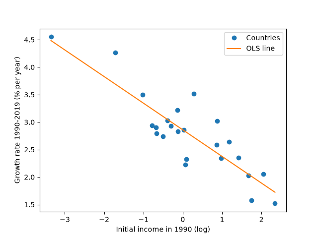
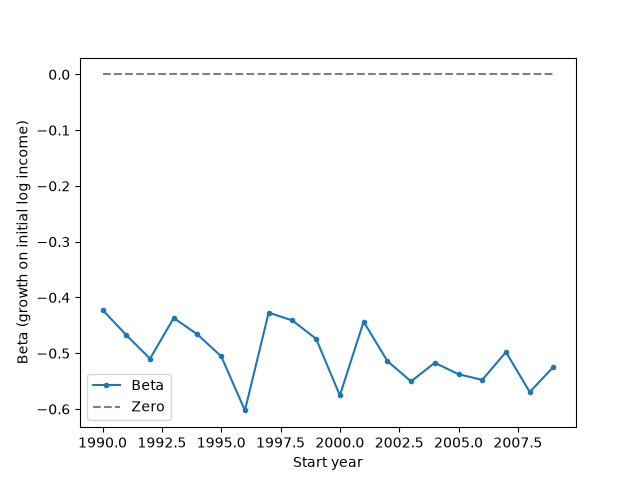

# 第 6 章: 所得分布と所得収斂

## 6.1 この章の地図

第 5 章のソロー・モデルは、「資本の少ない国は、速く成長して、定常状態に近づく」と予想しました。同じ定常状態を持つ国どうしなら、**貧しい国は、豊かな国に追いつく**はずです（収斂）。この章では、成長率を、初期の所得に回帰して、実際に追いついているかを調べます。

| 項目 | 内容 |
| :--- | :--- |
| 経済学の題材 | 絶対的収斂、条件付き収斂、クラブ収斂、収束の速さと半減期 |
| 使う Python の機能 | 第 3 章の回帰（`fit_ols`）、`for` ループ（開始年をずらす）、辞書、内包表記 |
| 新しく導入するライブラリ | なし |
| 完成形 | `income_growth`、`beta_convergence`、`implied_speed`、`half_life_years`、`club_convergence`、`beta_by_start_year` |
| ファイル | 実装: `lib/chapter06/convergence.py`、`lib/chapter06/plot.py`（収斂の図）／テスト: `test/chapter06/test_convergence.py`、`test/chapter06/test_plot.py`（自分で書くときは、`practice/chapter06/` に、同じ名前で作ります） |
| データ | 第 2 章の `data/panel.csv`（架空の 24 か国、1990〜2019 年） |

### 経済学の式とコードの対応

| 経済学 | 式 | コード |
| :--- | :--- | :--- |
| 収斂の回帰 | (1 ÷ T)·ln(y_T ÷ y_0) = a + β·ln y_0 | `beta_convergence(panel, start, end)` |
| 傾きと収束の速さ | β = −(1 − e^(−λT)) ÷ T | `implied_speed(beta, years)` |
| 半減期 | ln 2 ÷ λ | `half_life_years(speed)` |
| 条件付き収斂 | 成長率を、ln y_0 と、初期の ln k_0・ln h_0 に回帰 | `beta_convergence(..., controls=["k", "h"])` |
| クラブ収斂 | 初期の所得の低い半分・高い半分で、別々に回帰 | `club_convergence(panel, start, end)` |

> **記号について**: β は、収斂の回帰の傾きです（第 3 章の回帰の係数 β と、同じ文字ですが、ここでは「ln y_0 の係数」を指します）。λ は収束の速さですが、第 5 章の λ（1 期当たりの割合、(1 − α)·δ）と違い、この章では、**1 年当たりの連続時間の速さ**です。一覧は、[記号について](how-to-read.md#symbols) を参照してください。

## 6.2 予想する

すべての国が、共通の定常状態に、同じ速さ λ = 2% で近づくとします（連続時間: 乖離が、毎年 e^(−0.02) 倍になる）。20 年間の成長率を、初期の対数の所得に回帰したら、傾き β は、いくつになりますか。

- 20 年間で、乖離は何倍になりますか（e^(−0.02 × 20)）
- 初期の所得が、ln で 1 だけ（約 2.7 倍）高い国は、年の成長率が、どれだけ低くなりますか

答えは、乖離が e^(−0.4) ≈ 0.670 倍になるので、β = −(1 − 0.670) ÷ 20 ≈ -0.0165（成長率を小数で見たとき）です。初期の所得が 2.7 倍の国は、年の成長率が、約 1.65 ポイント低くなります。

## 6.3 収斂の考え方

### 収斂の式

定常状態からの乖離が、毎年一定の割合で縮む（第 5 章の対数線形近似と同じ構造）とすると、T 年後の対数の所得は、ln y_T − c = e^(−λT)·(ln y_0 − c) です（c は、共通の定常状態の対数の所得）。1 年当たりの成長率に直すと、

> (1 ÷ T)·ln(y_T ÷ y_0) = c·(1 − e^(−λT)) ÷ T − ((1 − e^(−λT)) ÷ T)·ln y_0

これは、成長率を ln y_0 に回帰した式 a + β·ln y_0 で、**傾きが β = −(1 − e^(−λT)) ÷ T** です。β が負なら、初期の所得が低い国ほど、速く成長します。β から λ を求めると、λ = −ln(1 + β·T) ÷ T です。

### 3 種類の収斂

| 種類 | 内容 |
| :--- | :--- |
| 絶対的収斂 | 国の特徴によらず、貧しい国が、豊かな国に追いつく。成長率を ln y_0 だけに回帰して、β < 0 かを見る |
| 条件付き収斂 | 国によって、定常状態が違う（貯蓄率や人的資本が違う）。それらを、説明変数に加えて、β < 0 かを見る |
| クラブ収斂 | 初期の所得が近い国どうしの間で、収斂する。全体では、収斂していなくても、グループの中で、収斂する |

## 6.4 Red → Green → Refactor

### 成長率を求める

```python
def test_10年で2倍になる国の成長率は年6_93パーセント() -> None:
    rows = [("A", 2000, 1.0, 1.0, 1.0), ("A", 2010, 2.0, 1.0, 1.0)]
    panel = pd.DataFrame(rows, columns=["country", "year", "y", "k", "h"])
    panel = panel.set_index(["country", "year"])
    growth = income_growth(panel, 2000, 2010)
    assert growth["A"] == pytest.approx(100 * np.log(2) / 10)


def test_期間の始まりは終わりより前でなければならない() -> None:
    with pytest.raises(ValueError, match="期間"):
        income_growth(exact_panel(), 2020, 2000)


def test_パネルにない年は受け付けない() -> None:
    with pytest.raises(ValueError, match="年"):
        income_growth(exact_panel(), 1990, 2020)
```

```python
def _endpoints(
    panel: pd.DataFrame, start: int, end: int
) -> tuple[pd.DataFrame, pd.DataFrame]:
    """始まりの年と終わりの年の表を返す。期間や年がおかしければ、エラーにする。"""
    if start >= end:
        raise ValueError("期間の始まりは終わりより前でなければならない")
    available = set(panel.index.get_level_values("year"))
    for year in (start, end):
        if year not in available:
            raise ValueError(f"パネルに {year} 年がない")
    return (
        pd.DataFrame(panel.xs(start, level="year")),
        pd.DataFrame(panel.xs(end, level="year")),
    )


def income_growth(panel: pd.DataFrame, start: int, end: int) -> pd.Series:
    """国ごとの、所得の 1 年当たりの成長率（%）= 100 × ln(y_end ÷ y_start) ÷ 年数。"""
    first, last = _endpoints(panel, start, end)
    return 100 * (last["y"] / first["y"]).apply(np.log) / (end - start)
```

### 傾きを復元する

全国が、同じ速さで、共通の定常状態に近づく、**ちょうどの関係**を満たす表を作ります。傾きが、式どおりに復元できれば、関数は正しいと分かります。

```python
def exact_panel(start: int = 2000, end: int = 2020) -> pd.DataFrame:
    """全国が、同じ速さ λ = 0.02 で、共通の定常状態に近づく、ちょうどの関係を満たす表。"""
    initial = np.array([0.0, 0.5, 1.0, 1.5, 2.0, 2.5])
    years = end - start
    final = STEADY + (initial - STEADY) * np.exp(-SPEED * years)
    rows = []
    for i, (a, b) in enumerate(zip(initial, final, strict=True)):
        for year, value in ((start, a), (end, b)):
            rows.append((f"C{i}", year, np.exp(value), 1.0, 1.0))
    df = pd.DataFrame(rows, columns=["country", "year", "y", "k", "h"])
    return df.set_index(["country", "year"])
```

```python
def test_ちょうどの関係を満たす表では傾きを復元できる() -> None:
    result = beta_convergence(exact_panel(), 2000, 2020)
    expected = -(1 - np.exp(-SPEED * 20)) / 20  # 成長率を小数で見たときの β
    assert result.coefficients["ln_y0"] / 100 == pytest.approx(expected)
    assert result.r_squared == pytest.approx(1)


def test_傾きから収束の速さを求める() -> None:
    result = beta_convergence(exact_panel(), 2000, 2020)
    assert implied_speed(result.coefficients["ln_y0"], 20) == pytest.approx(SPEED)


def test_収束の速さ0_02の半減期は約34_7年() -> None:
    assert half_life_years(0.02) == pytest.approx(34.66, abs=0.01)


def test_収束の速さは正でなければならない() -> None:
    with pytest.raises(ValueError, match="収束の速さ"):
        half_life_years(0)


def test_傾きが大きすぎて収束の速さが決まらないときは受け付けない() -> None:
    # 1 + β·T ≤ 0 になる傾き（成長率の小数 β = −0.1、T = 20）
    with pytest.raises(ValueError, match="傾き"):
        implied_speed(-10, 20)
```

```python
def beta_convergence(
    panel: pd.DataFrame, start: int, end: int, controls: Sequence[str] = ()
) -> OlsResult:
    """成長率を、初期の対数の所得（ln_y0）に回帰する。

    controls に "k"・"h" を渡すと、初期の対数の資本・人的資本も説明変数に加える
    （条件付き収斂）。ln_y0 の係数 β が負なら、初期の所得が低い国ほど、速く成長した。
    """
    first, _ = _endpoints(panel, start, end)
    x = pd.DataFrame({"ln_y0": np.log(first["y"])})
    for name in controls:
        if name not in ("k", "h"):
            raise ValueError("条件に使える変数は k と h だけ")
        x[f"ln_{name}0"] = np.log(first[name])
    return fit_ols(income_growth(panel, start, end), x)


def implied_speed(beta: float, years: float) -> float:
    """傾き β（成長率は % / 年）から、収束の速さ λ を求める。

    β（小数）= −(1 − e^(−λT)) ÷ T を、λ について解く: λ = −ln(1 + β·T) ÷ T。
    """
    argument = 1 + beta / 100 * years
    if argument <= 0:
        raise ValueError("傾きが小さすぎて、収束の速さが決まらない")
    return -math.log(argument) / years


def half_life_years(speed: float) -> float:
    """乖離が半分になる年数 = ln 2 ÷ λ。"""
    if speed <= 0:
        raise ValueError("収束の速さは正でなければならない")
    return math.log(2) / speed
```

`beta_convergence` は、第 3 章の `fit_ols` を呼んでいます。傾きから λ を求める式は、予想する節の式の逆です。

### 架空のデータで調べる

```python
def test_同梱のパネルでは貧しい国ほど速く成長する() -> None:
    result = beta_convergence(load_panel(), 1990, 2019)
    assert result.coefficients["ln_y0"] < 0
    assert result.t_values()["ln_y0"] < -3


def test_同梱のパネルの絶対的収斂の傾きと速さ() -> None:
    result = beta_convergence(load_panel(), 1990, 2019)
    assert result.coefficients["ln_y0"] == pytest.approx(-0.485, abs=0.001)
    speed = implied_speed(result.coefficients["ln_y0"], 29)
    assert speed == pytest.approx(0.0052, abs=0.0001)
```

```python
from lib.chapter02.growth import load_panel
from lib.chapter06.convergence import beta_convergence, implied_speed

result = beta_convergence(load_panel(), start=1990, end=2019)
result.coefficients, result.t_values(), result.r_squared
```

| 変数 | 係数 | 標準誤差 | t 値 |
| :--- | ---: | ---: | ---: |
| 定数項 | 2.860 | 0.075 | 38.18 |
| 初期の対数の所得（ln_y0） | −0.485 | 0.059 | −8.22 |

決定係数は 0.754、観測数は 24 です。傾きは負で、t 値は −8.2 です。**貧しい国ほど、速く成長しました**（絶対的収斂）。傾き −0.485 は、初期の所得が ln で 1 高い国は、年の成長率が 0.49 ポイント低いことを表します。

収束の速さは、λ = −ln(1 + (−0.485 ÷ 100) × 29) ÷ 29 ≈ 0.0052（年 0.52%）、半減期は約 133 年です。



図の読み方:

- 横軸が 1990 年の対数の所得、縦軸が、その後 29 年間の成長率です。点は国です
- 右下がりの直線（傾き −0.485）が、絶対的収斂を表します。左上（貧しくて成長が速い国）と、右下（豊かで成長が遅い国）が、目立ちます

> **この関係は、データの作り方で決まっています。** 第 2 章のデータは、「発展の度合い」が低い国ほど、成長が速くなるように作りました。実際の統計では、同じ関係が見えるとは限りません（第 7 章で、実際の統計で試します）。

### 条件付き収斂

初期の人的資本（ln_h0）を、説明変数に加えます。

```python
def test_初期の人的資本を加えた条件付き収斂() -> None:
    absolute = beta_convergence(load_panel(), 1990, 2019)
    conditional = beta_convergence(load_panel(), 1990, 2019, controls=["h"])
    assert list(conditional.coefficients.index) == ["const", "ln_y0", "ln_h0"]
    assert conditional.r_squared >= absolute.r_squared


def test_条件に使える変数はkとhだけ() -> None:
    with pytest.raises(ValueError, match="条件"):
        beta_convergence(load_panel(), 1990, 2019, controls=["gdp"])
```

係数は、ln_y0 が −0.406（t 値 −2.44）、ln_h0 が −0.438（t 値 −0.51）で、決定係数は 0.757 です（絶対的収斂の 0.754 から、ほとんど上がりません）。人的資本を加えても、ln_y0 の傾きは負のままで、**収斂は、国の特徴の違いでは説明できません**（このデータの場合）。

### クラブ収斂と、開始年をずらした傾き

```python
def test_クラブ収斂は初期の所得が高い半分と低い半分に分けて推定する() -> None:
    clubs = club_convergence(load_panel(), 1990, 2019)
    assert set(clubs) == {"rich", "poor"}
    assert clubs["rich"].n_obs == 12
    assert clubs["poor"].n_obs == 12


def test_期間をずらした傾きは一つずつ直接求めた傾きと一致する() -> None:
    panel = load_panel()
    series = beta_by_start_year(panel, window=10)
    assert series.index.min() == 1990
    assert series.index.max() == 2009
    direct = beta_convergence(panel, 1995, 2005).coefficients["ln_y0"]
    assert series[1995] == pytest.approx(direct)


def test_期間の幅は1年以上でなければならない() -> None:
    with pytest.raises(ValueError, match="幅"):
        beta_by_start_year(load_panel(), window=0)
```

```python
def club_convergence(panel: pd.DataFrame, start: int, end: int) -> dict[str, OlsResult]:
    """初期の所得の低い半分（poor）と高い半分（rich）に分けて、それぞれ推定する。

    全体で収斂していても、グループの中では、収斂していないことがある（クラブ収斂）。
    """
    first, _ = _endpoints(panel, start, end)
    ranked = first["y"].sort_values()
    half = len(ranked) // 2
    groups = {"poor": list(ranked.index[:half]), "rich": list(ranked.index[half:])}
    countries = panel.index.get_level_values("country")
    return {
        name: beta_convergence(panel[countries.isin(members)], start, end)
        for name, members in groups.items()
    }


def beta_by_start_year(panel: pd.DataFrame, window: int) -> pd.Series:
    """開始年をずらしながら、window 年間の傾き β を求める（開始年 -> β）。"""
    if window < 1:
        raise ValueError("期間の幅は 1 年以上でなければならない")
    years = sorted(set(panel.index.get_level_values("year")))
    betas = {}
    for start in years:
        if start + window in years:
            result = beta_convergence(panel, start, start + window)
            betas[start] = result.coefficients["ln_y0"]
    return pd.Series(betas)
```

初期の所得の低い 12 か国の傾きは −0.572（t 値 −6.16）、高い 12 か国は −0.483（t 値 −2.69）で、どちらのグループの中でも、収斂しています。

`beta_by_start_year` は、開始年を 1 年ずつずらして、10 年間の傾きを求めます（`for` ループです）。



図の読み方:

- 横軸が開始年（1990〜2009）、縦軸が、その開始年からの 10 年間の傾き β です
- すべての開始年で、β は負（−0.42〜−0.60）です。収斂は、特定の時期に限らず、全期間で続いています
- 傾きは、年ごとに、上下にゆれます。短い期間の推定は、不安定です

### 実行結果

```bash
cd apps/macro-programming/python
uv run pytest test/chapter06
```

```text
21 passed
```

## 6.5 規則で言うと

1. **成長率を、初期の所得に回帰すると、収斂が見える。** 傾きが負なら、貧しい国ほど、速く成長した
2. **傾きは、収束の速さに、直せる。** β = −(1 − e^(−λT)) ÷ T を、λ について解く。式どおりのデータで、関数を確かめる
3. **収斂には、種類がある。** 絶対的（国の特徴によらない）、条件付き（特徴を揃える）、クラブ（グループの中）。どれを調べているかを、はっきりさせる

混同しやすい点を、表にまとめます。

| 混同しやすい点 | 違い |
| :--- | :--- |
| 収斂している と 同じ所得になる | 傾きが負でも、国によって定常状態が違えば、所得は同じにならない。条件付き収斂は、国ごとの定常状態に近づくこと |
| 第 5 章の λ と この章の λ | 第 5 章は 1 期当たり（離散）の割合 (1 − α)·δ。この章は 1 年当たりの連続時間の速さ。近い値だが、別の定義 |
| 傾きが負 と 収斂が速い | 傾きが負なら収斂している。速さは、傾きの大きさと、期間の長さ T から求める（半減期） |

### このモデルが成り立たない場面

- **回帰の傾きが負でも、収斂の証拠とは限りません。** 豊かな国の成長が、たまたま低いだけ（平均への回帰、ゆらぎ）かもしれません。始まりの年の測定誤差でも、負の傾きが出ます
- **成長率の分散が、縮んでいるかは、別の問題です。** 傾きが負でも、国ごとの成長のゆらぎが大きいと、所得の分布は、縮まないことがあります（練習問題の「生成」）
- **「追いつく」には、同じ定常状態が前提です。** 制度や政策が違えば、定常状態が違い、追いつかない国が出ます（クラブ収斂）
- **2 時点だけで、成長率を求めています。** 始まりと終わりの年が、景気の山か谷かで、結果が変わります（開始年をずらした図）

## 6.6 練習問題

| 種類 | 問題 |
| :--- | :--- |
| 想起 | 本文を閉じて、`income_growth` の最初のテスト（10 年で 2 倍になる国の、年の成長率）を書いてください |
| 生成 | 解説を見る前に、ある年の、対数の所得の標準偏差を返す `log_income_std(panel, year)` を、テストから書いてください。1990 年と 2019 年で、国による所得のばらつきが、縮んだかを確かめます（σ 収斂） |
| 多様 | 期間を、1990〜2004 年と、2004〜2019 年に分けて、傾きと、収束の速さを求めてください。2 つの期間で、変わるかを、先に予想してください |
| 交互 | 第 5 章の λ = 0.025（1 期当たり）を、連続時間の速さに直して、29 年間の傾きの予想値を求める関数 `expected_beta(speed, years)` を、書いてください。データの傾き（−0.485）と比べて、データの収束は、ソロー・モデルの予想より、速いですか、遅いですか |

??? note "解答（先に自分で取り組んでから、開いてください）"

    **想起**:

    ```python
    def test_10年で2倍になる国の成長率は年6_93パーセント() -> None:
        panel = pd.DataFrame(
            [("A", 2000, 1.0, 1.0, 1.0), ("A", 2010, 2.0, 1.0, 1.0)],
            columns=["country", "year", "y", "k", "h"],
        ).set_index(["country", "year"])
        assert income_growth(panel, 2000, 2010)["A"] == pytest.approx(100 * np.log(2) / 10)
    ```

    **生成**: 国による所得のばらつきが縮むことを、σ 収斂と呼びます。傾き β が負（β 収斂）でも、σ が縮むとは限りません。

    ```python
    def log_income_std(panel, year):
        return np.log(panel.xs(year, level="year")["y"]).std()
    ```

    ```python
    def test_2か国の対数の所得の標準偏差() -> None:
        panel = pd.DataFrame(
            [("A", 2000, 1.0, 1.0, 1.0), ("B", 2000, np.e, 1.0, 1.0)],
            columns=["country", "year", "y", "k", "h"],
        ).set_index(["country", "year"])
        # ln y = 0 と 1。標本の標準偏差 = √0.5
        assert log_income_std(panel, 2000) == pytest.approx(np.sqrt(0.5))


    def test_同梱のパネルではばらつきが縮んだ() -> None:
        panel = load_panel()
        assert log_income_std(panel, 1990) == pytest.approx(1.287, abs=0.001)
        assert log_income_std(panel, 2019) == pytest.approx(1.111, abs=0.001)
        assert log_income_std(panel, 2019) < log_income_std(panel, 1990)
    ```

    1990 年に 1.287 だった標準偏差が、2019 年に 1.111 に縮みました。この架空のデータでは、β 収斂と σ 収斂が、**どちらも**成り立っています。

    **多様**: データの作り方（成長の違いが、期間によらず一定）から、2 つの期間で、傾きは、**あまり変わらない**と予想できます。

    ```python
    def test_期間を分けた傾きと速さ() -> None:
        panel = load_panel()
        first = beta_convergence(panel, 1990, 2004)
        second = beta_convergence(panel, 2004, 2019)
        assert first.coefficients["ln_y0"] == pytest.approx(-0.509, abs=0.001)
        assert second.coefficients["ln_y0"] == pytest.approx(-0.487, abs=0.001)
        assert implied_speed(first.coefficients["ln_y0"], 14) == pytest.approx(0.0053, abs=0.0001)
        assert implied_speed(second.coefficients["ln_y0"], 15) == pytest.approx(0.0051, abs=0.0001)
    ```

    傾きは −0.509 と −0.487、収束の速さは 0.0053 と 0.0051 で、ほぼ同じです。

    **交互**: 第 5 章の λ = 0.025（1 期 = 1 年とみなす）は、離散時間で、乖離が毎期 (1 − 0.025) 倍になる、という意味です。連続時間の速さは、−ln(1 − 0.025) ≈ 0.0253 です。29 年間の傾き（成長率を % で見たとき）は、−(1 − e^(−0.0253 × 29)) ÷ 29 × 100 ≈ −1.79 です。

    ```python
    def expected_beta(speed, years):
        return -(1 - np.exp(-speed * years)) / years * 100
    ```

    ```python
    def test_第5章の収束の速さから予想する傾き() -> None:
        speed = -np.log(1 - 0.025)
        assert expected_beta(speed, 29) == pytest.approx(-1.79, abs=0.01)


    def test_予想する傾きから収束の速さに戻せる() -> None:
        beta = expected_beta(0.02, 20)
        assert implied_speed(beta, 20) == pytest.approx(0.02)
    ```

    データの傾き（−0.485）は、ソロー・モデルの予想（−1.79）より、**ずっと小さい**です。データの収束の速さ（0.0052）は、予想（0.0253）の約 5 分の 1、つまり、データの収束は、**遅い**です。ただし、この架空のデータは、ソロー・モデルから作ったものではないので、一致しなくても、不思議ではありません。実際の統計でも、同じ比較ができます（第 7 章）。

## 6.7 振り返り

- 予想した傾き（約 −0.0165、成長率を小数で見たとき）は、式から求められましたか
- 傾きが負でも、収斂と言い切れない理由を、説明できますか
- 開始年をずらしたとき、傾きがゆれたのは、なぜだと思いますか

## 6.8 まとめ

- 成長率を、初期の対数の所得に回帰して、収斂を調べた。ちょうどの関係を満たす表で、傾きと収束の速さの関数を確かめた
- 絶対的・条件付き・クラブの 3 つの収斂を、関数で調べた（架空のデータでは、どれも収斂）
- 傾きから、収束の速さと半減期を求めた（約 0.52% / 年、約 133 年）
- 次の章では、国による**物価**の違いを調べ（購買力平価）、第 1 部のまとめとして、実際の統計（Penn World Table）で、ここまでの関数を試します
