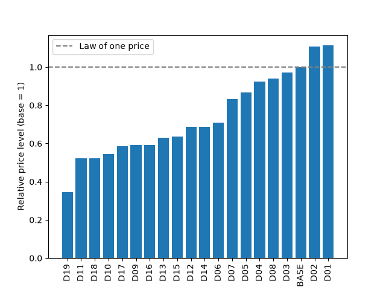
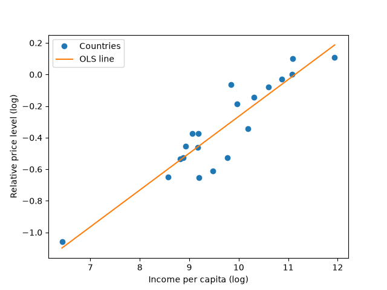

# 第 7 章: 一物一価と購買力平価

## 7.1 この章の地図

この章では、国による**物価**の違いを調べます。「同じ商品なら、どこで買っても、同じ値段になるはず」（一物一価）が、国際比較で成り立つかを、為替レートを通して確かめます。そして、第 1 部のまとめとして、**実際の統計**（Penn World Table）で、第 1〜6 章の関数を、試します。

| 項目 | 内容 |
| :--- | :--- |
| 経済学の題材 | 一物一価、購買力平価（PPP）、相対価格水準、ペン効果（豊かな国ほど物価が高い） |
| 使う Python の機能 | 第 3 章の回帰、`pandas.read_stata`（Stata ファイルの読み込み）、`groupby`、列の割り算 |
| 新しく導入するライブラリ | なし（`read_stata` は pandas の機能） |
| 完成形 | `price_in_dollars`、`ppp_rate`、`relative_price_level`、`load_prices`、`relative_price_levels`、`penn_effect_regression`、`income_adjusted_gaps`、`load_pwt`、`balanced_countries` |
| ファイル | 実装: `lib/chapter07/ppp.py`、`lib/chapter07/pwt.py`（実際の統計の読み込み）、`lib/chapter07/plot.py`（相対価格水準の図）／テスト: `test/chapter07/test_ppp.py`、`test/chapter07/test_pwt.py`、`test/chapter07/test_plot.py`（自分で書くときは、`practice/chapter07/` に、同じ名前で作ります） |
| データ | `data/prices.csv`（**架空の 20 か国**。実在の統計ではありません）、実際の統計 Penn World Table 10.01（7.5 節） |

### 経済学の式とコードの対応

| 経済学 | 式 | コード |
| :--- | :--- | :--- |
| ドル換算の価格 | 自国の価格 ÷ 為替レート e | `price_in_dollars(local_price, exchange_rate)` |
| PPP レート | 自国の価格 ÷ 米国の価格 | `ppp_rate(local_price, us_price)` |
| 相対価格水準 | ドル換算の価格 ÷ 米国の価格 = PPP レート ÷ e | `relative_price_level(...)`・`relative_price_levels(df)` |
| ペン効果の回帰 | ln(相対価格水準) = c + β·ln(所得) | `penn_effect_regression(df)` |

> **記号について**: e は為替レート（自国通貨 / ドル）です（第 13 章以降の e とは別）。この章の β は、ペン効果の回帰の傾き（ln 所得の係数）です。一覧は、[記号について](how-to-read.md#symbols) を参照してください。

## 7.2 予想する

同じ商品（例: ハンバーガー）が、日本で 450 円、米国で 5.5 ドルです。為替レートは、1 ドル 150 円です。

- 日本の価格は、ドルで、いくらですか
- PPP レート（一物一価が成り立つ為替レート）は、1 ドル何円ですか
- 日本の価格は、米国の価格の何倍ですか（相対価格水準）。日本は、米国より、安いですか、高いですか

## 7.3 購買力平価の考え方

### 一物一価と PPP

貿易できる同じ商品は、国によって価格が違えば、安い国で買って、高い国で売る（裁定）ことで、価格が揃うはずです（一物一価）。一物一価が成り立つなら、為替レートは、PPP レート（自国の価格 ÷ 米国の価格）に等しくなります。

### 相対価格水準

実際の為替レートと、PPP レートの比が、**相対価格水準**（PPP レート ÷ 為替レート）です。1 なら、一物一価が成り立っています。1 より小さければ、ドルで見て、米国より安い国です。

### ペン効果

実際のデータでは、豊かな国ほど、相対価格水準が高い傾向があります（**ペン効果**）。貿易できないサービス（理髪・外食など）の価格が、豊かな国ほど高いことが、一つの説明です。この傾向を、回帰で確かめます。傾きが正で、有意なら、豊かな国ほど、物価が高いと言えます。

## 7.4 プログラミング

### 価格・PPP レート・相対価格水準

予想する節の値を、テストにします。

```python
def test_円の価格をドルに直す() -> None:
    assert price_in_dollars(450, 150) == pytest.approx(3)


def test_PPPレートは自国の価格を米国の価格で割った値() -> None:
    assert ppp_rate(450, 5.5) == pytest.approx(450 / 5.5)


def test_相対価格水準は米国の価格を1としたドル建ての価格() -> None:
    assert relative_price_level(450, 150, 5.5) == pytest.approx(3 / 5.5)


def test_相対価格水準はPPPレートを為替レートで割った値() -> None:
    level = relative_price_level(450, 150, 5.5)
    assert level == pytest.approx(ppp_rate(450, 5.5) / 150)


def test_一物一価が成り立てばPPPレートは為替レートと等しい() -> None:
    # 825 円 ÷ 150 = 5.5 ドル
    assert relative_price_level(825, 150, 5.5) == pytest.approx(1)
    assert ppp_rate(825, 5.5) == pytest.approx(150)
```

3 つ目と 4 つ目は、**同じ量を、2 通りの式で求めて**、一致を確かめています。

```python
@pytest.mark.parametrize(
    ("local", "rate", "us"), [(0, 150, 5.5), (450, 0, 5.5), (450, 150, 0), (-1, 1, 1)]
)
def test_価格と為替レートは正でなければならない(
    local: float, rate: float, us: float
) -> None:
    with pytest.raises(ValueError, match="正"):
        relative_price_level(local, rate, us)


def test_ドル換算の価格も為替レートは正でなければならない() -> None:
    with pytest.raises(ValueError, match="正"):
        price_in_dollars(450, 0)


@pytest.mark.parametrize(("local", "us"), [(0, 5.5), (450, 0)])
def test_PPPレートの計算でも価格は正でなければならない(local: float, us: float) -> None:
    with pytest.raises(ValueError, match="正"):
        ppp_rate(local, us)
```

```python
def price_in_dollars(local_price: float, exchange_rate: float) -> float:
    """自国通貨の価格を、ドルに直す。"""
    if local_price <= 0 or exchange_rate <= 0:
        raise ValueError("価格と為替レートは正でなければならない")
    return local_price / exchange_rate


def ppp_rate(local_price: float, us_price: float) -> float:
    """PPP レート = 自国の価格 ÷ 米国の価格（自国通貨 / ドル）。"""
    if local_price <= 0 or us_price <= 0:
        raise ValueError("価格は正でなければならない")
    return local_price / us_price


def relative_price_level(
    local_price: float, exchange_rate: float, us_price: float
) -> float:
    """相対価格水準 = ドル換算の価格 ÷ 米国の価格。1 より小さければ、米国より安い。"""
    if us_price <= 0:
        raise ValueError("価格は正でなければならない")
    return price_in_dollars(local_price, exchange_rate) / us_price
```

### 国ごとの相対価格水準

```python
def test_同梱のデータは基準の国を含む20か国() -> None:
    df = load_prices()
    assert len(df) == 20
    assert df.index[0] == "BASE"
    assert list(df.columns) == ["local_price", "exchange_rate", "income"]


def test_基準の国の相対価格水準は1() -> None:
    levels = relative_price_levels(load_prices())
    assert levels["BASE"] == pytest.approx(1)


def test_相対価格水準を国ごとに求める() -> None:
    df = load_prices()
    levels = relative_price_levels(df)
    assert levels["D01"] == pytest.approx(
        relative_price_level(
            float(df["local_price"]["D01"]),
            float(df["exchange_rate"]["D01"]),
            float(df["local_price"]["BASE"]),
        )
    )


def test_基準の国がなければ受け付けない() -> None:
    df = load_prices().drop(index="BASE")
    with pytest.raises(ValueError, match="基準"):
        relative_price_levels(df)
```

```python
def load_prices(path: Path = DEFAULT_DATA_PATH) -> pd.DataFrame:
    """CSV を読み込み、国名を行の名前にした表を返す。

    列は local_price（自国通貨の価格）・exchange_rate（自国通貨 / ドル）・
    income（1 人当たりの所得、ドル）。
    """
    return pd.read_csv(path, index_col="country")


def relative_price_levels(df: pd.DataFrame, base: str = "BASE") -> pd.Series:
    """国ごとの相対価格水準（基準の国のドル換算の価格 = 1）を返す。"""
    if base not in df.index:
        raise ValueError(f"基準の国 {base} が、データにない")
    dollars = df["local_price"] / df["exchange_rate"]
    levels: pd.Series = dollars / dollars[base]
    return levels
```

`data/prices.csv` は、**架空の 20 か国**（基準の国 `BASE` と、D01〜D19）の、同じ商品の、自国通貨での価格・為替レート・1 人当たりの所得です。作り方は、`data/README.md` にあります。



図の読み方:

- 横軸が国、縦軸が、基準の国（BASE）を 1 とした、相対価格水準です。点線（高さ 1）が、一物一価です
- ほとんどの国が、1 より下（基準の国より安い）です。一番安い D19 は、約 0.35 です
- 一物一価は、成り立っていません。国による差が、大きいことが分かります

### ペン効果を回帰で調べる

```python
def test_豊かな国ほど物価が高いペン効果() -> None:
    result = penn_effect_regression(load_prices())
    assert list(result.coefficients.index) == ["const", "ln_income"]
    assert result.coefficients["ln_income"] == pytest.approx(0.233, abs=0.001)
    assert result.t_values()["ln_income"] > 5


def test_所得で説明した後の差の合計は0() -> None:
    gaps = income_adjusted_gaps(load_prices())
    assert gaps.sum() == pytest.approx(0, abs=1e-9)
    assert len(gaps) == 20


def test_所得で説明した後の差は対数の相対価格水準と回帰直線の差() -> None:
    df = load_prices()
    result = penn_effect_regression(df)
    gaps = income_adjusted_gaps(df)
    levels = relative_price_levels(df)
    fitted = result.coefficients["const"] + result.coefficients["ln_income"] * np.log(
        df["income"]
    )
    assert gaps.to_numpy() == pytest.approx((np.log(levels) - fitted).to_numpy())
```

```python
def penn_effect_regression(df: pd.DataFrame, base: str = "BASE") -> OlsResult:
    """対数の相対価格水準を、対数の所得に回帰する（ペン効果）。

    傾きが正なら、豊かな国ほど、物価が高い。
    """
    levels = relative_price_levels(df, base)
    x = pd.DataFrame({"ln_income": np.log(df["income"])})
    return fit_ols(np.log(levels), x)


def income_adjusted_gaps(df: pd.DataFrame, base: str = "BASE") -> pd.Series:
    """所得で説明できる分を除いた、対数の相対価格水準の差（回帰の残差）を返す。

    正なら、所得の割に、物価が高い。負なら、安い。合計は 0 になる。
    """
    result = penn_effect_regression(df, base)
    levels = relative_price_levels(df, base)
    fitted = result.coefficients["const"] + result.coefficients["ln_income"] * np.log(
        df["income"]
    )
    gaps: pd.Series = np.log(levels) - fitted
    return gaps
```

`income_adjusted_gaps` は、所得で説明できる分を除いた、「所得の割に、物価が高いか、安いか」です（回帰の残差）。

```python
from lib.chapter07.ppp import load_prices, penn_effect_regression

result = penn_effect_regression(load_prices())
result.coefficients, result.standard_errors, result.r_squared
```

| 変数 | 係数 | 標準誤差 |
| :--- | ---: | ---: |
| 定数項 | −2.598 | 0.226 |
| 対数の所得（ln_income） | 0.233 | 0.023 |

決定係数は 0.849 です。**所得が 2 倍になると、相対価格水準は、約 2^0.233 ≈ 1.18 倍（約 18% 高く）なります。**



図の読み方:

- 横軸が対数の所得、縦軸が対数の相対価格水準です。点は国です
- 右上がりの直線（傾き 0.233）が、ペン効果です。豊かな国ほど、物価が高い傾向があります
- 直線より下の国は、所得の割に、物価が安い国です（`income_adjusted_gaps` が負）

> **この結果は、架空のデータの結果です。** このデータは、傾きが 0.25 になるように作りました（推定値 0.233 は、それに近い）。実際の統計では、7.5 節で確かめます。

### 予想の答え合わせ

予想した答えを、プログラムで確かめます。

```python
from lib.chapter07.ppp import ppp_rate, price_in_dollars, relative_price_level

dollars = price_in_dollars(450, 150)
ppp = ppp_rate(450, 5.5)
level = relative_price_level(450, 150, 5.5)
print("日本の価格（ドル）:", round(dollars, 4))
print("PPP レート（円 / ドル）:", round(ppp, 4))
print("相対価格水準:", round(level, 4))
```

```text
日本の価格（ドル）: 3.0
PPP レート（円 / ドル）: 81.8182
相対価格水準: 0.5455
```

- 1 つ目の問い: 日本の価格は、ドルで **3 ドル**です（450 ÷ 150）
- 2 つ目の問い: PPP レートは、**約 81.8 円 / ドル**です（450 ÷ 5.5）。一物一価が成り立つなら、為替レートは 81.8 円 / ドルのはずですが、実際は 150 円 / ドルです
- 3 つ目の問い: 相対価格水準は、**約 0.545**（3 ÷ 5.5）です。日本の価格は、ドルで見ると、米国の約 55% で、**安い**です

### 実行結果

```bash
cd apps/macro-programming/python
uv run pytest test/chapter07
```

```text
30 passed
```

## 7.5 実際の統計で試す（Penn World Table）

ここまでの第 1〜7 章の関数は、架空のデータで試しました。最後に、**実際の国際比較データ**で、同じ関数を、そのまま使います。

### データを取得する

[Penn World Table（PWT）](https://www.rug.nl/ggdc/productivity/pwt/)は、フローニンゲン大学の GGDC が公開する、国際比較データです。この記事では、**PWT 10.01** を使います。

| 項目 | 内容 |
| :--- | :--- |
| 入手先 | [GGDC の PWT 10.01 のページ](https://www.rug.nl/ggdc/productivity/pwt/pwt-releases/pwt1001)（DOI: [10.34894/QT5BCC](https://doi.org/10.34894/QT5BCC)）。Stata 形式（`pwt1001.dta`）を使う |
| ライセンス | Creative Commons Attribution 4.0（CC BY 4.0）。**出典の明記が必要** |
| 引用 | Feenstra, R. C., Inklaar, R. and Timmer, M. P. (2015), "The Next Generation of the Penn World Table", American Economic Review, 105(10), 3150–3182 |
| 保存先 | `apps/macro-programming/python/data/pwt1001.dta`（Git の管理から外れています。リポジトリには入っていません） |

> **PWT は、新しい版が公開されています**（PWT 11.0 が、2025 年 10 月に公開されたと、GGDC のページに載っています）。この記事の数値は、**PWT 10.01** の結果です。別の版を使うと、列の名前や値が、変わることがあります。取得した日と、版を、記録しておきます。

### ファイルの形（実物で確かめたこと）

| 項目 | 内容 |
| :--- | :--- |
| 形式 | Stata（`.dta`）。`pandas.read_stata` で読める |
| 大きさ | 約 3.5 MB。12,810 行 × 52 列（183 か国 × 1950〜2019 年） |
| 行 | 国（`countrycode`: 3 文字の国コード）× 年（`year`） |
| 使う列 | `cgdpo`（産出側の GDP、購買力平価、2017 年の百万ドル）、`cn`（資本ストック、購買力平価、同）、`emp`（就業者、百万人）、`hc`（人的資本の指数）、`pop`（人口、百万人）、`pl_gdpo`（相対価格水準、米国の 2017 年 = 1） |
| 欠測 | 変数・国・年によって、値がない（たとえば、`hc` は 8,637 行、`emp` は 9,529 行にだけ値がある） |

注意: `rkna` という列は、「資本サービス」の**指数**（2017 年 = 1）で、資本ストックの水準ではありません。第 1 章の k には、`cn` を使います。

### 読み込む関数

就業者 1 人当たりの GDP（y = cgdpo ÷ emp）、資本（k = cn ÷ emp）、人的資本（h = hc）に直します。第 1〜3 章と、同じ形の表になるので、これまでの関数を、そのまま使えます。

```python
def write_dta(path: Path, rows: list[dict[str, object]]) -> None:
    columns = [
        "countrycode",
        "country",
        "year",
        "cgdpo",
        "cn",
        "emp",
        "hc",
        "pop",
        "pl_gdpo",
        "rgdpe",
    ]
    df = pd.DataFrame(rows, columns=columns)
    df.to_stata(path, write_index=False)


def row(code: str, year: int, **overrides: float) -> dict[str, object]:
    values: dict[str, object] = {
        "countrycode": code,
        "country": f"Country {code}",
        "year": year,
        "cgdpo": 1000.0,
        "cn": 3000.0,
        "emp": 10.0,
        "hc": 2.0,
        "pop": 20.0,
        "pl_gdpo": 0.5,
        "rgdpe": 999.0,
    }
    values.update(overrides)
    return values
```

テストは、公式のファイルと同じ列名の、小さな Stata ファイルを、テストの中で作って、確かめます。

```python
def test_国と年が行の名前になる(dta: Path) -> None:
    df = load_pwt(dta)
    assert list(df.index.names) == ["country", "year"]
    assert df.index.get_level_values("country").unique().tolist() == ["AAA", "BBB"]


def test_列の値は元の変数から計算される(dta: Path) -> None:
    df = load_pwt(dta)
    key = ("AAA", 2018)
    assert df.loc[key, "y"] == pytest.approx(1000 / 10)
    assert df.loc[key, "k"] == pytest.approx(3000 / 10)
    assert df.loc[key, "h"] == pytest.approx(2.0)
    assert df.loc[key, "income_pc"] == pytest.approx(1000 / 20)
    assert df.loc[key, "price_level"] == pytest.approx(0.5)
    assert df.loc[("AAA", 2019), "y"] == pytest.approx(110)


def test_使う列だけを返す(dta: Path) -> None:
    assert list(load_pwt(dta).columns) == ["y", "k", "h", "income_pc", "price_level"]


def test_欠けた値のある行は除く(dta: Path) -> None:
    df = load_pwt(dta)
    assert ("BBB", 2018) not in df.index


def test_就業者が0の行は除く(dta: Path) -> None:
    df = load_pwt(dta)
    assert ("BBB", 2019) not in df.index
    assert ("BBB", 2020) in df.index


def test_全年がそろう国だけを残す(dta: Path) -> None:
    df = load_pwt(dta)
    kept = balanced_countries(df, 2018, 2019)
    assert kept.index.get_level_values("country").unique().tolist() == ["AAA"]
    assert len(kept) == 2


def test_期間の外の年は残さない(dta: Path) -> None:
    kept = balanced_countries(load_pwt(dta), 2018, 2019)
    assert set(kept.index.get_level_values("year")) == {2018, 2019}


def test_期間の始まりは終わりより前でなければならない(dta: Path) -> None:
    with pytest.raises(ValueError, match="期間"):
        balanced_countries(load_pwt(dta), 2019, 2018)
```

```python
def load_pwt(path: Path) -> pd.DataFrame:
    """PWT の Stata ファイルを読み、国と年を行の名前にした表を返す。

    列は y・k・h（第 1〜3 章と同じ）、income_pc（人口 1 人当たりの GDP）、
    price_level（相対価格水準 pl_gdpo。米国の 2017 年 = 1）。
    値が欠けている行と、就業者・人口が 0 以下の行は、除く。
    """
    raw = pd.read_stata(path, columns=_COLUMNS).dropna()
    raw = raw[(raw["emp"] > 0) & (raw["pop"] > 0)]
    df = pd.DataFrame(
        {
            "country": raw["countrycode"].astype(str),
            "year": raw["year"].astype(int),
            "y": raw["cgdpo"].astype(float) / raw["emp"].astype(float),
            "k": raw["cn"].astype(float) / raw["emp"].astype(float),
            "h": raw["hc"].astype(float),
            "income_pc": raw["cgdpo"].astype(float) / raw["pop"].astype(float),
            "price_level": raw["pl_gdpo"].astype(float),
        }
    )
    return df.set_index(["country", "year"]).sort_index()


def balanced_countries(panel: pd.DataFrame, start: int, end: int) -> pd.DataFrame:
    """start 年から end 年までの全年に、値がそろっている国だけを、残す。"""
    if start >= end:
        raise ValueError("期間の始まりは終わりより前でなければならない")
    years = panel.index.get_level_values("year")
    within = panel[(years >= start) & (years <= end)]
    counts = within.groupby(level="country").size()
    complete = counts[counts == end - start + 1].index
    countries = within.index.get_level_values("country")
    return within[countries.isin(complete)]
```

### 第 1〜7 章の関数を、実際の統計に使う

```python
from pathlib import Path

from lib.chapter01.accounting import variance_shares
from lib.chapter02.growth import growth_contribution
from lib.chapter03.regression import development_accounting_regression
from lib.chapter06.convergence import beta_convergence, implied_speed
from lib.chapter07.pwt import balanced_countries, load_pwt

raw = load_pwt(Path("data/pwt1001.dta"))
panel = balanced_countries(raw, 1990, 2019)
latest = panel.xs(2019, level="year")

variance_shares(latest, alpha=1 / 3)
growth_contribution(panel, 1990, 2019, alpha=1 / 3)
development_accounting_regression(latest)
beta_convergence(panel, 1990, 2019)
```

欠測の行を除くと、8,201 行、144 か国が残ります。1990〜2019 年の全年がそろう国は、144 か国です。結果は、次のとおりです（PWT 10.01、α = 1/3）。

| 章 | 結果 | 架空のデータ | 実際の統計（PWT 10.01） |
| :--- | :--- | ---: | ---: |
| 1 | 2019 年の所得の分散を説明する TFP の割合 | 61.5% | **50.4%**（資本 36.9%、人的資本 12.7%） |
| 2 | 1990〜2019 年の平均の成長率（% / 年） | 2.78 | **2.02**（資本の寄与 1.15、人的資本 0.60、TFP 0.28） |
| 2 | TFP の寄与の割合（平均の寄与から） | 46% | **14%** |
| 3 | 回帰の資本の係数 | 0.878 | **0.728**（標準誤差 0.037）。人的資本は 0.423、決定係数 0.887 |
| 6 | 収斂の傾き β | −0.485（t = −8.2） | **−0.413**（t = −2.72、決定係数 0.05） |
| 6 | 収束の速さ λ（% / 年）、半減期 | 0.52、約 133 年 | **0.44、約 158 年** |
| 6 | 条件付き収斂（k・h を加えた）の ln_y0 の傾き | −0.224 | **−0.723**（t = −1.67） |

読み取れることと、注意点:

- **所得の差の約半分は、TFP の差です**（第 1 章）。架空のデータ（61.5%）より小さいものの、資本と人的資本だけでは、説明できません。ただし、資本の測り方（`cn`）と、α = 1/3 の仮定に依存します
- **成長の分解では、TFP の寄与が小さい**（第 2 章、14%）。1990〜2019 年の成長の大部分は、資本の蓄積（1.15）と人的資本（0.60）で、説明されます。水準の分解（50%）と、成長の分解（14%）で、TFP の割合が、大きく違います
- **回帰の資本の係数 0.728 は、真の α（1/3 とした値）を、大きく上回ります**（第 3 章）。実際のデータでも、TFP と資本が相関するために、係数が偏っている、可能性があります。ただし、実際の α の真の値は分かりません
- **収斂は、弱い**（第 6 章）。傾きは負ですが、決定係数は 0.05 で、t 値も −2.7 です。架空のデータ（決定係数 0.754）と比べて、関係は、ずっと弱いです

> **実際の統計の注意点**: 2019 年の就業者 1 人当たりの GDP は、最大のアイルランド（約 22 万ドル）と、最小のベネズエラ（約 600 ドル）で、約 360 倍の差があります。アイルランドの値は、多国籍企業の利益の計上の影響を、受けていると、言われています（この記事では、確かめていません）。1 か国の外れ値が、回帰の結果に、影響することがあります。

### ペン効果を、実際の統計で

PWT の `pl_gdpo`（相対価格水準）を、人口 1 人当たりの GDP（`cgdpo` ÷ `pop`）に回帰します（2019 年、144 か国）。

```python
import numpy as np
import pandas as pd

from lib.chapter03.regression import fit_ols

d = raw.xs(2019, level="year")
x = pd.DataFrame({"ln_income": np.log(d["income_pc"])})
fit_ols(np.log(d["price_level"]), x)
```

傾き（ln_income の係数）は **0.150**（標準誤差 0.033）、決定係数は 0.127 です。**豊かな国ほど、物価が高い**（ペン効果）は、実際の統計でも、確かめられました。傾きは、架空のデータ（0.233）より、小さいです。1 人当たりの所得が 2 倍の国は、物価が約 2^0.15 ≈ 1.11 倍（約 11% 高い）です。

## 7.6 規則で言うと

1. **同じ量を、2 通りの式で求めて、突き合わせる。** 相対価格水準は、「ドル換算の価格 ÷ 米国の価格」と、「PPP レート ÷ 為替レート」で、一致する
2. **実際の統計は、先に形を確かめてから、読む。** 文字コード・列の意味・単位・欠測を確認する。列の名前が似ていても（`rkna` と `cn`）、意味が違う
3. **架空のデータで作った関数を、実際の統計に使って、結果を比べる。** 構造が同じ表にそろえれば、関数は、そのまま使える。結果の違いから、モデルの限界が見える

混同しやすい点を、表にまとめます。

| 混同しやすい点 | 違い |
| :--- | :--- |
| PPP レート と 市場為替レート | PPP レートは、一物一価が成り立つなら、成り立つはずの為替レート。市場為替レートは、実際の値。この比が、相対価格水準 |
| 相対価格水準が低い と 通貨が安い | 相対価格水準が低い（ドルで見て物価が安い）のは、貧しい国に多い（ペン効果）。通貨が割安かどうかは、所得で説明できない分（`income_adjusted_gaps`）を見る |
| 架空のデータの結果 と 実際の統計の結果 | 架空のデータは、作った関係が、そのまま出る。実際の統計は、関係が弱く、ばらつく |

### このモデルが成り立たない場面

- **貿易できない財・サービスがあると、一物一価は成り立ちません。** 理髪や家賃の価格は、国によって違うままです。輸送費・関税・独占も、価格差を生みます
- **ペン効果の回帰は、因果ではなく、相関です。** 所得が高いから、物価が高いのか、別の要因が、両方を決めているのかは、分かりません
- **商品の質が、国によって違うと、価格を比べられません。** バスケットの中身が、国によって違うことも、あります
- **PWT の PPP は、推定値です。** 国によって、調査の質が違い、年によって、基準が改定されます

## 7.7 第 1 部の到達チェック

第 1 部（第 1〜7 章）の終わりです。何も見ずに、できるかどうかを、自分で確かめます。

### できること

| できること | 検証の方法 | 戻る章 |
| :--- | :--- | :--- |
| 生産関数から TFP を求め、所得の差を、資本・人的資本・TFP に分ける | α = 1/3、k = 8、h = 1、y = 2 で TFP = 1。3 つの寄与の和が、所得の差に一致する | 第 1 章 |
| 成長率を、3 つの寄与に分ける | g_k = 6%、g_h = 3%、g_A = 1% の国で、所得の成長率 5%、TFP の寄与 20% | 第 2 章 |
| 最小二乗法を、行列で書く | 3 点 (1, 2)、(2, 4)、(3, 5) の傾き 1.5、切片 2/3。statsmodels と一致する | 第 3 章 |
| 差分方程式の定常状態と安定性を求める | x(t+1) = 0.5·x(t) + 1 の定常状態 2。\|a\| < 1 で安定 | 第 4 章 |
| ソロー・モデルの定常状態と、収束の速さを求める | α = 0.5、s = 0.2、δ = 0.05 で k* = 16、λ = 0.025 | 第 5 章 |
| 成長率の回帰で、収斂を調べる | ちょうどの関係を満たす表で、傾きと速さを復元する | 第 6 章 |
| 相対価格水準を求め、ペン効果を回帰で調べる | 450 円・5.5 ドル・150 円 / ドルで、相対価格水準 0.545 | 第 7 章 |
| 実際の統計を、先に形を確かめてから読む | 列の意味・単位・欠測を、確認してから、関数を書く | 第 7 章（7.5 節） |

### 時間を決めて書く課題

何も見ずに、時間を計って、関数とテストを書きます。

| 課題 | 目安の時間 |
| :--- | :--- |
| 1 階差分方程式の経路・定常状態・安定性判定の関数と、テスト（x(t+1) = a·x(t) + b） | 15 分 |
| TFP を求める関数と、所得の差を 3 つに分ける関数と、恒等式のテスト | 20 分 |
| 成長率を回帰して、傾きから、収束の速さを求める関数と、ちょうどの関係を満たす表でのテスト | 25 分 |

### 誤りの原因の分類

できなかったときは、原因を分類して、戻る章に戻ります。

| 原因 | 例（第 1 部） | 対策 |
| :--- | :--- | :--- |
| 知らない | 対数の差で、成長率が足し算になる。回帰の標準誤差の式 | 第 1〜3 章に戻る |
| 見抜けない | 回帰の係数が偏っていること。傾きが負でも、収斂と言い切れないこと | 第 3 章・第 6 章の「成り立たない場面」を読む |
| 混同した | 水準の分解と成長の分解。第 5 章の λ（離散）と第 6 章の λ（連続）。対数の成長率とふつうの成長率 | 各章の「混同しやすい点」の表を読む |
| 手順の誤り | 年数で割り忘れる。対数をとらずに回帰する。実際の統計の単位（百万人）を確認しない | テストを先に書き、手計算の値と比べる |

## 7.8 練習問題

| 種類 | 問題 |
| :--- | :--- |
| 想起 | 本文を閉じて、`relative_price_level` のテスト（450 円、150 円 / ドル、5.5 ドルのとき、3 ÷ 5.5）を書いてください |
| 生成 | 解説を見る前に、所得が 2 倍になったとき、相対価格水準が何倍になるかを返す `price_multiplier_for_income_doubling(result)` を、テストから書いてください（傾き β のとき、2^β 倍です）。本文の約 1.18 倍を確かめます |
| 多様 | 基準の国を、BASE から D03 に変えて、ペン効果の傾きが、変わるかを、先に予想してから確かめてください |
| 交互 | 第 3 章の statsmodels との照合を使って、`penn_effect_regression` の係数・標準誤差・決定係数が、statsmodels の結果と一致することを、確かめてください |

??? note "解答（先に自分で取り組んでから、開いてください）"

    **想起**:

    ```python
    def test_相対価格水準は米国の価格を1としたドル建ての価格() -> None:
        assert relative_price_level(450, 150, 5.5) == pytest.approx(3 / 5.5)
    ```

    **生成**: ln(相対価格水準) = c + β·ln(所得) なので、所得が 2 倍（ln が ln 2 だけ増える）と、ln(相対価格水準) は β·ln 2 だけ増え、相対価格水準は 2^β 倍です。

    ```python
    def price_multiplier_for_income_doubling(result):
        return 2 ** result.coefficients["ln_income"]
    ```

    ```python
    def test_所得が2倍で相対価格水準は約1_18倍() -> None:
        result = penn_effect_regression(load_prices())
        assert price_multiplier_for_income_doubling(result) == pytest.approx(1.175, abs=0.001)


    def test_傾きが0なら所得が2倍でも物価は変わらない() -> None:
        from lib.chapter03.regression import OlsResult

        flat = OlsResult(
            coefficients=pd.Series({"const": 0.0, "ln_income": 0.0}),
            standard_errors=pd.Series({"const": 0.0, "ln_income": 0.0}),
            r_squared=0.0,
            n_obs=2,
            df_resid=0,
        )
        assert price_multiplier_for_income_doubling(flat) == pytest.approx(1)
    ```

    **多様**: 基準の国を変えると、すべての国の相対価格水準が、同じ倍率で変わります。対数をとると、**定数が足されるだけ**で、傾きは**変わらない**と予想できます（切片は、変わります）。

    ```python
    def test_基準の国を変えても傾きは変わらない() -> None:
        df = load_prices()
        before = penn_effect_regression(df, base="BASE")
        after = penn_effect_regression(df, base="D03")
        assert after.coefficients["ln_income"] == pytest.approx(before.coefficients["ln_income"])
        assert after.coefficients["const"] != pytest.approx(before.coefficients["const"])
    ```

    **交互**:

    ```python
    def test_statsmodelsの結果と一致する() -> None:
        import statsmodels.api as sm

        df = load_prices()
        ours = penn_effect_regression(df)
        y = np.log(relative_price_levels(df))
        x = sm.add_constant(pd.DataFrame({"ln_income": np.log(df["income"])}))
        theirs = sm.OLS(y, x).fit()
        assert ours.coefficients.to_numpy() == pytest.approx(theirs.params.to_numpy())
        assert ours.standard_errors.to_numpy() == pytest.approx(theirs.bse.to_numpy())
        assert ours.r_squared == pytest.approx(theirs.rsquared)
    ```

## 7.9 振り返り

- 予想した相対価格水準（約 0.55）は、当たりましたか
- 架空のデータと実際の統計で、結果が違った点（収斂の強さ、TFP の割合）を、どう説明しますか
- 実際の統計を読む前に、確かめておくべきことは何でしたか

## 7.10 まとめ

- 同じ商品の価格から、PPP レートと相対価格水準を求め、2 通りの式で一致を確かめた
- 豊かな国ほど物価が高い（ペン効果）を、回帰で確かめた（架空のデータの傾き 0.233、実際の統計 0.150）
- 実際の統計（Penn World Table 10.01）を、先に形を確かめてから読み込み、第 1〜6 章の関数を、そのまま使った
- 第 1 部の到達チェックで、成長・回帰・動学・収斂・物価の分析を、自分でできるかを確かめた
- 次の章からは、第 2 部「短期データ分析」に進みます。景気循環のデータを分析する前に、ランダムな動きを表す、確率過程を学びます
