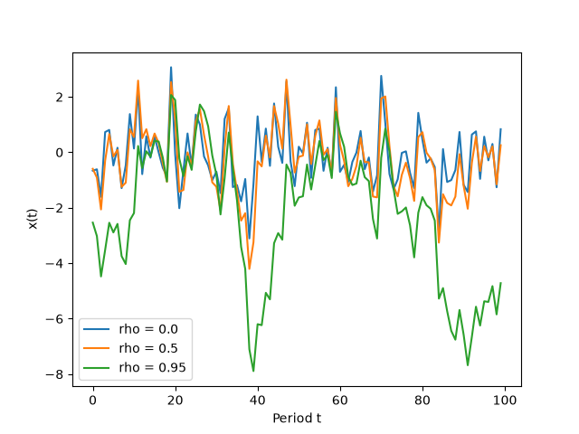
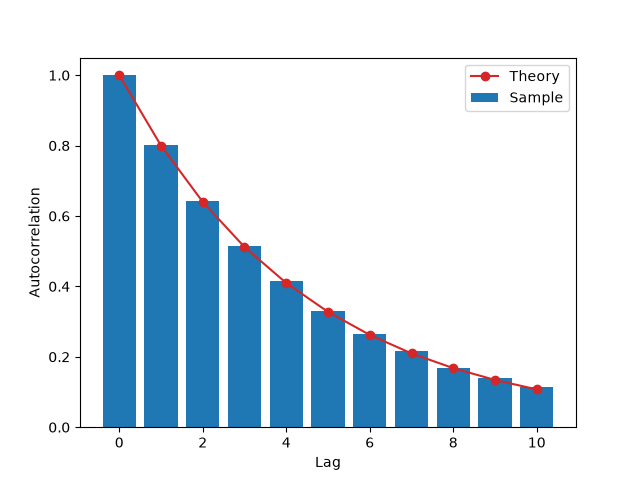

# 第 8 章: ランダム変数と確率過程

## 8.1 この章の地図

第 2 部では、景気循環のデータを分析します。景気循環は、**ランダムなショック**が、時間をかけて、広がっていく動きです。この章では、その動きを表す確率過程（ホワイト・ノイズと AR(1)）を、関数にして、**理論値と、シミュレーションの結果を、突き合わせます**。

| 項目 | 内容 |
| :--- | :--- |
| 経済学の題材 | ホワイト・ノイズ、AR(1)、自己相関、定常性、ショックの持続性と半減期 |
| 使う Python の機能 | 乱数の生成器（`np.random.Generator`）を引数で渡す、`for` ループによる系列の作成、`np.asarray`、`Sequence` と `NDArray` の型ヒント |
| 新しく導入するライブラリ | なし |
| 完成形 | `white_noise`、`ar1_series`、`sample_autocovariance`、`sample_autocorrelation`、`autocorrelation_function`、`ar1_variance`、`ar1_autocorrelation`、`shock_half_life`、`ar1_impulse_response` |
| ファイル | 実装: `lib/chapter08/stochastic.py`、`lib/chapter08/plot.py`（系列と自己相関の図）／テスト: `test/chapter08/test_stochastic.py`、`test/chapter08/test_plot.py`（自分で書くときは、`practice/chapter08/` に、同じ名前で作ります） |

### 経済学の式とコードの対応

| 経済学・統計学 | 式 | コード |
| :--- | :--- | :--- |
| ホワイト・ノイズ | ε(t) は、平均 0、分散 σ²、期の間で無相関 | `white_noise(n, sigma, rng)` |
| AR(1) | x(t) = ρ·x(t−1) + ε(t) | `ar1_series(rho, sigma, n, rng)` |
| 標本の自己共分散 | Σ (x(t) − x̄)(x(t−k) − x̄) ÷ n | `sample_autocovariance(x, lag)` |
| 標本の自己相関 | ラグ k の自己共分散 ÷ 分散 | `sample_autocorrelation(x, lag)` |
| AR(1) の分散 | σ² ÷ (1 − ρ²) | `ar1_variance(rho, sigma)` |
| AR(1) の自己相関 | ρ^k | `ar1_autocorrelation(rho, lag)` |
| ショックの半減期 | ln 0.5 ÷ ln\|ρ\| | `shock_half_life(rho)` |
| インパルス反応 | ρ^t × ショック | `ar1_impulse_response(rho, periods, shock)` |

> **記号について**: この章の ρ は、AR(1) の係数（持続性）で、σ は、ショックの標準偏差です（第 1 シリーズの第 8 章の σ と同じ使い方）。ρ は、後の章の限界消費性向などとは別です。一覧は、[記号について](how-to-read.md#symbols) を参照してください。

### 前提とする内容

| できること | 出典 |
| :--- | :--- |
| 乱数の生成器を引数で渡して、種を固定したテストを書く | 第 1 シリーズの第 8 章 |
| 1 階差分方程式の安定性（\|a\| < 1） | この記事の第 4 章 |
| 半減期の考え方 | この記事の第 5 章 |

## 8.2 予想する

AR(1) x(t) = ρ·x(t−1) + ε(t) で、ρ = 0.5、σ = 1 とします。

- x(t) の分散は、いくつですか（x の分散は、ρ² × 分散 + σ² を満たします）
- ラグ 1、ラグ 2 の自己相関は、いくつですか
- ρ を 0.95 に上げると、系列の見た目は、どう変わりますか

答えは、分散 = 1 ÷ (1 − 0.25) = 4/3 ≈ 1.33、ラグ 1 の自己相関は 0.5、ラグ 2 は 0.25 です。ρ = 0.95 では、ショックの影響が長く残り、系列は、ゆっくりと、大きく動きます。

## 8.3 確率過程の考え方

### ホワイト・ノイズ

期ごとに、独立に引かれる、平均 0 の乱数です。過去の値から、未来を予想する手がかりが、ありません（自己相関が 0）。経済のショック（技術・政策・需要の変化）のモデル化に使います。

### AR(1)

今期の値が、前期の値の ρ 倍と、新しいショックで決まります。

- |ρ| < 1 なら、**定常**です（分散・自己相関が、時間によらず一定）。ρ = 1 では、ランダム・ウォークになり、分散が時間とともに広がり、定常ではありません
- ρ が 1 に近いほど、**持続的**です。ショックの影響は、毎期 ρ 倍になるので、半減期は ln 0.5 ÷ ln ρ です
- 分散は σ² ÷ (1 − ρ²)、ラグ k の自己相関は ρ^k です

第 4 章の差分方程式 x(t+1) = a·x(t) + b で、a = ρ、b = 0 と見ると、**ショックへの反応（インパルス反応）は、第 4 章の経路そのもの**です。景気循環は、AR(1) でよく近似されます。

## 8.4 プログラミング

### 乱数の生成器を、引数で渡す

乱数を使う関数は、結果が毎回変わるので、テストしにくくなります。**乱数の生成器を、引数で渡して**、テストでは種を固定します（第 1 シリーズの第 8 章と同じ方針です）。

```python
def test_ホワイトノイズの平均は0で標準偏差は指定した値に近い() -> None:
    x = white_noise(100_000, 2.0, np.random.default_rng(0))
    assert x.mean() == pytest.approx(0, abs=0.03)
    assert x.std() == pytest.approx(2.0, abs=0.03)


def test_種が同じなら同じ系列() -> None:
    a = white_noise(10, 1.0, np.random.default_rng(5))
    b = white_noise(10, 1.0, np.random.default_rng(5))
    assert a.tolist() == b.tolist()


def test_系列の長さは正でなければならない() -> None:
    with pytest.raises(ValueError, match="長さ"):
        white_noise(0, 1.0, np.random.default_rng(0))


def test_標準偏差は負にできない() -> None:
    with pytest.raises(ValueError, match="標準偏差"):
        white_noise(10, -1.0, np.random.default_rng(0))
```

```python
def _check_sigma(sigma: float) -> None:
    if sigma < 0:
        raise ValueError("標準偏差は 0 以上でなければならない")


def white_noise(n: int, sigma: float, rng: np.random.Generator) -> NDArray[np.float64]:
    """平均 0、標準偏差 sigma の、独立な正規乱数 n 個。乱数の生成器を、引数で渡す。"""
    if n < 1:
        raise ValueError("系列の長さは 1 以上でなければならない")
    _check_sigma(sigma)
    return rng.normal(0.0, sigma, n)
```

### 標本の自己相関

標本の自己相関を、手計算できる小さな例で、確かめます。x = [1, 2, 3, 4] の平均は 2.5 で、ラグ 1 の自己共分散は ((−1.5)(−0.5) + (−0.5)(0.5) + (0.5)(1.5)) ÷ 4 = 0.3125 です。分散（ラグ 0 の自己共分散）は 5 ÷ 4 = 1.25 なので、自己相関は 0.3125 ÷ 1.25 = 0.25 です。

```python
def test_自己共分散を手計算と比べる() -> None:
    assert sample_autocovariance(X, 0) == pytest.approx(1.25)
    assert sample_autocovariance(X, 1) == pytest.approx(0.3125)


def test_自己相関を手計算と比べる() -> None:
    assert sample_autocorrelation(X, 0) == pytest.approx(1)
    assert sample_autocorrelation(X, 1) == pytest.approx(0.25)


def test_自己相関関数はラグ0から並べる() -> None:
    assert autocorrelation_function(X, 2) == pytest.approx([1, 0.25, -0.3])


@pytest.mark.parametrize("lag", [-1, 4, 10])
def test_ラグは0以上で系列の長さより短くなければならない(lag: int) -> None:
    with pytest.raises(ValueError, match="ラグ"):
        sample_autocovariance(X, lag)


def test_定数の系列では自己相関は求められない() -> None:
    with pytest.raises(ValueError, match="変動"):
        sample_autocorrelation([2.0, 2.0, 2.0], 1)
```

```python
def sample_autocovariance(x: Sequence[float] | NDArray[np.float64], lag: int) -> float:
    """標本の自己共分散 = Σ (x(t) − 平均)(x(t−lag) − 平均) ÷ n。"""
    values = np.asarray(x, dtype=float)
    n = len(values)
    if lag < 0 or lag >= n:
        raise ValueError("ラグは 0 以上で、系列の長さより短くなければならない")
    centered = values - values.mean()
    return float((centered[lag:] * centered[: n - lag]).sum() / n)


def sample_autocorrelation(x: Sequence[float] | NDArray[np.float64], lag: int) -> float:
    """標本の自己相関 = ラグ lag の自己共分散 ÷ 分散（ラグ 0 の自己共分散）。"""
    variance = sample_autocovariance(x, 0)
    if variance == 0:
        raise ValueError("系列に変動がないので、自己相関は求められない")
    return sample_autocovariance(x, lag) / variance


def autocorrelation_function(
    x: Sequence[float] | NDArray[np.float64], max_lag: int
) -> NDArray[np.float64]:
    """ラグ 0 から max_lag までの自己相関を並べる（ラグ 0 は 1）。"""
    return np.array([sample_autocorrelation(x, lag) for lag in range(max_lag + 1)])
```

標本の分散は、n で割ります（n − 1 ではありません）。自己相関は、自己共分散と分散の比なので、割り算の分母がそろっていれば、どちらでも同じです。

### AR(1) を作る

```python
def test_AR1の分散は理論値4_3に近い() -> None:
    x = ar1_series(0.5, 1.0, 100_000, np.random.default_rng(2))
    assert x.var() == pytest.approx(4 / 3, abs=0.05)


def test_AR1の自己相関はラグkでrhoのk乗に近い() -> None:
    x = ar1_series(0.5, 1.0, 100_000, np.random.default_rng(2))
    assert sample_autocorrelation(x, 1) == pytest.approx(0.5, abs=0.01)
    assert sample_autocorrelation(x, 2) == pytest.approx(0.25, abs=0.01)


def test_rhoが負なら自己相関も負() -> None:
    x = ar1_series(-0.7, 1.0, 100_000, np.random.default_rng(3))
    assert sample_autocorrelation(x, 1) == pytest.approx(-0.7, abs=0.01)


def test_AR1の長さは指定どおり() -> None:
    assert len(ar1_series(0.9, 1.0, 50, np.random.default_rng(0))) == 50


@pytest.mark.parametrize("rho", [1.0, -1.0, 1.5])
def test_rhoの絶対値が1以上なら定常ではない(rho: float) -> None:
    with pytest.raises(ValueError, match="定常"):
        ar1_series(rho, 1.0, 10, np.random.default_rng(0))
```

乱数のテストは、**理論値に、十分近い**ことで確かめます（種を固定した、10 万個の系列で、分散は 1.333、ラグ 1・2・3 の自己相関は 0.501・0.251・0.123）。理論値は、1.333、0.5・0.25・0.125 です。

```python
def _check_stationary(rho: float) -> None:
    if abs(rho) >= 1:
        raise ValueError("rho の絶対値が 1 以上なので、定常ではない")


def ar1_series(
    rho: float, sigma: float, n: int, rng: np.random.Generator, burn_in: int = 200
) -> NDArray[np.float64]:
    """AR(1) x(t) = ρ·x(t−1) + ε(t) の系列を、長さ n で作る。

    初期値の影響を消すために、最初の burn_in 個は捨てる。
    """
    _check_stationary(rho)
    shocks = white_noise(n + burn_in, sigma, rng)
    x = np.zeros(n + burn_in)
    for t in range(1, n + burn_in):
        x[t] = rho * x[t - 1] + shocks[t]
    return x[burn_in:]
```

最初の 200 個（`burn_in`）を捨てているのは、初期値（0）の影響を消すためです。



図の読み方:

- 3 本とも、同じ種の乱数（同じショック）から作りました。違いは、ρ だけです
- ρ = 0（青）は、ショックがそのまま現れ、すぐ平均に戻ります
- ρ = 0.95（緑）は、ショックの影響が長く残り、長い間、平均から離れたままになります（−8 まで下がっています）

### 理論値と、半減期

```python
def test_AR1の分散の理論値() -> None:
    # σ² ÷ (1 − ρ²) = 1 ÷ 0.75
    assert ar1_variance(0.5, 1.0) == pytest.approx(4 / 3)


def test_rhoが1なら分散は求められない() -> None:
    with pytest.raises(ValueError, match="定常"):
        ar1_variance(1.0, 1.0)


def test_AR1の自己相関の理論値はrhoのk乗() -> None:
    assert ar1_autocorrelation(0.5, 3) == pytest.approx(0.125)
    assert ar1_autocorrelation(-0.5, 3) == pytest.approx(-0.125)


def test_ショックの半減期() -> None:
    assert shock_half_life(0.5) == pytest.approx(1)
    assert shock_half_life(0.9) == pytest.approx(np.log(0.5) / np.log(0.9))


@pytest.mark.parametrize("rho", [0, 1, -1, 1.2])
def test_半減期はrhoの絶対値が0より大きく1より小さいときだけ(rho: float) -> None:
    with pytest.raises(ValueError, match="rho"):
        shock_half_life(rho)
```

```python
def ar1_variance(rho: float, sigma: float) -> float:
    """AR(1) の分散の理論値 σ² ÷ (1 − ρ²)。"""
    _check_stationary(rho)
    return sigma**2 / (1 - rho**2)


def ar1_autocorrelation(rho: float, lag: int) -> float:
    """AR(1) のラグ k の自己相関の理論値 ρ^k。"""
    return float(rho**lag)


def shock_half_life(rho: float) -> float:
    """ショックの影響が半分になるまでの期間 = ln 0.5 ÷ ln|ρ|。"""
    if not 0 < abs(rho) < 1:
        raise ValueError("rho の絶対値は 0 より大きく 1 より小さくなければならない")
    return math.log(0.5) / math.log(abs(rho))
```

| ρ | 分散（σ = 1） | ラグ 4 の自己相関 | ショックの半減期（期） |
| ---: | ---: | ---: | ---: |
| 0.5 | 1.33 | 0.06 | 1.0 |
| 0.85 | 3.60 | 0.52 | 4.3 |
| 0.9 | 5.26 | 0.66 | 6.6 |
| 0.95 | 10.26 | 0.82 | 13.5 |
| 0.99 | 50.25 | 0.96 | 69.0 |

ρ が 1 に近づくと、分散と半減期が、急に大きくなります。

### インパルス反応

```python
def test_インパルス反応は毎期rho倍() -> None:
    assert ar1_impulse_response(0.8, 2) == pytest.approx([1, 0.8, 0.64])


def test_インパルス反応は第4章の差分方程式の経路と同じ() -> None:
    assert ar1_impulse_response(0.8, 10, shock=2.0) == pytest.approx(
        linear_path(0.8, 0, 2.0, 10)
    )
```

```python
def ar1_impulse_response(
    rho: float, periods: int, shock: float = 1.0
) -> NDArray[np.float64]:
    """1 回のショックの影響の推移 ρ^t·shock。第 4 章の差分方程式（a = ρ、b = 0）。"""
    return np.array(linear_path(rho, 0, shock, periods))
```

### 標本の自己相関と、理論値を比べる

ρ = 0.8 の AR(1)（5000 個）の、標本の自己相関を、理論値 ρ^k と比べます。

| ラグ | 0 | 1 | 2 | 3 | 4 | 5 |
| :--- | ---: | ---: | ---: | ---: | ---: | ---: |
| 標本 | 1.000 | 0.801 | 0.643 | 0.515 | 0.415 | 0.330 |
| 理論値 0.8^k | 1.000 | 0.800 | 0.640 | 0.512 | 0.410 | 0.328 |



図の読み方:

- 棒が、標本の自己相関、赤い線が、理論値 ρ^k です。ラグが増えるにつれて、ρ の累乗で、小さくなります
- 標本と理論値は、よく一致します。**自己相関のグラフの形から、ρ を読み取れます**（ラグ 1 の値が、ρ の推定値になります）

### 実行結果

```bash
cd apps/macro-programming/python
uv run pytest test/chapter08
```

```text
33 passed
```

## 8.5 規則で言うと

1. **乱数の生成器を、引数で渡す。** 種を固定すれば、結果が再現できる。テストは、理論値に十分近いことで確かめる
2. **理論値と、シミュレーションを突き合わせる。** 関数が正しいかを、数式の答え（分散・自己相関）で確かめる
3. **持続性は、ρ で決まる。** ρ が 1 に近いほど、ショックの影響が長く残る

混同しやすい点を、表にまとめます。

| 混同しやすい点 | 違い |
| :--- | :--- |
| ホワイト・ノイズ と AR(1) | ホワイト・ノイズは、自己相関が 0。AR(1) は、ρ のぶんだけ、前期に引きずられる |
| 定常 と 平均に戻る | |ρ| < 1 なら定常で、ショックの影響は消える。ρ = 1 では、影響は消えず、系列は、平均に戻らない（ランダム・ウォーク） |
| 標本の自己相関 と 理論値 | 標本は、ばらつく（短い系列ではとくに）。理論値に近いかを、長い系列で確かめる |

### このモデルが成り立たない場面

- **実際の景気循環は、AR(1) より、複雑です。** 2 期以上前の値にも依存したり（AR(2)）、ショックが非正規だったり、時期によって性質が変わったりします
- **標本の自己相関は、系列が短いと、偏ります。** 実際のマクロ・データは、数十〜百数十個しかなく、ρ の推定は、不確かです
- **トレンドを取り除いていない系列では、ρ が 1 に近く見えます。** 次の章で、トレンドと循環に分けます

## 8.6 練習問題

| 種類 | 問題 |
| :--- | :--- |
| 想起 | 本文を閉じて、x = [1, 2, 3, 4] の、ラグ 1 の自己相関（0.25）を確かめるテストを書いてください |
| 生成 | 解説を見る前に、系列から ρ を推定する `estimate_rho(x)`（ラグ 1 の自己相関）を、テストから書いてください。ρ = 0.7 の AR(1)（2000 個）で、推定値が 0.7 に近いことを確かめます |
| 多様 | ρ を 0.5、0.9、0.99 に変えて、ショックの半減期と、ラグ 4 の自己相関の理論値を、先に予想してから求めてください |
| 交互 | 第 5 章の `half_life(speed)`（収束の速さ λ から求める半減期）を、ρ = 0.9 のときの `shock_half_life` と比べてください。どう関係しますか |

??? note "解答（先に自分で取り組んでから、開いてください）"

    **想起**:

    ```python
    def test_自己相関を手計算と比べる() -> None:
        assert sample_autocorrelation([1.0, 2.0, 3.0, 4.0], 1) == pytest.approx(0.25)
    ```

    **生成**: AR(1) のラグ 1 の自己相関は ρ なので、標本のラグ 1 の自己相関が、ρ の推定値になります。

    ```python
    def estimate_rho(x):
        return sample_autocorrelation(x, 1)
    ```

    ```python
    def test_AR1の係数を推定する() -> None:
        x = ar1_series(0.7, 1.0, 2000, np.random.default_rng(10))
        assert estimate_rho(x) == pytest.approx(0.7, abs=0.05)
    ```

    推定値は 0.702 でした。系列が短いと、ばらつきます（標準誤差は、おおよそ √((1 − ρ²) ÷ n)）。

    **多様**: ρ が 1 に近いほど、半減期が、急に長くなる、と予想できます。

    ```python
    def test_rhoを変えたときの半減期と自己相関() -> None:
        assert shock_half_life(0.5) == pytest.approx(1.0)
        assert shock_half_life(0.9) == pytest.approx(6.58, abs=0.01)
        assert shock_half_life(0.99) == pytest.approx(68.97, abs=0.01)
        assert ar1_autocorrelation(0.9, 4) == pytest.approx(0.656, abs=0.001)
        assert ar1_autocorrelation(0.99, 4) == pytest.approx(0.961, abs=0.001)
    ```

    ρ = 0.5 で 1.0 期、0.9 で 6.6 期、0.99 で 69.0 期です。ρ が 0.99 のように 1 に近いと、四半期のデータでは、ショックの影響が、17 年も残ります。

    **交互**: 第 5 章の収束の速さ λ は、1 期当たりに、乖離が縮む割合で、乖離は毎期 (1 − λ) 倍になります。AR(1) のショックの影響も、毎期 ρ 倍なので、**λ = 1 − ρ** と読めば、同じ半減期になります。

    ```python
    def test_半減期は第5章の半減期と同じ() -> None:
        assert shock_half_life(0.9) == pytest.approx(half_life(1 - 0.9))
    ```

    ソロー・モデルの資本の収束も、AR(1) のショックの消え方も、同じ「毎期一定の割合で縮む」動きです。

## 8.7 振り返り

- 予想した分散 4/3 と、自己相関 0.5・0.25 は、当たりましたか
- ρ が 1 に近いと、なぜ、分散と半減期が急に大きくなるのかを、説明できますか
- 乱数を使う関数のテストで、何に気をつけましたか

## 8.8 まとめ

- ホワイト・ノイズと AR(1) を、乱数の生成器を引数にした関数で作り、手計算の自己相関と、理論値（分散・自己相関）で確かめた
- ショックの半減期は、ρ で決まる。第 4・5 章の差分方程式と、同じ構造
- 次の章では、実際のマクロ時系列を、トレンドと循環に分け、循環の大きさ・相関・自己相関を調べます
