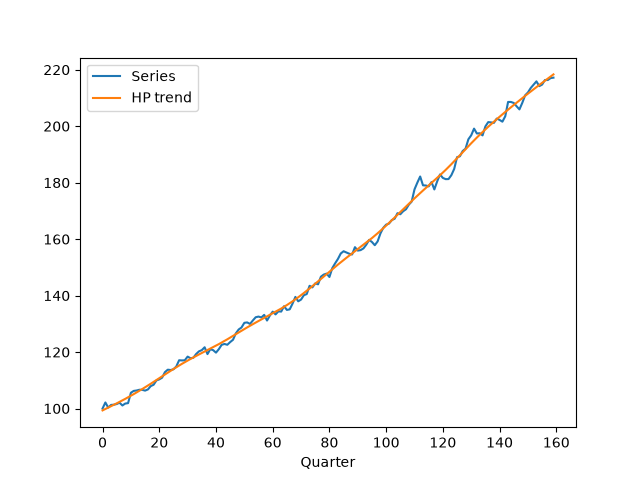
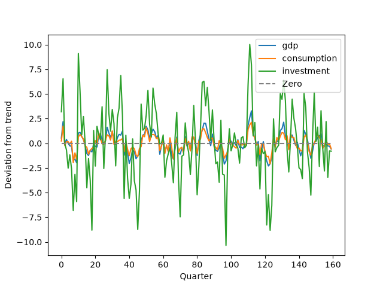
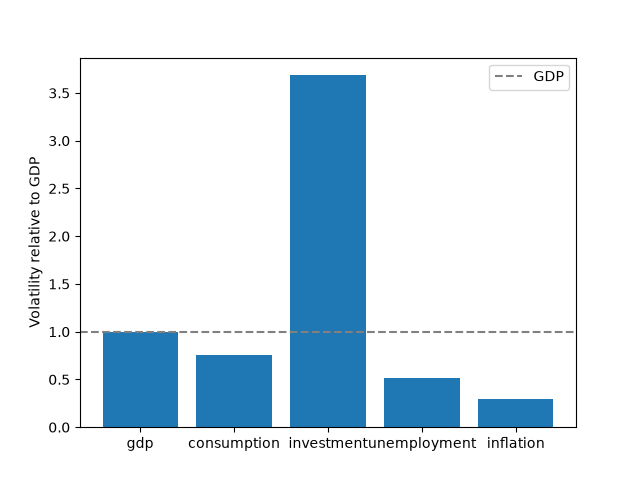

# 第 9 章: 主なマクロ・データの特徴

## 9.1 この章の地図

景気循環を調べるには、まず、系列を**トレンド**（長期の動き）と**循環**（トレンドからの乖離）に分けます。この章では、HP フィルターを自作して、statsmodels と照合し、四半期のマクロ時系列の、循環の特徴を調べます。

| 項目 | 内容 |
| :--- | :--- |
| 経済学の題材 | トレンドと循環、景気循環の変動の大きさ・共変動・持続性（景気循環の事実） |
| 使う Python の機能 | 行列計算（`np.eye`・`np.diff`・`np.linalg.solve`）、`pd.PeriodIndex`（四半期）、`Series.corr`・`shift` |
| 新しく導入するライブラリ | なし（statsmodels は、照合に使う） |
| 完成形 | `load_quarterly`、`hp_trend`、`cycle`、`log_cycle`、`volatility`、`relative_volatility`、`cross_correlation`、`cycle_statistics` |
| ファイル | 実装: `lib/chapter09/cycles.py`、`lib/chapter09/plot.py`（トレンド・循環・変動の図）／テスト: `test/chapter09/test_cycles.py`、`test/chapter09/test_plot.py`（自分で書くときは、`practice/chapter09/` に、同じ名前で作ります） |
| データ | `data/quarterly.csv`（**架空の国**の、1980Q1〜2019Q4 の四半期データ 160 個。実在の統計ではありません） |

### 経済学の式とコードの対応

| 経済学・統計学 | 式 | コード |
| :--- | :--- | :--- |
| HP トレンド | (I + λ·D'D)·τ = y（λ = 1600） | `hp_trend(series, smoothing)` |
| 循環（率の系列） | 系列 − トレンド | `cycle(series, smoothing)` |
| 循環（水準の系列） | 100 × (ln y − ln のトレンド) | `log_cycle(series, smoothing)` |
| 変動の大きさ | 標準偏差 | `volatility(x)` |
| 共変動 | 相関係数 | `cross_correlation(x, y, lag)` |
| 循環の統計 | 標準偏差・相対的な大きさ・GDP との相関・自己相関 | `cycle_statistics(df)` |

> **記号について**: この章の λ は、HP フィルターの**平滑化の強さ**（四半期で 1600）です。第 5・6 章の λ（収束の速さ）とは、別のものです（コードの引数名は `smoothing` です）。D は 2 階差分の行列です。一覧は、[記号について](how-to-read.md#symbols) を参照してください。

## 9.2 予想する

GDP・消費・投資の景気循環を、トレンドからの乖離（%）で見ます。

- 変動が最も大きいのは、どれですか。最も小さいのは、どれですか
- 失業率の循環は、GDP の循環と、同じ向きですか、逆向きですか
- 景気循環は、1 四半期前の循環と、どれくらい似ていますか（自己相関は、高いですか、低いですか）

答えは、変動が大きいのが投資、小さいのが消費（経済学の景気循環の事実）です。失業率は、GDP と逆に動きます。循環には、持続性があります（自己相関が正）。この章のデータで、実際の値を確かめます。

## 9.3 トレンドと循環の考え方

### トレンドをどう決めるか

マクロの系列は、長期的に伸びます。景気循環を見るには、その成長（トレンド）を取り除く必要があります。トレンドの決め方は、一つではありません。この章では、**HP フィルター**を使います。

HP フィルターのトレンド τ は、次の 2 つを、両立させます。

- 系列 y に近い（残差 y − τ の二乗和が小さい）
- 滑らか（τ の 2 階差分の二乗和が小さい）

この 2 つの重みの比が、平滑化の強さ λ です。λ が大きいほど、トレンドは滑らかで、直線に近づきます。解は、行列の連立方程式 (I + λ·D'D)·τ = y で、第 1 シリーズの第 9 章の連立方程式（`np.linalg.solve`）と、同じ方法で解けます。

### 水準と率で、循環の測り方が違う

GDP・消費・投資のような水準の系列は、**対数をとって**、トレンドからの乖離を、%で見ます。失業率・物価上昇率のような、すでに率の系列は、**差**（%ポイント）で見ます。

## 9.4 Red → Green → Refactor

### HP トレンド

```python
def series(values: list[float]) -> pd.Series:
    return pd.Series(values, dtype=float)


def test_直線の系列のHPトレンドは系列そのもの() -> None:
    x = series([1.0 + 2 * t for t in range(20)])
    assert hp_trend(x).to_numpy() == pytest.approx(x.to_numpy())


def test_定数の系列のトレンドは定数() -> None:
    x = series([5.0] * 10)
    assert hp_trend(x).to_numpy() == pytest.approx(5.0)


def test_循環の平均は0() -> None:
    rng = np.random.default_rng(1)
    x = pd.Series(np.cumsum(rng.normal(0.5, 1.0, 80)))
    assert cycle(x).mean() == pytest.approx(0, abs=1e-9)


def test_平滑化の強さを大きくするとトレンドは直線に近づく() -> None:
    rng = np.random.default_rng(2)
    x = pd.Series(np.cumsum(rng.normal(0.5, 1.0, 60)))
    t = np.arange(60)
    slope, intercept = np.polyfit(t, x.to_numpy(), 1)
    line = intercept + slope * t
    smooth = hp_trend(x, 1e9).to_numpy()
    rough = hp_trend(x, 1.0).to_numpy()
    assert np.abs(smooth - line).max() < np.abs(rough - line).max()
    assert smooth == pytest.approx(line, abs=0.01)


def test_系列の長さが3未満ならトレンドは求められない() -> None:
    with pytest.raises(ValueError, match="長さ"):
        hp_trend(series([1.0, 2.0]))


def test_平滑化の強さは正でなければならない() -> None:
    with pytest.raises(ValueError, match="平滑化"):
        hp_trend(series([1.0, 2.0, 3.0]), 0)


def test_行の名前はそのまま引き継ぐ() -> None:
    x = pd.Series([1.0, 2.0, 3.0, 4.0], index=list("abcd"))
    assert list(hp_trend(x).index) == list("abcd")
```

```python
def hp_trend(series: pd.Series, smoothing: float = 1600) -> pd.Series:
    """HP フィルターのトレンド。直線の系列は、そのまま残る。"""
    n = len(series)
    if n < 3:
        raise ValueError("系列の長さは 3 以上でなければならない")
    if smoothing <= 0:
        raise ValueError("平滑化の強さは正でなければならない")
    second_difference = np.diff(np.eye(n), 2, axis=0)
    system = np.eye(n) + smoothing * second_difference.T @ second_difference
    trend = np.linalg.solve(system, series.to_numpy(dtype=float))
    return pd.Series(trend, index=series.index)
```

`np.diff(np.eye(n), 2, axis=0)` が、2 階差分の行列 D です。

### statsmodels と照合する

```python
def test_HPフィルターはstatsmodelsの結果と一致する() -> None:
    rng = np.random.default_rng(0)
    x = pd.Series(np.cumsum(rng.normal(0.5, 1.0, 120)))
    theirs_cycle, theirs_trend = sm.tsa.filters.hpfilter(x, lamb=1600)
    assert hp_trend(x, 1600).to_numpy() == pytest.approx(theirs_trend.to_numpy())
    assert cycle(x, 1600).to_numpy() == pytest.approx(theirs_cycle.to_numpy())
```

自作のトレンドと循環が、statsmodels の `hpfilter` と、一致します（λ = 1600）。

### 循環

```python
def test_毎期同じ率で伸びる系列の対数の循環は0() -> None:
    x = series([100 * 1.01**t for t in range(40)])
    assert log_cycle(x).to_numpy() == pytest.approx(0, abs=1e-9)


def test_対数の循環は対数のトレンドからの乖離のパーセント() -> None:
    x = series([100 * 1.01**t for t in range(40)])
    x.iloc[20] *= 1.05
    result = log_cycle(x)
    assert result.iloc[20] > 3.5
    assert result.iloc[20] == result.max()
```

```python
def cycle(series: pd.Series, smoothing: float = 1600) -> pd.Series:
    """循環 = 系列 − HP トレンド（失業率や物価上昇率のような、率の系列に使う）。"""
    return series - hp_trend(series, smoothing)


def log_cycle(series: pd.Series, smoothing: float = 1600) -> pd.Series:
    """対数のトレンドからの乖離（%）。GDP などの水準の系列に使う。"""
    logs = series.apply(np.log)
    return 100 * (logs - hp_trend(logs, smoothing))
```

### 変動の大きさと、共変動

```python
def test_標準偏差を手計算と比べる() -> None:
    # 1、2、3、4 の標本の標準偏差 = √(5 ÷ 3)
    assert volatility(series([1, 2, 3, 4])) == pytest.approx(np.sqrt(5 / 3))


def test_相対的な変動の大きさ() -> None:
    x = series([1, 2, 3, 4])
    assert relative_volatility(3 * x, x) == pytest.approx(3)


def test_同じ系列の相関は1で逆向きの系列は負1() -> None:
    x = series([1, 3, 2, 5, 4, 6])
    assert cross_correlation(x, x) == pytest.approx(1)
    assert cross_correlation(x, -x) == pytest.approx(-1)


def test_ラグを指定すると系列をずらして相関を求める() -> None:
    x = series([0, 1, 0, -1, 0, 1, 0, -1])
    y = x.shift(1)  # y(t) = x(t−1)
    assert cross_correlation(x, y, lag=-1) == pytest.approx(1)
    assert cross_correlation(x, y, lag=0) == pytest.approx(0, abs=1e-9)
```

```python
def volatility(x: pd.Series) -> float:
    """変動の大きさ = 標本の標準偏差。"""
    return float(x.std())


def relative_volatility(x: pd.Series, y: pd.Series) -> float:
    """x の変動の大きさが、y の何倍か。"""
    return volatility(x) / volatility(y)


def cross_correlation(x: pd.Series, y: pd.Series, lag: int = 0) -> float:
    """x(t) と y(t − lag) の相関係数。lag = 0 なら、同じ時点の相関。"""
    return float(x.corr(y.shift(lag)))
```

### データを読み込む

```python
def test_CSVを読むと四半期の期間が行の名前になる(tmp_path: Path) -> None:
    path = tmp_path / "q.csv"
    path.write_text(
        "year,quarter,gdp,consumption,investment,unemployment,inflation\n"
        "2000,1,100,60,20,4.0,2.0\n2000,2,101,61,21,4.1,2.1\n",
        encoding="utf-8",
    )
    df = load_quarterly(path)
    assert str(df.index[0]) == "2000Q1"
    assert str(df.index[1]) == "2000Q2"
    assert list(df.columns) == [
        "gdp",
        "consumption",
        "investment",
        "unemployment",
        "inflation",
    ]


def test_同梱のデータは1980年から2019年までの160四半期() -> None:
    df = load_quarterly()
    assert len(df) == 160
    assert str(df.index[0]) == "1980Q1"
    assert str(df.index[-1]) == "2019Q4"
```

```python
def load_quarterly(path: Path = DEFAULT_DATA_PATH) -> pd.DataFrame:
    """CSV を読み込み、四半期（1980Q1 など）を行の名前にした表を返す。"""
    raw = pd.read_csv(path)
    periods = pd.PeriodIndex(
        [f"{y}Q{q}" for y, q in zip(raw["year"], raw["quarter"], strict=True)],
        freq="Q",
    )
    return raw.drop(columns=["year", "quarter"]).set_index(periods)
```

`data/quarterly.csv` は、**架空の国**の 160 四半期のデータです（実在の統計ではありません）。列は、`gdp`・`consumption`・`investment`（実質、水準）、`unemployment`（失業率、%）、`inflation`（物価上昇率、年率 %）です。作り方は、`data/README.md` にあります。



図の読み方:

- 横軸が四半期（0 = 1980Q1）、縦軸が GDP です。青が実際の系列、オレンジが HP トレンドです
- トレンドは、長期の成長（1 四半期当たり、約 0.49%）を表します。実際の系列は、その上下を、ゆらぎます
- この上下の動きが、**循環**です

### 循環の統計

```python
def test_循環の統計は変数ごとの行() -> None:
    stats = cycle_statistics(load_quarterly())
    assert list(stats.index) == [
        "gdp",
        "consumption",
        "investment",
        "unemployment",
        "inflation",
    ]
    assert list(stats.columns) == [
        "volatility",
        "relative_to_gdp",
        "correlation_with_gdp",
        "autocorrelation",
    ]


def test_GDP自身の相対的な変動は1で相関は1() -> None:
    stats = cycle_statistics(load_quarterly())
    assert stats.loc["gdp", "relative_to_gdp"] == pytest.approx(1)
    assert stats.loc["gdp", "correlation_with_gdp"] == pytest.approx(1)


def test_投資は消費より変動が大きい() -> None:
    stats = cycle_statistics(load_quarterly())
    relative = stats["relative_to_gdp"]
    assert float(relative["investment"]) > float(relative["consumption"])


def test_失業率の循環はGDPの循環と逆に動く() -> None:
    stats = cycle_statistics(load_quarterly())
    assert float(stats["correlation_with_gdp"]["unemployment"]) < -0.9


def test_同梱のデータの循環の統計の値() -> None:
    stats = cycle_statistics(load_quarterly())
    assert stats["volatility"]["gdp"] == pytest.approx(1.008, abs=0.001)
    assert stats["relative_to_gdp"]["investment"] == pytest.approx(3.686, abs=0.001)
    assert stats["relative_to_gdp"]["consumption"] == pytest.approx(0.761, abs=0.001)
    assert stats["correlation_with_gdp"]["unemployment"] == pytest.approx(
        -0.963, abs=0.001
    )
    assert stats["autocorrelation"]["gdp"] == pytest.approx(0.623, abs=0.001)
```

```python
def cycle_statistics(df: pd.DataFrame, smoothing: float = 1600) -> pd.DataFrame:
    """変数ごとの循環の統計。

    変動の大きさ、GDP に対する相対的な変動、GDP との相関、自己相関。
    GDP・消費・投資は対数の乖離（%）、失業率・物価上昇率は差（%ポイント）で見る。
    """
    cycles = pd.DataFrame(
        {
            **{name: log_cycle(df[name], smoothing) for name in _LEVELS},
            **{name: cycle(df[name], smoothing) for name in _RATES},
        }
    )
    gdp = cycles["gdp"]
    return pd.DataFrame(
        {
            "volatility": [volatility(cycles[c]) for c in cycles],
            "relative_to_gdp": [relative_volatility(cycles[c], gdp) for c in cycles],
            "correlation_with_gdp": [cross_correlation(cycles[c], gdp) for c in cycles],
            "autocorrelation": [
                sample_autocorrelation(cycles[c].to_numpy(), 1) for c in cycles
            ],
        },
        index=list(cycles.columns),
    )
```

```python
from lib.chapter09.cycles import cycle_statistics, load_quarterly

cycle_statistics(load_quarterly())
```

| 変数 | 変動の大きさ | GDP に対する相対的な大きさ | GDP との相関 | 自己相関（ラグ 1） |
| :--- | ---: | ---: | ---: | ---: |
| GDP | 1.008 | 1.000 | 1.000 | 0.623 |
| 消費 | 0.768 | 0.761 | 0.935 | 0.501 |
| 投資 | 3.717 | 3.686 | 0.862 | 0.437 |
| 失業率 | 0.520 | 0.515 | −0.963 | 0.605 |
| 物価上昇率 | 0.300 | 0.297 | 0.474 | 0.201 |

（変動の大きさ: GDP・消費・投資は %、失業率・物価上昇率は %ポイント。相対的な大きさは、単位が違うので、GDP・消費・投資の間でだけ比べられます）





図の読み方:

- 投資（緑）の循環は、GDP（青）の約 3.7 倍も大きく、消費（オレンジ）は、約 0.76 倍と小さいです。**投資は、景気の変動の主役**で、消費は、なだらかです
- 3 本とも、同じタイミングで上下します（相関 0.94・0.86）。好況のとき、消費も投資も増えます
- 失業率の循環は、GDP と逆に動きます（相関 −0.96）。次の章のオークンの法則です

> **これは、架空のデータの結果です。** このデータは、消費が GDP の 0.7 倍、投資が 3 倍で反応するように作りました（HP フィルターで取り出した値は、0.76 倍と 3.7 倍で、それに近い）。実際の景気循環の事実と、傾向は似ていますが、数値は、実際の統計で確かめる必要があります（7 章の方法で、実際の統計を読み込めます）。

### 実行結果

```bash
cd apps/macro-programming/python
uv run pytest test/chapter09
```

```text
26 passed
```

## 9.5 規則で言うと

1. **トレンドの決め方で、循環が変わる。** 循環は、「トレンドからの乖離」なので、トレンドをどう決めるかに、依存する
2. **水準は対数、率は差。** GDP のような水準は、対数をとって、% で見る。失業率のような率は、%ポイントで見る
3. **景気循環の事実は、大きさ・共変動・持続性で、まとめる。** 投資は大きい、消費は小さい、失業率は逆向き、循環には持続性がある

混同しやすい点を、表にまとめます。

| 混同しやすい点 | 違い |
| :--- | :--- |
| トレンド と 長期の平均成長率 | トレンドは、時点ごとに値を持つ曲線。平均成長率は 1 つの数 |
| 循環の大きさ と 成長率の大きさ | 循環は、トレンドからの乖離（水準の動き）。成長率は、前期との差。持続性（自己相関）が高いと、循環は大きく、成長率は小さく見える |
| 相関 と 因果 | 失業率が GDP と逆に動くのは、相関。どちらが原因かは、別の問題 |

### このモデルが成り立たない場面

- **HP フィルターは、標本の端で、不正確です。** 最初と最後のトレンドは、前後のデータが足りないので、不安定です（最新のデータで、循環が大きく変わることがあります）
- **平滑化の強さ λ = 1600 は、慣習です。** 理論的に、正しい値ではありません。練習問題の「多様」で、λ を変えると、循環の大きさと自己相関が変わることを確かめます
- **HP フィルターは、見かけ上の循環を、作ることがあります。** ランダム・ウォークのような、循環のない系列にも、循環が現れます（トレンドを取り除く方法の限界）
- **架空のデータでは、トレンドが直線です。** 実際の統計では、トレンドが、折れ曲がったり、構造変化があったりします

## 9.6 練習問題

| 種類 | 問題 |
| :--- | :--- |
| 想起 | 本文を閉じて、「直線の系列は、HP トレンドが系列そのもの」というテストを書いてください |
| 生成 | 解説を見る前に、ラグを変えながら、2 つの系列の相関を並べる `lagged_correlations(x, y, lags)`（ラグ → 相関の辞書）を、テストから書いてください。消費と GDP の循環で、相関が最も高いラグを調べます |
| 多様 | 平滑化の強さ λ を 100、1600、10000、100000 に変えて、GDP の循環の標準偏差と、自己相関が、どう変わるかを、先に予想してから確かめてください |
| 交互 | 第 8 章の `autocorrelation_function` で、GDP の循環の自己相関を、ラグ 4 まで求めてください。AR(1) の理論値 ρ^k（ρ = ラグ 1 の自己相関）と、比べてください |

??? note "解答（先に自分で取り組んでから、開いてください）"

    **想起**:

    ```python
    def test_直線の系列のHPトレンドは系列そのもの() -> None:
        x = pd.Series([1.0 + 2 * t for t in range(20)])
        assert hp_trend(x).to_numpy() == pytest.approx(x.to_numpy())
    ```

    **生成**: x(t) と y(t − lag) の相関を、ラグごとに求めます。

    ```python
    def lagged_correlations(x, y, lags):
        return {lag: cross_correlation(x, y, lag) for lag in lags}
    ```

    ```python
    def test_ずらした系列の相関はラグ0で最大() -> None:
        x = pd.Series([0, 1, 0, -1, 0, 1, 0, -1], dtype=float)
        result = lagged_correlations(x, x.shift(1), [-1, 0, 1])
        assert result[-1] == pytest.approx(1)
        assert max(result, key=lambda lag: result[lag]) == -1


    def test_消費と_GDPの相関は同じ時点で最大() -> None:
        df = load_quarterly()
        gdp = log_cycle(pd.Series(df["gdp"]))
        consumption = log_cycle(pd.Series(df["consumption"]))
        result = lagged_correlations(consumption, gdp, [-2, -1, 0, 1, 2])
        assert max(result, key=lambda lag: result[lag]) == 0
        assert result[0] == pytest.approx(0.935, abs=0.001)
    ```

    ラグ −2 から 2 の相関は、0.33・0.59・0.94・0.56・0.33 で、同じ時点（ラグ 0）で最大です。消費と GDP は、同時に動きます（先行も遅行もしていません）。

    **多様**: λ が大きいほど、トレンドが滑らかで、トレンドに含まれる動きが減るので、循環は**大きく、持続的**になる、と予想できます。

    ```python
    def test_平滑化の強さによる循環の違い() -> None:
        gdp = pd.Series(load_quarterly()["gdp"])
        stds = [log_cycle(gdp, lam).std() for lam in (100, 1600, 10000, 100000)]
        assert stds == sorted(stds)
        assert stds == pytest.approx([0.758, 1.008, 1.101, 1.200], abs=0.001)
        acf1 = [
            sample_autocorrelation(log_cycle(gdp, lam).to_numpy(), 1)
            for lam in (100, 1600, 10000, 100000)
        ]
        assert acf1 == pytest.approx([0.371, 0.623, 0.677, 0.722], abs=0.001)
    ```

    λ = 100 で標準偏差 0.76・自己相関 0.37、λ = 100000 で 1.20・0.72 です。**循環の大きさも持続性も、λ の選び方で、大きく変わります**。結論を出すときは、λ を変えても、同じ結論になるかを、確かめます。

    **交互**:

    ```python
    def test_GDPの循環の自己相関と_AR1の理論値() -> None:
        gdp = pd.Series(load_quarterly()["gdp"])
        acf = autocorrelation_function(log_cycle(gdp).to_numpy(), 4)
        assert acf == pytest.approx([1, 0.623, 0.342, 0.131, 0.058], abs=0.001)
        theory = [ar1_autocorrelation(acf[1], k) for k in range(5)]
        assert acf[2] < theory[2]
    ```

    標本の自己相関は 1・0.62・0.34・0.13・0.06 で、AR(1) の理論値（0.62^k = 1・0.62・0.39・0.24・0.15）より、速く 0 に近づきます。HP フィルターで取り出した循環は、元の景気循環（ρ = 0.85 の AR(1) として作りました）より、持続性が小さく見えます（トレンドに、循環の一部が吸収されるため）。

## 9.7 振り返り

- 変動の大きさの順序（投資 > GDP > 消費）を、予想できましたか
- 平滑化の強さを変えると、結論が変わりました。実際の分析では、何に注意しますか
- 水準の系列と、率の系列で、循環の測り方を変えたのは、なぜですか

## 9.8 まとめ

- HP フィルターを行列で自作し、statsmodels と一致することを確かめた
- 水準は対数の乖離（%）、率は差（%ポイント）で、循環を求めた
- 景気循環の事実（投資は大きく、消費は小さい、失業率は逆向き、循環に持続性がある）を、架空のデータで確かめた
- 次の章では、失業率と GDP の関係（オークンの法則）、失業率と物価の関係（フィリップス曲線）を、回帰で調べます
