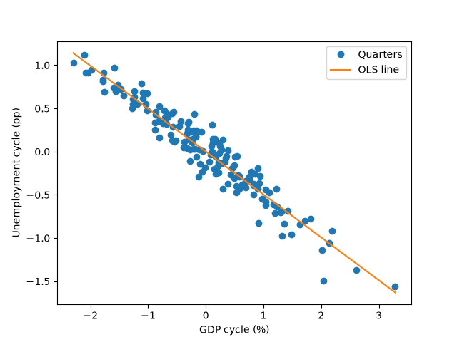
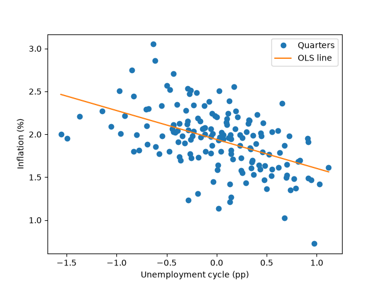
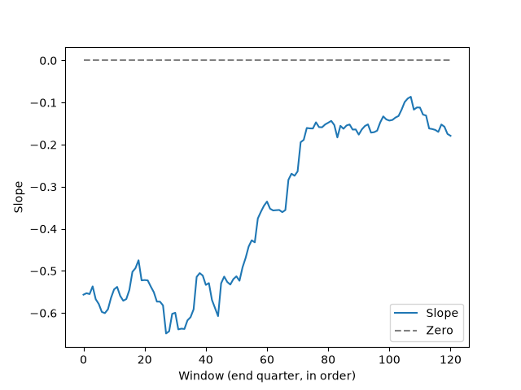

# 第 10 章: オークンの法則とフィリップス曲線

## 10.1 この章の地図

前の章で取り出した循環を使って、2 つの有名な関係を調べます。**オークンの法則**（GDP が好調なとき、失業率が下がる）と、**フィリップス曲線**（失業率が低いとき、物価上昇率が高い）です。第 3 章の回帰を、そのまま使います。そして、フィリップス曲線が、時期によって、**平らになる**様子を、窓をずらした回帰で見ます。

| 項目 | 内容 |
| :--- | :--- |
| 経済学の題材 | オークンの法則、フィリップス曲線、フラット化するフィリップス曲線 |
| 使う Python の機能 | 第 3 章の `fit_ols`、`PeriodIndex.year`、論理値で行を選ぶ、窓をずらす `for` ループ |
| 新しく導入するライブラリ | なし |
| 完成形 | `okun_regression`、`okun_regression_from_data`、`phillips_regression`、`phillips_regression_from_data`、`phillips_by_period`、`rolling_slope` |
| ファイル | 実装: `lib/chapter10/okun_phillips.py`、`lib/chapter10/plot.py`（傾きの推移の図）／テスト: `test/chapter10/test_okun_phillips.py`、`test/chapter10/test_plot.py`（自分で書くときは、`practice/chapter10/` に、同じ名前で作ります） |
| データ | 第 9 章の `data/quarterly.csv`（架空の国の四半期データ） |

### 経済学の式とコードの対応

| 経済学 | 式 | コード |
| :--- | :--- | :--- |
| オークンの法則 | 失業率の循環 = c + β·GDP の循環（β < 0） | `okun_regression(unemployment_cycle, output_cycle)` |
| フィリップス曲線 | 物価上昇率 = c + β·失業率の循環（β < 0） | `phillips_regression(inflation, unemployment_gap)` |
| 期間による違い | 期間を分けて、別々に回帰 | `phillips_by_period(df, split_year)` |
| 窓をずらした傾き | 窓ごとに回帰した傾き | `rolling_slope(x, y, window)` |

> **記号について**: この章の β は、回帰の傾きです（第 3・6・7 章と同じ使い方）。第 14 章のフィリップス曲線の傾き a とは、別の記号です（第 1 シリーズの第 14 章の `slope` に当たります）。一覧は、[記号について](how-to-read.md#symbols) を参照してください。

### 前提とする内容

| できること | 出典 |
| :--- | :--- |
| 循環を取り出す | この記事の第 9 章 |
| 最小二乗法の回帰（係数・標準誤差・t 値） | この記事の第 3 章 |
| オークンの法則・フィリップス曲線の式 | 第 1 シリーズの第 14 章 |

## 10.2 予想する

- 実質 GDP が、トレンドより 1% 高いとき、失業率は、トレンドより、何%ポイント低いでしょうか（大きさを予想してください）
- 失業率が、トレンドより 1%ポイント低いとき、物価上昇率は、平均より、どれだけ高いでしょうか
- 2000 年代以降、物価上昇率は、失業率の変化に、あまり反応しなくなった、と言われます。これは、フィリップス曲線の傾きが、どうなったことですか

## 10.3 オークンの法則とフィリップス曲線の考え方

### オークンの法則

GDP の循環（トレンドからの乖離、%）が大きいとき、企業は労働者を増やすので、失業率の循環（%ポイント）は小さくなります。失業率の循環を、GDP の循環に回帰すると、傾き β は負で、**GDP が 1% 好調なとき、失業率が |β| %ポイント下がる**ことを表します。

### フィリップス曲線

失業率が低い（労働市場が逼迫している）とき、賃金・物価が上がりやすく、物価上昇率が高くなります。物価上昇率を、失業率の循環に回帰すると、傾き β は負です。

### 傾きは、変わりうる

フィリップス曲線の傾きは、時期によって、変わります。傾きが小さくなる（平らになる）と、失業率が下がっても、物価はあまり上がりません。金融政策の判断に、大きく関わります。

## 10.4 プログラミング

### オークンの法則

ちょうどの関係を満たす表で、係数を復元できるかを、先に確かめます。

```python
def exact_series(slope: float, intercept: float = 0.0) -> tuple[pd.Series, pd.Series]:
    x = pd.Series([-2.0, -1.0, 0.0, 1.0, 2.0, 1.5, -0.5, 0.5])
    return intercept + slope * x, x
```

```python
def test_ちょうどの関係を満たすデータでオークンの係数を復元できる() -> None:
    u, g = exact_series(-0.5)
    result = okun_regression(u, g)
    assert result.coefficients["output_cycle"] == pytest.approx(-0.5)
    assert result.coefficients["const"] == pytest.approx(0)
    assert result.r_squared == pytest.approx(1)
```

```python
def okun_regression(
    unemployment_cycle: pd.Series, output_cycle: pd.Series
) -> OlsResult:
    """失業率の循環（%ポイント）を、GDP の循環（%）に回帰する。"""
    return fit_ols(unemployment_cycle, pd.DataFrame({"output_cycle": output_cycle}))


def okun_regression_from_data(df: pd.DataFrame, smoothing: float = 1600) -> OlsResult:
    """四半期のデータ（gdp・unemployment の列）から、オークンの法則を回帰する。"""
    output = log_cycle(pd.Series(df["gdp"]), smoothing)
    unemployment = cycle(pd.Series(df["unemployment"]), smoothing)
    return okun_regression(unemployment, output)
```

第 9 章の `log_cycle`（GDP）と `cycle`（失業率）で循環を取り出し、第 3 章の `fit_ols` に渡しています。

```python
def test_同梱のデータのオークンの係数は負() -> None:
    result = okun_regression_from_data(load_quarterly())
    assert result.coefficients["output_cycle"] < -0.4
    assert result.t_values()["output_cycle"] < -20


def test_同梱のデータのオークンの係数の値() -> None:
    result = okun_regression_from_data(load_quarterly())
    assert result.coefficients["output_cycle"] == pytest.approx(-0.496, abs=0.002)
    assert result.r_squared == pytest.approx(0.927, abs=0.005)
    assert result.n_obs == 160
```

```python
from lib.chapter09.cycles import load_quarterly
from lib.chapter10.okun_phillips import okun_regression_from_data

result = okun_regression_from_data(load_quarterly())
result.coefficients, result.standard_errors, result.t_values(), result.r_squared
```

| 変数 | 係数 | 標準誤差 | t 値 |
| :--- | ---: | ---: | ---: |
| 定数項 | 0.000 | 0.011 | 0.0 |
| GDP の循環（output_cycle） | −0.496 | 0.011 | −44.7 |

決定係数は 0.927、観測数は 160 です。**GDP が 1% 好調なとき、失業率は約 0.5%ポイント下がります**（オークンの法則）。定数項が 0 なのは、循環の平均が 0 だからです。



図の読み方:

- 横軸が GDP の循環（%）、縦軸が失業率の循環（%ポイント）です。点は四半期です
- 点は、右下がりの直線の近くに、集まっています（決定係数 0.93）。GDP が高いとき、失業率は低いです
- 傾き −0.496 は、このデータを作ったときの値（−0.5）に近い値です

### フィリップス曲線

```python
def test_ちょうどの関係を満たすデータでフィリップス曲線の傾きを復元できる() -> None:
    pi, gap = exact_series(-0.4, intercept=2.0)
    result = phillips_regression(pi, gap)
    assert result.coefficients["unemployment_gap"] == pytest.approx(-0.4)
    assert result.coefficients["const"] == pytest.approx(2.0)


def test_同梱のデータのフィリップス曲線の傾きは負() -> None:
    result = phillips_regression_from_data(load_quarterly())
    assert result.coefficients["unemployment_gap"] < 0
    assert result.t_values()["unemployment_gap"] < -3
```

```python
def phillips_regression(inflation: pd.Series, unemployment_gap: pd.Series) -> OlsResult:
    """物価上昇率（%）を、失業率の循環（%ポイント）に回帰する。"""
    return fit_ols(inflation, pd.DataFrame({"unemployment_gap": unemployment_gap}))


def phillips_regression_from_data(
    df: pd.DataFrame, smoothing: float = 1600
) -> OlsResult:
    """四半期のデータ（unemployment・inflation の列）で、フィリップス曲線を回帰する。"""
    gap = cycle(pd.Series(df["unemployment"]), smoothing)
    return phillips_regression(pd.Series(df["inflation"]), gap)
```

全期間の回帰では、傾きは **−0.337**（標準誤差 0.048、t 値 −7.0）、決定係数は 0.238 です。切片は 1.94（失業率の循環が 0 のときの、物価上昇率）です。



図の読み方:

- 横軸が失業率の循環、縦軸が物価上昇率です。点は四半期です
- 右下がりの傾向は見えますが、点のばらつきは、オークンの法則より、ずっと大きいです（決定係数 0.24）。物価には、失業率以外の要因（ショック）が多いためです

### 期間を分けて、傾きを比べる

```python
def test_期間を分けるとフィリップス曲線は後半で平らになる() -> None:
    parts = phillips_by_period(load_quarterly(), split_year=2000)
    before = parts["before"].coefficients["unemployment_gap"]
    after = parts["after"].coefficients["unemployment_gap"]
    assert before < after < 0
    assert abs(before) > 2 * abs(after) * 0.8


def test_期間を分けたフィリップス曲線の傾きの値() -> None:
    parts = phillips_by_period(load_quarterly(), split_year=2000)
    assert parts["before"].coefficients["unemployment_gap"] == pytest.approx(
        -0.571, abs=0.005
    )
    assert parts["after"].coefficients["unemployment_gap"] == pytest.approx(
        -0.161, abs=0.005
    )


def test_期間を分ける年は範囲の内側でなければならない() -> None:
    with pytest.raises(ValueError, match="年"):
        phillips_by_period(load_quarterly(), split_year=1980)
    with pytest.raises(ValueError, match="年"):
        phillips_by_period(load_quarterly(), split_year=2030)


def test_期間を分けた観測数の合計は全体と等しい() -> None:
    df = load_quarterly()
    parts = phillips_by_period(df, split_year=2000)
    assert parts["before"].n_obs + parts["after"].n_obs == len(df)
```

```python
def phillips_by_period(
    df: pd.DataFrame, split_year: int, smoothing: float = 1600
) -> dict[str, OlsResult]:
    """split_year の前（before）と後（after）で、フィリップス曲線を別々に回帰する。

    失業率の循環は、全期間のデータで求めてから、期間で分ける。
    """
    years = df.index.year  # type: ignore[attr-defined]
    if split_year <= years.min() or split_year > years.max():
        raise ValueError("分ける年は、データの範囲の内側でなければならない")
    gap = cycle(pd.Series(df["unemployment"]), smoothing)
    inflation = pd.Series(df["inflation"])
    before = years < split_year
    return {
        "before": phillips_regression(inflation[before], gap[before]),
        "after": phillips_regression(inflation[~before], gap[~before]),
    }
```

2000 年の前後で分けると、傾きは次のとおりです。

| 期間 | 傾き | t 値 | 観測数 | 決定係数 |
| :--- | ---: | ---: | ---: | ---: |
| 2000 年より前（1980〜1999 年） | −0.571 | −7.3 | 80 | 0.409 |
| 2000 年以降（2000〜2019 年） | −0.161 | −3.1 | 80 | 0.110 |

**傾きの大きさが、約 3.5 分の 1 に小さくなりました**。2000 年以降のフィリップス曲線は、平らです（フラット化）。

### 窓をずらして、傾きの推移を見る

分ける年を、一つ決めると、その年の選び方に、結果が依存します。窓（40 四半期 = 10 年）を、1 四半期ずつずらして、傾きを求めます。

```python
def test_窓をずらした傾きの数は系列の長さ引く窓の幅足す1() -> None:
    u, g = exact_series(-0.5)
    slopes = rolling_slope(g, u, window=4)
    assert len(slopes) == 8 - 4 + 1


def test_窓をずらした傾きはちょうどの関係なら常に同じ() -> None:
    u, g = exact_series(-0.5)
    assert rolling_slope(g, u, window=4).to_numpy() == pytest.approx(-0.5)


def test_最初の窓の傾きは直接回帰した傾きと一致する() -> None:
    rng = np.random.default_rng(0)
    x = pd.Series(rng.normal(size=30))
    y = pd.Series(-0.3 * x + rng.normal(0, 0.1, 30))
    first = rolling_slope(x, y, window=10).iloc[0]
    direct = okun_regression(
        y.iloc[:10].reset_index(drop=True), x.iloc[:10].reset_index(drop=True)
    )
    assert first == pytest.approx(direct.coefficients["output_cycle"])


def test_窓の幅は3以上で系列の長さ以下でなければならない() -> None:
    u, g = exact_series(-0.5)
    with pytest.raises(ValueError, match="窓"):
        rolling_slope(g, u, window=2)
    with pytest.raises(ValueError, match="窓"):
        rolling_slope(g, u, window=9)


def test_窓をずらした傾きの行の名前は窓の最後の時点() -> None:
    df = load_quarterly()
    slopes = rolling_slope(
        pd.Series(df["unemployment"]), pd.Series(df["inflation"]), window=40
    )
    assert str(slopes.index[0]) == "1989Q4"
    assert str(slopes.index[-1]) == "2019Q4"
```

```python
def rolling_slope(x: pd.Series, y: pd.Series, window: int) -> pd.Series:
    """窓（window 個の観測）をずらしながら、y を x に回帰した傾きを求める。

    行の名前は、窓の最後の時点。傾きが時間とともに変わるか（平らになるか）を見る。
    """
    if window < 3 or window > len(x):
        raise ValueError("窓の幅は 3 以上で、系列の長さ以下でなければならない")
    slopes = {}
    for start in range(len(x) - window + 1):
        stop = start + window
        result = fit_ols(y.iloc[start:stop], pd.DataFrame({"x": x.iloc[start:stop]}))
        slopes[x.index[stop - 1]] = result.coefficients["x"]
    return pd.Series(slopes)
```



図の読み方:

- 横軸は、窓の順番（0 は、1980Q1〜1989Q4 の窓）、縦軸は、その窓の傾きです。破線は 0 です
- 傾きは、−0.56 から始まり、1996Q3 の窓で最も急（−0.65）になり、その後、一貫して上がり、−0.1〜−0.2 に落ち着きます
- 1999 年を境に、傾きが小さくなったことが、**滑らかな推移**として見えます（このデータは、1999 年（80 四半期目）で、傾きが 0.5 から 0.2 に変わるように作りました）

> **これは、架空のデータの結果です。** 実際のデータで、フィリップス曲線が平らになったかは、実際の統計で確かめる必要があります。

### 予想の答え合わせ

予想した答えを、プログラムで確かめます。第 9 章のデータで、オークンの法則とフィリップス曲線を回帰します。

```python
from lib.chapter09.cycles import load_quarterly
from lib.chapter10.okun_phillips import (
    okun_regression_from_data,
    phillips_by_period,
    phillips_regression_from_data,
)

df = load_quarterly()
okun = okun_regression_from_data(df)
print("オークンの法則の傾き:", round(float(okun.coefficients["output_cycle"]), 3))
print(
    "GDP が 1% 好調なときの失業率（%ポイント）:",
    round(float(okun.coefficients["output_cycle"]) * 1, 3),
)

phillips = phillips_regression_from_data(df)
slope = float(phillips.coefficients["unemployment_gap"])
print("フィリップス曲線の傾き（全期間）:", round(slope, 3))
print("失業率が 1%ポイント低いときの物価上昇率の上昇（%ポイント）:", round(-slope, 3))

parts = phillips_by_period(df, split_year=2000)
for name, label in (("before", "2000 年より前"), ("after", "2000 年以降")):
    print(f"{label}の傾き:", round(float(parts[name].coefficients["unemployment_gap"]), 3))
```

```text
オークンの法則の傾き: -0.496
GDP が 1% 好調なときの失業率（%ポイント）: -0.496
フィリップス曲線の傾き（全期間）: -0.337
失業率が 1%ポイント低いときの物価上昇率の上昇（%ポイント）: 0.337
2000 年より前の傾き: -0.571
2000 年以降の傾き: -0.161
```

- 1 つ目の問い: オークンの法則の傾きは **−0.496** です。GDP がトレンドより 1% 高いとき、失業率は、トレンドより約 **0.5%ポイント低い**です
- 2 つ目の問い: フィリップス曲線の傾き（全期間）は −0.337 なので、失業率が 1%ポイント低いとき、物価上昇率は、平均より約 **0.34%ポイント高い**です
- 3 つ目の問い: 2000 年より前の傾きは −0.571、2000 年以降は −0.161 です。傾きの大きさが小さくなり、**0 に近づきました（平らになりました）**

### 実行結果

```bash
cd apps/macro-programming/python
uv run pytest test/chapter10
```

```text
19 passed
```

## 10.5 規則で言うと

1. **循環を取り出してから、回帰する。** 水準のままでは、トレンドの影響で、見かけの関係が出る
2. **傾きは、時期によって変わる。** 期間を分ける、窓をずらす、の 2 通りで、変化を確かめる
3. **回帰の結果は、決定係数と一緒に読む。** オークンの法則は当てはまりがよく（0.93）、フィリップス曲線はばらつきが大きい（0.24）

混同しやすい点を、表にまとめます。

| 混同しやすい点 | 違い |
| :--- | :--- |
| オークンの法則 と フィリップス曲線 | オークンは、GDP と失業率の関係。フィリップスは、失業率と物価上昇率の関係 |
| 傾きが小さい と 関係がない | 傾きが小さくても、有意なことがある（2000 年以降、t 値 −3.1）。ただし、決定係数は、小さい（0.11） |
| 平らになった と 関係が消えた | 傾きが 0 に近いだけで、符号は負のまま。失業率で物価を説明する力が、弱まった |

### このモデルが成り立たない場面

- **フィリップス曲線の傾きの変化は、「失業率の効果が弱まった」ことの証拠とは限りません。** 期待物価上昇率の安定（金融政策の信認）が、物価を動かなくしたのかもしれません。回帰では、区別できません
- **オークンの係数 −0.5 は、国と時期で違います。** この記事の値は、架空のデータです
- **失業率の循環は、トレンドの決め方に依存します。** HP フィルターの平滑化の強さを変えると、傾きが変わります（第 9 章）
- **同時に決まる変数の回帰です。** 失業率と物価は、同時に決まるので、回帰の傾きは、因果の効果とは限りません（第 3 章の偏り）

## 10.6 練習問題

| 種類 | 問題 |
| :--- | :--- |
| 想起 | 本文を閉じて、「ちょうどの関係（失業率の循環 = −0.5 × GDP の循環）を満たす表で、オークンの係数 −0.5 を復元する」テストを書いてください |
| 生成 | 解説を見る前に、失業率を指定した分だけ下げるのに必要な、GDP の循環の増加を返す `required_output_gain(result, unemployment_change)` を、テストから書いてください。失業率を 1%ポイント下げるには、GDP を何 % 好調にする必要がありますか |
| 多様 | 分ける年を、1995 年と 2005 年に変えて、前後の傾きを求めてください。結論（後半で平らになる）は、変わりますか。先に予想してください |
| 交互 | 第 3 章の statsmodels との照合を使って、`okun_regression_from_data` の係数・標準誤差・決定係数が、statsmodels の結果と一致することを確かめてください |

??? note "解答（先に自分で取り組んでから、開いてください）"

    **想起**:

    ```python
    def test_オークンの係数を復元できる() -> None:
        x = pd.Series([-2.0, -1.0, 0.0, 1.0, 2.0, 1.5, -0.5, 0.5])
        result = okun_regression(-0.5 * x, x)
        assert result.coefficients["output_cycle"] == pytest.approx(-0.5)
    ```

    **生成**: 失業率の変化 Δu = β × GDP の循環の変化 なので、必要な GDP の循環の変化は Δu ÷ β です。

    ```python
    def required_output_gain(result, unemployment_change):
        return unemployment_change / result.coefficients["output_cycle"]
    ```

    ```python
    def test_失業率を1ポイント下げるのに必要なGDPの増加() -> None:
        result = okun_regression_from_data(load_quarterly())
        assert required_output_gain(result, -1.0) == pytest.approx(2.015, abs=0.01)


    def test_係数が_0_5なら失業率を1ポイント下げるにはGDPを2パーセント増やす() -> None:
        x = pd.Series([-2.0, -1.0, 0.0, 1.0, 2.0, 1.5, -0.5, 0.5])
        result = okun_regression(-0.5 * x, x)
        assert required_output_gain(result, -1.0) == pytest.approx(2.0)
    ```

    失業率を 1%ポイント下げるには、GDP を約 2.0% 、トレンドより好調にする必要があります。

    **多様**: データは、1999 年に傾きが変わるように作ったので、1995 年で分けても、2005 年で分けても、**後半のほうが平ら**になる、と予想できます。ただし、分ける年が、真の変化の年（1999 年）から離れると、差は小さくなります。

    ```python
    def test_分ける年を変えても後半は平ら() -> None:
        df = load_quarterly()
        for year, before, after in [(1995, -0.504, -0.241), (2005, -0.454, -0.142)]:
            parts = phillips_by_period(df, year)
            assert parts["before"].coefficients["unemployment_gap"] == pytest.approx(before, abs=0.005)
            assert parts["after"].coefficients["unemployment_gap"] == pytest.approx(after, abs=0.005)
            assert parts["before"].coefficients["unemployment_gap"] < parts["after"].coefficients["unemployment_gap"]
    ```

    1995 年で分けると −0.50 と −0.24、2005 年で分けると −0.45 と −0.14 です。どの年で分けても、後半が平らです。ただし、前半の傾きも、分ける年で、−0.45〜−0.59 と、変わります。

    **交互**:

    ```python
    def test_statsmodelsの結果と一致する() -> None:
        import statsmodels.api as sm

        df = load_quarterly()
        ours = okun_regression_from_data(df)
        y = cycle(pd.Series(df["unemployment"]))
        x = sm.add_constant(pd.DataFrame({"output_cycle": log_cycle(pd.Series(df["gdp"]))}))
        theirs = sm.OLS(y, x).fit()
        assert ours.coefficients.to_numpy() == pytest.approx(theirs.params.to_numpy(), abs=1e-9)
        assert ours.standard_errors.to_numpy() == pytest.approx(theirs.bse.to_numpy())
        assert ours.r_squared == pytest.approx(theirs.rsquared)
    ```

## 10.7 振り返り

- 予想した係数（約 −0.5）は、当たりましたか。オークンの法則の当てはまりがよく、フィリップス曲線がばらつくのは、なぜでしょうか
- フィリップス曲線が平らになったことの、別の説明を、考えられますか
- 分ける年を、一つに決めることの、問題点は何でしたか

## 10.8 まとめ

- オークンの法則（傾き −0.496、決定係数 0.93）とフィリップス曲線（傾き −0.337、決定係数 0.24）を、第 9 章の循環と第 3 章の回帰で調べた
- 期間を分けた回帰（−0.571 → −0.161）と、窓をずらした回帰で、傾きが平らになる様子を調べた
- 次の章では、貨幣量と物価の関係（貨幣数量説）を、データで調べます
