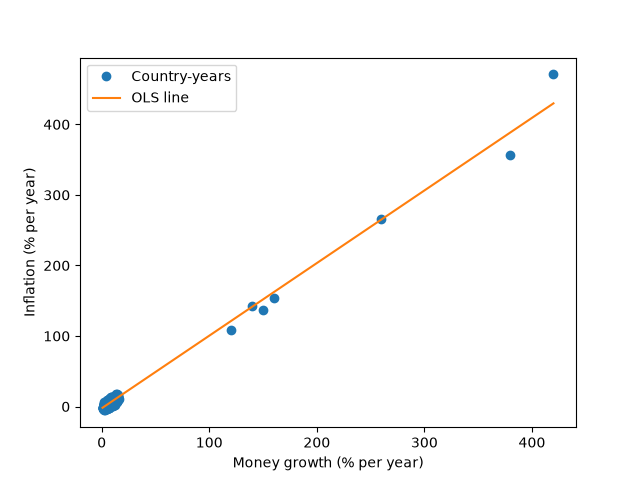
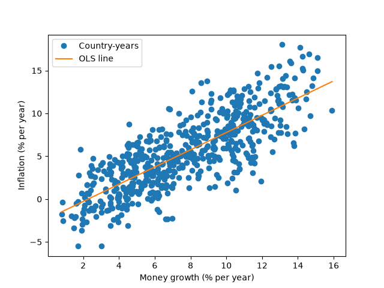

# 第 11 章: インフレとマネーストック

## 11.1 この章の地図

「インフレは、いつでもどこでも、貨幣的な現象である」と言われます。この章では、貨幣数量説を成長率の式にして、**貨幣の伸び率が高い国ほど、物価上昇率が高い**かを、20 か国のパネルデータで確かめます。第 3 章の回帰を使います。ハイパーインフレの期間が、関係の見え方に、どう影響するかも調べます。

| 項目 | 内容 |
| :--- | :--- |
| 経済学の題材 | 貨幣数量説（MV = PY）、貨幣の伸び率と物価上昇率、流通速度、ハイパーインフレ、長期の関係 |
| 使う Python の機能 | 第 3 章の `fit_ols`、`groupby`、`PeriodIndex.year`、論理値で行を選ぶ |
| 新しく導入するライブラリ | なし |
| 完成形 | `quantity_theory_inflation`、`implied_velocity_growth`、`to_annual_average`、`load_money_panel`、`money_inflation_regression`、`hyperinflation_episodes`、`country_averages`、`long_run_relation` |
| ファイル | 実装: `lib/chapter11/money.py`／テスト: `test/chapter11/test_money.py`（自分で書くときは、`practice/chapter11/` に、同じ名前で作ります） |
| データ | `data/money_panel.csv`（**架空の 20 か国**、1990〜2019 年。実在の統計ではありません） |

### 経済学の式とコードの対応

| 経済学 | 式 | コード |
| :--- | :--- | :--- |
| 貨幣数量説（水準） | M·V = P·Y | （成長率の式に直す） |
| 貨幣数量説（成長率） | π = μ − g + (流通速度の伸び率) | `quantity_theory_inflation(money_growth, real_growth, velocity_growth)` |
| 流通速度の伸び率 | π − μ + g | `implied_velocity_growth(...)` |
| 貨幣と物価の回帰 | π = c + β·μ（β = 1 なら、数量説どおり） | `money_inflation_regression(panel)` |
| 長期の関係 | 国ごとの平均 π = c + β·(平均 μ − 平均 g) | `long_run_relation(panel)` |

> **記号について**: この章の μ は貨幣の伸び率、g は実質成長率、π は物価上昇率（いずれも % / 年）です。M は貨幣量、V は流通速度、P は物価水準、Y は実質 GDP です。μ は、第 4 章の差分方程式の係数などとは別です。一覧は、[記号について](how-to-read.md#symbols) を参照してください。

## 11.2 予想する

貨幣量が年 5% 増え、実質 GDP が年 1% 増える国があります。流通速度は、一定とします。

- 物価上昇率は、年何 % ですか（MV = PY の両辺の成長率を比べます）
- 実質成長率が 3% なら、物価上昇率は、どう変わりますか
- 20 か国のデータで、物価上昇率を貨幣の伸び率に回帰したら、傾きは、いくつになりそうですか

## 11.3 貨幣数量説の考え方

### 成長率の式

MV = PY の両辺の対数をとって、時間で差をとると、成長率の式になります。

> μ + (V の伸び率) = π + g　→　**π = μ − g + (V の伸び率)**

流通速度（V）が安定なら、物価上昇率は、貨幣の伸び率から、実質成長率を引いた値です。貨幣が増えても、実質成長が同じだけ増えれば、物価は上がりません。

### 長期と短期

流通速度は、短期には、大きく動きます（金融の変化・予想の変化）。しかし、**長い期間の平均**をとると、ゆらぎが打ち消されて、貨幣数量説が、よく成り立つ、とされます。この章では、年次のパネル（短期のゆらぎを含む）と、国ごとの 30 年平均（長期）の両方で、確かめます。

## 11.4 プログラミング

### 貨幣数量説の式

予想する節の値を、テストにします。

```python
def test_貨幣が5パーセント_実質成長が1パーセントなら物価上昇率は4パーセント() -> None:
    assert quantity_theory_inflation(5, 1) == pytest.approx(4)


def test_流通速度が上がると物価上昇率も上がる() -> None:
    assert quantity_theory_inflation(5, 1, velocity_growth=0.5) == pytest.approx(4.5)


def test_実質成長率が高いと物価上昇率は低くなる() -> None:
    assert quantity_theory_inflation(5, 3) < quantity_theory_inflation(5, 1)


def test_観測した物価上昇率から流通速度の伸び率を求める() -> None:
    assert implied_velocity_growth(5, 1, 4.5) == pytest.approx(0.5)


def test_流通速度の伸び率を求めて数量説に戻すと元の物価上昇率になる() -> None:
    velocity = implied_velocity_growth(7.0, 2.0, 6.1)
    assert quantity_theory_inflation(7.0, 2.0, velocity) == pytest.approx(6.1)
```

```python
def quantity_theory_inflation(
    money_growth: float, real_growth: float, velocity_growth: float = 0.0
) -> float:
    """物価上昇率 = 貨幣の伸び率 − 実質成長率 + 流通速度の伸び率（% / 年）。"""
    return money_growth - real_growth + velocity_growth


def implied_velocity_growth(
    money_growth: float, real_growth: float, inflation: float
) -> float:
    """観測した物価上昇率から、貨幣数量説が成り立つ流通速度の伸び率を求める。"""
    return inflation - money_growth + real_growth
```

最後のテストは、逆の関数どうしの確かめです（求めた流通速度を、元の関数に戻すと、元の物価上昇率に戻る）。

### 四半期から年平均へ

四半期のデータ（第 9 章）を、年のデータに直します。

```python
def test_四半期の系列を年平均にする() -> None:
    index = pd.period_range("2000Q1", periods=8, freq="Q")
    series = pd.Series([1.0, 2, 3, 4, 5, 6, 7, 8], index=index)
    annual = to_annual_average(series)
    assert list(annual.index) == [2000, 2001]
    assert annual.tolist() == pytest.approx([2.5, 6.5])


def test_四半期でない系列は年平均にできない() -> None:
    with pytest.raises(ValueError, match="四半期"):
        to_annual_average(pd.Series([1.0, 2.0, 3.0]))
```

```python
def to_annual_average(series: pd.Series) -> pd.Series:
    """四半期（PeriodIndex）の系列を、年ごとの平均にする。"""
    index = series.index
    if not isinstance(index, pd.PeriodIndex) or not index.freqstr.startswith("Q"):
        raise ValueError("四半期（PeriodIndex）の系列でなければならない")
    return series.groupby(index.year).mean()
```

第 9 章の四半期データの物価上昇率の、年平均は、1980 年が 2.04%、1981 年が 1.76%、1982 年が 1.60% です（40 年分）。

### パネルを読み込む

```python
def test_CSVを読むと国と年が行の名前になる(tmp_path: Path) -> None:
    path = tmp_path / "money.csv"
    path.write_text(
        "country,year,money_growth,real_growth,inflation\nA,2000,5.0,1.0,4.0\n",
        encoding="utf-8",
    )
    df = load_money_panel(path)
    assert list(df.index.names) == ["country", "year"]
    assert df.loc[("A", 2000), "inflation"] == 4.0


def test_同梱のパネルは20か国の30年() -> None:
    df = load_money_panel()
    assert len(df) == 600
    assert df.index.get_level_values("country").nunique() == 20
```

```python
def load_money_panel(path: Path = DEFAULT_DATA_PATH) -> pd.DataFrame:
    """CSV を読み込み、国と年を行の名前にした表を返す。

    列は money_growth（貨幣の伸び率）・real_growth（実質成長率）・
    inflation（物価上昇率）。すべて % / 年。
    """
    return pd.read_csv(path, index_col=["country", "year"])
```

`data/money_panel.csv` は、**架空の 20 か国**（E01〜E20）の、1990〜2019 年の、貨幣の伸び率・実質成長率・物価上昇率（% / 年）です。E19 と E20 には、ハイパーインフレの期間があります。作り方は、`data/README.md` にあります。

### 貨幣の伸び率と物価上昇率の回帰

ちょうどの関係を満たす表で、傾き 1 を復元できるかを、先に確かめます。

```python
def exact_panel() -> pd.DataFrame:
    """物価上昇率 = 貨幣の伸び率 − 2.5 を、ちょうど満たす 3 か国 × 3 年の表。"""
    rows = []
    for country, level in (("A", 4.0), ("B", 8.0), ("C", 6.0)):
        for year, wiggle in ((2000, -1.0), (2001, 0.0), (2002, 1.5)):
            money = level + wiggle
            rows.append((country, year, money, 2.5, money - 2.5))
    df = pd.DataFrame(
        rows, columns=["country", "year", "money_growth", "real_growth", "inflation"]
    )
    return df.set_index(["country", "year"])
```

```python
def test_ちょうどの関係を満たす表では傾き1を復元できる() -> None:
    result = money_inflation_regression(exact_panel())
    assert result.coefficients["money_growth"] == pytest.approx(1)
    assert result.coefficients["const"] == pytest.approx(-2.5)
    assert result.r_squared == pytest.approx(1)


def test_同梱のパネルでは貨幣の伸び率の係数がほぼ1() -> None:
    result = money_inflation_regression(load_money_panel())
    assert result.coefficients["money_growth"] == pytest.approx(1.029, abs=0.001)
    assert result.r_squared == pytest.approx(0.985, abs=0.001)
    assert result.n_obs == 600


def test_ハイパーインフレを除いても傾きは1に近いが当てはまりは下がる() -> None:
    result = money_inflation_regression(load_money_panel(), max_inflation=100)
    assert result.coefficients["money_growth"] == pytest.approx(1.005, abs=0.001)
    assert result.r_squared == pytest.approx(0.629, abs=0.001)
    assert result.n_obs == 593
```

```python
def money_inflation_regression(
    panel: pd.DataFrame, max_inflation: float | None = None
) -> OlsResult:
    """物価上昇率を、貨幣の伸び率に回帰する。

    max_inflation を渡すと、物価上昇率がそれを超える行（ハイパーインフレ）を除く。
    """
    data = (
        panel if max_inflation is None else panel[panel["inflation"] <= max_inflation]
    )
    return fit_ols(
        pd.Series(data["inflation"]),
        pd.DataFrame({"money_growth": data["money_growth"]}),
    )
```

| 標本 | 傾き（貨幣の伸び率の係数） | 標準誤差 | 決定係数 | 観測数 |
| :--- | ---: | ---: | ---: | ---: |
| 全体 | 1.029 | 0.005 | 0.985 | 600 |
| ハイパーインフレ（100% 超）を除く | 1.005 | 0.032 | 0.629 | 593 |

**傾きは、どちらも、ほぼ 1 です**（貨幣数量説どおり）。しかし、決定係数は、全体で 0.985、ハイパーインフレを除くと 0.629 です。





図の読み方:

- 上の図は、全体です。貨幣の伸び率が 100〜400% の 7 つの点（ハイパーインフレ）が、右上に離れて、**直線を決めています**。ほとんどの点（3〜13%）は、左下に、かたまっています
- 下の図は、ハイパーインフレを除いた、ふつうの国の点です。傾きは、ほぼ 1 のままですが、**点のばらつきが大きく**、貨幣の伸び率だけでは、物価上昇率の一部しか説明できません（決定係数 0.63）
- つまり、**貨幣と物価の関係は、物価上昇率が高いときに、はっきり見える**。低いときは、流通速度の変化などの、ほかの要因が、同じくらい効きます

### ハイパーインフレの期間

```python
def test_ハイパーインフレの国と年を取り出す() -> None:
    episodes = hyperinflation_episodes(load_money_panel(), threshold=100)
    assert len(episodes) == 7
    assert set(episodes.index.get_level_values("country")) == {"E19", "E20"}
    years = episodes.index.get_level_values("year")
    assert sorted(years[episodes.index.get_level_values("country") == "E19"]) == [
        1992,
        1993,
        1994,
        1995,
    ]


def test_しきい値が高ければハイパーインフレは見つからない() -> None:
    assert len(hyperinflation_episodes(load_money_panel(), threshold=1000)) == 0
```

```python
def hyperinflation_episodes(
    panel: pd.DataFrame, threshold: float = 100
) -> pd.DataFrame:
    """物価上昇率が threshold（% / 年）を超える、国と年の行を取り出す。"""
    return panel[panel["inflation"] > threshold]
```

物価上昇率が 100% / 年を超える国と年は、7 つです（E19 の 1992〜1995 年: 136%・357%・471%・153%、E20 の 2008〜2010 年: 109%・265%・142%）。

### 長期の関係

```python
def test_国ごとの平均() -> None:
    averages = country_averages(exact_panel())
    assert averages.loc["A", "money_growth"] == pytest.approx(4.0 + 0.5 / 3)
    assert list(averages.index) == ["A", "B", "C"]


def test_長期の関係では平均の物価上昇率が貨幣の伸び率から実質成長率を引いた値に比例する() -> (
    None
):
    result = long_run_relation(exact_panel())
    assert result.coefficients["money_minus_real_growth"] == pytest.approx(1)


def test_同梱のパネルの長期の関係の傾きは1に近い() -> None:
    result = long_run_relation(load_money_panel())
    assert result.coefficients["money_minus_real_growth"] == pytest.approx(
        1.011, abs=0.002
    )
    assert result.r_squared == pytest.approx(0.999, abs=0.001)
    assert result.n_obs == 20
```

```python
def country_averages(panel: pd.DataFrame) -> pd.DataFrame:
    """国ごとの、全期間の平均（貨幣の伸び率・実質成長率・物価上昇率）。"""
    return panel.groupby(level="country")[
        ["money_growth", "real_growth", "inflation"]
    ].mean()


def long_run_relation(panel: pd.DataFrame) -> OlsResult:
    """長期の関係: 国ごとの平均の物価上昇率を、平均の貨幣と成長の差に回帰する。"""
    averages = country_averages(panel)
    x = pd.DataFrame(
        {"money_minus_real_growth": averages["money_growth"] - averages["real_growth"]}
    )
    return fit_ols(pd.Series(averages["inflation"]), x)
```

国ごとの 30 年平均で、物価上昇率を（貨幣の伸び率 − 実質成長率）に回帰すると、傾きは **1.011**（標準誤差 0.006）、決定係数は **0.999**（20 か国）です。年次のパネル（短期のゆらぎを含む）より、はるかによく当てはまります。**長期の平均では、貨幣数量説が、ほぼ正確に成り立っています**。

> **これは、架空のデータの結果です。** このデータは、π = μ − g + 誤差（誤差の大きさは、貨幣の伸び率に応じて大きい）として作りました。実際のデータで、長期の関係が、どれだけ成り立つかは、実際の統計で確かめる必要があります。この記事では、貨幣量の統計の取得元を、確認できていないので、実際の統計では試していません。

### 予想の答え合わせ

予想した答えを、プログラムで確かめます。

```python
from lib.chapter11.money import (
    load_money_panel,
    money_inflation_regression,
    quantity_theory_inflation,
)

print("物価上昇率（貨幣 5%、成長 1%）:", quantity_theory_inflation(5, 1))
print("物価上昇率（貨幣 5%、成長 3%）:", quantity_theory_inflation(5, 3))

panel = load_money_panel()
whole = money_inflation_regression(panel)
print("回帰の傾き（全体）:", round(float(whole.coefficients["money_growth"]), 3))
moderate = money_inflation_regression(panel, max_inflation=100)
print(
    "回帰の傾き（ハイパーインフレを除く）:",
    round(float(moderate.coefficients["money_growth"]), 3),
)
```

```text
物価上昇率（貨幣 5%、成長 1%）: 4.0
物価上昇率（貨幣 5%、成長 3%）: 2.0
回帰の傾き（全体）: 1.029
回帰の傾き（ハイパーインフレを除く）: 1.005
```

- 1 つ目の問い: 物価上昇率は、**4%** です（5 − 1）
- 2 つ目の問い: 実質成長率が 3% なら、物価上昇率は **2%** に下がります（5 − 3）。貨幣の伸び率が同じでも、実質成長が高いほど、物価は上がりません
- 3 つ目の問い: 貨幣数量説が成り立てば、傾きは **1** になるはずです。20 か国のパネルの回帰の傾きは、全体で **1.029**、ハイパーインフレを除いても **1.005** で、ほぼ 1 です

### ノートブックで試す

数字を書き換えて、結果と図が変わるのを、手軽に確かめられます。`apps/macro-programming/python/notebooks/ch11_inflation_and_money_stock.ipynb` を開き、「Parameters」のセルの数字（貨幣の伸び率、実質成長率、流通速度の伸び率、回帰に使う物価上昇率の上限）を書き換えて、上から順に実行します。起動は、アプリのディレクトリで `uv run --with jupyterlab jupyter lab notebooks/` です。

### 実行結果

```bash
cd apps/macro-programming/python
uv run pytest test/chapter11
```

```text
18 passed
```

## 11.5 規則で言うと

1. **数量説は、成長率の式で使う。** 物価上昇率 = 貨幣の伸び率 − 実質成長率 + 流通速度の伸び率
2. **長期の平均で、よく成り立つ。** 短期のゆらぎ（流通速度の変化）は、平均をとると、打ち消される
3. **回帰の傾きと、当てはまりを、分けて読む。** 傾きが 1 でも、決定係数が低ければ、貨幣だけでは、物価の動きを説明できない

混同しやすい点を、表にまとめます。

| 混同しやすい点 | 違い |
| :--- | :--- |
| 貨幣の伸び率 と 物価上昇率 | 両者の差が、実質成長率。貨幣が増えても、実質成長が同じだけ増えれば、物価は上がらない |
| 傾きが 1 と 当てはまりが良い | 傾き（係数）と、決定係数（当てはまり）は、別。この章では、傾きは 1 でも、決定係数は 0.63〜0.99 と違う |
| 外れ値が、回帰を決める | ハイパーインフレの 7 点が、全体の回帰の決定係数を、0.63 から 0.99 に引き上げる。外れ値を、除いた結果も、並べて見る |

### このモデルが成り立たない場面

- **流通速度が、安定とは限りません。** 金融の自由化・決済手段の変化・予想の変化で、流通速度は、大きく動きます。短期には、数量説は、成り立ちにくいです
- **貨幣量の定義が、国によって、時期によって違います。** 現金・預金・M1・M2 のどれを使うかで、結果が変わります
- **因果の向きが、不明です。** 物価が上がって、貨幣が増える（政府が貨幣を発行する）こともあります。回帰の傾きは、貨幣が物価を決める、とは言えません
- **ハイパーインフレは、特殊です。** 物価が貨幣に追いつけない状況で、数量説が見えやすいが、ふつうの国の、平常時の関係とは、別です

## 11.6 練習問題

| 種類 | 問題 |
| :--- | :--- |
| 想起 | 本文を閉じて、「貨幣が 5%、実質成長率が 1%、流通速度が一定なら、物価上昇率は 4%」のテストを書いてください |
| 生成 | 解説を見る前に、パネルの各行の、流通速度の伸び率（π − μ + g）を返す `velocity_growth_series(panel)` を、テストから書いてください。その平均と標準偏差は、いくつですか。数量説が成り立つなら、平均はどうなりますか |
| 多様 | ハイパーインフレのしきい値を、50、100、200 に変えて、見つかる国と年の数と、残りの標本の傾きを、先に予想してから、確かめてください |
| 交互 | 第 8 章の `sample_autocorrelation` で、E01 国の、物価上昇率と貨幣の伸び率の、ラグ 1 の自己相関を求めてください。30 年の系列で、自己相関は、安定して推定できるでしょうか |

??? note "解答（先に自分で取り組んでから、開いてください）"

    **想起**:

    ```python
    def test_貨幣が5パーセント_実質成長が1パーセントなら物価上昇率は4パーセント() -> None:
        assert quantity_theory_inflation(5, 1) == pytest.approx(4)
    ```

    **生成**: 数量説が成り立つなら、流通速度の伸び率の平均は 0 に近い、と予想できます。

    ```python
    def velocity_growth_series(panel):
        return panel["inflation"] - panel["money_growth"] + panel["real_growth"]
    ```

    ```python
    def test_ちょうどの関係を満たす表では流通速度の伸び率は0() -> None:
        panel = pd.DataFrame(
            {
                "money_growth": [4.0, 6.0],
                "real_growth": [2.5, 2.5],
                "inflation": [1.5, 3.5],
            }
        )
        assert velocity_growth_series(panel).to_numpy() == pytest.approx(0)


    def test_同梱のパネルの流通速度の伸び率() -> None:
        velocity = velocity_growth_series(load_money_panel())
        assert velocity.mean() == pytest.approx(0.244, abs=0.001)
        assert velocity.std() == pytest.approx(3.188, abs=0.001)
    ```

    平均は 0.24（ほぼ 0）、標準偏差は 3.2 ポイントです。**平均はほぼ 0 でも、年ごとの流通速度の伸び率は、±3 ポイントほど、ゆれます**。これが、短期の関係の当てはまりが悪い（決定係数 0.63）理由で、長期の平均で、よく成り立つ理由です。

    **多様**: しきい値を下げても、7 つの観測が、すべてしきい値を超えているので、数は変わりません。しきい値を 200 に上げると、7 つのうち、200 を超える 3 つだけが残ります。

    ```python
    def test_しきい値によるハイパーインフレの数と傾き() -> None:
        panel = load_money_panel()
        for threshold, count, slope in [(50, 7, 1.005), (100, 7, 1.005), (200, 3, 0.967)]:
            assert len(hyperinflation_episodes(panel, threshold)) == count
            result = money_inflation_regression(panel, max_inflation=threshold)
            assert result.coefficients["money_growth"] == pytest.approx(slope, abs=0.001)
    ```

    しきい値 50 と 100 では、同じ 7 つで、傾きは 1.005 です。しきい値 200 では、3 つだけが除かれ、残りに、100〜200% の 4 つが含まれるので、傾きは 0.967 に下がります。**外れ値の扱いで、傾きが変わる**ことが分かります。

    **交互**:

    ```python
    def test_E01の自己相関() -> None:
        e01 = load_money_panel().xs("E01", level="country")
        inflation = sample_autocorrelation(e01["inflation"].to_numpy(), 1)
        money = sample_autocorrelation(e01["money_growth"].to_numpy(), 1)
        assert inflation == pytest.approx(0.102, abs=0.001)
        assert money == pytest.approx(0.160, abs=0.001)
    ```

    物価上昇率は 0.10、貨幣の伸び率は 0.16 です。貨幣の伸び率は、0.6 の持続性（AR(1)）を持つように作りましたが、30 年の標本では、0.16 としか推定できません。**短い系列の自己相関は、大きくばらつきます**（標準誤差は、おおよそ 1 ÷ √30 ≈ 0.18）。第 8 章の注意点（標本が短いと、ρ の推定は不確か）の実例です。

## 11.7 振り返り

- 予想した傾き 1 は、当たりましたか。決定係数が、標本によって大きく違ったのは、なぜですか
- 外れ値（ハイパーインフレ）を、含めた結果と、除いた結果を、並べて見ることの意味は何ですか
- 短期と長期で、数量説の当てはまりが違うのは、なぜですか

## 11.8 まとめ

- 貨幣数量説を、成長率の式にして、関数とテストにした
- 20 か国のパネルで、貨幣の伸び率と物価上昇率の傾きが、ほぼ 1 であること、ハイパーインフレが、決定係数を大きく引き上げることを調べた
- 国ごとの長期の平均では、数量説が、ほぼ正確に成り立つことを確かめた（傾き 1.011、決定係数 0.999）
- 次の章では、貨幣の**中立性**（貨幣が、実質変数に影響しない）と、為替レートを調べ、第 2 部のまとめとして、実際の統計（内閣府の四半期 GDP）で、第 8・9 章の関数を試します
