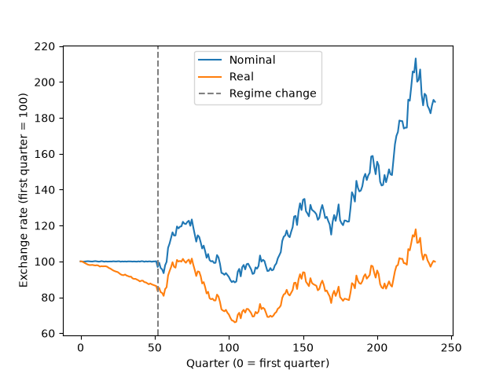
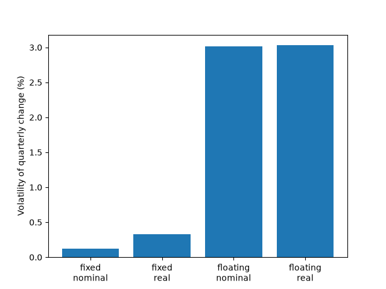

# 第 12 章: 貨幣の中立性と金融政策

## 12.1 この章の地図

古典派の二分法は、「貨幣は、物価などの名目変数を決めるが、実質変数には影響しない」という考え方です。この章では、2 つの角度から確かめます。第 11 章の 20 か国のパネルで、貨幣の伸び率が、**実質成長率に影響しているか**。そして、**固定相場から変動相場に移ったとき**、名目と実質の為替レートが、どう動いたか（相対価格）。最後に、第 2 部のまとめとして、**実際の統計**（内閣府の四半期 GDP）に、第 8・9 章の関数を、そのまま使います。

| 項目 | 内容 |
| :--- | :--- |
| 経済学の題材 | 貨幣の中立性、古典派の二分法、実質為替レート、固定相場と変動相場、物価の粘着性 |
| 使う Python の機能 | 第 3 章の回帰、`PeriodIndex` の比較と `Period`、論理値で行を選ぶ、`csv` モジュールと `re`（正規表現）による CSV の読み込み、`Any` の型ヒント |
| 新しく導入するライブラリ | なし |
| 完成形 | `real_exchange_rate`、`log_change`、`load_exchange`、`regime_statistics`、`money_neutrality_regression`、`load_cabinet_quarterly`、`year_over_year` |
| ファイル | 実装: `lib/chapter12/exchange.py`、`lib/chapter12/cabinet.py`（実際の統計の読み込み）、`lib/chapter12/plot.py`（為替レートの図）／テスト: `test/chapter12/test_exchange.py`、`test/chapter12/test_cabinet.py`、`test/chapter12/test_plot.py`（自分で書くときは、`practice/chapter12/` に、同じ名前で作ります） |
| データ | `data/exchange.csv`（**架空の国**の為替レートと物価、1960Q1〜2019Q4。実在の統計ではありません）、第 11 章の `data/money_panel.csv`、実際の統計（12.5 節） |

### 経済学の式とコードの対応

| 経済学 | 式 | コード |
| :--- | :--- | :--- |
| 実質為替レート | q = e × P* ÷ P | `real_exchange_rate(nominal_rate, price_foreign, price_domestic)` |
| 変化率 | 100 × Δln x | `log_change(series)` |
| 相場制度による違い | 切り替えの前後で、変動の大きさ・相関を比べる | `regime_statistics(df, break_period)` |
| 貨幣の中立性 | 実質成長率 = c + β·貨幣の伸び率（β ≈ 0） | `money_neutrality_regression(panel)` |

> **記号について**: e は為替レート（自国通貨 / 外国通貨）、P* は外国の物価、P は自国の物価、q は実質為替レートです（第 7 章と同じ使い方）。一覧は、[記号について](how-to-read.md#symbols) を参照してください。

## 12.2 予想する

- 貨幣の伸び率が高い国は、実質成長率も高い（あるいは低い）でしょうか。貨幣が中立なら、どうなりますか
- 為替レートが、固定から変動に変わると、名目為替レートは、どうなりますか。物価は、すぐに動くでしょうか（物価が粘着的なら）
- 物価が粘着的だと、名目為替レートの動きは、実質為替レートの動きに、どう反映されますか

答えは、貨幣が中立なら、貨幣の伸び率は、実質成長率と、無関係（傾き 0）です。変動相場では、名目為替レートが大きく動き、物価は粘着的なので、**名目の動きが、そのまま、実質為替レートの動きになります**。

## 12.3 貨幣の中立性と、為替レートの考え方

### 貨幣の中立性

貨幣量を増やしても、長期には、生産や雇用などの実質変数は、変わらず、物価だけが上がる、というのが、貨幣の中立性です。国の間の比較では、「貨幣の伸び率が高い国で、実質成長率が高いか」で、確かめられます（傾きが 0 に近ければ、中立）。

### 実質為替レート

実質為替レート q = e × P* ÷ P は、自国の財が、外国の財の何倍の価値を持つか（相対価格）です。名目為替レート e が変わっても、物価がそれに合わせて動けば、q は変わりません。**物価が粘着的**（すぐに動かない）なら、e の動きは、そのまま q の動きになります。

### 固定相場と変動相場

固定相場では、名目為替レートが、ほとんど動きません。変動相場では、名目為替レートが、大きく動きます。物価が粘着的であれば、変動相場で、実質為替レートも、名目と同じように大きく動きます。

## 12.4 Red → Green → Refactor

### 貨幣の中立性を回帰で確かめる

```python
def test_貨幣の伸び率は実質成長率を説明しない() -> None:
    result = money_neutrality_regression(load_money_panel())
    assert result.coefficients["money_growth"] == pytest.approx(0.002, abs=0.01)
    assert abs(result.t_values()["money_growth"]) < 2


def test_貨幣の中立性の回帰は実質成長率を貨幣の伸び率に回帰する() -> None:
    result = money_neutrality_regression(load_money_panel())
    assert list(result.coefficients.index) == ["const", "money_growth"]
    assert result.coefficients["const"] == pytest.approx(2.44, abs=0.01)
```

```python
def money_neutrality_regression(panel: pd.DataFrame) -> OlsResult:
    """実質成長率を、貨幣の伸び率に回帰する（第 11 章のパネル）。

    貨幣が中立なら、傾きは 0 に近い。
    """
    return fit_ols(
        pd.Series(panel["real_growth"]),
        pd.DataFrame({"money_growth": panel["money_growth"]}),
    )
```

第 11 章のパネル（600 行）で、実質成長率を貨幣の伸び率に回帰した結果は、次のとおりです。

| 変数 | 係数 | 標準誤差 | t 値 |
| :--- | ---: | ---: | ---: |
| 定数項 | 2.440 | 0.067 | 36.3 |
| 貨幣の伸び率 | 0.002 | 0.002 | 0.7 |

決定係数は 0.0008 です。**傾きは 0.002 で、ほぼ 0** です（t 値 0.7 で、有意ではありません）。貨幣の伸び率が 1 ポイント高い国でも、実質成長率は 0.002 ポイントしか違いません。貨幣は、**中立**です（このデータでは）。

> **これは、架空のデータの結果です。** このデータは、実質成長率を、貨幣の伸び率と無関係に作りました。ここでの確認は、「関数が、中立を検出できる」ことです。実際の経済で、貨幣が中立かは、別の問題です（短期には、非中立とされます）。

### 実質為替レート

```python
def test_実質為替レートは名目レートに外国の物価を掛けて自国の物価で割る() -> None:
    assert real_exchange_rate(100, 2, 4) == pytest.approx(50)


def test_系列でも計算できる() -> None:
    e = pd.Series([100.0, 200.0])
    q = real_exchange_rate(e, pd.Series([2.0, 2.0]), pd.Series([4.0, 8.0]))
    assert q.tolist() == pytest.approx([50, 50])


@pytest.mark.parametrize("args", [(0, 2, 4), (100, 0, 4), (100, 2, 0)])
def test_為替レートと物価は正でなければならない(
    args: tuple[float, float, float],
) -> None:
    with pytest.raises(ValueError, match="正"):
        real_exchange_rate(*args)


def test_自国と外国の物価が同じ率で上がれば実質レートは名目レートに比例する() -> None:
    e = pd.Series([100.0, 110.0, 121.0])
    p = pd.Series([1.0, 1.1, 1.21])
    pf = pd.Series([1.0, 1.1, 1.21])
    q = real_exchange_rate(e, pf, p)
    assert (q / e).tolist() == pytest.approx([1, 1, 1])
```

```python
def real_exchange_rate(
    nominal_rate: Any, price_foreign: Any, price_domestic: Any
) -> Any:
    """実質為替レート q = e × P* ÷ P。数でも、系列でも計算できる。"""
    for value in (nominal_rate, price_foreign, price_domestic):
        if np.any(np.asarray(value) <= 0):
            raise ValueError("為替レートと物価は正でなければならない")
    return nominal_rate * price_foreign / price_domestic
```

この関数は、数でも、系列でも使えます（型ヒントは `Any` です）。第 7 章の相対価格水準と、同じ考え方です。

### 変化率と、データの読み込み

```python
def test_対数の変化率はパーセント() -> None:
    changes = log_change(pd.Series([100.0, 110.0, 99.0]))
    assert changes.tolist() == pytest.approx([100 * np.log(1.1), 100 * np.log(0.9)])


def test_同梱のデータは1960年から2019年までの240四半期() -> None:
    df = load_exchange()
    assert len(df) == 240
    assert str(df.index[0]) == "1960Q1"
    assert str(df.index[-1]) == "2019Q4"
    assert list(df.columns) == ["nominal_rate", "price_domestic", "price_foreign"]
```

```python
def log_change(series: pd.Series) -> pd.Series:
    """対数の変化率（%）= 100 × Δln x。最初の期は、前がないので、除く。"""
    return (100 * series.apply(np.log).diff()).dropna()


def load_exchange(path: Path = DEFAULT_DATA_PATH) -> pd.DataFrame:
    """CSV を読み込み、四半期を行の名前にした表を返す。

    列は nominal_rate（自国通貨 / 外国通貨）・price_domestic・price_foreign
    （物価指数）。
    """
    raw = pd.read_csv(path)
    periods = pd.PeriodIndex(
        [f"{y}Q{q}" for y, q in zip(raw["year"], raw["quarter"], strict=True)],
        freq="Q",
    )
    return raw.drop(columns=["year", "quarter"]).set_index(periods)
```

`data/exchange.csv` は、**架空の国**の、1960Q1〜2019Q4 の、名目為替レート（自国通貨 / 外国通貨）と、自国・外国の物価指数です。1972 年までは固定相場、1973 年以降は変動相場として、作りました。

### 相場制度で比べる

```python
def test_相場制度ごとの統計は固定と変動の2行() -> None:
    stats = regime_statistics(load_exchange(), "1973Q1")
    assert list(stats.index) == ["fixed", "floating"]
    assert list(stats.columns) == [
        "nominal_volatility",
        "real_volatility",
        "correlation",
    ]


def test_変動相場では名目レートが大きく動き実質レートも同じように動く() -> None:
    stats = regime_statistics(load_exchange(), "1973Q1")
    nominal = stats["nominal_volatility"]
    assert float(nominal["floating"]) > 10 * float(nominal["fixed"])
    assert float(stats["correlation"]["floating"]) > 0.95


def test_固定相場では名目レートの動きと実質レートの動きは弱い関係() -> None:
    stats = regime_statistics(load_exchange(), "1973Q1")
    assert float(stats["correlation"]["fixed"]) < 0.5


def test_相場制度ごとの統計の値() -> None:
    stats = regime_statistics(load_exchange(), "1973Q1")
    assert stats["nominal_volatility"].tolist() == pytest.approx(
        [0.126, 3.012], abs=0.001
    )
    assert stats["real_volatility"].tolist() == pytest.approx([0.327, 3.030], abs=0.001)
    assert stats["correlation"].tolist() == pytest.approx([0.24, 0.993], abs=0.005)


@pytest.mark.parametrize(
    "break_period", ["1960Q1", "1960Q3", "2030Q1", "2019Q4", "2019Q3"]
)
def test_切り替えの時点はデータの範囲の内側でなければならない(
    break_period: str,
) -> None:
    with pytest.raises(ValueError, match="切り替え"):
        regime_statistics(load_exchange(), break_period)
```

```python
def regime_statistics(df: pd.DataFrame, break_period: str) -> pd.DataFrame:
    """切り替えの前（fixed）と後（floating）で、為替レートの動きを比べる。

    名目為替レートの変動の大きさ、実質為替レートの変動の大きさ
    （対数の変化率の標準偏差）、名目と実質の変化率の相関。
    切り替えの前後に、3 四半期以上のデータが必要（変化率が 2 個以上）。
    """
    period = pd.Period(break_period, freq="Q")
    if min((df.index < period).sum(), (df.index >= period).sum()) < 3:
        raise ValueError("切り替えの前後に、それぞれ 3 四半期以上のデータが必要")
    real = real_exchange_rate(
        df["nominal_rate"], df["price_foreign"], df["price_domestic"]
    )
    rows = {}
    for name, mask in (("fixed", df.index < period), ("floating", df.index >= period)):
        nominal_change = log_change(pd.Series(df["nominal_rate"][mask]))
        real_change = log_change(pd.Series(real[mask]))
        rows[name] = {
            "nominal_volatility": float(nominal_change.std()),
            "real_volatility": float(real_change.std()),
            "correlation": float(nominal_change.corr(real_change)),
        }
    return pd.DataFrame.from_dict(rows, orient="index")
```

切り替えの前後に、3 四半期以上のデータが必要です（変化率が 2 個以上ないと、標準偏差と相関が求まりません）。足りないときは、エラーにします。

| 相場制度 | 名目の変動の大きさ | 実質の変動の大きさ | 名目と実質の変化率の相関 |
| :--- | ---: | ---: | ---: |
| 固定相場（〜1972 年） | 0.126 | 0.327 | 0.240 |
| 変動相場（1973 年〜） | 3.012 | 3.030 | 0.993 |

（変動の大きさ: 四半期の対数の変化率の標準偏差、%）





図の読み方:

- 縦の点線（1973 年第 1 四半期）までは、名目為替レート（青）は、ほとんど動かず、実質為替レート（オレンジ）は、ゆっくり下がります（自国の物価上昇率が、外国より高いため）
- 点線の後、名目が大きく動き始めます。実質は、名目と**ほぼ同じ形**で動きます（相関 0.993）。物価が粘着的なので、名目の動きが、そのまま、実質の動きになります
- 棒グラフでは、変動相場の名目と実質の変動の大きさが、ほぼ等しく（3.01 と 3.03）、固定相場（0.13 と 0.33）の、名目で約 24 倍、実質で約 9 倍です

> **これは、架空のデータの結果です。** このデータは、物価を粘着的に（小さなゆらぎだけで）作りました。実際の経済でも、ブレトン・ウッズ体制の崩壊（1973 年）の前後で、名目と実質の為替レートの変動が、大きく変わったことが、知られています。

### 実行結果

```bash
cd apps/macro-programming/python
uv run pytest test/chapter12
```

```text
33 passed
```

## 12.5 実際の統計で試す（内閣府の四半期 GDP）

最後に、第 2 部の**実際の統計**で、第 8・9 章の関数を試します。

### データを取得する

内閣府・経済社会総合研究所の「四半期別 GDP 速報」の統計表一覧から、2 つの CSV を保存します（第 1 シリーズの第 11 章の、実際の統計の手順と、同じページです）。

| 表 | 統計表一覧での場所 | ファイル名（2026 年 1-3 月期 1 次速報の例） |
| :--- | :--- | :--- |
| 実質 GDP と、支出の各項目（四半期） | 「国内総生産(支出側)及び各需要項目」の「実額」の「実質季節調整系列」 | `gaku-jk2611.csv` |
| GDP デフレーター（四半期） | 同じ表の「デフレーター」の「四半期デフレーター季節調整系列」 | `def-qk2611.csv` |

保存先は、`apps/macro-programming/python/data/` です（Git の管理から外れる、実際の統計の置き場）。**統計は、後から改定されます**。ファイルを取得した日と、公表の回を、記録します。利用規約の条文は、確認できていません。各統計の利用条件を確認し、出典（公表の回と取得日）を明記してください。

### CSV の形（実物で確かめたこと）

| 項目 | 内容 |
| :--- | :--- |
| 文字コード | cp932（UTF-8 では読めない） |
| 見出し | 先頭の 7 行 |
| 四半期の行 | 第 1 四半期の行にだけ年が付く（`1994/ 1- 3.`）。続く行は `4- 6.`・`7- 9.`・`10-12.` |
| 値 | 3 桁区切りで、後ろに空白が付く文字列（`"465,062.6 "`） |
| 実質 GDP の単位 | 年率、2020 暦年連鎖価格、10 億円。デフレーターは、2020 暦年 = 100 |
| 範囲（2026 年 5 月 19 日公表の 1 次速報） | 1994 年第 1 四半期〜2026 年第 1 四半期（129 四半期） |
| 列の位置 | 1: 国内総生産(支出側)、2: 民間最終消費支出、5: 民間住宅、6: 民間企業設備、8: 政府最終消費支出（0 から数える） |
| 注記 | 末尾に、「年率で表示している」などの注記の行がある |

### 読み込む関数

第 1 四半期の行から年を引き継ぎ、続く行に、同じ年を付けて、四半期（`PeriodIndex`）の系列に直します。

```python
HEADER = [
    "実質季節調整系列,,,<参考>,,(単位:2020暦年連鎖価格、10億円)",
    "Real, Seasonally Adjusted Series,,,<cf>",
    ",国内総生産(支出側),民間最終消費支出",
    ",,,家計最終消費支出",
    ",,,",
    ",GDP(Expenditure Approach),PrivateConsumption",
    ",,,",
]


ROWS = [
    '1994/ 1- 3.,"465,062.6 ","252,336.7 "',
    '4- 6.,"461,497.1 ","250,000.0 "',
    '7- 9.,"466,135.7 ","251,000.0 "',
    '10-12.,"464,394.6 ","252,000.0 "',
    '1995/ 1- 3.,"468,893.1 ","253,000.0 "',
]
```

テストは、公式の CSV と同じ構造の、小さなファイルを、テストの中で作って、確かめます。

```python
def test_第1四半期の行の年が続く行にも引き継がれる(tmp_path: Path) -> None:
    path = tmp_path / "q.csv"
    write_csv(path, ROWS)
    series = load_cabinet_quarterly(path)
    assert [str(p) for p in series.index] == [
        "1994Q1",
        "1994Q2",
        "1994Q3",
        "1994Q4",
        "1995Q1",
    ]


def test_値は3桁区切りと空白を除いた小数(tmp_path: Path) -> None:
    path = tmp_path / "q.csv"
    write_csv(path, ROWS)
    series = load_cabinet_quarterly(path)
    assert series.iloc[0] == pytest.approx(465062.6)
    assert series.iloc[-1] == pytest.approx(468893.1)


def test_列の位置を指定して別の項目を読める(tmp_path: Path) -> None:
    path = tmp_path / "q.csv"
    write_csv(path, ROWS)
    consumption = load_cabinet_quarterly(path, column=2)
    assert consumption.iloc[0] == pytest.approx(252336.7)


def test_空の行は読み飛ばす(tmp_path: Path) -> None:
    path = tmp_path / "q.csv"
    write_csv(path, [ROWS[0], "", ROWS[1]])
    assert len(load_cabinet_quarterly(path)) == 2


def test_注記の行は読み飛ばす(tmp_path: Path) -> None:
    path = tmp_path / "q.csv"
    write_csv(path, ROWS)
    assert len(load_cabinet_quarterly(path)) == 5


def test_四半期の行がなければ受け付けない(tmp_path: Path) -> None:
    path = tmp_path / "q.csv"
    write_csv(path, [])
    with pytest.raises(ValueError, match="四半期"):
        load_cabinet_quarterly(path)


def test_前年同期比は対数の差のパーセント(tmp_path: Path) -> None:
    path = tmp_path / "q.csv"
    write_csv(path, ROWS)
    growth = year_over_year(load_cabinet_quarterly(path))
    assert len(growth) == 1
    assert growth.iloc[0] == pytest.approx(100 * np.log(468893.1 / 465062.6))


def test_前年同期比は最初の4四半期が欠ける(tmp_path: Path) -> None:
    path = tmp_path / "q.csv"
    write_csv(path, ROWS)
    growth = year_over_year(load_cabinet_quarterly(path))
    assert str(growth.index[0]) == "1995Q1"
```

```python
def load_cabinet_quarterly(path: Path, column: int = 1) -> pd.Series:
    """四半期の行だけを取り出し、四半期（PeriodIndex）の系列にする。

    column は CSV の列の位置（0 から数える）。1 が、国内総生産(支出側)。
    見出しと注記の行は、読み飛ばす。
    """
    year: int | None = None
    periods = []
    values = []
    with path.open(encoding=ENCODING, newline="") as file:
        for row in csv.reader(file):
            if not row:
                continue
            first_quarter = _YEAR_ROW.match(row[0])
            later_quarter = _QUARTER_ROW.match(row[0])
            if first_quarter:
                year = int(first_quarter.group(1))
                month = int(first_quarter.group(2))
            elif later_quarter and year is not None:
                month = int(later_quarter.group(1))
            else:
                continue
            quarter = (month - 1) // 3 + 1
            periods.append(pd.Period(f"{year}Q{quarter}"))
            values.append(float(row[column].replace(",", "").strip()))
    if not periods:
        raise ValueError("四半期の行がない")
    return pd.Series(values, index=pd.PeriodIndex(periods, freq="Q"))


def year_over_year(series: pd.Series) -> pd.Series:
    """前年同期比（%）= 100 × (ln x(t) − ln x(t−4))。最初の 4 四半期は、除く。"""
    logs = series.apply(np.log)
    return (100 * (logs - logs.shift(4))).dropna()
```

### 第 8・9 章の関数を、実際の統計に使う

```python
from pathlib import Path

from lib.chapter08.stochastic import autocorrelation_function, shock_half_life
from lib.chapter09.cycles import log_cycle, relative_volatility
from lib.chapter12.cabinet import load_cabinet_quarterly, year_over_year

gdp = load_cabinet_quarterly(Path("data/gaku-jk2611.csv"), column=1)
consumption = load_cabinet_quarterly(Path("data/gaku-jk2611.csv"), column=2)
investment = load_cabinet_quarterly(Path("data/gaku-jk2611.csv"), column=6)
deflator = load_cabinet_quarterly(Path("data/def-qk2611.csv"), column=1)

cycle = log_cycle(gdp)
autocorrelation_function(cycle.to_numpy(), 4)
```

2026 年 5 月 19 日公表の 1 次速報（129 四半期）の結果は、次のとおりです。

| 項目 | 実際の統計 | 架空のデータ（第 9 章） |
| :--- | ---: | ---: |
| GDP の循環の変動の大きさ（%） | **1.58** | 1.01 |
| 消費の相対的な変動の大きさ（GDP = 1） | **0.83** | 0.76 |
| 民間企業設備の相対的な変動の大きさ | **2.17** | 3.69 |
| 消費・設備投資の、GDP との相関 | **0.78・0.77** | 0.94・0.86 |
| GDP の循環の自己相関（ラグ 1〜4） | **0.71・0.49・0.20・0.02** | 0.62・0.34・0.13・0.06 |
| ショックの半減期（ラグ 1 の自己相関から、四半期） | **2.0** | — |
| GDP の循環の最小・最大 | **−8.22%（2020 年第 2 四半期）・+3.01%（2008 年第 1 四半期）** | −2.3%・+3.3% |
| デフレーターの前年同期比の平均・標準偏差（%） | **0.02・1.65** | — |
| デフレーターの前年同期比の自己相関（ラグ 1） | **0.92** | — |

読み取れることと、注意点:

- **景気循環の事実は、実際の統計でも、同じ傾向です。** 設備投資は GDP より変動が大きく（2.2 倍）、消費は小さく（0.83 倍）、どちらも GDP と同じ向きに動きます（相関 0.77〜0.78）。ただし、数値は、架空のデータと違います（投資の相対的な変動は、3.7 倍でなく、2.2 倍）
- **循環の最小は、新型コロナの 2020 年第 2 四半期（−8.2%）です。** 1 つの大きな外れ値が、変動の大きさ（1.58%）を、大きくしています。HP フィルターのトレンドも、この時期の影響を受けます
- **物価（デフレーターの前年同期比）は、非常に持続的です**（自己相関 0.92）。ほぼ 0% の平均のまわりを、長く同じ側に動きます（最小 −2.5%（2003 年第 1 四半期）、最大 +5.9%（2023 年第 3 四半期））
- **この節では、失業率と貨幣量の実際の統計を使っていません。** 取得元の利用条件と CSV の形を、確認できていないためです。オークンの法則・フィリップス曲線（第 10 章）と、貨幣数量説（第 11 章）は、実際の統計では、試していません

## 12.6 規則で言うと

1. **物価が粘着的なら、名目の動きは、実質の動きになる。** 変動相場で、名目と実質の為替レートが、ほぼ同じように動く
2. **貨幣の中立性は、実質変数との関係が 0 かで、確かめる。** 傾きが 0 に近く、有意でなければ、中立と整合的
3. **実際の統計は、先に形を確かめてから、読む。** 年が、第 1 四半期の行にだけ付く、単位が年率、注記の行がある、といった癖を、実物で確かめる

混同しやすい点を、表にまとめます。

| 混同しやすい点 | 違い |
| :--- | :--- |
| 名目為替レート と 実質為替レート | 名目は市場の値。実質は、物価を考慮した、財の相対価格 |
| 中立性 と 貨幣が無力 | 中立は、長期に、実質変数に影響しないこと。物価（名目変数）は、貨幣で決まる（第 11 章） |
| 固定相場の実質レートが動く | 名目が固定でも、物価上昇率の差で、実質レートは、ゆっくり動く（この章の図の、オレンジの線） |

### このモデルが成り立たない場面

- **短期には、貨幣は中立ではありません。** 金融政策は、短期には、実質 GDP や失業率に影響するとされます（第 15 章以降）
- **物価は、変動相場でも、為替レートに、少しずつ反応します。** この章のデータは、物価の反応を、ほとんど入れていません
- **国の間の貨幣と成長の関係は、因果ではありません。** 成長が高い国が、貨幣を増やす、という逆の因果も、ありえます
- **実際の統計の循環は、新型コロナのような、大きなショックに、影響されます**（12.5 節）

## 12.7 第 2 部の到達チェック

第 2 部（第 8〜12 章）の終わりです。何も見ずに、できるかどうかを、自分で確かめます。

### できること

| できること | 検証の方法 | 戻る章 |
| :--- | :--- | :--- |
| AR(1) を、乱数の生成器を引数にして作り、自己相関・半減期を、理論値で確かめる | ρ = 0.5、σ = 1 で、分散 4/3、ラグ 1 の自己相関 0.5。x = [1, 2, 3, 4] のラグ 1 の自己相関 0.25 | 第 8 章 |
| HP フィルターで、トレンドと循環に分け、statsmodels と照合する | 直線の系列で循環 0。statsmodels と一致 | 第 9 章 |
| 循環の統計（大きさ・GDP との相関・自己相関）を求める | 投資は消費より大きい、失業率は GDP と逆向き | 第 9 章 |
| オークンの法則・フィリップス曲線を回帰で調べ、傾きの変化を見る | ちょうどの関係を満たす表で、傾きを復元できる | 第 10 章 |
| 貨幣数量説を、成長率の式で確かめる | 貨幣 5%・実質成長率 1% で、物価上昇率 4% | 第 11 章 |
| 為替レートの相場制度による違いを調べる | 実質為替レート 100 × 2 ÷ 4 = 50。変動相場で名目と実質の相関が高い | 第 12 章 |
| 実際の統計の CSV を、先に形を確かめてから読む | 文字コード・見出し・年の付き方・単位・注記を、確認してから、関数を書く | 第 12 章（12.5 節） |

### 時間を決めて書く課題

何も見ずに、時間を計って、関数とテストを書きます。

| 課題 | 目安の時間 |
| :--- | :--- |
| 標本の自己共分散・自己相関の関数と、手計算の例（x = [1, 2, 3, 4]）のテスト | 15 分 |
| AR(1) を作る関数（乱数の生成器を引数にする）と、分散・自己相関が理論値に近いことのテスト | 20 分 |
| HP フィルターのトレンドを求める関数と、直線の系列のテスト | 20 分 |

### 誤りの原因の分類

できなかったときは、原因を分類して、戻る章に戻ります。

| 原因 | 例（第 2 部） | 対策 |
| :--- | :--- | :--- |
| 知らない | HP フィルターの式。自己相関と自己共分散の違い | 第 8・9 章に戻る |
| 見抜けない | 平滑化の強さで、循環の大きさが変わること。外れ値が、回帰の当てはまりを引き上げること | 第 9 章・第 11 章の「成り立たない場面」を読む |
| 混同した | 水準は対数の乖離、率は差。名目と実質の為替レート。傾きと決定係数 | 各章の「混同しやすい点」の表を読む |
| 手順の誤り | 乱数の種を固定しない。年の行を引き継がずに、実際の統計を読む | テストを先に書き、手計算の値と比べる |

## 12.8 練習問題

| 種類 | 問題 |
| :--- | :--- |
| 想起 | 本文を閉じて、実質為替レートのテスト（e = 100、P* = 2、P = 4 のとき、q = 50）を書いてください |
| 生成 | 解説を見る前に、対数の変化率の系列から、年率の平均の変化率（四半期の平均の 4 倍）を返す `average_annual_change(changes)` を、テストから書いてください。変動相場で、名目為替レートの減価率が、自国と外国の物価上昇率の差に近いか（相対的購買力平価）を確かめます |
| 多様 | 切り替えの時点を、1973 年第 1 四半期から、1980 年第 1 四半期と 1990 年第 1 四半期に変えて、固定相場の側の、名目と実質の相関が、どう変わるかを、先に予想してから、確かめてください |
| 交互 | 第 8 章の `sample_autocorrelation` と `shock_half_life` で、対数の実質為替レートの、ラグ 1 の自己相関と、ショックの半減期を、相場制度ごとに求めてください |

??? note "解答（先に自分で取り組んでから、開いてください）"

    **想起**:

    ```python
    def test_実質為替レートは名目レートに外国の物価を掛けて自国の物価で割る() -> None:
        assert real_exchange_rate(100, 2, 4) == pytest.approx(50)
    ```

    **生成**: 四半期の対数の変化率（%）の平均を 4 倍すると、年率の変化率になります。

    ```python
    def average_annual_change(changes):
        return 4 * changes.mean()
    ```

    ```python
    def test_四半期0_5パーセントなら年率2パーセント() -> None:
        assert average_annual_change(pd.Series([0.5, 0.5, 0.5])) == pytest.approx(2.0)


    def test_変動相場の名目減価率と物価上昇率の差() -> None:
        df = load_exchange()
        floating = df[df.index >= pd.Period("1973Q1", freq="Q")]
        nominal = average_annual_change(log_change(pd.Series(floating["nominal_rate"])))
        differential = average_annual_change(
            log_change(pd.Series(floating["price_domestic"]))
        ) - average_annual_change(log_change(pd.Series(floating["price_foreign"])))
        assert nominal == pytest.approx(1.429, abs=0.001)
        assert differential == pytest.approx(1.048, abs=0.001)
        assert abs(nominal - differential) < 1.0
    ```

    名目為替レートの減価率は年 1.43%、自国と外国の物価上昇率の差は年 1.05% で、**近い値**です（相対的購買力平価）。差は、名目為替レートのゆらぎ（四半期 3%）が大きいことによる、標本のばらつきの範囲内です。

    **多様**: 切り替えの年が、真の切り替え（1973 年）より後ろだと、「固定相場」の側に、変動相場の期間が混じります。名目レートが動くので、**名目と実質の相関は、1 に近く**なる、と予想できます。

    ```python
    def test_切り替えの時点を変えたときの固定相場の相関() -> None:
        df = load_exchange()
        expected = {"1973Q1": 0.240, "1980Q1": 0.979, "1990Q1": 0.983}
        for period, correlation in expected.items():
            stats = regime_statistics(df, period)
            assert float(stats["correlation"]["fixed"]) == pytest.approx(correlation, abs=0.005)
    ```

    1973 年の切り替えでは 0.24、1980 年では 0.98、1990 年では 0.98 です。**切り替えの年を間違えると、固定相場の特徴が消えます**。切り替えの年は、制度の変化（歴史的事実）から決めるべきで、データから選ぶべきではありません。

    **交互**:

    ```python
    def test_実質為替レートの持続性() -> None:
        df = load_exchange()
        q = np.log(real_exchange_rate(df["nominal_rate"], df["price_foreign"], df["price_domestic"]))
        floating = df.index >= pd.Period("1973Q1", freq="Q")
        fixed_rho = sample_autocorrelation(q[~floating].to_numpy(), 1)
        floating_rho = sample_autocorrelation(q[floating].to_numpy(), 1)
        assert fixed_rho == pytest.approx(0.9436, abs=0.001)
        assert floating_rho == pytest.approx(0.9701, abs=0.001)
        assert shock_half_life(floating_rho) == pytest.approx(22.9, abs=0.1)
    ```

    対数の実質為替レートの、ラグ 1 の自己相関は、固定相場で 0.944（半減期 11.9 四半期）、変動相場で 0.970（半減期 22.9 四半期、約 5.7 年）です。**実質為替レートは、非常に持続的**で、ショックの影響が、5 年以上も残ります。購買力平価が成り立つなら、実質為替レートは、すぐに一定の値に戻るはずなので、この持続性は、「購買力平価のパズル」と呼ばれます（このデータは、そのように作ったわけではなく、ランダム・ウォークに近い動きが、結果として現れています）。

## 12.9 振り返り

- 貨幣が中立、物価が粘着的、という 2 つの考え方を、それぞれ、どのデータで確かめましたか
- 切り替えの年の選び方で、結果が変わりました。実際の分析では、何に基づいて決めますか
- 実際の統計を読む前に、確かめておくべきことは何でしたか。架空のデータと、実際の統計の結果の違いから、何が分かりましたか

## 12.10 まとめ

- 貨幣の伸び率が、実質成長率に影響しないこと（中立性）を、回帰で確かめた
- 固定相場から変動相場への移行で、名目と実質の為替レートの動きが、そろうことを調べた
- 実際の統計（内閣府の四半期 GDP）を、先に形を確かめてから読み込み、第 8・9 章の関数を、そのまま使った
- 第 2 部の到達チェックで、確率過程・トレンドと循環・回帰・貨幣と為替の分析を、自分でできるかを確かめた
- 次の章からは、第 3 部「短期定量分析」に進みます。ここまでのデータの特徴（変動の大きさ・自己相関）に、動学的 AD-AS モデルを合わせます（カリブレーション）
