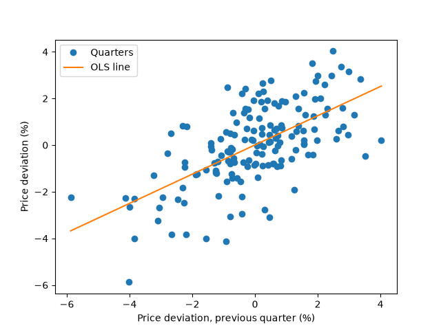
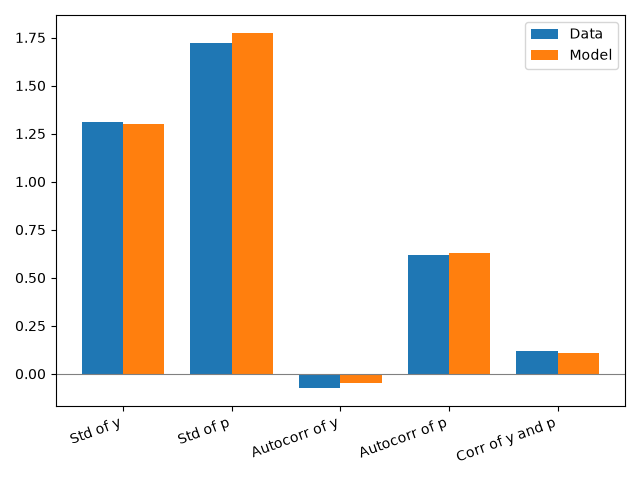

# 第 13 章: 動学的 AD-AS モデルとカリブレーション

## 13.1 この章の地図

第 3 部では、中級マクロ経済学の**総需要・総供給モデル（AD-AS モデル）**を、数値で動かします。教科書では、曲線の傾きの符号（正か負か）だけを仮定して、「政府支出が増えるとどうなるか」を定性的に考えます。ここでは、傾きに**数値**を入れて、「何 % 動くのか」「どれだけの時間で元に戻るのか」を答えます。数値の入れ方が、この章の**カリブレーション**です（データの特徴に合うように、パラメーターを決める）。

| 項目 | 内容 |
| :--- | :--- |
| 経済学の題材 | AS 曲線・AD 曲線・適応的期待、定常状態と乖離率、均衡式（物価の持続性 h）、カリブレーション、モデルの積率とデータの特徴の比較 |
| 使う Python の機能 | `dataclass(frozen=True)`、`@property`、辞書、第 3 章の `fit_ols`、第 8 章の自己相関、第 9 章の HP フィルター |
| 新しく導入するライブラリ | なし（第 1〜12 章の関数を組み合わせる） |
| 完成形 | `AdasParameters`、`adas_step`、`calibrate`、`model_moments`、`data_features`、`load_adas_quarterly`、`adas_cycles` |
| ファイル | 実装: `lib/chapter13/adas.py`、`lib/chapter13/plot.py`／テスト: `test/chapter13/test_adas.py`、`test/chapter13/test_plot.py`（自分で書くときは、`practice/chapter13/` に、同じ名前で作ります） |
| データ | `data/adas_quarterly.csv`（**架空の**四半期データ。1980Q1〜2019Q4、真のパラメーターを知っているモデルから作った）、実際の統計（13.5 節） |

### 経済学の式とコードの対応

| 経済学 | 式 | コード |
| :--- | :--- | :--- |
| AS 曲線 | p(t) = p(t−1) + a·y(t) + v(t) | （均衡式にまとめる） |
| AD 曲線 | y(t) = −c·p(t) + u(t) | （均衡式にまとめる） |
| 物価の持続性 | h = 1 ÷ (1 + a·c) | `AdasParameters.h` |
| 均衡式（物価） | p(t) = h·p(t−1) + h·(a·u(t) + v(t)) | `adas_step(p_prev, u, v, params)` |
| 均衡式（産出量） | y(t) = −c·h·p(t−1) + h·(u(t) − c·v(t)) | `adas_step` の戻り値 |
| カリブレーション | データから a・c・σu・σv を決める | `calibrate(y, p)` |
| モデルが示す特徴 | 標準偏差・自己相関・相関の理論値 | `model_moments(params)` |
| データの特徴 | 同じ 5 つを標本から求める | `data_features(y, p)` |

> **記号について**: y は産出量（GDP）、p は物価水準（デフレーター）の、**トレンドからの乖離（%）**です（第 9 章の `log_cycle`）。a は AS 曲線の傾き、c は AD 曲線の傾き、u・v は需要・供給ショック、σu・σv はその標準偏差です。h は、第 4 章の差分方程式 x(t+1) = a·x(t) + b の係数と同じ役割（持続性）ですが、別の記号です。a・c は、第 1・4 章の a・b・c とは別物です。一覧は、[記号について](how-to-read.md#symbols) を参照してください。

## 13.2 予想する

AS 曲線の傾き a = 0.8、AD 曲線の傾き c = 0.3 とします。

- 物価の持続性 h = 1 ÷ (1 + a·c) は、いくつですか
- a を 2 倍（1.6）にすると、h は、大きくなりますか、小さくなりますか。a = 0.4、c = 0.6 にすると、どうでしょう
- 物価の乖離が 1% のとき、ショックがなければ、次の期の乖離は何 % ですか

## 13.3 モデルの考え方

### 3 つの式

| 式 | 意味 |
| :--- | :--- |
| AS 曲線: P(t) = P^e(t) + a·(Y(t) − Y*) + v(t) | 物価は、期待物価と、産出量の乖離で決まる（a > 0） |
| 適応的期待: P^e(t) = P(t−1) | 期待物価は、前期の物価 |
| AD 曲線: Y(t) = b − c·P(t) + u(t) | 物価が高いと、需要は少ない（c > 0） |

Y と P は対数です。Y* と P* を、長期の（トレンドの）産出量と物価とすると、長期均衡では Y* = b − c·P* です。両辺からこれを引いて、乖離 **y = Y − Y\*、p = P − P\*** で書くと、定数が消えます。

> **AS 曲線**　p(t) = p(t−1) + a·y(t) + v(t)
>
> **AD 曲線**　y(t) = −c·p(t) + u(t)

乖離の変数は、第 9 章で求めた、トレンドからの乖離（%）と対応します。**長期均衡は、y = p = 0 で、u = v = 0** です。

### 均衡式を導く

AD 曲線を AS 曲線に代入します。

> p(t) = p(t−1) + a·(−c·p(t) + u(t)) + v(t)
>
> (1 + a·c)·p(t) = p(t−1) + a·u(t) + v(t)
>
> **p(t) = h·p(t−1) + h·(a·u(t) + v(t))**　（h = 1 ÷ (1 + a·c)）

これを AD 曲線に戻すと、産出量の式になります。

> y(t) = −c·[h·p(t−1) + h·(a·u + v)] + u = −c·h·p(t−1) + (1 − a·c·h)·u − c·h·v
>
> 1 − a·c·h = h なので、**y(t) = −c·h·p(t−1) + h·(u(t) − c·v(t))**

物価の式は、**AR(1)**（第 8 章）で、係数が h です。a と c が正なら、h は 0 と 1 の間で、**物価の乖離は、ショックがなければ、毎期 h 倍になって 0 に戻ります**（安定）。

### 需要ショックと供給ショック

| ショック | 均衡式での効き方 |
| :--- | :--- |
| 需要ショック u（AD 曲線の右シフト） | p に h·a·u、y に h·u。**物価も産出量も上がる** |
| 供給ショック v（AS 曲線の上シフト） | p に h·v、y に −c·h·v。**物価は上がり、産出量は下がる** |

### 回帰でパラメーターを求める

均衡式は、右辺が**前期の物価だけ**の式なので、回帰で係数を求められます。

| 回帰 | 係数 | 残差 |
| :--- | :--- | :--- |
| p(t) を p(t−1) に回帰 | h | e_p = h·(a·u + v) |
| y(t) を p(t−1) に回帰 | d = −c·h | e_y = h·(u − c·v) |

AS 曲線や AD 曲線を、そのまま回帰する（y を p に回帰するなど）と、y と p が同時に決まるため、係数が偏ります（同時性）。均衡式は、右辺が**前の期の値**なので、この問題が小さくなります。

回帰から、パラメーターを次のように決めます（これが**カリブレーション**です）。

1. c = −d ÷ h
2. a = (1 ÷ h − 1) ÷ c　（h の定義 h = 1 ÷ (1 + a·c) を a について解く）
3. 2 つの式の残差 e_p、e_y を、連立方程式として解くと、v = e_p − a·e_y、u = c·e_p + e_y。この標準偏差が、σv、σu

> **元の記事との違い**: 元の記事は、残差の系列相関に対処するため、コクラン＝オーカット推定法（`statsmodels` の `glsar`）を使います。この章は、第 3 章の最小二乗法（`fit_ols`）だけで進めます。推定値は、データによって少し変わります。

## 13.4 プログラミング

### パラメーターと均衡式

モデルのパラメーターを、1 つのまとまりにします（`dataclass`。`frozen=True` で、作った後に変更できない）。a と c は正、標準偏差は 0 以上、という条件を、作るときに検査します。

```python
TRUE = AdasParameters(a=0.8, c=0.3, sigma_u=1.5, sigma_v=1.2)


def test_hはaとcの積で決まる() -> None:
    assert TRUE.h == pytest.approx(1 / (1 + 0.8 * 0.3))


@pytest.mark.parametrize(
    ("a", "c", "su", "sv"),
    [
        (0, 0.3, 1, 1),
        (-0.1, 0.3, 1, 1),
        (0.8, 0, 1, 1),
        (0.8, 0.3, -1, 1),
        (0.8, 0.3, 1, -1),
    ],
)
def test_パラメーターの符号が合わなければ受け付けない(
    a: float, c: float, su: float, sv: float
) -> None:
    with pytest.raises(ValueError, match="パラメーター"):
        AdasParameters(a=a, c=c, sigma_u=su, sigma_v=sv)
```

```python
@dataclass(frozen=True)
class AdasParameters:
    """AS 曲線の傾き a、AD 曲線の傾き c、需要・供給ショックの標準偏差。"""

    a: float
    c: float
    sigma_u: float
    sigma_v: float

    def __post_init__(self) -> None:
        if self.a <= 0 or self.c <= 0 or self.sigma_u < 0 or self.sigma_v < 0:
            raise ValueError(
                "パラメーターは、a・c が正、標準偏差が 0 以上でなければならない"
            )

    @property
    def h(self) -> float:
        """物価の持続性 h = 1 ÷ (1 + a·c)。0 と 1 の間。"""
        return 1 / (1 + self.a * self.c)
```

次は、均衡式（1 期分）です。テストは、手計算の値（a = c = 1、h = 0.5）に加えて、**AS 曲線と AD 曲線を、同時に満たすこと**を確かめます。均衡式を導く過程の誤り（符号など）は、元の曲線に戻して確かめるのが確実です。

```python
def test_ショックがなければ定常状態にとどまる() -> None:
    assert adas_step(0.0, 0.0, 0.0, TRUE) == (0.0, 0.0)


def test_需要ショックは物価も産出量も上げる() -> None:
    params = AdasParameters(a=1, c=1, sigma_u=1, sigma_v=1)
    p, y = adas_step(0.0, 1.0, 0.0, params)
    assert p == pytest.approx(0.5)
    assert y == pytest.approx(0.5)


def test_供給ショックは物価を上げて産出量を下げる() -> None:
    params = AdasParameters(a=1, c=1, sigma_u=1, sigma_v=1)
    p, y = adas_step(0.0, 0.0, 1.0, params)
    assert p == pytest.approx(0.5)
    assert y == pytest.approx(-0.5)


@pytest.mark.parametrize(
    ("p_prev", "u", "v"), [(0.0, 1.0, 0.0), (2.0, -0.5, 0.7), (-1.3, 0.2, -0.4)]
)
def test_均衡はAS曲線とAD曲線を同時に満たす(p_prev: float, u: float, v: float) -> None:
    p, y = adas_step(p_prev, u, v, TRUE)
    assert p == pytest.approx(p_prev + TRUE.a * y + v)
    assert y == pytest.approx(-TRUE.c * p + u)
```

```python
def adas_step(
    p_prev: float, u: float, v: float, params: AdasParameters
) -> tuple[float, float]:
    """前期の物価の乖離と、今期のショックから、今期の（物価, 産出量）を求める。"""
    h = params.h
    p = h * p_prev + h * (params.a * u + v)
    y = -params.c * h * p_prev + h * (u - params.c * v)
    return p, y
```

### カリブレーション

まず、ショックのないデータ（物価が h 倍ずつ縮み、産出量が AD 曲線の上にある）から、a と c を**ちょうど復元できる**かを確かめます。答えを知っている問題で、関数の正しさを確かめます。

```python
def test_ショックのないデータからaとcをちょうど復元できる() -> None:
    h = TRUE.h
    p = pd.Series([h**t for t in range(30)])
    y = -TRUE.c * p
    result = calibrate(y, p)
    assert result.a == pytest.approx(0.8)
    assert result.c == pytest.approx(0.3)
    assert result.sigma_u == pytest.approx(0, abs=1e-6)
    assert result.sigma_v == pytest.approx(0, abs=1e-6)
```

次に、ショックのある長い系列です。モデルから 2 万期間のデータを作り（`simulated_cycles` は、第 14 章の `simulate` の下書きです）、真のパラメーターを復元できるかを見ます。

```python
def simulated_cycles(
    params: AdasParameters, n: int, seed: int
) -> tuple[pd.Series, pd.Series]:
    """モデルから、乖離の系列（y, p）を作る。第 14 章の simulate の下書き。"""
    rng = np.random.default_rng(seed)
    p = 0.0
    ys, ps = [], []
    for _ in range(n):
        u = rng.normal(0, params.sigma_u)
        v = rng.normal(0, params.sigma_v)
        p, y = adas_step(p, u, v, params)
        ys.append(y)
        ps.append(p)
    return pd.Series(ys), pd.Series(ps)


def test_長い系列から真のパラメーターに近い値を復元する() -> None:
    y, p = simulated_cycles(TRUE, 20000, seed=6)
    result = calibrate(y, p)
    assert result.a == pytest.approx(0.8, abs=0.05)
    assert result.c == pytest.approx(0.3, abs=0.05)
    assert result.sigma_u == pytest.approx(1.5, abs=0.05)
    assert result.sigma_v == pytest.approx(1.2, abs=0.05)
```

```python
def calibrate(y: pd.Series, p: pd.Series) -> AdasParameters:
    """乖離の系列 y, p から、パラメーターを決める。

    p(t) を p(t-1) に回帰して h、y(t) を p(t-1) に回帰して d = -c·h を求める。
    c = -d ÷ h、a = (1 ÷ h - 1) ÷ c。回帰の残差 e_p = h(a·u + v)、
    e_y = h(u - c·v) から、v = e_p - a·e_y、u = c·e_p + e_y を求め、
    その標準偏差を、σv、σu にする（標準偏差は定数のずれに影響されないので、
    残差の定数項は、引かなくてよい）。
    """
    lag = pd.DataFrame({"p_lag": p.shift().dropna()})
    p_now = pd.Series(p.iloc[1:])
    y_now = pd.Series(y.iloc[1:])
    fit_p = fit_ols(p_now, lag)
    fit_y = fit_ols(y_now, lag)
    h = float(fit_p.coefficients["p_lag"])
    d = float(fit_y.coefficients["p_lag"])
    e_p = p_now - h * lag["p_lag"]
    e_y = y_now - d * lag["p_lag"]
    c = -d / h
    a = (1 / h - 1) / c
    return AdasParameters(
        a=a,
        c=c,
        sigma_u=float((c * e_p + e_y).std()),
        sigma_v=float((e_p - a * e_y).std()),
    )
```

2 万期間なら、a = 0.79、c = 0.30、σu = 1.51、σv = 1.20 で、真の値（0.8、0.3、1.5、1.2）に近くなります。

モデルと合わないデータは、**受け付けない**ようにします。物価が上がったとき産出量も上がるデータ（d > 0）では、c が負になり、AD 曲線の傾きの符号に反します。

```python
def test_物価が上がっても産出量が下がらないデータはモデルと合わない() -> None:
    p = pd.Series([0.8**t for t in range(30)])
    y = 0.3 * p
    with pytest.raises(ValueError, match="パラメーター"):
        calibrate(y, p)


def test_計算に使う期間が短すぎると受け付けない() -> None:
    p = pd.Series([1.0, 0.8, 0.64])
    with pytest.raises(ValueError, match="観測数"):
        calibrate(-0.3 * p, p)
```

### モデルの特徴と、データの特徴

パラメーターが決まると、モデルが示す**標準偏差・自己相関・相関**が、式で求まります。物価の分散は、Var(p) = Var(h·p(t−1) + e_p) = h²·Var(p) + Var(e_p) から、Var(p) = Var(e_p) ÷ (1 − h²) です（p(t−1) と e_p は、時点がずれていて、無相関）。

```python
def test_モデルの積率を手計算の例と照合する() -> None:
    params = AdasParameters(a=1, c=1, sigma_u=1, sigma_v=0)
    moments = model_moments(params)
    assert moments["p_std"] == pytest.approx(np.sqrt(1 / 3))
    assert moments["y_std"] == pytest.approx(np.sqrt(1 / 3))
    assert moments["p_autocorr"] == pytest.approx(0.5)
    assert moments["y_autocorr"] == pytest.approx(-0.25)
    assert moments["correlation"] == pytest.approx(0.5)


def test_物価の自己相関はhに等しい() -> None:
    assert model_moments(TRUE)["p_autocorr"] == pytest.approx(TRUE.h)


def test_積率は長いシミュレーションの標本の値に近い() -> None:
    y, p = simulated_cycles(TRUE, 100000, seed=1)
    simulated = data_features(y, p)
    theory = model_moments(TRUE)
    for key in ("y_std", "p_std", "y_autocorr", "p_autocorr", "correlation"):
        assert simulated[key] == pytest.approx(theory[key], abs=0.02)
```

```python
def model_moments(params: AdasParameters) -> dict[str, float]:
    """モデルが示す（理論の）標準偏差・自己相関・相関。

    Var(p) = ((a·h)²σu² + h²σv²) ÷ (1 - h²)。p の自己相関 = h。
    """
    a, c, h = params.a, params.c, params.h
    su2, sv2 = params.sigma_u**2, params.sigma_v**2
    var_p = ((a * h) ** 2 * su2 + h**2 * sv2) / (1 - h**2)
    var_y = (c * h) ** 2 * var_p + h**2 * (su2 + c**2 * sv2)
    cov_py = -c * h**2 * var_p + h**2 * (a * su2 - c * sv2)
    return {
        "y_std": float(np.sqrt(var_y)),
        "p_std": float(np.sqrt(var_p)),
        "y_autocorr": -c * h * cov_py / var_y,
        "p_autocorr": h,
        "correlation": cov_py / float(np.sqrt(var_y * var_p)),
    }


def data_features(y: pd.Series, p: pd.Series) -> dict[str, float]:
    """データの特徴（モデルの積率と同じ 5 つ）。標準偏差は不偏、自己相関はラグ 1。"""
    return {
        "y_std": volatility(y),
        "p_std": volatility(p),
        "y_autocorr": sample_autocorrelation(y.to_numpy(), 1),
        "p_autocorr": sample_autocorrelation(p.to_numpy(), 1),
        "correlation": cross_correlation(y, p),
    }
```

手計算の例は、a = c = 1、σu = 1、σv = 0（h = 0.5）です。Var(p) = 0.25 ÷ 0.75 = 1/3、Var(y) = 0.25/3 + 0.25 = 1/3、Cov(p, y) = −0.25/3 + 0.25 = 1/6 なので、相関は 0.5、y の自己相関は −0.25 です。

データの特徴は、同じ 5 つを標本から求めます。

```python
def test_データの特徴は標準偏差と自己相関と相関() -> None:
    y = pd.Series([1.0, 2.0, 3.0, 4.0])
    p = pd.Series([4.0, 3.0, 2.0, 1.0])
    features = data_features(y, p)
    assert list(features) == [
        "y_std",
        "p_std",
        "y_autocorr",
        "p_autocorr",
        "correlation",
    ]
    assert features["y_std"] == pytest.approx(np.std([1, 2, 3, 4], ddof=1))
    assert features["y_autocorr"] == pytest.approx(0.25)
    assert features["correlation"] == pytest.approx(-1.0)
```

### 架空のデータで試す

`data/adas_quarterly.csv` は、**真のパラメーターを知っているモデル**（a = 0.8、c = 0.3、σu = 1.5、σv = 1.2、h = 0.806）から作った、GDP とデフレーターの水準です（トレンドは、GDP が毎四半期 0.5%、デフレーターが 0.4%）。第 9 章の HP フィルターで乖離を取り出し、カリブレーションします。

```python
def test_同梱のデータは1980年から2019年までの160四半期() -> None:
    df = load_adas_quarterly()
    assert len(df) == 160
    assert str(df.index[0]) == "1980Q1"
    assert str(df.index[-1]) == "2019Q4"
    assert list(df.columns) == ["gdp", "deflator"]


def test_乖離の系列は平均がほぼ0で産出量と物価の2列() -> None:
    cycles = adas_cycles(load_adas_quarterly())
    assert list(cycles.columns) == ["y", "p"]
    assert abs(cycles["y"].mean()) < 0.1
    assert abs(cycles["p"].mean()) < 0.1
```

```python
def load_adas_quarterly(path: Path = DEFAULT_DATA_PATH) -> pd.DataFrame:
    """GDP とデフレーター（水準）の四半期データを読み込む。"""
    return load_quarterly(path)


def adas_cycles(df: pd.DataFrame) -> pd.DataFrame:
    """GDP とデフレーターの、対数のトレンドからの乖離（%）。列は y と p。"""
    return pd.DataFrame(
        {
            "y": log_cycle(pd.Series(df["gdp"])),
            "p": log_cycle(pd.Series(df["deflator"])),
        }
    )
```

```python
def test_同梱のデータのカリブレーション() -> None:
    cycles = adas_cycles(load_adas_quarterly())
    result = calibrate(cycles["y"], cycles["p"])
    assert result.a == pytest.approx(1.083, abs=0.001)
    assert result.c == pytest.approx(0.550, abs=0.001)
    assert result.sigma_u == pytest.approx(1.706, abs=0.001)
    assert result.sigma_v == pytest.approx(1.206, abs=0.001)
    assert result.h == pytest.approx(0.627, abs=0.001)


def test_短い系列とHPフィルターでは真の値から離れる() -> None:
    """真のパラメーター（0.8, 0.3）とは、HP フィルターと標本の短さの分だけ違う。"""
    cycles = adas_cycles(load_adas_quarterly())
    result = calibrate(cycles["y"], cycles["p"])
    assert abs(result.a - TRUE.a) > 0.2
    assert abs(result.h - TRUE.h) > 0.15
```

| | a | c | σu | σv | h |
| :--- | ---: | ---: | ---: | ---: | ---: |
| 真の値（データを作ったモデル） | 0.80 | 0.30 | 1.50 | 1.20 | 0.806 |
| 2 万期間の系列から復元（上のテスト） | 0.79 | 0.30 | 1.51 | 1.20 | 0.808 |
| **160 四半期 + HP フィルター**（同梱のデータ） | **1.08** | **0.55** | **1.71** | **1.21** | **0.627** |

160 四半期の同梱データでは、真の値から**離れます**。理由は 2 つです。1 つ目は、標本が短く、h の推定値がばらつくこと。2 つ目は、HP フィルターが、**ゆっくりした動き（持続性）の一部を、トレンドとして取り除く**ことです（h が 0.81 から 0.63 に下がっています）。**答えを知っているデータで試すと、カリブレーションの手続きの限界が見えます**。





図の読み方:

- 上の図は、h を求める回帰です。点の並びの傾き（直線）が、物価の持続性 h です。点は、直線のまわりに、大きくばらつきます（残差 e_p が、ショックの影響）
- 下の図は、データとモデルの、5 つの特徴です。標準偏差と物価の自己相関は、ほぼ同じです（カリブレーションで合わせた特徴）。産出量の自己相関（−0.075 と −0.050）は、どちらも 0 に近い値です

```python
def test_同梱のデータの特徴とモデルの積率() -> None:
    cycles = adas_cycles(load_adas_quarterly())
    features = data_features(cycles["y"], cycles["p"])
    assert features["y_std"] == pytest.approx(1.310, abs=0.001)
    assert features["p_std"] == pytest.approx(1.722, abs=0.001)
    assert features["p_autocorr"] == pytest.approx(0.620, abs=0.001)
    moments = model_moments(calibrate(cycles["y"], cycles["p"]))
    assert moments["y_std"] == pytest.approx(1.300, abs=0.001)
    assert moments["p_autocorr"] == pytest.approx(0.627, abs=0.001)
```

```python
def plot_moment_comparison(data: dict[str, float], model: dict[str, float]) -> Figure:
    """データとモデルの、5 つの特徴（標準偏差・自己相関・相関）を、並べた棒で描く。"""
    positions = np.arange(len(MOMENT_LABELS))
    width = 0.38
    fig, ax = plt.subplots()
    ax.bar(positions - width / 2, [data[k] for k in MOMENT_LABELS], width, label="Data")
    ax.bar(
        positions + width / 2, [model[k] for k in MOMENT_LABELS], width, label="Model"
    )
    ax.axhline(0, color="gray", linewidth=0.8)
    ax.set_xticks(positions, list(MOMENT_LABELS.values()), rotation=20, ha="right")
    ax.legend()
    fig.tight_layout()
    plt.close(fig)
    return fig
```

> **これは、架空のデータの結果です。** データは、モデルから作ったので、モデルの特徴を持ちます。実際の経済で、モデルがどれだけ特徴を再現するかは、次の節（実際の統計）と、次の章で確かめます。

### 予想の答え合わせ

予想した答えを、プログラムで確かめます。

```python
from lib.chapter13.adas import AdasParameters

base = AdasParameters(a=0.8, c=0.3, sigma_u=1.5, sigma_v=1.2)
a_double = AdasParameters(a=1.6, c=0.3, sigma_u=1.5, sigma_v=1.2)
swapped = AdasParameters(a=0.4, c=0.6, sigma_u=1.5, sigma_v=1.2)

print("h (a=0.8, c=0.3):", round(base.h, 4))
print("h (a=1.6, c=0.3):", round(a_double.h, 4))
print("h (a=0.4, c=0.6):", round(swapped.h, 4))
print("next-period deviation of 1% (%):", round(1.0 * base.h, 4))
```

```text
h (a=0.8, c=0.3): 0.8065
h (a=1.6, c=0.3): 0.6757
h (a=0.4, c=0.6): 0.8065
next-period deviation of 1% (%): 0.8065
```

- 1 つ目の問い: h = 1 ÷ (1 + 0.8 × 0.3) = 1 ÷ 1.24 = **0.8065** です。
- 2 つ目の問い: a を 2 倍（1.6）にすると、a·c = 0.48 と大きくなり、h は **0.6757** と**小さく**なります。h は、a と c の**積**だけで決まるので、a = 0.4、c = 0.6（積 0.24）の h は、**0.8065** のまま、変わりません。
- 3 つ目の問い: ショックがなければ、乖離は h 倍になるので、1% の乖離は、次の期に **0.8065%** になります。

### ノートブックで試す

数字を書き換えて、結果と図が変わるのを、手軽に確かめられます。`apps/macro-programming/python/notebooks/ch13_adas_calibration.ipynb` を開き、「Parameters」のセルの数字（AS 曲線の傾き a、AD 曲線の傾き c、需要・供給ショックの標準偏差）を書き換えて、上から順に実行します。起動は、アプリのディレクトリで `uv run --with jupyterlab jupyter lab notebooks/` です。

### 実行結果

```bash
cd apps/macro-programming/python
uv run pytest test/chapter13
```

```text
32 passed
```

## 13.5 実際の統計で試す（内閣府の四半期 GDP とデフレーター）

第 12 章の 12.5 節で読み込んだ、**実際の統計**（内閣府の実質 GDP とデフレーター、1994Q1〜2026Q1、129 四半期）を、そのまま使います。ファイルの取得方法と、利用条件の注意は、12.5 節を参照してください。

```python
from pathlib import Path

from lib.chapter09.cycles import log_cycle
from lib.chapter12.cabinet import load_cabinet_quarterly
from lib.chapter13.adas import calibrate, data_features, model_moments

gdp = load_cabinet_quarterly(Path("data/gaku-jk2611.csv"), column=1)
deflator = load_cabinet_quarterly(Path("data/def-qk2611.csv"), column=1)

y = log_cycle(gdp)
p = log_cycle(deflator)
params = calibrate(y, p)
```

2026 年 5 月 19 日公表の 1 次速報（129 四半期）の結果は、次のとおりです。

| パラメーター | 実際の統計 | 同梱の架空データ |
| :--- | ---: | ---: |
| a（AS 曲線の傾き） | **0.316** | 1.083 |
| c（AD 曲線の傾き） | **0.656** | 0.550 |
| σu（需要ショックの標準偏差、%） | **1.553** | 1.706 |
| σv（供給ショックの標準偏差、%） | **0.641** | 1.206 |
| h（物価の持続性） | **0.828** | 0.627 |

| 特徴 | 実際のデータ | カリブレーションしたモデル |
| :--- | ---: | ---: |
| GDP の乖離の標準偏差（%） | 1.577 | 1.482 |
| デフレーターの乖離の標準偏差（%） | 0.735 | 1.193 |
| GDP の乖離の自己相関 | 0.709 | 0.075 |
| デフレーターの乖離の自己相関 | 0.825 | 0.828 |
| 両者の相関 | −0.214 | −0.171 |

読み取れることと、注意点:

- **物価の持続性は、再現できています**（0.825 と 0.828）。h を回帰で求めたので、当然の結果です。**GDP の標準偏差**も、近い値です（1.58 と 1.48）
- **再現できない特徴**もあります。デフレーターの標準偏差は、モデルが大きすぎ（0.74 に対して 1.19）、**GDP の自己相関は、低すぎます**（0.71 に対して 0.08）。モデルの均衡式は、y を前期の物価から決めるので、y 自体の持続性は、ショックが持続的でない限り生まれません（次の章で、持続的なショックを入れて確かめます）
- 元の記事（別のデータ、コクラン＝オーカット推定法）は、a = 0.823、c = 0.269 という値を報告しています。**同じモデルでも、データと推定方法で、パラメーターは大きく変わります**。a と c を、「真の値」と読まず、**データの特徴に合わせて決めた値**と読みます
- 相関の符号は、データ（−0.21）もモデル（−0.17）も負で、同じです

## 13.6 規則で言うと

1. **均衡式は、AS 曲線と AD 曲線の両方を満たす。** 導いた式の符号の誤りは、元の曲線に戻して確かめる
2. **h は、a と c の積で決まる。** 傾きを、別々の値にしても、積が同じなら、物価の持続性は同じ
3. **答えを知っているデータで、手続きを確かめる。** ショックのないデータで、ちょうど復元できること。長い系列で、近い値に戻ること。短い系列と HP フィルターでは、離れること
4. **カリブレーションした値は、データと手続きの産物。** 「真の値」とは読まない

混同しやすい点を、表にまとめます。

| 混同しやすい点 | 違い |
| :--- | :--- |
| モデルの a・c と 回帰の係数 h・d | h・d が回帰の係数。a・c は、h・d から、式の変形で求めた値 |
| カリブレーション と 推定 | カリブレーションは、データの特徴に合うようにパラメーターを決める作業。回帰（推定）は、その手段の 1 つ |
| 供給ショック v と 需要ショック u | v は、AS 曲線の上下（物価↑・産出量↓）、u は、AD 曲線の左右（物価↑・産出量↑） |
| p・y の乖離（%）と 水準 | モデルの変数は、トレンドからの乖離。GDP やデフレーターの水準ではない |

### このモデルが成り立たない場面

- **期待は、適応的とは限りません。** 前期の物価で期待を作るのは、後ろ向きの仮定です。合理的期待のモデル（第 18 章の RBC など）とは、前提が違います
- **ショックは、独立とは限りません。** 政府の政策・投資・流行は、数期間続くので、ホワイト・ノイズでは、持続性が足りません
- **AD 曲線は、IS-LM 曲線から導かれる複雑な式を、1 本の直線にまとめたものです。** 政府支出・貨幣量・金利の動きは、ショック u に含まれます
- **a と c の同時性の問題は、完全には消えません。** 均衡式は、右辺が前期の値ですが、ショックに系列相関があれば、回帰の係数は偏ります

## 13.7 練習問題

| 種類 | 問題 |
| :--- | :--- |
| 想起 | 本文を閉じて、「ショックがなければ、定常状態（0, 0）にとどまる」というテストを書いてください |
| 生成 | 解説を見る前に、回帰の係数 h と d から、a と c を求める `parameters_from_regression(h, d)` を、テストから書いてください。a = 0.8、c = 0.3 から作った h と d で、元に戻るでしょうか |
| 多様 | (a, c) = (0.4, 0.3)、(1.6, 0.3)、(0.8, 0.15)、(0.8, 0.6) の h を、先に予想してから、確かめてください。同じ h になる組み合わせはありますか |
| 交互 | 第 8 章の `sample_autocorrelation` と `ar1_autocorrelation` で、モデルの物価の乖離の、ラグ 1・ラグ 2 の自己相関を、シミュレーションで求めて、理論値（h と h²）と比べてください |

??? note "解答（先に自分で取り組んでから、開いてください）"

    **想起**:

    ```python
    def test_ショックがなければ定常状態にとどまる() -> None:
        params = AdasParameters(a=0.8, c=0.3, sigma_u=1.5, sigma_v=1.2)
        assert adas_step(0.0, 0.0, 0.0, params) == (0.0, 0.0)
    ```

    **生成**: c = −d ÷ h、a = (1 ÷ h − 1) ÷ c です。

    ```python
    def parameters_from_regression(h, d):
        c = -d / h
        a = (1 / h - 1) / c
        return a, c
    ```

    ```python
    def test_回帰の係数からaとcを求める() -> None:
        h = 1 / (1 + 0.8 * 0.3)
        a, c = parameters_from_regression(h, -0.3 * h)
        assert a == pytest.approx(0.8)
        assert c == pytest.approx(0.3)


    def test_求めたaとcからhの定義に戻る() -> None:
        a, c = parameters_from_regression(0.8, -0.24)
        assert AdasParameters(a=a, c=c, sigma_u=1, sigma_v=1).h == pytest.approx(0.8)
    ```

    h と d から作った a と c は、元の a と c に戻り、a と c から h を作ると、元の h に戻ります。**逆向きの関数どうしで、確かめる**例です。

    **多様**: h は a と c の積で決まるので、(0.4, 0.3) の積 0.12 と (0.8, 0.15) の積 0.12 は、同じ h です。(1.6, 0.3) の積 0.48 と (0.8, 0.6) の積 0.48 も、同じ h です。

    ```python
    def test_hはaとcの積だけで決まる() -> None:
        expected = {(0.4, 0.3): 0.8929, (1.6, 0.3): 0.6757, (0.8, 0.15): 0.8929, (0.8, 0.6): 0.6757}
        for (a, c), h in expected.items():
            params = AdasParameters(a=a, c=c, sigma_u=1, sigma_v=1)
            assert params.h == pytest.approx(h, abs=0.0001)
        low = AdasParameters(a=0.4, c=0.3, sigma_u=1, sigma_v=1)
        same = AdasParameters(a=0.8, c=0.15, sigma_u=1, sigma_v=1)
        assert low.h == pytest.approx(same.h)
    ```

    a と c の**積**が大きいほど、h は小さく（物価は、早く元に戻る）なります。AS 曲線が急（a が大きい）でも、AD 曲線が平ら（c が大きい。p を縦軸にとると、p = −y ÷ c）でも、同じ効果です。

    **交互**: 物価の乖離は、AR(1)（係数 h）なので、ラグ k の自己相関は h^k です。

    ```python
    def test_物価の自己相関はAR1の理論値に近い() -> None:
        params = AdasParameters(a=0.8, c=0.3, sigma_u=1.5, sigma_v=1.2)
        rng = np.random.default_rng(6)
        p = 0.0
        values = []
        for _ in range(20000):
            u = rng.normal(0, params.sigma_u)
            v = rng.normal(0, params.sigma_v)
            p, _ = adas_step(p, u, v, params)
            values.append(p)
        x = np.array(values)
        for lag, observed in [(1, 0.808), (2, 0.650)]:
            assert sample_autocorrelation(x, lag) == pytest.approx(observed, abs=0.002)
            theory = ar1_autocorrelation(params.h, lag)
            assert abs(sample_autocorrelation(x, lag) - theory) < 0.02
    ```

    標本の自己相関は、ラグ 1 が 0.808（理論値 0.806）、ラグ 2 が 0.650（理論値 0.650）です。**モデルの物価の動きは、第 8 章の AR(1)** で、そのまま理解できます。

## 13.8 振り返り

- h を 2 倍の a で予想したとき、何を基準にしましたか。h が、a と c の積だけで決まることに、気づきましたか
- 長い系列では、パラメーターを復元できたのに、短い系列と HP フィルターでは、離れました。**カリブレーションの値は、何に依存していますか**
- 架空のデータと、実際の統計で、パラメーターは大きく違いました。a や c を、どのような数として読みますか

## 13.9 まとめ

- AS 曲線・AD 曲線・適応的期待を、乖離率の均衡式（物価の持続性 h）にまとめ、関数とテストにした
- 回帰の係数 h・d と、残差から、a・c・σu・σv を決めるカリブレーションを実装した
- ショックのないデータでちょうど復元できること、長い系列で近い値に戻ること、短い系列と HP フィルターでは離れることを確かめた
- 日本の四半期データ（実際の統計）では、a = 0.32、c = 0.66、h = 0.83 だった。GDP の持続性は、モデルでは再現できなかった
- 次の章では、このモデルに、ショックを与えて、**インパルス反応**と**確率的シミュレーション**、**分散分解**を調べます
