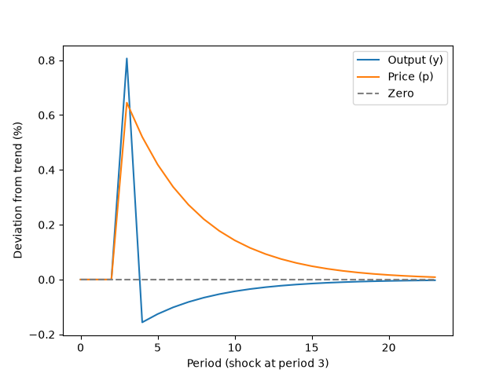
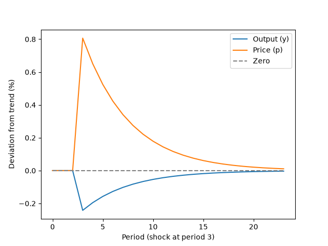
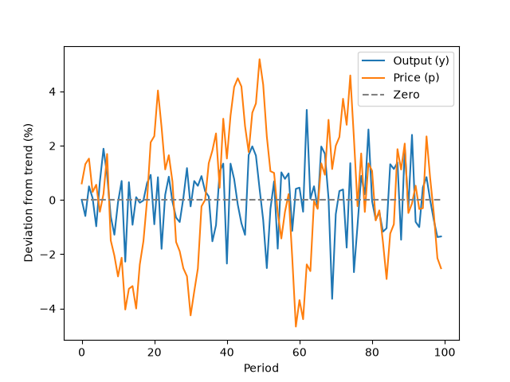

# 第 14 章: インパルス反応と確率的シミュレーション

## 14.1 この章の地図

第 13 章で作ったモデルに、ショックを与えます。**1 回だけのショック**への反応（インパルス反応）で、モデルの動きを理解し、**毎期のショック**（確率的シミュレーション）で、データの特徴を再現できるかを調べます。そして、「GDP と物価の変動の何 % が、需要ショックで、何 % が供給ショックによるか」という**定量的な問い**に、分散分解で答えます。

| 項目 | 内容 |
| :--- | :--- |
| 経済学の題材 | 安定性、収束の速さと半減期、インパルス反応（需要ショック・供給ショック）、確率的シミュレーション、分散分解 |
| 使う Python の機能 | `for` ループによる差分方程式の計算、乱数の生成器を引数にする設計（第 8 章）、`DataFrame` の組み立て、列ごとの割り算 |
| 新しく導入するライブラリ | なし |
| 完成形 | `is_stable`、`price_half_life`、`convergence_path`、`impulse_response`、`simulate`、`variance_contributions`、`variance_decomposition` |
| ファイル | 実装: `lib/chapter14/simulation.py`、`lib/chapter14/plot.py`／テスト: `test/chapter14/test_simulation.py`、`test/chapter14/test_plot.py`（自分で書くときは、`practice/chapter14/` に、同じ名前で作ります） |
| データ | 第 13 章のモデル（a = 0.8、c = 0.3、σu = 1.5、σv = 1.2）、実際の統計（14.5 節） |

### 経済学の式とコードの対応

| 経済学 | 式 | コード |
| :--- | :--- | :--- |
| 安定性 | \|h\| < 1 なら、ショックがなければ 0 に戻る | `is_stable(h)` |
| 半減期 | 乖離が半分になる期間 = ln 0.5 ÷ ln h | `price_half_life(params)` |
| ショックがない経済の道筋 | p(t) = h·p(t−1)、y(t) = −c·p(t) | `convergence_path(p0, params, periods)` |
| インパルス反応 | 1 期間のショックへの反応 | `impulse_response(params, u, v)` |
| 確率的シミュレーション | 毎期 u(t) ~ N(0, σu²)、v(t) ~ N(0, σv²) | `simulate(params, n, rng)` |
| 分散分解 | Var(p) を、需要・供給ショックに分ける | `variance_decomposition(params)` |

> **記号について**: 第 13 章と同じです（y・p は乖離（%）、a・c は AS・AD 曲線の傾き、h は物価の持続性）。

## 14.2 予想する

a = 0.8、c = 0.3、σu = 1.5、σv = 1.2 のモデルです。経済が長期均衡にあるとき、ある 1 期間だけ、需要ショック（u = 1）が起きます。

- ショックの期に、物価と産出量は、上がりますか、下がりますか
- ショックの次の期には、産出量は、どうなりますか（需要ショックは、もう 0 です）
- 物価の乖離が半分になるのに、何四半期かかりますか
- 需要ショックを受けた産出量の反応を、全期間で足し合わせると、いくつになりますか

答えは、ショックの期は、物価も産出量も**上がります**（物価 +0.65、産出量 +0.81）。次の期は、物価がまだ高いので、AS 曲線が上にあり、産出量は**マイナス**（−0.16）になります。半減期は、ln 0.5 ÷ ln 0.806 = **3.2 四半期**です。足し合わせると、**ちょうど 0** です（14.8 節の練習問題で確かめます）。

## 14.3 考え方

### 安定性と半減期

ショックがなければ、p(t) = h·p(t−1)、y(t) = −c·p(t) です。h は、0 と 1 の間なので、乖離は、毎期 h 倍になって 0 に戻ります（**安定**）。p が半分になる期間（半減期）は、h^k = 0.5 から、k = ln 0.5 ÷ ln h です（第 8 章 `shock_half_life`）。a と c の積が大きい（h が小さい）ほど、早く戻ります。

### インパルス反応

1 期間だけ、ショックを与えます（u = 1 または v = 1）。物価と産出量の反応は、次のとおりです（a = 0.8、c = 0.3）。

| 期 | 需要ショック u = 1 の産出量 y | 需要ショックの物価 p | 供給ショック v = 1 の y | 供給ショックの p |
| :--- | ---: | ---: | ---: | ---: |
| ショックの期 | +0.806 | +0.645 | −0.242 | +0.806 |
| 1 期後 | −0.156 | +0.520 | −0.195 | +0.650 |
| 2 期後 | −0.126 | +0.420 | −0.157 | +0.524 |
| 3 期後 | −0.102 | +0.338 | −0.127 | +0.423 |

需要ショックでは、**産出量は、ショックの期だけ上がり、その後は下がります**。ショックが消えても、物価が高いまま（適応的期待）なので、AS 曲線が高い位置にあります。供給ショックでは、**物価が上がり、産出量が下がり、その後、ゆっくり戻ります**。

### 確率的シミュレーション

現実の経済では、毎期、大小のショックが起きます。ショックを、毎期、正規分布から引いて（ホワイト・ノイズ。第 8 章）、y と p を作ります。乱数の生成器を、**引数として渡す**ので、種を固定すれば、結果を再現できます（第 8 章と同じ設計）。

### 分散分解

物価の分散は、Var(p) = Var(e_p) ÷ (1 − h²)、e_p = h·(a·u + v) でした。u と v は無相関なので、Var(e_p) = (a·h)²σu² + h²σv² で、2 つの項は、**需要ショックと供給ショックに起因する分散**です。割合を求めると、

> p の変動に対する需要ショックの寄与度 = a²σu² ÷ (a²σu² + σv²)

となります。産出量は、y(t) = −c·h·p(t−1) + h·u − c·h·v なので、p(t−1) 経由の効果と、直接の効果を足します。

| | 需要ショックに起因する分散 | 供給ショックに起因する分散 |
| :--- | :--- | :--- |
| p | (a·h)²σu² ÷ (1 − h²) | h²σv² ÷ (1 − h²) |
| y | (c·h)² × (p の u 部分) + h²σu² | (c·h)² × (p の v 部分) + (c·h)²σv² |

## 14.4 Red → Green → Refactor

### 安定性と、ショックのない経済の道筋

```python
@pytest.mark.parametrize(
    ("h", "stable"), [(0.8, True), (-0.5, True), (1.0, False), (-1.2, False)]
)
def test_遷移係数の絶対値が1より小さければ安定(h: float, stable: bool) -> None:
    assert is_stable(h) is stable


def test_aとcが正ならモデルは必ず安定() -> None:
    assert is_stable(TRUE.h)
    assert is_stable(AdasParameters(a=100, c=100, sigma_u=1, sigma_v=1).h)


def test_ショックがなければ物価はhずつ縮み産出量はAD曲線の上にある() -> None:
    path = convergence_path(1.0, TRUE, periods=5)
    assert len(path) == 6
    assert path["p"].iloc[0] == 1.0
    assert path["p"].iloc[1] == pytest.approx(TRUE.h)
    assert path["p"].iloc[5] == pytest.approx(TRUE.h**5)
    assert path["y"].to_numpy() == pytest.approx((-TRUE.c * path["p"]).to_numpy())


def test_初期値が負でも0に近づく() -> None:
    path = convergence_path(-1.0, TRUE, periods=30)
    assert path["p"].iloc[-1] == pytest.approx(0, abs=1e-2)
    assert (path["p"] < 0).all()


def test_変化率はhマイナス1でaが大きいほど速く収束する() -> None:
    slow = AdasParameters(a=0.2, c=0.3, sigma_u=1, sigma_v=1)
    fast = AdasParameters(a=2.0, c=0.3, sigma_u=1, sigma_v=1)
    assert fast.h < slow.h
    path = convergence_path(1.0, fast, periods=1)
    assert path["p"].iloc[1] / path["p"].iloc[0] - 1 == pytest.approx(fast.h - 1)


def test_半減期は物価の持続性から決まる() -> None:
    assert price_half_life(TRUE) == pytest.approx(np.log(0.5) / np.log(TRUE.h))
    assert TRUE.h ** price_half_life(TRUE) == pytest.approx(0.5)
```

```python
def is_stable(h: float) -> bool:
    """p(t) = h·p(t-1) が、安定（|h| < 1）か。"""
    return abs(h) < 1


def price_half_life(params: AdasParameters) -> float:
    """物価の乖離が、半分になるまでの期間（四半期）。"""
    return shock_half_life(params.h)


def convergence_path(p0: float, params: AdasParameters, periods: int) -> pd.DataFrame:
    """ショックがない経済が、初期の物価の乖離 p0 から、定常状態に戻る道筋。

    最初の期の産出量は、AD 曲線 y = -c·p から決まる。
    """
    p = p0
    rows = [{"y": -params.c * p, "p": p}]
    for _ in range(periods):
        p, y = adas_step(p, 0.0, 0.0, params)
        rows.append({"y": y, "p": p})
    return pd.DataFrame(rows)
```

### インパルス反応

```python
UNIT = AdasParameters(a=1, c=1, sigma_u=1, sigma_v=1)


def test_インパルス反応は最初の3期間が定常状態() -> None:
    df = impulse_response(TRUE, u=1.0)
    assert df.iloc[:3].to_numpy() == pytest.approx(0)


def test_インパルス反応の列と長さ() -> None:
    df = impulse_response(TRUE, u=1.0, periods_after=20)
    assert list(df.columns) == ["y", "p", "u", "v"]
    assert len(df) == 3 + 1 + 20


def test_需要ショックの反応は手計算と一致する() -> None:
    df = impulse_response(UNIT, u=1.0, periods_after=2)
    assert df["u"].tolist() == [0, 0, 0, 1.0, 0, 0]
    assert df["p"].iloc[3] == pytest.approx(0.5)
    assert df["y"].iloc[3] == pytest.approx(0.5)
    assert df["p"].iloc[4] == pytest.approx(0.25)
    assert df["y"].iloc[4] == pytest.approx(-0.25)
    assert df["p"].iloc[5] == pytest.approx(0.125)


def test_供給ショックは物価を上げて産出量を下げ長期には戻る() -> None:
    df = impulse_response(UNIT, v=1.0, periods_after=40)
    assert df["v"].iloc[3] == 1.0
    assert df["p"].iloc[3] > 0
    assert df["y"].iloc[3] < 0
    assert abs(df["p"].iloc[-1]) < 1e-9
    assert abs(df["y"].iloc[-1]) < 1e-9


def test_ショックが小さければ反応も比例して小さい() -> None:
    one = impulse_response(TRUE, u=1.0)
    two = impulse_response(TRUE, u=2.0)
    assert two[["y", "p"]].to_numpy() == pytest.approx(2 * one[["y", "p"]].to_numpy())


def test_需要と供給のショックの反応は足し合わせられる() -> None:
    u_only = impulse_response(TRUE, u=1.0)
    v_only = impulse_response(TRUE, v=1.0)
    both = impulse_response(TRUE, u=1.0, v=1.0)
    assert both[["y", "p"]].to_numpy() == pytest.approx(
        (u_only[["y", "p"]] + v_only[["y", "p"]]).to_numpy()
    )
```

```python
def impulse_response(
    params: AdasParameters,
    u: float = 0.0,
    v: float = 0.0,
    periods_after: int = 20,
    periods_before: int = 3,
) -> pd.DataFrame:
    """1 期間だけの需要ショック u、供給ショック v への反応。

    最初の periods_before 期間は定常状態、次の 1 期間にショック、
    その後 periods_after 期間はショックなし。列は y, p, u, v。
    """
    rows = [{"y": 0.0, "p": 0.0, "u": 0.0, "v": 0.0} for _ in range(periods_before)]
    p = 0.0
    for shock_u, shock_v in [(u, v)] + [(0.0, 0.0)] * periods_after:
        p, y = adas_step(p, shock_u, shock_v, params)
        rows.append({"y": y, "p": p, "u": shock_u, "v": shock_v})
    return pd.DataFrame(rows)
```

最後の 2 つのテストは、モデルが**線形**であることの確認です。ショックを 2 倍にすれば、反応も 2 倍。需要ショックと供給ショックが同時に起きた反応は、それぞれの反応の和です。





```python
def plot_impulse_response(df: pd.DataFrame) -> Figure:
    """1 期間のショックへの、産出量と物価の反応を、0 の線と一緒に描く。"""
    return _plot_paths(df, "Period (shock at period 3)")
```

### 確率的シミュレーション

```python
def test_シミュレーションは種が同じなら同じ結果() -> None:
    first = simulate(TRUE, 50, np.random.default_rng(3))
    second = simulate(TRUE, 50, np.random.default_rng(3))
    pd.testing.assert_frame_equal(first, second)


def test_シミュレーションの列と長さ() -> None:
    df = simulate(TRUE, 50, np.random.default_rng(0))
    assert list(df.columns) == ["y", "p", "u", "v"]
    assert len(df) == 50


def test_シミュレーションの各期はAS曲線とAD曲線を満たす() -> None:
    df = simulate(TRUE, 50, np.random.default_rng(0))
    p_prev = df["p"].shift(fill_value=0.0)
    assert df["p"].to_numpy() == pytest.approx(
        (p_prev + TRUE.a * df["y"] + df["v"]).to_numpy()
    )
    assert df["y"].to_numpy() == pytest.approx((-TRUE.c * df["p"] + df["u"]).to_numpy())


def test_最初の期は定常状態から始まる() -> None:
    df = simulate(TRUE, 10, np.random.default_rng(0))
    assert df["p"].iloc[0] == pytest.approx(
        TRUE.h * (TRUE.a * df["u"].iloc[0] + df["v"].iloc[0])
    )


def test_ショックの標準偏差はパラメーターに近い() -> None:
    df = simulate(TRUE, 100000, np.random.default_rng(2))
    assert df["u"].std() == pytest.approx(1.5, abs=0.02)
    assert df["v"].std() == pytest.approx(1.2, abs=0.02)


def test_長いシミュレーションの特徴は理論の積率に近づく() -> None:
    df = simulate(TRUE, 200000, np.random.default_rng(5))
    simulated = data_features(df["y"], df["p"])
    theory = model_moments(TRUE)
    for key, value in theory.items():
        assert simulated[key] == pytest.approx(value, abs=0.02)


def test_シミュレーションの長さは1以上() -> None:
    with pytest.raises(ValueError, match="1 以上"):
        simulate(TRUE, 0, np.random.default_rng(0))
```

```python
def simulate(params: AdasParameters, n: int, rng: np.random.Generator) -> pd.DataFrame:
    """毎期、ショックが発生する n 期間のシミュレーション。列は y, p, u, v。

    乱数の生成器を、引数で渡す。最初の期は、定常状態から始まる。
    """
    u = white_noise(n, params.sigma_u, rng)
    v = white_noise(n, params.sigma_v, rng)
    p = 0.0
    rows = []
    for shock_u, shock_v in zip(u, v, strict=True):
        p, y = adas_step(p, float(shock_u), float(shock_v), params)
        rows.append({"y": y, "p": p, "u": float(shock_u), "v": float(shock_v)})
    return pd.DataFrame(rows)
```

20 万期間のシミュレーションの標準偏差・自己相関・相関が、第 13 章の `model_moments`（理論値）と、**小数第 2 位まで**一致します。理論の式と、シミュレーションが、同じ結果を出すので、どちらも正しい、という手がかりになります。



```python
def plot_simulation(df: pd.DataFrame) -> Figure:
    """確率的シミュレーションの、産出量と物価の推移を、0 の線と一緒に描く。"""
    return _plot_paths(df, "Period")
```

### 分散分解

```python
def test_分散分解の割合は列ごとに合計1() -> None:
    shares = variance_decomposition(TRUE)
    assert list(shares.index) == ["demand", "supply"]
    assert list(shares.columns) == ["p", "y"]
    assert shares.sum().to_numpy() == pytest.approx(1.0)


def test_物価の分散分解は需要ショックの寄与度の式と一致する() -> None:
    shares = variance_decomposition(TRUE)
    a2su2 = TRUE.a**2 * TRUE.sigma_u**2
    assert shares["p"]["demand"] == pytest.approx(a2su2 / (a2su2 + TRUE.sigma_v**2))


def test_手計算の例で産出量の分散分解の割合を確かめる() -> None:
    params = AdasParameters(a=2, c=1, sigma_u=1, sigma_v=1)
    shares = variance_decomposition(params)
    assert shares["p"]["demand"] == pytest.approx(0.8)
    assert shares["y"]["demand"] == pytest.approx(4 / 7)
    assert shares["y"]["supply"] == pytest.approx(3 / 7)


def test_需要ショックだけなら寄与度は需要が1() -> None:
    params = AdasParameters(a=0.8, c=0.3, sigma_u=1.5, sigma_v=0)
    shares = variance_decomposition(params)
    assert shares["p"]["demand"] == pytest.approx(1.0)
    assert shares["y"]["demand"] == pytest.approx(1.0)


def test_寄与の合計は理論の分散に等しい() -> None:
    contributions = variance_contributions(TRUE)
    moments = model_moments(TRUE)
    assert contributions["p"].sum() == pytest.approx(moments["p_std"] ** 2)
    assert contributions["y"].sum() == pytest.approx(moments["y_std"] ** 2)


def test_ショックを片方だけにしたシミュレーションの分散は寄与に近い() -> None:
    contributions = variance_contributions(TRUE)
    only_u = AdasParameters(a=TRUE.a, c=TRUE.c, sigma_u=TRUE.sigma_u, sigma_v=0)
    df = simulate(only_u, 200000, np.random.default_rng(8))
    assert df["p"].var() == pytest.approx(contributions["p"]["demand"], rel=0.03)
    assert df["y"].var() == pytest.approx(contributions["y"]["demand"], rel=0.03)
```

```python
def variance_contributions(params: AdasParameters) -> pd.DataFrame:
    """物価と産出量の分散の、需要ショック・供給ショックに起因する部分。

    p: u は (a·h)²σu² ÷ (1 - h²)、v は h²σv² ÷ (1 - h²)。
    y = -c·h·p(t-1) + h·u - c·h·v なので、それぞれ、
    u は (c·h)²·(p の u の分散) + h²σu²、v は (c·h)²·(p の v の分散) + (c·h)²σv²。
    """
    a, c, h = params.a, params.c, params.h
    p_u = (a * h) ** 2 * params.sigma_u**2 / (1 - h**2)
    p_v = h**2 * params.sigma_v**2 / (1 - h**2)
    y_u = (c * h) ** 2 * p_u + h**2 * params.sigma_u**2
    y_v = (c * h) ** 2 * p_v + (c * h) ** 2 * params.sigma_v**2
    return pd.DataFrame({"p": [p_u, p_v], "y": [y_u, y_v]}, index=["demand", "supply"])


def variance_decomposition(params: AdasParameters) -> pd.DataFrame:
    """分散分解: 変動に占める、需要ショックと供給ショックの割合（列ごとに合計 1）。"""
    contributions = variance_contributions(params)
    return contributions / contributions.sum()
```

3 つの確認があります。**(1)** 割合は、列ごとに合計 1。**(2)** 手計算（a = 2、c = 1、σu = σv = 1）で、物価は 0.8 と 0.2、産出量は 4/7 と 3/7。**(3)** 寄与の合計は、第 13 章の `model_moments` の分散と等しく、片方のショックだけのシミュレーションの分散は、寄与に近い（相対誤差 3% 以内）。

a = 0.8、c = 0.3、σu = 1.5、σv = 1.2 のモデルでは、次のようになります。

| | 物価 p | 産出量 y |
| :--- | ---: | ---: |
| 需要ショックに起因 | 50.0% | 87.0% |
| 供給ショックに起因 | 50.0% | 13.0% |

> 物価が、ちょうど 50 : 50 になるのは、a²σu² = 0.64 × 2.25 = 1.44 = σv²（= 1.2²）だからです。偶然の一致ですが、公式 a²σu² ÷ (a²σu² + σv²) の意味（AS 曲線の傾きと需要ショックの大きさが、効きを決める）が分かります。

### 実行結果

```bash
cd apps/macro-programming/python
uv run pytest test/chapter14
```

```text
34 passed
```

## 14.5 実際の統計で試す（モデルの評価と、変動の分解）

第 13 章 13.5 節の、実際の統計（内閣府、1994Q1〜2026Q1）から決めたパラメーター（a = 0.316、c = 0.656、σu = 1.553、σv = 0.641、h = 0.828）で、モデルを動かします。

```python
import numpy as np

from lib.chapter13.adas import AdasParameters, data_features
from lib.chapter14.simulation import price_half_life, simulate, variance_decomposition

params = AdasParameters(a=0.316, c=0.656, sigma_u=1.553, sigma_v=0.641)
simulated = simulate(params, 100000, np.random.default_rng(0))
data_features(simulated["y"], simulated["p"])
variance_decomposition(params)
```

（上の `params` は、13.5 節の値を丸めたものです。表の値は、丸める前の値で計算しています）

| 特徴 | 実際のデータ | モデルの 10 万期間シミュレーション | 評価 |
| :--- | ---: | ---: | :--- |
| GDP の乖離の標準偏差（%） | 1.577 | 1.481 | 近い |
| デフレーターの乖離の標準偏差（%） | 0.735 | 1.190 | 大きすぎる |
| GDP の乖離の自己相関 | 0.709 | 0.072 | **低すぎる** |
| デフレーターの乖離の自己相関 | 0.825 | 0.826 | 近い（h を合わせたため） |
| 両者の相関 | −0.214 | −0.169 | 符号が同じ |

**変動の分解**（実際の統計のパラメーター）:

| | 物価 p | 産出量 y |
| :--- | ---: | ---: |
| 需要ショックに起因 | 37.0% | 82.4% |
| 供給ショックに起因 | 63.0% | 17.6% |

- **産出量（GDP）の変動は、約 8 割が、需要ショックに起因します**（実際の統計のパラメーターで 82%）。この結果は、同梱の架空データのパラメーターでも（83%）、真の値でも（87%）、近い値です
- **物価の変動は、パラメーターによって、大きく違います**（需要ショックの寄与度が、実際の統計で 37%、同梱の架空データで 70%、真の値で 50%）。a が小さい（AS 曲線が平ら）と、需要ショックが物価に効きにくく、供給ショックの寄与が大きくなります
- ショックの半減期は、3.7 四半期（h = 0.828）です
- **評価**: 5 つの特徴のうち、一致するのは 3 つ（そのうち、物価の自己相関は、h を合わせたもの）。**GDP の持続性は、白色ノイズのショックでは、再現できません**。元の記事も、同じ点を課題にしています。「100 点満点なら 40 点」という見方もあります。完全ではなくても、**目的に合えば有用**です（地図は、縮尺が合っていればよい）

> 推定したパラメーターは、データと手続きに依存します（第 13 章）。この表を、日本経済の「真の」需要・供給ショックの割合、と読んではいけません。**このモデルの枠組みで、この手続きで、この標本から得た値**です。

## 14.6 規則で言うと

1. **ショックを 1 回だけ与えて、モデルの動きを見る。** インパルス反応は、モデルの構造を調べる道具
2. **理論の式と、シミュレーションを、突き合わせる。** 一致すれば、どちらも正しい手がかり。不一致なら、どちらかに誤りがある
3. **分散分解の割合は、パラメーターに依存する。** パラメーターの不確かさを、結果に付けて読む
4. **線形のモデルでは、ショックの反応は、足し合わせられる。** 反応の比例性と加法性を、テストにする

混同しやすい点を、表にまとめます。

| 混同しやすい点 | 違い |
| :--- | :--- |
| インパルス反応 と 確率的シミュレーション | 前者は、1 回のショックへの反応（モデルの構造）、後者は、毎期のショックで生まれる動き（データとの比較） |
| 分散と標準偏差 | 分解できるのは、分散（足し算ができる）。標準偏差は、足し算できない（分散の合計の平方根） |
| 半減期と収束 | 半減期は、乖離が半分になる期間。完全に 0 になるのは、無限に先 |
| u の乱数の引数 | `rng.normal(0, σ)` の第 2 引数は、標準偏差（分散ではない。第 8 章） |

### このモデルが成り立たない場面

- **ショックが、独立とは限りません。** ショックに持続性があれば（14.8 節の練習問題）、GDP の持続性は、再現できます。ただし、物価の持続性が、高くなりすぎます
- **供給ショックには、一時的なものと、トレンドを変えるものがあります。** この章のショックは、トレンドに影響しない、一時的なものです
- **ショックの分解（需要か供給か）は、モデルの構造に依存します。** AD-AS モデルでは、需要ショックと供給ショックは、乖離の式の定義です。VAR モデルの構造ショックとは、別のものです
- **パラメーターは、サンプル期間で変わります。** 1990 年代以降の日本のデータで推定した値を、ほかの時期に、そのまま使えるとは限りません

## 14.7 第 3 部の到達チェック

第 3 部（第 13・14 章）の終わりです。何も見ずに、できるかどうかを、自分で確かめます。

### できること

| できること | 検証の方法 | 戻る章 |
| :--- | :--- | :--- |
| AS 曲線と AD 曲線から、均衡式を導き、関数にする | AS 曲線と AD 曲線を同時に満たす。手計算（a = c = 1、u = 1 で p = y = 0.5） | 第 13 章 |
| 回帰の係数から、a と c を決める（カリブレーション） | ショックのないデータで、ちょうど復元できる。長い系列で、近い値に戻る | 第 13 章 |
| モデルの標準偏差・自己相関・相関を、式で求める | 手計算の例（a = c = 1、σu = 1、σv = 0）。シミュレーションと一致 | 第 13 章 |
| インパルス反応を、手計算と一致させる | 需要ショックの反応（0.5、0.25、…）。比例性と加法性 | 第 14 章 |
| 確率的シミュレーションを、乱数の生成器を引数にして作る | 種が同じなら同じ結果。長い系列で、標準偏差・自己相関が理論値に近い | 第 14 章 |
| 分散分解を求め、割合の合計が 1 になることを確かめる | 手計算（a = 2、c = 1、σu = σv = 1 で、物価 0.8、産出量 4/7） | 第 14 章 |
| 実際の統計で、手続きを回し、結果を限界付きで読む | 実際のデータの特徴と、モデルの特徴を、並べて評価する | 第 13・14 章 |

### 時間を決めて書く課題

何も見ずに、時間を計って、関数とテストを書きます。

| 課題 | 目安の時間 |
| :--- | :--- |
| 均衡式（1 期分の `adas_step`）と、AS 曲線・AD 曲線を同時に満たすテスト | 15 分 |
| 回帰の係数から a と c を求める関数と、ちょうど復元できるテスト | 15 分 |
| インパルス反応の関数と、手計算（a = c = 1）のテスト | 20 分 |
| 分散分解の関数と、列ごとの合計が 1 のテスト | 20 分 |

### 誤りの原因の分類

できなかったときは、原因を分類して、戻る章に戻ります。

| 原因 | 例（第 3 部） | 対策 |
| :--- | :--- | :--- |
| 知らない | 均衡式の導出（AD 曲線を AS 曲線に代入する）。分散分解の式 | 第 13・14 章に戻る |
| 見抜けない | 長い系列では復元できるが、短い系列と HP フィルターでは、離れること。パラメーターを真の値と読むこと | 第 13 章の「規則で言うと」と、本章の注意を読む |
| 混同した | 標準偏差と分散。インパルス反応と確率的シミュレーション。需要ショックと供給ショック | 各章の「混同しやすい点」の表を読む |
| 手順の誤り | 均衡式を元の曲線に戻して確かめない。乱数の種を固定しない。シミュレーションを短くする | テストを先に書き、手計算の値と、曲線の恒等式で確かめる |

## 14.8 練習問題

| 種類 | 問題 |
| :--- | :--- |
| 想起 | 本文を閉じて、需要ショック（u = 1）のインパルス反応の、手計算のテスト（a = c = 1 で、ショックの期の p = y = 0.5、次の期は p = 0.25、y = −0.25）を書いてください |
| 生成 | 解説を見る前に、インパルス反応の列の合計を返す `total_response(df, column)` を、テストから書いてください。需要ショックと供給ショックで、y と p の合計は、いくつになりますか。AD 曲線 y = −c·p + u を、全期間で足して考えてください |
| 多様 | (a, c) = (0.4, 0.3)、(1.6, 0.3)、(0.8, 0.15)、(0.8, 0.6) の半減期を、先に予想してから、確かめてください |
| 交互 | 第 8 章の `ar1_series` で、需要・供給ショックを、AR(1)（ρ = 0、0.5、0.9）にしたシミュレーションをつくり、`y` と `p` の、ラグ 1 の自己相関を求めてください。ρ が上がると、y と p の持続性は、どう変わりますか |

??? note "解答（先に自分で取り組んでから、開いてください）"

    **想起**:

    ```python
    def test_需要ショックの反応は手計算と一致する() -> None:
        params = AdasParameters(a=1, c=1, sigma_u=1, sigma_v=1)
        df = impulse_response(params, u=1.0, periods_after=2)
        assert df["p"].iloc[3] == pytest.approx(0.5)
        assert df["y"].iloc[3] == pytest.approx(0.5)
        assert df["p"].iloc[4] == pytest.approx(0.25)
        assert df["y"].iloc[4] == pytest.approx(-0.25)
    ```

    **生成**: 合計は、`sum()` です。AD 曲線を全期間で足すと、Σy = −c·Σp + Σu。需要ショックでは Σu = 1 で、Σp = a·h ÷ (1 − h) です。

    ```python
    def total_response(df, column):
        return float(df[column].sum())
    ```

    ```python
    def test_需要ショックの産出量への反応は合計すると0() -> None:
        params = AdasParameters(a=0.8, c=0.3, sigma_u=1.5, sigma_v=1.2)
        df = impulse_response(params, u=1.0, periods_after=200)
        assert total_response(df, "y") == pytest.approx(0, abs=1e-9)
        assert total_response(df, "p") == pytest.approx(params.a * params.h / (1 - params.h))


    def test_供給ショックの合計() -> None:
        params = AdasParameters(a=0.8, c=0.3, sigma_u=1.5, sigma_v=1.2)
        df = impulse_response(params, v=1.0, periods_after=200)
        assert total_response(df, "p") == pytest.approx(params.h / (1 - params.h))
        assert total_response(df, "y") == pytest.approx(-params.c * params.h / (1 - params.h))
    ```

    需要ショックの産出量の反応は、全期間で足すと**ちょうど 0** です（最初に +0.81、その後の小さな負の反応の合計が −0.81）。物価の合計は 3.33、供給ショックでは、物価の合計が 4.17、産出量の合計が −1.25（= −c × 4.17）です。**需要ショックは、産出量を長期的に増やさない**ことが、数式で確かめられます。

    **多様**: 半減期は、h だけで決まり、h は a と c の積で決まります。積 0.12 は 6.12 四半期、積 0.48 は 1.77 四半期です。

    ```python
    def test_半減期はaとcの積だけで決まる() -> None:
        expected = {(0.4, 0.3): 6.12, (1.6, 0.3): 1.77, (0.8, 0.15): 6.12, (0.8, 0.6): 1.77}
        for (a, c), periods in expected.items():
            params = AdasParameters(a=a, c=c, sigma_u=1, sigma_v=1)
            assert price_half_life(params) == pytest.approx(periods, abs=0.01)
    ```

    **交互**: ショックの持続性 ρ を上げると、**y の持続性が、ほぼ ρ になります**（ショックの持続性が、そのまま y に出る）。物価の持続性も上がり、0.99 近くになります。

    ```python
    def simulate_persistent(params, n, rng, rho):
        u = ar1_series(rho, params.sigma_u, n, rng)
        v = ar1_series(rho, params.sigma_v, n, rng)
        p = 0.0
        rows = []
        for shock_u, shock_v in zip(u, v):
            p, y = adas_step(p, float(shock_u), float(shock_v), params)
            rows.append({"y": y, "p": p})
        return pd.DataFrame(rows)


    def test_ショックの持続性と産出量と物価の持続性() -> None:
        params = AdasParameters(a=0.8, c=0.3, sigma_u=1.5, sigma_v=1.2)
        expected = {0.0: (0.015, 0.805), 0.5: (0.518, 0.932), 0.9: (0.910, 0.989)}
        for rho, (y_ac, p_ac) in expected.items():
            df = simulate_persistent(params, 50000, np.random.default_rng(1), rho)
            assert sample_autocorrelation(df["y"].to_numpy(), 1) == pytest.approx(y_ac, abs=0.002)
            assert sample_autocorrelation(df["p"].to_numpy(), 1) == pytest.approx(p_ac, abs=0.002)
    ```

    ホワイト・ノイズ（ρ = 0）では、y の自己相関は 0.015 で、実際の統計の 0.71 に届きません。ρ = 0.5 で 0.52、ρ = 0.9 で 0.91 になります。ただし、物価の自己相関は、0.805 から 0.989 に上がり、実際の統計（0.825）を超えます。**ショックの持続性だけでは、GDP と物価の両方の持続性を、同時には合わせられません**。モデルの限界の一例です。

## 14.9 振り返り

- インパルス反応を、手計算で予想したとき、産出量が、ショックの次の期にマイナスになることを、予想できましたか。それは、なぜですか
- 理論の式（積率・分散分解）と、シミュレーションが、一致することは、何を保証しますか。何を保証しませんか
- 分散分解の割合は、パラメーターで、大きく変わりました。結果を人に伝えるとき、何を付け加えますか

## 14.10 まとめ

- ショックのない経済の安定性、半減期、1 回のショックへの反応（インパルス反応）を、関数とテストにした
- 毎期のショックの確率的シミュレーションを、乱数の生成器を引数にして作り、理論の積率と、小数第 2 位まで一致することを確かめた
- 分散分解で、産出量の変動の約 8 割が需要ショックに起因すること（物価は、パラメーターで大きく変わる）を調べた
- 日本の四半期データ（実際の統計）で、モデルの特徴を評価した（物価の持続性と GDP の標準偏差は再現、GDP の持続性は再現できない）
- 第 3 部の到達チェックで、均衡式・カリブレーション・インパルス反応・シミュレーション・分散分解を、自分でできるかを確かめた
- 次の章からは、第 4 部「短期モデル分析」に進みます。IS-MP-PC モデルと、確率的ソロー・モデル、対数線形近似、RBC モデルです
